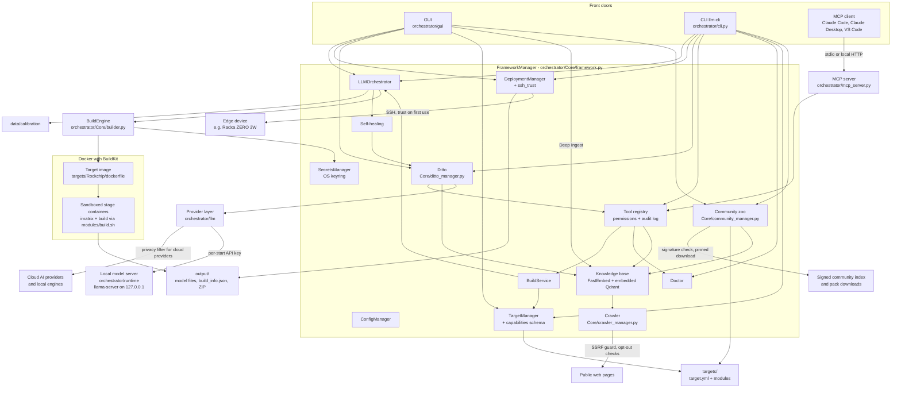
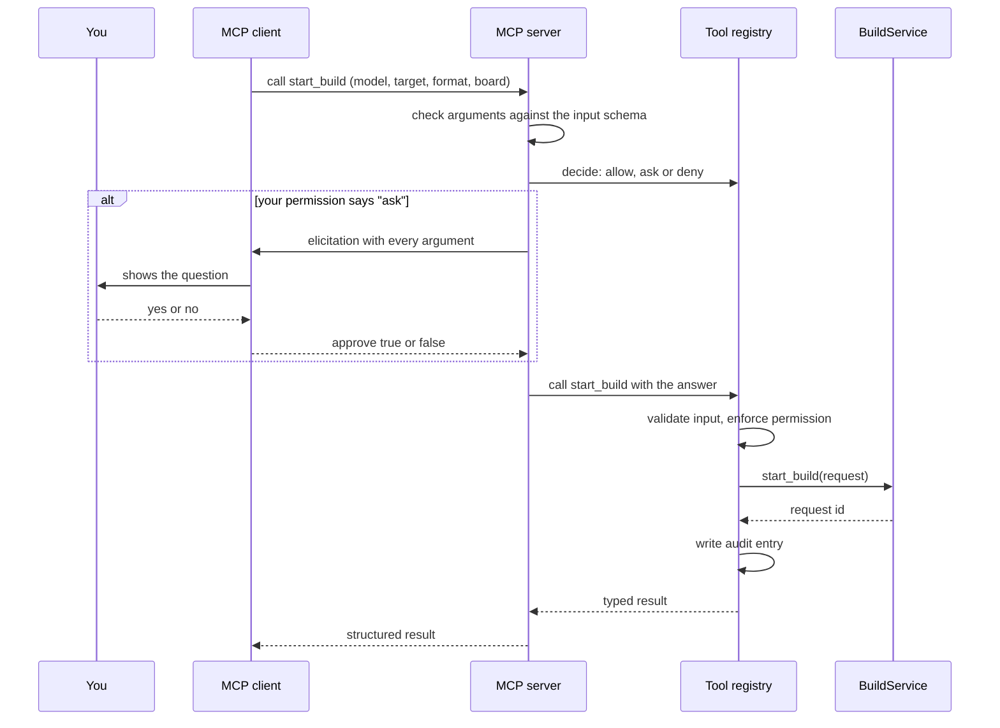

Version 3.0.0 + unreleased changes · Last updated 2026-10-11

**English** · [Deutsch](BLUEPRINT_DE.md)

# Blueprint

This is the design document of the LLM Cross-Compiler Framework. It explains what the framework is for, how its
parts fit together, how data moves through it, how it protects you, and why it is built the way it is. It ends
with the [roadmap](#roadmap), which says what comes next. What each released version contains is recorded in the
[changelog](../CHANGELOG.md).

The document describes the development branch: the released version 3.0.0 plus the changes listed under
"Unreleased" in the changelog, which are planned for 3.1.0. Where a part is not released yet, the text says so.

## Contents

- [In short](#in-short)
- [Purpose and principles](#purpose-and-principles)
- [Architecture overview](#architecture-overview)
- [Data flows](#data-flows)
- [Security model](#security-model)
- [Key decisions](#key-decisions)
- [Versioning and documentation policy](#versioning-and-documentation-policy)
- [Roadmap](#roadmap)
- [History](#history)
- [Glossary](#glossary)

## In short

A language model as published on Hugging Face is usually too big and in the wrong format for a small computer
such as a Radxa ZERO 3W. The framework fixes that in three steps:

1. **Fetch** the model (a Hugging Face repo id such as `Qwen/Qwen3-0.6B`, or a folder on your disk).
2. **Convert and shrink** it ("quantize") inside a Docker container that has the right tools for your hardware.
3. **Install** the result on your device over SSH.

You can drive it in three ways: the desktop GUI, the command line `llm-cli`, or an AI client such as Claude Code
or Claude Desktop through the Model Context Protocol (MCP). All three use the same core.

The built-in assistant **Ditto** helps you choose models and settings, explains failed builds and can use the
framework's tools for you, always within the permissions you set. Ditto works with a cloud AI provider of your
choice or fully offline with a local model that the framework downloads and runs for you (unreleased).

There is one official hardware target, **Rockchip** (boards RK3566, RK3568, RK3576, RK3588), with three output
formats:

| Format | Runs on | Boards | Typical use |
|---|---|---|---|
| GGUF (llama.cpp) | CPU | all four | chat models on any board |
| RKLLM | NPU | RK3588, RK3576 | chat models on the neural processor |
| RKNN | NPU | all four | ONNX vision and audio models |

`llm-cli` is the console command defined in `pyproject.toml`. If it is not on your PATH, run
`python -m orchestrator.cli` from the installation folder instead; the options are the same.

## Purpose and principles

The framework exists so that people without a background in compilers or machine learning can run a language
model on their own small hardware, and so that experts get a reproducible, inspectable pipeline. Five principles
guide every design choice.

| Principle | What it means in practice |
|---|---|
| **Local-first** | Conversions run on your computer in Docker. Models are downloaded on the host, and the conversion containers have no network. The knowledge base computes its embeddings and reranking locally, and Ditto can run completely offline on a local model. Apart from downloads, nothing leaves your computer unless you choose a cloud AI provider for Ditto (then the privacy filter applies, see [Security model](#security-model)), turn on the anonymous error reports (`enable_telemetry`, off by default) or open a pull request with a community pack (the framework prepares the pack; the GitHub CLI or the browser sends it, with their own credentials). |
| **Laypeople-friendly** | The GUI offers only what the selected target supports, the CLI refuses anything else, and both fill in sensible defaults per board (for example Q4_0 on the RK3566). `llm-cli doctor` explains problems with fix hints. AI errors are explained in plain words (for example that a Claude API key valid in every workspace needs the workspace ID). Self-healing proposals wait for your decision. |
| **Safe by default** | The conversion sandbox is on (`build_sandbox: true`). AI clients and Ditto may read freely but must ask before changing anything. New SSH devices are trusted only after you confirm their fingerprint. Passwords are never stored. Text suggested by an AI is never executed. The crawler honours every machine-readable opt-out of a site, and no switch turns that off. Community packs are installed only after checks in a quarantine folder and your confirmation. |
| **Data over code** | What a target can build is declared in its `target.yml` (`capabilities:` block, checked by a schema). AI providers are presets in `configs/llm_providers.yml`, the local model server and its models are pinned in `configs/llama_runtime.yml`, Ditto's evaluation cases live in `evals/ditto/cases.yml`, the retrieval evaluation's corpus and cases in `evals/retrieval/`, and the trusted community keys in `configs/community_keys.yml`. A new board, model or OpenAI-compatible server is an edit of data, as long as the code behind it supports it. |
| **Verifiable builds** | Every build writes a manifest (`build_info.json`) with the SHA256 hash of each model file, a `Model_Card.md` and a ZIP archive. The deployment package checks the hashes on the device before installing. Python dependencies are pinned by hash, downloads of the local model server and its models by size and SHA256, and the tool audit log can be verified. |

## Architecture overview

In plain words: there are three front doors (GUI, CLI, MCP). Behind them sits one core, the `FrameworkManager`,
which starts all other parts and hands them to each other. A build request ends up in the `BuildEngine`, which
builds a Docker image for the target and runs the conversion in sandboxed containers. The finished model lands in
`output/`, and the `DeploymentManager` copies it to the device. Ditto talks to AI providers only through the
provider layer, and uses the same tool registry as the MCP server. Deep Ingest, which only the GUI can start,
sends the crawler to public web pages for the knowledge base; the community zoo installs community packs into
`targets/`, the recipe folder and the knowledge base.

### Components

| Component | Where | Role |
|---|---|---|
| GUI | `orchestrator/gui/` (start: `llm-gui`) | Main window, build tab, deployment window, Ditto chat (its header shows the access in use), module wizard with Deep Ingest, Hugging Face browser, Community Hub, dialogs for AI settings, the sign-in panel (`sign_in.py`: method cards, key form, storage chooser, passphrase dialog; vault and network calls in worker threads), tool permissions, tool confirmations, healing proposals, SSH trust, the Deep Ingest notice and the export for the community. |
| CLI | `orchestrator/cli.py` (`llm-cli`) | Top-level commands `build`, `config`, `deploy`, `ditto`, `doctor`, `mcp`, `module`, `scan`, `secrets`, `targets`, `tools`, `zoo` (`doctor` and `scan` are single commands, the others are groups). The sign-in commands `ditto login`, `logout` and `auth` use the same sign-in operations as the GUI (`orchestrator/llm/auth/signin.py`). |
| FrameworkManager | `orchestrator/Core/framework.py` | Starts all managers in four phases (security and infrastructure, core logic, AI and knowledge, guardians and operations), connects them, keeps one long-lived asyncio loop for builds and resolves relative data paths against the installation folder, not the working directory. |
| ConfigManager | `orchestrator/Core/config_manager.py` | Settings with a schema (type, default, validation rule). The config folder is `LLM_FRAMEWORK_CONFIG_DIR` if set, otherwise the installation's `configs/` if it is writable, otherwise the per-user folder; never the working directory. User settings are saved to `config.yml` there. Environment variables with the prefix `LLM_FRAMEWORK_`, `FRAMEWORK_` or `LLM_` override known settings. Personal state lives in `~/.llm-framework` (override with `LLM_FRAMEWORK_HOME`), mode 0700 on Linux and macOS. |
| SecretsManager | `orchestrator/Core/secrets_manager.py`, `orchestrator/Core/vault_key.py`, `orchestrator/utils/file_lock.py` | Encrypted vault (`secrets.store` in the per-user folder, format v2: Fernet entries with key ids, read with MultiFernet, key rotation). Its key comes from the operating system's keyring by default (one entry per vault; a keyring that hangs, keeps nothing or stores in plain text is refused) or from the explicit choice in `secret_storage` (credential helper, passphrase, unencrypted key file, memory only). Every change runs under a cross-process lock; the vault refuses a location inside a git working copy. Holds API keys (as records under `cred/<provider>/api_key`; the old names still work) and the Hugging Face token (`hf_token`). The secrets of a store in the old location (config folder) are taken over once and re-encrypted with the vault key, also into an existing per-user store; secrets already there win, and the old file is left unchanged. A long-running process (GUI, MCP server) re-reads the vault when another process has changed it. |
| Secret patterns and log redaction | `orchestrator/security/` | One standard-library table of secret formats (`secret_patterns.py`), loaded by `scripts/secret_scan.py` and used by `redact_secrets`. `redaction.py` redacts every log record when it is created (framework, SDK and HTTP loggers, tracebacks), keeps the SDK loggers at INFO or above unless `--debug-http` is given, and provides `SecretStr`, in which the provider layer holds its keys. |
| TargetManager and capabilities | `orchestrator/Core/target_manager.py`, `orchestrator/schemas/targets.py` | Loads the `target.yml` of every target folder (folders starting with `_` or `.`, such as `_template`, are skipped) and validates its `capabilities:` block: boards, formats, quantization types (also per board), aliases, board defaults, default board, importance matrix and calibration needs, support level (`official`, `community`, `experimental`). |
| BuildService | `orchestrator/Core/build_service.py`, `orchestrator/schemas/build.py` | One typed entry point for builds: validate, start, status, cancel, log tail, artifacts, healing decision. The tools (MCP server and Ditto) use it. GUI and CLI check the same capabilities and then submit to the orchestrator directly; they cancel through it (the Builder tab's Cancel button, Ctrl+C in `llm-cli build start`). |
| LLMOrchestrator | `orchestrator/Core/orchestrator.py` | Queue and pipeline: prepares calibration text, expands a request into jobs (model x target x format x quantization), runs them on the build engine, handles cancellation and the self-healing approval loop. |
| BuildEngine | `orchestrator/Core/builder.py`, `orchestrator/utils/build_context.py` | Stages the Docker build context, builds the image (BuildKit when available), downloads or mounts the model, runs the optional Trivy scan, the importance-matrix stage and the build stage in sandboxed containers, writes the manifest, model card and ZIP into a hidden staging folder, moves them into the output folder once the build can no longer be cancelled, and cleans up. |
| DockerManager | `orchestrator/Core/docker_manager.py` | Docker connection and live CPU/RAM figures for the GUI. |
| Rockchip reference target | `targets/Rockchip/` | `dockerfile` (Debian bookworm-slim; llama.cpp v0.6.0 tools; three Python venvs), `modules/build.sh` (dispatcher for `gguf`, `rkllm`, `rknn` and the `imatrix` job), `modules/rkllm_module.sh`, `modules/rknn_module.sh`, `scripts/export_rkllm.py`, `scripts/rknn_converter.py`, `target.yml`. `targets/_template/` is the starting point for new targets ([Module Developer Guide](Module_Developer_Guide.md)). |
| DeploymentManager and SSH trust | `orchestrator/Core/deployment_manager.py`, `orchestrator/utils/ssh_trust.py` | Builds the deployment package, checks the device's host key, pairs the framework's SSH key, uploads and runs the installer. |
| Tool registry, permissions, audit | `orchestrator/tools/` (`registry.py`, `policy.py`, `audit.py`, `confirmation.py`, `framework_tools.py`) | Eleven typed tools with risk tiers, the user's stored permissions, the confirmation text (shared by MCP and Ditto) and a hash-chained audit log. |
| MCP server | `orchestrator/mcp_server.py` | Exposes the tool registry over MCP (official SDK `mcp` 2.3.0) via stdio or local Streamable HTTP. The launch command it writes for clients uses `python -P`, so nothing is imported from the folder a client starts it in. |
| Provider layer (unreleased) | `orchestrator/llm/` | One client (`LLMClient`) for every AI provider, built on the official `anthropic` and `openai` SDKs; OpenAI-compatible servers go through `openai`. Picks provider, model and effort per task from the settings and the presets in `configs/llm_providers.yml` (a file of the same name in the config folder adds or replaces presets). Retries (two, the SDKs' own retries are off), a fallback chain for refusals and outages (`ai_fallback_chain`), structured answers validated against schemas with one repair attempt, typed errors, the privacy filter for cloud providers, and a tool loop. The sign-in core (`orchestrator/llm/auth/`) resolves the credential of each call from the sign-in methods in the catalog: keys from the vault (keys of custom servers bound to their address) or from the environment variables the catalog lists, a free credential check, errors with a known cause and the next step, and token renewal under a lock shared by all processes. |
| Ditto (rebuilt, unreleased) | `orchestrator/Core/ditto_manager.py` | The assistant: chat with the framework tools (at most 8 model turns per question, tool calls as actor `ditto` through the registry), analysis of failed builds, module proposals from a hardware probe and build recommendations. The last three are validated structured answers; an invalid answer is an error and is never applied. A healing analysis or build recommendation with a dangerous command is discarded; a module proposal is checked again by the module generator. The chat history is append-only (`chat_history.json`); a long conversation is summarized into a new one. |
| Managed local model (unreleased) | `orchestrator/runtime/`, `configs/llama_runtime.yml` | Downloads a pinned llama.cpp build (b11429, the same commit as v0.6.0) for the hardware (CPU, Vulkan, CUDA, Metal; ROCm only when chosen) and pinned GGUF models in tiers (Qwen3.5 9B, 4B and 2B, 2-bit variants for weak hardware, and an IBM Granite 4.2 3B model on request), each checked by size and SHA256. Runs `llama-server` on 127.0.0.1 with a free port and a per-start API key. The `local` provider finds the running server by itself. |
| Ditto evaluation (unreleased) | `orchestrator/evals/ditto_eval.py`, `evals/ditto/cases.yml`, `evals/retrieval/` | `llm-cli ditto eval`: 19 fixed cases (build-log analysis, build recommendations, module proposals, chat with tools, prompt injection) graded by rules, against the configured provider or per local model tier. Nothing is built: chat cases use the real tool definitions over a stand-in build service. With `--kind retrieval`, 42 searches grade the knowledge-base search on a fixed corpus, without an AI model (see [A knowledge-base search](#a-knowledge-base-search-unreleased)). |
| Self-healing | `orchestrator/Core/self_healing_manager.py` | Recognizes known failures with fixed patterns first and asks Ditto only for unknown ones. Applies only framework-defined fixes, and only after your approval. |
| Knowledge base and crawler | `orchestrator/Core/rag_manager.py`, `orchestrator/rag/`, `orchestrator/Core/crawler_manager.py` | Optional (`enable_rag_knowledge`). Web pages, PDFs, community knowledge packs and the framework's own code are split into chunks and stored with a local dense embedding (FastEmbed on ONNX Runtime, CPU; model chosen by hardware unless `rag_embedding_model` is set) and a BM25 vector. Searches combine both rankings with Reciprocal Rank Fusion; a local cross-encoder can rerank the results and drop those below a relevance floor (unreleased, see [A knowledge-base search](#a-knowledge-base-search-unreleased)). Qdrant runs embedded in the process with its storage in the per-user folder (unreleased); a Qdrant server is used only when `qdrant_url` is set. The crawler of Deep Ingest honours the sites' machine-readable opt-outs (see [Deep Ingest](#deep-ingest-from-a-web-page-to-the-knowledge-base-unreleased)). |
| Deep Ingest notice and spoken announcements (unreleased) | `orchestrator/utils/crawl_notice.py`, `orchestrator/utils/announce.py` | The one-time notice before the first Deep Ingest, remembered per user, and short announcements through the speech engine of the operating system. |
| Community zoo (unreleased) | `orchestrator/Core/community_manager.py`, `orchestrator/Core/community_pack.py`, `orchestrator/schemas/recipes.py`, `orchestrator/gui/community_hub.py`, `configs/community_keys.yml` | Signed and encrypted community packs (targets, recipes, knowledge), the signed community index, installation through a quarantine with trust levels, export with privacy scrub and the hand-over to a pull request (see [Community packs](#community-packs-format-trust-and-exchange-unreleased)). |
| Input history (unreleased) | `orchestrator/utils/input_history.py` | Recent values of the GUI input fields, per user and without secrets (see [Recent inputs](#recent-inputs-unreleased)). |
| Doctor | `orchestrator/Core/doctor.py` | Deterministic health checks (Python, Docker and BuildKit, disk space, targets, state folder permissions, secrets and keyring, tool permissions and audit log, calibration data, installed community packs) with stable codes, fix hints and tiered automatic fixes. |
| Calibration data | `data/calibration/`, `orchestrator/utils/calibration.py` | Curated German, English and tool-use text (MIT licence) with SHA256 checks, used for importance matrices. |
| Untrusted text handling | `orchestrator/utils/untrusted.py` | Cleans and wraps external text before it reaches a language model. |

The Rockchip folder also still contains `source_module.sh`, `config_module.sh`, `convert_module.sh` and
`target_module.sh` from the four-module chain of version 1.x. The current dispatcher `build.sh` does not call
them; their removal is planned for 3.4.0.

`configs/project_sources.yml` is a catalogue of upstream projects and documentation links. The framework does not
read it at runtime; see [SSOT_ARCHITECTURE.md](../configs/SSOT_ARCHITECTURE.md) for what each file in `configs/`
is for.

### Where things are stored

| Place | Content |
|---|---|
| `targets/` | Target definitions (one folder per target). |
| `cache/models/hf/` | Models downloaded from Hugging Face for builds. |
| `cache/builds/<build id>/` | Work folder of a running build (build context, output, importance matrix, scratch space); removed after the build. |
| `cache/calibration/` | Calibration text written for importance matrices. |
| `output/` | Finished builds, one folder per build with model files, `build_info.json`, `Model_Card.md`, plus a ZIP next to it. |
| `models/ditto/` | Ditto's local GGUF models with a `.verified.json` marker each (unreleased). |
| `models/embeddings/` | Embedding and reranking models of the knowledge base (unreleased). |
| `community/` | Installed community recipes (`recipes/`) and knowledge packs (`knowledge/`), each with a `.lcf-provenance.json`, and the packs you export (`contributions/`). Community targets are installed into `targets/`. A `.quarantine/` folder inside an install folder holds a pack only while it is checked (unreleased). |
| `~/.llm-framework/` (or `LLM_FRAMEWORK_HOME`) | `secrets.store` (also your community keys), `tool_policy.json`, `audit.db` with `audit.db.anchor`, `known_hosts`, the framework SSH key `id_ed25519_llm_framework` (+ `.pub`), `mcp_http_token`, `chat_history.json`, `llm_privacy_key` and `llm_install_id`; `crawl_notice.json` and `input_history.json` (unreleased); the cached community index `community/index.json` with `index.json.sig` and the authors' public keys remembered at the first install, `community/authors.json` (unreleased); the embedded knowledge base `qdrant/` and `knowledge_snapshots/`; the local model server under `runtime/llama.cpp/` (builds, `active.json`, `server.json`, the key file while the server runs) and its log in `logs/llama-server.log`. |
| Config folder (usually `configs/`) | `config.yml` (user settings); optionally an own `llm_providers.yml` that adds or replaces provider presets. |

`cache/`, `output/` and `models/` are relative to the installation folder unless the settings `cache_dir`,
`output_dir` and `models_dir` say otherwise. If the user may not write to the installation folder (for example
`C:\Program Files`), their defaults are in the per-user folder instead (`ConfigManager.default_data_root`). None of
them is created at startup; a build, a download or the knowledge base creates what it uses.

## Data flows

### A build, from request to device

In plain words: you pick a model, a board and a quantization. The framework checks that the target can do it,
prepares everything on your computer, builds a toolbox image, converts the model in a locked-down container,
records hashes and lets you install the result on your device.

1. **Request.** The GUI build tab, `llm-cli build start -m <model> -t Rockchip -f gguf -b rk3566`, or the tool
   `start_build` (MCP client or Ditto) creates a request. An unknown target is refused with the list of known
   targets. The request is checked against the target's capabilities: unknown formats, boards or quantization
   types are refused with a sentence that lists the allowed values;
   spellings are normalized (case, aliases such as `INT8` for `Q8_0`); a missing board becomes the target's
   default board, a missing quantization the board default; low-bit types such as IQ2_XS require an importance
   matrix.
2. **Queue and calibration.** The `LLMOrchestrator` queues the request. If an importance matrix is wanted (GGUF
   only) and you gave no dataset, it writes the shipped calibration text (`calibration_language`: `mixed`, `de`
   or `en`) to `cache/calibration/`.
3. **Jobs.** The request is expanded into one job per model, target, format and quantization. Each job goes to
   the `BuildEngine`.
4. **Build context and image.** The engine copies the target's `modules/`, `scripts/` and the shared
   `entrypoint.sh` into a fresh build context and builds the image `llm-framework/<target>:<build id>` with
   `docker buildx build` (BuildKit), or with the Docker API if BuildKit is missing. This step needs network: it
   downloads llama.cpp (tag from `llama_cpp_version`, default `v0.6.0`) and the Python toolchains. The number of
   parallel compile jobs comes from `build_jobs` (0 means all cores).
5. **Staging on the host.** The model is made available before any conversion code runs: a local folder or file
   is mounted read-only; a Hugging Face repo is downloaded on the host into `cache/models/hf/`, using your stored
   `hf_token` if needed. The token never enters a container.
6. **Security scan.** If `enable_security_scan` is on (default), Trivy (`image_trivy`, default
   `aquasec/trivy:0.75.0`) scans the image for HIGH and CRITICAL vulnerabilities. Findings produce a warning; the
   build continues. A scan that does not finish within `build_timeout` is stopped with a warning.
7. **Importance-matrix stage** (GGUF with IMatrix only). A sandboxed container runs `modules/build.sh` with
   `JOB_TYPE=imatrix`: it converts the model to F16 GGUF and runs `llama-imatrix` on the first 100 chunks of the
   calibration text. If this stage fails, the build stops.
8. **Build stage.** A second sandboxed container runs `modules/build.sh` with `JOB_TYPE=build`. The dispatcher
   picks the toolchain: `llama-quantize` for GGUF (with the importance matrix if present), `rkllm_module.sh` for
   RKLLM (RK3588 and RK3576 only), `rknn_module.sh` for RKNN.
9. **Manifest and golden artifact.** The engine copies the results into a hidden staging folder next to the
   output folder (links in the build output are not followed), completes `build_info.json` with every model
   file's size and SHA256 hash and the primary file, writes `Model_Card.md` and creates a ZIP of these files. Only
   when the build can no longer be cancelled are they moved into `output/` and the ZIP next to the build folder; a
   cancelled or failed build leaves no files there. The per-build image tag and the work folder are removed; image
   layers stay in the build cache, so the next build is faster.
10. **Deployment.** In the deployment window (or with `llm-cli deploy package` and `llm-cli deploy run`) you pick
    a build. The framework packs the model file, `build_info.json`, `Model_Card.md`, a generated `deploy.sh` and
    `checksums.sha256` into a ZIP.
11. **Trust on first use.** Before the first connection the device's host key fingerprint is shown (the same
    format as `ssh-keygen -lf`). Only after you confirm it, or pass a matching `--trust-fingerprint`, is it
    stored in the framework's own `known_hosts`. A changed key always stops the deployment.
12. **Pairing and install.** On the first connection your password is used once to install the framework's
    Ed25519 key on the device; it is never stored. The package is uploaded into a private temporary folder
    (`mktemp -d /tmp/llm_deploy.XXXXXXXX`), unpacked, and `deploy.sh` checks all hashes with `sha256sum -c`
    before it copies the model to `$MODEL_DIR` (default `$HOME/models`) and prints how to start it (for GGUF with
    `llama-server`).

The tool `cancel_build`, the Builder tab's Cancel button and Ctrl+C in `llm-cli build start` stop the running
stage container through the build service. Each stage container has its own time limit (`build_timeout`, default
3600 seconds). Every build engine writes one record per build into `<cache_dir>/build_records/`
(`orchestrator/Core/build_records.py`), which `llm-cli build status` reads, so it sees builds of other programs too.
The CLI, the build service, the orchestrator and the engine resolve a target through the target registry's one
id -> folder map, so a target id may differ from its folder name.

### A tool call from an MCP client

In plain words: the AI client may look at things on its own, but before it changes something the framework asks
you, through the client, and writes down what happened.

1. **Names, arguments, schema.** The tool name and the raw arguments first go through the fool-proof layer
   (`orchestrator/tools/normalize.py`), the same one Ditto's calls use: spelling variants of a tool name, declared
   argument aliases, values coerced and matched against closed lists without ever guessing a near miss, and every
   repair recorded. Every tool has a pydantic input and output model; clients get the input model's closed JSON
   schema. Unknown names and invalid arguments are refused before anything runs, with a reason code and the next
   step, and the refusal is audited (`unknown_tool`, `invalid_input`); the same failing call a third time is
   refused without running (`repeat_refused`).
2. **Policy.** The registry looks up your stored permission for this tool (per-tool override first, then its
   tier). Defaults: `read` allowed, `local_write` ask, `external` ask. Tools in the `forbidden` tier cannot even
   be registered. If the permission file is damaged, every tool is denied until you set the permissions up
   again.
3. **Elicitation.** "Ask" becomes an MCP elicitation: the client shows you the tool and every argument in full
   (arguments too long to show cannot be confirmed). Only a real answer counts as approval, and a "no" is final
   for that call, even if the permission is loosened meanwhile. A confirmation that fails is refused and audited.
   A client without elicitation support cannot confirm, so the call is denied with a hint to allow the tool with
   `llm-cli tools permissions` or in the GUI (Tools > Tool Permissions (Ditto / MCP)...).
4. **Execution.** A call that changes something is first recorded (`started`) and refused if that entry cannot
   be written. The handler runs in a worker thread; a client's cancel reaches it at once. Its result is checked
   against the output model and filtered: secrets redacted in every string, fields with external text (logs,
   healing proposals, manifests, knowledge excerpts, job errors) cleaned of invisible characters and capped, a
   result over 256 KiB refused. `notes` are added by the framework only. The client gets the structured result and
   a text block that starts with one sentence of framework facts, followed by the JSON wrapped as untrusted data.
   Errors come back as tool errors with a message meant for people, with secrets redacted; the part of an error
   that quotes external text (a server reply, a log line, a name from a pack) is cleaned first and wrapped as
   untrusted data, the framework's own words and the next step stay plain.
5. **Audit.** Every outcome (`ok`, `denied`, `not_confirmed` with the answer, `error`, `invalid_input`,
   `confirmation_timeout`, `cancelled`) is appended to `audit.db` with redacted, shortened arguments and a hash of
   the full text, the duration, a hash of the result and a link to the call's `started` entry. `llm-cli tools
   audit --verify` checks the chain and its anchor; `llm-cli tools audit --archive` puts the log aside and starts a
   new chain.
6. **Owner, waits and the end of a session.** The server lifespan gives each connection a session (one per stdio
   session, one for the HTTP server); the caller is actor `mcp` with that session, and it owns the builds and jobs
   it starts. `cancel_build` and `cancel_job` on its own work are allowed without a question (a per-tool setting
   still wins, a tier you denied stays denied, a damaged permission file still denies); on another client's work
   the caller's permissions apply. A call with `wait_seconds` first waits on the event loop (no worker thread, at
   most 50 s and 4 waits per client, progress every 5 s when the client gave a progress token), then runs through
   the registry once; cancelling the wait leaves the build or job alone. When the session ends, its unfinished
   builds and jobs are cancelled and audited as `cancelled` ("client disconnected"), the server waits up to 30 s
   for build containers to stop, and `llm-cli mcp serve` then shuts the framework down. Over stdio a SIGTERM from
   the client ends the session the same way (it interrupts the server like Ctrl+C instead of ending the process at
   once).

The fourteen tools: `list_targets`, `get_target_capabilities`, `list_build_requests`, `get_build_status`,
`read_build_log`, `list_artifacts`, `run_doctor`, `search_knowledge`, `get_status`, `get_job_status` (tier `read`)
and `start_build`, `cancel_build`, `resolve_healing`, `cancel_job` (tier `local_write`). Tools your permissions deny
are not listed to the client. No tool of the `external` tier is registered, so neither AI clients nor Ditto can
deploy to devices.

### A question to Ditto (unreleased)

In plain words: Ditto answers in the chat window or on the command line. When it needs facts about targets or
builds, it asks the framework's tools, with the same permissions as an AI client. Before a question goes to a
cloud provider, personal details are replaced by placeholders.

1. **Question.** In the GUI chat, or with `llm-cli ditto ask "<question>"` (`--no-tools` answers without tools;
   `--provider` and `--model` override the AI settings for this question).
2. **Provider and model.** The `LLMClient` takes provider, model and effort for the task from the AI settings
   and the preset in `configs/llm_providers.yml`. For the `local` provider it reads address, key and model of the
   running managed `llama-server`. In offline mode only local providers are used.
3. **Privacy filter** (cloud providers only). Secrets are always redacted. Depending on `ai_security_level`,
   addresses, e-mail addresses, logins, user names, host names, serial numbers and paths are replaced by stable
   placeholders, which are mapped back locally in the answer.
4. **Tool loop.** The model may call tools, at most 8 model turns per question. Each call goes through the tool
   registry as actor `ditto`. A call that needs confirmation shows its title and every argument: a dialog in the
   GUI, a prompt in the CLI; without a terminal the answer is no. Tool results go back to the model as untrusted
   data blocks.
5. **Errors.** Provider errors are typed and explained (missing credit, rejected key, rate limit, refusal, cut-off
   answer). Refusals and outages move on along the fallback chain. An error is never shown or stored as an
   answer.
6. **History.** The finished turn is appended to `chat_history.json`. A long conversation is summarized and
   continued as a new conversation; earlier turns are never edited.

### Self-healing approval

In plain words: when a build fails, the framework looks for a known cause, tells you what it would do, and waits.
Nothing is changed without your yes.

1. A job fails. The orchestrator hands the error log to the self-healing manager.
2. **Known issues first.** Fixed patterns recognize, for example, an out-of-memory compiler during the image
   build, a killed conversion (exit code 137), a full disk, missing Docker permissions, DNS failures and outdated
   apt sources.
3. **Ditto second.** Only if no pattern matches, Ditto analyses the log (wrapped as untrusted text) and returns a
   structured analysis. Its answer is always treated as advice: the strategy is set to "manual step". A proposal
   that contains a dangerous command is discarded.
4. **Waiting for you.** The build status becomes `awaiting_approval`. You decide in the GUI dialog, at the prompt
   of a running `llm-cli build start`, or through the tool `resolve_healing`. Without a decision within
   `healing_approval_timeout` (default 900 seconds) the proposal is dismissed.
5. **Only fixed actions.** An approved proposal is applied only if it is one of three framework-defined
   strategies: lower `build_jobs` to 1, remove dangling framework images and the Docker build cache, or simply
   retry. The job is then retried once. Command text from patterns or AI is shown read-only and never executed;
   approving a manual step through MCP is refused.

### The local model for offline mode (unreleased)

In plain words: the framework can download a small language model and a matching server program, check both, and
run them on your computer only. Ditto then needs no internet.

1. **Status.** `llm-cli ditto runtime status` shows the detected hardware, the recommended server build and model
   tier, and whether the server runs.
2. **Install the server.** `llm-cli ditto runtime install` downloads the pinned llama.cpp build for your hardware
   (`--backend auto|cpu|vulkan|cuda|rocm|metal`; ROCm only when chosen). Size and SHA256 are checked before
   anything is unpacked; the build is installed atomically.
3. **Download a model.** `llm-cli ditto models list` shows the tiers; `llm-cli ditto models download [TIER]`
   fetches one at its pinned Hugging Face revision and checks size and SHA256. The recommendation follows memory:
   the 9B model with at least 7.5 GiB of GPU memory, 2B at 2-bit for 3 GiB of RAM or less, 2B at 4-bit up to
   4.5 GiB, otherwise 4B, in each case only if the model fits next to the system. The other tiers (4B and 9B at
   2-bit, IBM Granite 4.2 3B) are never recommended; you download them by name.
4. **Start.** `llm-cli ditto runtime start` (`--model`, `--ctx`, `--sleep-idle`) starts `llama-server` on
   127.0.0.1 with a free port. A new random API key is written to a private file for every start; the framework
   checks that the server refuses requests without it. The context length follows free memory (at most 32768
   tokens); an idle model is unloaded after 10 minutes and reloaded on the next request.
5. **Use.** The `local` provider reads address, key and model from the running server on every call, so a server
   started from the CLI or the GUI is found without configuration. Requests to 127.0.0.1 never go through an
   HTTP(S) proxy. With effort `low`, thinking is turned off (Qwen3.5 otherwise thinks at full length, which takes
   minutes on a CPU).
6. **Stop.** `llm-cli ditto runtime stop` stops the server (and leftovers of a crash) and deletes the key file.

### Deep Ingest: from a web page to the knowledge base (unreleased)

In plain words: you give the framework the address of a documentation site. It reads the public pages of that
site into your local knowledge base, so Ditto can use them. Before it keeps a page, it checks whether the site's
owner has said "no text and data mining" in a machine-readable way, and skips the page if so. You do not have to
judge that yourself.

1. **Start.** Deep Ingest starts only from the GUI: the module wizard (Tools > Create Hardware Module...) has the
   button "Deep Ingest (Add Docs)", which needs the knowledge base (`enable_rag_knowledge`). The CLI has no crawl
   command, and MCP clients and Ditto have no tool that crawls or takes a URL. The test `TestCrawlsStayWithTheUser`
   in `tests/test_security.py` fails if code of the MCP server, Ditto, the tools or the provider layer reaches the
   crawler.
2. **Notice.** Before the first crawl a notice says what is read (only publicly reachable pages), which opt-outs are
   honoured, that the knowledge stays on this computer (only the excerpts Ditto uses go to the AI provider you
   chose) and that sharing it needs your explicit release. It is information, not a legal confirmation, so it has
   one button, "Understood". A short spoken hint starts once the notice is on screen. The per-user file
   `crawl_notice.json` (mode 0600, written atomically) records a SHA-256 hash of its English and German texts: the
   notice comes back when its text changes, and also when the file is missing or damaged.
3. **Options and snapshot.** The Deep Ingest dialog takes the start URLs and, for this crawl, the depth (0 to 5),
   PDF downloads and the delay between requests (0 to 10 seconds, fractions allowed). It opens with the settings
   `crawler_max_depth`, `crawler_download_pdfs` and `crawler_rate_limit` (a larger configured depth or delay raises
   the upper end, so the dialog never cuts a setting down); the values in the dialog decide. The page limit
   `crawler_max_pages` (default 50) and the languages `crawler_languages` (default `en` and `de`) come from the
   settings. There is no switch for robots.txt or any other opt-out. Before each start URL the knowledge base
   saves a snapshot of itself in `knowledge_snapshots/` (the last five are kept; an empty knowledge base gets
   none). Neither the GUI nor the CLI can restore a snapshot yet.
4. **Checks before the request.** For each URL, breadth-first, in this order: the SSRF check of the address (see
   [Security model](#security-model)), then, with PDF downloads off, the skip of a URL ending in `.pdf`, the
   origin's robots.txt and `/.well-known/tdmrep.json` (origin: scheme, host and port; each file fetched once). Both
   files are fetched through the same SSRF guard as the pages, and every redirect hop on the way is checked again.
5. **Request.** The wizard shows "Page N of M: <url>", and the crawler waits the delay between requests (a Stop
   cuts it short). The request does not follow redirects: a redirect target is queued and goes through steps 4
   and 5 itself, so it is checked against its own host's robots.txt and `tdmrep.json`. A link that redirects to
   another host is skipped like any external link; only the start URL may move the crawl to another host (for
   example from `example.com` to `www.example.com`). More than five redirects count as a failure, and a crawl
   makes at most five times `crawler_max_pages` page requests (the fetches of robots.txt and `tdmrep.json` are
   not counted).
6. **Checks after the response.** First the `X-Robots-Tag` header and the TDMRep `tdm-reservation` header; then,
   for HTML, `<meta name="robots">`, `<meta name="llm-conversion-framework-bot">` and
   `<meta name="tdm-reservation">`, and for a PDF, `tdm:reservation` in its metadata. `noindex`, `none`, `noai`
   and `noimageai` keep the page out; `nofollow` and `none` stop the crawler from following its links.
7. **Store.** An HTML page is converted to Markdown (headings, code blocks and tables kept) and filtered by
   language (`crawler_languages`), a PDF is read as text; each page is stored at once, replacing its earlier
   version. A Stop, or closing the wizard, ends the crawl after the current page; what is stored stays.
8. **Outcome.** Only after the last write has returned does the result say success (pages stored; none failed
   or was reserved by the site, and the crawl was not stopped), partial (some pages stored; others failed, were
   reserved by the site, or the crawl was stopped) or failure (nothing stored). It is shown, logged and spoken.
   Pages left out by an opt-out, the address check, switched-off PDF downloads, a redirect or the language filter,
   and fetched pages that are neither HTML nor PDF or have no text, are listed in the crawl log with their reason,
   and so are pages that could not be fetched.

Which signals count, and when they are read:

| Signal | When | Rule |
|---|---|---|
| robots.txt ([RFC 9309](https://www.rfc-editor.org/rfc/rfc9309)) | before the request, once per origin (scheme, host and port) | The groups whose user-agent equals this crawler's product token (`LLM-Conversion-Framework-Bot`, any case; a group for `bot` is not ours) count, otherwise all `*` groups together; `*` and `$` patterns work; the longest matching rule decides and `Allow` wins a tie. A 401, a 403, a server error or an unreachable file means "disallow everything" (for 401 and 403 this is stricter than RFC 9309, which allows crawling when the file is unavailable with a 4xx code); a missing file (404) means everything is allowed. A file that the SSRF guard blocks or that lies behind more than five redirects counts as unavailable, which RFC 9309 treats as allowed. |
| TDMRep file `/.well-known/tdmrep.json` | before the request, once per origin | The first rule whose location matches the path decides; `"tdm-reservation": 1` reserves the page. A missing or unreadable file means the site does not use the protocol. |
| `X-Robots-Tag` and `tdm-reservation` headers | after the response | `noindex`, `none`, `noai`, `noimageai` or `tdm-reservation: 1` reserve the page. Directives for other crawlers (`otherbot: noindex`) are ignored. |
| Robots meta tags (`robots` and `llm-conversion-framework-bot`), `tdm-reservation` meta tag | after the response, HTML | as for the headers |
| `tdm:reservation` in the PDF metadata | after the response, PDF | the value 1 reserves the PDF |

A reservation from any source wins. TDMRep lets a later source lift a reservation found in an earlier one; the
crawler deviates from that on purpose and stays on the cautious side: once any source reserves a page, nothing
lifts it. None of these checks can be switched off; the old *Respect robots.txt* option and the setting
`crawler_respect_robots` are gone.

A short hint with the notice and the outcome are also **spoken**, through the speech engine built into the operating
system and in the interface language: Windows PowerShell 5.1 with System.Speech (started from the system folder; the
text travels in environment variables, so it never becomes code), macOS `say` (with an installed voice of the
language when there is one), Linux `spd-say`, otherwise `espeak-ng` or `espeak`. There are no audio files and no new
dependency, and the system volume is never touched. Speech runs in a background thread, one announcement at a time,
at most 300 characters, with a time limit; it never blocks or fails the caller, and every announcement is also
written to the log. It stays silent when the setting `audio_announcements` (Tools > Spoken Announcements) is off,
with `LLM_FRAMEWORK_NO_AUDIO=1`, under CI, in an SSH session without a display, on Linux without a display,
and when no engine works. The shape of the call follows the USB watcher of rag4ll (MIT licence, see
[THIRD_PARTY_NOTICES.md](../THIRD_PARTY_NOTICES.md)), and so does its rule that a state is announced only once it is
true: the outcome is spoken after the last write has returned.

### A knowledge-base search (unreleased)

In plain words: when Ditto needs background knowledge, it searches your local knowledge base by meaning and by
keywords at the same time and merges both result lists. A small second model can then read the question together
with each hit and throw out the hits that do not answer it. Only as much text as fits into a third of Ditto's
context goes into the prompt.

**Storing.** Text is split into chunks along its structure (headings, paragraphs, lists, code blocks, tables),
sized with the embedding model's tokenizer; each chunk is embedded together with a line naming its source, title
and section. Code blocks and tables stay whole as long as the embedding model sees them whole. A larger one
(above the model's context minus 96 tokens for that line; the default model reads 512 tokens) is split at line
boundaries, and each piece repeats the table header or reopens the code block, so its later parts can be found
at all; a document is split this way when it is imported again. Every chunk gets a dense vector (FastEmbed:
`intfloat/multilingual-e5-small` on a CPU, `BAAI/bge-m3` with CUDA and at least 8 GB RAM, or the model in
`rag_embedding_model`) and a BM25 vector. For the BM25 vector only, identifiers are added split into their parts:
`-DGGML_CUDA=ON` adds `GGML_CUDA`, `GGML` and `CUDA`, `rknn_toolkit2` adds `rknn` and `toolkit2`,
`rknnToolkitLite` adds `rknn`, `Toolkit` and `Lite`. A leading `-D` is dropped only from definitions
(`-DNAME=VALUE`, `-DNAME_WITH_UNDERSCORE`, not `-DEBUG`), and parts of one or two digits are left out (`x86_64`
adds only `x86`). The dense input and the stored text stay as they are. The parts only add tokens of the same
hashed BM25 vocabulary, so chunks imported before the splitting stay valid in the same index without a migration;
importing a document again adds its parts.

**Searching.**

1. **Query.** The query gets a dense vector. It also gets a BM25 vector when it has at least three words or
   contains an identifier (a digit, an underscore, two capital letters in a row, or a dot or hyphen inside a
   word), so one-word searches such as `E2041` or `GGML_CUDA` use the keyword index as well.
2. **Hybrid search.** Qdrant ranks the candidates by both vectors and fuses the two rankings with Reciprocal Rank
   Fusion. The same text stored under several sources is returned once.
3. **Reranking (optional).** A cross-encoder reads the query together with each candidate (its heading and the
   first 1500 characters; up to 20 candidates, at least 12) and rates it between 0 and 1. Candidates below the
   relevance floor are dropped, so the list may be empty: no excerpt is better than an unrelated one. The floor is
   `rag_rerank_min_score` (0 turns it off) or, when it is not set (the default), the model's own floor, 0.2 for
   both registered models. The model comes from `rag_reranker`: `auto` takes
   `onnx-community/bge-reranker-v2-m3-ONNX` with CUDA and at least 16 GB RAM,
   `cross-encoder/mmarco-mMiniLMv2-L12-H384-v1` (a download of about 0.12 GB) from 6 GB RAM, and none below that;
   `off` turns reranking off; a model id picks one. The model is downloaded on first use, never in offline mode.
   Scores are cached by text. A reranker that cannot run is logged once, and searches keep the fused order until
   the next start or a change of `rag_reranker`.
4. **Excerpt budget.** Ditto takes the excerpts, best first, that fit together into a third of
   `chat_context_limit` (default 4096 tokens). One that does not fit is skipped, so a smaller one after it can
   still come along; a first excerpt that alone is too long is cut at a line, an open code block is closed and
   the cut is marked. The excerpts reach the model as untrusted data. The MCP tool `search_knowledge` returns its
   hits cleaned, each shortened to 4000 characters.

Where reranking is used:

| Search | Reranked | Why |
|---|---|---|
| Build recommendation with knowledge-base excerpts | yes, unless `rag_reranker` is `off` or no reranker suits the machine | Its query is prose about model, target and quantization; there the reranker improved the order and its floor kept unrelated excerpts out. |
| Ditto chat, MCP tool `search_knowledge` | only with `rag_rerank_default` (off by default) | In the retrieval evaluation the gain was too small for the cost of about 1 to 2.5 seconds per search on one free CPU core. |
| Build-log analysis of self-healing | no | The cross-encoder rates log lines against prose poorly: it lost relevant excerpts that the hybrid search found. |
| Module proposal | no | For its keyword search string the floor dropped every excerpt, the relevant ones too. |

`rag_rerank_default` covers the chat and `search_knowledge` only; the build-log analysis and the module proposal
keep the hybrid order with the setting on as well.

**Model memory.** The embedding, keyword and reranking models are unloaded after `rag_model_idle_minutes`
(default 10; 0 keeps them loaded) without use and loaded again on the next search. The time counts from the end
of the last search or import, never during one. The embedded storage itself is released after 30 seconds without
use, so the GUI and the MCP server can take turns.

**The retrieval evaluation decides the defaults.** `llm-cli ditto eval --kind retrieval` indexes a fixed corpus
(`evals/retrieval/corpus/`, 30 German and English documentation excerpts) into a temporary knowledge base with
the configured embedding model and runs 42 searches from `evals/retrieval/cases.yml`: German, English and
cross-lingual questions, identifiers, answers deep inside an oversized table or script, the last lines of failed
builds, Ditto's own search strings, and unrelated questions that must get no excerpt. No AI model is involved,
your own knowledge base is not touched, and no Qdrant server is used. `--rag-variant fused` grades the hybrid
search, `--rag-variant rerank` adds the reranker and its floor (an attempt where the reranker did not run counts
as failed). The report gives hit@1, hit@3, MRR over 10 results, the share of unrelated questions without an
excerpt, figures per tag and the search latency. A GitHub workflow (`retrieval-eval.yml`) runs both variants
nightly and on demand with cached models. A change to the search becomes a default only when this evaluation
shows that it helps: the floor, the identifier splitting and the block splitting were measured this way, and the
reranker stays off where it did not help. The figures are in the [changelog](../CHANGELOG.md).

### Community packs: format, trust and exchange (unreleased)

In plain words: you can share a target, a recipe (how a model was built) or knowledge as a pack. A public pack is
signed, so others can check that nobody changed it; a private pack is encrypted, so only the people you choose
can open it. Packs are listed in a signed community index. Installing always goes through a quarantine folder
where every file is checked, and you confirm before anything is put in place. Nothing is sent unless you open a
pull request, which goes through the GitHub CLI or the browser; the framework never asks for a token.

**The pack.** A zip file with `pack.json`, an optional author signature `pack.sig` and exactly the files the
manifest lists. The manifest names the schema version, the kind (`target`, `recipe` or `knowledge`), id, version,
author, licence (an SPDX id), the minimum framework version, the creation time in UTC and, for every file, its path,
sha256, size and mode (0644 or 0755). Paths are plain relative paths that every operating system can store; links
and special files are refused (binary files are refused by the export and by the target validators); a pack holds at
most 10,000 files and 512 MB. The zip entries carry a fixed date, so the same manifest and files always give the
same zip bytes. Reading a pack accepts exactly the listed files and checks every size and hash; on any problem
nothing of it stays.

**Recipes**, the zoo's model templates, carry no weights. A recipe names a Hugging Face model at a pinned commit,
the target with a fingerprint of its files, board, format, quantization, options (importance matrix, context length,
the calibration dataset's hash) and verified results (artifact name, size and sha256, framework version, toolchain
image pinned by digest, device tests). It is generated from a finished build's `build_info.json`, which records what
it needs (device tests are not recorded there); only builds of a Hugging Face model at a known commit qualify. A
recipe is checked against the target's capabilities and becomes a normal build request.

**Signatures.** Ed25519 over a purpose prefix followed by the signed bytes: the canonical JSON of a pack manifest
(sorted keys, no whitespace, UTF-8), the exact bytes of `index.json`, or the age file of an encrypted pack. There
is one prefix each for these three, so a signature made for one purpose never verifies for another. A key id is the
first 16 hex characters of the SHA-256 of the raw public key. An author signature is provenance, not trust: it is
checked when the pack carries the public key, the author's whole public key (not the short key id, which a key made
for the purpose could match) is remembered at the first install (`authors.json`), and a different key later is
shown as a warning.

**Encryption for private sharing** in the [age](https://age-encryption.org/v1) format, for your own machines or a
team:

- The pack is encrypted by rage, the Rust implementation of age, through its Python binding `pyrage` (pinned
  exactly): to the recipients' X25519 keys (`age1...`, at most 64) or to one passphrase (scrypt, at least 12
  characters, with the work factor rage picks for the sender's computer), never to both, as age requires. There is
  no cipher of our own.
- An encrypted pack (`.lcfpack`) is a zip with two members: `pack.zip.age`, a standard age file that the `age` and
  `rage` tools open too, and `pack.zip.age.sig`, the sender's Ed25519 signature over it (the `pack.sig` format with
  the public key). The signature covers the whole age file, so an added or removed recipient, or a recipient who
  re-encrypts the pack, breaks it.
- A reader checks, in this order and before anything is decrypted: the zip layout and sizes, the age header (at
  most 68 stanzas, 64 recipients and room for rage's grease stanza, because rage's header processing grows with the
  square of their number; a scrypt stanza must be alone, and its work factor at most 2^20: pyrage's own limit
  follows the machine's speed and lets through work factors whose memory need aborts the process), the signature,
  and the sender if trusted senders are given (`--from`). Without `--from`, the sender's key id is shown.
- Each user gets an Ed25519 key (signing) and an age identity (receiving) on first use. They are kept only in the
  encrypted secrets store, created under the store's lock for that entry (two processes never create two keys)
  and never replaced silently; `llm-cli zoo keys` prints the public keys as text to give to others. The shared
  secret pattern table knows age secret keys, so the secret scan and the runtime redaction catch them.

**The signed index.** `index.json` lists the packs (kind, id, version, author, licence, trust `verified` or
`community`, HTTPS address, size and sha256) and the revocations (by sha256, or by kind and id, optionally for one
version, each with a reason). Its version number grows with every signed index, and `index.json.sig` signs its
exact bytes. The keys that may sign it ship with the framework in `configs/community_keys.yml`, each with an
expiry date. The index comes from `community_index_url`, is verified, cached per user and fetched again when the
cache is older than a day. An index that does not verify is not used, and one with a lower version than the
cached one is refused. For revocations only, a cached index stays valid after the key that signed it has
expired, so a revocation never stops applying because the framework was not updated.

**Install** (`llm-cli zoo install`, or Install in the Community Hub):

1. Installing by id always fetches the current index first; without it nothing is installed, so a revocation is
   never missed. A revoked pack is refused.
2. The pack is downloaded, pinned by the size and sha256 from the index, into a `.quarantine/` folder inside the
   install folder.
3. It is read as described above and must match its index entry (kind, id and version).
4. Validators: a target must pass the same checks as a generated module (capabilities, every image a Dockerfile
   pulls pinned by digest unless it is an official base image, the shell deny-list, `bash -n`, no template
   placeholders, no binary files); a recipe must match its schema and the capabilities of its target if that is
   installed; knowledge must be a list of entries that each keep their source. A recipe or knowledge pack may hold
   only its `recipe.yml` or `knowledge.json` and a `README.md`.
5. A summary in plain text shows kind, id, version, author, licence, trust level, source, files and destination,
   and you confirm. `--yes` skips the question only when the signed index lists the pack (trust `verified` or
   `community`), also for a pack file.
6. An atomic rename puts the pack in place, never over an existing folder (also when only the case differs),
   together with `.lcf-provenance.json` (trust, source, hashes, signer, sender). A knowledge pack is then imported
   into the knowledge base, or when the knowledge base starts if it is off. Anything that fails on the way is
   removed.

A pack file (`llm-cli zoo install --file`, or Import file... in the Community Hub) goes through the same
quarantine; an encrypted one is decrypted first (`--from`, `--passphrase`). Its trust comes from the index when
the index lists its sha256; otherwise it is `local`.

**Trust levels.** `verified` (in the signed index: reviewed and reproduced independently), `community` (in the
signed index: reviewed), `local` (a file without an index entry: always confirmed, and every build of it shows a
warning) and `revoked` (in the signed revocation list: not installed; installed copies are flagged by
`llm-cli zoo list`, `llm-cli doctor` and the Community Hub and are not built). Shipped targets carry no provenance
file; they are not packs and have no trust level. `llm-cli zoo verify` finds installed packs that were changed or
revoked.

**Export and hand-over.** `llm-cli zoo export target|recipe|knowledge`, the check box "Export for community" on the
module wizard's last page and "Export a finished build for the community..." in the Builder log's context menu make
a pack: its files are privacy-scrubbed (home folders, IP and MAC addresses, e-mail addresses, JWTs, the host and
user name, keys; the changes are shown), validated and signed with your key. With `--to` (files with age
recipients) or `--passphrase` the signed pack is also encrypted for private sharing; an encrypted pack is never
submitted with `--pr`. The licence defaults to MIT, for knowledge to `NOASSERTION`, and every page keeps its source
address. A target you installed from someone else is not re-signed as yours, and pages imported from installed
community knowledge packs are left out of a knowledge export. "Open pull request" (`--pr`) hands the pack to the
community repository (`community_repo`): through the GitHub CLI when it is installed and logged in, otherwise the
repository's upload page opens in the browser. Both keep their own credentials; the framework never asks for, reads
or shows a token.

**Maintainer tools.** `scripts/zoo_sign_index.py` creates the index key in the OS keyring (`keygen`), checks a pack
and prints its index entry (`entry`) and signs `index.json` (`sign`; with `--previous` the version must be higher
than that of the old index). `scripts/community_repo/validate-contribution.yml` is the workflow template for the
community repository: it accepts only pack zips of at most 5 MB and runs `llm-cli zoo verify` on each, which also
rejects packs that still contain keys or personal data (the repository's secret scan skips binary files, so it
does not run on the zips). The signing key never reaches CI.

**State.** The community repository, its index and the maintainer's key are not published yet:
`configs/community_keys.yml` lists no key, and `community_index_url` and `community_repo` are empty. Listing the
index and installing by id therefore stop with a message (`llm-cli zoo list` still shows installed packs), and
`--pr` only says where the pack is. The framework release the workflow template checks packs with (`LCF_REF`) is a
placeholder that the maintainer sets. Packs can already be exchanged as files (trust `local`) and encrypted between
users.

### Recent inputs (unreleased)

In plain words: the input fields of the GUI remember what you used recently, so you need not type it again.
Nothing secret is remembered.

- **Fields.** Model, calibration dataset, Deep Ingest URL and device (Deployment window, remote hardware scan) are
  editable lists, newest first. The most recent model and device are filled in; datasets and URLs are only
  offered. Targets and boards come from the target definitions: the most recently built one that is still offered
  is preselected, and a target without declared boards offers recent boards as suggestions.
- **When.** A value is remembered once it was used: a submitted build (model, target, board, dataset), the URLs
  of a crawl, a device whose host key was confirmed (for a deployment also its hardware profile).
- **Where.** `input_history.json` in the per-user folder (mode 0600, written atomically), at most 20 values per
  field; a value longer than 1000 characters is not remembered. Every read loads the file, so several windows stay
  in step. A damaged file starts a new history and is kept as `input_history.json.bad`; errors are logged and never
  break the GUI.
- **Never secrets.** A value is refused when the secret redaction would change it (API keys, tokens), when it is a
  URL with a user name or password, when its query, fragment or path parameters have a credential-like name
  (token, key, secret, password, auth, signature, credential, session, jwt, sid and similar), when it has the form
  `user:password@host`, and when it contains control characters. A file edited by hand is held to the same rules.
- **Forget.** Tools > Clear Input History... deletes the file and the copy of a damaged one. The earlier setting
  `input_history` in the shared `config.yml` was removed: the history is personal.

## Security model

In plain words: the framework works with third-party conversion tools, AI-generated code, AI answers and text from
the internet. It treats all of them as potentially hostile and limits what each can reach. The table lists each
threat, the protection and where it is implemented.

| Threat | Protection | Where |
|---|---|---|
| Conversion code (vendor toolkits, AI-generated target scripts) harms the host or sends data out | Conversion stages run as the host user instead of root (1000:1000 if the host user is root or on Windows), with no network (`network_mode: none`), all capabilities dropped, `no-new-privileges`, a read-only image filesystem, a 1 GB `/tmp` tmpfs, a process limit (`build_pids_limit`, default 4096) and an optional memory limit (`build_memory_limit`). Only the per-build folders (work space, output, importance matrix) are writable; model, cache and dataset mounts are read-only. Hugging Face libraries are forced offline. `build_sandbox: false` switches back to the old root-plus-entrypoint mode. | `BuildEngine._sandbox` in `orchestrator/Core/builder.py` |
| The crawler is abused to reach internal services (SSRF), also through DNS rebinding or redirects | Only http(s); URLs with backslashes, whitespace, control characters or ambiguous hosts are refused; every resolved address must be public (no private, loopback, link-local, CGNAT, multicast or reserved ranges, also inside IPv4-mapped, NAT64, 6to4 and Teredo addresses). At connect time the address is resolved and checked again and the connection goes to exactly that IP. Redirects are never followed automatically: each target is checked like a new URL (at most 5 hops); robots.txt and `tdmrep.json` are fetched through the same guard; a request budget of five times `crawler_max_pages`; delay between requests (`crawler_rate_limit`). Behind a configured proxy only the URL check applies. | `validate_public_url`, `is_public_ip` in `orchestrator/utils/validation.py`; `PublicOnlyAdapter` in `orchestrator/Core/crawler_manager.py` |
| A hostile site fills the memory or holds the crawl with an endless, huge or dripping response | Every response body is read up to a limit for its type (HTML pages 8 MiB, PDFs 64 MiB, robots.txt 500 KiB, `tdmrep.json` 1 MiB; counted after decompression) and every request, headers and body together, has a deadline (60 s, PDFs 180 s), because the HTTP timeout only bounds each socket read. The request runs in a worker thread, so neither the deadline nor Stop waits for a socket read. A page over its limit is skipped and one over its deadline fails, each named in the crawl log; a robots.txt that does not arrive in time means "disallow everything". | `_guarded_get`, `BODY_LIMITS` in `orchestrator/Core/crawler_manager.py`; `TestCrawlerLimits` in `tests/test_security.py` |
| Pages whose owner reserved text and data mining end up in the knowledge base, or an AI is steered into crawling | The crawler checks robots.txt (RFC 9309), the `X-Robots-Tag` header, robots meta tags (also for its own bot name) and the TDM Reservation Protocol (site file, header, meta tag, PDF metadata) before and after each request. A reservation from any source wins, and no check can be switched off. Skipped pages are named in the crawl log. Crawls start only from the GUI; no tool takes a URL, and a test fails if the MCP server, Ditto, the tools or the provider layer reach the crawler. | `CrawlerManager` in `orchestrator/Core/crawler_manager.py`; `TestCrawlsStayWithTheUser` in `tests/test_security.py` |
| Instructions hidden in external text steer a language model (prompt injection) | Web pages, knowledge-base hits, build logs, hardware probes, tool results and conversation summaries never go into a system prompt. They are normalized, stripped of invisible characters and HTML comments, shortened and wrapped in a block with a random id; the system prompt tells the model to treat such blocks as data. MCP tool descriptions and server instructions mark logs and search results as untrusted; output schemas mark every field with external text, the tool registry cleans and caps those fields and redacts secrets in every result for every caller, and an MCP result's first line is built from framework facts only. Ditto's healing analyses, module proposals and build recommendations are validated structured answers; a healing fix or recommendation with a dangerous command (a download piped into a shell, deleting the root or home folder, world-writable permissions, overwriting a disk) is discarded. Chat output is HTML-escaped; links open only after confirmation. | `orchestrator/utils/untrusted.py`, `orchestrator/Core/ditto_manager.py`, `orchestrator/llm/tool_loop.py`, `orchestrator/gui/chat_window.py`, `orchestrator/mcp_server.py` |
| A generated or shared target module contains harmful code | Before any template is rendered, names, architecture, Debian package names, compiler/CMake flags and the detection command are checked against strict patterns; base images must be pinned by digest unless they are official base images (`debian:`, `ubuntu:`, `nvidia/cuda:`, `rocm/dev-ubuntu-*`, `rocm/rocm-terminal:`, `python:`). Shell code fields must pass a fixed deny-list (downloads, `sudo`, deleting `/`, `chmod 777`, raw device writes, Docker socket or `docker run`, evaluating generated code) and every generated script must pass `bash -n`. New targets stay inside `targets/`, never overwrite an existing target and are removed again if generation fails. The wizard and `llm-cli module generate-ai` show the proposal for review. Generated modules, community exports and community target packs in quarantine also pass `validate_target_folder`: valid capabilities, every image a Dockerfile pulls (`FROM`, `COPY --from`, `RUN --mount=...,from=`) pinned by digest unless it is an official base image, the deny-list on every script line that is not from the shipped template, `bash -n`, no template placeholders and no binary files. | `validate_module_data`, `validate_target_folder`, `ModuleGenerator` in `orchestrator/Core/module_generator.py` |
| An AI client or Ditto does something you did not want | Four risk tiers; the registry enforces your stored permissions on every call, whatever the client's tool annotations say. `forbidden` tools cannot be registered; `external` tools always ask at most, whatever is set; a tool's own default and cap come before and after your settings, tools you have not reviewed never inherit a loosened tier setting, Ditto and local MCP clients can have permissions of their own, and denied tools are not listed; a damaged permission file denies every tool. Confirmations show every argument in full (MCP elicitation, Ditto's dialog or prompt). Every call is recorded in an audit log whose entries are chained with an HMAC; a call that changes something runs only after its write-ahead entry is written (refused otherwise), and questions as well as every end (declined, timed out, unanswered, cancelled by the client) are recorded; the key is a separate entry in the OS keyring, not next to the database (without a keyring the chain is unkeyed, and the doctor says so). An anchor file (`audit.db.anchor`) also reveals removed newest entries. | `orchestrator/tools/` |
| Other local programs or websites talk to the MCP server | stdio is the default. Streamable HTTP binds only to loopback addresses, requires a per-user bearer token (compared in constant time, file `mcp_http_token`, mode 0600) and uses the SDK's Host/Origin checks against DNS rebinding. | `orchestrator/mcp_server.py` |
| Personal data reaches a cloud AI provider | The privacy filter runs on everything sent to a cloud provider: system prompt, messages, tool results and tool arguments. `OFF`: only secrets are redacted (always). `BALANCED`: also IP and MAC addresses, e-mail addresses, `user@host` logins and user names in home paths. `STRICT` (default): also host names from probe files, serial numbers, UUIDs and the folders of absolute paths. Placeholders come from an HMAC with a per-install key and are mapped back locally. Local providers (loopback, private network, `*.local`) are never filtered. Offline mode uses local providers only, and the knowledge base computes embeddings locally. | `orchestrator/llm/privacy.py`, `orchestrator/llm/client.py` |
| The local model server is misused | `llama-server` binds 127.0.0.1 only, on a free port, with a random per-start API key passed through a 0600 file (never on the command line); the framework checks that the key is enforced. Options that would give the server its own tools, agent mode, MCP clients, a web UI, remote compute or state endpoints are never passed; secret-looking variables are removed from its environment. Ditto's tools run inside the framework, where permissions apply. | `orchestrator/runtime/llama_server.py` |
| A tampered download of the local server or a model | Every entry in `configs/llama_runtime.yml` needs a pinned size and SHA256, otherwise it is refused; models are pinned to a Hugging Face commit, never a branch. Archives are checked before unpacking, extracted safely and installed atomically. | `orchestrator/runtime/` |
| Secrets leak | Secrets are stored encrypted in a vault whose key is in the OS keyring, or protected the way you choose explicitly (`secret_storage`); nothing falls back silently. The vault is changed under a cross-process lock, never lies inside a git working copy, and its key can be rotated. API keys are passed per call, never exported to the environment of child processes; every SDK client gets its key and base URL explicitly, and `OPENAI_CUSTOM_HEADERS`/`ANTHROPIC_CUSTOM_HEADERS` are removed at startup. Cloud presets have fixed endpoints, so a cloud key never reaches a leftover custom URL, and the key of a custom server is bound to the address it was saved for; Claude Admin API keys are refused. Key variables from the environment are read only as the provider catalog lists them and are shown as the key's source. The Hugging Face token stays on the host. The SSH password is used once and never stored. One table of secret formats is shared by the repository's secret scan and the runtime redaction, which covers every log record (also those of the SDKs and HTTP libraries, and tracebacks), build logs and errors handed to tools, the audit log, requests to cloud AI providers, telemetry reports and community exports. The SDKs' debug logs stay off unless `--debug-http` is given. In the repository, a secret scan refuses credentials in commits and pushes, and CI scans the whole history. | `orchestrator/Core/secrets_manager.py`, `orchestrator/Core/vault_key.py`, `orchestrator/security/`, `orchestrator/llm/sdk_env.py`, `orchestrator/llm/client.py`, `orchestrator/llm/auth/`, `scripts/secret_scan.py` |
| Someone impersonates your device during deployment | Trust on first use, but never silently: unknown host keys are shown with their SHA256 fingerprint and stored only after confirmation; a changed key or key type always fails. Authentication uses the framework's own Ed25519 key. The OpenSSH fallback runs with `BatchMode=yes` and `StrictHostKeyChecking=yes`. User names and IP addresses are validated; the upload goes into a private temporary folder; `deploy.sh` verifies all checksums. Without Docker only model files are deployed, never arbitrary programs. | `orchestrator/utils/ssh_trust.py`, `orchestrator/Core/deployment_manager.py` |
| A crafted archive writes outside its folder | Extraction refuses path traversal, links pointing outside and device files, and uses Python's `data` filter for tar files. | `safe_extract_archive` in `orchestrator/utils/helpers.py` |
| A community pack is changed on the way, replaced by an older index, or revoked after its release | Packs from the index are downloaded pinned by size and sha256 from an index signed with a key that ships with the framework (with an expiry date). An index that does not verify is not used, an older one is refused, installing by id always fetches the current index, and revoked packs are neither installed nor built. Every pack is checked in a quarantine folder (exact file list and hashes, no links or special files, the validators, which refuse binary files in a target) and moved into place atomically only after you confirm a plain-text summary with its trust level, so text from a pack cannot hide it. A file without an index entry is `local` and warns on every build. | `orchestrator/Core/community_manager.py` (with `build_trust_check`, which `orchestrator/Core/builder.py` calls), `orchestrator/Core/community_pack.py` |
| Someone reads or changes a privately shared pack | Encrypted in the age format by rage (`pyrage`) to X25519 recipients or one scrypt passphrase, with the sender's Ed25519 signature over the whole age file. Any change, also to the recipient list, is detected before anything is decrypted; a header with more than 68 stanzas or a scrypt work factor above 2^20 is refused before rage reads it; `--from` accepts only known senders. The private keys live only in the encrypted secrets store. | `encrypt_pack`, `decrypt_pack`, `UserKeys` in `orchestrator/Core/community_pack.py` |
| A shared pack or the input history gives away personal data or a credential | Exports are privacy-scrubbed (home folders, IP and MAC addresses, e-mail addresses, JWTs, host and user name, keys) and the changes are shown; `llm-cli zoo verify`, also in the community repository's CI, rejects a pack that the scrub would still change. The input history refuses values that look like secrets and URLs with credentials. The framework never asks for or stores a repository token: a pull request goes through the GitHub CLI or the browser, which keep their own credentials. | `scrub` in `orchestrator/Core/community_pack.py`, `submit_contribution` in `orchestrator/Core/community_manager.py`, `orchestrator/utils/input_history.py` |
| A compromised dependency (supply chain) | Host dependencies are pinned with hashes (`requirements*.txt`, Poetry 2 lock); `anthropic` (1.13.0), `openai` (3.28.0), `fastembed` (0.8.1) and `mcp` (2.3.0) are pinned exactly. GitHub Actions are pinned by commit SHA; CI runs pip-audit and bandit; Dependabot checks pip, Actions and Docker weekly. In the Rockchip image the RKLLM wheel is checked by SHA256 and the toolkit, torch and onnx versions are pinned. The calibration text is checked by SHA256. | `pyproject.toml`, `poetry.lock`, `.github/`, `targets/Rockchip/dockerfile`, `orchestrator/utils/calibration.py` |

### Known gaps

These are real limitations of the current state. Most are scheduled in the [roadmap](#roadmap).

- **Docker setup for the framework itself is broken.** `Docker Setup/docker-compose.yml` builds from
  `orchestrator/Dockerfile`, which has never existed, so the Makefile targets `build`, `up`, `gui`,
  `test-container` and `audit` fail; `build`, `up` and `gui` also call the missing `scripts/setup_linux.sh`.
  Install the framework on the host instead. A hardened headless image (CLI and MCP server) is being built for
  3.1.0.
- **Sign-in covers API keys, local engines and the `ant` profile so far** (the GUI's sign-in panel and
  `llm-cli ditto login`). There is no browser sign-in and no cloud credential chain yet. For Anthropic an
  `ant auth login` profile is used only when you choose it. The remaining sign-in methods are being built for
  3.1.0.
- **The privacy filter works with patterns.** It recognizes the formats listed above, not every personal detail
  in free text, such as a name in a sentence. Use a local provider for sensitive material.
- **Generated targets are skeletons.** The module generator writes a `capabilities:` block (support level
  community: the boards, and GGUF with the types the build script handles), and the template `build.sh` follows the
  Rockchip dispatcher, but the template Dockerfile does not build llama.cpp yet, so a generated target needs that
  part from `targets/Rockchip/dockerfile` before it can build. See the
  [Module Developer Guide](Module_Developer_Guide.md).
- **The community zoo has no published index yet.** The community repository, its signed index and the
  maintainer's key are not published: `configs/community_keys.yml` lists no key, and `community_index_url` and
  `community_repo` are empty. Listing the index and installing by id stop with a message; packs can be exchanged
  as files (trust `local`) and encrypted between users. Publishing is planned for 3.1.0.
- **Deep Ingest runs only in the GUI.** The CLI has no crawl command; MCP clients and Ditto cannot start a crawl,
  on purpose.
- **Reranking is on only for build recommendations.** The chat and the MCP search use it only with
  `rag_rerank_default`. The reranker's floor is calibrated for questions; for short keyword searches, such as the
  module proposal's, it drops relevant excerpts too.
- **Trivy and the Docker socket.** The scanner container gets the Docker socket; mounting it read-only does not
  limit what the Docker API allows. Planned for 3.4.0: Trivy pinned by digest, without the socket.
- **Pins inside images.** Base images are pinned by tag (`debian:bookworm-slim`), llama.cpp by tag (`v0.6.0`),
  and the venvs inside the image have no hashed lock files. Planned for 3.4.0.
- **Image builds have network access.** This is by design (they download toolchains); only the conversion stages
  are offline.
- **The project-sources catalogue** (`configs/project_sources.yml`) is not read at runtime; it is a reference for
  developers (see [SSOT_ARCHITECTURE.md](../configs/SSOT_ARCHITECTURE.md)).

## Key decisions

| Decision | Why |
|---|---|
| **One venv per toolchain** in the target image | The toolchains pin conflicting versions: the llama.cpp converter uses a current torch (2.11, CPU), RKLLM-Toolkit 1.3.1 needs torch 2.6 and its own transformers, RKNN-Toolkit2 2.3.2 needs torch 2.4, setuptools below 81 and onnx 1.16.2. Separate venvs (`/opt/venv`, `/opt/venv-rkllm`, `/opt/venv-rknn`) keep each at its tested versions; the module scripts call the right interpreter. |
| **Debian bookworm and Python 3.11 in the images** | Rockchip publishes its toolkit wheels only for CPython 3.10 to 3.12 (the image uses the cp311 RKLLM wheel); bookworm ships Python 3.11. The host side is independent and supports Python 3.11 to 3.14. |
| **BuildKit for image builds** | Better layer caching than the legacy builder behind docker-py's `api.build`, which Docker has deprecated, and the same builder CI uses. The engine falls back to the Docker API if `docker buildx` is missing. |
| **Capabilities as data** | One declaration in `target.yml` feeds the GUI, the CLI, the build service, Ditto and the MCP tools, so they cannot disagree. The pydantic schema rejects inconsistent declarations (for example a default that is not in the list); tests in `tests/test_foundation.py` and `tests/test_review_capabilities_paths.py` keep it in sync with `build.sh`, `rkllm_module.sh`, `rknn_module.sh` and `export_rkllm.py`. |
| **Stage models on the host, run the sandbox without network** | Downloads need network and sometimes a token. Doing them on the host lets every piece of conversion code run offline: vendor toolkits and AI-generated target scripts cannot reach the internet or your LAN, and the token never enters a container. |
| **MCP first, one tool registry** | Many users already have a capable AI client (Claude Code, Claude Desktop, VS Code). Exposing typed tools with permissions and an audit log made the framework usable from those clients, and the client's credentials stay in the client. Ditto's tool loop uses the same registry, permissions and confirmation text, so both paths follow the same rules. |
| **Official SDKs instead of LiteLLM** | LiteLLM brought a large dependency tree; removing it and tiktoken dropped 19 indirect packages (among others aiohttp, boto3 and jinja2). Every API key passes through this layer, and LLM tooling is a frequent supply-chain target, so fewer layers mean less risk. The official `anthropic` and `openai` SDKs cover all presets directly or through OpenAI-compatible APIs and are pinned exactly. |
| **No Claude subscription login inside the framework** | Anthropic does not allow third-party developers to offer claude.ai login or subscription rate limits in their products ([Agent SDK overview](https://code.claude.com/docs/en/agent-sdk/overview)), and its [Usage Policy](https://www.anthropic.com/legal/aup), in force from 2026-11-12, bans routing requests through consumer subscriptions. Claude subscribers therefore use the framework from Claude Code or Claude Desktop through the MCP server, or give Ditto an Anthropic API key; Max and Team plans include monthly API credits. |
| **Providers as data** | New models and OpenAI-compatible servers appear faster than releases. Presets in `configs/llm_providers.yml` (model and effort per task, endpoint, how reasoning is sent) and a live model list mean that such changes need no code change. |
| **Local model through a managed llama-server** | The 3.0.0 offline mode loaded a Transformers model inside the framework, which needed torch and transformers (not part of the default installation). A pinned llama.cpp server binary is small, runs on CPU, Vulkan, CUDA, ROCm and Metal, speaks the OpenAI-compatible API the provider layer already uses, and runs as a separate process with its own key; the framework itself stays free of GPU libraries. |
| **Local embeddings and an embedded vector store** | In 3.0.0 the knowledge base sent ingested text and search queries to OpenAI for embeddings and needed a Qdrant container. FastEmbed on ONNX Runtime and Qdrant embedded in the process keep all text on the computer and open no port; a Qdrant server remains optional. |
| **Structured answers, never free text, for actions** | A healing fix, a module proposal or a build recommendation that comes back as free text cannot be checked. Pydantic models with limits make an invalid answer an error that is never applied, and the module generator checks every value again. |
| **Evaluation by rules** | Whether a small or 2-bit model is good enough for Ditto has to be measurable on the user's machine. Fixed cases graded by deterministic rules are reproducible and need no second model as a judge; the cases file is data. |
| **Low effort means no thinking on local models** | Qwen3.5 on llama-server otherwise thinks at full length, which takes minutes on a CPU. "medium" and up keep thinking on. |
| **Curated calibration data shipped instead of generated** | An importance matrix is only as good as the text it is computed on. The old generator downloaded a URL that returned 404 and fell back to repeated sentences. 3.0.0 ships subsets of `eaddario/imatrix-calibration` (MIT, pinned revision), checks their SHA256 and interleaves them so that the first chunks `llama-imatrix` reads already cover German, English and tool use. |
| **Only fixed self-healing actions** | A build log can contain text written by anyone, and model output can be wrong. Letting either one run commands on the host would be a remote-code-execution path. AI output is therefore advice; the framework applies only three fixed strategies, and only with your approval. |
| **Trust on first use with confirmation, framework key instead of passwords** | Silently accepting host keys makes man-in-the-middle attacks easy; stored passwords leak. Confirming a fingerprint once and pairing a dedicated key gives password-free, verifiable deployments. |
| **One version source** | `orchestrator.__version__` is the only place the version is written in code; a test keeps `pyproject.toml` and the changelog in line, so the GUI, CLI and MCP server always report the same version. |
| **The site's machine-readable opt-outs decide, and any reservation wins** | Text and data mining of public pages is allowed unless the rightsholder reserved it in machine-readable form (EU DSM Directive Art. 4, German UrhG § 44b). A user cannot judge that for each page, so the crawler reads the signals itself. TDMRep lets a later source lift a reservation from an earlier one; the crawler deviates on purpose and keeps a page out once any source reserves it, because skipping a page costs little and a wrong guess cannot be undone once the text is shared. |
| **No switch for robots.txt or the other opt-outs** | A switch would turn a reservation into a user choice. robots.txt is a machine-readable opt-out like the others, so the *Respect robots.txt* option and `crawler_respect_robots` were removed; the crawler keeps a parameter only for tests with a fake web. |
| **A notice instead of a legal confirmation** | A check box such as "I have the right to mine this site" would ask the user to confirm something they cannot know. The notice informs and has one button; its stored hash brings it back when its text changes. |
| **Crawls start only from the GUI** | A tool that fetches URLs would let text in a build log or a web page steer an AI client or Ditto into crawling. A guard test keeps the crawler out of reach of the MCP server, Ditto, the tools and the provider layer. |
| **Spoken announcements through the operating system's speech engine** | No audio files, no new dependency and nothing that can fail a crawl: the engines ship with Windows, macOS and most Linux desktops, and an announcement is always also shown and logged. |
| **Rerank only build recommendations by default** | In the retrieval evaluation the reranker improved the order and kept unrelated excerpts out for questions, but for the chat the gain did not justify about 1 to 2.5 seconds per search on a CPU, and on build-log lines and the module proposal's keyword string it lost or dropped relevant excerpts. |
| **No excerpt rather than an unrelated one** | Unrelated excerpts take room in a small context and mislead small local models. A relevance floor, calibrated with the retrieval evaluation, lets a reranked search return nothing. |
| **The mMARCO cross-encoder is the default CPU reranker** | `cross-encoder/mmarco-mMiniLMv2-L12-H384-v1` is multilingual (German and English questions), small (about 0.12 GB) and fast enough on a CPU; its model card names the Apache-2.0 licence. It was trained on mMARCO, a translation of MS MARCO, which has its own terms of use; the maintainer accepted it as the default that `rag_reranker: auto` downloads on first use. `rag_reranker: off` or another model id replaces it. |
| **The retrieval evaluation is the gate for search defaults** | Retrieval changes can help one kind of question and hurt another. A fixed corpus with fixed cases, graded by rules and without an AI judge, shows that before a change becomes a default. |
| **Identifiers are split for the keyword index only** | Flags and names such as `-DGGML_CUDA=ON` were one token for BM25 and could not be found by their parts. Adding the parts only to the BM25 input leaves the dense vectors and the stored text unchanged. They share the hashed BM25 vocabulary, so older chunks need no migration: a re-import adds their parts. |
| **Public packs signed, private packs encrypted in the age format** | For public data, authenticity and integrity matter; for private sharing, confidentiality too. The XOR "SwarmCipher" could be undone by anyone. age is a published and well-reviewed format and rage a maintained implementation of it, so there is no cipher of our own to review, and recipients can also use the standard age tools. One signing prefix per purpose keeps a signature for one thing from verifying another. |
| **Installing always reads the current index first** | A revocation only protects users who see it. An install needs the network anyway, so it fetches the index first and installs nothing without it. A cached index serves listing and file installs, and is never replaced by an older one. |
| **No token in the framework, and no upload of its own** | A repository token in the framework would be a valuable secret in one more place, and an upload button sends data without a review step. The framework prepares a scrubbed, signed pack and shows what the scrub changed; only when you open the pull request do the GitHub CLI or the browser send it, with their own credentials. |
| **`NOASSERTION` for knowledge packs** | A knowledge pack holds other people's pages. The exporter cannot license them, so the pack claims no licence for them and every page keeps its source address. |
| **Recipes instead of shared model files** | Model files are large and come with their own licences. A recipe pins the model commit, the target fingerprint and the toolchain image and lists the artifact hashes, so anyone can rebuild the model and compare; "verified" means reproduced independently. |
| **Input history per user and without secrets** | The shared `config.yml` may sit in the installation folder and be shared. Recent inputs are personal, so they live in the per-user folder (mode 0600), and values that look like credentials are never written. |

## Versioning and documentation policy

- **Semantic Versioning 2.0.0.** MAJOR for incompatible changes, MINOR for new features, PATCH for fixes.
- **The changelog says what was done.** [CHANGELOG.md](../CHANGELOG.md) (English) and
  [CHANGELOG_DE.md](../CHANGELOG_DE.md) (German) follow [Keep a Changelog 1.1.0](https://keepachangelog.com/en/1.1.0/):
  one section per released version with its date, and an `[Unreleased]` section at the top for changes that are
  built but not released.
- **The roadmap says what comes.** Planned and unfinished work is listed only in the [roadmap](#roadmap) below,
  never in the changelog. At a release, `[Unreleased]` becomes `## [x.y.z] - YYYY-MM-DD`, and the finished items
  leave the roadmap.
- **Single version source.** `orchestrator/__init__.py` holds `__version__`; `pyproject.toml` carries the same
  value. `tests/test_versioning.py` checks that `pyproject.toml`, the newest released changelog entry, the
  framework info and the CLI agree. `llm-cli --version` prints it.
- **English first, German second.** Every document exists twice: `<name>.md` in English and `<name>_DE.md` in
  German, with the same structure and content and a link to its counterpart at the top. The German text is natural
  German with correct umlauts and typographic quotes, not a word-by-word translation.
- **Version line.** Every document starts with its version and date, for example "Version 3.0.0 · Last updated
  2026-10-10" (German: "Version 3.0.0 · Stand 2026-10-10"). A document that also covers unreleased work says so
  ("Version 3.0.0 + unreleased changes").
- **Only what exists.** Documents describe the code of their branch, checked against the code and the `--help`
  output. What is not built goes to the roadmap.

## Roadmap

What comes next. Version numbers and contents can still change; nothing in this section is part of a released
version. The latest release is 3.0.0 (2026-10-10, see the [changelog](../CHANGELOG.md)).

Status per item:

- **done**: built and listed under "Unreleased" in the changelog; part of the next release.
- **in progress**: being built.
- **planned**: decided, not started.

When a version is released, its done items leave the roadmap and appear in the changelog under that version.

| Version | Theme | Status |
|---|---|---|
| 3.1.0 | Ditto rebuild, sign-in and local AI | in progress |
| 3.2.0 | Device runtime and the maintainer's hardware | planned |
| 3.3.0 | LoRA and large models | planned |
| 3.4.0 | Supply chain and community | planned |
| later | More hardware and MCP extensions | planned |

### 3.1.0 - Ditto rebuild, sign-in and local AI (in progress)

| Item | Status |
|---|---|
| **Ditto rebuilt on its own provider layer.** Official `anthropic` and `openai` SDKs instead of LiteLLM; providers as data (`configs/llm_providers.yml`) with model and effort per task and a live model list; retries, fallback chain, validated structured answers, prompt caching, privacy filter for cloud providers; Ditto uses the framework tools within your permissions (GUI chat and `llm-cli ditto ask`). | done |
| **Local knowledge base.** FastEmbed embeddings on the CPU, Qdrant embedded in the process, hybrid search (BM25 plus dense vectors, Reciprocal Rank Fusion); no vector-database server and no cloud embeddings. | done |
| **Managed local model with tiers down to 2-bit.** Pinned llama.cpp `llama-server` for the hardware (CUDA, Vulkan, Metal or CPU; ROCm only when chosen) and pinned Qwen3.5 models from 9B down to 2-bit models for weak hardware (3 GB RAM); `llm-cli ditto runtime` and `llm-cli ditto models`. | done |
| **Ditto evaluation.** `llm-cli ditto eval` with fixed cases graded by rules, per provider or local model tier. The first measurement found gaps in Ditto's prompts; they are fixed, and a new measurement is running. | done |
| **Sign-in per access type** for all common cloud and API providers and for local engines (details below). | in progress |
| **Removal of the `claude_code` provider.** Anthropic does not allow third-party apps to use Claude subscription logins. Claude subscribers use the framework from Claude Code or Claude Desktop through the MCP server (`llm-cli mcp config` prints the setup), or give Ditto an Anthropic API key; Max and Team plans include monthly API credits. | done |
| **Hardened headless Docker image** for the CLI and the MCP server, with a working compose file and Makefile targets; replaces the broken `Docker Setup/`. | in progress |
| **Documentation in English and German** for every document. | in progress |
| **Crawler that checks the site's own signals.** A user cannot know whether a site may be evaluated, so the crawler checks the machine-readable opt-outs itself (robots.txt per RFC 9309, the `X-Robots-Tag` header, robots meta tags including `noai` and its own bot name, the TDM Reservation Protocol) and skips reserved pages, naming them in the log; any reservation wins, and no check can be switched off. Instead of a legal confirmation, a one-time notice (per user, again when its text changes) explains what is read and kept, with a spoken announcement through the operating system's speech engine (the technique of the rag4ll USB watcher); a Stop button keeps what was stored, the progress shows "Page N of M", the result says success, partial or failure honestly, and the crawler reports its real version. Deep Ingest starts only from the GUI. | done |
| **Input history**: recent models, targets, boards, URLs, devices and datasets offered in the GUI fields, per user, without secrets; Tools > Clear Input History... forgets them. | done |
| **Better answers from the knowledge base**, taken from rag4ll and kept small: reranking with a cross-encoder on the CPU and a relevance floor that keeps unrelated excerpts out of Ditto's prompt (on for build recommendations; for the chat and MCP searches with `rag_rerank_default`), a size budget for the excerpts, splitting of oversized code and table blocks, keyword search that understands identifiers such as `-DGGML_CUDA=ON`, and unloading of idle models; measured with the retrieval evaluation (`llm-cli ditto eval --kind retrieval`). | done |
| **Community packs with real cryptography**: packs with a manifest of every file, public packs signed with Ed25519, private packs encrypted in the age format (rage, through `pyrage`) to the recipients' keys or a passphrase, signed by the sender and readable with the standard age tools. The XOR "SwarmCipher" upload and its GitHub token prompt are removed; the framework never asks for a token. | done |
| **Model zoo from the community**: recipes (model at a pinned commit, target fingerprint, format, quantization, toolchain image and verified hashes) generated from finished builds; a signed index with revocations, installation through a quarantine with trust levels, `llm-cli zoo`, the Community Hub, export for the community with a hand-over to a pull request, and the maintainer tools for the community repository. | done |
| **Community repository and index published**: the community repository with the contribution workflow, the first signed index, the maintainer's key in `configs/community_keys.yml` and the settings `community_index_url` and `community_repo` filled in, shipped with a release. Until then the zoo works with pack files only. | planned |

Sign-in per access type, as designed. Built so far (listed in the changelog): the API key first for Anthropic,
the credential store's second version, the one pattern table, the sign-in core (methods per provider, check,
errors with a next step) and the sign-in panel in the GUI with the matching CLI commands (`llm-cli ditto login`,
`logout`, `auth`) for API keys, local engines and the `ant` profile.

- One sign-in panel per access type in the GUI and matching CLI commands.
- **API keys first.** For Anthropic the API key is used unless you choose an `ant auth login` profile yourself;
  nothing switches the credential or the billed account silently. OpenAI, Google Gemini, OpenRouter and further
  OpenAI-compatible API services get presets with key pages and checks.
- **Browser sign-in only where the vendor allows it for third-party apps**: OpenRouter (OAuth with PKCE, which
  returns an API key), Hugging Face with the framework's own registered app, and "Sign in with ChatGPT" for OpenAI
  plans (beta until it is tested with a real account). The framework never reuses another program's login.
- **Cloud platforms** (AWS, Google Cloud, Azure) through the vendors' own credential chains, as optional extras;
  only selectors such as profile and region are stored.
- **Local engines as a client only**: Ollama, LM Studio, llama.cpp, vLLM, Jan, Lemonade, Foundry Local and
  Unsloth Studio. Engines are recognized by their responses, not by their port; keys are bound to the engine's
  address; a warning appears when an engine is reachable from the network without a key; Ditto never turns on
  server-side tools.
- **Credential store, second version**: encrypted vault with a lock across processes and key rotation; when no
  keyring is usable, you choose a fallback explicitly.
- **One pattern table** for the repository's secret scan and the redaction in logs.

### 3.2.0 - Device runtime and the maintainer's hardware (planned)

The maintainer's own hardware sets the priorities: Radxa ZERO 3W (RK3566), NVIDIA RTX 2080 Ti and RTX 3090, AMD
Ryzen Z1 Extreme, on Windows and Linux.

| Item | Status |
|---|---|
| **Runtime on the device.** llama-server, llama-cli and llama-bench cross-compiled per ARM baseline (armv8.2-a with dotprod and fp16 for RK3566, RK3568 and RK3588; armv8-a for RK3576 and RK3562), installed by the deploy step together with a start script and a systemd unit. | planned |
| **More Rockchip SoCs for RKLLM** (RK3562, RV1126B) with a per-SoC table of supported types. | planned |
| **NVIDIA GPU target**: GGUF with CUDA for the RTX 2080 Ti and RTX 3090 (CUDA version chosen by driver), vLLM formats AWQ and GPTQ, EXL3, and native deployment to Windows machines with NVIDIA GPUs. | planned |
| **GPU acceleration** for the importance matrix and the RKLLM export. | planned |
| **AMD RDNA3 APU target** for the Ryzen Z1 Extreme: llama.cpp with Vulkan and HIP, Linux container and native Windows deployment. | planned |
| **Pre-flight check before a build** (`orchestrator/Core/consistency_manager.py`, in development): compares the drivers the hardware probe found with what the target's SDK needs (for example the CUDA and driver matrix) and stops a build that cannot succeed before it starts; still to be wired into the build start. | planned |
| **Benchmark window** (`orchestrator/gui/benchmark_window.py`, in development): run llama-bench and show the results as a table; still to be finished on top of the runtime on the device and made reachable from the GUI. | planned |

### 3.3.0 - LoRA and large models (planned)

| Item | Status |
|---|---|
| **LoRA adapters**: merge them into the model or keep them as an adapter (or both), with an own streaming merger, GGUF adapters for `llama-server --lora`, RKLLM LoRA, and a `lora` block in the target capabilities. | planned |
| **Optional LoRA training** with a lean trainer of our own: ideas from Unsloth, but no Unsloth code and no Unsloth installation. | planned |
| **Large models**: a check of disk space and RAM before a build, reuse of F16 intermediates, GGUF as input (passthrough and requantization), per-tensor quantization recipes checked by KL divergence, an importance matrix computed, taken from Hugging Face or loaded from a file, and tokenizer and chat-template checks after each build. | planned |
| **Defaults for the importance matrix and calibration** (settings `default_enable_imatrix` and `default_calibration_dataset`, in development): used as the defaults of the Builder, the CLI and the AI tools. | planned |

Not planned: airllm. It is a runtime, not a converter, and does not belong in the pipeline.

### 3.4.0 - Supply chain and community (planned)

| Item | Status |
|---|---|
| **Trivy** pinned by digest, without the Docker socket. | planned |
| **Pinning inside images**: base images by digest, hashed lock files per venv, llama.cpp by commit. | planned |
| **CycloneDX SBOM** and artifact provenance. | planned |
| **Dependabot cooldown** for LLM SDKs. | planned |
| **A second secret scanner in CI** (the gitleaks binary, pinned and checksum-verified) and GitHub push protection. | planned |
| **Signed updates** of the framework itself (`orchestrator/utils/updater.py`, in development: update check, update and restart; not wired yet), finished as verified updates of a signed release instead of a plain `git pull`. The settings `docker_registry` and `docker_namespace` name the framework's own toolchain images once they are published and signed. | planned |
| **Clean-up**: removal of the legacy four-module scripts, and a template Dockerfile that builds llama.cpp (the template `build.sh` already matches the current pipeline: GGUF through llama.cpp, intermediates in the work folder). | planned |
| **SSOT corrections** for the project-sources catalogue and its scripts. | done |

### Later (planned)

- **More hardware** through a contribution kit: Hailo, Qualcomm, Intel NPU, NVIDIA Jetson.
- **Builds on a GPU machine you provide** (rented or your own): the framework offers the connections (SSH to
  your host, provider APIs with your own key); it does not rent, start or bill machines.
- **Crawls of large documentation sites with resume**: continue a stopped crawl later instead of only a page limit.
- **A reranker floor for keyword searches**: calibrate the relevance floor for short keyword queries, such as the
  module proposal's search string, with the retrieval evaluation, so those searches can be reranked too.
- **Measurement of the GPU tier**: grade `BAAI/bge-m3` and `bge-reranker-v2-m3`, which are chosen automatically
  with CUDA, with the retrieval evaluation on a CUDA machine.
- **Sign-in methods that need registrations**: AWS IAM Identity Center with an own registered client, GitHub
  Copilot through an own GitHub App, Gemini with the user's own OAuth client.
- **Local API server** (settings `api_enabled`, `api_host`, `api_port`, in development).
- **GUI theme and automatic refresh** (settings `gui_theme`, `gui_auto_refresh`, `gui_refresh_interval`, in
  development).
- **Housekeeping** (settings `auto_cleanup` and `logs_dir`, in development): clean up work folders after builds and
  a configurable log folder.
- **MCP Apps UI.**
- **An MCP server on edge devices.**

## History

What each released version contains is recorded in the [changelog](../CHANGELOG.md)
([German version](../CHANGELOG_DE.md)). In short:

| Version | Date | Theme |
|---|---|---|
| 1.0.0 | 2025-11-20 | First release: orchestrator, builder, Docker manager, basic Rockchip support, CLI and GUI. |
| 1.1.0 to 1.7.0 | 2025-11-28 to 2025-12-10 | Target-agnostic builder, Ditto and hardware probe, localization, smart calibration, knowledge base and crawler, deployment manager. |
| 2.0.0 to 2.4.0 | 2025-12-13 to 2026-01-14 | Self-healing, offline mode, telemetry, IMatrix calibration, project-sources catalogue (one reconstructed changelog entry). |
| 3.0.0 | 2026-10-10 | Repair, security and MCP: working pipeline, sandbox, capabilities, tool registry, MCP server, doctor, SSH trust on first use, CI. |

## Glossary

| Term | Meaning |
|---|---|
| Quantization | Storing a model's numbers with fewer bits (for example 4 instead of 16), so it needs less memory and runs faster, at some cost in quality. "2-bit" models are very small and noticeably less accurate. |
| GGUF | The model file format of llama.cpp; runs on ordinary CPUs (and GPUs). |
| Importance matrix (IMatrix) | Statistics computed on sample text that tell the quantizer which weights matter most; needed for very low-bit types. |
| Calibration text / dataset | The sample text (or sample inputs) used for an importance matrix or for NPU quantization. |
| NPU | Neural processing unit, a chip block for AI workloads, for example in the RK3588. |
| RKLLM / RKNN | Rockchip's model formats for its NPU: RKLLM for language models, RKNN for other (ONNX) models. |
| Target / board | A target is a hardware family with its own toolbox image (here: Rockchip); a board is one chip within it (for example RK3566). |
| Capabilities | The `capabilities:` block of a target's `target.yml`: what the target can build, for which board, with which quantization. |
| MCP | Model Context Protocol, a standard that lets AI clients use tools of other programs. |
| Elicitation | An MCP feature: the server asks the user a question through the client. |
| Provider / preset | A provider is a service or program that runs a language model (cloud or local); a preset is its entry in `configs/llm_providers.yml`. |
| Effort | How much a model may think before it answers (`low` to `max`); more effort is slower and costs more. |
| Fallback chain | Providers tried in order when the first one declines or is unavailable. |
| Privacy filter | Replaces personal details by placeholders before a request goes to a cloud provider and restores them in the answer. |
| Tier | A size class of Ditto's local model (for example `small`, `small-q2`, `default`, `large`). |
| llama-server | The server program of llama.cpp; it offers an OpenAI-compatible API on your computer. |
| Embedding | A list of numbers that represents the meaning of a text, used to find similar text. |
| Hybrid search / RRF | Searching with keywords (BM25) and meaning (embeddings) at the same time and combining both rankings (Reciprocal Rank Fusion). |
| RAG | Retrieval-augmented generation: the assistant looks up relevant text in a local knowledge base before answering. |
| Reranker / cross-encoder | A small model that reads a question together with one search hit and rates how well the hit answers it; used to reorder hits and drop unrelated ones. |
| Relevance floor | The lowest reranker rating (0 to 1) a hit needs to be kept. |
| Deep Ingest | Reading the public pages of a documentation site into the local knowledge base. |
| Opt-out / TDM reservation | A machine-readable signal by which a site's owner says that its pages must not be used for text and data mining (robots.txt, robots tags, the TDM Reservation Protocol). |
| Community pack | A zip file with a target, a recipe or knowledge, a manifest of its files and usually a signature; private packs are encrypted. |
| Recipe | How a model was built (model commit, target, format, quantization, options, result hashes), so others can rebuild it; contains no model files. |
| Community index | The signed list of reviewed community packs, with their download addresses, hashes and revocations. |
| Trust level | How far a pack was checked: verified, community, local or revoked. |
| Quarantine | A folder where a pack is unpacked and checked before it is installed. |
| Sandbox | A locked-down container with no network and minimal rights. |
| Trust on first use (TOFU) | The first time you connect to a device you confirm its key; afterwards any change is detected. |
