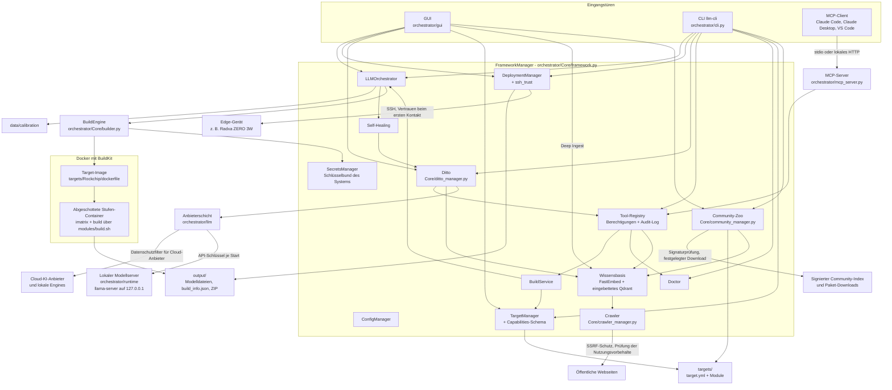
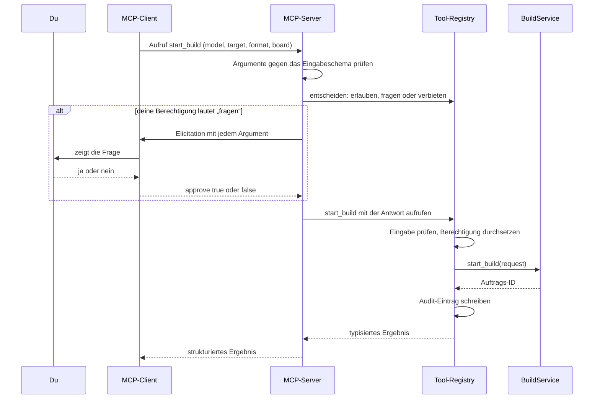

Version 3.0.0 + unveröffentlichte Änderungen · Stand 2026-10-11

[English](BLUEPRINT.md) · **Deutsch**

# Bauplan

Dies ist das Designdokument des LLM Cross-Compiler Frameworks. Es erklärt, wofür das Framework da ist, wie seine
Teile zusammenspielen, wie Daten hindurchfließen, wie es dich schützt und warum es so gebaut ist. Am Ende steht die
[Roadmap](#roadmap): Sie sagt, was als Nächstes kommt. Was jede veröffentlichte Version enthält, steht im
[Changelog](../CHANGELOG_DE.md).

Das Dokument beschreibt den Entwicklungszweig: die veröffentlichte Version 3.0.0 plus die Änderungen, die im
Changelog unter „Unreleased“ stehen und für 3.1.0 geplant sind. Wo ein Teil noch nicht veröffentlicht ist, steht
das dabei.

## Inhalt

- [Kurz gesagt](#kurz-gesagt)
- [Zweck und Grundsätze](#zweck-und-grundsätze)
- [Architektur im Überblick](#architektur-im-überblick)
- [Datenflüsse](#datenflüsse)
- [Sicherheitsmodell](#sicherheitsmodell)
- [Wichtige Entscheidungen](#wichtige-entscheidungen)
- [Versionierung und Dokumentationsregeln](#versionierung-und-dokumentationsregeln)
- [Roadmap](#roadmap)
- [Geschichte](#geschichte)
- [Glossar](#glossar)

## Kurz gesagt

Ein Sprachmodell, wie es auf Hugging Face veröffentlicht wird, ist für einen kleinen Rechner wie ein Radxa ZERO 3W
meist zu groß und im falschen Format. Das Framework löst das in drei Schritten:

1. **Holen**: das Modell (eine Hugging-Face-Repo-ID wie `Qwen/Qwen3-0.6B` oder ein Ordner auf deiner Festplatte).
2. **Umwandeln und verkleinern** („quantisieren“) in einem Docker-Container, der die passenden Werkzeuge für deine
   Hardware enthält.
3. **Installieren**: das Ergebnis per SSH auf dein Gerät.

Du kannst es auf drei Wegen bedienen: über die Desktop-Oberfläche (GUI), über die Kommandozeile `llm-cli` oder über
einen KI-Client wie Claude Code oder Claude Desktop per Model Context Protocol (MCP). Alle drei nutzen denselben
Kern.

Der eingebaute Assistent **Ditto** hilft bei der Wahl von Modellen und Einstellungen, erklärt fehlgeschlagene Builds
und kann die Tools des Frameworks für dich bedienen, immer im Rahmen der Berechtigungen, die du festlegst. Ditto
arbeitet mit einem Cloud-KI-Anbieter deiner Wahl oder ganz offline mit einem lokalen Modell, das das Framework für
dich herunterlädt und betreibt (unveröffentlicht).

Es gibt ein offizielles Hardware-Target, **Rockchip** (Boards RK3566, RK3568, RK3576, RK3588), mit drei
Ausgabeformaten:

| Format | Läuft auf | Boards | Typischer Einsatz |
|---|---|---|---|
| GGUF (llama.cpp) | CPU | alle vier | Chat-Modelle auf jedem Board |
| RKLLM | NPU | RK3588, RK3576 | Chat-Modelle auf dem Neuroprozessor |
| RKNN | NPU | alle vier | ONNX-Modelle für Bild und Ton |

`llm-cli` ist der Konsolenbefehl aus `pyproject.toml`. Wenn er nicht im PATH liegt, rufst du im Installationsordner
stattdessen `python -m orchestrator.cli` auf; die Optionen sind dieselben.

## Zweck und Grundsätze

Das Framework soll Menschen ohne Hintergrund in Compilern oder maschinellem Lernen ein Sprachmodell auf eigener,
kleiner Hardware ermöglichen und Fachleuten eine reproduzierbare, nachprüfbare Pipeline geben. Fünf Grundsätze
leiten jede Designentscheidung.

| Grundsatz | Was das praktisch heißt |
|---|---|
| **Lokal zuerst** | Umwandlungen laufen auf deinem Rechner in Docker. Modelle werden auf dem Host heruntergeladen, die Umwandlungs-Container haben kein Netzwerk. Die Wissensbasis berechnet ihre Embeddings und ihr Reranking lokal, und Ditto kann ganz offline mit einem lokalen Modell arbeiten. Außer Downloads verlässt nichts deinen Rechner, es sei denn, du wählst für Ditto einen Cloud-KI-Anbieter (dann greift der Datenschutzfilter, siehe [Sicherheitsmodell](#sicherheitsmodell)), schaltest die anonymen Fehlerberichte ein (`enable_telemetry`, standardmäßig aus) oder öffnest mit einem Community-Paket einen Pull-Request (das Framework bereitet das Paket vor; die GitHub-CLI oder der Browser verschickt es mit ihren eigenen Zugangsdaten). |
| **Laienfreundlich** | Die GUI bietet nur an, was das gewählte Target kann, die CLI lehnt alles andere ab, und beide setzen sinnvolle Vorgaben je Board (zum Beispiel Q4_0 auf dem RK3566). `llm-cli doctor` erklärt Probleme mit Lösungshinweisen. KI-Fehler werden in klaren Worten erklärt (etwa, dass ein Claude-API-Schlüssel, der in jedem Workspace gilt, die Workspace-ID braucht). Vorschläge des Self-Healing warten auf deine Entscheidung. |
| **Sicher von Haus aus** | Die Umwandlungs-Sandbox ist eingeschaltet (`build_sandbox: true`). KI-Clients und Ditto dürfen frei lesen, müssen aber fragen, bevor sie etwas ändern. Neuen SSH-Geräten wird erst vertraut, wenn du ihren Fingerabdruck bestätigt hast. Passwörter werden nie gespeichert. Von einer KI vorgeschlagener Text wird nie ausgeführt. Der Crawler beachtet jeden maschinenlesbaren Nutzungsvorbehalt einer Seite, und kein Schalter hebt das auf. Community-Pakete werden erst nach Prüfungen in einem Quarantäneordner und nach deiner Bestätigung installiert. |
| **Daten statt Code** | Was ein Target bauen kann, steht in seiner `target.yml` (Block `capabilities:`, von einem Schema geprüft). KI-Anbieter sind Vorlagen in `configs/llm_providers.yml`, der lokale Modellserver und seine Modelle sind in `configs/llama_runtime.yml` festgelegt, Dittos Evaluationsfälle stehen in `evals/ditto/cases.yml`, Korpus und Fälle der Abruf-Evaluation in `evals/retrieval/` und die vertrauenswürdigen Community-Schlüssel in `configs/community_keys.yml`. Ein neues Board, ein neues Modell oder ein OpenAI-kompatibler Server ist eine Datenänderung, solange der Code dahinter das unterstützt. |
| **Nachprüfbare Builds** | Jeder Build schreibt ein Manifest (`build_info.json`) mit dem SHA256-Hash jeder Modelldatei, eine `Model_Card.md` und ein ZIP-Archiv. Das Deployment-Paket prüft die Hashes auf dem Gerät vor der Installation. Python-Abhängigkeiten sind per Hash festgelegt, Downloads des lokalen Modellservers und seiner Modelle per Größe und SHA256, und das Audit-Log der Tools lässt sich prüfen. |

## Architektur im Überblick

In einfachen Worten: Es gibt drei Eingangstüren (GUI, CLI, MCP). Dahinter sitzt ein Kern, der `FrameworkManager`,
der alle anderen Teile startet und miteinander verbindet. Ein Build-Auftrag landet bei der `BuildEngine`, die ein
Docker-Image für das Target baut und die Umwandlung in abgeschotteten Containern ausführt. Das fertige Modell liegt
danach in `output/`, und der `DeploymentManager` kopiert es auf das Gerät. Ditto spricht mit KI-Anbietern nur über
die Anbieterschicht und nutzt dieselbe Tool-Registry wie der MCP-Server. Deep Ingest, das eine Person in der GUI
startet oder für einen KI-Client bestätigt (`crawl_docs_site`), schickt den Crawler für die Wissensbasis auf öffentliche Webseiten; der Community-Zoo installiert Community-Pakete
nach `targets/`, in den Rezeptordner und in die Wissensbasis.

### Bausteine

| Baustein | Wo | Aufgabe |
|---|---|---|
| GUI | `orchestrator/gui/` (Start: `llm-gui`) | Hauptfenster, Build-Reiter, Deployment-Fenster, Ditto-Chat (sein Kopf zeigt den genutzten Zugang), Modul-Assistent mit Deep Ingest, Hugging-Face-Browser, Community-Hub, Dialoge für KI-Einstellungen, der Anmeldebereich (`sign_in.py`: Karten für die Verfahren, Schlüsselformular, Auswahl für den Schutz des Tresors, Passphrase-Dialog; Zugriffe auf Tresor und Netz in Hintergrund-Threads), Tool-Berechtigungen, Tool-Bestätigungen, Self-Healing-Vorschläge, SSH-Vertrauen, den Deep-Ingest-Hinweis und den Export für die Community. |
| CLI | `orchestrator/cli.py` (`llm-cli`) | Befehle der obersten Ebene `build`, `config`, `deploy`, `ditto`, `doctor`, `knowledge`, `mcp`, `module`, `scan`, `secrets`, `targets`, `tools`, `zoo` (`doctor` und `scan` sind einzelne Befehle, die übrigen Gruppen). Die Befehle zur Anmeldung `ditto login`, `logout` und `auth` nutzen dieselben Anmeldeoperationen wie die GUI (`orchestrator/llm/auth/signin.py`). |
| FrameworkManager | `orchestrator/Core/framework.py` | Startet alle Manager in vier Phasen (Sicherheit und Infrastruktur, Kernlogik, KI und Wissen, Wächter und Betrieb), verbindet sie, hält eine langlebige asyncio-Schleife für Builds und löst relative Datenpfade gegen den Installationsordner auf, nicht gegen das Arbeitsverzeichnis. |
| ConfigManager | `orchestrator/Core/config_manager.py` | Einstellungen mit Schema (Typ, Vorgabe, Prüfregel). Der Einstellungsordner ist `LLM_FRAMEWORK_CONFIG_DIR`, wenn gesetzt, sonst das `configs/` der Installation, wenn es beschreibbar ist, sonst der Benutzerordner; nie das Arbeitsverzeichnis. Benutzereinstellungen landen dort in `config.yml`. Umgebungsvariablen mit dem Präfix `LLM_FRAMEWORK_`, `FRAMEWORK_` oder `LLM_` überschreiben bekannte Einstellungen. Persönlicher Zustand liegt in `~/.llm-framework` (änderbar mit `LLM_FRAMEWORK_HOME`), unter Linux und macOS mit Modus 0700. |
| SecretsManager | `orchestrator/Core/secrets_manager.py`, `orchestrator/Core/vault_key.py`, `orchestrator/utils/file_lock.py` | Verschlüsselter Tresor (`secrets.store` im Benutzerordner, Format v2: Fernet-Einträge mit Schlüssel-IDs, gelesen mit MultiFernet, Schlüsselwechsel). Sein Schlüssel kommt standardmäßig aus dem Schlüsselbund des Betriebssystems (ein Eintrag je Tresor; ein Schlüsselbund, der hängt, nichts behält oder im Klartext speichert, wird abgelehnt) oder aus der ausdrücklichen Wahl in `secret_storage` (Credential-Helper, Passphrase, unverschlüsselte Schlüsseldatei, nur Arbeitsspeicher). Jede Änderung läuft unter einer Sperre über Prozessgrenzen; der Tresor lehnt einen Ort innerhalb einer Git-Arbeitskopie ab. Enthält API-Schlüssel (als Datensätze unter `cred/<anbieter>/api_key`; die alten Namen gelten weiter) und das Hugging-Face-Token (`hf_token`). Die Secrets eines Speichers am alten Ort (Einstellungsordner) werden einmalig übernommen und mit dem Schlüssel des Tresors neu verschlüsselt, auch in einen schon vorhandenen Speicher im Benutzerordner; dort bereits vorhandene Secrets haben Vorrang, und die alte Datei bleibt unverändert. Ein lange laufender Prozess (GUI, MCP-Server) liest den Tresor neu, wenn ein anderer Prozess ihn geändert hat. |
| Secret-Formate und Schwärzung in Logs | `orchestrator/security/` | Eine Tabelle der Secret-Formate, die nur die Standardbibliothek braucht (`secret_patterns.py`); `scripts/secret_scan.py` lädt sie, `redact_secrets` nutzt sie. `redaction.py` schwärzt jeden Logeintrag beim Erzeugen (Logger des Frameworks, der SDKs und der HTTP-Bibliotheken, Tracebacks), hält die SDK-Logger auf INFO oder darüber, außer `--debug-http` ist angegeben, und stellt `SecretStr` bereit, in dem die Anbieterschicht ihre Schlüssel hält. |
| TargetManager und Capabilities | `orchestrator/Core/target_manager.py`, `orchestrator/schemas/targets.py` | Lädt die `target.yml` jedes Target-Ordners (Ordner, die mit `_` oder `.` beginnen, etwa `_template`, werden übersprungen) und prüft ihren Block `capabilities:`: Boards, Formate, Quantisierungstypen (auch je Board), Aliasse, Board-Vorgaben, Standard-Board, Bedarf an Importance-Matrix und Kalibrierdaten, Unterstützungsstufe (`official`, `community`, `experimental`). |
| BuildService | `orchestrator/Core/build_service.py`, `orchestrator/schemas/build.py` | Ein typisierter Einstieg für Builds: prüfen, starten, Status, abbrechen, Log-Ende, Ergebnisse, Self-Healing-Entscheidung. Die Tools (MCP-Server und Ditto) nutzen ihn. GUI und CLI prüfen dieselben Capabilities und reichen den Auftrag dann direkt beim Orchestrator ein; abbrechen tun sie über ihn (Schaltfläche Cancel im Builder-Tab, Strg+C in `llm-cli build start`). |
| LLMOrchestrator | `orchestrator/Core/orchestrator.py` | Warteschlange und Pipeline: bereitet Kalibriertext vor, zerlegt einen Auftrag in Jobs (Modell x Target x Format x Quantisierung), führt sie auf der Build-Engine aus, behandelt Abbrüche und die Freigabeschleife des Self-Healing. |
| BuildEngine | `orchestrator/Core/builder.py`, `orchestrator/utils/build_context.py` | Stellt den Docker-Build-Kontext zusammen, baut das Image (mit BuildKit, wenn vorhanden), lädt oder bindet das Modell ein, führt den optionalen Trivy-Scan, die Importance-Matrix-Stufe und die Build-Stufe in abgeschotteten Containern aus, schreibt Manifest, Model Card und ZIP in einen versteckten Zwischenordner, verschiebt sie in den Ausgabeordner, sobald der Build nicht mehr abgebrochen werden kann, und räumt auf. |
| DockerManager | `orchestrator/Core/docker_manager.py` | Docker-Verbindung und laufende CPU-/RAM-Werte für die GUI. |
| Rockchip-Referenz-Target | `targets/Rockchip/` | `dockerfile` (Debian bookworm-slim; llama.cpp-Werkzeuge v0.6.0; drei Python-venvs), `modules/build.sh` (Verteiler für `gguf`, `rkllm`, `rknn` und den Job `imatrix`), `modules/rkllm_module.sh`, `modules/rknn_module.sh`, `scripts/export_rkllm.py`, `scripts/rknn_converter.py`, `target.yml`. `targets/_template/` ist der Ausgangspunkt für neue Targets ([Leitfaden für Modulentwickler](Module_Developer_Guide_DE.md)). |
| DeploymentManager und SSH-Vertrauen | `orchestrator/Core/deployment_manager.py`, `orchestrator/utils/ssh_trust.py` | Baut das Deployment-Paket, prüft den Host-Schlüssel des Geräts, hinterlegt den SSH-Schlüssel des Frameworks, lädt hoch und startet die Installation. |
| Tool-Registry, Berechtigungen, Audit | `orchestrator/tools/` (`registry.py`, `policy.py`, `audit.py`, `confirmation.py`, `framework_tools.py`) | Elf typisierte Tools mit Risikostufen, die gespeicherten Berechtigungen des Benutzers, der Bestätigungstext (gemeinsam für MCP und Ditto) und ein per Hash verkettetes Audit-Log. |
| MCP-Server | `orchestrator/mcp_server.py` | Stellt die Tool-Registry per MCP bereit (offizielles SDK `mcp` 2.3.0), über stdio oder lokales Streamable HTTP. Der Startbefehl, den er für Clients schreibt, nutzt `python -P`, sodass nichts aus dem Ordner importiert wird, in dem ein Client ihn startet. |
| Anbieterschicht (unveröffentlicht) | `orchestrator/llm/` | Ein Client (`LLMClient`) für jeden KI-Anbieter, gebaut auf den offiziellen SDKs `anthropic` und `openai`; OpenAI-kompatible Server laufen über `openai`. Wählt Anbieter, Modell und Aufwand je Aufgabe aus den Einstellungen und den Vorlagen in `configs/llm_providers.yml` (eine gleichnamige Datei im Einstellungsordner ergänzt oder ersetzt Vorlagen). Wiederholungen (zwei, die eigenen Wiederholungen der SDKs sind aus), eine Fallback-Kette bei Ablehnungen und Ausfällen (`ai_fallback_chain`), strukturierte Antworten mit Schemaprüfung und einem Reparaturversuch, typisierte Fehler, der Datenschutzfilter für Cloud-Anbieter und eine Tool-Schleife. Der Anmeldekern (`orchestrator/llm/auth/`) bestimmt die Zugangsdaten jedes Aufrufs aus den Anmeldeverfahren im Katalog: Schlüssel aus dem Tresor (Schlüssel eigener Server an ihre Adresse gebunden) oder aus den Umgebungsvariablen, die der Katalog nennt, eine kostenlose Prüfung der Zugangsdaten, Fehler mit bekannter Ursache und dem nächsten Schritt sowie die Erneuerung von Tokens unter einer Sperre, die alle Prozesse teilen. |
| Ditto (neu gebaut, unveröffentlicht) | `orchestrator/Core/ditto_manager.py` | Der Assistent: Chat mit den Tools des Frameworks (höchstens 8 Modellrunden je Frage, Tool-Aufrufe als Akteur `ditto` über die Registry), Analyse fehlgeschlagener Builds, Modulvorschläge aus einer Hardware-Probe und Build-Empfehlungen. Die letzten drei sind geprüfte strukturierte Antworten; eine ungültige Antwort ist ein Fehler und wird nie angewendet. Eine Self-Healing-Analyse oder Build-Empfehlung mit gefährlichem Befehl wird verworfen; einen Modulvorschlag prüft der Modulgenerator noch einmal. Der Chatverlauf wird nur ergänzt (`chat_history.json`); ein langes Gespräch wird zusammengefasst und als neues fortgesetzt. |
| Verwaltetes lokales Modell (unveröffentlicht) | `orchestrator/runtime/`, `configs/llama_runtime.yml` | Baut `llama-server` auf dem Rechner aus dem festgelegten llama.cpp-Commit (b11429, derselbe Commit wie v0.6.0): zuerst den CPU-Build, dann einen GPU-Build (in dieser Version Vulkan), jeder vor der Nutzung geprüft; importiert einen Build eines anderen Rechners derselben Art; lädt das offizielle vorgebaute Archiv nur auf ausdrücklichen Wunsch, als nicht selbst gebaut gekennzeichnet. Lädt festgelegte GGUF-Modelle in Stufen (Qwen3.5 9B, 4B und 2B, 2-Bit-Varianten für schwache Hardware und auf Wunsch ein IBM Granite 4.2 3B), jeweils per Größe und SHA256 geprüft. Startet `llama-server` auf 127.0.0.1 mit freiem Port und einem API-Schlüssel je Start. Der Anbieter `local` findet den laufenden Server von selbst. |
| Ditto-Evaluation (unveröffentlicht) | `orchestrator/evals/ditto_eval.py`, `evals/ditto/cases.yml`, `evals/retrieval/` | `llm-cli ditto eval`: 19 feste Fälle (Build-Log-Analyse, Build-Empfehlungen, Modulvorschläge, Chat mit Tools, Prompt-Injection), nach Regeln bewertet, gegen den eingestellten Anbieter oder je lokaler Modellstufe. Gebaut wird nichts: Chat-Fälle nutzen die echten Tool-Definitionen über einen Stellvertreter-Build-Service. Mit `--kind retrieval` bewerten 42 Suchen die Suche der Wissensbasis auf einem festen Korpus, ohne KI-Modell (siehe [Eine Suche in der Wissensbasis](#eine-suche-in-der-wissensbasis-unveröffentlicht)). |
| Self-Healing | `orchestrator/Core/self_healing_manager.py` | Erkennt bekannte Fehler zuerst mit festen Mustern und fragt Ditto nur bei unbekannten. Wendet nur vom Framework festgelegte Korrekturen an, und nur nach deiner Freigabe. |
| Wissensbasis und Crawler | `orchestrator/Core/rag_manager.py`, `orchestrator/rag/`, `orchestrator/Core/crawler_manager.py` | Optional (`enable_rag_knowledge`). Webseiten, PDFs, Wissenspakete der Community und der eigene Code des Frameworks werden in Abschnitte zerlegt und mit einem lokalen dichten Embedding (FastEmbed auf ONNX Runtime, CPU; Modell je nach Hardware, sofern `rag_embedding_model` nichts anderes sagt) und einem BM25-Vektor gespeichert. Suchen verbinden beide Ranglisten mit Reciprocal Rank Fusion; ein lokaler Cross-Encoder kann die Ergebnisse neu ordnen und die unter einer Relevanzschwelle verwerfen (unveröffentlicht, siehe [Eine Suche in der Wissensbasis](#eine-suche-in-der-wissensbasis-unveröffentlicht)). Qdrant läuft eingebettet im Prozess, die Daten liegen im Benutzerordner (unveröffentlicht); ein Qdrant-Server wird nur genutzt, wenn `qdrant_url` gesetzt ist. Der Crawler von Deep Ingest beachtet die maschinenlesbaren Nutzungsvorbehalte der Seiten (siehe [Deep Ingest](#deep-ingest-von-der-webseite-in-die-wissensbasis-unveröffentlicht)). |
| Deep-Ingest-Hinweis und Sprachansagen (unveröffentlicht) | `orchestrator/utils/crawl_notice.py`, `orchestrator/utils/announce.py` | Der einmalige Hinweis vor dem ersten Deep Ingest, je Benutzer gemerkt, und kurze Ansagen über die Sprachausgabe des Betriebssystems. |
| Community-Zoo (unveröffentlicht) | `orchestrator/Core/community_manager.py`, `orchestrator/Core/community_pack.py`, `orchestrator/schemas/recipes.py`, `orchestrator/gui/community_hub.py`, `configs/community_keys.yml` | Signierte und verschlüsselte Community-Pakete (Targets, Rezepte, Wissen), der signierte Community-Index, die Installation über eine Quarantäne mit Vertrauensstufen, der Export mit Datenschutz-Bereinigung und die Übergabe an einen Pull-Request (siehe [Community-Pakete](#community-pakete-format-vertrauen-und-austausch-unveröffentlicht)). |
| Eingabe-Historie (unveröffentlicht) | `orchestrator/utils/input_history.py` | Zuletzt verwendete Werte der GUI-Eingabefelder, je Benutzer und ohne Geheimnisse (siehe [Zuletzt verwendete Eingaben](#zuletzt-verwendete-eingaben-unveröffentlicht)). |
| Doctor | `orchestrator/Core/doctor.py` | Deterministische Gesundheitsprüfungen (Python, Docker und BuildKit, Speicherplatz, Targets, Rechte des Zustandsordners, Secrets und Schlüsselbund, Tool-Berechtigungen und Audit-Log, Kalibrierdaten, installierte Community-Pakete, Snapshots der Wissensbasis) mit festen Codes, Lösungshinweisen und gestuften automatischen Korrekturen. Stufe 2 löscht nichts von selbst: Sie baut einen Löschplan der verwaisten Build-Images des Frameworks (`DeletionPlan` aus `tools/spec.py`), und `delete_framework_images` entfernt genau diese IDs, nachdem die Person den Plan im Terminal bestätigt hat (nur Akteur `cli` oder `gui`, zuerst auditiert, abgelehnt, wenn sich die Liste geändert hat); der Docker-Build-Cache wird nie geleert. `ai_findings` ist, was `run_doctor` einer KI liefert: Ordner unter ihrer Bezeichnung, andere Pfade nur mit dem Dateinamen. |
| Kalibrierdaten | `data/calibration/`, `orchestrator/utils/calibration.py` | Kuratierter deutscher, englischer und Tool-Nutzungs-Text (MIT-Lizenz) mit SHA256-Prüfung, für Importance-Matrizen. |
| Umgang mit nicht vertrauenswürdigem Text | `orchestrator/utils/untrusted.py` | Bereinigt und verpackt externen Text, bevor er ein Sprachmodell erreicht. |

Der Rockchip-Ordner enthält außerdem noch `source_module.sh`, `config_module.sh`, `convert_module.sh` und
`target_module.sh` aus der Vier-Module-Kette der Version 1.x. Der aktuelle Verteiler `build.sh` ruft sie nicht auf;
ihre Entfernung ist für 3.4.0 geplant.

`configs/project_sources.yml` ist ein Katalog vorgelagerter Projekte und Dokumentationslinks. Zur Laufzeit liest
das Framework nur seine Dokumentationslinks für Hardware (sie füllen das Deep-Ingest-Fenster für Hersteller und SDK
einer Probe); wofür jede Datei in `configs/` da ist, steht in
[SSOT_ARCHITECTURE_DE.md](../configs/SSOT_ARCHITECTURE_DE.md).

### Wo was liegt

| Ort | Inhalt |
|---|---|
| `targets/` | Target-Definitionen (ein Ordner je Target). |
| `cache/models/hf/` | Von Hugging Face heruntergeladene Modelle für Builds. |
| `cache/builds/<Build-ID>/` | Arbeitsordner eines laufenden Builds (Build-Kontext, Ausgabe, Importance-Matrix, Zwischenablage); wird nach dem Build entfernt. |
| `cache/calibration/` | Für Importance-Matrizen geschriebener Kalibriertext. |
| `output/` | Fertige Builds, ein Ordner je Build mit Modelldateien, `build_info.json`, `Model_Card.md`, daneben ein ZIP. |
| `models/ditto/` | Dittos lokale GGUF-Modelle mit je einer Markierung `.verified.json` (unveröffentlicht). |
| `models/embeddings/` | Embedding- und Reranking-Modelle der Wissensbasis (unveröffentlicht). |
| `community/` | Installierte Community-Rezepte (`recipes/`) und Wissenspakete (`knowledge/`), jeweils mit einer `.lcf-provenance.json`, und die Pakete, die du exportierst (`contributions/`). Community-Targets werden nach `targets/` installiert. Ein Ordner `.quarantine/` in einem Installationsordner enthält ein Paket nur, solange es geprüft wird (unveröffentlicht). |
| `~/.llm-framework/` (oder `LLM_FRAMEWORK_HOME`) | `secrets.store` (auch deine Community-Schlüssel), `tool_policy.json`, `audit.db` mit `audit.db.anchor`, `known_hosts`, der SSH-Schlüssel des Frameworks `id_ed25519_llm_framework` (+ `.pub`), `mcp_tokens.json` (die benannten MCP-Tokens als SHA-256-Hashes, mit ihren Berechtigungen), `chat_history.json`, `llm_privacy_key` und `llm_install_id`; `crawl_notice.json` und `input_history.json` (unveröffentlicht); der zwischengespeicherte Community-Index `community/index.json` mit `index.json.sig` und die bei der ersten Installation gemerkten öffentlichen Schlüssel der Autoren, `community/authors.json` (unveröffentlicht); die eingebettete Wissensbasis `qdrant/` und `knowledge_snapshots/`; der lokale Modellserver unter `runtime/llama.cpp/` (Builds, `active.json`, `server.json`, die Schlüsseldatei, solange der Server läuft) und sein Log in `logs/llama-server.log`. |
| Einstellungsordner (meist `configs/`) | `config.yml` (Benutzereinstellungen); auf Wunsch eine eigene `llm_providers.yml`, die Anbietervorlagen ergänzt oder ersetzt. |
| `chat_feed.sqlite` im Benutzerordner (unveröffentlicht) | Der Chat-Verlauf: was der Chat-Bereich rechts zeigt (deine Nachrichten, Dittos Antworten, wartende Fragen, Entscheidungen einer KI mit ihrer Begründung, Ergebnisse von Arbeit, die eine KI gestartet hat). Jede Zeile ist signiert; nichts darin wird von selbst gelöscht. |

`cache/`, `output/` und `models/` sind relativ zum Installationsordner, sofern die Einstellungen `cache_dir`,
`output_dir` und `models_dir` nichts anderes sagen. Darf der Benutzer im Installationsordner nicht schreiben (zum
Beispiel `C:\Program Files`), liegen ihre Vorgaben stattdessen im Benutzerordner (`ConfigManager.default_data_root`).
Keiner von ihnen wird beim Start angelegt; ein Build, ein Download oder die Wissensbasis legt an, was sie nutzen.

## Datenflüsse

### Ein Build, vom Auftrag bis zum Gerät

In einfachen Worten: Du wählst ein Modell, ein Board und eine Quantisierung. Das Framework prüft, ob das Target das
kann, bereitet alles auf deinem Rechner vor, baut ein Werkzeug-Image, wandelt das Modell in einem abgeriegelten
Container um, hält Hashes fest und lässt dich das Ergebnis auf deinem Gerät installieren.

1. **Auftrag.** Der Build-Reiter der GUI, `llm-cli build start -m <Modell> -t Rockchip -f gguf -b rk3566` oder das
   Tool `start_build` (MCP-Client oder Ditto) erzeugt einen Auftrag. Ein unbekanntes Target wird mit der Liste der
   bekannten Targets abgelehnt. Der Auftrag wird gegen die Capabilities des Targets geprüft: Unbekannte Formate,
   Boards oder Quantisierungstypen werden mit einem Satz abgelehnt, der die erlaubten Werte nennt; Schreibweisen werden vereinheitlicht (Groß- und Kleinschreibung, Aliasse wie `INT8` für `Q8_0`); ein
   fehlendes Board wird zum Standard-Board des Targets, eine fehlende Quantisierung zur Vorgabe des Boards;
   Typen mit sehr wenigen Bits wie IQ2_XS verlangen eine Importance-Matrix.
2. **Warteschlange und Kalibrierung.** Der `LLMOrchestrator` reiht den Auftrag ein. Ist eine Importance-Matrix
   gewünscht (nur GGUF) und hast du keinen Datensatz angegeben, schreibt er den mitgelieferten Kalibriertext
   (`calibration_language`: `mixed`, `de` oder `en`) nach `cache/calibration/`.
3. **Jobs.** Der Auftrag wird in einen Job je Modell, Target, Format und Quantisierung zerlegt. Jeder Job geht an
   die `BuildEngine`.
4. **Build-Kontext und Image.** Die Engine kopiert `modules/`, `scripts/` des Targets und das gemeinsame
   `entrypoint.sh` in einen frischen Build-Kontext und baut das Image `llm-framework/<Target>:<Build-ID>` mit
   `docker buildx build` (BuildKit) oder, falls BuildKit fehlt, über die Docker-API. Dieser Schritt braucht Netzwerk:
   Er holt den in `configs/llama_runtime.yml` festgelegten llama.cpp-Commit (`b11429`; der Build bricht ab, wenn er
   nicht genau diesen Commit bekommt) und die Python-Werkzeugketten. Die Konvertierungswerkzeuge von llama.cpp
   entstehen mit den Optionen des Build-Rezepts für diesen Rechner (`LLAMA_CMAKE_ARGS`, aus einer Probe unmittelbar
   vor dem Image-Build), hinter den Optionen, die jeder Build hat (nichts wird beim Konfigurieren heruntergeladen,
   keine Unterprozesse). Die Zahl paralleler Compile-Jobs kommt aus `build_jobs` (0 heißt alle Kerne).
5. **Bereitstellung auf dem Host.** Das Modell wird bereitgestellt, bevor irgendein Umwandlungscode läuft: Ein
   lokaler Ordner oder eine Datei wird schreibgeschützt eingebunden; ein Hugging-Face-Repo wird auf dem Host nach
   `cache/models/hf/` geladen, bei Bedarf mit deinem gespeicherten `hf_token`. Das Token gelangt nie in einen
   Container.
6. **Sicherheitsscan.** Ist `enable_security_scan` an (Vorgabe), durchsucht Trivy (`image_trivy`, Vorgabe
   `aquasec/trivy:0.75.0`) das Image nach Schwachstellen der Stufen HIGH und CRITICAL. Funde ergeben eine Warnung;
   der Build läuft weiter. Ein Scan, der nicht innerhalb von `build_timeout` fertig wird, wird mit einer Warnung
   gestoppt.
7. **Importance-Matrix-Stufe** (nur GGUF mit IMatrix). Ein abgeschotteter Container führt `modules/build.sh` mit
   `JOB_TYPE=imatrix` aus: Er wandelt das Modell in F16-GGUF um und lässt `llama-imatrix` über die ersten 100
   Abschnitte des Kalibriertexts laufen. Scheitert diese Stufe, stoppt der Build.
8. **Build-Stufe.** Ein zweiter abgeschotteter Container führt `modules/build.sh` mit `JOB_TYPE=build` aus. Der
   Verteiler wählt die Werkzeugkette: `llama-quantize` für GGUF (mit Importance-Matrix, falls vorhanden),
   `rkllm_module.sh` für RKLLM (nur RK3588 und RK3576), `rknn_module.sh` für RKNN.
9. **Manifest und „Golden Artifact“.** Die Engine kopiert die Ergebnisse in einen versteckten Zwischenordner neben
   dem Ausgabeordner (Links in der Ausgabe des Builds werden nicht verfolgt), ergänzt `build_info.json` um Größe
   und SHA256-Hash jeder Modelldatei und um die Hauptdatei, schreibt `Model_Card.md` und erstellt ein ZIP dieser
   Dateien. Erst wenn der Build nicht mehr abgebrochen werden kann, werden sie nach `output/` verschoben und das ZIP
   neben den Build-Ordner; ein abgebrochener oder gescheiterter Build hinterlässt dort keine Dateien. Das Image-Tag
   des Builds und der Arbeitsordner werden entfernt; die Image-Schichten bleiben im Build-Cache, der nächste Build
   geht also schneller.
10. **Deployment.** Im Deployment-Fenster (oder mit `llm-cli deploy package` und `llm-cli deploy run`) wählst du
    einen Build. Das Framework packt Modelldatei, `build_info.json`, `Model_Card.md`, ein erzeugtes `deploy.sh` und
    `checksums.sha256` in ein ZIP.
11. **Vertrauen beim ersten Kontakt.** Vor der ersten Verbindung wird der Fingerabdruck des Host-Schlüssels des
    Geräts angezeigt (im selben Format wie bei `ssh-keygen -lf`). Erst wenn du ihn bestätigst oder ein passendes
    `--trust-fingerprint` angibst, wird er in der eigenen `known_hosts` des Frameworks gespeichert. Ein geänderter
    Schlüssel stoppt das Deployment immer.
12. **Kopplung und Installation.** Bei der ersten Verbindung wird dein Passwort einmal benutzt, um den
    Ed25519-Schlüssel des Frameworks auf dem Gerät zu hinterlegen; gespeichert wird es nie. Das Paket wird in einen
    privaten temporären Ordner hochgeladen (`mktemp -d /tmp/llm_deploy.XXXXXXXX`) und entpackt, und `deploy.sh`
    prüft alle Hashes mit `sha256sum -c`, bevor es das Modell nach `$MODEL_DIR` (Vorgabe `$HOME/models`) kopiert
    und anzeigt, wie man es startet (bei GGUF mit `llama-server`).

Das Tool `cancel_build`, die Schaltfläche Cancel im Builder-Tab und Strg+C in `llm-cli build start` stoppen den
laufenden Stufen-Container über den Build-Service. Jeder Stufen-Container hat ein eigenes Zeitlimit
(`build_timeout`, Vorgabe 3600 Sekunden). Jede Build-Engine schreibt je Build einen Eintrag nach
`<cache_dir>/build_records/` (`orchestrator/Core/build_records.py`), den `llm-cli build status` liest; so sieht es
auch Builds anderer Programme. CLI, Build-Service, Orchestrator und Engine lösen ein Target über die eine Zuordnung
von ID zu Ordner der Target-Registry auf, deshalb darf eine Target-ID vom Ordnernamen abweichen.

### Ein Tool-Aufruf eines MCP-Clients

In einfachen Worten: Der KI-Client darf sich Dinge selbst ansehen, aber bevor er etwas ändert, fragt das Framework
dich über den Client und schreibt auf, was passiert ist.

1. **Namen, Argumente, Schema.** Tool-Name und rohe Argumente laufen zuerst durch die Absicherungsschicht
   (`orchestrator/tools/normalize.py`), dieselbe, die Dittos Aufrufe nutzen: Schreibvarianten eines Tool-Namens,
   angegebene Argument-Aliasse, Werte umgewandelt und mit geschlossenen Listen abgeglichen, ohne je einen knapp
   danebenliegenden Wert zu erraten, und jede Reparatur festgehalten. Jedes Tool hat ein pydantic-Modell für Ein-
   und Ausgabe; Clients bekommen das geschlossene JSON-Schema des Eingabemodells. Unbekannte Namen und ungültige
   Argumente werden abgelehnt, bevor irgendetwas läuft, mit Grundcode und nächstem Schritt, und die Ablehnung wird
   im Audit-Log festgehalten (`unknown_tool`, `invalid_input`); derselbe fehlschlagende Aufruf wird beim dritten Mal
   abgelehnt, ohne zu laufen (`repeat_refused`).
2. **Berechtigungen.** Die Registry schlägt deine gespeicherte Berechtigung für dieses Tool nach (zuerst eine
   Einstellung für das einzelne Tool, dann seine Stufe). Vorgaben: `read` erlaubt, `local_write` fragen, `external`
   fragen. Tools der Stufe `forbidden` lassen sich gar nicht erst registrieren. Ist die Berechtigungsdatei
   beschädigt, wird jedes Tool verweigert, bis du die Berechtigungen neu einrichtest.
3. **Elicitation.** „Fragen“ wird zu einer MCP-Elicitation: Der Client zeigt dir das Tool und jedes Argument
   vollständig (Argumente, die zu lang zum Anzeigen sind, lassen sich nicht bestätigen). Nur eine echte Antwort
   zählt als Freigabe, und ein „Nein“ gilt für diesen Aufruf endgültig, auch wenn die Berechtigung inzwischen
   gelockert wird. Eine Bestätigung, die scheitert, führt zur Ablehnung und wird im Audit-Log festgehalten. Ein
   Kann der Client nicht fragen (keine Formular-Elicitation), ist die Frage zu lang für eine Elicitation oder hast du
   das Tool auf Bestätigung im Framework gestellt, wird der Aufruf stattdessen zu einer wartenden Freigabe: Die
   Registry speichert die Frage (signiert, gebunden an Aufrufer, Tool, Argument-Hash und Fragen-Hash, 15 Minuten), der
   Client bekommt `waiting_for_approval` mit einer Job-ID, und du entscheidest in der GUI oder mit
   `llm-cli tools approvals`. Bei der Freigabe baut das Framework die Frage neu und führt den Aufruf selbst unter dem
   ursprünglichen Aufrufer aus, wenn sie gleich lautet.
4. **Ausführung.** Ein Aufruf, der etwas ändert, wird zuerst festgehalten (`started`) und abgelehnt, wenn sich
   dieser Eintrag nicht schreiben lässt. Die Tool-Funktion läuft in einem eigenen Thread; der Abbruch eines Clients
   erreicht sie sofort. Ihr Ergebnis wird gegen das Ausgabemodell geprüft und gefiltert: Secrets in jeder
   Zeichenkette geschwärzt, Felder mit externem Text (Logs, Healing-Vorschläge, Manifeste, Auszüge aus der
   Wissensbasis, Fehler von Jobs) von unsichtbaren Zeichen befreit und gekürzt, ein Ergebnis über 256 KiB abgelehnt.
   `notes` fügt nur das Framework hinzu. Der Client bekommt das strukturierte Ergebnis und einen Textblock, der mit
   einem Satz aus Fakten des Frameworks beginnt, gefolgt vom JSON, eingepackt als nicht vertrauenswürdige Daten.
   Fehler kommen als Tool-Fehler mit einer für Menschen gedachten Meldung zurück, Secrets darin geschwärzt; der Teil
   eines Fehlers, der externen Text zitiert (eine Serverantwort, eine Log-Zeile, einen Namen aus einem Pack), wird
   zuerst bereinigt und als nicht vertrauenswürdige Daten eingepackt, die eigenen Worte des Frameworks und der
   nächste Schritt bleiben unverpackt.
5. **Audit.** Jedes Ergebnis (`ok`, `denied`, `not_confirmed` mit der Antwort, `error`, `invalid_input`,
   `confirmation_timeout`, `cancelled`) wird an `audit.db` angehängt, mit geschwärzten, gekürzten Argumenten und
   einem Hash des vollen Texts, der Dauer, einem Hash des Ergebnisses und einem Verweis auf den Eintrag `started`
   des Aufrufs. `llm-cli tools audit --verify` prüft die Kette und ihren Anker; `llm-cli tools audit --archive` legt
   das Log beiseite und beginnt eine neue Kette.
6. **Besitzer, Warten und das Ende einer Sitzung.** Die Lifespan des Servers gibt jeder Verbindung eine Sitzung
   (eine je stdio-Sitzung, eine für den HTTP-Server); dem Aufrufer (Akteur `mcp`, oder `mcp:<Name>` für das
   benannte Token, das ClientTracker für die Anfrage geprüft hat) mit dieser Sitzung gehören die Builds und Jobs, die
   er startet, und dieselbe Identität entscheidet über die Berechtigungen, ist der Akteur im Audit-Log und zählt die
   Wartevorgänge. `cancel_build` und `cancel_job` auf eigene Arbeit sind ohne Frage
   erlaubt (eine Einstellung für das einzelne Tool gilt weiter, eine verweigerte Stufe bleibt verweigert, eine
   beschädigte Berechtigungsdatei verbietet weiter); auf die Arbeit eines anderen Clients gelten die Berechtigungen
   des Aufrufers. Ein Aufruf mit `wait_seconds` wartet zuerst in der Ereignisschleife (ohne Thread, höchstens 50 s
   und 4 Wartevorgänge je Client, Fortschritt alle 5 s, wenn der Client ein Fortschritts-Token mitgegeben hat) und
   läuft dann einmal durch die Registry; ein abgebrochenes Warten lässt den Build oder Job in Ruhe. Endet die
   Sitzung, werden ihre unfertigen Builds und Jobs abgebrochen und als `cancelled` („client disconnected“) im
   Audit-Log festgehalten, der Server wartet bis zu 30 s, bis die Build-Container gestoppt sind, und
   `llm-cli mcp serve` fährt danach das Framework herunter. Über stdio beendet ein SIGTERM des Clients die Sitzung
   genauso (es unterbricht den Server wie Strg+C, statt den Prozess sofort zu beenden).

Die vierundzwanzig Tools: `list_targets`, `get_target_capabilities`, `list_build_requests`, `get_build_status`,
`read_build_log`, `list_artifacts`, `run_doctor`, `search_knowledge`, `list_knowledge_sources`,
`read_knowledge_source`, `search_hf_models`, `get_hf_model_info`, `list_local_files`, `get_status`, `get_job_status`,
`list_devices` (Stufe `read`), `start_build`, `cancel_build`, `resolve_healing`, `cancel_job`, `propose_healing_fix`,
`download_hf_file`, `create_deploy_package` (Stufe `local_write`) und `deploy_to_device` (Stufe `external`). Tools,
die deine Berechtigungen verweigern, werden dem Client nicht aufgeführt. `deploy_to_device` wird immer erfragt (keine
Einstellung erlaubt es ohne Frage) und erreicht nur ein Gerät, dem du in der GUI oder CLI vertraut und das du
gekoppelt hast: Das Framework liest den Host-Schlüssel des Geräts vor der Frage, lehnt einen unbekannten oder
geänderten Schlüssel ab, zeigt in der Frage den Fingerabdruck des Schlüssels und das sha256 des Pakets und bricht
das Deployment ab, wenn eins davon danach abweicht. Sieben optionale Tools (die lokale Laufzeit:
`build_local_runtime`, `start_local_runtime`, `stop_local_runtime`, `run_benchmark`; die Laufzeit eines Boards:
`probe_remote_device`, `deploy_device_runtime`, `run_device_benchmark`) werden mit ihren Laufzeitpaketen registriert
und bleiben verweigert, also nicht aufgeführt, bis du sie freigibst.

### Eine Frage an Ditto (unveröffentlicht)

In einfachen Worten: Ditto antwortet im Chat-Bereich oder auf der Kommandozeile. Braucht es Fakten über Targets oder
Builds, fragt es die Tools des Frameworks, mit denselben Berechtigungen wie ein KI-Client. Bevor eine Frage an einen
Cloud-Anbieter geht, werden persönliche Angaben durch Platzhalter ersetzt.

1. **Frage.** Im Chat der GUI oder mit `llm-cli ditto ask "<Frage>"` (`--no-tools` antwortet ohne Tools;
   `--provider` und `--model` überschreiben die KI-Einstellungen für diese eine Frage).
2. **Anbieter und Modell.** Der `LLMClient` nimmt Anbieter, Modell und Aufwand für die Aufgabe aus den
   KI-Einstellungen und der Vorlage in `configs/llm_providers.yml`. Für den Anbieter `local` liest er Adresse,
   Schlüssel und Modell des laufenden verwalteten `llama-server`. Im Offline-Modus werden nur lokale Anbieter
   genutzt.
3. **Datenschutzfilter** (nur Cloud-Anbieter). Secrets werden immer geschwärzt. Je nach `ai_security_level`
   werden Adressen, E-Mail-Adressen, Logins, Benutzernamen, Hostnamen, Seriennummern und Pfade durch feste
   Platzhalter ersetzt, die in der Antwort lokal zurückübersetzt werden.
4. **Tool-Schleife.** Das Modell darf Tools aufrufen, höchstens 8 Modellrunden je Frage. Jeder Aufruf läuft als
   Akteur `ditto` über die Tool-Registry. Ein Aufruf, der eine Bestätigung braucht, zeigt seinen Titel und jedes
   Argument: als Dialog in der GUI, als Rückfrage in der CLI; ohne Terminal lautet die Antwort Nein.
   Tool-Ergebnisse gehen als nicht vertrauenswürdige Datenblöcke an das Modell zurück.
5. **Fehler.** Anbieterfehler sind typisiert und werden erklärt (kein Guthaben, abgelehnter Schlüssel,
   Ratenlimit, Ablehnung, abgeschnittene Antwort). Bei Ablehnungen und Ausfällen geht es entlang der Fallback-Kette
   weiter. Ein Fehler wird nie als Antwort angezeigt oder gespeichert.
6. **Verlauf.** Die fertige Runde wird an `chat_history.json` angehängt. Ein langes Gespräch wird zusammengefasst
   und als neues Gespräch fortgesetzt; frühere Runden werden nie verändert.
7. **Dieser Computer und ein anderer Computer** (`llm-cli ditto remote set`; `orchestrator/llm/hybrid_tools.py`).
   Die Tools dieses Computers bleiben immer. Ist das Framework auf einem anderen Computer eingerichtet (dasselbe
   Programm; Docker ist nicht nötig, SSH oder eine Serveradresse genügt, mit einem benannten Token, das dort mit
   Dittos Berechtigungen verknüpft ist, `--link ditto`), kommen seine Tools in dieselbe Liste: ein Tool, das beide mit
   demselben Eingabeschema anbieten, einmal, mit optionalem `place`; ein Katalog-Tool nur dort mit Pflichtfeld
   `place`; das Tool einer anderen Framework-Version als `remote_<name>`. Von dort kommen nur Katalognamen, immer mit
   Titeln und Beschreibungen dieses Computers; die eigenen Texte der Gegenseite erreichen das Modell nie. Ein Router
   schickt jeden Aufruf dorthin, wo sein Objekt liegt (IDs, gelernt aus strukturierten Ergebnissen, stehen in der
   signierten `ditto_places.json`): Ein widersprechender Ort ist `wrong_place`, Objekte auf beiden Computern
   `needs_transfer`, weil nichts von selbst kopiert wird. Ein entfernter Aufruf bekommt den vorab geschriebenen
   Eintrag `started` dieses Computers (Stufe `remote`, `place remote:<Name>`) und einen verknüpften Abschlusseintrag,
   und eine Änderung wird nicht geschickt, wenn dieser Eintrag nicht geschrieben werden kann; jener Server
   entscheidet, fragt und protokolliert dann (Akteur `mcp:<Token-Name>`). Jedes entfernte Ergebnis beginnt vor seinem
   nicht vertrauenswürdigen Block mit einer Zeile des Frameworks, und die Runde wird als belastet markiert; nur Dittos
   Dialog beantwortet die Rückfragen jenes Servers, und eine Runde ohne Dialog verbindet sich ohne die Fähigkeit zu
   fragen. Ein nicht erreichbarer Computer hält nie eine Runde an und setzt nie die Unterhaltung zurück (die Runde
   läuft mit den Tools dieses Computers und einem Hinweis für die Person weiter). Dittos Aufgaben
   (Build-Empfehlung, Modulvorschlag, Analyse eines entfernten Builds) holen ihren Kontext weiter aus den
   Aufgaben-Prompts jenes Servers unter Dittos eigenem Aufgabentext, und der Grund-Code eines abgelehnten Aufrufs
   kommt aus dem strukturierten Fehler des Servers, nie aus seinen Worten.

### Freigabe beim Self-Healing

In einfachen Worten: Scheitert ein Build, sucht das Framework nach einer bekannten Ursache, sagt dir, was es tun
würde, und wartet. Ohne dein Ja wird nichts verändert.

1. Ein Job scheitert. Der Orchestrator übergibt das Fehlerlog an den Self-Healing-Manager.
2. **Bekannte Probleme zuerst.** Feste Muster erkennen zum Beispiel einen Compiler, dem beim Image-Bau der
   Speicher ausgeht, eine abgebrochene Umwandlung (Exit-Code 137), eine volle Festplatte, fehlende Docker-Rechte,
   DNS-Fehler und veraltete apt-Quellen.
3. **Ditto als Zweites.** Nur wenn kein Muster passt, analysiert Ditto das Log (als nicht vertrauenswürdiger Text
   verpackt) und liefert eine strukturierte Analyse. Seine Antwort gilt immer als Rat: Die Strategie wird auf
   „manueller Schritt“ gesetzt. Ein Vorschlag mit gefährlichem Befehl wird verworfen.
4. **Warten auf dich.** Der Build-Status wird `awaiting_approval`. Du entscheidest im GUI-Dialog, an der Rückfrage
   eines laufenden `llm-cli build start` oder über das Tool `resolve_healing`. Ohne Entscheidung innerhalb von
   `healing_approval_timeout` (Vorgabe 900 Sekunden) wird der Vorschlag verworfen.
5. **Nur feste Maßnahmen.** Ein freigegebener Vorschlag wird nur angewendet, wenn er eine von zwei im Framework
   festgelegten Strategien ist (`AUTOMATIC_STRATEGIES` in `self_healing_manager.py`): `build_jobs` auf 1 senken oder
   einfach neu versuchen. Der Job wird dann einmal wiederholt. Keine davon löscht etwas: Eine volle Docker-Platte
   (`docker_prune`) ist ein manueller Schritt, der auf `llm-cli doctor --fix --tier 2` verweist, das nur die
   gelisteten Images löscht, die die Person bestätigt. Befehlstext aus Mustern oder von der
   KI wird nur angezeigt und nie ausgeführt; die Freigabe eines manuellen Schritts über MCP wird abgelehnt.

### Das lokale Modell für den Offline-Modus (unveröffentlicht)

In einfachen Worten: Das Framework baut das Serverprogramm auf deinem Rechner aus einer festgelegten Quelle, lädt ein
kleines Sprachmodell herunter, prüft beide und betreibt sie nur auf deinem Rechner. Ditto braucht dann kein Internet.

1. **Status.** `llm-cli ditto runtime status` zeigt die erkannte Hardware, den genutzten Build (selbst gebaut,
   importiert oder „prebuilt, not self-built“), ob er neu gebaut werden sollte, die Modellstufe und ob der Server
   läuft.
2. **Server bauen.** `llm-cli ditto runtime install` untersucht den Rechner und erkennt die Toolchain; das
   Bau-Rezept (`orchestrator/runtime/build/recipe.py`) macht aus dem Hardwareprofil einen CPU-Bauplan und, wenn
   sich eine GPU lohnt, einen GPU-Bauplan (in dieser Version Vulkan; das Rezept folgt Betriebssystem, Architektur
   und C-Bibliothek). Nach deiner Zustimmung wird der festgelegte llama.cpp-Commit einmal geholt und geprüft;
   Konfiguration und Build laufen nativ oder im Builder-Container, ohne Netzwerk (`orchestrator/runtime/build/host.py`,
   `executor.py`). Jeder Build wird auf diesem Rechner geprüft (`verify.py`: Version und Commit, Geräte, der Server
   lehnt `--tools` ab) und im Build-Speicher abgelegt (`store.py`, `~/.llm-framework/runtime/llama.cpp/builds/<Build-ID>/`).
   Der CPU-Build wird zuerst aktiv und bleibt der Ersatz; ein geprüfter GPU-Build wird danach aktiv. Stattdessen
   lässt sich ein Build eines anderen Rechners derselben Art importieren (`ditto runtime export` dort,
   `ditto runtime import` hier: gegen die Festlegung und sein Manifest geprüft, von dir bestätigt, dann hier
   geprüft). Das offizielle vorgebaute Archiv ist nur die ausdrückliche Wahl `--prebuilt` (Größe und SHA256 vor dem
   Entpacken geprüft).
3. **Modell laden.** `llm-cli ditto models list` zeigt die Stufen; `llm-cli ditto models download [STUFE]` lädt
   eine davon in ihrer festgelegten Hugging-Face-Revision und prüft Größe und SHA256. Die Empfehlung richtet sich
   nach dem Speicher: das 9B-Modell ab 7,5 GiB Grafikspeicher, 2B mit 2 Bit bei höchstens 3 GiB RAM, 2B mit 4 Bit
   bis 4,5 GiB, sonst 4B, jeweils nur, wenn das Modell neben dem System Platz hat. Die übrigen Stufen (4B und 9B
   mit 2 Bit, IBM Granite 4.2 3B) werden nie empfohlen; du lädst sie über ihren Namen.
4. **Starten.** `llm-cli ditto runtime start` (`--model`, `--ctx`, `--sleep-idle`) startet `llama-server` auf
   127.0.0.1 mit einem freien Port, aber nur einen Build, der seine Prüfung auf diesem Rechner bestanden hat und noch
   zu seinem Manifest passt (sonst den CPU-Ersatz, sonst nichts; das vorgebaute Archiv nur nach `--prebuilt`).
   Befehlszeile, geleerte Umgebung, Loopback und Schlüsseldatei kommen aus der einen Startregel, die jeder Starter
   nutzt (`orchestrator/runtime/server_policy.py`). Für jeden Start wird ein neuer zufälliger API-Schlüssel in eine
   private Datei geschrieben; das Framework prüft, dass der Server Anfragen ohne ihn ablehnt. Die Kontextlänge richtet sich nach
   dem freien Speicher (höchstens 32768 Token); ein unbenutztes Modell wird nach 10 Minuten entladen und bei der
   nächsten Anfrage neu geladen.
5. **Nutzen.** Der Anbieter `local` liest Adresse, Schlüssel und Modell bei jedem Aufruf vom laufenden Server; ein
   aus der CLI oder der GUI gestarteter Server wird also ohne Einrichtung gefunden. Anfragen an 127.0.0.1 laufen
   nie über einen HTTP(S)-Proxy. Beim Aufwand `low` ist das Nachdenken ausgeschaltet (Qwen3.5 denkt sonst in voller
   Länge, was auf einer CPU Minuten dauert).
6. **Stoppen.** `llm-cli ditto runtime stop` beendet den Server (und Reste eines Absturzes) und löscht die
   Schlüsseldatei.

### Deep Ingest: von der Webseite in die Wissensbasis (unveröffentlicht)

In einfachen Worten: Du gibst dem Framework die Adresse einer Doku-Seite. Es liest die öffentlichen Seiten dieser
Website in deine lokale Wissensbasis ein, damit Ditto sie nutzen kann. Bevor es eine Seite behält, prüft es, ob
der Inhaber der Website maschinenlesbar „kein Text- und Data-Mining“ erklärt hat, und überspringt die Seite dann.
Das musst du nicht selbst beurteilen.

1. **Start.** Eine Person startet Deep Ingest in der GUI: Der Modul-Assistent (Tools > Create Hardware Module...) hat
   den Knopf „Deep Ingest (Add Docs)“, der die Wissensbasis braucht (`enable_rag_knowledge`). Die CLI hat keinen
   Crawl-Befehl. MCP-Clients und Ditto bitten mit dem einen Tool `crawl_docs_site` um einen Crawl (unveröffentlicht),
   das den Crawler nur über `CrawlJobService` (`orchestrator/Core/crawl_jobs.py`) erreicht: immer gefragt, jede
   Startadresse in der Frage, abgelehnt, solange der Hinweis unten nicht gelesen ist, höchstens 5 öffentliche
   Startadressen, `max_pages` und `max_depth` innerhalb der Einstellungen und nie über 100 und 3, eine Pause von
   mindestens einer Sekunde, ein Crawl gleichzeitig je Benutzer, 300 gespeicherte Seiten am Tag je Client und ein
   Job, den `cancel_job` nach der aktuellen Seite anhält. Der Test `TestCrawlsStayWithTheUser` in
   `tests/test_security.py` schlägt fehl, wenn Code des MCP-Servers, von Ditto, der Tools oder der Anbieterschicht
   den Crawler auf anderem Weg erreicht, den Hinweis bestätigt oder ein anderes Tool eine Adresse zum Lesen
   annimmt.
2. **Hinweis.** Vor dem ersten Crawl sagt ein Hinweis, was gelesen wird (nur öffentlich erreichbare Seiten), welche
   Nutzungsvorbehalte beachtet werden, dass das Wissen auf diesem Rechner bleibt (nur die Auszüge, die Ditto nutzt,
   gehen an den gewählten KI-Anbieter) und dass Teilen deine ausdrückliche Freigabe braucht. Er ist eine
   Information, keine rechtliche Bestätigung, und hat deshalb einen einzigen Knopf, „Verstanden“. Ein kurzer
   gesprochener Hinweis beginnt, sobald der Hinweis auf dem Bildschirm ist. Die Datei `crawl_notice.json` im
   Benutzerordner (Modus 0600, atomar geschrieben) hält einen SHA-256-Hash seines englischen und deutschen Texts
   fest: Der Hinweis kommt wieder, wenn sich sein Text ändert, und auch, wenn die Datei fehlt oder beschädigt ist.
3. **Optionen und Snapshot.** Der Deep-Ingest-Dialog nimmt die Start-URLs und für diesen Crawl die Tiefe (0 bis 5),
   PDF-Downloads und die Pause zwischen Anfragen (0 bis 10 Sekunden, auch Bruchteile). Er öffnet sich mit den
   Einstellungen `crawler_max_depth`, `crawler_download_pdfs` und `crawler_rate_limit` (eine größere eingestellte
   Tiefe oder Pause hebt die Obergrenze an, sodass der Dialog eine Einstellung nie kürzt); die Werte im Dialog
   entscheiden. Das Seitenlimit `crawler_max_pages` (Vorgabe 50) und die Sprachen `crawler_languages`
   (Vorgabe `en` und `de`) kommen aus den Einstellungen. Einen Schalter für robots.txt oder einen anderen
   Nutzungsvorbehalt gibt es nicht. Vor jeder Start-URL speichert die Wissensbasis einen Snapshot von sich in
   `knowledge_snapshots/` (eine leere Wissensbasis bekommt keinen). Kein Snapshot wird von selbst gelöscht,
   und es gibt keine Grenze (`orchestrator/Core/knowledge_snapshots.py`): Keine Anzahl bringt eine Erinnerung oder
   eine Warnung, und `llm-cli knowledge snapshots` listet sie mit vollem Pfad, Namen und Größe für die Person, die
   sie löscht oder exportiert. Weder die GUI noch die CLI kann einen Snapshot bisher wiederherstellen.
4. **Prüfungen vor der Anfrage.** Für jede URL, in der Breite zuerst, in dieser Reihenfolge: die SSRF-Prüfung der
   Adresse (siehe [Sicherheitsmodell](#sicherheitsmodell)), dann bei ausgeschalteten PDF-Downloads das Überspringen
   einer URL, die auf `.pdf` endet, die robots.txt und die `/.well-known/tdmrep.json` des Ursprungs (Schema, Host
   und Port; jede Datei einmal geladen). Beide Dateien werden über denselben SSRF-Schutz geladen wie die Seiten,
   und jeder Weiterleitungsschritt auf dem Weg wird erneut geprüft.
5. **Anfrage.** Der Assistent zeigt „Seite N von M: <URL>“, und der Crawler wartet die Pause zwischen Anfragen ab
   (ein Stopp verkürzt sie). Die Anfrage folgt keinen Weiterleitungen: Ein Weiterleitungsziel wird eingereiht und
   durchläuft die Schritte 4 und 5 selbst, wird also gegen robots.txt und `tdmrep.json` seines eigenen Hosts
   geprüft. Ein Link, der auf einen anderen Host weiterleitet, wird wie jeder externe Link übersprungen; nur die
   Start-URL darf den Crawl auf einen anderen Host verlegen (etwa von `example.com` nach `www.example.com`). Mehr
   als fünf Weiterleitungen zählen als Fehler, und ein Crawl stellt höchstens fünfmal `crawler_max_pages`
   Seitenanfragen (das Laden von robots.txt und `tdmrep.json` zählt nicht mit).
6. **Prüfungen nach der Antwort.** Zuerst der Header `X-Robots-Tag` und der TDMRep-Header `tdm-reservation`; dann
   bei HTML `<meta name="robots">`, `<meta name="llm-conversion-framework-bot">` und
   `<meta name="tdm-reservation">`, bei einem PDF `tdm:reservation` in seinen Metadaten. `noindex`, `none`,
   `noai` und `noimageai` halten die Seite heraus; `nofollow` und `none` verhindern, dass der Crawler ihren Links
   folgt.
7. **Speichern.** Eine HTML-Seite wird in Markdown umgewandelt (Überschriften, Codeblöcke und Tabellen bleiben
   erhalten) und nach Sprache gefiltert (`crawler_languages`), ein PDF wird als Text gelesen; jede Seite wird
   sofort gespeichert und ersetzt ihre frühere Fassung. Ein Stopp oder das Schließen des Assistenten beendet den
   Crawl nach der aktuellen Seite; was gespeichert ist, bleibt.
8. **Ergebnis.** Erst wenn der letzte Schreibvorgang zurückgekehrt ist, nennt das Ergebnis Erfolg (Seiten
   gespeichert; keine schlug fehl oder war von der Website vorbehalten, und der Crawl wurde nicht gestoppt),
   Teilerfolg (einige Seiten gespeichert; andere schlugen fehl, waren von der Website vorbehalten, oder der Crawl
   wurde gestoppt) oder Fehler (nichts gespeichert). Es wird angezeigt, protokolliert und gesprochen. Seiten, die
   ein Nutzungsvorbehalt, die Adressprüfung, ausgeschaltete PDF-Downloads, eine Weiterleitung oder der
   Sprachfilter ausgelassen hat, und geladene Seiten, die weder HTML noch PDF sind oder keinen Text haben, stehen
   mit ihrem Grund im Crawl-Protokoll, ebenso Seiten, die sich nicht laden ließen.

Welche Signale zählen und wann sie gelesen werden:

| Signal | Wann | Regel |
|---|---|---|
| robots.txt ([RFC 9309](https://www.rfc-editor.org/rfc/rfc9309)) | vor der Anfrage, einmal je Ursprung (Schema, Host und Port) | Es zählen die Gruppen, deren User-Agent dem Produkt-Token dieses Crawlers gleicht (`LLM-Conversion-Framework-Bot`, gleich in welcher Schreibweise; eine Gruppe für `bot` ist nicht unsere), sonst alle `*`-Gruppen zusammen; Muster mit `*` und `$` wirken; die längste passende Regel entscheidet, bei Gleichstand gewinnt `Allow`. Ein 401, ein 403, ein Serverfehler oder eine unerreichbare Datei heißen „alles verboten“ (bei 401 und 403 ist das strenger als RFC 9309, das Crawlen erlaubt, wenn die Datei mit einem 4xx-Code nicht verfügbar ist); eine fehlende Datei (404) heißt, alles ist erlaubt. Eine Datei, die der SSRF-Schutz blockiert oder die hinter mehr als fünf Weiterleitungen liegt, gilt als nicht verfügbar, was RFC 9309 als erlaubt behandelt. |
| TDMRep-Datei `/.well-known/tdmrep.json` | vor der Anfrage, einmal je Ursprung | Die erste Regel, deren Ort zum Pfad passt, entscheidet; `"tdm-reservation": 1` behält die Seite vor. Eine fehlende oder unlesbare Datei heißt, die Website nutzt das Protokoll nicht. |
| Header `X-Robots-Tag` und `tdm-reservation` | nach der Antwort | `noindex`, `none`, `noai`, `noimageai` oder `tdm-reservation: 1` behalten die Seite vor. Anweisungen für andere Crawler (`otherbot: noindex`) werden übergangen. |
| Robots-Meta-Tags (`robots` und `llm-conversion-framework-bot`), Meta-Tag `tdm-reservation` | nach der Antwort, HTML | wie bei den Headern |
| `tdm:reservation` in den PDF-Metadaten | nach der Antwort, PDF | der Wert 1 behält das PDF vor |

Ein Vorbehalt aus irgendeiner Quelle gewinnt. TDMRep erlaubt einer späteren Quelle, einen Vorbehalt aus einer
früheren aufzuheben; der Crawler weicht davon absichtlich ab und bleibt auf der vorsichtigen Seite: Hat eine
Quelle eine Seite vorbehalten, hebt nichts das wieder auf. Keine dieser Prüfungen lässt sich abschalten; die alte
Option *Respect robots.txt* und die Einstellung `crawler_respect_robots` gibt es nicht mehr.

Eine kurze Ansage zum Hinweis und das Ergebnis werden auch **gesprochen**, über die Sprachausgabe des
Betriebssystems und in der Sprache der Oberfläche: Windows PowerShell 5.1 mit System.Speech (aus dem Systemordner
gestartet; der Text reist in Umgebungsvariablen und wird so nie zu Code), macOS `say` (mit einer installierten
Stimme der Sprache, wenn es eine gibt), Linux `spd-say`, sonst `espeak-ng` oder `espeak`. Es gibt keine Audiodateien
und keine neue Abhängigkeit, und die Systemlautstärke wird nie angefasst. Die Ausgabe läuft in einem
Hintergrund-Thread, eine Ansage nach der anderen, höchstens 300 Zeichen, mit Zeitlimit; sie blockiert den Aufrufer
nie und lässt ihn nie scheitern, und jede Ansage steht auch im Log. Sie bleibt stumm, wenn die Einstellung
`audio_announcements` (Tools > Gesprochene Ansagen, in der englischen Oberfläche Spoken Announcements) aus ist, mit
`LLM_FRAMEWORK_NO_AUDIO=1`, in der CI, in einer SSH-Sitzung ohne Bildschirm, unter Linux ohne
Bildschirm und wenn keine Sprachausgabe funktioniert. Die Form des Aufrufs folgt dem USB-Watcher von rag4ll
(MIT-Lizenz, siehe [THIRD_PARTY_NOTICES.md](../THIRD_PARTY_NOTICES.md)), ebenso seine Regel, einen Zustand erst
anzusagen, wenn er stimmt: Das Ergebnis wird gesprochen, nachdem der letzte Schreibvorgang zurückgekehrt ist.

### Eine Suche in der Wissensbasis (unveröffentlicht)

In einfachen Worten: Braucht Ditto Hintergrundwissen, durchsucht es deine lokale Wissensbasis gleichzeitig nach
Bedeutung und nach Stichwörtern und führt beide Ergebnislisten zusammen. Ein kleines zweites Modell kann dann die
Frage zusammen mit jedem Treffer lesen und die Treffer aussortieren, die sie nicht beantworten. In den Prompt
kommt nur so viel Text, wie in ein Drittel von Dittos Kontext passt.

**Speichern.** Text wird entlang seiner Struktur in Abschnitte zerlegt (Überschriften, Absätze, Listen,
Codeblöcke, Tabellen), gemessen mit dem Tokenizer des Embedding-Modells; jeder Abschnitt wird zusammen mit einer
Zeile eingebettet, die Quelle, Titel und Kapitel nennt. Codeblöcke und Tabellen bleiben ganz, solange das
Embedding-Modell sie ganz sieht. Ein größerer Block (über dem Kontext des Modells abzüglich 96 Token für jene
Zeile; das Standardmodell liest 512 Token) wird an Zeilengrenzen geteilt, und jedes Stück wiederholt den
Tabellenkopf oder öffnet den Codeblock neu, sodass seine hinteren Teile überhaupt gefunden werden; ein Dokument
wird so geteilt, wenn es erneut eingelesen wird. Jeder Abschnitt bekommt einen dichten Vektor (FastEmbed:
`intfloat/multilingual-e5-small` auf einer CPU, `BAAI/bge-m3` mit CUDA und mindestens 8 GB RAM, oder das Modell in
`rag_embedding_model`) und einen BM25-Vektor. Nur für den BM25-Vektor werden Bezeichner zusätzlich in ihre Teile
zerlegt: `-DGGML_CUDA=ON` ergänzt `GGML_CUDA`, `GGML` und `CUDA`, `rknn_toolkit2` ergänzt `rknn` und `toolkit2`,
`rknnToolkitLite` ergänzt `rknn`, `Toolkit` und `Lite`. Ein führendes `-D` fällt nur bei Definitionen weg
(`-DNAME=WERT`, `-DNAME_MIT_UNTERSTRICH`, nicht bei `-DEBUG`), und Teile aus einer oder zwei Ziffern werden
ausgelassen (`x86_64` ergänzt nur `x86`). Die dichte Eingabe und der gespeicherte Text bleiben, wie sie sind. Die
Teile ergänzen nur Tokens desselben gehashten BM25-Vokabulars; Abschnitte, die vor dem Zerlegen aufgenommen wurden,
bleiben deshalb ohne Migration im selben Index gültig, und erneutes Aufnehmen eines Dokuments ergänzt seine Teile.

**Suchen.**

1. **Anfrage.** Die Anfrage bekommt einen dichten Vektor. Einen BM25-Vektor bekommt sie zusätzlich, wenn sie
   mindestens drei Wörter hat oder einen Bezeichner enthält (eine Ziffer, einen Unterstrich, zwei Großbuchstaben
   hintereinander oder einen Punkt oder Bindestrich innerhalb eines Worts); so nutzen auch Suchen aus einem Wort
   wie `E2041` oder `GGML_CUDA` den Stichwortindex.
2. **Hybride Suche.** Qdrant ordnet die Kandidaten nach beiden Vektoren und verbindet die zwei Ranglisten mit
   Reciprocal Rank Fusion. Derselbe Text, der unter mehreren Quellen gespeichert ist, kommt einmal zurück.
3. **Reranking (optional).** Ein Cross-Encoder liest die Anfrage zusammen mit jedem Kandidaten (seine Überschrift
   und die ersten 1500 Zeichen; bis zu 20 Kandidaten, mindestens 12) und bewertet ihn zwischen 0 und 1. Kandidaten
   unter der Relevanzschwelle werden verworfen, die Liste kann also leer sein: Kein Auszug ist besser als ein
   unpassender. Die Schwelle ist `rag_rerank_min_score` (0 schaltet sie ab) oder, wenn es nicht gesetzt ist
   (Vorgabe), die eigene Schwelle des Modells, 0,2 für beide eingetragenen Modelle. Das Modell kommt aus
   `rag_reranker`: `auto` nimmt `onnx-community/bge-reranker-v2-m3-ONNX` mit CUDA und mindestens 16 GB RAM,
   `cross-encoder/mmarco-mMiniLMv2-L12-H384-v1` (ein Download von etwa 0,12 GB) ab 6 GB RAM und darunter keines;
   `off` schaltet das Reranking aus; eine Modell-ID wählt eines. Das Modell wird bei der ersten Nutzung
   heruntergeladen, nie im Offline-Modus. Bewertungen werden je Text zwischengespeichert. Ein Reranker, der nicht
   laufen kann, wird einmal protokolliert, und Suchen behalten die verbundene Reihenfolge bis zum nächsten Start
   oder einer Änderung von `rag_reranker`.
4. **Budget für die Auszüge.** Ditto nimmt die Auszüge, die besten zuerst, die zusammen in ein Drittel von
   `chat_context_limit` passen (Vorgabe 4096 Token). Einer, der nicht passt, wird übersprungen, sodass ein
   kleinerer danach noch mitkommt; ein erster Auszug, der allein zu lang ist, wird an einer Zeile gekürzt, ein
   offener Codeblock wird geschlossen und die Kürzung markiert. Die Auszüge erreichen das Modell als nicht
   vertrauenswürdige Daten. Das MCP-Tool `search_knowledge` gibt seine Treffer bereinigt zurück, jeden auf 4000
   Zeichen gekürzt.

Wo Reranking genutzt wird:

| Suche | Reranking | Warum |
|---|---|---|
| Build-Empfehlung mit Auszügen aus der Wissensbasis | ja, außer `rag_reranker` ist `off` oder kein Reranker passt zum Rechner | Ihre Anfrage ist Fließtext über Modell, Target und Quantisierung; dort hat der Reranker die Reihenfolge verbessert und seine Schwelle unpassende Auszüge herausgehalten. |
| Ditto-Chat, MCP-Tool `search_knowledge` | nur mit `rag_rerank_default` (standardmäßig aus) | In der Abruf-Evaluation war der Gewinn zu klein für etwa 1 bis 2,5 Sekunden je Suche auf einem freien CPU-Kern. |
| Build-Log-Analyse des Self-Healing | nein | Der Cross-Encoder bewertet Logzeilen gegen Fließtext schlecht: Er hat passende Auszüge verloren, die die hybride Suche gefunden hatte. |
| Modulvorschlag | nein | Bei seiner Suchanfrage aus Stichwörtern hat die Schwelle jeden Auszug verworfen, auch die passenden. |

`rag_rerank_default` gilt nur für den Chat und `search_knowledge`; Build-Log-Analyse und Modulvorschlag behalten
auch mit eingeschalteter Einstellung die hybride Reihenfolge.

**Speicher der Modelle.** Embedding-, Stichwort- und Reranking-Modell werden nach `rag_model_idle_minutes`
(Vorgabe 10; 0 hält sie geladen) ohne Nutzung entladen und bei der nächsten Suche neu geladen. Die Zeit läuft ab
dem Ende der letzten Suche oder des letzten Einlesens, nie währenddessen. Der eingebettete Speicher selbst wird
nach 30 Sekunden ohne Nutzung freigegeben, sodass sich GUI und MCP-Server abwechseln können.

**Die Abruf-Evaluation entscheidet über die Vorgaben.** `llm-cli ditto eval --kind retrieval` liest einen festen
Korpus (`evals/retrieval/corpus/`, 30 deutsche und englische Doku-Auszüge) mit dem eingestellten Embedding-Modell
in eine temporäre Wissensbasis ein und führt 42 Suchen aus `evals/retrieval/cases.yml` aus: deutsche, englische
und sprachübergreifende Fragen, Bezeichner, Antworten tief in einer übergroßen Tabelle oder einem Skript, die
letzten Zeilen gescheiterter Builds, Dittos eigene Suchanfragen und themenfremde Fragen, die keinen Auszug bekommen
dürfen. Kein KI-Modell ist beteiligt, deine eigene Wissensbasis bleibt unberührt, und kein Qdrant-Server wird
genutzt. `--rag-variant fused` bewertet die hybride Suche, `--rag-variant rerank` nimmt Reranker und Schwelle
hinzu (ein Versuch, bei dem der Reranker nicht lief, gilt als gescheitert). Der Bericht nennt hit@1, hit@3, MRR
über 10 Ergebnisse, den Anteil themenfremder Fragen ohne Auszug, Werte je Schlagwort und die Suchdauer. Ein
GitHub-Workflow (`retrieval-eval.yml`) führt beide Varianten nachts und auf Anforderung mit zwischengespeicherten
Modellen aus.
Eine Änderung an der Suche wird erst zur Vorgabe, wenn diese Evaluation zeigt, dass sie hilft: Die Schwelle, das
Zerlegen der Bezeichner und das Teilen großer Blöcke wurden so gemessen, und der Reranker bleibt aus, wo er nicht
geholfen hat. Die Werte stehen im [Changelog](../CHANGELOG_DE.md).

### Community-Pakete: Format, Vertrauen und Austausch (unveröffentlicht)

In einfachen Worten: Du kannst ein Target, ein Rezept (wie ein Modell gebaut wurde) oder Wissen als Paket teilen.
Ein öffentliches Paket ist signiert, sodass andere prüfen können, dass niemand es verändert hat; ein privates Paket
ist verschlüsselt, sodass nur die Menschen es öffnen können, die du auswählst. Pakete stehen in einem signierten
Community-Index. Die Installation läuft immer über einen Quarantäneordner, in dem jede Datei geprüft wird, und du
bestätigst, bevor irgendetwas an seinen Platz kommt. Verschickt wird nichts, außer du öffnest einen Pull-Request,
der über die GitHub-CLI oder den Browser läuft; das Framework fragt nie nach einem Token.

**Das Paket.** Eine ZIP-Datei mit `pack.json`, einer optionalen Autorensignatur `pack.sig` und genau den Dateien,
die das Manifest aufführt. Das Manifest nennt Schemaversion, Art (`target`, `recipe` oder `knowledge`), ID, Version,
Autor, Lizenz (eine SPDX-ID), die Mindestversion des Frameworks, die Erstellungszeit in UTC und für jede Datei Pfad,
sha256, Größe und Modus (0644 oder 0755). Pfade sind schlichte relative Pfade, die jedes Betriebssystem speichern
kann; Links und Spezialdateien werden abgelehnt (Binärdateien lehnen der Export und die Target-Prüfer ab); ein Paket
enthält höchstens 10.000 Dateien und 512 MB. Die ZIP-Einträge tragen ein festes Datum, sodass dasselbe Manifest mit
denselben Dateien immer dieselben ZIP-Bytes ergibt. Beim Lesen werden genau die aufgeführten Dateien angenommen und
jede Größe und jeder Hash geprüft; bei jedem Problem bleibt nichts davon übrig.

**Rezepte**, die Modellvorlagen des Zoos, enthalten keine Gewichte. Ein Rezept nennt ein Hugging-Face-Modell mit
festgelegtem Commit, das Target mit einem Fingerabdruck seiner Dateien, Board, Format, Quantisierung, Optionen
(Importance-Matrix, Kontextlänge, Hash des Kalibrierdatensatzes) und geprüfte Ergebnisse (Name, Größe und sha256 des
Artefakts, Framework-Version, per Digest festgelegtes Toolchain-Image, Gerätetests). Es entsteht aus der
`build_info.json` eines fertigen Builds, die festhält, was es braucht (Gerätetests stehen dort nicht); infrage
kommen nur Builds eines Hugging-Face-Modells mit bekanntem Commit. Ein Rezept wird gegen die Capabilities des
Targets geprüft und wird zu einem normalen Build-Auftrag.

**Signaturen.** Ed25519 über ein Zweck-Präfix, gefolgt von den signierten Bytes: dem kanonischen JSON eines
Paket-Manifests (sortierte Schlüssel, keine Leerzeichen, UTF-8), den genauen Bytes von `index.json` oder der
age-Datei eines verschlüsselten Pakets. Es gibt für diese drei je ein Präfix; eine Signatur für einen Zweck lässt sich
also nie für einen anderen verwenden. Eine Schlüssel-ID sind die ersten 16 Hex-Zeichen des SHA-256 des rohen
öffentlichen Schlüssels. Eine Autorensignatur ist Herkunftsangabe, kein Vertrauen: Sie wird geprüft, wenn das Paket
den öffentlichen Schlüssel mitbringt, der ganze öffentliche Schlüssel des Autors (nicht die kurze Schlüssel-ID, die
ein eigens dafür erzeugter Schlüssel treffen könnte) wird bei der ersten Installation gemerkt (`authors.json`), und
ein anderer Schlüssel später wird als Warnung angezeigt.

**Verschlüsselung zum privaten Teilen** im Format [age](https://age-encryption.org/v1), für die eigenen Rechner oder
ein Team:

- Das Paket wird von rage verschlüsselt, der Rust-Implementierung von age, über ihre Python-Anbindung `pyrage`
  (exakt festgelegt): an die X25519-Schlüssel der Empfänger (`age1...`, höchstens 64) oder an eine Passphrase
  (scrypt, mindestens 12 Zeichen, mit dem Arbeitsfaktor, den rage für den Rechner des Absenders wählt), nie an
  beides, wie age es verlangt. Eine eigene Verschlüsselung gibt es nicht.
- Ein verschlüsseltes Paket (`.lcfpack`) ist eine ZIP-Datei mit zwei Einträgen: `pack.zip.age`, eine übliche
  age-Datei, die auch die Werkzeuge `age` und `rage` öffnen, und `pack.zip.age.sig`, die Ed25519-Signatur des
  Absenders darüber (das Format von `pack.sig` mit dem öffentlichen Schlüssel). Die Signatur deckt die ganze
  age-Datei ab; ein hinzugefügter oder entfernter Empfänger oder ein Empfänger, der das Paket neu verschlüsselt,
  bricht sie also.
- Ein Leser prüft in dieser Reihenfolge und bevor irgendetwas entschlüsselt wird: Aufbau und Größen der ZIP-Datei,
  den Kopf der age-Datei (höchstens 68 Abschnitte, 64 Empfänger und Platz für den Grease-Abschnitt von rage, weil
  die Verarbeitung des Kopfs in rage mit dem Quadrat ihrer Zahl wächst; ein scrypt-Abschnitt muss allein stehen und
  sein Arbeitsfaktor höchstens 2^20 sein: die eigene Grenze von pyrage richtet sich nach der Geschwindigkeit des
  Rechners und lässt Arbeitsfaktoren durch, deren Speicherbedarf den Prozess abbricht), die Signatur und den
  Absender, wenn vertrauenswürdige Absender angegeben sind (`--from`). Ohne `--from` wird die Schlüssel-ID des
  Absenders angezeigt.
- Jeder Benutzer bekommt bei der ersten Nutzung einen Ed25519-Schlüssel (Signieren) und eine age-Identität
  (Empfangen). Sie liegen nur im verschlüsselten Secrets-Speicher, werden unter der Sperre des Speichers für diesen
  Eintrag angelegt (zwei Prozesse legen nie zwei Schlüssel an) und nie stillschweigend ersetzt; `llm-cli zoo keys`
  gibt die öffentlichen Schlüssel als Text zum Weitergeben aus. Die gemeinsame Tabelle der Geheimnis-Formate kennt
  geheime age-Schlüssel, damit der Secret-Scan und die Schwärzung zur Laufzeit sie erkennen.

**Der signierte Index.** `index.json` führt die Pakete auf (Art, ID, Version, Autor, Lizenz, Vertrauen `verified`
oder `community`, HTTPS-Adresse, Größe und sha256) und die Widerrufe (per sha256 oder per Art und ID, auf Wunsch
für eine Version, jeweils mit Grund). Seine Versionsnummer wächst mit jedem signierten Index, und
`index.json.sig` signiert seine genauen Bytes. Die Schlüssel, die ihn signieren dürfen, kommen mit dem Framework in
`configs/community_keys.yml`, jeder mit einem Ablaufdatum. Der Index kommt von `community_index_url`, wird
geprüft, je Benutzer zwischengespeichert und neu geladen, wenn der Zwischenspeicher älter als ein Tag ist. Ein
Index, der sich nicht prüfen lässt, wird nicht genutzt, und einer mit niedrigerer Version als der
zwischengespeicherte wird abgelehnt. Nur für Widerrufe bleibt ein zwischengespeicherter Index gültig, nachdem der
Schlüssel, der ihn signiert hat, abgelaufen ist; ein Widerruf hört also nie auf zu gelten, nur weil das Framework
nicht aktualisiert wurde.

**Installation** (`llm-cli zoo install` oder Install im Community-Hub):

1. Eine Installation per ID lädt immer zuerst den aktuellen Index; ohne ihn wird nichts installiert, ein Widerruf
   wird also nie übersehen. Ein widerrufenes Paket wird abgelehnt.
2. Das Paket wird, festgelegt durch Größe und sha256 aus dem Index, in einen Ordner `.quarantine/` innerhalb des
   Installationsordners geladen.
3. Es wird wie oben beschrieben gelesen und muss zu seinem Indexeintrag passen (Art, ID und Version).
4. Prüfer: Ein Target muss dieselben Prüfungen bestehen wie ein erzeugtes Modul (Capabilities, jedes Image, das
   ein Dockerfile bezieht, per Digest festgelegt, außer es ist ein offizielles Basis-Image, kein vorgebautes
   llama.cpp, die Shell-Sperrliste, `bash -n`, keine Vorlagen-Platzhalter, keine Binärdateien); ein Rezept muss zu seinem Schema passen und zu den
   Capabilities seines Targets, wenn dieses installiert ist; Wissen muss eine Liste von Einträgen sein, die jeweils
   ihre Quelle behalten. Ein Rezept- oder Wissenspaket darf nur seine `recipe.yml` oder `knowledge.json` und eine
   `README.md` enthalten.
5. Eine Zusammenfassung in reinem Text zeigt Art, ID, Version, Autor, Lizenz, Vertrauensstufe, Quelle, Dateien
   und Ziel, und du bestätigst. `--yes` überspringt die Frage nur, wenn der signierte Index das Paket aufführt
   (Vertrauen `verified` oder `community`), auch bei einer Paketdatei.
6. Ein atomares Umbenennen bringt das Paket an seinen Platz, nie über einen bestehenden Ordner (auch nicht, wenn
   sich nur die Groß- und Kleinschreibung unterscheidet), zusammen mit `.lcf-provenance.json` (Vertrauen, Quelle,
   Hashes, Signierer, Absender). Ein Wissenspaket wird danach in die Wissensbasis eingelesen oder, wenn sie
   ausgeschaltet ist, sobald sie startet. Was unterwegs scheitert, wird entfernt.

Eine Paketdatei (`llm-cli zoo install --file` oder Import file... im Community-Hub) läuft durch dieselbe
Quarantäne; eine verschlüsselte wird zuerst entschlüsselt (`--from`, `--passphrase`). Ihr Vertrauen kommt aus dem
Index, wenn der Index ihren sha256 aufführt; sonst ist es `local`.

**Vertrauensstufen.** `verified` (im signierten Index: geprüft und unabhängig nachgebaut), `community` (im
signierten Index: geprüft), `local` (eine Datei ohne Indexeintrag: immer bestätigt, und jeder Build davon zeigt eine
Warnung) und `revoked` (in der signierten Widerrufsliste: nicht installiert; installierte Kopien werden von
`llm-cli zoo list`, `llm-cli doctor` und dem Community-Hub markiert und nicht gebaut). Ausgelieferte Targets haben
keine Herkunftsdatei; sie sind keine Pakete und haben keine Vertrauensstufe. `llm-cli zoo verify` findet installierte
Pakete, die verändert oder widerrufen wurden.

**Export und Übergabe.** `llm-cli zoo export target|recipe|knowledge`, das Kontrollkästchen „Export for community“
auf der letzten Seite des Modul-Assistenten und „Export a finished build for the community...“ im Kontextmenü des
Builder-Logs erstellen ein Paket: Seine Dateien werden datenschutzbereinigt (Home-Ordner, IP- und MAC-Adressen,
E-Mail-Adressen, JWTs, Host- und Benutzername, Schlüssel; die Änderungen werden angezeigt), geprüft und mit deinem
Schlüssel signiert. Mit `--to` (Dateien mit age-Empfängern) oder `--passphrase` wird das signierte Paket
zusätzlich zum privaten Teilen verschlüsselt; ein verschlüsseltes Paket wird nie mit `--pr` eingereicht. Die Lizenz
ist standardmäßig MIT, bei Wissen `NOASSERTION`, und jede Seite behält ihre Quelladresse. Ein Target, das du von
jemand anderem installiert hast, wird nicht als deines neu signiert, und Seiten aus installierten
Community-Wissenspaketen bleiben aus einem Wissens-Export draußen. „Open pull request“ (`--pr`) übergibt das Paket
an das Community-Repository (`community_repo`): über die GitHub-CLI, wenn sie installiert und angemeldet ist, sonst
öffnet sich die Upload-Seite des Repositorys im Browser. Beide behalten ihre eigenen Zugangsdaten; das Framework
fragt nie nach einem Token, liest keines und zeigt keines an.

**Werkzeuge für den Maintainer.** `scripts/zoo_sign_index.py` legt den Index-Schlüssel im Schlüsselbund des Systems
an (`keygen`), prüft ein Paket und gibt seinen Indexeintrag aus (`entry`) und signiert `index.json` (`sign`; mit
`--previous` muss die Version höher sein als die des alten Index).
`scripts/community_repo/validate-contribution.yml` ist die Workflow-Vorlage für das Community-Repository: Sie nimmt
nur Paket-ZIPs bis 5 MB an und lässt über jedes `llm-cli zoo verify` laufen, das auch Pakete ablehnt, die noch
Schlüssel oder persönliche Daten enthalten (der Secret-Scan des Repositorys überspringt Binärdateien und läuft
deshalb nicht über die ZIP-Dateien). Der Signierschlüssel erreicht die CI nie.

**Stand.** Das Community-Repository, sein Index und der Schlüssel des Maintainers sind noch nicht veröffentlicht:
`configs/community_keys.yml` enthält keinen Schlüssel, und `community_index_url` und `community_repo` sind leer. Den
Index auflisten und per ID installieren endet deshalb mit einer Meldung (`llm-cli zoo list` zeigt installierte
Pakete trotzdem an), und `--pr` sagt nur, wo das Paket liegt. Das Framework-Release, mit dem die Workflow-Vorlage
Pakete prüft (`LCF_REF`), ist ein Platzhalter, den der Maintainer einträgt. Pakete lassen sich schon als Dateien
austauschen (Vertrauen `local`) und zwischen Benutzern verschlüsselt weitergeben.

### Zuletzt verwendete Eingaben (unveröffentlicht)

In einfachen Worten: Die Eingabefelder der GUI merken sich, was du zuletzt verwendet hast, damit du es nicht neu
tippen musst. Nichts Geheimes wird gemerkt.

- **Felder.** Modell, Kalibrierdatensatz, Deep-Ingest-URL und Gerät (Deployment-Fenster, entfernter
  Hardware-Scan) sind bearbeitbare Listen, das Neueste zuerst. Das zuletzt verwendete Modell und Gerät werden
  eingetragen; Datensätze und URLs werden nur angeboten. Targets und Boards kommen aus den Target-Definitionen:
  Das zuletzt gebaute, das noch angeboten wird, ist vorausgewählt, und ein Target ohne angegebene Boards bietet
  zuletzt verwendete Boards als Vorschläge an.
- **Wann.** Ein Wert wird gemerkt, sobald er verwendet wurde: ein abgeschickter Build (Modell, Target, Board,
  Datensatz), die URLs eines Crawls, ein Gerät, dessen Host-Schlüssel bestätigt wurde (bei einem Deployment auch
  sein Hardware-Profil).
- **Wo.** `input_history.json` im Benutzerordner (Modus 0600, atomar geschrieben), höchstens 20 Werte je Feld; ein
  Wert mit mehr als 1000 Zeichen wird nicht gemerkt. Jedes Lesen lädt die Datei, sodass mehrere Fenster gleichauf
  bleiben. Eine beschädigte Datei beginnt eine neue Historie und bleibt als `input_history.json.bad` erhalten;
  Fehler werden protokolliert und legen die GUI nie lahm.
- **Nie Geheimnisse.** Ein Wert wird abgelehnt, wenn die Secret-Schwärzung ihn verändern würde (API-Schlüssel,
  Tokens), wenn er eine URL mit Benutzername oder Passwort ist, wenn seine Query, sein Fragment oder seine
  Pfadparameter einen Namen tragen, der nach Zugangsdaten klingt (token, key, secret, password, auth, signature,
  credential, session, jwt, sid und Ähnliches), wenn er die Form `user:password@host` hat und wenn er
  Steuerzeichen enthält. Eine von Hand bearbeitete Datei unterliegt denselben Regeln.
- **Vergessen.** Tools > Eingabeverlauf löschen... (englische Oberfläche: Clear Input History...) zählt die Datei
  und die Kopie einer beschädigten auf (vollständiger Pfad, Dateiname, Größe, was es ist; „Nein“ ist die Vorgabe)
  und löscht nur, was es aufgezählt hat. Die frühere Einstellung `input_history` in der gemeinsamen `config.yml` ist
  entfallen: Die Historie ist persönlich.

## Sicherheitsmodell

In einfachen Worten: Das Framework arbeitet mit Umwandlungswerkzeugen von Dritten, mit KI-erzeugtem Code, mit
KI-Antworten und mit Text aus dem Internet. Es behandelt all das als möglicherweise feindlich und begrenzt, was
jedes davon erreichen kann. Die Tabelle nennt jede Bedrohung, den Schutz und wo er umgesetzt ist.

| Bedrohung | Schutz | Wo |
|---|---|---|
| Umwandlungscode (Hersteller-Toolkits, KI-erzeugte Target-Skripte) schadet dem Host oder schickt Daten nach außen | Umwandlungsstufen laufen als Host-Benutzer statt als root (1000:1000, wenn der Host-Benutzer root ist oder unter Windows), ohne Netzwerk (`network_mode: none`), ohne Capabilities, mit `no-new-privileges`, schreibgeschütztem Image-Dateisystem, einem 1-GB-tmpfs für `/tmp`, einem Prozesslimit (`build_pids_limit`, Vorgabe 4096) und einem optionalen Speicherlimit (`build_memory_limit`). Beschreibbar sind nur die Ordner des Builds (Arbeitsbereich, Ausgabe, Importance-Matrix); Modell-, Cache- und Datensatz-Einbindungen sind schreibgeschützt. Hugging-Face-Bibliotheken werden offline gezwungen. `build_sandbox: false` schaltet auf den alten Modus mit root und Entrypoint zurück. | `BuildEngine._sandbox` in `orchestrator/Core/builder.py` |
| Der Crawler wird missbraucht, um interne Dienste zu erreichen (SSRF), auch über DNS-Rebinding oder Weiterleitungen | Nur http(s); URLs mit Backslashes, Leerzeichen, Steuerzeichen oder mehrdeutigen Hosts werden abgelehnt; jede aufgelöste Adresse muss öffentlich sein (keine privaten, Loopback-, Link-Local-, CGNAT-, Multicast- oder reservierten Bereiche, auch nicht verpackt in IPv4-mapped-, NAT64-, 6to4- und Teredo-Adressen). Beim Verbinden wird die Adresse erneut aufgelöst und geprüft, und die Verbindung geht genau an diese IP. Weiterleitungen werden nie automatisch verfolgt: Jedes Ziel wird wie eine neue URL geprüft (höchstens 5 Schritte); robots.txt und `tdmrep.json` werden über denselben Schutz geladen; ein Anfragebudget vom Fünffachen von `crawler_max_pages`; Pause zwischen Anfragen (`crawler_rate_limit`). Hinter einem eingestellten Proxy gilt nur die URL-Prüfung. | `validate_public_url`, `is_public_ip` in `orchestrator/utils/validation.py`; `PublicOnlyAdapter` in `orchestrator/Core/crawler_manager.py` |
| Eine feindliche Site füllt den Speicher oder hält den Crawl fest, mit einer endlosen, riesigen oder tröpfelnden Antwort | Jeder Antwortinhalt wird bis zu einer Grenze für seine Art gelesen (HTML-Seiten 8 MiB, PDFs 64 MiB, robots.txt 500 KiB, `tdmrep.json` 1 MiB; gezählt nach dem Entpacken), und jede Anfrage, Header und Inhalt zusammen, hat eine Frist (60 s, PDFs 180 s), weil der HTTP-Timeout nur jeden einzelnen Lesevorgang am Socket begrenzt. Die Anfrage läuft in einem Worker-Thread, sodass weder die Frist noch Stoppen auf einen Lesevorgang warten. Eine Seite über ihrer Grenze wird übersprungen, eine über ihrer Frist scheitert, beide mit Grund im Crawl-Protokoll; eine robots.txt, die nicht rechtzeitig ankommt, bedeutet „alles verboten“. | `_guarded_get`, `BODY_LIMITS` in `orchestrator/Core/crawler_manager.py`; `TestCrawlerLimits` in `tests/test_security.py` |
| Seiten, deren Inhaber sich Text- und Data-Mining vorbehalten hat, landen in der Wissensbasis, oder eine KI wird zum Crawlen gebracht | Der Crawler prüft robots.txt (RFC 9309), den Header `X-Robots-Tag`, Robots-Meta-Tags (auch für seinen eigenen Bot-Namen) und das TDM Reservation Protocol (Datei der Website, Header, Meta-Tag, PDF-Metadaten) vor und nach jeder Anfrage. Ein Vorbehalt aus irgendeiner Quelle gewinnt, und keine Prüfung lässt sich abschalten. Übersprungene Seiten stehen im Crawl-Protokoll. Ein KI-Client crawlt nur über `crawl_docs_site`: Die Person sieht jede Startadresse und bestätigt jeden Crawl (nie eine dauerhafte Freigabe), der Hinweis muss vorher von einer Person gelesen sein, und keine Eingabe erreicht die Opt-out-Prüfungen oder die Pause; ein Test schlägt fehl, wenn MCP-Server, Ditto, die Tools oder die Anbieterschicht den Crawler auf anderem Weg erreichen. | `CrawlerManager` in `orchestrator/Core/crawler_manager.py`; `TestCrawlsStayWithTheUser` in `tests/test_security.py` |
| In externem Text versteckte Anweisungen steuern ein Sprachmodell (Prompt-Injection) | Webseiten, Treffer der Wissensbasis, Build-Logs, Hardware-Proben, Tool-Ergebnisse und Gesprächszusammenfassungen kommen nie in einen System-Prompt. Sie werden normalisiert, von unsichtbaren Zeichen und HTML-Kommentaren befreit, gekürzt und in einen Block mit zufälliger ID verpackt; der System-Prompt sagt dem Modell, solche Blöcke als Daten zu behandeln. Tool-Beschreibungen und Serveranweisungen des MCP-Servers kennzeichnen Logs und Suchergebnisse als nicht vertrauenswürdig; Ausgabeschemas markieren jedes Feld mit externem Text, die Tool-Registry bereinigt und kürzt diese Felder und schwärzt Secrets in jedem Ergebnis für jeden Aufrufer, und die erste Zeile eines MCP-Ergebnisses besteht nur aus Fakten des Frameworks. Dittos Self-Healing-Analysen, Modulvorschläge und Build-Empfehlungen sind geprüfte strukturierte Antworten; eine Self-Healing-Korrektur oder Empfehlung mit gefährlichem Befehl (ein Download, der in eine Shell geleitet wird, Löschen des Wurzel- oder Home-Ordners, für alle beschreibbare Rechte, Überschreiben einer Festplatte) wird verworfen. Der Chat-Bereich zeigt jeden Text als reinen Text, nie als HTML; Links öffnen erst nach einer Frage, die die ganze Adresse zeigt. | `orchestrator/utils/untrusted.py`, `orchestrator/Core/ditto_manager.py`, `orchestrator/llm/tool_loop.py`, `orchestrator/gui/chat_panel/`, `orchestrator/mcp_server.py` |
| Ein erzeugtes oder geteiltes Target-Modul enthält schädlichen Code | Bevor eine Vorlage ausgefüllt wird, werden Namen, Architektur, Debian-Paketnamen, Compiler-/CMake-Flags und der Erkennungsbefehl gegen strenge Muster geprüft; Basis-Images müssen per Digest festgelegt sein, außer es sind offizielle Basis-Images (`debian:`, `ubuntu:`, `rocm/dev-ubuntu-*`, `rocm/rocm-terminal:`, `python:`); die vorgebauten CUDA-Images von NVIDIA sind nur ein per Digest festgelegter Opt-in der GPU-Vorlage, und ein vorgebautes llama.cpp-Image wird abgelehnt. Shell-Code-Felder müssen eine feste Sperrliste bestehen (Downloads, `sudo`, Löschen von `/`, `chmod 777`, Schreiben auf Rohgeräte, Docker-Socket oder `docker run`, Ausführen erzeugten Codes), und jedes erzeugte Skript muss `bash -n` bestehen. Neue Targets bleiben in `targets/`, überschreiben nie ein bestehendes Target und werden wieder entfernt, wenn die Erzeugung scheitert. Der Assistent und `llm-cli module generate-ai` zeigen den Vorschlag zur Prüfung an. Erzeugte Module, Community-Exporte und Community-Target-Pakete in Quarantäne bestehen zusätzlich `validate_target_folder`: gültige Capabilities, jedes Image, das ein Dockerfile bezieht (`FROM`, `COPY --from`, `RUN --mount=...,from=`), per Digest festgelegt, außer es ist ein offizielles Basis-Image, kein vorgebautes llama.cpp (danach benannte Images, aus einem anderen Image kopierte Programme, Release- oder Programm-Downloads, Paketquellen vorgebauter Wheels, Pakete einer Distribution: das Framework teilt Rezepte, keine Binärdateien), ein Block `runtime:`, der zu seinem Schema passt, die Sperrliste für jede Skriptzeile, die nicht aus der mitgelieferten Vorlage stammt, `bash -n`, keine Vorlagen-Platzhalter und keine Binärdateien. | `validate_module_data`, `validate_target_folder`, `ModuleGenerator` in `orchestrator/Core/module_generator.py` |
| Ein KI-Client oder Ditto tut etwas, das du nicht wolltest | Vier Risikostufen; die Registry setzt deine gespeicherten Berechtigungen bei jedem Aufruf durch, egal was die Tool-Annotationen des Clients sagen. Tools der Stufe `forbidden` lassen sich nicht registrieren; Tools der Stufe `external` fragen höchstens, egal was eingestellt ist; eigene Vorgabe und Obergrenze eines Tools stehen vor und nach deinen Einstellungen, Tools, die du noch nicht gesehen hast, erben nie eine gelockerte Einstellung der Stufe, Ditto, lokale MCP-Clients und jedes benannte MCP-Token können eigene Berechtigungen haben, und verweigerte Tools werden nicht aufgeführt; eine beschädigte Berechtigungsdatei verweigert jedes Tool. Die Berechtigungsdatei und der Token-Speicher sind mit einem aus dem Audit-Schlüssel abgeleiteten Schlüssel signiert: Eine Bearbeitung von Hand, ein anderer Schlüssel oder eine fehlende Signatur verweigert jedes Tool (der Token-Speicher nimmt dann kein Token an). Nur eine Person ändert sie (die GUI, die CLI an einem Terminal); jedes Speichern wird mit den alten und neuen Entscheidungen festgehalten, bevor es wirkt, und ein Speichern auf Grundlage einer älteren Revision wird abgelehnt. Die neueste gespeicherte Revision steht im Schlüsselbund, daher verbietet auch eine ältere signierte Kopie, die über eine der beiden Dateien zurückgelegt wird, oder eine entfernte Berechtigungsdatei alles. Eine dauerhafte Freigabe („nicht mehr fragen“) entsteht nur im eigenen Fenster des Frameworks, begrenzt durch Fakten, die das Framework nachgeschlagen hat, nie für die Tools, die deployen, Einstellungen ändern, crawlen, Module anlegen, exportieren, heilen, löschen oder die Arbeit eines anderen Clients stoppen; ihre Nutzungen kommen aus dem Audit-Log, damit eine Nutzung die Berechtigungsdatei nie neu schreibt. Bestätigungen zeigen jedes Argument vollständig (MCP-Elicitation, Dittos Dialog oder Rückfrage). Jeder Aufruf wird in einem Audit-Log festgehalten, dessen Einträge per HMAC verkettet sind; ein Aufruf, der etwas ändert, läuft erst, nachdem sein vorab geschriebener Eintrag steht (sonst wird er abgelehnt), und Fragen sowie jedes Ende (abgelehnt, abgelaufen, unbeantwortet, vom Client abgebrochen) werden festgehalten; der Schlüssel ist ein eigener Eintrag im Schlüsselbund des Systems, nicht neben der Datenbank (ohne Schlüsselbund ist die Kette ohne Schlüssel, und der Doctor meldet das). Eine Ankerdatei (`audit.db.anchor`) deckt auch entfernte neueste Einträge auf. | `orchestrator/tools/` |
| Eine KI schwächt deine Aufsicht, ihre unbeaufsichtigten Läufe gelten als deine, oder sie löscht etwas | Einstellungen, die dich darüber informieren, was KIs tun (gesprochene Ansagen und das Zeigen des Chat-Bereichs, wenn eine Frage wartet; später auch die Weiterleitung von Fragen, die Erinnerung an den Papierkorb und die Wahl der Benchmark-Sandbox), kann keine KI ändern, in keine Richtung, und `update_settings` wird gar nicht erst registriert, wenn es eine davon erreichen könnte; `crawler_download_pdfs` kann eine KI nur ausschalten. Aufrufe, die liefen, ohne dass du ihre Frage beantwortet hast (heute ein Dauerauftrag, später eine Vollmacht), erkennt eine einzige Hilfsfunktion, `unattended()`: Sie behalten die größere Plattenreserve, ein Paket, das sie installieren, wird als unbeaufsichtigt installiert markiert, und sie zählen nie als deine Bestätigung; ein Quelltext-Test verbietet, diese Kanäle anderswo zu prüfen. Die Builds, die du bestätigt hast (`confirmed_builds.json`), sind wie die Berechtigungsdatei signiert, sodass eine Handänderung, ein anderer Schlüssel oder eine fehlende Signatur als keine Bestätigung zählt, und jede ist an das sha256 eines Pakets, den Inhalt eines von einer KI erstellten Moduls oder das sha256 eines geholten Modells gebunden. Ein Tool, das etwas löscht, gehört allein dir: Die Registry registriert es nur, wenn ausschließlich das eigene Fenster des Frameworks danach fragen kann (nie das Formular des Clients), es nie einen Dauerauftrag oder eine Vollmacht bekommt und jeder Aufruf fragt; dasselbe gilt für jeden Aufruf, dessen nachgeschlagene Fakten einen Löschplan tragen. Dieses Fenster nennt jedes Teil mit vollem Pfad, Dateinamen, Größe und was es ist, während eine KI nur Bezeichnungen und Größen sieht. Eine Antwort aus dem Formular eines Clients zählt nie für einen Aufruf, nach dem nur das Fenster des Frameworks fragen darf. Tools lassen sich auf bestimmte Aufrufer beschränken (geprüft am echten Aufrufer, nie über einen verknüpften Token) oder intern halten; ein verborgenes Tool, das jemand beim Namen aufruft, wird abgelehnt und protokolliert, ebenso eine Ressource oder ein Prompt, die darauf aufbauen. | `orchestrator/tools/tools_status.py`, `orchestrator/Core/confirmed_builds.py`, `orchestrator/tools/registry.py`, `orchestrator/tools/delegation.py` |
| Andere lokale Programme oder Webseiten sprechen mit dem MCP-Server | stdio ist die Vorgabe. Streamable HTTP bindet nur an Loopback-Adressen und verlangt ein benanntes Token je Client (`llm-cli mcp token` oder der Dialog Tool Permissions der GUI, nur durch einen Menschen; als SHA-256 in `mcp_tokens.json` gespeichert, Modus 0600; solange andere sie lesen oder ändern können oder sie einem anderen Benutzer gehört, wird kein Token angenommen und der Server startet nicht; in konstanter Zeit verglichen; ein widerrufenes oder rotiertes Token funktioniert sofort nicht mehr). Bevor das Token geprüft wird, wird jede Anfrage mit `Origin`-Header (eine Webseite, ein CORS-Preflight) abgelehnt, und der `Host`-Header muss eine Loopback-Adresse mit dem Port des Servers nennen (DNS-Rebinding); das SDK prüft beides noch einmal. Höchstens 8 Sitzungen, 4 je Token, nach 10 Minuten ohne Anfrage geschlossen, 1 MiB pro Anfrage; eine noch offene Anfrage wird geschlossen, wenn ihr Token widerrufen oder rotiert wird, und ebenso die Sitzungen dieses Tokens; und eine Sitzung oder eine offene Fragerunde (2026-07-28) antwortet nur dem Token-Wert, der sie geöffnet hat. Der Name des Tokens ist der Aufrufer (`mcp:<Name>`) mit eigenen Berechtigungen, ein neues Token darf nur lesen, und ein unbekanntes oder widerrufenes bekommt nichts; über stdio leistet `LCF_MCP_TOKEN` dasselbe, von `llm-cli` aus der Umgebung genommen, bevor irgendein Befehl läuft, und nur an `mcp serve` weitergegeben; was außerhalb einer vom Server geprüften Anfrage läuft, bekommt keinerlei Berechtigungen; Aufrufe, die ein widerrufenes stdio-Token noch schickt, werden abgelehnt und protokolliert. Kein Token erreicht ein Tool, ein Ergebnis, eine Logzeile oder das Audit-Log. | `orchestrator/mcp_server.py`, `orchestrator/tools/mcp_tokens.py` |
| Persönliche Daten erreichen einen Cloud-KI-Anbieter | Der Datenschutzfilter läuft über alles, was an einen Cloud-Anbieter geht: System-Prompt, Nachrichten, Tool-Ergebnisse und Tool-Argumente. `OFF`: nur Secrets werden geschwärzt (immer). `BALANCED`: zusätzlich IP- und MAC-Adressen, E-Mail-Adressen, Logins der Form `user@host` und Benutzernamen in Home-Pfaden. `STRICT` (Vorgabe): zusätzlich Hostnamen aus Proben, Seriennummern, UUIDs und die Ordner absoluter Pfade. Platzhalter entstehen aus einem HMAC mit einem Schlüssel je Installation und werden lokal zurückübersetzt. Lokale Anbieter (Loopback, privates Netz, `*.local`) werden nie gefiltert. Der Offline-Modus nutzt nur lokale Anbieter, und die Wissensbasis berechnet Embeddings lokal. | `orchestrator/llm/privacy.py`, `orchestrator/llm/client.py` |
| Der Chat zeigt Worte, die eine KI oder ein Programm nie geschrieben hat, verbirgt eine Entscheidung oder behält ein Secret (unveröffentlicht) | Der Chat-Verlauf (`chat_feed.sqlite`, Modus 0600) ist der einzige Speicher für die festgehaltene Begründung einer KI; das Audit-Log behält nur ihren Hash. Jede Zeile ist einzeln signiert, mit einem vom Audit-Schlüssel abgeleiteten Schlüssel (eine Zeilensignatur kann nie für die einer Datei oder einer anderen Zeilenart stehen); eine Zeile, die geändert wurde, nicht signiert ist oder mit einem anderen Schlüssel geschrieben wurde, wird nicht angezeigt, und der Leser erfährt, wie viele übersprungen wurden. Jeder Text wird vor dem Speichern und vor jedem Kürzen geschwärzt (ein Schlüssel, den eine Längengrenze teilt, lässt keinen Rest zurück), KI-Text vorher von unsichtbaren Zeichen bereinigt (so verstecken ähnlich aussehende Zeichen keinen Schlüssel), und eine Zeile hat kein Feld für die Ausgabe eines Tools oder die rohen Argumente eines Aufrufs. Fakten, die nur für den Menschen bestimmt sind (vollständige Pfade, Adressen), kommen nie in die Fakten, die eine KI nutzen darf. Parameter sind einzeilig und als Framework- oder Fremdtext markiert (auch Dittos frühere Werkzeug-Hinweise und Hinweise); von wem eine Zeile stammt, kommt aus der Aufrufer-Kennung, nie aus Text, und nur die GUI und das Terminal schreiben im Namen des Menschen. Ein Schreiben, von dem die Entscheidung einer KI abhängt, schlägt geschlossen fehl (nichts läuft), jedes andere schlägt offen fehl, und Lesen wartet nie länger als einen Moment. Den Chat leeren kann nur der Mensch: die Frage nennt vollständigen Pfad, Namen, Größe und Inhalt der Datei, das Leeren wird mit dem Hash des Plans (`deletion_sha256`) vor jedem Löschen protokolliert, der gelöschte Text wird überschrieben, und die Einträge darüber, was KIs getan haben, werden ausgeblendet, nie gelöscht. Genaue Framework-IDs in KI-Text erscheinen erst bei der Anzeige als sprechende Namen; die gespeicherten Worte ändern sich nie. Der Chat-Bereich zeigt jede Zeile als reinen Text: versteckte Zeichen als Escape-Folgen, Werte von außerhalb in Anführungszeichen in ihrer eigenen Zeile, nichts inline anklickbar, das Aussehen des Absenders aus der Aufrufer-Kennung und nie aus Text (eine App, die sich Ditto nennt, wird als „nennt sich so“ gezeigt); wartende Fragen kommen nur aus den ausstehenden Freigaben, und sein „Chat leeren“ nennt auch Dittos Gesprächsdatei, mit „Nein“ als Vorgabe. Meldungsfenster, Tooltips, Benachrichtigungen und Beschriftungen von Schaltflächen der neuen und geänderten Fenster sind ebenfalls reiner Text (`gui/plain.py`). | `orchestrator/Core/chat_feed.py`, `orchestrator/Core/speaking_names.py`, `sign_row` in `orchestrator/tools/signing.py`, `orchestrator/gui/chat_panel/`, `orchestrator/gui/plain.py` |
| Der lokale Modellserver wird missbraucht | `llama-server` bindet nur an 127.0.0.1, auf einem freien Port, mit einem zufälligen API-Schlüssel je Start, der über eine Datei mit Modus 0600 übergeben wird (nie auf der Kommandozeile); das Framework prüft, dass der Schlüssel durchgesetzt wird. Optionen, die dem Server eigene Tools, einen Agentenmodus, MCP-Clients, eine Weboberfläche, entfernte Rechenknoten, Zustandsendpunkte, Downloads oder ein Prompt-Protokoll geben würden, werden nie übergeben, in keiner Schreibweise, die llama.cpp annimmt; er startet mit einer geleerten Umgebung, die nur die Variablen behält, die GPUs auswählen oder ihre Treiber finden. Gestartet wird nur ein auf diesem Rechner geprüfter Build (das vorgebaute Archiv nur nach `--prebuilt`). Dittos Tools laufen im Framework, wo die Berechtigungen gelten. | `orchestrator/runtime/llama_server.py`, `orchestrator/runtime/server_policy.py` |
| Ein manipulierter Download des lokalen Servers oder eines Modells | Jeder Eintrag in `configs/llama_runtime.yml` braucht eine festgelegte Größe und einen SHA256, sonst wird er abgelehnt; Modelle sind auf einen Hugging-Face-Commit festgelegt, nie auf einen Branch. Archive werden vor dem Entpacken geprüft, sicher entpackt und atomar installiert. | `orchestrator/runtime/` |
| Secrets gelangen nach außen | Secrets werden verschlüsselt in einem Tresor gespeichert, dessen Schlüssel im Schlüsselbund des Systems liegt oder so geschützt ist, wie du es ausdrücklich wählst (`secret_storage`); nichts weicht stillschweigend aus. Der Tresor wird unter einer Sperre über Prozessgrenzen geändert, liegt nie in einer Git-Arbeitskopie, und sein Schlüssel lässt sich wechseln. API-Schlüssel werden je Aufruf übergeben, nie in die Umgebung von Kindprozessen exportiert; jeder SDK-Client bekommt Schlüssel und Basis-URL ausdrücklich, und `OPENAI_CUSTOM_HEADERS`/`ANTHROPIC_CUSTOM_HEADERS` werden beim Start entfernt. Cloud-Vorlagen haben feste Endpunkte; ein Cloud-Schlüssel erreicht also nie eine übrig gebliebene eigene URL, und der Schlüssel eines eigenen Servers ist an die Adresse gebunden, für die er gespeichert wurde; Admin-API-Schlüssel von Claude werden abgelehnt. Schlüssel aus Umgebungsvariablen werden nur gelesen, wie der Anbieterkatalog sie nennt, und als Quelle des Schlüssels angezeigt. Das Hugging-Face-Token bleibt auf dem Host. Das SSH-Passwort wird einmal benutzt und nie gespeichert. Eine Tabelle der Secret-Formate teilen sich der Secret-Scan des Repositorys und die Schwärzung zur Laufzeit; diese erfasst jeden Logeintrag (auch die der SDKs und HTTP-Bibliotheken, und Tracebacks), Build-Logs und an Tools gegebene Fehler, das Audit-Log, Anfragen an Cloud-KI-Anbieter, Telemetrieberichte und Community-Exporte. Die Debug-Logs der SDKs bleiben aus, außer `--debug-http` ist angegeben. Im Repository lehnt ein Secret-Scan Zugangsdaten in Commits und Pushes ab, und die CI durchsucht die ganze Historie. | `orchestrator/Core/secrets_manager.py`, `orchestrator/Core/vault_key.py`, `orchestrator/security/`, `orchestrator/llm/sdk_env.py`, `orchestrator/llm/client.py`, `orchestrator/llm/auth/`, `scripts/secret_scan.py` |
| Jemand gibt sich beim Deployment als dein Gerät aus | Vertrauen beim ersten Kontakt, aber nie stillschweigend: Unbekannte Host-Schlüssel werden mit ihrem SHA256-Fingerabdruck angezeigt und erst nach Bestätigung gespeichert; ein geänderter Schlüssel oder Schlüsseltyp scheitert immer. Die Anmeldung nutzt den eigenen Ed25519-Schlüssel des Frameworks. Der OpenSSH-Rückfallweg läuft mit `BatchMode=yes` und `StrictHostKeyChecking=yes`. Benutzernamen und IP-Adressen werden geprüft; das Hochladen geht in einen privaten temporären Ordner; `deploy.sh` prüft alle Prüfsummen. Ohne Docker deployt ein Modellpaket nur Modelldateien, nie beliebige Programme; die Geräte-Laufzeit deployt nur die Programme eines auf deinem Rechner gebauten und im Format geprüften Tarballs, auf dem Board Datei für Datei gegen seine `SHA256SUMS` geprüft, als unprivilegierter Benutzer (root wird abgelehnt), nur auf das Board, mit dessen Host-Schlüssel das Profil erstellt wurde, und sie wird erst aktiv, wenn ihre Prüfungen dort bestehen. | `orchestrator/utils/ssh_trust.py`, `orchestrator/Core/deployment_manager.py`, `orchestrator/runtime/device/` |
| Ein präpariertes Archiv schreibt außerhalb seines Ordners | Das Entpacken lehnt Pfadüberschreitungen, nach außen zeigende Links und Gerätedateien ab und nutzt für tar-Dateien den `data`-Filter von Python. | `safe_extract_archive` in `orchestrator/utils/helpers.py` |
| Ein Community-Paket wird unterwegs verändert, durch einen älteren Index ersetzt oder nach seiner Veröffentlichung widerrufen | Pakete aus dem Index werden, festgelegt durch Größe und sha256, aus einem Index geladen, der mit einem Schlüssel signiert ist, der mit dem Framework ausgeliefert wird (mit Ablaufdatum). Ein Index, der sich nicht prüfen lässt, wird nicht genutzt, ein älterer wird abgelehnt, eine Installation per ID lädt immer den aktuellen Index, und widerrufene Pakete werden weder installiert noch gebaut. Jedes Paket wird in einem Quarantäneordner geprüft (genaue Dateiliste und Hashes, keine Links oder Spezialdateien, die Prüfer, die in einem Target Binärdateien ablehnen) und erst nach deiner Bestätigung einer Zusammenfassung in reinem Text mit seiner Vertrauensstufe atomar an seinen Platz gebracht; Text aus einem Paket kann diese also nicht verdecken. Eine Datei ohne Indexeintrag ist `local` und warnt bei jedem Build. | `orchestrator/Core/community_manager.py` (mit `build_trust_check`, das `orchestrator/Core/builder.py` aufruft), `orchestrator/Core/community_pack.py` |
| Jemand liest oder verändert ein privat geteiltes Paket | Im Format age von rage (`pyrage`) an X25519-Empfänger oder eine scrypt-Passphrase verschlüsselt, mit der Ed25519-Signatur des Absenders über die ganze age-Datei. Jede Änderung, auch an der Empfängerliste, fällt auf, bevor irgendetwas entschlüsselt wird; ein Kopf mit mehr als 68 Abschnitten oder ein scrypt-Arbeitsfaktor über 2^20 wird abgelehnt, bevor rage ihn liest; `--from` nimmt nur bekannte Absender an. Die privaten Schlüssel liegen nur im verschlüsselten Secrets-Speicher. | `encrypt_pack`, `decrypt_pack`, `UserKeys` in `orchestrator/Core/community_pack.py` |
| Ein geteiltes Paket oder die Eingabe-Historie verrät persönliche Daten oder Zugangsdaten | Exporte werden datenschutzbereinigt (Home-Ordner, IP- und MAC-Adressen, E-Mail-Adressen, JWTs, Host- und Benutzername, Schlüssel), und die Änderungen werden angezeigt; `llm-cli zoo verify`, auch in der CI des Community-Repositorys, lehnt ein Paket ab, das die Bereinigung noch verändern würde. Die Eingabe-Historie lehnt Werte ab, die nach Secrets aussehen, und URLs mit Zugangsdaten. Das Framework fragt nie nach einem Repository-Token und speichert keines: Ein Pull-Request läuft über die GitHub-CLI oder den Browser, die ihre eigenen Zugangsdaten behalten. | `scrub` in `orchestrator/Core/community_pack.py`, `submit_contribution` in `orchestrator/Core/community_manager.py`, `orchestrator/utils/input_history.py` |
| Eine kompromittierte Abhängigkeit (Lieferkette) | Host-Abhängigkeiten sind mit Hashes festgelegt (`requirements*.txt`, Poetry-2-Lock); `anthropic` (1.13.0), `openai` (3.28.0), `fastembed` (0.8.1) und `mcp` (2.3.0) sind exakt festgelegt. GitHub Actions sind per Commit-SHA festgelegt; die CI führt pip-audit und bandit aus; Dependabot prüft pip, Actions und Docker wöchentlich. Im Rockchip-Image wird das RKLLM-Wheel per SHA256 geprüft, und die Versionen von Toolkit, torch und onnx sind festgelegt. Der Kalibriertext wird per SHA256 geprüft. | `pyproject.toml`, `poetry.lock`, `.github/`, `targets/Rockchip/dockerfile`, `orchestrator/utils/calibration.py` |

### Bekannte Lücken

Das sind echte Einschränkungen des aktuellen Stands. Die meisten sind in der [Roadmap](#roadmap) eingeplant.

- **Das Framework im Container baut keine Modelle.** Das Image, das du mit `make build` baust
  ([Container-Einrichtung](Container_Setup_DE.md)), enthält kein Docker; Konvertierungen laufen deshalb auf einem
  Computer, auf dem das Framework direkt installiert ist. Den Docker-Socket des Hosts in den Container zu geben wird
  nicht angeboten.
- **Die Anmeldung umfasst bisher API-Schlüssel, lokale Engines und das `ant`-Profil** (der Anmeldebereich der GUI
  und `llm-cli ditto login`). Eine Anmeldung im Browser und Anmeldeketten von Cloud-Plattformen gibt es noch
  nicht. Bei Anthropic wird ein Profil von `ant auth login` nur genutzt, wenn du es wählst. Die übrigen
  Anmeldeverfahren entstehen gerade für 3.1.0.
- **Der Datenschutzfilter arbeitet mit Mustern.** Er erkennt die oben genannten Formate, nicht jede persönliche
  Angabe in freiem Text, etwa einen Namen in einem Satz. Für heikles Material nutzt du besser einen lokalen Anbieter.
- **Erzeugte Targets sind Gerüste.** Der Modulgenerator schreibt einen Block `capabilities:` (Unterstützungsstufe
  community: die Boards und GGUF mit den Typen, die das Build-Skript behandelt) und einen Block `runtime:`, das
  Vorlagen-`build.sh` folgt dem Rockchip-Dispatcher, und das Vorlagen-Dockerfile baut die Konvertierungswerkzeuge von
  llama.cpp nach demselben Rezept wie `targets/Rockchip/dockerfile`. Boards, Formate und Quantisierungen bleiben ein
  Ausgangspunkt, und ein erzeugtes GPU-Target ist auf echter Hardware nicht getestet. Siehe
  [Leitfaden für Modulentwickler](Module_Developer_Guide_DE.md).
- **Der Community-Zoo hat noch keinen veröffentlichten Index.** Das Community-Repository, sein signierter Index und
  der Schlüssel des Maintainers sind nicht veröffentlicht: `configs/community_keys.yml` enthält keinen Schlüssel,
  und `community_index_url` und `community_repo` sind leer. Den Index auflisten und per ID installieren endet mit
  einer Meldung; Pakete lassen sich als Dateien austauschen (Vertrauen `local`) und zwischen Benutzern
  verschlüsselt weitergeben. Die Veröffentlichung ist für 3.1.0 geplant.
- **Deep Ingest hat keinen CLI-Befehl.** Eine Person startet es in der GUI; MCP-Clients und Ditto bitten mit
  `crawl_docs_site` darum, und die Person bestätigt jeden Crawl.
- **Reranking ist nur für Build-Empfehlungen eingeschaltet.** Chat und MCP-Suche nutzen es nur mit
  `rag_rerank_default`. Die Schwelle des Rerankers ist für Fragen kalibriert; bei kurzen Suchen aus Stichwörtern,
  etwa der des Modulvorschlags, verwirft sie auch passende Auszüge.
- **Trivy und der Docker-Socket.** Der Scanner-Container bekommt den Docker-Socket; schreibgeschütztes Einbinden
  begrenzt nicht, was die Docker-API erlaubt. Geplant für 3.4.0: Trivy per Digest festgelegt, ohne Socket.
- **Festlegungen in den Images.** Das Rockchip-Image und die CPU-Vorlage nutzen per Tag festgelegte Basis-Images
  (`debian:bookworm-slim`; die GPU-Vorlage legt Ubuntu 22.04 per Digest fest), und die venvs in den Images haben keine
  Lock-Dateien mit Hashes. Geplant für 3.4.0. llama.cpp wird über den Commit aus `configs/llama_runtime.yml` geholt,
  den das Image prüft.
- **Image-Builds haben Netzwerk.** Das ist Absicht (sie laden Werkzeugketten); nur die Umwandlungsstufen sind
  offline.
- **Der Katalog der Projektquellen** (`configs/project_sources.yml`) ist eine Referenz für Entwickler; zur
  Laufzeit werden nur seine Dokumentationslinks für Hardware gelesen, für Deep Ingest (siehe
  [SSOT_ARCHITECTURE_DE.md](../configs/SSOT_ARCHITECTURE_DE.md)).

## Wichtige Entscheidungen

| Entscheidung | Warum |
|---|---|
| **Ein venv je Werkzeugkette** im Target-Image | Die Werkzeugketten legen sich gegenseitig widersprechende Versionen fest: Der llama.cpp-Konverter nutzt ein aktuelles torch (2.11, CPU), RKLLM-Toolkit 1.3.1 braucht torch 2.6 und ein eigenes transformers, RKNN-Toolkit2 2.3.2 braucht torch 2.4, setuptools unter 81 und onnx 1.16.2. Getrennte venvs (`/opt/venv`, `/opt/venv-rkllm`, `/opt/venv-rknn`) halten jede bei ihren getesteten Versionen; die Modulskripte rufen den passenden Interpreter auf. |
| **Debian bookworm und Python 3.11 in den Images** | Rockchip veröffentlicht seine Toolkit-Wheels nur für CPython 3.10 bis 3.12 (das Image nutzt das RKLLM-Wheel für cp311); bookworm bringt Python 3.11 mit. Die Host-Seite ist davon unabhängig und unterstützt Python 3.11 bis 3.14. |
| **BuildKit für Image-Builds** | Besseres Zwischenspeichern der Schichten als der alte Builder hinter `api.build` von docker-py, den Docker abgekündigt hat, und derselbe Builder wie in der CI. Fehlt `docker buildx`, weicht die Engine auf die Docker-API aus. |
| **Capabilities als Daten** | Eine Angabe in `target.yml` speist GUI, CLI, Build-Service, Ditto und die MCP-Tools; sie können sich also nicht widersprechen. Das pydantic-Schema lehnt widersprüchliche Angaben ab (etwa eine Vorgabe, die nicht in der Liste steht); Tests in `tests/test_foundation.py` und `tests/test_review_capabilities_paths.py` halten sie im Einklang mit `build.sh`, `rkllm_module.sh`, `rknn_module.sh` und `export_rkllm.py`. |
| **Modelle auf dem Host bereitstellen, die Sandbox ohne Netzwerk betreiben** | Downloads brauchen Netzwerk und manchmal ein Token. Erledigt der Host sie, kann jeder Umwandlungscode offline laufen: Hersteller-Toolkits und KI-erzeugte Target-Skripte erreichen weder das Internet noch dein lokales Netz, und das Token gelangt nie in einen Container. |
| **MCP zuerst, eine Tool-Registry** | Viele Benutzer haben schon einen fähigen KI-Client (Claude Code, Claude Desktop, VS Code). Typisierte Tools mit Berechtigungen und Audit-Log machten das Framework aus diesen Clients nutzbar, und die Zugangsdaten des Clients bleiben im Client. Dittos Tool-Schleife nutzt dieselbe Registry, dieselben Berechtigungen und denselben Bestätigungstext; beide Wege folgen also denselben Regeln. |
| **Offizielle SDKs statt LiteLLM** | LiteLLM brachte einen großen Abhängigkeitsbaum mit; mit ihm und tiktoken fielen 19 indirekte Pakete weg (unter anderem aiohttp, boto3 und jinja2). Jeder API-Schlüssel läuft durch diese Schicht, und KI-Werkzeuge sind ein häufiges Ziel von Angriffen auf die Lieferkette; weniger Schichten heißen weniger Risiko. Die offiziellen SDKs `anthropic` und `openai` decken alle Vorlagen direkt oder über OpenAI-kompatible APIs ab und sind exakt festgelegt. |
| **Keine Claude-Abo-Anmeldung im Framework** | Anthropic erlaubt Drittentwicklern nicht, in ihren Produkten die claude.ai-Anmeldung oder die Nutzungsgrenzen eines Abos anzubieten ([Agent-SDK-Überblick](https://code.claude.com/docs/en/agent-sdk/overview)), und seine [Nutzungsrichtlinie](https://www.anthropic.com/legal/aup), gültig ab 2026-11-12, verbietet, Anfragen über Verbraucher-Abos zu leiten. Wer ein Claude-Abo hat, nutzt das Framework deshalb aus Claude Code oder Claude Desktop über den MCP-Server oder gibt Ditto einen Anthropic-API-Schlüssel; die Tarife Max und Team enthalten monatliches API-Guthaben. |
| **Anbieter als Daten** | Neue Modelle und OpenAI-kompatible Server erscheinen schneller als Releases. Vorlagen in `configs/llm_providers.yml` (Modell und Aufwand je Aufgabe, Endpunkt, wie das Nachdenken übergeben wird) und eine live geladene Modellliste machen solche Änderungen ohne Codeänderung möglich. |
| **Lokales Modell über einen verwalteten llama-server** | Der Offline-Modus von 3.0.0 lud ein Transformers-Modell im Framework selbst, wofür torch und transformers nötig waren (nicht Teil der Standardinstallation). Ein llama.cpp-Serverprogramm, auf dem Rechner des Nutzers aus einem festgelegten Commit für diesen Rechner gebaut (das offizielle vorgebaute Archiv nur auf ausdrücklichen Wunsch), ist klein, läuft auf CPU, Vulkan, CUDA, ROCm und Metal, spricht die OpenAI-kompatible API, die die Anbieterschicht ohnehin nutzt, und läuft als eigener Prozess mit eigenem Schlüssel; das Framework selbst bleibt frei von GPU-Bibliotheken. |
| **Lokale Embeddings und ein eingebetteter Vektorspeicher** | In 3.0.0 schickte die Wissensbasis eingelesenen Text und Suchanfragen für Embeddings an OpenAI und brauchte einen Qdrant-Container. FastEmbed auf ONNX Runtime und ein im Prozess eingebettetes Qdrant halten allen Text auf dem Rechner und öffnen keinen Port; ein Qdrant-Server bleibt möglich. |
| **Strukturierte Antworten statt freiem Text für Aktionen** | Eine Self-Healing-Korrektur, ein Modulvorschlag oder eine Build-Empfehlung als freier Text lässt sich nicht prüfen. Pydantic-Modelle mit Grenzen machen eine ungültige Antwort zu einem Fehler, der nie angewendet wird, und der Modulgenerator prüft jeden Wert noch einmal. |
| **Evaluation nach Regeln** | Ob ein kleines oder ein 2-Bit-Modell für Ditto reicht, muss sich auf dem Rechner des Benutzers messen lassen. Feste Fälle mit deterministischen Regeln sind wiederholbar und brauchen kein zweites Modell als Schiedsrichter; die Falldatei ist Daten. |
| **Niedriger Aufwand heißt kein Nachdenken bei lokalen Modellen** | Qwen3.5 auf llama-server denkt sonst in voller Länge, was auf einer CPU Minuten dauert. Ab „medium“ bleibt das Nachdenken an. |
| **Kuratierte Kalibrierdaten mitliefern statt erzeugen** | Eine Importance-Matrix ist nur so gut wie der Text, auf dem sie berechnet wird. Der alte Generator lud eine URL, die 404 lieferte, und wich auf wiederholte Sätze aus. 3.0.0 liefert Teilmengen von `eaddario/imatrix-calibration` (MIT, festgelegte Revision) mit, prüft ihren SHA256 und verzahnt sie so, dass schon die ersten Abschnitte, die `llama-imatrix` liest, Deutsch, Englisch und Tool-Nutzung abdecken. |
| **Nur feste Maßnahmen beim Self-Healing** | Ein Build-Log kann von irgendwem geschriebenen Text enthalten, und Modellausgaben können falsch sein. Dürfte eins von beiden Befehle auf dem Host ausführen, wäre das ein Weg zur Codeausführung aus der Ferne. KI-Ausgaben sind deshalb Rat; das Framework wendet nur drei feste Strategien an, und nur mit deiner Freigabe. |
| **Vertrauen beim ersten Kontakt mit Bestätigung, Framework-Schlüssel statt Passwörtern** | Stillschweigend angenommene Host-Schlüssel machen Man-in-the-Middle-Angriffe leicht; gespeicherte Passwörter gelangen nach außen. Einen Fingerabdruck einmal zu bestätigen und einen eigenen Schlüssel zu hinterlegen, ergibt passwortfreie, nachprüfbare Deployments. |
| **Eine Quelle für die Version** | `orchestrator.__version__` ist die einzige Stelle im Code, an der die Version steht; ein Test hält `pyproject.toml` und den Changelog im Einklang, sodass GUI, CLI und MCP-Server immer dieselbe Version melden. |
| **Die maschinenlesbaren Nutzungsvorbehalte der Website entscheiden, und jeder Vorbehalt gewinnt** | Text- und Data-Mining öffentlicher Seiten ist erlaubt, es sei denn, der Rechteinhaber hat es sich maschinenlesbar vorbehalten (EU-DSM-Richtlinie Art. 4, deutsches UrhG § 44b). Ein Benutzer kann das nicht für jede Seite beurteilen, deshalb liest der Crawler die Signale selbst. TDMRep erlaubt einer späteren Quelle, einen Vorbehalt aus einer früheren aufzuheben; der Crawler weicht absichtlich ab und hält eine Seite heraus, sobald irgendeine Quelle sie vorbehält, denn eine übersprungene Seite kostet wenig, und eine falsche Annahme lässt sich nicht zurücknehmen, sobald der Text geteilt ist. |
| **Kein Schalter für robots.txt oder die anderen Nutzungsvorbehalte** | Ein Schalter machte aus einem Vorbehalt eine Wahl des Benutzers. robots.txt ist ein maschinenlesbarer Nutzungsvorbehalt wie die anderen; deshalb sind die Option *Respect robots.txt* und `crawler_respect_robots` entfallen; der Crawler behält einen Parameter nur für Tests mit einem nachgebildeten Web. |
| **Ein Hinweis statt einer rechtlichen Bestätigung** | Ein Kontrollkästchen wie „Ich darf diese Website auswerten“ verlangte vom Benutzer, etwas zu bestätigen, das er nicht wissen kann. Der Hinweis informiert und hat einen Knopf; sein gespeicherter Hash bringt ihn zurück, wenn sich sein Text ändert. |
| **KI-Crawls nur mit dem Ja einer Person zu jeder Startadresse** | Text in einem Build-Log oder auf einer Webseite könnte einen KI-Client oder Ditto zum Crawlen bringen. Deshalb ist das eine Tool, das crawlt (`crawl_docs_site`), auf "nachfragen" gedeckelt, nie von einer dauerhaften Freigabe gedeckt, zeigt jede Startadresse und braucht den von einer Person gelesenen Hinweis; ein Wächtertest hält jeden anderen Weg zum Crawler außer Reichweite von MCP-Server, Ditto, den Tools und der Anbieterschicht. |
| **Sprachansagen über die Sprachausgabe des Betriebssystems** | Keine Audiodateien, keine neue Abhängigkeit und nichts, was einen Crawl scheitern lassen kann: Die Sprachausgaben gehören zu Windows, macOS und den meisten Linux-Desktops, und eine Ansage wird immer auch angezeigt und protokolliert. |
| **Standardmäßig nur Build-Empfehlungen neu ordnen** | In der Abruf-Evaluation hat der Reranker bei Fragen die Reihenfolge verbessert und unpassende Auszüge herausgehalten, aber im Chat rechtfertigte der Gewinn nicht etwa 1 bis 2,5 Sekunden je Suche auf einer CPU, und bei Build-Log-Zeilen und der Stichwortsuche des Modulvorschlags hat er passende Auszüge verloren oder verworfen. |
| **Lieber kein Auszug als ein unpassender** | Unpassende Auszüge belegen Platz in einem kleinen Kontext und führen kleine lokale Modelle in die Irre. Eine Relevanzschwelle, mit der Abruf-Evaluation kalibriert, erlaubt einer neu geordneten Suche, nichts zurückzugeben. |
| **Der mMARCO-Cross-Encoder ist der Standard-Reranker für die CPU** | `cross-encoder/mmarco-mMiniLMv2-L12-H384-v1` ist mehrsprachig (deutsche und englische Fragen), klein (etwa 0,12 GB) und auf einer CPU schnell genug; seine Model Card nennt die Lizenz Apache-2.0. Trainiert wurde er auf mMARCO, einer Übersetzung von MS MARCO, das eigene Nutzungsbedingungen hat; der Maintainer hat ihn als Vorgabe akzeptiert, die `rag_reranker: auto` bei der ersten Nutzung herunterlädt. `rag_reranker: off` oder eine andere Modell-ID ersetzt ihn. |
| **Die Abruf-Evaluation entscheidet über die Vorgaben der Suche** | Eine Änderung an der Suche kann einer Art Frage helfen und einer anderen schaden. Ein fester Korpus mit festen Fällen, nach Regeln bewertet und ohne KI als Schiedsrichter, zeigt das, bevor eine Änderung zur Vorgabe wird. |
| **Bezeichner werden nur für den Stichwortindex zerlegt** | Flags und Namen wie `-DGGML_CUDA=ON` waren für BM25 ein einziges Token und über ihre Teile nicht zu finden. Die Teile nur der BM25-Eingabe hinzuzufügen, lässt die dichten Vektoren und den gespeicherten Text unverändert. Sie teilen das gehashte BM25-Vokabular, ältere Abschnitte brauchen also keine Migration: Erneutes Aufnehmen ergänzt ihre Teile. |
| **Öffentliche Pakete signiert, private im Format age verschlüsselt** | Bei öffentlichen Daten zählen Echtheit und Unversehrtheit, beim privaten Teilen auch Vertraulichkeit. Die XOR-„SwarmCipher“ konnte jeder rückgängig machen. age ist ein veröffentlichtes, gut geprüftes Format und rage eine gepflegte Implementierung davon; es gibt also keine eigene Verschlüsselung zu prüfen, und Empfänger können auch die üblichen age-Werkzeuge nutzen. Ein Signatur-Präfix je Zweck verhindert, dass eine Signatur für das eine auch für etwas anderes gilt. |
| **Eine Installation liest immer zuerst den aktuellen Index** | Ein Widerruf schützt nur Benutzer, die ihn sehen. Eine Installation braucht ohnehin das Netz, also lädt sie zuerst den Index und installiert ohne ihn nichts. Ein zwischengespeicherter Index dient dem Auflisten und Installationen aus Dateien und wird nie durch einen älteren ersetzt. |
| **Kein Token im Framework und kein eigener Upload** | Ein Repository-Token im Framework wäre ein wertvolles Geheimnis an einer Stelle mehr, und ein Upload-Knopf schickt Daten ohne Prüfschritt hinaus. Das Framework bereitet ein bereinigtes, signiertes Paket vor und zeigt, was die Bereinigung geändert hat; erst wenn du den Pull-Request öffnest, verschicken die GitHub-CLI oder der Browser es mit ihren eigenen Zugangsdaten. |
| **`NOASSERTION` für Wissenspakete** | Ein Wissenspaket enthält Seiten anderer Leute. Wer es exportiert, kann sie nicht lizenzieren; das Paket beansprucht deshalb keine Lizenz für sie, und jede Seite behält ihre Quelladresse. |
| **Rezepte statt geteilter Modelldateien** | Modelldateien sind groß und haben eigene Lizenzen. Ein Rezept legt Modell-Commit, Target-Fingerabdruck und Toolchain-Image fest und nennt die Hashes der Artefakte; so kann jeder das Modell nachbauen und vergleichen, und „verified“ heißt unabhängig nachgebaut. |
| **Eingabe-Historie je Benutzer und ohne Geheimnisse** | Die gemeinsame `config.yml` kann im Installationsordner liegen und geteilt werden. Zuletzt verwendete Eingaben sind persönlich; sie liegen deshalb im Benutzerordner (Modus 0600), und Werte, die nach Zugangsdaten aussehen, werden nie geschrieben. |

## Versionierung und Dokumentationsregeln

- **Semantic Versioning 2.0.0.** MAJOR für inkompatible Änderungen, MINOR für neue Funktionen, PATCH für
  Fehlerbehebungen.
- **Der Changelog sagt, was war.** [CHANGELOG.md](../CHANGELOG.md) (Englisch) und
  [CHANGELOG_DE.md](../CHANGELOG_DE.md) (Deutsch) folgen [Keep a Changelog 1.1.0](https://keepachangelog.com/de/1.1.0/):
  ein Abschnitt je veröffentlichter Version mit Datum und oben ein Abschnitt `[Unreleased]` für Änderungen, die
  gebaut, aber noch nicht veröffentlicht sind.
- **Die Roadmap sagt, was kommt.** Geplante und unfertige Arbeit steht nur in der [Roadmap](#roadmap) unten, nie im
  Changelog. Bei einem Release wird `[Unreleased]` zu `## [x.y.z] - JJJJ-MM-TT`, und die fertigen Punkte verlassen
  die Roadmap.
- **Eine Quelle für die Version.** `orchestrator/__init__.py` enthält `__version__`; `pyproject.toml` trägt
  denselben Wert. `tests/test_versioning.py` prüft, dass `pyproject.toml`, der neueste veröffentlichte
  Changelog-Eintrag, die Framework-Info und die CLI übereinstimmen. `llm-cli --version` zeigt sie an.
- **Englisch zuerst, Deutsch als Zweites.** Jedes Dokument gibt es zweimal: `<Name>.md` auf Englisch und
  `<Name>_DE.md` auf Deutsch, mit gleicher Gliederung und gleichem Inhalt und oben einem Link auf das Gegenstück.
  Der deutsche Text ist natürliches Deutsch mit korrekten Umlauten und typografischen Anführungszeichen, keine
  Wort-für-Wort-Übersetzung.
- **Versionszeile.** Jedes Dokument beginnt mit Version und Datum, zum Beispiel „Version 3.0.0 · Stand
  2026-10-10“ (Englisch: „Version 3.0.0 · Last updated 2026-10-10“). Ein Dokument, das auch unveröffentlichte
  Arbeit beschreibt, sagt das („Version 3.0.0 + unveröffentlichte Änderungen“).
- **Nur was es gibt.** Dokumente beschreiben den Code ihres Zweigs, geprüft am Code und an der Ausgabe von
  `--help`. Was nicht gebaut ist, gehört in die Roadmap.

## Roadmap

Was als Nächstes kommt. Versionsnummern und Inhalte können sich noch ändern; nichts in diesem Abschnitt ist Teil
einer veröffentlichten Version. Die neueste Veröffentlichung ist 3.0.0 (2026-10-10, siehe
[Changelog](../CHANGELOG_DE.md)).

Status je Punkt:

- **fertig**: gebaut und im Changelog unter „Unreleased“ aufgeführt; Teil der nächsten Veröffentlichung.
- **in Arbeit**: wird gerade gebaut.
- **geplant**: beschlossen, noch nicht begonnen.

Wird eine Version veröffentlicht, verlassen ihre fertigen Punkte die Roadmap und erscheinen im Changelog unter
dieser Version.

| Version | Thema | Status |
|---|---|---|
| 3.1.0 | Ditto-Neubau, Anmeldung und lokale KI | in Arbeit |
| 3.2.0 | Laufzeit auf dem Gerät und die Hardware des Maintainers | geplant |
| 3.3.0 | LoRA und große Modelle | geplant |
| 3.4.0 | Lieferkette und Community | geplant |
| später | Mehr Hardware und MCP-Erweiterungen | geplant |

### 3.1.0 - Ditto-Neubau, Anmeldung und lokale KI (in Arbeit)

| Punkt | Status |
|---|---|
| **Ditto auf eigener Anbieterschicht neu gebaut.** Offizielle SDKs `anthropic` und `openai` statt LiteLLM; Anbieter als Daten (`configs/llm_providers.yml`) mit Modell und Aufwand je Aufgabe und einer live geladenen Modellliste; Wiederholungen, Fallback-Kette, geprüfte strukturierte Antworten, Prompt-Caching, Datenschutzfilter für Cloud-Anbieter; Ditto nutzt die Tools des Frameworks im Rahmen deiner Berechtigungen (GUI-Chat und `llm-cli ditto ask`). | fertig |
| **Lokale Wissensbasis.** FastEmbed-Embeddings auf der CPU, im Prozess eingebettetes Qdrant, hybride Suche (BM25 plus dichte Vektoren, Reciprocal Rank Fusion); kein Vektordatenbank-Server und keine Cloud-Embeddings. | fertig |
| **Verwaltetes lokales Modell mit Stufen bis hinunter zu 2 Bit.** llama.cpp-`llama-server`, auf deinem Rechner aus einem festgelegten Commit selbst gebaut (Linux: CPU, dann Vulkan; siehe die selbst gebaute Laufzeit unten), das offizielle vorgebaute Archiv (CUDA, Vulkan, Metal oder CPU; ROCm nur auf Wunsch) nur als ausdrücklicher Opt-in `--prebuilt`, gekennzeichnet mit „not self-built“, und festgelegte Qwen3.5-Modelle von 9B bis hinunter zu 2-Bit-Modellen für schwache Hardware (3 GB RAM); `llm-cli ditto runtime` und `llm-cli ditto models`. | fertig |
| **Selbst gebautes llama.cpp, Stufe 1: eine Hardware-Probe.** Probe-Format Schema 2 mit der Python-Probe als Hauptweg und den Skripten `.sh` und `.ps1` als Rückfallwege, die dieselben Schlüssel schreiben: Betriebssystem, Version, Init-System, C-Bibliothek und ihre Version, Architektur und CPU-Merkmale des Rechners, der die Programme ausführt, auf einem Board per SSH gelesen, ohne dort etwas zu schreiben; keine Hostnamen, Serien- oder Teilenummern in Profilen. | fertig |
| **Selbst gebautes llama.cpp, Stufe 1: ein Rezept, per Commit festgelegt, ohne Netz gebaut.** Ein Build-Rezept macht aus einem Profil einen Bauplan mit Build-ID; llama.cpp ist an einer Stelle per Commit festgelegt, die Target-Images, Vorlagen und der Katalog holen und prüfen (aus 3.4.0 vorgezogen); der Quelltext wird einmal geholt und geprüft und als Bundle auf Rechner ohne Netz gebracht; Konfiguration und Build laufen nativ oder im Builder-Container ohne Netz; jeder Build wird geprüft (Format, glibc-Symbolversionen, Version und Commit, Geräte, der Server lehnt `--tools` ab) und in einem Build-Speicher abgelegt; ein Build von einem deiner anderen Rechner kann importiert werden. | fertig |
| **Selbst gebautes llama.cpp, Stufe 1: Konvertierungswerkzeuge abgestimmt auf den Build-Rechner.** Target-Images bauen `llama-quantize`, `llama-imatrix`, `llama-perplexity`, `llama-completion` und `llama-bench` nach dem Rezept für die CPU des Build-Rechners; neue Target-Module bekommen einen Block `runtime:`; Target-Module bauen llama.cpp aus dem Quelltext und beziehen nie vorgebaute llama.cpp-Images oder -Programme. | fertig |
| **Selbst gebautes llama.cpp, Stufe 1: Ditto auf dem selbst gebauten Server (Linux).** `llm-cli ditto runtime install` baut `llama-server` (zuerst CPU, dann den GPU-Build), statt ihn herunterzuladen; eine Startregel (verbotene Optionen in jeder Schreibweise, eine geleerte Umgebung, Loopback und eine Schlüsseldatei) für jedes Programm, das das Framework startet, auf dem PC und auf einem Board; die Perplexity-Prüfung nutzt das selbst gebaute `llama-perplexity` ohne geholtes Image. | fertig |
| **Selbst gebautes llama.cpp, Stufe 1: die Laufzeit auf dem Board.** `llama-server`, `llama-cli`, `llama-bench` und `llama-perplexity`, aus der eigenen Probe des Boards im Builder-Container cross-kompiliert (Basis passend zur glibc oder musl des Boards, C++-Laufzeit statisch gelinkt, `libgomp.so.1` dabei), als Tarball mit Startskript gepackt, per SSH als unprivilegierter Benutzer deployt und auf dem Board geprüft, bevor er aktiv wird; Startskript oder systemd-Unit vorher in den Deploy-Einstellungen gewählt. Getestet mit Nachbildungen und einem lokal nachgebildeten Board, noch nicht auf einem echten Board. | fertig |
| **Ditto-Evaluation.** `llm-cli ditto eval` mit festen, nach Regeln bewerteten Fällen, je Anbieter oder lokaler Modellstufe. Die erste Messung hat Lücken in Dittos Prompts gefunden; sie sind behoben, eine neue Messung läuft. | fertig |
| **Anmeldung je Zugangsart** für alle gängigen Cloud- und API-Anbieter und für lokale Engines (Einzelheiten unten). | in Arbeit |
| **Entfernung des Anbieters `claude_code`.** Anthropic erlaubt Drittanbieter-Apps die Anmeldung mit einem Claude-Abo nicht. Wer ein Claude-Abo hat, nutzt das Framework aus Claude Code oder Claude Desktop über den MCP-Server (`llm-cli mcp config` zeigt die Einrichtung) oder gibt Ditto einen Anthropic-API-Schlüssel; die Tarife Max und Team enthalten monatliches API-Guthaben. | fertig |
| **Das Framework in einem Container, lokal gebaut.** Kein Framework-Image wird veröffentlicht oder geladen: `scripts/build_container_image.sh` (`make build`) baut das Image auf deinem Computer, indem es aus den ausgelieferten Dateien dieselbe Installation ausführt wie auf dem Rechner selbst (`install.sh`); standardmäßig CLI und MCP-Server ohne Oberfläche, die GUI nur als Option; eine funktionierende Compose-Datei, Makefile-Ziele und eine Bauanleitung ([Container-Einrichtung](Container_Setup_DE.md)). | fertig |
| **Dokumentation auf Englisch und Deutsch** für jedes Dokument. | in Arbeit |
| **Crawler, der die eigenen Signale der Seite prüft.** Ob eine Seite ausgewertet werden darf, kann ein Nutzer nicht wissen. Deshalb prüft der Crawler die maschinenlesbaren Nutzungsvorbehalte selbst (robots.txt nach RFC 9309, den Header `X-Robots-Tag`, Robots-Meta-Tags einschließlich `noai` und seines eigenen Bot-Namens, das TDM Reservation Protocol) und überspringt vorbehaltene Seiten mit Nennung im Log; jeder Vorbehalt gewinnt, und keine Prüfung lässt sich abschalten. Statt einer rechtlichen Bestätigung erklärt ein einmaliger Hinweis (je Benutzer, erneut, wenn sich sein Text ändert), was gelesen und behalten wird, mit Sprachansage über die Sprachausgabe des Betriebssystems (die Technik des USB-Watchers aus rag4ll); ein Stopp-Knopf behält das Gespeicherte, der Fortschritt zeigt „Seite N von M“, das Ergebnis nennt ehrlich Erfolg, Teilerfolg oder Fehler, und der Crawler meldet seine echte Version. Eine Person startet Deep Ingest in der GUI oder bestätigt das `crawl_docs_site` eines KI-Clients (unveröffentlicht). | fertig |
| **Eingabe-Historie**: zuletzt verwendete Modelle, Targets, Boards, URLs, Geräte und Datensätze als Auswahl in den GUI-Feldern, je Benutzer, ohne Geheimnisse; Tools > Eingabeverlauf löschen... vergisst sie. | fertig |
| **Bessere Antworten aus der Wissensbasis**, aus rag4ll übernommen und klein gehalten: Reranking mit einem Cross-Encoder auf der CPU und eine Relevanzschwelle, die unpassende Auszüge aus Dittos Prompt heraushält (eingeschaltet für Build-Empfehlungen; für Chat und MCP-Suchen mit `rag_rerank_default`), ein Größenbudget für die Auszüge, das Aufteilen übergroßer Code- und Tabellenblöcke, eine Stichwortsuche, die Bezeichner wie `-DGGML_CUDA=ON` versteht, und das Entladen unbenutzter Modelle; gemessen mit der Abruf-Evaluation (`llm-cli ditto eval --kind retrieval`). | fertig |
| **Community-Pakete mit echter Kryptografie**: Pakete mit einem Manifest jeder Datei, öffentliche Pakete mit Ed25519 signiert, private Pakete im Format age (rage, über `pyrage`) an die Schlüssel der Empfänger oder eine Passphrase verschlüsselt, vom Absender signiert und mit den üblichen age-Werkzeugen lesbar. Der Upload mit der XOR-„SwarmCipher“ und seine Abfrage eines GitHub-Tokens entfallen; das Framework fragt nie nach einem Token. | fertig |
| **Model-Zoo aus der Community**: Rezepte (Modell mit festgelegtem Commit, Target-Fingerabdruck, Format, Quantisierung, Toolchain-Image und geprüfte Hashes), aus fertigen Builds erzeugt; ein signierter Index mit Widerrufen, Installation über eine Quarantäne mit Vertrauensstufen, `llm-cli zoo`, der Community-Hub, der Export für die Community mit Übergabe an einen Pull-Request und die Werkzeuge des Maintainers für das Community-Repository. | fertig |
| **Community-Repository und Index veröffentlicht**: das Community-Repository mit dem Beitrags-Workflow, der erste signierte Index, der Schlüssel des Maintainers in `configs/community_keys.yml` und die ausgefüllten Einstellungen `community_index_url` und `community_repo`, ausgeliefert mit einem Release. Bis dahin arbeitet der Zoo nur mit Paketdateien. | geplant |

Anmeldung je Zugangsart, wie entworfen. Schon gebaut (im Changelog aufgeführt): der API-Schlüssel zuerst bei
Anthropic, die zweite Fassung des Secrets-Speichers, die eine Mustertabelle, der Kern der Anmeldung (Verfahren je
Anbieter, Prüfung, Fehler mit nächstem Schritt) und der Anmeldebereich der GUI mit den passenden CLI-Befehlen
(`llm-cli ditto login`, `logout`, `auth`) für API-Schlüssel, lokale Engines und das `ant`-Profil.

- Ein Anmeldebereich je Zugangsart in der GUI und passende CLI-Befehle.
- **API-Schlüssel zuerst.** Bei Anthropic gilt der API-Schlüssel, es sei denn, du wählst selbst ein Profil von
  `ant auth login`; nichts wechselt stillschweigend die Zugangsdaten oder das abgerechnete Konto. OpenAI, Google
  Gemini, OpenRouter und weitere OpenAI-kompatible API-Dienste bekommen Vorlagen mit Schlüsselseiten und Prüfungen.
- **Anmeldung im Browser nur, wo der Anbieter sie für Drittanbieter-Apps erlaubt**: OpenRouter (OAuth mit PKCE,
  liefert einen API-Schlüssel), Hugging Face mit einer eigenen registrierten App des Frameworks und „Sign in with
  ChatGPT“ für OpenAI-Tarife (Beta, bis es mit einem echten Konto getestet ist). Das Framework nutzt nie die
  Anmeldung eines anderen Programms mit.
- **Cloud-Plattformen** (AWS, Google Cloud, Azure) über die eigenen Anmeldeketten der Anbieter, als optionale
  Erweiterungen; gespeichert werden nur Auswahlwerte wie Profil und Region.
- **Lokale Engines nur als Client**: Ollama, LM Studio, llama.cpp, vLLM, Jan, Lemonade, Foundry Local und Unsloth
  Studio. Engines werden an ihren Antworten erkannt, nicht an ihrem Port; Schlüssel sind an die Adresse der Engine
  gebunden; eine Warnung erscheint, wenn eine Engine ohne Schlüssel aus dem Netz erreichbar ist; Ditto schaltet nie
  serverseitige Tools ein.
- **Secrets-Speicher, zweite Fassung**: verschlüsselter Tresor mit einer Sperre über Prozessgrenzen und
  Schlüsselwechsel; ist kein Schlüsselbund nutzbar, wählst du einen Ausweichweg ausdrücklich.
- **Eine Mustertabelle** für den Secret-Scan des Repositorys und die Schwärzung in Logs.

### 3.2.0 - Laufzeit auf dem Gerät und die Hardware des Maintainers (geplant)

Die eigene Hardware des Maintainers setzt die Prioritäten: Radxa ZERO 3W (RK3566), NVIDIA RTX 2080 Ti und RTX 3090,
AMD Ryzen Z1 Extreme, unter Windows und Linux.

| Punkt | Status |
|---|---|
| **Laufzeit auf dem Gerät, der Rest.** Der erste Lauf der selbst gebauten Board-Laufzeit auf einem echten Radxa ZERO 3W; die Geräte-Laufzeit in Deployment-Paketen; das Laufzeit-Image für Docker-Deployments, lokal aus einem Geräte-Build gebaut (statt des geholten Laufzeit-Images); Benchmarks auf dem Gerät und eine gemessene Quantisierungsempfehlung je Board; ein Build auf dem Board, wenn keine Builder-Basis alt genug für seine C-Bibliothek ist; Vulkan auf Mali erst, wenn llama-bench zeigt, dass es den CPU-Build schlägt; MCP-Tools zum Proben, Deployen und Messen von Geräten. | geplant |
| **Selbst gebautes llama.cpp, Stufe 2.** CUDA-Builds (die Redist-Archive von NVIDIA, das Toolkit nach Treiber, Compute Capability, Host-Compiler und CMake gewählt), Windows-Builds (Clang für das CPU-Backend, MSVC nur als CUDA-Host-Compiler; bis dahin Dittos lokales Modell unter Windows und macOS nur über den Opt-in `--prebuilt`), macOS (ungetestet), Benchmarks auf dem PC, die Dittos Modellstufe wählen, und MCP-Tools für die Laufzeit. | geplant |
| **Weitere Rockchip-SoCs für RKLLM** (RK3562, RV1126B) mit einer Tabelle der unterstützten Typen je SoC. | geplant |
| **NVIDIA-GPU-Target**: GGUF mit CUDA für die RTX 2080 Ti und RTX 3090 (CUDA-Version je nach Treiber), die vLLM-Formate AWQ und GPTQ, EXL3 und natives Deployment auf Windows-Rechner mit NVIDIA-GPU. | geplant |
| **GPU-Beschleunigung** für die Importance-Matrix und den RKLLM-Export. | geplant |
| **Target für AMD-RDNA3-APUs** für den Ryzen Z1 Extreme: llama.cpp mit Vulkan und HIP, Linux-Container und natives Deployment unter Windows. | geplant |
| **Prüfung vor dem Build** (`orchestrator/Core/consistency_manager.py`, in Entwicklung): vergleicht die Treiber, die die Hardware-Probe gefunden hat, mit dem, was das SDK des Targets braucht (etwa die CUDA- und Treiber-Matrix), und hält einen Build an, der nicht gelingen kann, bevor er startet; muss noch in den Build-Start eingebunden werden. | geplant |
| **Benchmark-Fenster** (`orchestrator/gui/benchmark_window.py`, in Entwicklung): llama-bench ausführen und die Ergebnisse als Tabelle zeigen; muss noch auf Basis der Laufzeit auf dem Gerät fertig gebaut und in der GUI erreichbar gemacht werden. | geplant |

### 3.3.0 - LoRA und große Modelle (geplant)

| Punkt | Status |
|---|---|
| **LoRA-Adapter**: in das Modell einrechnen oder als Adapter behalten (oder beides), mit eigenem Streaming-Merger, GGUF-Adaptern für `llama-server --lora`, RKLLM-LoRA und einem Block `lora` in den Target-Capabilities. | geplant |
| **Optionales LoRA-Training** mit einem eigenen, schlanken Trainer: Ideen von Unsloth, aber kein Unsloth-Code und keine Unsloth-Installation. | geplant |
| **Große Modelle**: eine Prüfung von Speicherplatz und RAM vor dem Build, Wiederverwendung von F16-Zwischenständen, GGUF als Eingabe (Durchreichen und Neu-Quantisieren), Quantisierungsrezepte je Tensor, per KL-Divergenz geprüft, eine Importance-Matrix berechnet, von Hugging Face übernommen oder aus einer Datei geladen, und Prüfungen von Tokenizer und Chat-Vorlage nach jedem Build. | geplant |
| **Vorgaben für Importance-Matrix und Kalibrierung** (Einstellungen `default_enable_imatrix` und `default_calibration_dataset`, in Entwicklung): als Vorgaben in Builder, CLI und den KI-Tools genutzt. | geplant |

Nicht geplant: airllm. Es ist eine Laufzeit, kein Konverter, und gehört nicht in die Pipeline.

### 3.4.0 - Lieferkette und Community (geplant)

| Punkt | Status |
|---|---|
| **Trivy** per Digest festgelegt, ohne Docker-Socket. | geplant |
| **Festlegungen in den Images**: Basis-Images per Digest, Lock-Dateien mit Hashes je venv. | geplant |
| **CycloneDX-SBOM** und Herkunftsnachweise für Artefakte. | geplant |
| **Dependabot-Wartezeit** für LLM-SDKs. | geplant |
| **Ein zweiter Secret-Scanner in der CI** (das gitleaks-Programm, festgelegt und per Prüfsumme geprüft) und GitHub-Push-Schutz. | geplant |
| **Signierte Updates** des Frameworks selbst (`orchestrator/utils/updater.py`, in Entwicklung: Update-Prüfung, Update und Neustart; noch nicht eingebunden), fertig gebaut als geprüfte Updates einer signierten Veröffentlichung statt eines einfachen `git pull`. Werkzeugketten-Images gehören nicht dazu: Das Framework teilt Rezepte, nie kompilierte Images, daher werden sie weiter auf deinem Rechner aus dem Dockerfile des Targets gebaut; die Einstellungen `docker_registry` und `docker_namespace`, die nichts liest, bleiben erhalten. | geplant |
| **Aufräumen**: Entfernung der alten Vier-Module-Skripte (Vorlagen-`build.sh` und Vorlagen-Dockerfile folgen bereits der aktuellen Pipeline: GGUF über llama.cpp, nach dem Rezept gebaut, Zwischendateien im Arbeitsordner). | geplant |
| **SSOT-Korrekturen** für den Katalog der Projektquellen und seine Skripte. | fertig |

### Später (geplant)

- **Mehr Hardware** über ein Beitragspaket: Hailo, Qualcomm, Intel NPU, NVIDIA Jetson.
- **Builds auf einer GPU-Maschine, die du stellst** (gemietet oder eigene): Das Framework bietet die Anbindungen
  (SSH zu deinem Rechner, Anbieter-APIs mit deinem eigenen Schlüssel); es mietet, startet und bezahlt keine Maschinen.
- **Crawls großer Doku-Seiten mit Fortsetzen**: einen gestoppten Crawl später fortsetzen statt nur eines Seitenlimits.
- **Eine Reranker-Schwelle für Stichwortsuchen**: die Relevanzschwelle für kurze Anfragen aus Stichwörtern, etwa
  die Suchanfrage des Modulvorschlags, mit der Abruf-Evaluation kalibrieren, damit auch diese Suchen neu geordnet
  werden können.
- **Messung der GPU-Stufe**: `BAAI/bge-m3` und `bge-reranker-v2-m3`, die mit CUDA automatisch gewählt werden, mit
  der Abruf-Evaluation auf einem Rechner mit CUDA bewerten.
- **Anmeldewege, die Registrierungen brauchen**: AWS IAM Identity Center mit eigenem registriertem Client, GitHub
  Copilot über eine eigene GitHub-App, Gemini mit dem eigenen OAuth-Client des Benutzers.
- **Lokaler API-Server** (Einstellungen `api_enabled`, `api_host`, `api_port`, in Entwicklung).
- **GUI-Design und automatische Aktualisierung** (Einstellungen `gui_theme`, `gui_auto_refresh`,
  `gui_refresh_interval`, in Entwicklung).
- **Aufräumen** (Einstellungen `auto_cleanup` und `logs_dir`, in Entwicklung): Arbeitsordner nach Builds aufräumen und
  ein einstellbarer Log-Ordner.
- **MCP-Apps-Oberfläche.**
- **Ein MCP-Server auf Edge-Geräten.**

## Geschichte

Was jede veröffentlichte Version enthält, steht im [Changelog](../CHANGELOG_DE.md)
([englische Fassung](../CHANGELOG.md)). Kurz:

| Version | Datum | Thema |
|---|---|---|
| 1.0.0 | 2025-11-20 | Erste Veröffentlichung: Orchestrator, Builder, Docker-Manager, grundlegende Rockchip-Unterstützung, CLI und GUI. |
| 1.1.0 bis 1.7.0 | 2025-11-28 bis 2025-12-10 | Target-unabhängiger Builder, Ditto und Hardware-Probe, Lokalisierung, „Smart Calibration“, Wissensbasis und Crawler, Deployment-Manager. |
| 2.0.0 bis 2.4.0 | 2025-12-13 bis 2026-01-14 | Self-Healing, Offline-Modus, Telemetrie, IMatrix-Kalibrierung, Katalog der Projektquellen (ein nachträglich rekonstruierter Changelog-Eintrag). |
| 3.0.0 | 2026-10-10 | Reparatur, Sicherheit und MCP: funktionierende Pipeline, Sandbox, Capabilities, Tool-Registry, MCP-Server, Doctor, SSH-Vertrauen beim ersten Kontakt, CI. |

## Glossar

| Begriff | Bedeutung |
|---|---|
| Quantisierung | Die Zahlen eines Modells mit weniger Bits speichern (etwa 4 statt 16), damit es weniger Speicher braucht und schneller läuft, auf Kosten von etwas Qualität. „2-Bit“-Modelle sind sehr klein und spürbar ungenauer. |
| GGUF | Das Modelldateiformat von llama.cpp; läuft auf gewöhnlichen CPUs (und GPUs). |
| Importance-Matrix (IMatrix) | Auf Beispieltext berechnete Statistik, die dem Quantisierer sagt, welche Gewichte am wichtigsten sind; nötig für Typen mit sehr wenigen Bits. |
| Kalibriertext / Datensatz | Der Beispieltext (oder die Beispieleingaben) für eine Importance-Matrix oder für die NPU-Quantisierung. |
| NPU | Neural Processing Unit, ein Chipteil für KI-Aufgaben, etwa im RK3588. |
| RKLLM / RKNN | Die Modellformate von Rockchip für seine NPU: RKLLM für Sprachmodelle, RKNN für andere (ONNX-)Modelle. |
| Target / Board | Ein Target ist eine Hardware-Familie mit eigenem Werkzeug-Image (hier: Rockchip); ein Board ist ein Chip darin (etwa RK3566). |
| Capabilities | Der Block `capabilities:` in der `target.yml` eines Targets: was das Target bauen kann, für welches Board, mit welcher Quantisierung. |
| MCP | Model Context Protocol, ein Standard, über den KI-Clients Tools anderer Programme nutzen. |
| Elicitation | Eine MCP-Funktion: Der Server stellt dem Benutzer über den Client eine Frage. |
| Anbieter / Vorlage | Ein Anbieter ist ein Dienst oder Programm, das ein Sprachmodell betreibt (Cloud oder lokal); eine Vorlage ist sein Eintrag in `configs/llm_providers.yml`. |
| Aufwand (Effort) | Wie viel ein Modell nachdenken darf, bevor es antwortet (`low` bis `max`); mehr Aufwand ist langsamer und kostet mehr. |
| Fallback-Kette | Anbieter, die der Reihe nach versucht werden, wenn der erste ablehnt oder nicht erreichbar ist. |
| Datenschutzfilter | Ersetzt persönliche Angaben durch Platzhalter, bevor eine Anfrage an einen Cloud-Anbieter geht, und setzt sie in der Antwort wieder ein. |
| Stufe (Tier) | Eine Größenklasse von Dittos lokalem Modell (etwa `small`, `small-q2`, `default`, `large`). |
| llama-server | Das Serverprogramm von llama.cpp; es bietet auf deinem Rechner eine OpenAI-kompatible API. |
| Embedding | Eine Zahlenliste, die die Bedeutung eines Texts darstellt; damit findet man ähnliche Texte. |
| Hybride Suche / RRF | Gleichzeitig nach Stichwörtern (BM25) und Bedeutung (Embeddings) suchen und beide Ranglisten verbinden (Reciprocal Rank Fusion). |
| RAG | Retrieval-Augmented Generation: Der Assistent schlägt vor der Antwort passende Texte in einer lokalen Wissensbasis nach. |
| Reranker / Cross-Encoder | Ein kleines Modell, das eine Frage zusammen mit einem Suchtreffer liest und bewertet, wie gut der Treffer sie beantwortet; damit werden Treffer neu geordnet und unpassende verworfen. |
| Relevanzschwelle | Die niedrigste Reranker-Bewertung (0 bis 1), die ein Treffer braucht, um zu bleiben. |
| Deep Ingest | Das Einlesen der öffentlichen Seiten einer Doku-Website in die lokale Wissensbasis. |
| Nutzungsvorbehalt (Opt-out, TDM-Vorbehalt) | Ein maschinenlesbares Signal, mit dem der Inhaber einer Website erklärt, dass ihre Seiten nicht für Text- und Data-Mining genutzt werden dürfen (robots.txt, Robots-Tags, das TDM Reservation Protocol). |
| Community-Paket | Eine ZIP-Datei mit einem Target, einem Rezept oder Wissen, einem Manifest ihrer Dateien und meist einer Signatur; private Pakete sind verschlüsselt. |
| Rezept | Wie ein Modell gebaut wurde (Modell-Commit, Target, Format, Quantisierung, Optionen, Hashes der Ergebnisse), damit andere es nachbauen können; enthält keine Modelldateien. |
| Community-Index | Die signierte Liste geprüfter Community-Pakete mit ihren Download-Adressen, Hashes und Widerrufen. |
| Vertrauensstufe | Wie weit ein Paket geprüft wurde: verified, community, local oder revoked. |
| Quarantäne | Ein Ordner, in dem ein Paket entpackt und geprüft wird, bevor es installiert wird. |
| Sandbox | Ein abgeriegelter Container ohne Netzwerk und mit minimalen Rechten. |
| Vertrauen beim ersten Kontakt (TOFU) | Beim ersten Verbinden mit einem Gerät bestätigst du seinen Schlüssel; danach fällt jede Änderung auf. |
