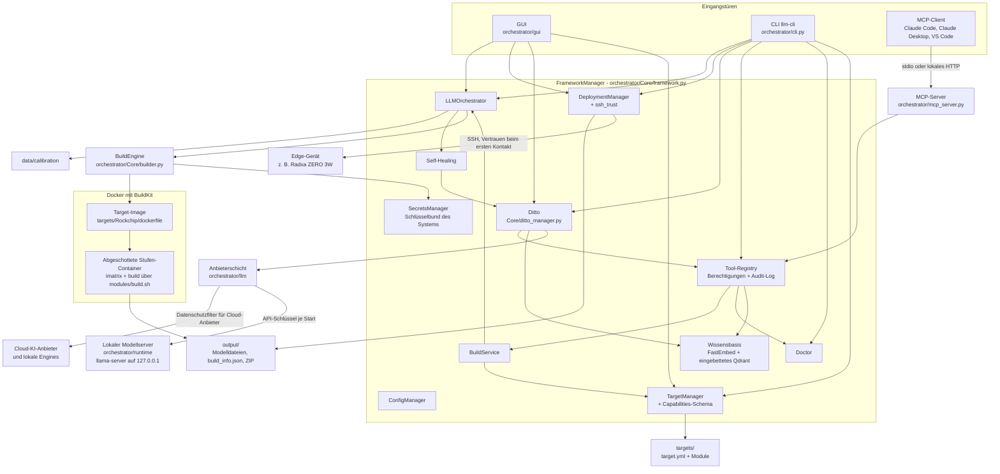
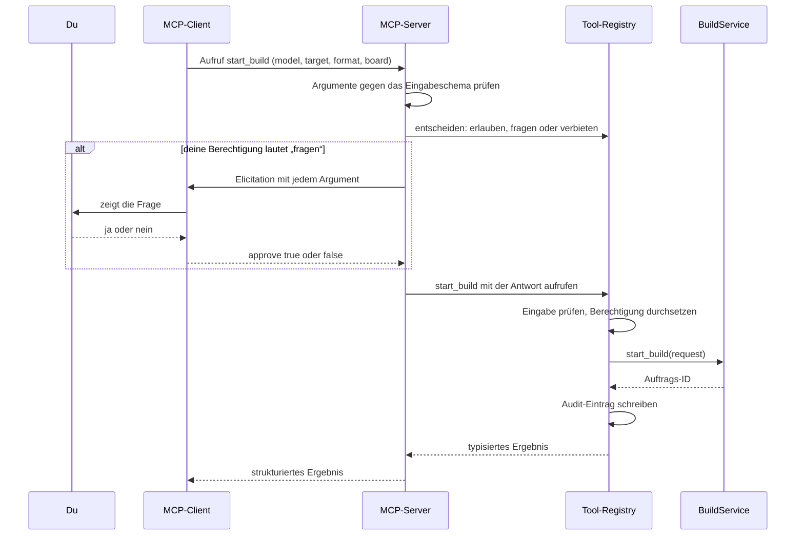

Version 3.0.0 + unveröffentlichte Änderungen · Stand 2026-10-11

[English](BLUEPRINT.md) · **Deutsch**

# Bauplan

Dies ist das Designdokument des LLM Cross-Compiler Frameworks. Es erklärt, wofür das Framework da ist, wie seine
Teile zusammenspielen, wie Daten hindurchfließen, wie es dich schützt und warum es so gebaut ist. Am Ende steht die
[Roadmap](#roadmap): Sie sagt, was als Nächstes kommt. Was jede veröffentlichte Version enthält, steht im
[Changelog](../CHANGELOG_DE.md).

Das Dokument beschreibt den Entwicklungszweig: die veröffentlichte Version 3.0.0 plus die Änderungen, die im
Changelog unter „Unreleased“ stehen und für 3.1.0 geplant sind. Wo ein Teil noch nicht veröffentlicht ist, steht
das dabei.

## Inhalt

- [Kurz gesagt](#kurz-gesagt)
- [Zweck und Grundsätze](#zweck-und-grundsätze)
- [Architektur im Überblick](#architektur-im-überblick)
- [Datenflüsse](#datenflüsse)
- [Sicherheitsmodell](#sicherheitsmodell)
- [Wichtige Entscheidungen](#wichtige-entscheidungen)
- [Versionierung und Dokumentationsregeln](#versionierung-und-dokumentationsregeln)
- [Roadmap](#roadmap)
- [Geschichte](#geschichte)
- [Glossar](#glossar)

## Kurz gesagt

Ein Sprachmodell, wie es auf Hugging Face veröffentlicht wird, ist für einen kleinen Rechner wie ein Radxa ZERO 3W
meist zu groß und im falschen Format. Das Framework löst das in drei Schritten:

1. **Holen**: das Modell (eine Hugging-Face-Repo-ID wie `Qwen/Qwen3-0.6B` oder ein Ordner auf deiner Festplatte).
2. **Umwandeln und verkleinern** („quantisieren“) in einem Docker-Container, der die passenden Werkzeuge für deine
   Hardware enthält.
3. **Installieren**: das Ergebnis per SSH auf dein Gerät.

Du kannst es auf drei Wegen bedienen: über die Desktop-Oberfläche (GUI), über die Kommandozeile `llm-cli` oder über
einen KI-Client wie Claude Code oder Claude Desktop per Model Context Protocol (MCP). Alle drei nutzen denselben
Kern.

Der eingebaute Assistent **Ditto** hilft bei der Wahl von Modellen und Einstellungen, erklärt fehlgeschlagene Builds
und kann die Tools des Frameworks für dich bedienen, immer im Rahmen der Berechtigungen, die du festlegst. Ditto
arbeitet mit einem Cloud-KI-Anbieter deiner Wahl oder ganz offline mit einem lokalen Modell, das das Framework für
dich herunterlädt und betreibt (unveröffentlicht).

Es gibt ein offizielles Hardware-Target, **Rockchip** (Boards RK3566, RK3568, RK3576, RK3588), mit drei
Ausgabeformaten:

| Format | Läuft auf | Boards | Typischer Einsatz |
|---|---|---|---|
| GGUF (llama.cpp) | CPU | alle vier | Chat-Modelle auf jedem Board |
| RKLLM | NPU | RK3588, RK3576 | Chat-Modelle auf dem Neuroprozessor |
| RKNN | NPU | alle vier | ONNX-Modelle für Bild und Ton |

`llm-cli` ist der Konsolenbefehl aus `pyproject.toml`. Wenn er nicht im PATH liegt, rufst du im Installationsordner
stattdessen `python -m orchestrator.cli` auf; die Optionen sind dieselben.

## Zweck und Grundsätze

Das Framework soll Menschen ohne Hintergrund in Compilern oder maschinellem Lernen ein Sprachmodell auf eigener,
kleiner Hardware ermöglichen und Fachleuten eine reproduzierbare, nachprüfbare Pipeline geben. Fünf Grundsätze
leiten jede Designentscheidung.

| Grundsatz | Was das praktisch heißt |
|---|---|
| **Lokal zuerst** | Umwandlungen laufen auf deinem Rechner in Docker. Modelle werden auf dem Host heruntergeladen, die Umwandlungs-Container haben kein Netzwerk. Die Wissensbasis berechnet ihre Embeddings lokal, und Ditto kann ganz offline mit einem lokalen Modell arbeiten. Außer Downloads verlässt nichts deinen Rechner, es sei denn, du wählst für Ditto einen Cloud-KI-Anbieter (dann greift der Datenschutzfilter, siehe [Sicherheitsmodell](#sicherheitsmodell)), schaltest die anonymen Fehlerberichte ein (`enable_telemetry`, standardmäßig aus) oder teilst selbst ein Wissenspaket. |
| **Laienfreundlich** | Die GUI bietet nur an, was das gewählte Target kann, die CLI lehnt alles andere ab, und beide setzen sinnvolle Vorgaben je Board (zum Beispiel Q4_0 auf dem RK3566). `llm-cli doctor` erklärt Probleme mit Lösungshinweisen. KI-Fehler werden in klaren Worten erklärt (etwa, dass ein Claude-API-Schlüssel, der in jedem Workspace gilt, die Workspace-ID braucht). Vorschläge des Self-Healing warten auf deine Entscheidung. |
| **Sicher von Haus aus** | Die Umwandlungs-Sandbox ist eingeschaltet (`build_sandbox: true`). KI-Clients und Ditto dürfen frei lesen, müssen aber fragen, bevor sie etwas ändern. Neuen SSH-Geräten wird erst vertraut, wenn du ihren Fingerabdruck bestätigt hast. Passwörter werden nie gespeichert. Von einer KI vorgeschlagener Text wird nie ausgeführt. |
| **Daten statt Code** | Was ein Target bauen kann, steht in seiner `target.yml` (Block `capabilities:`, von einem Schema geprüft). KI-Anbieter sind Vorlagen in `configs/llm_providers.yml`, der lokale Modellserver und seine Modelle sind in `configs/llama_runtime.yml` festgelegt, und Dittos Evaluationsfälle stehen in `evals/ditto/cases.yml`. Ein neues Board, ein neues Modell oder ein OpenAI-kompatibler Server ist eine Datenänderung, solange der Code dahinter das unterstützt. |
| **Nachprüfbare Builds** | Jeder Build schreibt ein Manifest (`build_info.json`) mit dem SHA256-Hash jeder Modelldatei, eine `Model_Card.md` und ein ZIP-Archiv. Das Deployment-Paket prüft die Hashes auf dem Gerät vor der Installation. Python-Abhängigkeiten sind per Hash festgelegt, Downloads des lokalen Modellservers und seiner Modelle per Größe und SHA256, und das Audit-Log der Tools lässt sich prüfen. |

## Architektur im Überblick

In einfachen Worten: Es gibt drei Eingangstüren (GUI, CLI, MCP). Dahinter sitzt ein Kern, der `FrameworkManager`,
der alle anderen Teile startet und miteinander verbindet. Ein Build-Auftrag landet bei der `BuildEngine`, die ein
Docker-Image für das Target baut und die Umwandlung in abgeschotteten Containern ausführt. Das fertige Modell liegt
danach in `output/`, und der `DeploymentManager` kopiert es auf das Gerät. Ditto spricht mit KI-Anbietern nur über
die Anbieterschicht und nutzt dieselbe Tool-Registry wie der MCP-Server.

### Bausteine

| Baustein | Wo | Aufgabe |
|---|---|---|
| GUI | `orchestrator/gui/` (Start: `llm-gui`) | Hauptfenster, Build-Reiter, Deployment-Fenster, Ditto-Chat (sein Kopf zeigt den genutzten Zugang), Modul-Assistent, Hugging-Face-Browser, Dialoge für KI-Einstellungen, der Anmeldebereich (`sign_in.py`: Karten für die Verfahren, Schlüsselformular, Auswahl für den Schutz des Tresors, Passphrase-Dialog; Zugriffe auf Tresor und Netz in Hintergrund-Threads), Tool-Berechtigungen, Tool-Bestätigungen, Self-Healing-Vorschläge und SSH-Vertrauen. |
| CLI | `orchestrator/cli.py` (`llm-cli`) | Befehle der obersten Ebene `build`, `config`, `deploy`, `ditto`, `doctor`, `mcp`, `module`, `scan`, `secrets`, `swarm`, `targets`, `tools` (`doctor` und `scan` sind einzelne Befehle, die übrigen Gruppen). Die Befehle zur Anmeldung `ditto login`, `logout` und `auth` nutzen dieselben Anmeldeoperationen wie die GUI (`orchestrator/llm/auth/signin.py`). |
| FrameworkManager | `orchestrator/Core/framework.py` | Startet alle Manager in vier Phasen (Sicherheit und Infrastruktur, Kernlogik, KI und Wissen, Wächter und Betrieb), verbindet sie, hält eine langlebige asyncio-Schleife für Builds und löst relative Datenpfade gegen den Installationsordner auf, nicht gegen das Arbeitsverzeichnis. |
| ConfigManager | `orchestrator/Core/config_manager.py` | Einstellungen mit Schema (Typ, Vorgabe, Prüfregel). Der Einstellungsordner ist `LLM_FRAMEWORK_CONFIG_DIR`, wenn gesetzt, sonst das `configs/` der Installation, wenn es beschreibbar ist, sonst der Benutzerordner; nie das Arbeitsverzeichnis. Benutzereinstellungen landen dort in `config.yml`. Umgebungsvariablen mit dem Präfix `LLM_FRAMEWORK_`, `FRAMEWORK_` oder `LLM_` überschreiben bekannte Einstellungen. Persönlicher Zustand liegt in `~/.llm-framework` (änderbar mit `LLM_FRAMEWORK_HOME`), unter Linux und macOS mit Modus 0700. |
| SecretsManager | `orchestrator/Core/secrets_manager.py`, `orchestrator/Core/vault_key.py`, `orchestrator/utils/file_lock.py` | Verschlüsselter Tresor (`secrets.store` im Benutzerordner, Format v2: Fernet-Einträge mit Schlüssel-IDs, gelesen mit MultiFernet, Schlüsselwechsel). Sein Schlüssel kommt standardmäßig aus dem Schlüsselbund des Betriebssystems (ein Eintrag je Tresor; ein Schlüsselbund, der hängt, nichts behält oder im Klartext speichert, wird abgelehnt) oder aus der ausdrücklichen Wahl in `secret_storage` (Credential-Helper, Passphrase, unverschlüsselte Schlüsseldatei, nur Arbeitsspeicher). Jede Änderung läuft unter einer Sperre über Prozessgrenzen; der Tresor lehnt einen Ort innerhalb einer Git-Arbeitskopie ab. Enthält API-Schlüssel (als Datensätze unter `cred/<anbieter>/api_key`; die alten Namen gelten weiter) und das Hugging-Face-Token (`hf_token`). Die Secrets eines Speichers am alten Ort (Einstellungsordner) werden einmalig übernommen und mit dem Schlüssel des Tresors neu verschlüsselt, auch in einen schon vorhandenen Speicher im Benutzerordner; dort bereits vorhandene Secrets haben Vorrang, und die alte Datei bleibt unverändert. Ein lange laufender Prozess (GUI, MCP-Server) liest den Tresor neu, wenn ein anderer Prozess ihn geändert hat. |
| Secret-Formate und Schwärzung in Logs | `orchestrator/security/` | Eine Tabelle der Secret-Formate, die nur die Standardbibliothek braucht (`secret_patterns.py`); `scripts/secret_scan.py` lädt sie, `redact_secrets` nutzt sie. `redaction.py` schwärzt jeden Logeintrag beim Erzeugen (Logger des Frameworks, der SDKs und der HTTP-Bibliotheken, Tracebacks), hält die SDK-Logger auf INFO oder darüber, außer `--debug-http` ist angegeben, und stellt `SecretStr` bereit, in dem die Anbieterschicht ihre Schlüssel hält. |
| TargetManager und Capabilities | `orchestrator/Core/target_manager.py`, `orchestrator/schemas/targets.py` | Lädt die `target.yml` jedes Target-Ordners (Ordner, die mit `_` oder `.` beginnen, etwa `_template`, werden übersprungen) und prüft ihren Block `capabilities:`: Boards, Formate, Quantisierungstypen (auch je Board), Aliasse, Board-Vorgaben, Standard-Board, Bedarf an Importance-Matrix und Kalibrierdaten, Unterstützungsstufe (`official`, `community`, `experimental`). |
| BuildService | `orchestrator/Core/build_service.py`, `orchestrator/schemas/build.py` | Ein typisierter Einstieg für Builds: prüfen, starten, Status, abbrechen, Log-Ende, Ergebnisse, Self-Healing-Entscheidung. Die Tools (MCP-Server und Ditto) nutzen ihn. GUI und CLI prüfen dieselben Capabilities und reichen den Auftrag dann direkt beim Orchestrator ein. |
| LLMOrchestrator | `orchestrator/Core/orchestrator.py` | Warteschlange und Pipeline: bereitet Kalibriertext vor, zerlegt einen Auftrag in Jobs (Modell x Target x Format x Quantisierung), führt sie auf der Build-Engine aus, behandelt Abbrüche und die Freigabeschleife des Self-Healing. |
| BuildEngine | `orchestrator/Core/builder.py`, `orchestrator/utils/build_context.py` | Stellt den Docker-Build-Kontext zusammen, baut das Image (mit BuildKit, wenn vorhanden), lädt oder bindet das Modell ein, führt den optionalen Trivy-Scan, die Importance-Matrix-Stufe und die Build-Stufe in abgeschotteten Containern aus, schreibt Manifest, Model Card und ZIP in einen versteckten Zwischenordner, verschiebt sie in den Ausgabeordner, sobald der Build nicht mehr abgebrochen werden kann, und räumt auf. |
| DockerManager | `orchestrator/Core/docker_manager.py` | Docker-Verbindung und laufende CPU-/RAM-Werte für die GUI. |
| Rockchip-Referenz-Target | `targets/Rockchip/` | `dockerfile` (Debian bookworm-slim; llama.cpp-Werkzeuge v0.6.0; drei Python-venvs), `modules/build.sh` (Verteiler für `gguf`, `rkllm`, `rknn` und den Job `imatrix`), `modules/rkllm_module.sh`, `modules/rknn_module.sh`, `scripts/export_rkllm.py`, `scripts/rknn_converter.py`, `target.yml`. `targets/_template/` ist der Ausgangspunkt für neue Targets ([Leitfaden für Modulentwickler](Module_Developer_Guide_DE.md)). |
| DeploymentManager und SSH-Vertrauen | `orchestrator/Core/deployment_manager.py`, `orchestrator/utils/ssh_trust.py` | Baut das Deployment-Paket, prüft den Host-Schlüssel des Geräts, hinterlegt den SSH-Schlüssel des Frameworks, lädt hoch und startet die Installation. |
| Tool-Registry, Berechtigungen, Audit | `orchestrator/tools/` (`registry.py`, `policy.py`, `audit.py`, `confirmation.py`, `framework_tools.py`) | Elf typisierte Tools mit Risikostufen, die gespeicherten Berechtigungen des Benutzers, der Bestätigungstext (gemeinsam für MCP und Ditto) und ein per Hash verkettetes Audit-Log. |
| MCP-Server | `orchestrator/mcp_server.py` | Stellt die Tool-Registry per MCP bereit (offizielles SDK `mcp` 2.3.0), über stdio oder lokales Streamable HTTP. Der Startbefehl, den er für Clients schreibt, nutzt `python -P`, sodass nichts aus dem Ordner importiert wird, in dem ein Client ihn startet. |
| Anbieterschicht (unveröffentlicht) | `orchestrator/llm/` | Ein Client (`LLMClient`) für jeden KI-Anbieter, gebaut auf den offiziellen SDKs `anthropic` und `openai`; OpenAI-kompatible Server laufen über `openai`. Wählt Anbieter, Modell und Aufwand je Aufgabe aus den Einstellungen und den Vorlagen in `configs/llm_providers.yml` (eine gleichnamige Datei im Einstellungsordner ergänzt oder ersetzt Vorlagen). Wiederholungen (zwei, die eigenen Wiederholungen der SDKs sind aus), eine Fallback-Kette bei Ablehnungen und Ausfällen (`ai_fallback_chain`), strukturierte Antworten mit Schemaprüfung und einem Reparaturversuch, typisierte Fehler, der Datenschutzfilter für Cloud-Anbieter und eine Tool-Schleife. Der Anmeldekern (`orchestrator/llm/auth/`) bestimmt die Zugangsdaten jedes Aufrufs aus den Anmeldeverfahren im Katalog: Schlüssel aus dem Tresor (Schlüssel eigener Server an ihre Adresse gebunden) oder aus den Umgebungsvariablen, die der Katalog nennt, eine kostenlose Prüfung der Zugangsdaten, Fehler mit bekannter Ursache und dem nächsten Schritt sowie die Erneuerung von Tokens unter einer Sperre, die alle Prozesse teilen. |
| Ditto (neu gebaut, unveröffentlicht) | `orchestrator/Core/ditto_manager.py` | Der Assistent: Chat mit den Tools des Frameworks (höchstens 8 Modellrunden je Frage, Tool-Aufrufe als Akteur `ditto` über die Registry), Analyse fehlgeschlagener Builds, Modulvorschläge aus einer Hardware-Probe und Build-Empfehlungen. Die letzten drei sind geprüfte strukturierte Antworten; eine ungültige Antwort ist ein Fehler und wird nie angewendet. Eine Self-Healing-Analyse oder Build-Empfehlung mit gefährlichem Befehl wird verworfen; einen Modulvorschlag prüft der Modulgenerator noch einmal. Der Chatverlauf wird nur ergänzt (`chat_history.json`); ein langes Gespräch wird zusammengefasst und als neues fortgesetzt. |
| Verwaltetes lokales Modell (unveröffentlicht) | `orchestrator/runtime/`, `configs/llama_runtime.yml` | Lädt einen festgelegten llama.cpp-Build (b11429, derselbe Commit wie v0.6.0) für die Hardware (CPU, Vulkan, CUDA, Metal; ROCm nur auf Wunsch) und festgelegte GGUF-Modelle in Stufen (Qwen3.5 9B, 4B und 2B, 2-Bit-Varianten für schwache Hardware und auf Wunsch ein IBM Granite 4.2 3B), jeweils per Größe und SHA256 geprüft. Startet `llama-server` auf 127.0.0.1 mit freiem Port und einem API-Schlüssel je Start. Der Anbieter `local` findet den laufenden Server von selbst. |
| Ditto-Evaluation (unveröffentlicht) | `orchestrator/evals/ditto_eval.py`, `evals/ditto/cases.yml` | `llm-cli ditto eval`: 19 feste Fälle (Build-Log-Analyse, Build-Empfehlungen, Modulvorschläge, Chat mit Tools, Prompt-Injection), nach Regeln bewertet, gegen den eingestellten Anbieter oder je lokaler Modellstufe. Gebaut wird nichts: Chat-Fälle nutzen die echten Tool-Definitionen über einen Stellvertreter-Build-Service. |
| Self-Healing | `orchestrator/Core/self_healing_manager.py` | Erkennt bekannte Fehler zuerst mit festen Mustern und fragt Ditto nur bei unbekannten. Wendet nur vom Framework festgelegte Korrekturen an, und nur nach deiner Freigabe. |
| Wissensbasis und Crawler | `orchestrator/Core/rag_manager.py`, `orchestrator/rag/`, `orchestrator/Core/crawler_manager.py`, `orchestrator/Core/community_manager.py` | Optional (`enable_rag_knowledge`). Webseiten, PDFs, Community-Pakete und der eigene Code des Frameworks werden in Abschnitte zerlegt und mit einem lokalen dichten Embedding (FastEmbed auf ONNX Runtime, CPU; Modell je nach Hardware, sofern `rag_embedding_model` nichts anderes sagt) und einem BM25-Vektor gespeichert. Suchen verbinden beide Ranglisten mit Reciprocal Rank Fusion. Qdrant läuft eingebettet im Prozess, die Daten liegen im Benutzerordner (unveröffentlicht); ein Qdrant-Server wird nur genutzt, wenn `qdrant_url` gesetzt ist. Wissenspakete lassen sich als JSON in `community/knowledge/` teilen. |
| Doctor | `orchestrator/Core/doctor.py` | Deterministische Gesundheitsprüfungen (Python, Docker und BuildKit, Speicherplatz, Targets, Rechte des Zustandsordners, Secrets und Schlüsselbund, Tool-Berechtigungen und Audit-Log, Kalibrierdaten) mit festen Codes, Lösungshinweisen und gestuften automatischen Korrekturen. |
| Kalibrierdaten | `data/calibration/`, `orchestrator/utils/calibration.py` | Kuratierter deutscher, englischer und Tool-Nutzungs-Text (MIT-Lizenz) mit SHA256-Prüfung, für Importance-Matrizen. |
| Umgang mit nicht vertrauenswürdigem Text | `orchestrator/utils/untrusted.py` | Bereinigt und verpackt externen Text, bevor er ein Sprachmodell erreicht. |

Der Rockchip-Ordner enthält außerdem noch `source_module.sh`, `config_module.sh`, `convert_module.sh` und
`target_module.sh` aus der Vier-Module-Kette der Version 1.x. Der aktuelle Verteiler `build.sh` ruft sie nicht auf;
ihre Entfernung ist für 3.4.0 geplant.

`configs/project_sources.yml` ist ein Katalog vorgelagerter Projekte und Dokumentationslinks. Das Framework liest
ihn zur Laufzeit nicht; wofür jede Datei in `configs/` da ist, steht in
[SSOT_ARCHITECTURE_DE.md](../configs/SSOT_ARCHITECTURE_DE.md).

### Wo was liegt

| Ort | Inhalt |
|---|---|
| `targets/` | Target-Definitionen (ein Ordner je Target). |
| `cache/models/hf/` | Von Hugging Face heruntergeladene Modelle für Builds. |
| `cache/builds/<Build-ID>/` | Arbeitsordner eines laufenden Builds (Build-Kontext, Ausgabe, Importance-Matrix, Zwischenablage); wird nach dem Build entfernt. |
| `cache/calibration/` | Für Importance-Matrizen geschriebener Kalibriertext. |
| `output/` | Fertige Builds, ein Ordner je Build mit Modelldateien, `build_info.json`, `Model_Card.md`, daneben ein ZIP. |
| `models/ditto/` | Dittos lokale GGUF-Modelle mit je einer Markierung `.verified.json` (unveröffentlicht). |
| `models/embeddings/` | Embedding-Modelle der Wissensbasis (unveröffentlicht). |
| `~/.llm-framework/` (oder `LLM_FRAMEWORK_HOME`) | `secrets.store`, `tool_policy.json`, `audit.db` mit `audit.db.anchor`, `known_hosts`, der SSH-Schlüssel des Frameworks `id_ed25519_llm_framework` (+ `.pub`), `mcp_http_token`, `chat_history.json`, `llm_privacy_key` und `llm_install_id`; die eingebettete Wissensbasis `qdrant/` und `knowledge_snapshots/`; der lokale Modellserver unter `runtime/llama.cpp/` (Builds, `active.json`, `server.json`, die Schlüsseldatei, solange der Server läuft) und sein Log in `logs/llama-server.log`. |
| Einstellungsordner (meist `configs/`) | `config.yml` (Benutzereinstellungen); auf Wunsch eine eigene `llm_providers.yml`, die Anbietervorlagen ergänzt oder ersetzt. |

`cache/`, `output/` und `models/` sind relativ zum Installationsordner, sofern die Einstellungen `cache_dir`,
`output_dir` und `models_dir` nichts anderes sagen.

## Datenflüsse

### Ein Build, vom Auftrag bis zum Gerät

In einfachen Worten: Du wählst ein Modell, ein Board und eine Quantisierung. Das Framework prüft, ob das Target das
kann, bereitet alles auf deinem Rechner vor, baut ein Werkzeug-Image, wandelt das Modell in einem abgeriegelten
Container um, hält Hashes fest und lässt dich das Ergebnis auf deinem Gerät installieren.

1. **Auftrag.** Der Build-Reiter der GUI, `llm-cli build start -m <Modell> -t Rockchip -f gguf -b rk3566` oder das
   Tool `start_build` (MCP-Client oder Ditto) erzeugt einen Auftrag. Ein unbekanntes Target wird mit der Liste der
   bekannten Targets abgelehnt. Der Auftrag wird gegen die Capabilities des Targets geprüft: Unbekannte Formate,
   Boards oder Quantisierungstypen werden mit einem Satz abgelehnt, der die erlaubten Werte nennt; Schreibweisen werden vereinheitlicht (Groß- und Kleinschreibung, Aliasse wie `INT8` für `Q8_0`); ein
   fehlendes Board wird zum Standard-Board des Targets, eine fehlende Quantisierung zur Vorgabe des Boards;
   Typen mit sehr wenigen Bits wie IQ2_XS verlangen eine Importance-Matrix.
2. **Warteschlange und Kalibrierung.** Der `LLMOrchestrator` reiht den Auftrag ein. Ist eine Importance-Matrix
   gewünscht (nur GGUF) und hast du keinen Datensatz angegeben, schreibt er den mitgelieferten Kalibriertext
   (`calibration_language`: `mixed`, `de` oder `en`) nach `cache/calibration/`.
3. **Jobs.** Der Auftrag wird in einen Job je Modell, Target, Format und Quantisierung zerlegt. Jeder Job geht an
   die `BuildEngine`.
4. **Build-Kontext und Image.** Die Engine kopiert `modules/`, `scripts/` des Targets und das gemeinsame
   `entrypoint.sh` in einen frischen Build-Kontext und baut das Image `llm-framework/<Target>:<Build-ID>` mit
   `docker buildx build` (BuildKit) oder, falls BuildKit fehlt, über die Docker-API. Dieser Schritt braucht Netzwerk:
   Er lädt llama.cpp (Tag aus `llama_cpp_version`, Vorgabe `v0.6.0`) und die Python-Werkzeugketten. Die Zahl
   paralleler Compile-Jobs kommt aus `build_jobs` (0 heißt alle Kerne).
5. **Bereitstellung auf dem Host.** Das Modell wird bereitgestellt, bevor irgendein Umwandlungscode läuft: Ein
   lokaler Ordner oder eine Datei wird schreibgeschützt eingebunden; ein Hugging-Face-Repo wird auf dem Host nach
   `cache/models/hf/` geladen, bei Bedarf mit deinem gespeicherten `hf_token`. Das Token gelangt nie in einen
   Container.
6. **Sicherheitsscan.** Ist `enable_security_scan` an (Vorgabe), durchsucht Trivy (`image_trivy`, Vorgabe
   `aquasec/trivy:0.75.0`) das Image nach Schwachstellen der Stufen HIGH und CRITICAL. Funde ergeben eine Warnung;
   der Build läuft weiter. Ein Scan, der nicht innerhalb von `build_timeout` fertig wird, wird mit einer Warnung
   gestoppt.
7. **Importance-Matrix-Stufe** (nur GGUF mit IMatrix). Ein abgeschotteter Container führt `modules/build.sh` mit
   `JOB_TYPE=imatrix` aus: Er wandelt das Modell in F16-GGUF um und lässt `llama-imatrix` über die ersten 100
   Abschnitte des Kalibriertexts laufen. Scheitert diese Stufe, stoppt der Build.
8. **Build-Stufe.** Ein zweiter abgeschotteter Container führt `modules/build.sh` mit `JOB_TYPE=build` aus. Der
   Verteiler wählt die Werkzeugkette: `llama-quantize` für GGUF (mit Importance-Matrix, falls vorhanden),
   `rkllm_module.sh` für RKLLM (nur RK3588 und RK3576), `rknn_module.sh` für RKNN.
9. **Manifest und „Golden Artifact“.** Die Engine kopiert die Ergebnisse in einen versteckten Zwischenordner neben
   dem Ausgabeordner (Links in der Ausgabe des Builds werden nicht verfolgt), ergänzt `build_info.json` um Größe
   und SHA256-Hash jeder Modelldatei und um die Hauptdatei, schreibt `Model_Card.md` und erstellt ein ZIP dieser
   Dateien. Erst wenn der Build nicht mehr abgebrochen werden kann, werden sie nach `output/` verschoben und das ZIP
   neben den Build-Ordner; ein abgebrochener oder gescheiterter Build hinterlässt dort keine Dateien. Das Image-Tag
   des Builds und der Arbeitsordner werden entfernt; die Image-Schichten bleiben im Build-Cache, der nächste Build
   geht also schneller.
10. **Deployment.** Im Deployment-Fenster (oder mit `llm-cli deploy package` und `llm-cli deploy run`) wählst du
    einen Build. Das Framework packt Modelldatei, `build_info.json`, `Model_Card.md`, ein erzeugtes `deploy.sh` und
    `checksums.sha256` in ein ZIP.
11. **Vertrauen beim ersten Kontakt.** Vor der ersten Verbindung wird der Fingerabdruck des Host-Schlüssels des
    Geräts angezeigt (im selben Format wie bei `ssh-keygen -lf`). Erst wenn du ihn bestätigst oder ein passendes
    `--trust-fingerprint` angibst, wird er in der eigenen `known_hosts` des Frameworks gespeichert. Ein geänderter
    Schlüssel stoppt das Deployment immer.
12. **Kopplung und Installation.** Bei der ersten Verbindung wird dein Passwort einmal benutzt, um den
    Ed25519-Schlüssel des Frameworks auf dem Gerät zu hinterlegen; gespeichert wird es nie. Das Paket wird in einen
    privaten temporären Ordner hochgeladen (`mktemp -d /tmp/llm_deploy.XXXXXXXX`) und entpackt, und `deploy.sh`
    prüft alle Hashes mit `sha256sum -c`, bevor es das Modell nach `$MODEL_DIR` (Vorgabe `$HOME/models`) kopiert
    und anzeigt, wie man es startet (bei GGUF mit `llama-server`).

Das Tool `cancel_build` stoppt den laufenden Stufen-Container. Jeder Stufen-Container hat ein eigenes Zeitlimit
(`build_timeout`, Vorgabe 3600 Sekunden).

### Ein Tool-Aufruf eines MCP-Clients

In einfachen Worten: Der KI-Client darf sich Dinge selbst ansehen, aber bevor er etwas ändert, fragt das Framework
dich über den Client und schreibt auf, was passiert ist.

1. **Schema.** Jedes Tool hat ein pydantic-Modell für Ein- und Ausgabe. Das MCP-SDK veröffentlicht sie als
   JSON-Schemas; ungültige Argumente werden abgelehnt, bevor irgendetwas läuft, und die Ablehnung wird als
   `invalid_input` im Audit-Log festgehalten.
2. **Berechtigungen.** Die Registry schlägt deine gespeicherte Berechtigung für dieses Tool nach (zuerst eine
   Einstellung für das einzelne Tool, dann seine Stufe). Vorgaben: `read` erlaubt, `local_write` fragen, `external`
   fragen. Tools der Stufe `forbidden` lassen sich gar nicht erst registrieren. Ist die Berechtigungsdatei
   beschädigt, wird jedes Tool verweigert, bis du die Berechtigungen neu einrichtest.
3. **Elicitation.** „Fragen“ wird zu einer MCP-Elicitation: Der Client zeigt dir das Tool und jedes Argument
   vollständig (Argumente, die zu lang zum Anzeigen sind, lassen sich nicht bestätigen). Nur eine echte Antwort
   zählt als Freigabe, und ein „Nein“ gilt für diesen Aufruf endgültig, auch wenn die Berechtigung inzwischen
   gelockert wird. Eine Bestätigung, die scheitert, führt zur Ablehnung und wird im Audit-Log festgehalten. Ein
   Client ohne Elicitation kann nicht bestätigen; der Aufruf wird dann verweigert, mit dem Hinweis, das Tool mit
   `llm-cli tools permissions` oder in der GUI (Tools > Tool Permissions (Ditto / MCP)...) zu erlauben.
4. **Ausführung.** Die Tool-Funktion läuft in einem eigenen Thread; ihr Ergebnis wird gegen das Ausgabemodell
   geprüft. Fehler kommen als Tool-Fehler mit einer für Menschen gedachten Meldung zurück, Secrets darin
   geschwärzt.
5. **Audit.** Jedes Ergebnis (`ok`, `denied`, `not_confirmed`, `error`, `invalid_input`) wird an `audit.db`
   angehängt, mit geschwärzten, gekürzten Argumenten und einem Hash des vollen Texts. `llm-cli tools audit --verify`
   prüft die Kette und ihren Anker; `llm-cli tools audit --archive` legt das Log beiseite und beginnt eine neue
   Kette.

Die elf Tools: `list_targets`, `get_target_capabilities`, `list_build_requests`, `get_build_status`,
`read_build_log`, `list_artifacts`, `run_doctor`, `search_knowledge` (Stufe `read`) sowie `start_build`,
`cancel_build`, `resolve_healing` (Stufe `local_write`). Kein Tool der Stufe `external` ist registriert; weder
KI-Clients noch Ditto können also auf Geräte deployen.

### Eine Frage an Ditto (unveröffentlicht)

In einfachen Worten: Ditto antwortet im Chatfenster oder auf der Kommandozeile. Braucht es Fakten über Targets oder
Builds, fragt es die Tools des Frameworks, mit denselben Berechtigungen wie ein KI-Client. Bevor eine Frage an einen
Cloud-Anbieter geht, werden persönliche Angaben durch Platzhalter ersetzt.

1. **Frage.** Im Chat der GUI oder mit `llm-cli ditto ask "<Frage>"` (`--no-tools` antwortet ohne Tools;
   `--provider` und `--model` überschreiben die KI-Einstellungen für diese eine Frage).
2. **Anbieter und Modell.** Der `LLMClient` nimmt Anbieter, Modell und Aufwand für die Aufgabe aus den
   KI-Einstellungen und der Vorlage in `configs/llm_providers.yml`. Für den Anbieter `local` liest er Adresse,
   Schlüssel und Modell des laufenden verwalteten `llama-server`. Im Offline-Modus werden nur lokale Anbieter
   genutzt.
3. **Datenschutzfilter** (nur Cloud-Anbieter). Secrets werden immer geschwärzt. Je nach `ai_security_level`
   werden Adressen, E-Mail-Adressen, Logins, Benutzernamen, Hostnamen, Seriennummern und Pfade durch feste
   Platzhalter ersetzt, die in der Antwort lokal zurückübersetzt werden.
4. **Tool-Schleife.** Das Modell darf Tools aufrufen, höchstens 8 Modellrunden je Frage. Jeder Aufruf läuft als
   Akteur `ditto` über die Tool-Registry. Ein Aufruf, der eine Bestätigung braucht, zeigt seinen Titel und jedes
   Argument: als Dialog in der GUI, als Rückfrage in der CLI; ohne Terminal lautet die Antwort Nein.
   Tool-Ergebnisse gehen als nicht vertrauenswürdige Datenblöcke an das Modell zurück.
5. **Fehler.** Anbieterfehler sind typisiert und werden erklärt (kein Guthaben, abgelehnter Schlüssel,
   Ratenlimit, Ablehnung, abgeschnittene Antwort). Bei Ablehnungen und Ausfällen geht es entlang der Fallback-Kette
   weiter. Ein Fehler wird nie als Antwort angezeigt oder gespeichert.
6. **Verlauf.** Die fertige Runde wird an `chat_history.json` angehängt. Ein langes Gespräch wird zusammengefasst
   und als neues Gespräch fortgesetzt; frühere Runden werden nie verändert.

### Freigabe beim Self-Healing

In einfachen Worten: Scheitert ein Build, sucht das Framework nach einer bekannten Ursache, sagt dir, was es tun
würde, und wartet. Ohne dein Ja wird nichts verändert.

1. Ein Job scheitert. Der Orchestrator übergibt das Fehlerlog an den Self-Healing-Manager.
2. **Bekannte Probleme zuerst.** Feste Muster erkennen zum Beispiel einen Compiler, dem beim Image-Bau der
   Speicher ausgeht, eine abgebrochene Umwandlung (Exit-Code 137), eine volle Festplatte, fehlende Docker-Rechte,
   DNS-Fehler und veraltete apt-Quellen.
3. **Ditto als Zweites.** Nur wenn kein Muster passt, analysiert Ditto das Log (als nicht vertrauenswürdiger Text
   verpackt) und liefert eine strukturierte Analyse. Seine Antwort gilt immer als Rat: Die Strategie wird auf
   „manueller Schritt“ gesetzt. Ein Vorschlag mit gefährlichem Befehl wird verworfen.
4. **Warten auf dich.** Der Build-Status wird `awaiting_approval`. Du entscheidest im GUI-Dialog, an der Rückfrage
   eines laufenden `llm-cli build start` oder über das Tool `resolve_healing`. Ohne Entscheidung innerhalb von
   `healing_approval_timeout` (Vorgabe 900 Sekunden) wird der Vorschlag verworfen.
5. **Nur feste Maßnahmen.** Ein freigegebener Vorschlag wird nur angewendet, wenn er eine von drei im Framework
   festgelegten Strategien ist: `build_jobs` auf 1 senken, verwaiste Framework-Images und den Docker-Build-Cache
   entfernen oder einfach neu versuchen. Der Job wird dann einmal wiederholt. Befehlstext aus Mustern oder von der
   KI wird nur angezeigt und nie ausgeführt; die Freigabe eines manuellen Schritts über MCP wird abgelehnt.

### Das lokale Modell für den Offline-Modus (unveröffentlicht)

In einfachen Worten: Das Framework kann ein kleines Sprachmodell und ein passendes Serverprogramm herunterladen,
beide prüfen und nur auf deinem Rechner betreiben. Ditto braucht dann kein Internet.

1. **Status.** `llm-cli ditto runtime status` zeigt die erkannte Hardware, den empfohlenen Server-Build und die
   empfohlene Modellstufe und ob der Server läuft.
2. **Server installieren.** `llm-cli ditto runtime install` lädt den festgelegten llama.cpp-Build für deine
   Hardware (`--backend auto|cpu|vulkan|cuda|rocm|metal`; ROCm nur auf Wunsch). Größe und SHA256 werden geprüft,
   bevor irgendetwas entpackt wird; installiert wird atomar.
3. **Modell laden.** `llm-cli ditto models list` zeigt die Stufen; `llm-cli ditto models download [STUFE]` lädt
   eine davon in ihrer festgelegten Hugging-Face-Revision und prüft Größe und SHA256. Die Empfehlung richtet sich
   nach dem Speicher: das 9B-Modell ab 7,5 GiB Grafikspeicher, 2B mit 2 Bit bei höchstens 3 GiB RAM, 2B mit 4 Bit
   bis 4,5 GiB, sonst 4B, jeweils nur, wenn das Modell neben dem System Platz hat. Die übrigen Stufen (4B und 9B
   mit 2 Bit, IBM Granite 4.2 3B) werden nie empfohlen; du lädst sie über ihren Namen.
4. **Starten.** `llm-cli ditto runtime start` (`--model`, `--ctx`, `--sleep-idle`) startet `llama-server` auf
   127.0.0.1 mit einem freien Port. Für jeden Start wird ein neuer zufälliger API-Schlüssel in eine private Datei
   geschrieben; das Framework prüft, dass der Server Anfragen ohne ihn ablehnt. Die Kontextlänge richtet sich nach
   dem freien Speicher (höchstens 32768 Token); ein unbenutztes Modell wird nach 10 Minuten entladen und bei der
   nächsten Anfrage neu geladen.
5. **Nutzen.** Der Anbieter `local` liest Adresse, Schlüssel und Modell bei jedem Aufruf vom laufenden Server; ein
   aus der CLI oder der GUI gestarteter Server wird also ohne Einrichtung gefunden. Anfragen an 127.0.0.1 laufen
   nie über einen HTTP(S)-Proxy. Beim Aufwand `low` ist das Nachdenken ausgeschaltet (Qwen3.5 denkt sonst in voller
   Länge, was auf einer CPU Minuten dauert).
6. **Stoppen.** `llm-cli ditto runtime stop` beendet den Server (und Reste eines Absturzes) und löscht die
   Schlüsseldatei.

## Sicherheitsmodell

In einfachen Worten: Das Framework arbeitet mit Umwandlungswerkzeugen von Dritten, mit KI-erzeugtem Code, mit
KI-Antworten und mit Text aus dem Internet. Es behandelt all das als möglicherweise feindlich und begrenzt, was
jedes davon erreichen kann. Die Tabelle nennt jede Bedrohung, den Schutz und wo er umgesetzt ist.

| Bedrohung | Schutz | Wo |
|---|---|---|
| Umwandlungscode (Hersteller-Toolkits, KI-erzeugte Target-Skripte) schadet dem Host oder schickt Daten nach außen | Umwandlungsstufen laufen als Host-Benutzer statt als root (1000:1000, wenn der Host-Benutzer root ist oder unter Windows), ohne Netzwerk (`network_mode: none`), ohne Capabilities, mit `no-new-privileges`, schreibgeschütztem Image-Dateisystem, einem 1-GB-tmpfs für `/tmp`, einem Prozesslimit (`build_pids_limit`, Vorgabe 4096) und einem optionalen Speicherlimit (`build_memory_limit`). Beschreibbar sind nur die Ordner des Builds (Arbeitsbereich, Ausgabe, Importance-Matrix); Modell-, Cache- und Datensatz-Einbindungen sind schreibgeschützt. Hugging-Face-Bibliotheken werden offline gezwungen. `build_sandbox: false` schaltet auf den alten Modus mit root und Entrypoint zurück. | `BuildEngine._sandbox` in `orchestrator/Core/builder.py` |
| Der Crawler wird missbraucht, um interne Dienste zu erreichen (SSRF), auch über DNS-Rebinding oder Weiterleitungen | Nur http(s); URLs mit Backslashes, Leerzeichen, Steuerzeichen oder mehrdeutigen Hosts werden abgelehnt; jede aufgelöste Adresse muss öffentlich sein (keine privaten, Loopback-, Link-Local-, CGNAT-, Multicast- oder reservierten Bereiche, auch nicht verpackt in IPv4-mapped-, NAT64-, 6to4- und Teredo-Adressen). Beim Verbinden wird die Adresse erneut aufgelöst und geprüft, und die Verbindung geht genau an diese IP. Weiterleitungen werden von Hand verfolgt (höchstens 5, jede geprüft); ein Anfragebudget vom Fünffachen von `crawler_max_pages`; robots.txt nach RFC 9309 (Serverfehler heißen „verboten“); Pause zwischen Anfragen (`crawler_rate_limit`). Hinter einem eingestellten Proxy gilt nur die URL-Prüfung. | `validate_public_url`, `is_public_ip` in `orchestrator/utils/validation.py`; `PublicOnlyAdapter` in `orchestrator/Core/crawler_manager.py` |
| In externem Text versteckte Anweisungen steuern ein Sprachmodell (Prompt-Injection) | Webseiten, Treffer der Wissensbasis, Build-Logs, Hardware-Proben, Tool-Ergebnisse und Gesprächszusammenfassungen kommen nie in einen System-Prompt. Sie werden normalisiert, von unsichtbaren Zeichen und HTML-Kommentaren befreit, gekürzt und in einen Block mit zufälliger ID verpackt; der System-Prompt sagt dem Modell, solche Blöcke als Daten zu behandeln. Tool-Beschreibungen und Serveranweisungen des MCP-Servers kennzeichnen Logs und Suchergebnisse als nicht vertrauenswürdig. Dittos Self-Healing-Analysen, Modulvorschläge und Build-Empfehlungen sind geprüfte strukturierte Antworten; eine Self-Healing-Korrektur oder Empfehlung mit gefährlichem Befehl (ein Download, der in eine Shell geleitet wird, Löschen des Wurzel- oder Home-Ordners, für alle beschreibbare Rechte, Überschreiben einer Festplatte) wird verworfen. Chat-Ausgaben werden HTML-maskiert; Links öffnen erst nach Bestätigung. | `orchestrator/utils/untrusted.py`, `orchestrator/Core/ditto_manager.py`, `orchestrator/llm/tool_loop.py`, `orchestrator/gui/chat_window.py`, `orchestrator/mcp_server.py` |
| Ein erzeugtes oder geteiltes Target-Modul enthält schädlichen Code | Bevor eine Vorlage ausgefüllt wird, werden Namen, Architektur, Debian-Paketnamen, Compiler-/CMake-Flags und der Erkennungsbefehl gegen strenge Muster geprüft; Basis-Images müssen per Digest festgelegt sein, außer es sind offizielle Basis-Images (`debian:`, `ubuntu:`, `nvidia/cuda:`, `rocm/dev-ubuntu-*`, `rocm/rocm-terminal:`, `python:`). Shell-Code-Felder müssen eine feste Sperrliste bestehen (Downloads, `sudo`, Löschen von `/`, `chmod 777`, Schreiben auf Rohgeräte, Docker-Socket oder `docker run`, Ausführen erzeugten Codes), und jedes erzeugte Skript muss `bash -n` bestehen. Neue Targets bleiben in `targets/`, überschreiben nie ein bestehendes Target und werden wieder entfernt, wenn die Erzeugung scheitert. Der Assistent und `llm-cli module generate-ai` zeigen den Vorschlag zur Prüfung an. | `validate_module_data`, `ModuleGenerator` in `orchestrator/Core/module_generator.py` |
| Ein KI-Client oder Ditto tut etwas, das du nicht wolltest | Vier Risikostufen; die Registry setzt deine gespeicherten Berechtigungen bei jedem Aufruf durch, egal was die Tool-Annotationen des Clients sagen. Tools der Stufe `forbidden` lassen sich nicht registrieren; Tools der Stufe `external` lassen sich nur einzeln erlauben, nie als ganze Stufe; eine beschädigte Berechtigungsdatei verweigert jedes Tool. Bestätigungen zeigen jedes Argument vollständig (MCP-Elicitation, Dittos Dialog oder Rückfrage). Jeder Aufruf wird in einem Audit-Log festgehalten, dessen Einträge per HMAC verkettet sind; der Schlüssel ist ein eigener Eintrag im Schlüsselbund des Systems, nicht neben der Datenbank (ohne Schlüsselbund ist die Kette ohne Schlüssel, und der Doctor meldet das). Eine Ankerdatei (`audit.db.anchor`) deckt auch entfernte neueste Einträge auf. | `orchestrator/tools/` |
| Andere lokale Programme oder Webseiten sprechen mit dem MCP-Server | stdio ist die Vorgabe. Streamable HTTP bindet nur an Loopback-Adressen, verlangt ein Bearer-Token je Benutzer (in konstanter Zeit verglichen, Datei `mcp_http_token`, Modus 0600) und nutzt die Host-/Origin-Prüfung des SDK gegen DNS-Rebinding. | `orchestrator/mcp_server.py` |
| Persönliche Daten erreichen einen Cloud-KI-Anbieter | Der Datenschutzfilter läuft über alles, was an einen Cloud-Anbieter geht: System-Prompt, Nachrichten, Tool-Ergebnisse und Tool-Argumente. `OFF`: nur Secrets werden geschwärzt (immer). `BALANCED`: zusätzlich IP- und MAC-Adressen, E-Mail-Adressen, Logins der Form `user@host` und Benutzernamen in Home-Pfaden. `STRICT` (Vorgabe): zusätzlich Hostnamen aus Proben, Seriennummern, UUIDs und die Ordner absoluter Pfade. Platzhalter entstehen aus einem HMAC mit einem Schlüssel je Installation und werden lokal zurückübersetzt. Lokale Anbieter (Loopback, privates Netz, `*.local`) werden nie gefiltert. Der Offline-Modus nutzt nur lokale Anbieter, und die Wissensbasis berechnet Embeddings lokal. | `orchestrator/llm/privacy.py`, `orchestrator/llm/client.py` |
| Der lokale Modellserver wird missbraucht | `llama-server` bindet nur an 127.0.0.1, auf einem freien Port, mit einem zufälligen API-Schlüssel je Start, der über eine Datei mit Modus 0600 übergeben wird (nie auf der Kommandozeile); das Framework prüft, dass der Schlüssel durchgesetzt wird. Optionen, die dem Server eigene Tools, einen Agentenmodus, MCP-Clients, eine Weboberfläche, entfernte Rechenknoten oder Zustandsendpunkte geben würden, werden nie übergeben; Variablen, die nach Secrets aussehen, werden aus seiner Umgebung entfernt. Dittos Tools laufen im Framework, wo die Berechtigungen gelten. | `orchestrator/runtime/llama_server.py` |
| Ein manipulierter Download des lokalen Servers oder eines Modells | Jeder Eintrag in `configs/llama_runtime.yml` braucht eine festgelegte Größe und einen SHA256, sonst wird er abgelehnt; Modelle sind auf einen Hugging-Face-Commit festgelegt, nie auf einen Branch. Archive werden vor dem Entpacken geprüft, sicher entpackt und atomar installiert. | `orchestrator/runtime/` |
| Secrets gelangen nach außen | Secrets werden verschlüsselt in einem Tresor gespeichert, dessen Schlüssel im Schlüsselbund des Systems liegt oder so geschützt ist, wie du es ausdrücklich wählst (`secret_storage`); nichts weicht stillschweigend aus. Der Tresor wird unter einer Sperre über Prozessgrenzen geändert, liegt nie in einer Git-Arbeitskopie, und sein Schlüssel lässt sich wechseln. API-Schlüssel werden je Aufruf übergeben, nie in die Umgebung von Kindprozessen exportiert; jeder SDK-Client bekommt Schlüssel und Basis-URL ausdrücklich, und `OPENAI_CUSTOM_HEADERS`/`ANTHROPIC_CUSTOM_HEADERS` werden beim Start entfernt. Cloud-Vorlagen haben feste Endpunkte; ein Cloud-Schlüssel erreicht also nie eine übrig gebliebene eigene URL, und der Schlüssel eines eigenen Servers ist an die Adresse gebunden, für die er gespeichert wurde; Admin-API-Schlüssel von Claude werden abgelehnt. Schlüssel aus Umgebungsvariablen werden nur gelesen, wie der Anbieterkatalog sie nennt, und als Quelle des Schlüssels angezeigt. Das Hugging-Face-Token bleibt auf dem Host. Das SSH-Passwort wird einmal benutzt und nie gespeichert. Eine Tabelle der Secret-Formate teilen sich der Secret-Scan des Repositorys und die Schwärzung zur Laufzeit; diese erfasst jeden Logeintrag (auch die der SDKs und HTTP-Bibliotheken, und Tracebacks), Build-Logs und an Tools gegebene Fehler, das Audit-Log, Anfragen an Cloud-KI-Anbieter, Telemetrieberichte und Community-Exporte. Die Debug-Logs der SDKs bleiben aus, außer `--debug-http` ist angegeben. Im Repository lehnt ein Secret-Scan Zugangsdaten in Commits und Pushes ab, und die CI durchsucht die ganze Historie. | `orchestrator/Core/secrets_manager.py`, `orchestrator/Core/vault_key.py`, `orchestrator/security/`, `orchestrator/llm/sdk_env.py`, `orchestrator/llm/client.py`, `orchestrator/llm/auth/`, `scripts/secret_scan.py` |
| Jemand gibt sich beim Deployment als dein Gerät aus | Vertrauen beim ersten Kontakt, aber nie stillschweigend: Unbekannte Host-Schlüssel werden mit ihrem SHA256-Fingerabdruck angezeigt und erst nach Bestätigung gespeichert; ein geänderter Schlüssel oder Schlüsseltyp scheitert immer. Die Anmeldung nutzt den eigenen Ed25519-Schlüssel des Frameworks. Der OpenSSH-Rückfallweg läuft mit `BatchMode=yes` und `StrictHostKeyChecking=yes`. Benutzernamen und IP-Adressen werden geprüft; das Hochladen geht in einen privaten temporären Ordner; `deploy.sh` prüft alle Prüfsummen. Ohne Docker werden nur Modelldateien deployt, nie beliebige Programme. | `orchestrator/utils/ssh_trust.py`, `orchestrator/Core/deployment_manager.py` |
| Ein präpariertes Archiv schreibt außerhalb seines Ordners | Das Entpacken lehnt Pfadüberschreitungen, nach außen zeigende Links und Gerätedateien ab und nutzt für tar-Dateien den `data`-Filter von Python. | `safe_extract_archive` in `orchestrator/utils/helpers.py` |
| Eine kompromittierte Abhängigkeit (Lieferkette) | Host-Abhängigkeiten sind mit Hashes festgelegt (`requirements*.txt`, Poetry-2-Lock); `anthropic` (1.13.0), `openai` (3.28.0), `fastembed` (0.8.1) und `mcp` (2.3.0) sind exakt festgelegt. GitHub Actions sind per Commit-SHA festgelegt; die CI führt pip-audit und bandit aus; Dependabot prüft pip, Actions und Docker wöchentlich. Im Rockchip-Image wird das RKLLM-Wheel per SHA256 geprüft, und die Versionen von Toolkit, torch und onnx sind festgelegt. Der Kalibriertext wird per SHA256 geprüft. | `pyproject.toml`, `poetry.lock`, `.github/`, `targets/Rockchip/dockerfile`, `orchestrator/utils/calibration.py` |

### Bekannte Lücken

Das sind echte Einschränkungen des aktuellen Stands. Die meisten sind in der [Roadmap](#roadmap) eingeplant.

- **Das Docker-Setup für das Framework selbst ist kaputt.** `Docker Setup/docker-compose.yml` baut aus
  `orchestrator/Dockerfile`, die es nie gegeben hat; deshalb scheitern die Makefile-Ziele `build`, `up`, `gui`,
  `test-container` und `audit`, und `build`, `up` und `gui` rufen außerdem das fehlende `scripts/setup_linux.sh`
  auf. Installiere das Framework stattdessen direkt auf dem Host. Ein gehärtetes Image ohne Oberfläche (CLI und
  MCP-Server) entsteht gerade für 3.1.0.
- **Die Anmeldung umfasst bisher API-Schlüssel, lokale Engines und das `ant`-Profil** (der Anmeldebereich der GUI
  und `llm-cli ditto login`). Eine Anmeldung im Browser und Anmeldeketten von Cloud-Plattformen gibt es noch
  nicht. Bei Anthropic wird ein Profil von `ant auth login` nur genutzt, wenn du es wählst. Die übrigen
  Anmeldeverfahren entstehen gerade für 3.1.0.
- **Der Datenschutzfilter arbeitet mit Mustern.** Er erkennt die oben genannten Formate, nicht jede persönliche
  Angabe in freiem Text, etwa einen Namen in einem Satz. Für heikles Material nutzt du besser einen lokalen Anbieter.
- **Erzeugte Targets sind Gerüste.** Der Modulgenerator schreibt keinen Block `capabilities:`, und das
  Vorlagen-`build.sh` passt nicht zur aktuellen Pipeline (es schreibt Zwischendateien nach `/tmp`, in der Sandbox ein
  1-GB-tmpfs, und sucht llama.cpp-Werkzeuge an alten Orten). Siehe
  [Leitfaden für Modulentwickler](Module_Developer_Guide_DE.md); eine überarbeitete Vorlage ist für 3.4.0 geplant.
- **Community-Wissenspakete** sind nur verschleiert (XOR, „SwarmCipher“), nicht signiert. Signierte Pakete mit
  Prüfung und Quarantäne sind für 3.4.0 geplant.
- **Trivy und der Docker-Socket.** Der Scanner-Container bekommt den Docker-Socket; schreibgeschütztes Einbinden
  begrenzt nicht, was die Docker-API erlaubt. Geplant für 3.4.0: Trivy per Digest festgelegt, ohne Socket.
- **Festlegungen in den Images.** Basis-Images sind per Tag festgelegt (`debian:bookworm-slim`), llama.cpp per Tag
  (`v0.6.0`), und die venvs im Image haben keine Lock-Dateien mit Hashes. Geplant für 3.4.0.
- **Image-Builds haben Netzwerk.** Das ist Absicht (sie laden Werkzeugketten); nur die Umwandlungsstufen sind
  offline.
- **Der Katalog der Projektquellen** (`configs/project_sources.yml`) wird zur Laufzeit nicht gelesen, und sein
  Abgleichskript hat Fehler; siehe [SSOT_ARCHITECTURE_DE.md](../configs/SSOT_ARCHITECTURE_DE.md). Korrekturen sind
  für 3.4.0 geplant.

## Wichtige Entscheidungen

| Entscheidung | Warum |
|---|---|
| **Ein venv je Werkzeugkette** im Target-Image | Die Werkzeugketten legen sich gegenseitig widersprechende Versionen fest: Der llama.cpp-Konverter nutzt ein aktuelles torch (2.11, CPU), RKLLM-Toolkit 1.3.1 braucht torch 2.6 und ein eigenes transformers, RKNN-Toolkit2 2.3.2 braucht torch 2.4, setuptools unter 81 und onnx 1.16.2. Getrennte venvs (`/opt/venv`, `/opt/venv-rkllm`, `/opt/venv-rknn`) halten jede bei ihren getesteten Versionen; die Modulskripte rufen den passenden Interpreter auf. |
| **Debian bookworm und Python 3.11 in den Images** | Rockchip veröffentlicht seine Toolkit-Wheels nur für CPython 3.10 bis 3.12 (das Image nutzt das RKLLM-Wheel für cp311); bookworm bringt Python 3.11 mit. Die Host-Seite ist davon unabhängig und unterstützt Python 3.11 bis 3.14. |
| **BuildKit für Image-Builds** | Besseres Zwischenspeichern der Schichten als der alte Builder hinter `api.build` von docker-py, den Docker abgekündigt hat, und derselbe Builder wie in der CI. Fehlt `docker buildx`, weicht die Engine auf die Docker-API aus. |
| **Capabilities als Daten** | Eine Angabe in `target.yml` speist GUI, CLI, Build-Service, Ditto und die MCP-Tools; sie können sich also nicht widersprechen. Das pydantic-Schema lehnt widersprüchliche Angaben ab (etwa eine Vorgabe, die nicht in der Liste steht); Tests in `tests/test_foundation.py` und `tests/test_review_capabilities_paths.py` halten sie im Einklang mit `build.sh`, `rkllm_module.sh`, `rknn_module.sh` und `export_rkllm.py`. |
| **Modelle auf dem Host bereitstellen, die Sandbox ohne Netzwerk betreiben** | Downloads brauchen Netzwerk und manchmal ein Token. Erledigt der Host sie, kann jeder Umwandlungscode offline laufen: Hersteller-Toolkits und KI-erzeugte Target-Skripte erreichen weder das Internet noch dein lokales Netz, und das Token gelangt nie in einen Container. |
| **MCP zuerst, eine Tool-Registry** | Viele Benutzer haben schon einen fähigen KI-Client (Claude Code, Claude Desktop, VS Code). Typisierte Tools mit Berechtigungen und Audit-Log machten das Framework aus diesen Clients nutzbar, und die Zugangsdaten des Clients bleiben im Client. Dittos Tool-Schleife nutzt dieselbe Registry, dieselben Berechtigungen und denselben Bestätigungstext; beide Wege folgen also denselben Regeln. |
| **Offizielle SDKs statt LiteLLM** | LiteLLM brachte einen großen Abhängigkeitsbaum mit; mit ihm und tiktoken fielen 19 indirekte Pakete weg (unter anderem aiohttp, boto3 und jinja2). Jeder API-Schlüssel läuft durch diese Schicht, und KI-Werkzeuge sind ein häufiges Ziel von Angriffen auf die Lieferkette; weniger Schichten heißen weniger Risiko. Die offiziellen SDKs `anthropic` und `openai` decken alle Vorlagen direkt oder über OpenAI-kompatible APIs ab und sind exakt festgelegt. |
| **Keine Claude-Abo-Anmeldung im Framework** | Anthropic erlaubt Drittentwicklern nicht, in ihren Produkten die claude.ai-Anmeldung oder die Nutzungsgrenzen eines Abos anzubieten ([Agent-SDK-Überblick](https://code.claude.com/docs/en/agent-sdk/overview)), und seine [Nutzungsrichtlinie](https://www.anthropic.com/legal/aup), gültig ab 2026-11-12, verbietet, Anfragen über Verbraucher-Abos zu leiten. Wer ein Claude-Abo hat, nutzt das Framework deshalb aus Claude Code oder Claude Desktop über den MCP-Server oder gibt Ditto einen Anthropic-API-Schlüssel; die Tarife Max und Team enthalten monatliches API-Guthaben. |
| **Anbieter als Daten** | Neue Modelle und OpenAI-kompatible Server erscheinen schneller als Releases. Vorlagen in `configs/llm_providers.yml` (Modell und Aufwand je Aufgabe, Endpunkt, wie das Nachdenken übergeben wird) und eine live geladene Modellliste machen solche Änderungen ohne Codeänderung möglich. |
| **Lokales Modell über einen verwalteten llama-server** | Der Offline-Modus von 3.0.0 lud ein Transformers-Modell im Framework selbst, wofür torch und transformers nötig waren (nicht Teil der Standardinstallation). Ein festgelegtes llama.cpp-Serverprogramm ist klein, läuft auf CPU, Vulkan, CUDA, ROCm und Metal, spricht die OpenAI-kompatible API, die die Anbieterschicht ohnehin nutzt, und läuft als eigener Prozess mit eigenem Schlüssel; das Framework selbst bleibt frei von GPU-Bibliotheken. |
| **Lokale Embeddings und ein eingebetteter Vektorspeicher** | In 3.0.0 schickte die Wissensbasis eingelesenen Text und Suchanfragen für Embeddings an OpenAI und brauchte einen Qdrant-Container. FastEmbed auf ONNX Runtime und ein im Prozess eingebettetes Qdrant halten allen Text auf dem Rechner und öffnen keinen Port; ein Qdrant-Server bleibt möglich. |
| **Strukturierte Antworten statt freiem Text für Aktionen** | Eine Self-Healing-Korrektur, ein Modulvorschlag oder eine Build-Empfehlung als freier Text lässt sich nicht prüfen. Pydantic-Modelle mit Grenzen machen eine ungültige Antwort zu einem Fehler, der nie angewendet wird, und der Modulgenerator prüft jeden Wert noch einmal. |
| **Evaluation nach Regeln** | Ob ein kleines oder ein 2-Bit-Modell für Ditto reicht, muss sich auf dem Rechner des Benutzers messen lassen. Feste Fälle mit deterministischen Regeln sind wiederholbar und brauchen kein zweites Modell als Schiedsrichter; die Falldatei ist Daten. |
| **Niedriger Aufwand heißt kein Nachdenken bei lokalen Modellen** | Qwen3.5 auf llama-server denkt sonst in voller Länge, was auf einer CPU Minuten dauert. Ab „medium“ bleibt das Nachdenken an. |
| **Kuratierte Kalibrierdaten mitliefern statt erzeugen** | Eine Importance-Matrix ist nur so gut wie der Text, auf dem sie berechnet wird. Der alte Generator lud eine URL, die 404 lieferte, und wich auf wiederholte Sätze aus. 3.0.0 liefert Teilmengen von `eaddario/imatrix-calibration` (MIT, festgelegte Revision) mit, prüft ihren SHA256 und verzahnt sie so, dass schon die ersten Abschnitte, die `llama-imatrix` liest, Deutsch, Englisch und Tool-Nutzung abdecken. |
| **Nur feste Maßnahmen beim Self-Healing** | Ein Build-Log kann von irgendwem geschriebenen Text enthalten, und Modellausgaben können falsch sein. Dürfte eins von beiden Befehle auf dem Host ausführen, wäre das ein Weg zur Codeausführung aus der Ferne. KI-Ausgaben sind deshalb Rat; das Framework wendet nur drei feste Strategien an, und nur mit deiner Freigabe. |
| **Vertrauen beim ersten Kontakt mit Bestätigung, Framework-Schlüssel statt Passwörtern** | Stillschweigend angenommene Host-Schlüssel machen Man-in-the-Middle-Angriffe leicht; gespeicherte Passwörter gelangen nach außen. Einen Fingerabdruck einmal zu bestätigen und einen eigenen Schlüssel zu hinterlegen, ergibt passwortfreie, nachprüfbare Deployments. |
| **Eine Quelle für die Version** | `orchestrator.__version__` ist die einzige Stelle im Code, an der die Version steht; ein Test hält `pyproject.toml` und den Changelog im Einklang, sodass GUI, CLI und MCP-Server immer dieselbe Version melden. |

## Versionierung und Dokumentationsregeln

- **Semantic Versioning 2.0.0.** MAJOR für inkompatible Änderungen, MINOR für neue Funktionen, PATCH für
  Fehlerbehebungen.
- **Der Changelog sagt, was war.** [CHANGELOG.md](../CHANGELOG.md) (Englisch) und
  [CHANGELOG_DE.md](../CHANGELOG_DE.md) (Deutsch) folgen [Keep a Changelog 1.1.0](https://keepachangelog.com/de/1.1.0/):
  ein Abschnitt je veröffentlichter Version mit Datum und oben ein Abschnitt `[Unreleased]` für Änderungen, die
  gebaut, aber noch nicht veröffentlicht sind.
- **Die Roadmap sagt, was kommt.** Geplante und unfertige Arbeit steht nur in der [Roadmap](#roadmap) unten, nie im
  Changelog. Bei einem Release wird `[Unreleased]` zu `## [x.y.z] - JJJJ-MM-TT`, und die fertigen Punkte verlassen
  die Roadmap.
- **Eine Quelle für die Version.** `orchestrator/__init__.py` enthält `__version__`; `pyproject.toml` trägt
  denselben Wert. `tests/test_versioning.py` prüft, dass `pyproject.toml`, der neueste veröffentlichte
  Changelog-Eintrag, die Framework-Info und die CLI übereinstimmen. `llm-cli --version` zeigt sie an.
- **Englisch zuerst, Deutsch als Zweites.** Jedes Dokument gibt es zweimal: `<Name>.md` auf Englisch und
  `<Name>_DE.md` auf Deutsch, mit gleicher Gliederung und gleichem Inhalt und oben einem Link auf das Gegenstück.
  Der deutsche Text ist natürliches Deutsch mit korrekten Umlauten und typografischen Anführungszeichen, keine
  Wort-für-Wort-Übersetzung.
- **Versionszeile.** Jedes Dokument beginnt mit Version und Datum, zum Beispiel „Version 3.0.0 · Stand
  2026-10-10“ (Englisch: „Version 3.0.0 · Last updated 2026-10-10“). Ein Dokument, das auch unveröffentlichte
  Arbeit beschreibt, sagt das („Version 3.0.0 + unveröffentlichte Änderungen“).
- **Nur was es gibt.** Dokumente beschreiben den Code ihres Zweigs, geprüft am Code und an der Ausgabe von
  `--help`. Was nicht gebaut ist, gehört in die Roadmap.

## Roadmap

Was als Nächstes kommt. Versionsnummern und Inhalte können sich noch ändern; nichts in diesem Abschnitt ist Teil
einer veröffentlichten Version. Die neueste Veröffentlichung ist 3.0.0 (2026-10-10, siehe
[Changelog](../CHANGELOG_DE.md)).

Status je Punkt:

- **fertig**: gebaut und im Changelog unter „Unreleased“ aufgeführt; Teil der nächsten Veröffentlichung.
- **in Arbeit**: wird gerade gebaut.
- **geplant**: beschlossen, noch nicht begonnen.

Wird eine Version veröffentlicht, verlassen ihre fertigen Punkte die Roadmap und erscheinen im Changelog unter
dieser Version.

| Version | Thema | Status |
|---|---|---|
| 3.1.0 | Ditto-Neubau, Anmeldung und lokale KI | in Arbeit |
| 3.2.0 | Laufzeit auf dem Gerät und die Hardware des Maintainers | geplant |
| 3.3.0 | LoRA und große Modelle | geplant |
| 3.4.0 | Lieferkette und Community | geplant |
| später | Mehr Hardware und MCP-Erweiterungen | geplant |

### 3.1.0 - Ditto-Neubau, Anmeldung und lokale KI (in Arbeit)

| Punkt | Status |
|---|---|
| **Ditto auf eigener Anbieterschicht neu gebaut.** Offizielle SDKs `anthropic` und `openai` statt LiteLLM; Anbieter als Daten (`configs/llm_providers.yml`) mit Modell und Aufwand je Aufgabe und einer live geladenen Modellliste; Wiederholungen, Fallback-Kette, geprüfte strukturierte Antworten, Prompt-Caching, Datenschutzfilter für Cloud-Anbieter; Ditto nutzt die Tools des Frameworks im Rahmen deiner Berechtigungen (GUI-Chat und `llm-cli ditto ask`). | fertig |
| **Lokale Wissensbasis.** FastEmbed-Embeddings auf der CPU, im Prozess eingebettetes Qdrant, hybride Suche (BM25 plus dichte Vektoren, Reciprocal Rank Fusion); kein Vektordatenbank-Server und keine Cloud-Embeddings. | fertig |
| **Verwaltetes lokales Modell mit Stufen bis hinunter zu 2 Bit.** Festgelegter llama.cpp-`llama-server` für die Hardware (CUDA, Vulkan, Metal oder CPU; ROCm nur auf Wunsch) und festgelegte Qwen3.5-Modelle von 9B bis hinunter zu 2-Bit-Modellen für schwache Hardware (3 GB RAM); `llm-cli ditto runtime` und `llm-cli ditto models`. | fertig |
| **Ditto-Evaluation.** `llm-cli ditto eval` mit festen, nach Regeln bewerteten Fällen, je Anbieter oder lokaler Modellstufe. Die erste Messung hat Lücken in Dittos Prompts gefunden; sie sind behoben, eine neue Messung läuft. | fertig |
| **Anmeldung je Zugangsart** für alle gängigen Cloud- und API-Anbieter und für lokale Engines (Einzelheiten unten). | in Arbeit |
| **Entfernung des Anbieters `claude_code`.** Anthropic erlaubt Drittanbieter-Apps die Anmeldung mit einem Claude-Abo nicht. Wer ein Claude-Abo hat, nutzt das Framework aus Claude Code oder Claude Desktop über den MCP-Server (`llm-cli mcp config` zeigt die Einrichtung) oder gibt Ditto einen Anthropic-API-Schlüssel; die Tarife Max und Team enthalten monatliches API-Guthaben. | fertig |
| **Gehärtetes Docker-Image ohne Oberfläche** für die CLI und den MCP-Server, mit funktionierender Compose-Datei und Makefile-Zielen; ersetzt das kaputte `Docker Setup/`. | in Arbeit |
| **Dokumentation auf Englisch und Deutsch** für jedes Dokument. | in Arbeit |
| **Crawler, der die eigenen Signale der Seite prüft.** Ob eine Seite ausgewertet werden darf, kann ein Nutzer nicht wissen. Deshalb prüft der Crawler die maschinenlesbaren Widersprüche selbst (robots.txt, den Header `X-Robots-Tag`, Robots-Meta-Tags einschließlich „noai“, das TDM Reservation Protocol) und überspringt vorbehaltene Seiten mit Nennung im Log. Statt einer rechtlichen Bestätigung erklärt ein einmaliger Hinweis, was gelesen und behalten wird, mit Sprachansage (die Technik des USB-Watchers aus rag4ll); ein Stopp-Knopf behält das Gesammelte, der Fortschritt zeigt „Seite N von M“, das Ergebnis nennt ehrlich Erfolg, Teilerfolg oder Fehler, und der Crawler meldet seine echte Version. | in Arbeit |
| **Eingabe-Historie**: zuletzt verwendete Modelle, Targets, URLs, Geräte und Datensätze als Auswahl in den GUI-Feldern, pro Nutzer, ohne Geheimnisse. | in Arbeit |
| **Bessere Antworten aus der Wissensbasis**, aus rag4ll übernommen und klein gehalten: Reranking mit einem Cross-Encoder auf der CPU, eine Relevanzschwelle, die unpassende Auszüge aus Dittos Prompt heraushält, ein Größenbudget für die Auszüge, das Aufteilen übergroßer Code- und Tabellenblöcke und eine Stichwortsuche, die Bezeichner wie `-DGGML_CUDA=ON` versteht; gemessen mit Abruf-Fällen in der Ditto-Evaluierung. | in Arbeit |
| **Community-Pakete mit echter Kryptografie**: öffentliche Pakete mit Ed25519 signiert, private Pakete an die Schlüssel der Empfänger (X25519 mit ChaCha20-Poly1305) oder mit einer Passphrase verschlüsselt. Der Upload mit der XOR-„SwarmCipher“ und seine Abfrage eines GitHub-Tokens entfallen; das Framework fragt nie nach einem Token. | in Arbeit |
| **Model-Zoo aus der Community**: Rezepte (Modell, Target, Format, Quantisierung, Toolchain-Image und geprüfte Hashes), erstellt mit dem Template-Wizard und per Pull-Request beigetragen; ein signierter Index, Installation mit Quarantäne und Vertrauensstufen, `llm-cli zoo` und der Community-Hub. | in Arbeit |

Anmeldung je Zugangsart, wie entworfen. Schon gebaut (im Changelog aufgeführt): der API-Schlüssel zuerst bei
Anthropic, die zweite Fassung des Secrets-Speichers, die eine Mustertabelle, der Kern der Anmeldung (Verfahren je
Anbieter, Prüfung, Fehler mit nächstem Schritt) und der Anmeldebereich der GUI mit den passenden CLI-Befehlen
(`llm-cli ditto login`, `logout`, `auth`) für API-Schlüssel, lokale Engines und das `ant`-Profil.

- Ein Anmeldebereich je Zugangsart in der GUI und passende CLI-Befehle.
- **API-Schlüssel zuerst.** Bei Anthropic gilt der API-Schlüssel, es sei denn, du wählst selbst ein Profil von
  `ant auth login`; nichts wechselt stillschweigend die Zugangsdaten oder das abgerechnete Konto. OpenAI, Google
  Gemini, OpenRouter und weitere OpenAI-kompatible API-Dienste bekommen Vorlagen mit Schlüsselseiten und Prüfungen.
- **Anmeldung im Browser nur, wo der Anbieter sie für Drittanbieter-Apps erlaubt**: OpenRouter (OAuth mit PKCE,
  liefert einen API-Schlüssel), Hugging Face mit einer eigenen registrierten App des Frameworks und „Sign in with
  ChatGPT“ für OpenAI-Tarife (Beta, bis es mit einem echten Konto getestet ist). Das Framework nutzt nie die
  Anmeldung eines anderen Programms mit.
- **Cloud-Plattformen** (AWS, Google Cloud, Azure) über die eigenen Anmeldeketten der Anbieter, als optionale
  Erweiterungen; gespeichert werden nur Auswahlwerte wie Profil und Region.
- **Lokale Engines nur als Client**: Ollama, LM Studio, llama.cpp, vLLM, Jan, Lemonade, Foundry Local und Unsloth
  Studio. Engines werden an ihren Antworten erkannt, nicht an ihrem Port; Schlüssel sind an die Adresse der Engine
  gebunden; eine Warnung erscheint, wenn eine Engine ohne Schlüssel aus dem Netz erreichbar ist; Ditto schaltet nie
  serverseitige Tools ein.
- **Secrets-Speicher, zweite Fassung**: verschlüsselter Tresor mit einer Sperre über Prozessgrenzen und
  Schlüsselwechsel; ist kein Schlüsselbund nutzbar, wählst du einen Ausweichweg ausdrücklich.
- **Eine Mustertabelle** für den Secret-Scan des Repositorys und die Schwärzung in Logs.

### 3.2.0 - Laufzeit auf dem Gerät und die Hardware des Maintainers (geplant)

Die eigene Hardware des Maintainers setzt die Prioritäten: Radxa ZERO 3W (RK3566), NVIDIA RTX 2080 Ti und RTX 3090,
AMD Ryzen Z1 Extreme, unter Windows und Linux.

| Punkt | Status |
|---|---|
| **Laufzeit auf dem Gerät.** llama-server, llama-cli und llama-bench, je ARM-Grundstufe cross-kompiliert (armv8.2-a mit dotprod und fp16 für RK3566, RK3568 und RK3588; armv8-a für RK3576 und RK3562), vom Deployment-Schritt zusammen mit einem Startskript und einer systemd-Unit installiert. | geplant |
| **Weitere Rockchip-SoCs für RKLLM** (RK3562, RV1126B) mit einer Tabelle der unterstützten Typen je SoC. | geplant |
| **NVIDIA-GPU-Target**: GGUF mit CUDA für die RTX 2080 Ti und RTX 3090 (CUDA-Version je nach Treiber), die vLLM-Formate AWQ und GPTQ, EXL3 und natives Deployment auf Windows-Rechner mit NVIDIA-GPU. | geplant |
| **GPU-Beschleunigung** für die Importance-Matrix und den RKLLM-Export. | geplant |
| **Target für AMD-RDNA3-APUs** für den Ryzen Z1 Extreme: llama.cpp mit Vulkan und HIP, Linux-Container und natives Deployment unter Windows. | geplant |

### 3.3.0 - LoRA und große Modelle (geplant)

| Punkt | Status |
|---|---|
| **LoRA-Adapter**: in das Modell einrechnen oder als Adapter behalten (oder beides), mit eigenem Streaming-Merger, GGUF-Adaptern für `llama-server --lora`, RKLLM-LoRA und einem Block `lora` in den Target-Capabilities. | geplant |
| **Optionales LoRA-Training** mit einem eigenen, schlanken Trainer: Ideen von Unsloth, aber kein Unsloth-Code und keine Unsloth-Installation. | geplant |
| **Große Modelle**: eine Prüfung von Speicherplatz und RAM vor dem Build, Wiederverwendung von F16-Zwischenständen, GGUF als Eingabe (Durchreichen und Neu-Quantisieren), Quantisierungsrezepte je Tensor, per KL-Divergenz geprüft, eine Importance-Matrix berechnet, von Hugging Face übernommen oder aus einer Datei geladen, und Prüfungen von Tokenizer und Chat-Vorlage nach jedem Build. | geplant |

Nicht geplant: airllm. Es ist eine Laufzeit, kein Konverter, und gehört nicht in die Pipeline.

### 3.4.0 - Lieferkette und Community (geplant)

| Punkt | Status |
|---|---|
| **Trivy** per Digest festgelegt, ohne Docker-Socket. | geplant |
| **Festlegungen in den Images**: Basis-Images per Digest, Lock-Dateien mit Hashes je venv, llama.cpp per Commit. | geplant |
| **CycloneDX-SBOM** und Herkunftsnachweise für Artefakte. | geplant |
| **Dependabot-Wartezeit** für LLM-SDKs. | geplant |
| **Ein zweiter Secret-Scanner in der CI** (das gitleaks-Programm, festgelegt und per Prüfsumme geprüft) und GitHub-Push-Schutz. | geplant |
| **Signierte Updates.** | geplant |
| **Aufräumen**: Entfernung der alten Vier-Module-Skripte und eine Target-Vorlage, die zur aktuellen Pipeline passt (Capabilities-Block, GGUF über llama.cpp, Zwischendateien im Arbeitsordner). | geplant |
| **SSOT-Korrekturen** für den Katalog der Projektquellen und seine Skripte. | geplant |

### Später (geplant)

- **Mehr Hardware** über ein Beitragspaket: Hailo, Qualcomm, Intel NPU, NVIDIA Jetson.
- **Builds auf einer GPU-Maschine, die du stellst** (gemietet oder eigene): Das Framework bietet die Anbindungen
  (SSH zu deinem Rechner, Anbieter-APIs mit deinem eigenen Schlüssel); es mietet, startet und bezahlt keine Maschinen.
- **Crawls großer Doku-Seiten mit Fortsetzen**: einen gestoppten Crawl später fortsetzen statt nur eines Seitenlimits.
- **Anmeldewege, die Registrierungen brauchen**: AWS IAM Identity Center mit eigenem registriertem Client, GitHub
  Copilot über eine eigene GitHub-App, Gemini mit dem eigenen OAuth-Client des Benutzers.
- **MCP-Apps-Oberfläche.**
- **Ein MCP-Server auf Edge-Geräten.**

## Geschichte

Was jede veröffentlichte Version enthält, steht im [Changelog](../CHANGELOG_DE.md)
([englische Fassung](../CHANGELOG.md)). Kurz:

| Version | Datum | Thema |
|---|---|---|
| 1.0.0 | 2025-11-20 | Erste Veröffentlichung: Orchestrator, Builder, Docker-Manager, grundlegende Rockchip-Unterstützung, CLI und GUI. |
| 1.1.0 bis 1.7.0 | 2025-11-28 bis 2025-12-10 | Target-unabhängiger Builder, Ditto und Hardware-Probe, Lokalisierung, „Smart Calibration“, Wissensbasis und Crawler, Deployment-Manager. |
| 2.0.0 bis 2.4.0 | 2025-12-13 bis 2026-01-14 | Self-Healing, Offline-Modus, Telemetrie, IMatrix-Kalibrierung, Katalog der Projektquellen (ein nachträglich rekonstruierter Changelog-Eintrag). |
| 3.0.0 | 2026-10-10 | Reparatur, Sicherheit und MCP: funktionierende Pipeline, Sandbox, Capabilities, Tool-Registry, MCP-Server, Doctor, SSH-Vertrauen beim ersten Kontakt, CI. |

## Glossar

| Begriff | Bedeutung |
|---|---|
| Quantisierung | Die Zahlen eines Modells mit weniger Bits speichern (etwa 4 statt 16), damit es weniger Speicher braucht und schneller läuft, auf Kosten von etwas Qualität. „2-Bit“-Modelle sind sehr klein und spürbar ungenauer. |
| GGUF | Das Modelldateiformat von llama.cpp; läuft auf gewöhnlichen CPUs (und GPUs). |
| Importance-Matrix (IMatrix) | Auf Beispieltext berechnete Statistik, die dem Quantisierer sagt, welche Gewichte am wichtigsten sind; nötig für Typen mit sehr wenigen Bits. |
| Kalibriertext / Datensatz | Der Beispieltext (oder die Beispieleingaben) für eine Importance-Matrix oder für die NPU-Quantisierung. |
| NPU | Neural Processing Unit, ein Chipteil für KI-Aufgaben, etwa im RK3588. |
| RKLLM / RKNN | Die Modellformate von Rockchip für seine NPU: RKLLM für Sprachmodelle, RKNN für andere (ONNX-)Modelle. |
| Target / Board | Ein Target ist eine Hardware-Familie mit eigenem Werkzeug-Image (hier: Rockchip); ein Board ist ein Chip darin (etwa RK3566). |
| Capabilities | Der Block `capabilities:` in der `target.yml` eines Targets: was das Target bauen kann, für welches Board, mit welcher Quantisierung. |
| MCP | Model Context Protocol, ein Standard, über den KI-Clients Tools anderer Programme nutzen. |
| Elicitation | Eine MCP-Funktion: Der Server stellt dem Benutzer über den Client eine Frage. |
| Anbieter / Vorlage | Ein Anbieter ist ein Dienst oder Programm, das ein Sprachmodell betreibt (Cloud oder lokal); eine Vorlage ist sein Eintrag in `configs/llm_providers.yml`. |
| Aufwand (Effort) | Wie viel ein Modell nachdenken darf, bevor es antwortet (`low` bis `max`); mehr Aufwand ist langsamer und kostet mehr. |
| Fallback-Kette | Anbieter, die der Reihe nach versucht werden, wenn der erste ablehnt oder nicht erreichbar ist. |
| Datenschutzfilter | Ersetzt persönliche Angaben durch Platzhalter, bevor eine Anfrage an einen Cloud-Anbieter geht, und setzt sie in der Antwort wieder ein. |
| Stufe (Tier) | Eine Größenklasse von Dittos lokalem Modell (etwa `small`, `small-q2`, `default`, `large`). |
| llama-server | Das Serverprogramm von llama.cpp; es bietet auf deinem Rechner eine OpenAI-kompatible API. |
| Embedding | Eine Zahlenliste, die die Bedeutung eines Texts darstellt; damit findet man ähnliche Texte. |
| Hybride Suche / RRF | Gleichzeitig nach Stichwörtern (BM25) und Bedeutung (Embeddings) suchen und beide Ranglisten verbinden (Reciprocal Rank Fusion). |
| RAG | Retrieval-Augmented Generation: Der Assistent schlägt vor der Antwort passende Texte in einer lokalen Wissensbasis nach. |
| Sandbox | Ein abgeriegelter Container ohne Netzwerk und mit minimalen Rechten. |
| Vertrauen beim ersten Kontakt (TOFU) | Beim ersten Verbinden mit einem Gerät bestätigst du seinen Schlüssel; danach fällt jede Änderung auf. |
