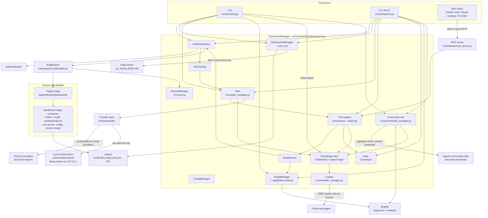
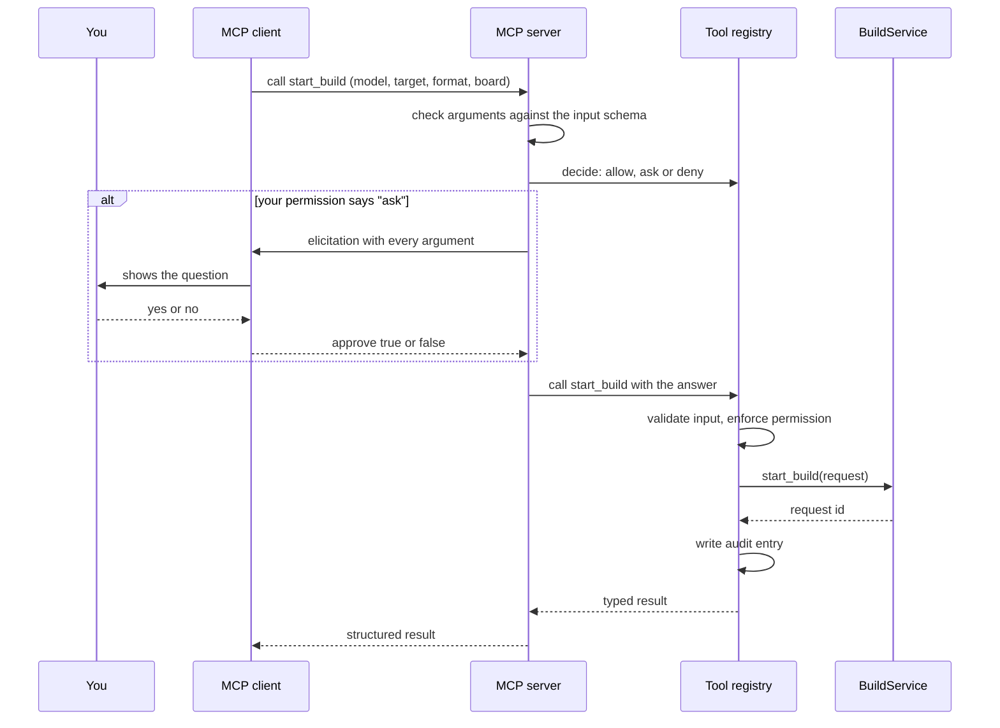
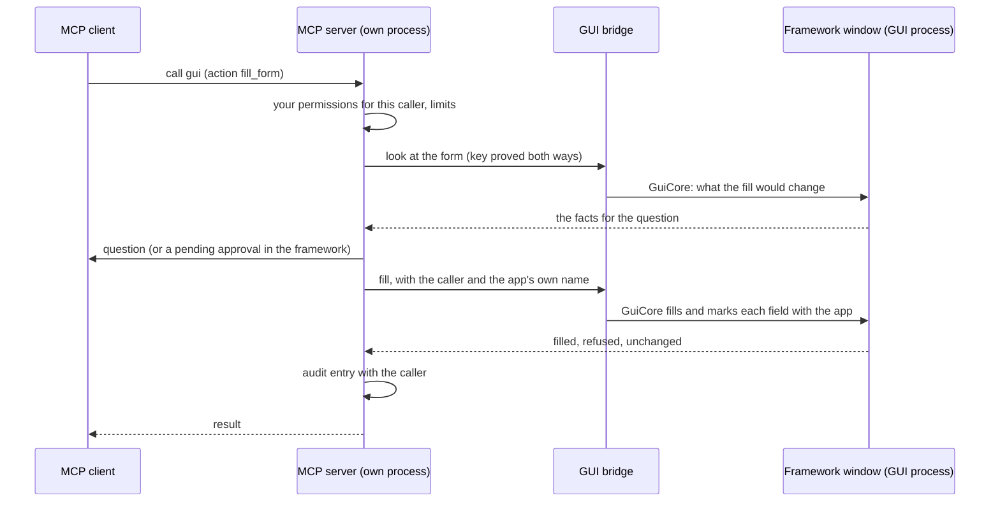

Version 3.2.0 · Last updated 2026-10-30

**English** · [Deutsch](DESIGN_DE.md)

# Design

This is the design document of the LLM Cross-Compiler Framework. It explains what the framework is for, how its
parts fit together, how data moves through it, how it protects you, and why it is built the way it is. It is one of
the three files of the [blueprint](BLUEPRINT.md): what comes next is in the [roadmap](ROADMAP.md), and what each
released version contains is recorded in the [changelog](../CHANGELOG.md).

The document describes the development branch: version 3.1.0 and what the changelog lists since. What is not built
yet is in the roadmap, not here.

## Contents

- [In short](#in-short)
- [Purpose and principles](#purpose-and-principles)
- [Architecture overview](#architecture-overview)
- [Data flows](#data-flows)
- [Components and decisions](#components-and-decisions)
- [Security model](#security-model)
- [Key decisions](#key-decisions)
- [Versioning and documentation policy](#versioning-and-documentation-policy)
- [History](#history)
- [Glossary](#glossary)

## In short

A language model as published on Hugging Face is usually too big and in the wrong format for a small computer
such as a Radxa ZERO 3W. The framework fixes that in three steps:

1. **Fetch** the model (a Hugging Face repo id such as `Qwen/Qwen3-0.6B`, or a folder on your disk).
2. **Convert and shrink** it ("quantize") inside a Docker container that has the right tools for your hardware.
3. **Install** the result on your device over SSH.

You can drive it in three ways: the desktop GUI, the command line `llm-cli`, or an AI client such as Claude Code
or Claude Desktop through the Model Context Protocol (MCP). All three use the same core.

The built-in assistant **Ditto** helps you choose models and settings, explains failed builds and can use the
framework's tools for you, always within the permissions you set. Ditto works with a cloud AI provider of your
choice or fully offline with a local model that the framework downloads and runs for you.

There is one official hardware target, **Rockchip** (boards RK3566, RK3568, RK3576, RK3588), with three output
formats:

| Format | Runs on | Boards | Typical use |
|---|---|---|---|
| GGUF (llama.cpp) | CPU | all four | chat models on any board |
| RKLLM | NPU | RK3588, RK3576 | chat models on the neural processor |
| RKNN | NPU | all four | ONNX vision and audio models |

`llm-cli` is the console command defined in `pyproject.toml`. If it is not on your PATH, run
`python -m orchestrator.cli` from the installation folder instead; the options are the same.

## Purpose and principles

The framework exists so that people without a background in compilers or machine learning can run a language
model on their own small hardware, and so that experts get a reproducible, inspectable pipeline. Five principles
guide every design choice.

| Principle | What it means in practice |
|---|---|
| **Local-first** | Conversions run on your computer in Docker. Models are downloaded on the host, and the conversion containers have no network. The knowledge base computes its embeddings and reranking locally, and Ditto can run completely offline on a local model. Apart from downloads, nothing leaves your computer unless you choose a cloud AI provider for Ditto (then the privacy filter applies, see [Security model](#security-model)), turn on the anonymous error reports (`enable_telemetry`, off by default) or open a pull request with a community pack (the framework prepares the pack; the GitHub CLI or the browser sends it, with their own credentials). |
| **Laypeople-friendly** | The GUI offers only what the selected target supports, the CLI refuses anything else, and both fill in sensible defaults per board (for example Q4_0 on the RK3566). `llm-cli mojo` explains problems with fix hints. AI errors are explained in plain words (for example that a Claude API key valid in every workspace needs the workspace ID). Self-healing proposals wait for your decision. |
| **Safe by default** | The conversion sandbox is on (`build_sandbox: true`). AI clients and Ditto may read freely but must ask before changing anything. New SSH devices are trusted only after you confirm their fingerprint. Passwords are never stored. Text suggested by an AI is never executed. The crawler honours every machine-readable opt-out of a site, and no switch turns that off. Community packs are installed only after checks in a quarantine folder and your confirmation. |
| **Data over code** | What a target can build is declared in its `target.yml` (`capabilities:` block, checked by a schema). AI providers are presets in `configs/llm_providers.yml`, the local model server and its models are pinned in `configs/llama_runtime.yml`, Ditto's evaluation cases live in `evals/ditto/cases.yml`, the retrieval evaluation's corpus and cases in `evals/retrieval/`, and the trusted community keys in `configs/community_keys.yml`. A new board, model or OpenAI-compatible server is an edit of data, as long as the code behind it supports it. |
| **Verifiable builds** | Every build writes a manifest (`build_info.json`) with the SHA256 hash of each model file, a `Model_Card.md` and a ZIP archive. The deployment package checks the hashes on the device before installing. Python dependencies are pinned by hash, downloads of the local model server and its models by size and SHA256, and the tool audit log can be verified. |

## Architecture overview

In plain words: there are three front doors (GUI, CLI, MCP). Behind them sits one core, the `FrameworkManager`,
which starts all other parts and hands them to each other. A build request ends up in the `BuildEngine`, which
builds a Docker image for the target and runs the conversion in sandboxed containers. The finished model lands in
`output/`, and the `DeploymentManager` copies it to the device. Ditto talks to AI providers only through the
provider layer, and uses the same tool registry as the MCP server. Deep Ingest, which a person starts in the GUI or
confirms for an AI client (`crawl_docs_site`), sends the crawler to public web pages for the knowledge base; the community zoo installs community packs into
`targets/`, the recipe folder and the knowledge base.

### Layers

The GUI, the CLI and the MCP server stay in one repository (maintainer decision of 2026-10-17); the coupling is kept
in check by layers, each importing only itself and the ones below it:

| Layer | Packages | May import |
|---|---|---|
| 1. Bottom | `orchestrator/utils/`, `orchestrator/security/`, `orchestrator/schemas/` | layer 1 |
| 2. Remote | `orchestrator/remote/`, `orchestrator/utils/ssh_trust.py` | layers 1 and 2 |
| 3. Kernel | the modules of `orchestrator/tools/` that define no tools (registry, policy, audit, approvals, signing, spec, ...) | layers 1 to 3 |
| 4. Domain | `orchestrator/Core/`, `runtime/`, `rag/`, `llm/`, `evals/` (`llm` and `rag` never import `Core`) | layers 1 to 4 |
| 5. Tool definitions | `orchestrator/tools/tools_*`, `framework_*`, `gui_bridge`, `gui_surface` | layers 1 to 5 |
| 6. Adapters | `orchestrator/cli.py`, `orchestrator/mcp_server.py`, `orchestrator/gui/` with `main.py` | everything except another adapter |

PySide6 lives only in the GUI, click and rich only in the CLI, mcp and uvicorn only in the MCP server, paramiko only in
the SSH transport (`remote/transport.py` and the `utils/ssh_trust.py` it grew out of). `tests/test_layering.py` checks every import
(also inside functions and lazy ones) against these rules; today's exceptions stand in
`tests/data/layering_allowlist.json` with their reason and the chain that removes them, and the list and the largest
import cycle may only shrink. Shared helpers therefore live below the tools: path labels for AIs in `security/paths.py`,
private atomic files and the one owner-only rule (`owner_only`, an ACL on Windows) in `utils/atomic.py`, one-time notices in `utils/notice_store.py`, image references in
`utils/image_ref.py`, the SSRF-safe HTTP adapter in `security/http.py`, the audit key in `Core/vault_key.py`.

### Components

| Component | Where | Role |
|---|---|---|
| GUI | `orchestrator/gui/` (start: `llm-gui`, `orchestrator/gui/app.py`; PySide6, the optional extra `gui`) | Main window, build tab, deployment window, Ditto chat (its header shows the access in use), module wizard with Deep Ingest, Hugging Face browser, Community Hub, dialogs for AI settings, the sign-in panel (`sign_in.py`: method cards, key form, storage chooser, passphrase dialog; vault and network calls in worker threads), tool permissions, tool confirmations, healing proposals, SSH trust, the Deep Ingest notice and the export for the community. |
| CLI | `orchestrator/cli.py` (`llm-cli`, also `llmcf`) | Top-level commands `build`, `config`, `deploy`, `ditto`, `doctor`, `knowledge`, `mcp`, `mojo`, `module`, `scan`, `secrets`, `targets`, `tools`, `zoo` (`doctor`, `mojo` and `scan` are single commands, the others are groups; `doctor` is the old name of `mojo`). The sign-in commands `ditto login`, `logout` and `auth` use the same sign-in operations as the GUI (`orchestrator/llm/auth/signin.py`). |
| FrameworkManager | `orchestrator/Core/framework.py` | Starts all managers in four phases (security and infrastructure, core logic, AI and knowledge, guardians and operations), connects them, keeps one long-lived asyncio loop for builds and resolves relative data paths against the installation folder, not the working directory. |
| ConfigManager | `orchestrator/Core/config_manager.py` | Settings with a schema (type, default, validation rule). The config folder is `LLM_FRAMEWORK_CONFIG_DIR` if set, otherwise the installation's `configs/` if it is writable, otherwise the per-user folder; never the working directory. User settings are saved to `config.yml` there. Environment variables with the prefix `LLM_FRAMEWORK_`, `FRAMEWORK_` or `LLM_` override known settings. Personal state lives in `~/.llm-framework` (override with `LLM_FRAMEWORK_HOME`), made private (mode 0700) when it is created on Linux and macOS; an existing folder keeps its mode, and Mojo Oracle reports one others can read (`state.permissions`). |
| SecretsManager | `orchestrator/Core/secrets_manager.py`, `orchestrator/Core/vault_key.py`, `orchestrator/utils/file_lock.py` | Encrypted vault (`secrets.store` in the per-user folder, format v2: Fernet entries with key ids, read with MultiFernet, key rotation). Its key comes from the operating system's keyring by default (one entry per vault; a keyring that hangs, keeps nothing or stores in plain text is refused) or from the explicit choice in `secret_storage` (credential helper, passphrase, unencrypted key file, memory only). Every change runs under a cross-process lock; the vault refuses a location inside a git working copy. Holds API keys (as records under `cred/<provider>/api_key`; the old names still work) and the Hugging Face token (`hf_token`). The secrets of a store in the old location (config folder) are taken over once and re-encrypted with the vault key, also into an existing per-user store; secrets already there win, and the old file is left unchanged. A long-running process (GUI, MCP server) re-reads the vault when another process has changed it. |
| Secret patterns and log redaction | `orchestrator/security/` | One standard-library table of secret formats (`secret_patterns.py`), loaded by `scripts/secret_scan.py` and used by `redact_secrets`. `redaction.py` redacts every log record when it is created (framework, SDK and HTTP loggers, tracebacks), keeps the SDK loggers at INFO or above unless `--debug-http` is given, and provides `SecretStr`, in which the provider layer holds its keys. |
| TargetManager and capabilities | `orchestrator/Core/target_manager.py`, `orchestrator/schemas/targets.py` | Loads the `target.yml` of every target folder (folders starting with `_` or `.`, such as `_template`, are skipped) and validates its `capabilities:` block: boards, formats, quantization types (also per board), aliases, board defaults, default board, importance matrix and calibration needs, support level (`official`, `community`, `experimental`). What a target offers as formats is `build_formats.offered_formats`: exactly the declared formats, every format but `hf` (unchecked) for a target without capabilities; the Builder tab's format list and `llm-cli build start --format` (its help, completion and refusal) read it. Which of them a build for one board gets is `build_formats.format_refusal`: NPU formats (RKLLM, RKNN) only when the board's hardware probe shows its NPU, RKLLM only for its SoCs and on an x86_64 build computer, else GGUF; the build service and the Builder tab read it. The board's probe (`BuildRequestIn.probe`, else the newest stored probe of a board of the request's SoC) reaches every build container read-only as `HARDWARE_CONFIG_FILE`, and the config stage plans the build for that board. |
| BuildService | `orchestrator/Core/build_service.py`, `orchestrator/schemas/build.py` | The one build-submission path: validate, start, status, cancel, log tail, artifacts, healing decision. `llm-cli build start`, the Builder tab's Start Build, the MCP server and Ditto all queue builds through `start_build` (an installed community recipe through `start_recipe`, which pins its calibration dataset and checks the recipe's revocation when it is built; `installed_recipe` is the only path that builds a recipe, and `community_manager.read_recipe` the only reader of `recipe.yml`). The person's own callers (`local_paths=True`) may name any path, choose the priority and the folder the build is saved to, and build a target without capabilities unchecked; AI callers may not. The person's builds carry no owner, so the queue limit for tool callers never refuses them. |
| Network locality | `orchestrator/utils/locality.py`, `orchestrator/Core/local_network.py` | The one offline check (`offline_mode`) and the one rule, asked two ways: `check_reach` (may offline mode reach it: the person's opt-outs count) and `check_location` (where the server stands: the privacy filter and the local/cloud label; the opt-outs never count). Connections go to `connect_addresses` (the checked local addresses only), a crawl the person starts to `crawl_addresses`; `tailscale_vpn` reads the VPN, `forget` drops a lookup after a failed connection (see [Offline mode and the local network](#offline-mode-and-the-local-network)). `local_network.py` is the only writer of the person's opt-outs (File > Settings... > Local network and `llm-cli config local-network`); no module an AI can reach imports it. |
| AI settings change | `orchestrator/llm/settings_change.py` | `AISettingsChange`: the rules of a change of the AI settings in one Qt-free place (known fallback providers, no cloud provider offline, key required and not an admin key, workspace ID, server address without user name or password, model, the plain-http question, the key stored for its address, the settings written, the knowledge base started, Ditto reloaded). The AI settings dialog keeps only its message boxes; sign-in and `ditto login` use its address rules; MCP `update_settings` and the dialog's GUI-tool fields use its tighten-only rule (`direction_problem`). `current()` and `with_setting()` serve a change of one setting, and `problems_of_settings()` runs every rule for it: MCP `update_settings` refuses what `offline_mode` or `enable_rag_knowledge` would break (offline mode with a cloud provider), while a problem the saved settings already have stays yours to fix in the dialog. |
| LLMOrchestrator | `orchestrator/Core/orchestrator.py` | Queue and pipeline: prepares calibration text, expands a request into jobs (model x target x format x quantization), runs them on the build engine, handles cancellation and the self-healing approval loop. |
| BuildEngine | `orchestrator/Core/builder.py`, `orchestrator/utils/build_context.py`, `orchestrator/utils/hadolint.py` | Stages the Docker build context, checks its Dockerfile with hadolint when it is installed (advisory: findings go to the build log and the progress warnings, the build goes on), builds the image (BuildKit when available), downloads or mounts the model, runs the optional Trivy scan, the importance-matrix stage and the build stage in sandboxed containers, writes the manifest, model card and ZIP into a hidden staging folder, moves them into the output folder once the build can no longer be cancelled, and cleans up. |
| DockerManager | `orchestrator/Core/docker_manager.py` | Makes the framework's one build engine (with its Docker client) and checks that the Docker daemon answers; no Qt. `container_resources()` turns a `docker stats` sample of a running build container into CPU and memory figures (Docker's own formulas, memory without the inactive page cache); the build engine samples them into the build's progress, `BuildService.live_resources` hands them to the Builder (under the progress bar), and the build log warns once near the memory limit. |
| Container engine | `orchestrator/utils/docker_engine.py` | Which engine the framework talks to: Docker CE is the standard; without a Docker daemon and with the person's Podman socket (install.sh's fallback in the RHEL family: Fedora, RHEL, CentOS Stream, Rocky Linux, AlmaLinux and Oracle Linux) `ensure_docker_host()` sets `DOCKER_HOST` to it for the process and the programs it starts (a `DOCKER_HOST` the person set always wins). Every place that makes a Docker client calls it first (the build engine, the builder image's `DockerEngine`, Ditto's `DittoDocker`, the one Docker check `check_docker_environment`, `scripts/build_container_image.sh` through `python3 -I ... --docker-host`). `engine_name()` tells Docker from Podman by `/version`; `podman_refusal()` refuses early what Podman does not provide (Docker's GPU request, BuildKit): `BuildService` before a GPU build is queued, the builder, Ditto's GPU passthrough. `create_container()` creates every container of the framework (the build stages, the llama.cpp builder, Ditto's check and server containers); under rootless Podman one that runs as the person gets Podman's `keep-id`, so it can write the person's folders. Mojo names the engine. Standard library only (the system's Python 3.9 too). |
| Rockchip reference target | `targets/Rockchip/` | `dockerfile` (Debian bookworm-slim; llama.cpp v0.6.0 tools; three Python venvs), `modules/build.sh` (the stage runner) with the four stage modules `source_module.sh`, `config_module.sh`, `convert_module.sh` and `target_module.sh` (`gguf`, `rkllm`, `rknn` and the `imatrix` job), `modules/rkllm_module.sh` and `modules/rknn_module.sh` (format helpers of the convert stage), `scripts/export_rkllm.py`, `scripts/rknn_converter.py`, `scripts/model_check.py` (the convert stage's checks; the template ships the same file), `target.yml`. `targets/_template/` is the starting point for new targets ([Module Developer Guide](Module_Developer_Guide.md)). |
| DeploymentManager and SSH trust | `orchestrator/Core/deployment_manager.py`, `orchestrator/utils/ssh_trust.py` | Builds the deployment package, checks the device's host key, pairs the framework's SSH key, uploads and runs the installer. |
| Deploy steps | `orchestrator/runtime/device/person_steps.py`, `orchestrator/runtime/device/steps.py`, `orchestrator/runtime/device/service.py` | One deploy per use case. `deploy_build` (the person's only) deploys a build for `llm-cli deploy run` and the Deployment tab: the package (`make_package`, its reason returned with the result; with Docker images exactly the containers of `deployment_manager.package_containers` that the Deployment tab's table has ticked, every one for `--docker`), the deploy, then the board's trusted record with the CLI's audit row. `deploy_runtime_flow` deploys a board's self-built runtime for `llm-cli device runtime deploy`, the Boards window and the AI's `deploy_device_runtime`: login, trusted record, refusal of root, benchmark question with its consent, install, "tested on" record. Each caller passes its login and its words as hooks; only the person's channels pass the trusted record and the question. |
| Remote layer | `orchestrator/remote/` | Everything that talks to a board, Qt-free and importing only `orchestrator/utils` and `orchestrator/security`: the board's address (`address.py`: `Endpoint` with its known_hosts, stored and displayed forms, the one host, port and SSH-user check, ASCII only), why a board cannot be reached (`reasons.py`: the four reason codes and `local_problem` for a problem on this computer, never recorded with a board, `check_port`, `classify`, `reach_code`; a dropped connection while a deploy waits for the board counts as "not back yet"), `RemoteFailure`, the base of every board step's error (`errors.py`), a board's words and a running deploy's state as one line for the person or an AI (`text.py`), the connection (`transport.py`: whether SSH works here, paramiko imported on first use; every command as one `sh -c` with a time limit and an output cap; the login, SFTP and keepalive in `ParamikoTransport`; the same over this computer's OpenSSH client in `SystemSshTransport` where paramiko is missing, with the one OpenSSH command-line builder: `openssh_argv`, `openssh_options` with a login time limit and keepalive and `-F` with the framework's own settings file, so OpenSSH reads neither `~/.ssh/config` nor `/etc/ssh/ssh_config`, `config_value` quoting a path, `openssh_file` writing a `%` of the framework's own paths as `%%`), the framework's own OpenSSH settings file (`ssh_config.py`: created owner-only on first use, holding only the `Host` blocks the person adds; the lines that would change the trust settings on the command line, run a command or include a file refused, a `ProxyJump` or `ProxyCommand` only knowingly; written only by `runtime/device/person_steps.py` `save_ssh_block` for the CLI and the GUI, never by a tool), the framework's `known_hosts`, read-only (`trust.py`: `TrustStore` with `status`, `status_of`, `check` giving a `KeyCheck`, `read_presented_key`; `fingerprint`, `device_id_for`, `parse_public_key` for a key the person pastes; the host-key errors), the person's writers of a board's trust (`pairing.py`: a trusted key with its audit row in one step, the one decision of trust on first use behind `deploy run`, `scan --device` and the GUI's question, pairing over a one-time password session, Q5's change of a board's address or host key with the old and the new fingerprint, audited before anything changes; for a new key the board's data moves to its new device ID with it, `runtime/device/board_move.py`: copied and checked before the change, the old copies removed only after it; and a consent's audit row) and the session with a board (`session.py`: `RemoteSession` logs in with the host key checked through `TrustStore` at every login, with typed credentials, `KeyOnly` for every AI path and the person's `OneTimePassword`, the only one that can pair; a private folder, the upload that resumes after a network drop, the wait for the board (N5), a job that runs on the board on its own and is followed again (`run_detached`, `follow`), a command that may run twice sent again after a drop (`run_resumable`); one `CancelToken`, and closing a session ends its waits). No module an AI can reach imports `pairing.py` (an import-graph test). The deploy of a package is a thin adapter over the session, over paramiko or, where it is missing, over OpenSSH (it waits for the board, resumes the upload and runs `deploy.sh` on the board on its own either way), and the runtime deploy, the checks on the board, the on-board benchmark and the probe run on it too (`runtime/device/remote.py` `RemoteShell` is their facade): the runtime tarball goes over SFTP and continues after a network drop (a board without SFTP gets it on stdin), the checks run again, the benchmark runs on the board on its own and is followed again, and the AI path (`runtime/device/service.py`, `KeyOnly`) and the person's board steps (`person_steps.connect_stored`, a one-time password allowed) both open a session that waits for the board (N5). The old paths `orchestrator/runtime/device/reasons.py` and `orchestrator/utils/ssh_trust.py` keep working. What a contact found is recorded for Mojo by `record_reach` in `orchestrator/runtime/device/trusted.py`. |
| Tool registry, permissions, audit | `orchestrator/tools/` (`registry.py`, `policy.py`, `audit.py`, `confirmation.py`, `framework_tools.py`) | Eleven typed tools with risk tiers, the user's stored permissions, the confirmation text (shared by MCP and Ditto) and a hash-chained audit log. |
| MCP server | `orchestrator/mcp_server.py` | Exposes the tool registry over MCP (official SDK `mcp` 2.3.0) via stdio or local Streamable HTTP. The launch command it writes for clients uses `python -P`, so nothing is imported from the folder a client starts it in. |
| Provider layer | `orchestrator/llm/` | One client (`LLMClient`) for every AI provider, built on the official `anthropic` and `openai` SDKs; OpenAI-compatible servers go through `openai`. Picks provider, model and effort per task from the settings and the presets in `configs/llm_providers.yml` (a file of the same name in the config folder adds or replaces presets). Retries (two, the SDKs' own retries are off), a fallback chain for refusals and outages (`ai_fallback_chain`), structured answers validated against schemas with one repair attempt, typed errors, the privacy filter for cloud providers, and a tool loop. The sign-in core (`orchestrator/llm/auth/`) resolves the credential of each call from the sign-in methods in the catalog: keys from the vault (keys of custom servers bound to their address) or from the environment variables the catalog lists, a free credential check, errors with a known cause and the next step, and token renewal under a lock shared by all processes. |
| Ditto (rebuilt) | `orchestrator/Core/ditto_manager.py` | The assistant: chat with the framework tools (at most 8 model turns per question, tool calls as actor `ditto` through the registry), analysis of failed builds, module proposals from a hardware probe and build recommendations. The last three are validated structured answers; an invalid answer is an error and is never applied. A healing analysis or build recommendation with a dangerous command is discarded; a module proposal is checked again by the module generator. The chat history is append-only (`chat_history.json`); a long conversation is summarized into a new one. |
| Managed local model | `orchestrator/runtime/`, `configs/llama_runtime.yml` | Builds `llama-server` on the machine from the pinned llama.cpp commit (b11429, the same commit as v0.6.0): the CPU build first, then a GPU build (Vulkan in this version), each verified before it is used; imports a build of another machine of the same kind; downloads the official prebuilt archive only on explicit request, labelled not self-built. Downloads pinned GGUF models in tiers (Qwen3.5 9B, 4B and 2B, 2-bit variants for weak hardware, and an IBM Granite 4.2 3B model on request), each checked by size and SHA256. Runs `llama-server` on 127.0.0.1 with a free port and a per-start API key. The `local` provider finds the running server by itself. |
| Ditto evaluation | `orchestrator/evals/ditto_eval.py`, `evals/ditto/cases.yml`, `evals/retrieval/` | `llm-cli ditto eval`: 19 fixed cases (build-log analysis, build recommendations, module proposals, chat with tools, prompt injection) graded by rules, against the configured provider or per local model tier. Nothing is built: chat cases use the real tool definitions over a stand-in build service. With `--kind retrieval`, 42 searches grade the knowledge-base search on a fixed corpus, without an AI model (see [A knowledge-base search](#a-knowledge-base-search)). |
| Self-healing | `orchestrator/Core/self_healing_manager.py` | Recognizes known failures with fixed patterns first and asks Ditto only for unknown ones. Applies only framework-defined fixes, and only after your approval. |
| Knowledge base and crawler | `orchestrator/Core/rag_manager.py`, `orchestrator/rag/`, `orchestrator/Core/crawler_manager.py` | Optional (`enable_rag_knowledge`). Web pages, PDFs, community knowledge packs and, when you index them (`llm-cli knowledge index-docs`, the GUI or the tool `index_framework_docs`, never by themselves), the framework's own documentation and code are split into chunks and stored with a local dense embedding (FastEmbed on ONNX Runtime, CPU; model chosen by hardware unless `rag_embedding_model` is set) and a BM25 vector. Searches combine both rankings with Reciprocal Rank Fusion; a local cross-encoder can rerank the results and drop those below a relevance floor (see [A knowledge-base search](#a-knowledge-base-search)). Qdrant Edge, the Rust engine of Qdrant, runs in the process with its storage in the per-user folder (a knowledge base of an earlier version is converted on first use, see [The knowledge base's storage](#the-knowledge-bases-storage-qdrant-edge)); a Qdrant server is used only when `qdrant_url` is set. The crawler of Deep Ingest honours the sites' machine-readable opt-outs (see [Deep Ingest](#deep-ingest-from-a-web-page-to-the-knowledge-base)). |
| Deep Ingest notice and spoken announcements | `orchestrator/utils/crawl_notice.py`, `orchestrator/utils/announce.py` | The one-time notice before the first Deep Ingest, remembered per user, and short announcements through the speech engine of the operating system. |
| Community zoo | `orchestrator/Core/community_manager.py`, `orchestrator/Core/community_pack.py`, `orchestrator/Core/community_maintainer.py`, `orchestrator/schemas/recipes.py`, `orchestrator/gui/community_hub.py`, `orchestrator/gui/community_maintainer.py`, `configs/community_keys.yml` | Signed and encrypted community packs (targets, recipes, knowledge), the signed community index, installation through a quarantine with trust levels, export with privacy scrub and the hand-over to a pull request, and the maintainer actions on the community repository (signing key, review and publish, revoke) (see [Community packs](#community-packs-format-trust-and-exchange)). |
| Input history | `orchestrator/utils/input_history.py` | Recent values of the GUI input fields, per user and without secrets (see [Recent inputs](#recent-inputs)). |
| Mojo (the doctor until 3.0.0) | `orchestrator/Core/mojo/` (`findings.py`, `checks/`, `runner.py`, `offers.py`, `repairs/`, `views.py`, `docker_objects.py`, `banner.py`); `orchestrator/Core/doctor.py` re-exports it | Deterministic health checks (Python, Docker and BuildKit, disk space, targets, state folder permissions, secrets and keyring, tool permissions and audit log, calibration data, installed community packs, knowledge snapshots) with stable codes, fix hints and, for every warning and error, where, why and what Mojo Miracle can do about it (Mojo Oracle). The Python and Docker checks run on the framework's original checks in `orchestrator/utils/validation.py` (`validate_python_version`; `check_docker_environment`, which the build engine's start uses as well). Mojo Miracle applies only harmless repair plans (the class computed from the steps; a dry run bound to its sha256, audited first, compare-and-swap, one at a time, checked again) and reports every problem as repaired or not repaired with the reason. Deleting is never a repair: `docker_objects.py` builds a deletion plan of every framework build image (`framework_image_plan`: left over without a name, named `last-build`, runtime builders; `DeletionPlan` of `tools/spec.py`), and `delete_framework_images` removes exactly the images the person ticked, after the person confirmed them at a terminal or in the GUI's Tools > Framework Build Images... (actor `cli` or `gui` only, audited first, refused when a chosen image changed); the Docker build cache is never cleared. `docker_storage` says where Docker keeps its images. `ai_findings` (`run_doctor`) and `oracle_rows` (`run_mojo_oracle`) are what an AI reads: folders by label, other paths by file name. `banner.py` is the console's crystal ball when Mojo Miracle ends after Mojo Oracle at a terminal (the drawing and its colour mask in one place, which line a result earns, and the note of the open Oracle run next to Mojo Miracle's lock); only the CLI prints it, nothing of it reaches an AI. |
| Deletion and trash | `orchestrator/Core/deletion.py`, `orchestrator/Core/trash.py`, `orchestrator/gui/deletion_dialog.py`, `orchestrator/gui/trash_window.py` | Every deletion of the person's objects takes an `AcceptedDeletion`: the plan the person accepted in the GUI or at a terminal (multiple choice rebuilds it from exactly the ticked items), its mode (trash or for good) and the channel. The deleting code builds the plan again and refuses a changed one (`PlanChanged`). The trash moves items with one rename into `.trash/<id>/` of their data folder (never across disks); its index `tool_trash.json` is signed; nothing leaves it by itself; only the person empties it; an AI restores only what it asked to delete. `tests/test_deletion.py` lists every place in the code that deletes, with how it is covered. |
| File hashing | `orchestrator/utils/helpers.py` | The one implementation of every file sha256 (whole files, open handles and their first bytes for a resume, descriptors, copies hashed while they are written so the bytes checked are the bytes used, a lock-protected cache, `SHA256SUMS` lines and `.sha256` sidecars, the constant-time compare). The old helper names in the build, deploy, runtime, trash and download code are delegates; `tests/test_hashing.py` refuses a new hash loop beside it. The hardware probe keeps no copy, and the `sha256sum` calls that run on a board stay on the board. |
| Disk rule and watchdog | `orchestrator/Core/disk_plan.py` | What a build lands where, the reserve (2 GiB or 2 %, 20 GiB or 10 % under a standing approval), the cross-process reservation ledger, and the watchdog: below half the reserve a running build container is stopped and staging ends (`DiskWatchdog`, `low_disk_text`), a full disk is reported by label with `insufficient_resources` (`disk_full_text`, `is_disk_full`), and the trivy scan is skipped (`low_disk_floor`). BuildEngine only calls them. The one disk rule for every free-space check (decision A4): `room` (one disk) and `check_disk` keep the reserve free beside what accepted calls of any process reserved in the ledger, for builds, downloads (`download_rule`, the downloader's `space`), the deployment package, the bench copy, the knowledge-base conversion, the snapshot export, Mojo's disk check and the AI's disk fact; `refusal` and `person_text` say what does not fit and the next step, English or German. The board package of a target stage is made in the build container, which has no framework: `scripts/board_package.py room` there applies the same reserve with the same words (a test compares them), without the ledger of the per-user folder. While a build runs, the engine records what of its reservation has landed on disk (`LandedMeter`, `ReservationLedger.landed`), so those bytes are not counted twice. |
| Hugging Face downloads | `orchestrator/Core/hf_hub.py`, `orchestrator/Core/hf_takeover.py`, `orchestrator/gui/huggingface_window.py` | One verified fetcher (`HubFetcher`: the commit pinned, a resumable `.part` file, the Hub's size and sha256 checked before the file gets its name, the token only to huggingface.co) for an AI's `download_hf_file`, the GUI's Hugging Face browser (`download_for_person`, decision A6) and the Builder's model download, one Hub API (`hub_api`: huggingface.co only, never the host in `HF_ENDPOINT`, never an implicit token) for every search, look-up and file list of the framework, the browser's and the Builder's included, and one token rule: a public repository's listings, look-ups and files carry no token, also with one stored; the token goes only to a gated or private repository (`needs_token` from the repository's gated and private fields, or the Hub's 401/403 answer to a request without it, then one request with it: `tokenless_first`, `HubFetcher(token_needed=...)`). The process runs with huggingface_hub's `HF_HUB_DISABLE_IMPLICIT_TOKEN` and `HF_HUB_DISABLE_TELEMETRY` on (`orchestrator/utils/hf_env.py`, set when the package `orchestrator` is imported; in huggingface_hub 1.33 the telemetry switch also stops its agent-harnesses registry request), and the knowledge base's fastembed models come through `fetch_snapshot` into fastembed's cache without a token, which fastembed then loads without contacting anybody; and one layout for single files, `download_path`: `<models_dir>/hf/<owner>--<name>/<commit[:12]>/<file>` (the Builder stages whole models in `cache/models/hf/`). The browser's download follows the one disk rule and holds its own reservation in the ledger while it runs; so does a knowledge base model fetched through `fetch_snapshot` (the knowledge base hands the factories its ledger: the disk rule's refusal before any file, the landed bytes recorded per file, the reservation released when the fetch ends). Each file and record of a download is moved into place with `utils/atomic.replace_file` (tried again for a moment on Windows while a reader holds the target): the fetcher's last move, `refs/main`, and the record of a complete Builder copy (`local_models.write_complete`). `hf_takeover` lists what earlier versions saved in huggingface_hub's cache inside the models folder (still listed and usable), copies it on the person's request, each file checked against the checksum it was downloaded with, and offers to remove the old copies only as an accepted deletion plan with the exact list (the browser's **Take over old downloads...** and `llm-cli models take-over` run the same calls). In offline mode the browser's, the Take over's and every AI caller's Hugging Face calls and the GUI's commit check refuse before any request with one refusal (`hf_hub.offline`, `offline_refusal`; the person reads `person_text`); a build in offline mode never downloads its model (see the next row). |
| Models on this computer | `orchestrator/Core/local_models.py`, `orchestrator/gui/offline_model.py` | What an offline build can use: `local_copy` finds a complete copy of a Hugging Face model (the Builder's own copy in `cache/models/hf/`, recorded as complete when its staging ends; a model folder the Hugging Face browser downloaded; the old huggingface_hub cache), which `BuildEngine` mounts instead of a download in offline mode. `models_here` lists the models already here, each with its label: a local-file reference for the models folder and the folders shared with the AI (`LocalFiles.list`), the repository id for the Builder's copies, the path for the inputs of earlier builds (their build records; the person's only). Without a copy `BuildService.check_model_here` raises `ModelNotHere` with that list: `build start` prints it and takes a listed label or a local path with `--model` (asked at a terminal), the Builder tab opens a choice with an open dialog for a model file or folder (when a recipe pins another commit than the copy chosen here, the tab asks instead of opening the choice again: No cancels, Yes builds the copy as the person's own build without the recipe, `bld.offline.pinned`), and an AI's build plan names the labels only. `ditto models download` in offline mode refuses and names the Ditto models already here (`runtime/ditto_models.offline_refusal`). |
| Texts (localization) | `orchestrator/utils/localization.py`, `orchestrator/utils/l10n_*.py`, `orchestrator/gui/localization.py` | The one text table (`TRANSLATIONS`, merged from the `l10n_*` modules) and `ui_text`, `tr` and `current_language`, without Qt, for every process. The window's language object (`LocalizationManager` with the `language_changed` signal the windows retranslate on, `get_instance`) and Qt's own translation of its standard buttons (`qtbase_<lang>`) live in the GUI; the old import path resolves to them on first use. Only `orchestrator/gui/` imports Qt (`tests/test_qt_free_core.py`). |
| Calibration data | `data/calibration/`, `orchestrator/utils/calibration.py` | Curated German, English and tool-use text (MIT licence) with SHA256 checks, used for importance matrices. |
| Untrusted text handling | `orchestrator/utils/untrusted.py` | Cleans and wraps external text before it reaches a language model. |

A build is the four stage modules of a target (`source_module.sh`, `config_module.sh`, `convert_module.sh`,
`target_module.sh`, the chain of version 1.x, made the build again by the maintainer's decision U9). `build.sh` is
only the stage runner: it runs them in order, writes a resume marker after every stage that finished (an input
digest and the files the stage named), skips a finished stage when it is run again on the same work folder with
the same inputs, and prints a progress line per stage that the BuildEngine reads from the container log. An
optional `rotate_module.sh` between convert and target is the slot for a rotation such as SpinQuant (none is
shipped). Benchmarks stay on the board: no stage runs one, and the template's `benchmark_module.sh` is no stage.
Around every conversion the convert stage does what the convert module of 1.x promised in the maintainer's design
(decision U9, addendum): it detects the input's format and refuses what the build's format cannot use (an ONNX model
for GGUF, naming the format rknn instead), checks the integrity of the input and of the GGUF the converter wrote,
runs that GGUF briefly with `llama-completion` when the image has it, writes its statistics (sizes, ratio,
duration, the test's result) into the log and into `build_info.json` (`conversion`), and leaves nothing
half-written when it fails: a file it replaces is kept until the new one passed its checks. `scripts/model_check.py`
does these checks with the image's Python and the standard library only; every target ships the same file.
Started by hand with a board's hardware profile, the config stage plans the board and checks the plan (compiler
test, toolchain file, plan script), and the target stage makes the deploy-ready package of version 1.x (programs for
the board, model card, `test_model.sh`, `deploy.sh`, `MANIFEST.json`, `SHA256SUMS`); `build.sh --package` makes it
without a profile too, planned with the target's plain defaults. A build of the framework has no profile and makes no
package. The package follows the framework's build rules: the one disk rule before it copies the model, no llama.cpp
option that downloads in its cross build (the module generator and the folder check refuse a module's CMake flags
that would switch one on, `recipe.refused_option`), and for an x86_64 profile of another PC the CPU features of its
probe as the build recipe plans them, `-march=native` only for a profile of the build machine itself.
See the [Module Developer Guide](Module_Developer_Guide.md#6-the-build-stages).

`configs/project_sources.yml` is a catalogue of upstream projects and documentation links. At runtime the
framework reads only its hardware documentation links (they fill the Deep Ingest window for a probe's vendor and
SDK); see [SSOT_ARCHITECTURE.md](../configs/SSOT_ARCHITECTURE.md) for what each file in `configs/` is for.

### Where things are stored

| Place | Content |
|---|---|
| `targets/` | Target definitions (one folder per target). |
| `cache/models/hf/` | Models downloaded from Hugging Face for builds. |
| `cache/builds/<build id>/` | Work folder of a running build (build context, output, importance matrix, scratch space); removed after the build. |
| `cache/calibration/` | Calibration text written for importance matrices. |
| `output/` | Finished builds, one folder per build with model files, `build_info.json`, `Model_Card.md`, plus a ZIP next to it. |
| `models/ditto/` | Ditto's local GGUF models with a `.verified.json` marker each. |
| `models/embeddings/` | Embedding and reranking models of the knowledge base. |
| `models/hf/<owner>--<name>/<commit>/` | Single Hugging Face files the GUI's browser or an AI app downloaded, checked against the Hub (decision A6). |
| `models/models--<owner>--<name>/` | The browser's downloads of earlier versions, in huggingface_hub's own cache layout: still listed and usable; **Take over old downloads...** copies them into `models/hf/` and offers to remove them. |
| `community/` | Installed community recipes (`recipes/`) and knowledge packs (`knowledge/<topic or target>/<pack>/`: knowledge always belongs to a topic or a target; a loose knowledge file there is never imported until it is sorted into one), each with a `.lcf-provenance.json`, and the packs you export (`contributions/`). Community targets are installed into `targets/`. A `.quarantine/` folder inside an install folder holds a pack only while it is checked. |
| `~/.llm-framework/` (or `LLM_FRAMEWORK_HOME`) | `secrets.store` (also your community keys), `tool_policy.json`, `audit.db` with `audit.db.anchor`, `known_hosts`, the framework SSH key `id_ed25519_llm_framework` (+ `.pub`), `mcp_tokens.json` (the named MCP tokens, as SHA-256 hashes, with their permissions), `chat_history.json`, `llm_privacy_key` and `llm_install_id`; `crawl_notice.json` and `input_history.json`; the cached community index `community/index.json` with `index.json.sig` and the authors' public keys remembered at the first install, `community/authors.json`; the knowledge base `qdrant_edge/` with its lock file `qdrant_edge.lock` and the record of its conversion `knowledge_conversion.json` (the folder `qdrant/` of earlier versions stays until you delete it) and `knowledge_snapshots/`; the local model server under `runtime/llama.cpp/` (builds, `active.json`, `server.json`, the key file while the server runs) and its log in `logs/llama-server.log`; while the framework window is open, `gui_bridge/` with `bridge.json` (the bridge's address and key, mode 0600) and the socket `gui.sock`. |
| Config folder (usually `configs/`) | `config.yml` (user settings); optionally an own `llm_providers.yml` that adds or replaces provider presets. |
| `chat_feed.sqlite` in the per-user folder | The chat feed: what the chat panel on the right shows (your messages, Ditto's answers, questions that wait, decisions an AI made with its reason, results of work an AI started). Every row is signed; nothing in it is deleted by itself. |

`cache/`, `output/` (the framework's build folder) and `models/` are relative to the installation folder unless the
settings `cache_dir`, `build_dir` and `models_dir` say otherwise. If the user may not write to the installation
folder (for example `C:\Program Files`), their defaults are in the per-user folder instead
(`ConfigManager.default_data_root`). Finished models (golden artifacts) are saved to the output folder, setting
`output_dir`, default `~/llmcf/output` (see [Features](Features.md#where-finished-models-go)); a build
started in the GUI waits in the build folder until it is saved, and earlier builds stay listed there. None of them is
created at startup; a build, a download or the knowledge base creates what it uses.

## Data flows

### A build, from request to device

In plain words: you pick a model, a board and a quantization. The framework checks that the target can do it,
prepares everything on your computer, builds a toolbox image, converts the model in a locked-down container,
records hashes and lets you install the result on your device.

1. **Request.** The GUI build tab, `llm-cli build start -m <model> -t Rockchip -f gguf -b rk3566`, or the tool
   `start_build` (MCP client or Ditto) creates a request. An unknown target is refused with the list of known
   targets. The request is checked against the target's capabilities: unknown formats, boards or quantization
   types are refused with a sentence that lists the allowed values;
   spellings are normalized (case, aliases such as `INT8` for `Q8_0`); a missing board becomes the target's
   default board, a missing quantization the board default; low-bit types such as IQ2_XS require an importance
   matrix.
2. **Queue and calibration.** The `LLMOrchestrator` queues the request. If an importance matrix is wanted (GGUF
   only) and you gave no dataset, it writes the shipped calibration text (`calibration_language`: `mixed`, `de`
   or `en`) to `cache/calibration/`.
3. **Jobs.** The request is expanded into one job per model, target, format and quantization. Each job goes to
   the `BuildEngine`.
4. **Build context and image.** The engine copies the target's `modules/`, `scripts/` and the shared
   `entrypoint.sh` into a fresh build context and builds the image `llm-framework/<target>:<build id>` with
   `docker buildx build` (BuildKit), or with the Docker API if BuildKit is missing. This step needs network: it
   fetches the llama.cpp commit pinned in `configs/llama_runtime.yml` (`b11429`; the build stops unless it got
   exactly that commit) and the Python toolchains. The llama.cpp conversion tools are built with the build recipe's
   options for this machine (`LLAMA_CMAKE_ARGS`, from a probe taken right before the image build), behind the
   options every build has (nothing downloaded at configure time, no subprocess support). The number of parallel
   compile jobs comes from `build_jobs` (0 means all cores).
5. **Staging on the host.** The model is made available before any conversion code runs: a local folder or file
   is mounted read-only; a Hugging Face repo is downloaded on the host into `cache/models/hf/`, using your stored
   `hf_token` if needed. The token never enters a container.
6. **Security scan.** If `enable_security_scan` is on (default), Trivy (`image_trivy`, default
   `aquasec/trivy:0.75.0`) scans the image for HIGH and CRITICAL vulnerabilities. It never gets the Docker socket:
   `docker save` writes the image to an archive in a private folder (0700) of the build, and the scanner runs
   without capabilities and reads only that file, read-only; the archive is removed after the scan, and without
   room for it the scan is skipped with a warning. Findings produce a warning; the
   build continues. A scan that does not finish within `build_timeout` is stopped with a warning.
7. **Importance-matrix stage** (GGUF with IMatrix only). A sandboxed container runs `modules/build.sh` with
   `JOB_TYPE=imatrix`: the stage runner runs source, config and convert, and the convert stage converts the model
   to F16 GGUF and runs `llama-imatrix` on the first 100 chunks of the calibration text. If this stage fails, the
   build stops.
8. **Build stage.** A second sandboxed container runs `modules/build.sh` with `JOB_TYPE=build`, and the stage
   runner runs all four stages: source names the tools of the image, config normalizes the request and refuses
   what the target cannot build, convert checks the input, picks the toolchain (the GGUF converter,
   `rkllm_module.sh` for RKLLM on RK3588 and RK3576 only, `rknn_module.sh` for RKNN), checks and briefly runs what
   it wrote and records its statistics, and target quantizes with `llama-quantize` (with the
   importance matrix if present) and writes `build_info.json`. The progress lines of the runner show the stage in
   the build status ("Running modules: convert (3/4)").
9. **Manifest and golden artifact.** The engine copies the results into a hidden staging folder next to the
   output folder (links in the build output are not followed), completes `build_info.json` with every model
   file's size and SHA256 hash and the primary file, writes `Model_Card.md` and creates a ZIP of these files. Only
   when the build can no longer be cancelled are they moved into `output/` and the ZIP next to the build folder; a
   cancelled or failed build leaves no files there. The build's image is named `llm-framework/<target>:last-build`
   and only its per-build name is dropped: the builder never deletes an image (an older one stays without a name until
   the person deletes it), and the next build reuses the layers. The work folder is removed.
10. **Deployment.** In the deployment window (or with `llm-cli deploy package` and `llm-cli deploy run`) you pick
    a build. The framework packs the model file, `build_info.json`, `Model_Card.md`, a generated `deploy.sh` and
    `checksums.sha256` into a ZIP.
11. **Trust on first use.** Before the first connection the device's host key fingerprint is shown (the same
    format as `ssh-keygen -lf`). Only after you confirm it, or pass a matching `--trust-fingerprint`, is it
    stored in the framework's own `known_hosts`. A changed key always stops the deployment.
12. **Pairing and install.** On the first connection your password is used once to install the framework's
    Ed25519 key on the device; it is never stored. The package is uploaded into a private temporary folder
    (`mktemp -d /tmp/llm_deploy.XXXXXXXX`), unpacked, and `deploy.sh` checks all hashes with `sha256sum -c`
    before it copies the model to `$MODEL_DIR` (default `$HOME/models`) and prints how to start it (for GGUF with
    `llama-server`).

The tool `cancel_build`, the Builder tab's Cancel button and Ctrl+C in `llm-cli build start` stop the running
stage container through the build service. Each stage container has its own time limit (`build_timeout`, default
3600 seconds). Every build engine writes one record per build into `<cache_dir>/build_records/`
(`orchestrator/Core/build_records.py`), which `llm-cli build status` reads, so it sees builds of other programs too.
The CLI, the build service, the orchestrator and the engine resolve a target through the target registry's one
id -> folder map, so a target id may differ from its folder name.

### A tool call from an MCP client

In plain words: the AI client may look at things on its own, but before it changes something the framework asks
you, through the client, and writes down what happened.

1. **Names, arguments, schema.** The tool name and the raw arguments first go through the fool-proof layer
   (`orchestrator/tools/normalize.py`), the same one Ditto's calls use: spelling variants of a tool name, declared
   argument aliases, values coerced and matched against closed lists without ever guessing a near miss, and every
   repair recorded. Every tool has a pydantic input and output model; clients get the input model's closed JSON
   schema. Unknown names and invalid arguments are refused before anything runs, with a reason code and the next
   step, and the refusal is audited (`unknown_tool`, `invalid_input`); the same failing call a third time is
   refused without running (`repeat_refused`).
2. **Policy.** The registry looks up your stored permission for this tool (per-tool override first, then its
   tier). Defaults: `read` allowed, `local_write` ask, `external` ask. Tools in the `forbidden` tier cannot even
   be registered. If the permission file is damaged, every tool is denied until you set the permissions up
   again.
3. **Elicitation.** "Ask" becomes an MCP elicitation: the client shows you the tool and every argument in full
   (arguments too long to show cannot be confirmed). Only a real answer counts as approval, and a "no" is final
   for that call, even if the permission is loosened meanwhile. A confirmation that fails is refused and audited.
   When the client cannot ask (no form elicitation), the question is too long for an elicitation, or you set the
   tool to be confirmed in the framework, the call becomes a pending approval instead: the registry stores the
   question (signed, bound to caller, tool, argument hash and question hash, 15 minutes), the client gets
   `waiting_for_approval` with a job id, and you decide in the GUI or with `llm-cli tools approvals`. On approval the
   framework rebuilds the question and runs the call itself under the original caller if it reads the same.
4. **Execution.** A call that changes something is first recorded (`started`) and refused if that entry cannot
   be written. The handler runs in a worker thread; a client's cancel reaches it at once. Its result is checked
   against the output model and filtered: secrets redacted in every string, fields with external text (logs,
   healing proposals, manifests, knowledge excerpts, job errors) cleaned of invisible characters and capped, a
   result over 256 KiB refused. `notes` are added by the framework only. The client gets the structured result and
   a text block that starts with one sentence of framework facts, followed by the JSON wrapped as untrusted data.
   Errors come back as tool errors with a message meant for people, with secrets redacted; the part of an error
   that quotes external text (a server reply, a log line, a name from a pack) is cleaned first and wrapped as
   untrusted data, the framework's own words and the next step stay plain.
5. **Audit.** Every outcome (`ok`, `denied`, `not_confirmed` with the answer, `error`, `invalid_input`,
   `confirmation_timeout`, `cancelled`) is appended to `audit.db` with redacted, shortened arguments and a hash of
   the full text, the duration, a hash of the result and a link to the call's `started` entry. `llm-cli tools
   audit --verify` checks the chain and its anchor; `llm-cli tools audit --archive` puts the log aside and starts a
   new chain.
6. **Owner, waits and the end of a session.** The server lifespan gives each connection a session (one per stdio
   session, one for the HTTP server); the caller (actor `mcp`, or `mcp:<name>` for the named token ClientTracker
   checked for the request) with that session owns the builds and jobs it starts, and the same identity decides
   the permissions, is the audit actor and counts the waits. `cancel_build` and `cancel_job` on its own work are allowed without a question (a per-tool setting
   still wins, a tier you denied stays denied, a damaged permission file still denies); on another client's work
   the caller's permissions apply. A call with `wait_seconds` first waits on the event loop (no worker thread, at
   most 50 s and 4 waits per client, progress every 5 s when the client gave a progress token), then runs through
   the registry once; cancelling the wait leaves the build or job alone. When the session ends, its unfinished
   builds and jobs are cancelled and audited as `cancelled` ("client disconnected"), the server waits up to 30 s
   for build containers to stop, and `llm-cli mcp serve` then shuts the framework down. Over stdio a SIGTERM from
   the client ends the session the same way (it interrupts the server like Ctrl+C instead of ending the process at
   once).

The twenty-five tools: `list_targets`, `get_target_capabilities`, `list_build_requests`, `get_build_status`,
`read_build_log`, `list_artifacts`, `run_mojo_oracle`, `search_knowledge`, `list_knowledge_sources`,
`read_knowledge_source`, `search_hf_models`, `get_hf_model_info`, `list_local_files`, `get_status`, `get_job_status`,
`list_devices` (tier `read`), `start_build`, `cancel_build`, `resolve_healing`, `cancel_job`, `propose_healing_fix`,
`download_hf_file`, `create_deploy_package`, `run_mojo_miracle` (tier `local_write`) and `deploy_to_device` (tier
`external`). Tools your permissions deny are not listed to the client; `run_doctor`, the 3.0.0 name of
`run_mojo_oracle`, stays callable but is never listed (`TOOL_RENAMES` in `tools/policy.py`: a setting for either name
applies to both, the stricter one wins). `deploy_to_device` is always asked (no setting allows it without a
question) and reaches only a device you trusted and paired in the GUI or the CLI: the framework reads the device's
host key before the question, refuses an unknown or changed key, shows the key's fingerprint and the package's
sha256 in the question, and refuses the deploy when either differs afterwards. Seven optional tools (the local
runtime: `build_local_runtime`, `start_local_runtime`, `stop_local_runtime`, `run_benchmark`; a board's runtime:
`probe_remote_device`, `deploy_device_runtime`, `run_device_benchmark`) are registered with their runtime packages and
stay denied, and so unlisted, until you enable them. The GUI tool `gui` reads and fills the open
framework window, for Ditto and for every MCP client alike (see the next data flow).

### An AI app in the open window

In plain words: while you have the framework's window open, an AI app can read and fill its forms with the same tool
Ditto uses, and you see who filled what.

1. **One tool.** `gui` has an `action` field: `read_form`, `fill_form`, `wizard_state`, `wizard_open`, `wizard_fill`,
   `wizard_next`, `wizard_back`, `wizard_docs` and `show_window`. It is the fortieth listed tool, so a client
   that takes at most 40 tools still gets all of them. The reading actions are decided like read tools; the others
   like a tool that changes something on this computer (asked by default). Your setting for `gui` covers all actions.
2. **The same harness.** The code that works on the window (`GuiCore` in `orchestrator/tools/tools_gui.py`) runs in
   the GUI process for every caller. Ditto runs there and calls it directly. An MCP client's server process sends the
   call over the bridge (`orchestrator/tools/gui_bridge.py`). The question, the permissions, pending approvals and the
   audit entry stay in the caller's own process, as for every other tool.
3. **The bridge.** The window listens on a socket in the private folder `gui_bridge` of the per-user folder (POSIX:
   folder 0700, socket 0600) or on a named pipe with a random name (Windows). Both sides prove a random key from
   `gui_bridge/bridge.json` (0600) before anything is sent; on Linux the window also checks the account of the process
   that connects. Messages are JSON. Another account on the same computer cannot reach it.
4. **Marks.** Each filled field names who filled it: Ditto in purple; an AI app in another colour, with its MCP token's
   name or with the name it gives itself, in quotes, as its own claim. An app never gets Ditto's look. One undo takes
   back every AI change; fields you changed keep your value.
5. **No window.** When no framework window is open, `gui` is refused with the blocker `gui_not_open`, and you are
   asked to open the framework window. The tool stays listed, because clients keep the tool list of a session. The
   window that opens first serves the AI apps; another open window checks every few seconds and takes over when the
   first one has closed.

### A question to Ditto

In plain words: Ditto answers in the chat panel or on the command line. When it needs facts about targets or
builds, it asks the framework's tools, with the same permissions as an AI client. Before a question goes to a
cloud provider, personal details are replaced by placeholders.

1. **Question.** In the GUI chat, or with `llm-cli ditto ask "<question>"` (`--no-tools` answers without tools;
   `--provider` and `--model` override the AI settings for this question; such a choice is never saved, also not
   by a settings change during the question, and another provider does not inherit the saved provider's model,
   address or sign-in method).
2. **Provider and model.** The `LLMClient` takes provider, model and effort for the task from the AI settings
   and the preset in `configs/llm_providers.yml`. For the `local` provider it reads address, key and model of the
   running managed `llama-server`. In offline mode only local providers are used, at an address the
   network-locality rule counts as local ([Offline mode and the local
   network](#offline-mode-and-the-local-network)).
3. **Privacy filter** (cloud providers only). Secrets are always redacted. Depending on `ai_security_level`,
   addresses, e-mail addresses, logins, user names, host names, serial numbers and paths are replaced by stable
   placeholders, which are mapped back locally in the answer.
4. **Tool loop.** The model may call tools, at most 8 model turns per question. Each call goes through the tool
   registry as actor `ditto`. A call that needs confirmation shows its title and every argument: a dialog in the
   GUI, a prompt in the CLI; without a terminal, and with Ctrl+C at the prompt, the answer is no. Tool results go
   back to the model as untrusted data blocks. Every tool call is answered before the conversation goes on: a call
   in an answer cut off at the length limit never runs and gets an error result.
5. **Errors.** Provider errors are typed and explained (missing credit, rejected key, rate limit, refusal, cut-off
   answer). Refusals and outages move on along the fallback chain. An error is never shown or stored as an
   answer; when tools already ran in the failed turn, the message names them and says that Ditto will not
   remember the turn. In the terminal, the answer, error texts and tool lines lose their control characters.
6. **History.** The finished turn is appended to `chat_history.json`. A long conversation is summarized and
   continued as a new conversation, and so is a conversation with tool turns asked without tools (tool turns need
   the tool definitions); earlier turns are never edited. A saved conversation whose tool calls and results do not
   pair up starts anew.
7. **Only this computer's tools.** Ditto's hands are the framework's own tools on this computer: the same registry,
   permissions, questions and audit log every MCP client gets. Ditto never connects to a framework on another
   computer. An earlier development version had such a remote mode; it was removed before a release (decision of
   2026-10-15). Its old settings are ignored with a log line, and a saved conversation of it starts anew once.

### Self-healing approval

In plain words: when a build fails, the framework looks for a known cause, tells you what it would do, and waits.
Nothing is changed without your yes.

1. A job fails. The orchestrator hands the error log to the self-healing manager.
2. **Known issues first.** Fixed patterns recognize, for example, an out-of-memory compiler during the image
   build, a killed conversion (exit code 137), a full disk, missing Docker permissions, DNS failures and outdated
   apt sources.
3. **Ditto second.** Only if no pattern matches, Ditto analyses the log (wrapped as untrusted text) and returns a
   structured analysis. Its answer is always treated as advice: the strategy is set to "manual step". A proposal
   that contains a dangerous command is discarded.
4. **Waiting for you.** The build status becomes `awaiting_approval`. You decide in the GUI dialog, at the prompt
   of a running `llm-cli build start`, or through the tool `resolve_healing`. Without a decision within
   `healing_approval_timeout` (default 900 seconds) the proposal is dismissed.
5. **Only fixed actions.** An approved proposal is applied only if it is one of two framework-defined
   strategies (`AUTOMATIC_STRATEGIES` in `self_healing_manager.py`): lower `build_jobs` to 1, or simply retry. The
   job is then retried once. Neither deletes anything: a full Docker disk (`docker_prune`) is a manual step that
   points to the list of the framework's build images (Tools > Framework Build Images..., `llm-cli doctor --fix
   --tier 2`), which deletes only the images the person ticks and confirms. Command text from patterns or AI is shown read-only and never executed;
   approving a manual step through MCP is refused.

### The local model for offline mode

In plain words: the framework builds the server program on your computer from a pinned source, downloads a small
language model, checks both, and runs them on your computer only. Ditto then needs no internet.

1. **Status.** `llm-cli ditto runtime status` shows the detected hardware, the build in use (self-built, imported,
   or "prebuilt, not self-built"), whether it should be built again, the model tier, and whether the server runs.
2. **Build the server.** `llm-cli ditto runtime install` probes the machine and detects the toolchain; the build
   recipe (`orchestrator/runtime/build/recipe.py`) turns the hardware profile into a CPU build plan and, when a GPU
   is worth it, a GPU build plan (Vulkan in this version; the recipe follows OS, architecture and C library). After
   you confirm, the pinned llama.cpp commit is fetched once and checked; configure and build run natively or in the
   builder container, without network (`orchestrator/runtime/build/host.py`, `executor.py`). Each build is verified
   on this machine (`verify.py`: version and commit, devices, the server refuses `--tools`) and kept in the build
   store (`store.py`, `~/.llm-framework/runtime/llama.cpp/builds/<build ID>/`). The CPU build becomes active first
   and stays the fallback; a verified GPU build then becomes active. A build of another machine of the same kind can
   be imported instead (`ditto runtime export` there, `ditto runtime import` here: checked against the pin and its
   manifest, confirmed by you, then verified here). The official prebuilt archive is only the explicit choice
   `--prebuilt` (size and SHA256 checked before unpacking).
3. **Download a model.** `llm-cli ditto models list` shows the tiers; `llm-cli ditto models download [TIER]`
   fetches one at its pinned Hugging Face revision and checks size and SHA256. The recommendation follows memory:
   the 9B model with at least 7.5 GiB of GPU memory, 2B at 2-bit for 3 GiB of RAM or less, 2B at 4-bit up to
   4.5 GiB, otherwise 4B, in each case only if the model fits next to the system. The other tiers (4B and 9B at
   2-bit, IBM Granite 4.2 3B) are never recommended; you download them by name.
4. **Start.** `llm-cli ditto runtime start` (`--model`, `--ctx`, `--sleep-idle`) starts `llama-server` on
   127.0.0.1 with a free port, but only a build that passed its verification on this machine and still matches its
   manifest (else the CPU fallback, else nothing; the prebuilt archive only after `--prebuilt`). The command line,
   the cleared environment, loopback and the key file come from the one launch policy every launcher uses
   (`orchestrator/runtime/server_policy.py`). A new random API key is written to a private file for every start;
   the framework checks that the server refuses requests without it. The context length follows free memory (at most 32768
   tokens); an idle model is unloaded after 10 minutes and reloaded on the next request.
5. **Use.** The `local` provider reads address, key and model from the running server on every call, so a server
   started from the CLI or the GUI is found without configuration. Requests to 127.0.0.1 never go through an
   HTTP(S) proxy. With effort `low`, thinking is turned off (Qwen3.5 otherwise thinks at full length, which takes
   minutes on a CPU).
6. **Stop.** `llm-cli ditto runtime stop` stops the server (and leftovers of a crash) and deletes the key file.

### Offline mode and the local network

In plain words: with offline mode on, the framework reaches only this computer and your own network, and you
decide what your own network includes. A name such as `nas.lan` counts by the addresses it resolves to, never by
its ending, and you can count a VPN, a host such as your reverse proxy or an address range as local yourself.

- **One check.** Every place that asks whether offline mode is on reads `offline_mode(config)` in
  `orchestrator/utils/locality.py` (the earlier getters, `hf_hub.offline` among them, delegate to it).
- **One rule** (`orchestrator/utils/locality.py`, decisions L-NET and "L-NET final"):
  1. A host counts by the addresses it resolves to. Loopback, private addresses (RFC 1918 and `fc00::/7`) and
     link-local addresses are local. A single-label name or a home suffix (`.fritz.box`, `.home`, `.lan`, `.local`,
     `.home.arpa`, `.internal`) is local only when it resolves to such addresses, and a name never makes a public
     address local. A name with local and public addresses (a home router that also registers a global IPv6 address)
     counts as local by its local ones: every connection goes only to those, in the resolver's order, and a public
     address of such a name is never used, not as a fallback either. A name with only public addresses is not local.
     `localhost` is this computer, without a lookup.
  2. Tailscale's ranges (`100.64.0.0/10`, `fd7a:115c:a1e0::/48`) are not local by default: traffic and coordination
     can pass servers outside your network. They count as local only when the VPN is Headscale in your own network,
     its DERP map holds only relays in your own network, and the address belongs to this computer or to a device of
     the tailnet. The framework reads all of it with the `tailscale` command when it is installed (`tailscale debug
     prefs`: `ControlURL`; `tailscale status --json`: `BackendState` and the `TailscaleIPs`, `AllowedIPs` and
     `PrimaryRoutes` of `Self` and every `Peer`; `tailscale debug derp-map`: every relay's `HostName`, `IPv4` and
     `IPv6`) and judges each control server and relay by rule 1 (all of their addresses local). A private address
     inside a device's advertised subnet route (beyond its own addresses; an exit node's default route is no subnet
     route) is reached through the VPN and is judged like a VPN address. Tailscale's own control server, a VPN that
     is not connected, a missing command or anything that cannot be read: not local. In an answer with local and
     public addresses a VPN address follows this rule too.
  3. A public name, such as a reverse proxy (Caddy with a DuckDNS name), resolves to a public address and is not
     local by default.
  4. You can count a VPN, a host or an address range as local: **File > Settings... > Local network** or
     `llm-cli config local-network`, each with a plain explanation of what can then leave your network (settings
     `offline_local_vpns`, `offline_local_hosts`, `offline_local_ranges`). Only you can: the AI settings change and
     MCP `update_settings` refuse these settings, an AI can neither read nor set them, and no AI tool or GUI-tool
     field reaches them (`orchestrator/Core/local_network.py` writes them, and no module an AI can reach imports it).
     The opt-outs count only for what offline mode may reach (`check_reach`): the privacy
     filter and a provider's local/cloud label ask where the server stands (`check_location`) without them, so a
     public host you count as local keeps the privacy filter on, online and offline, and keeps its label.
  5. The lookup uses the system resolver only (no DNS over HTTPS), with a 2 s timeout, and never on the GUI thread
     (the windows check in a worker thread first, also a Tailscale address, whose VPN check runs the `tailscale`
     command). A lookup and the VPN check are kept for 5 minutes (`LOOKUP_TTL`), and a connection that failed at
     every checked address drops the lookup at once (`forget`), so a laptop that moved to another network gets a
     fresh answer. Where a connection follows the check, it goes only to the checked local addresses, tried in turn
     as the system's own connection would (a link-local one with its zone; a `localhost` name to the loopback
     addresses, whatever a DNS server answers for it), and through no proxy, so a DNS answer that changes in between
     cannot reach a public host.
- **Where it decides.** The AI provider's address (Ollama and a custom server by their address, the managed local
  model on 127.0.0.1; `LLMClient.resolve`, the AI settings dialog and every settings change): in offline mode the
  requests go through a client without the proxy from the environment that connects only to the checked local
  addresses (`security/http.pinned_transport`; the certificate trust the environment names, `SSL_CERT_FILE` or
  `SSL_CERT_DIR`, stays). The sign-in check (**Check**, `ditto login --check`, the AI settings'
  sign-in panel): a provider offline mode may not reach is refused before any socket opens, a local server is
  checked through the same pinned client. A Qdrant server (setting `qdrant_url`): judged by the rule, a cloud Qdrant
  is refused in plain words, and qdrant-client connects only to the checked addresses (a server opened online is
  opened again under the rule once offline mode is switched on). The pinned llama.cpp source
  from a mirror (`device runtime build --mirror`, `ditto runtime export-source --mirror`, `ditto runtime install`)
  and the pin-bump check (`scripts/llama_cpp_pin.py`, `upstream_tag_commit`): only from your own network, and git
  connects to the checked local addresses (`http.curloptResolve`), through no proxy (an empty `http.proxy`, no proxy
  variables) and following no redirect (`http.followRedirects=false`); an international host name is refused until
  you write it in its `xn--` form (Python and git's curl convert a few characters differently). The llama.cpp
  repository override of an image build (`LLAMA_CPP_REPO_OVERRIDE`): the same rule; the image itself is not built in
  offline mode (see **Builds** below), so the image built earlier with the same override is used. The runtime's downloads (a model
  from a local model mirror, the prebuilt archive) and the AI tools `build_local_runtime` and `deploy_device_runtime`:
  the same. Deep Ingest: a crawl **you** start reads only sites on this computer or in your
  own network, over a pinned connection without a proxy, and every redirect and every followed link is judged again
  by the same rule; IPv4 link-local addresses (`169.254.0.0/16`) and the cloud metadata services
  (`METADATA_ADDRESSES`, `METADATA_NAMES`, from the providers' documentation, also in their IPv4-mapped, NAT64 and
  6to4 spellings, and also when only one address of a name is one) are never read. A crawl an AI starts
  (`crawl_docs_site`) keeps the public-only guard, so it reads nothing in offline mode; online every crawl keeps it.
  A crawl that started online reads nothing more once offline mode is switched on (every address is judged again).
- **Builds.** A build you start in offline mode never downloads its model: a model named by its Hugging Face id is
  used from its copy on this computer, without any connection. Without one nothing starts; you choose a model already
  here or a model file or folder of your own (`build start --model`, the Builder tab's choice; see the row "Models
  on this computer" above). An AI picks only among the models already here, by label. The target's image is neither
  pulled nor built: the image of the target built earlier from the same settings is used (label
  `org.llm-framework.inputs`), and without one the build stops and names the base images. The security scan runs
  Trivy without any network and with the vulnerability database it already has; its image comes from this computer
  or a registry the rule counts as local (`utils/image_ref.offline_pull_refusal`), otherwise the scan is skipped
  with a warning.
- **Docker images.** A package with Docker images (`deploy package --docker`, the Deployment tab, the AI's
  `create_deploy_package` with `include_docker_images`) uses only images already on this computer, or pulls from a
  registry the rule counts as local (`utils/image_ref.offline_pull_refusal`); otherwise it stops and names the image.
- **After the question.** `download_hf_file`, `build_local_runtime`, `deploy_device_runtime` and
  `add_pack_from_index` look at offline mode again after your answer: switched on while the question was open, the
  same refusal follows and nothing runs.
- **Refusals** name the host, why it is not local, and that you can count it as local (the next step
  `settings.local_network`).
- **Labels.** The local/cloud labels of the bundled providers stay as they are (cloud: Claude API, OpenAI, Google,
  OpenRouter; local: Ollama and the managed local model; a custom server by its address, without your opt-outs).
  Ollama keeps its "local" label whatever its address; offline mode judges the address itself. A custom server
  labelled local by its address is reached online too only at its checked local addresses, so its prompts, which go
  without the privacy filter, never reach a public address; when its name no longer counts as local, the
  connection is refused in plain words. A turn decides the privacy filter and its client from the same check, so a
  turn without the filter always gets that pinned client.

### Deep Ingest: from a web page to the knowledge base

In plain words: you give the framework the address of a documentation site. It reads the public pages of that
site into your local knowledge base, so Ditto can use them. Before it keeps a page, it checks whether the site's
owner has said "no text and data mining" in a machine-readable way, and skips the page if so. You do not have to
judge that yourself.

1. **Start.** A person starts Deep Ingest in the GUI: the module wizard (Tools > Create Hardware Module...) has the
   button "Deep Ingest (Add Docs)", which needs the knowledge base (`enable_rag_knowledge`). The CLI has no crawl
   command. MCP clients and Ditto ask for a crawl with the one tool `crawl_docs_site`, which reaches
   the crawler only through `CrawlJobService` (`orchestrator/Core/crawl_jobs.py`): always asked, every start address
   in the question, refused while the notice below is not read, at most 5 public start addresses, `max_pages` and
   `max_depth` within the settings and never above 100 and 3, a delay of at least one second, one crawl at a time
   per user, 300 stored pages a day per client, and a job that `cancel_job` stops after the current page. The test
   `TestCrawlsStayWithTheUser` in `tests/test_security.py` fails if code of the MCP server, Ditto, the tools or the
   provider layer reaches the crawler in any other way, acknowledges the notice, or if another tool takes an
   address to read.
2. **Notice.** Before the first crawl a notice says what is read (only publicly reachable pages), which opt-outs are
   honoured, that the knowledge stays on this computer (only the excerpts Ditto uses go to the AI provider you
   chose) and that sharing it needs your explicit release. It is information, not a legal confirmation, so it has
   one button, "Understood". A short spoken hint starts once the notice is on screen. The per-user file
   `crawl_notice.json` (mode 0600, written atomically) records a SHA-256 hash of its English and German texts: the
   notice comes back when its text changes, and also when the file is missing or damaged.
3. **Options and snapshot.** The Deep Ingest dialog takes the start URLs and, for this crawl, the depth (0 to 5),
   PDF downloads and the delay between requests (0 to 10 seconds, fractions allowed). It opens with the settings
   `crawler_max_depth`, `crawler_download_pdfs` and `crawler_rate_limit` (a larger configured depth or delay raises
   the upper end, so the dialog never cuts a setting down); the values in the dialog decide. The page limit
   `crawler_max_pages` (default 50) and the languages `crawler_languages` (default `en` and `de`) come from the
   settings. There is no switch for robots.txt or any other opt-out. Before each start URL the knowledge base
   saves a snapshot of itself in `knowledge_snapshots/` (an empty knowledge base gets none). No snapshot is deleted
   by itself and there is no limit (`orchestrator/Core/knowledge_snapshots.py`): no number of them brings a
   reminder or a warning, and `llm-cli knowledge snapshots` lists them with full path, name and size for the
   person, who deletes or exports them. Neither the GUI nor the CLI can restore a snapshot yet.
4. **Checks before the request.** For each URL, breadth-first, in this order: the SSRF check of the address (see
   [Security model](#security-model)), then, with PDF downloads off, the skip of a URL ending in `.pdf`, the
   origin's robots.txt and `/.well-known/tdmrep.json` (origin: scheme, host and port; each file fetched once). Both
   files are fetched through the same SSRF guard as the pages, and every redirect hop on the way is checked again.
5. **Request.** The wizard shows "Page N of M: <url>", and the crawler waits the delay between requests (a Stop
   cuts it short). The request does not follow redirects: a redirect target is queued and goes through steps 4
   and 5 itself, so it is checked against its own host's robots.txt and `tdmrep.json`. A link that redirects to
   another host is skipped like any external link; only the start URL may move the crawl to another host (for
   example from `example.com` to `www.example.com`). More than five redirects count as a failure, and a crawl
   makes at most five times `crawler_max_pages` page requests (the fetches of robots.txt and `tdmrep.json` are
   not counted).
6. **Checks after the response.** First the `X-Robots-Tag` header and the TDMRep `tdm-reservation` header; then,
   for HTML, `<meta name="robots">`, `<meta name="llm-cross-compiler-framework-bot">` (and the earlier
   `<meta name="llm-conversion-framework-bot">`) and `<meta name="tdm-reservation">`, and for a PDF,
   `tdm:reservation` in its metadata. `noindex`, `none`, `noai` and `noimageai` keep the page out; `nofollow` and
   `none` stop the crawler from following its links.
7. **Store.** An HTML page loses its page furniture and every element hidden from its reader (inline styles such as
   `display:none`, off-screen or zero-size text, the `hidden` attribute, `aria-hidden="true"`, `<template>`,
   `<noscript>`; one rule, `hidden_kind` in `orchestrator/rag/html_text.py`, so the links of hidden elements are not
   followed either), is converted to Markdown (headings, code blocks and tables kept) and filtered by language
   (`crawler_languages`), a PDF is read as text; each page is stored at once through `RAGManager.ingest_page`,
   replacing its earlier version, cleaned like all outside text (NFKC, invisible characters and HTML comments removed,
   the cleaning a model's view of it gets too), with its source address, what it says about its licence and copyright
   (see below) and how much hidden text was left out, by kind (`hidden_removed`, shown in Knowledge Sources). A Stop,
   or closing the wizard, ends the crawl after the current page; what is stored stays.
8. **Outcome.** Only after the last write has returned does the result say success (pages stored; none failed
   or was reserved by the site, and the crawl was not stopped), partial (some pages stored; others failed, were
   reserved by the site, or the crawl was stopped) or failure (nothing stored). It is shown, logged and spoken.
   Pages left out by an opt-out, the address check, switched-off PDF downloads, a redirect or the language filter,
   and fetched pages that are neither HTML nor PDF or have no text, are listed in the crawl log with their reason,
   and so are pages that could not be fetched.

Which signals count, and when they are read:

| Signal | When | Rule |
|---|---|---|
| robots.txt ([RFC 9309](https://www.rfc-editor.org/rfc/rfc9309)) | before the request, once per origin (scheme, host and port) | The groups whose user-agent equals one of this crawler's product tokens (`LLM-Cross-Compiler-Framework-Bot`, or `LLM-Conversion-Framework-Bot` from before the repository was renamed, so an earlier opt-out still holds; any case; a group for `bot` is not ours) count, merged, otherwise all `*` groups together; `*` and `$` patterns work; the longest matching rule decides and `Allow` wins a tie. A 401, a 403, a server error or an unreachable file means "disallow everything" (for 401 and 403 this is stricter than RFC 9309, which allows crawling when the file is unavailable with a 4xx code); a missing file (404) means everything is allowed. A file that the SSRF guard blocks or that lies behind more than five redirects counts as unavailable, which RFC 9309 treats as allowed. |
| TDMRep file `/.well-known/tdmrep.json` | before the request, once per origin | The first rule whose location matches the path decides; `"tdm-reservation": 1` reserves the page. A missing or unreadable file means the site does not use the protocol. |
| `X-Robots-Tag` and `tdm-reservation` headers | after the response | `noindex`, `none`, `noai`, `noimageai` or `tdm-reservation: 1` reserve the page. Directives for other crawlers (`otherbot: noindex`) are ignored. |
| Robots meta tags (`robots`, `llm-cross-compiler-framework-bot` and the earlier `llm-conversion-framework-bot`), `tdm-reservation` meta tag | after the response, HTML | as for the headers |
| `tdm:reservation` in the PDF metadata | after the response, PDF | the value 1 reserves the PDF |

A reservation from any source wins. TDMRep lets a later source lift a reservation found in an earlier one; the
crawler deviates from that on purpose and stays on the cautious side: once any source reserves a page, nothing
lifts it. None of these checks can be switched off; the old *Respect robots.txt* option and the setting
`crawler_respect_robots` are gone.

**Licences and copyright** (`orchestrator/rag/licences.py`, eighth round Q-1 and Q-1'). Text and data mining lets
the knowledge base keep the text the crawl was allowed to read; passing it on is decided per page. Before the footer
is dropped, the crawler records per page: a licence link (`rel="license"` on a link, or in the HTTP `Link` header),
licence metadata (`<meta name="license">`, `dc.rights`, `dcterms.license`, schema.org `license` in JSON-LD; in a PDF
`cc:license` or `xmpRights:WebStatement` in its XMP metadata), a link to a Creative Commons licence in the footer or in
a sentence that licenses the page, and an explicit copyright notice ("©", "(c)" with a year, "Copyright" with a year,
"All rights reserved"). Only what names the page's own licence counts: an address, an SPDX id, the licence's own title
with its version or its standard grant text. A licence named in passing, an image credit, a link in a PDF's text and
another version of a licence name nothing, and a bare link never outweighs an explicit "All rights reserved". For code
from GitHub only the repository's licence file decides, and only when the same crawl read it; the site's own footer
is not read there. It covers the code (start page, files, folders), not the issues, pull requests, discussions, wiki
or releases.
A knowledge pack, and the knowledge snapshot in a generated target, carry a page's full text only when its licence
allows passing the text on (CC0, public domain, CC BY, CC BY-SA, MIT, Apache-2.0, BSD, ISC, 0BSD, Unlicense,
MPL-2.0), with the attribution the licence requires (title, address, copyright notice, licence, the changes made).
A licence that asks for its text or permission notice (MIT, BSD, ISC, Apache-2.0, MPL-2.0, CC BY, CC BY-SA) also puts
its canonical text into the pack (`LICENSES/<SPDX id>.txt`, unchanged from the SPDX License List 3.29.0, checked by
sha256; `orchestrator/rag/licence_texts.py`), and a `NOTICE` lists every page with its source address, its copyright
line as found and its SPDX id: for MIT, BSD and ISC code from GitHub every copyright line of its repository's licence
file, for Apache-2.0 the notices of the work's `NOTICE` file when the crawl read it
(`orchestrator/rag/pack_licences.py`). Without the canonical text of such a licence a page goes out as its address and
short facts (state `no_licence_text`).
Every other page goes out as its address and short facts (title, section names, technical terms): a page with a
copyright notice and no such licence, code without a licence, a licence that forbids changes or commercial use, a
copyleft licence (it needs the whole licence text and the source with every copy), an unrecognised licence and a page
without any. The recipient crawls those pages under their own checks. `llm-cli knowledge sources` and
`list_knowledge_sources` show each source's licence and what a pack would carry; the export lists every page with
what it carries and why. An AI sees only the fixed words (licence id, state, how it is shared), never the notice.

A short hint with the notice and the outcome are also **spoken**, through the speech engine built into the operating
system and in the interface language: Windows PowerShell 5.1 with System.Speech (started from the system folder; the
text travels in environment variables, so it never becomes code), macOS `say` (with an installed voice of the
language when there is one), Linux `spd-say`, otherwise `espeak-ng` or `espeak`. There are no audio files and no new
dependency, and the system volume is never touched. Speech runs in a background thread, one announcement at a time,
at most 300 characters, with a time limit; it never blocks or fails the caller, and every announcement is also
written to the log. It stays silent when the setting `audio_announcements` (Tools > Spoken Announcements) is off,
with `LLM_FRAMEWORK_NO_AUDIO=1`, under CI, in an SSH session without a display, on Linux without a display,
and when no engine works. The shape of the call follows the USB watcher of rag4ll (MIT licence, see
[THIRD_PARTY_NOTICES.md](../THIRD_PARTY_NOTICES.md)), and so does its rule that a state is announced only once it is
true: the outcome is spoken after the last write has returned.

### A knowledge-base search

In plain words: when Ditto needs background knowledge, it searches your local knowledge base by meaning and by
keywords at the same time and merges both result lists. A small second model can then read the question together
with each hit and throw out the hits that do not answer it. Only as much text as fits into a third of Ditto's
context goes into the prompt.

**Storing.** Text is split into chunks along its structure (headings, paragraphs, lists, code blocks, tables),
sized with the embedding model's tokenizer; each chunk is embedded together with a line naming its source, title
and section. Code blocks and tables stay whole as long as the embedding model sees them whole. A larger one
(above the model's context minus 96 tokens for that line; the default model reads 512 tokens) is split at line
boundaries, and each piece repeats the table header or reopens the code block, so its later parts can be found
at all; a document is split this way when it is imported again. Every chunk gets a dense vector (FastEmbed:
`intfloat/multilingual-e5-small` on a CPU, `BAAI/bge-m3` with CUDA and at least 8 GB RAM, or the model in
`rag_embedding_model`) and a BM25 vector. For the BM25 vector only, identifiers are added split into their parts:
`-DGGML_CUDA=ON` adds `GGML_CUDA`, `GGML` and `CUDA`, `rknn_toolkit2` adds `rknn` and `toolkit2`,
`rknnToolkitLite` adds `rknn`, `Toolkit` and `Lite`. A leading `-D` is dropped only from definitions
(`-DNAME=VALUE`, `-DNAME_WITH_UNDERSCORE`, not `-DEBUG`), and parts of one or two digits are left out (`x86_64`
adds only `x86`). The dense input and the stored text stay as they are. The parts only add tokens of the same
hashed BM25 vocabulary, so chunks imported before the splitting stay valid in the same index without a migration;
importing a document again adds its parts.

**Searching.**

1. **Query.** The query gets a dense vector. It also gets a BM25 vector when it has at least three words or
   contains an identifier (a digit, an underscore, two capital letters in a row, or a dot or hyphen inside a
   word), so one-word searches such as `E2041` or `GGML_CUDA` use the keyword index as well.
2. **Hybrid search.** Qdrant Edge ranks the candidates by both vectors (the dense search is exact) and fuses the
   two rankings with Reciprocal Rank Fusion (k = 2). The same text stored under several sources is returned once.
3. **Reranking (optional).** A cross-encoder reads the query together with each candidate (its heading and the
   first 1500 characters; up to 20 candidates, at least 12) and rates it between 0 and 1. Candidates below the
   relevance floor are dropped, so the list may be empty: no excerpt is better than an unrelated one. The floor is
   `rag_rerank_min_score` (0 turns it off) or, when it is not set (the default), the model's own floor, 0.2 for
   both registered models. The model comes from `rag_reranker`: `auto` takes
   `onnx-community/bge-reranker-v2-m3-ONNX` with CUDA and at least 16 GB RAM,
   `cross-encoder/mmarco-mMiniLMv2-L12-H384-v1` (a download of about 0.12 GB) from 6 GB RAM, and none below that;
   `off` turns reranking off; a model id picks one. The model is downloaded on first use, never in offline mode.
   Scores are cached by text. A reranker that cannot run is logged once, and searches keep the fused order until
   the next start or a change of `rag_reranker`.
4. **Excerpt budget.** Ditto takes the excerpts, best first, that fit together into a third of
   `chat_context_limit` (default 4096 tokens). One that does not fit is skipped, so a smaller one after it can
   still come along; a first excerpt that alone is too long is cut at a line, an open code block is closed and
   the cut is marked. The excerpts reach the model as untrusted data. The MCP tool `search_knowledge` returns its
   hits cleaned, each shortened to 4000 characters.

Where reranking is used:

| Search | Reranked | Why |
|---|---|---|
| Build recommendation with knowledge-base excerpts | yes, unless `rag_reranker` is `off` or no reranker suits the machine | Its query is prose about model, target and quantization; there the reranker improved the order and its floor kept unrelated excerpts out. |
| Ditto chat, MCP tool `search_knowledge` | only with `rag_rerank_default` (off by default) | In the retrieval evaluation the gain was too small for the cost of about 1 to 2.5 seconds per search on one free CPU core. |
| Build-log analysis of self-healing | no | The cross-encoder rates log lines against prose poorly: it lost relevant excerpts that the hybrid search found. |
| Module proposal | no | For its keyword search string the floor dropped every excerpt, the relevant ones too. |

`rag_rerank_default` covers the chat and `search_knowledge` only; the build-log analysis and the module proposal
keep the hybrid order with the setting on as well.

**Model memory.** The embedding, keyword and reranking models are unloaded after `rag_model_idle_minutes`
(default 10; 0 keeps them loaded) without use and loaded again on the next search. The time counts from the end
of the last search or import, never during one. The embedded storage itself is released after 30 seconds without
use, so the GUI and the MCP server can take turns.

**The retrieval evaluation decides the defaults.** `llm-cli ditto eval --kind retrieval` indexes a fixed corpus
(`evals/retrieval/corpus/`, 30 German and English documentation excerpts) into a temporary knowledge base with
the configured embedding model and runs 42 searches from `evals/retrieval/cases.yml`: German, English and
cross-lingual questions, identifiers, answers deep inside an oversized table or script, the last lines of failed
builds, Ditto's own search strings, and unrelated questions that must get no excerpt. No AI model is involved,
your own knowledge base is not touched, and no Qdrant server is used. `--rag-variant fused` grades the hybrid
search, `--rag-variant rerank` adds the reranker and its floor (an attempt where the reranker did not run counts
as failed). The report gives hit@1, hit@3, MRR over 10 results, the share of unrelated questions without an
excerpt, figures per tag and the search latency. A GitHub workflow (`retrieval-eval.yml`) runs both variants
nightly and on demand with cached models. A change to the search becomes a default only when this evaluation
shows that it helps: the floor, the identifier splitting and the block splitting were measured this way, and the
reranker stays off where it did not help. The figures are in the [changelog](../CHANGELOG.md).

### The knowledge base's storage: Qdrant Edge

Earlier versions kept the local knowledge base in qdrant-client's local mode: a pure-Python re-implementation of
Qdrant, meant for development. It loads every point into memory when it opens and compares a query with each point in
Python. Qdrant Edge is Qdrant's own engine (Rust) as a library in the framework process (PyPI `qdrant-edge-py`,
Apache-2.0, pinned exactly; wheels for Linux x86_64 and aarch64, Windows x86_64 and macOS, one wheel for every Python
from 3.10). qdrant-client stays for an optional Qdrant server (`qdrant_url`) and to read the old storage once.

- **Layout.** `~/.llm-framework/qdrant_edge/` holds one Edge shard per collection (`collections/<name>/`), what each
  collection holds (`collections/<name>.json`: embedding model, dimension) and which one is active (`aliases.json`).
  The callers did not change: a collection per embedding model, point ids and `chunk_hash`, payload fields and
  filters, replacing a source, the reranker, the excerpt budget and the snapshots work as before. The dense search is
  exact (no graph index), as before: a few milliseconds even for 50 000 excerpts, and every result is the true nearest
  one. The rankings are fused with Reciprocal Rank Fusion with k = 2, the value of the old storage, so the fused scores
  stay the same.
- **One process at a time.** Qdrant Edge locks a shard's write-ahead log, so even a reader cannot open a shard that
  another process holds. The framework takes its own lock first (`qdrant_edge.lock` next to the folder, through
  `filelock`, on Linux and Windows), for the whole time the storage is open and around the conversion. GUI, CLI and
  MCP server take turns: each releases the storage after 30 seconds without use. A second process waits up to 5
  seconds and then gets the error "in use by another framework process", never a half-written state. To share one
  knowledge base between processes that run at the same time, use a Qdrant server (`qdrant_url`).
- **Conversion.** On the first use of an old store (`~/.llm-framework/qdrant`), under that lock:
  1. The disk: the new storage needs about the old one's size again, and 512 MB must stay free.
  2. Every collection of the knowledge base is copied with its vectors and payloads into a separate folder
     (`qdrant_edge.converting`). Nothing is embedded again.
  3. The check: every collection holds as many points as before, and a sample of 16 points per collection is compared
     one by one (payload, direction of the vector, keyword vector) and searched for in both stores (exact dense search;
     four of them also by keyword search with the IDF, which the old storage computes slowly in Python). Both stores
     must give the same results.
  4. Only then the folder is moved into place, and the conversion is recorded (`knowledge_conversion.json`: when, the
     collections, the points, what was checked, how long it took, the engine version).

  The old folder stays. Only the person deletes it, through the deletion list (Tools > Knowledge Snapshots... > Delete
  the old storage..., or `llm-cli knowledge storage delete-old`; trash or for good; audited as `old_store_deleted`).
  A failed conversion leaves the old store in use, removes the half-made copy and records why; Mojo Oracle and
  `llm-cli knowledge storage` show it. A failure of the moment (disk space, the old store held by an older framework)
  is tried again on the next start. A failure that would repeat (a check that did not match, an error while copying)
  waits for the person (Tools > Knowledge Snapshots... > Try the conversion again, which runs in the background, or
  `llm-cli knowledge storage convert`) or a new engine version. Once the knowledge base is in Qdrant Edge, the old
  folder never stands in for it again: when the engine cannot be loaded later (a missing or broken package), the
  knowledge base is refused with the reason and Mojo Oracle reports an error. The old folder lacks what was added since
  the conversion, and what would be written into it would never reach Qdrant Edge.
- **Snapshots.** A snapshot is a portable file (gzip, one JSON line per point with its vectors and payload), the same
  for every storage. Format 2 names the storage it came from. Snapshots of format 1, written by earlier versions,
  restore into Qdrant Edge and are converted that way. A newer format is refused before anything changes.

**Measured** with synthetic excerpts (384-dimensional vectors, a keyword vector and about 1 KB of text each), through
the store layer as the framework uses it, on 4 CPU cores shared with other jobs (so the times are rough):

| | Old storage, 5 000 | Qdrant Edge, 5 000 | Old storage, 50 000 | Qdrant Edge, 50 000 |
|---|---|---|---|---|
| Storing every excerpt (64 per call) | 21.9 s | 3.6 s | 246 s | 79 s |
| Opening the stored knowledge base | 2.9 s | 0.1 s | 19.1 s | 1.1 s |
| Hybrid search, median / 95th percentile | 414 / 586 ms | 2.6 / 4.3 ms | 4949 / 5935 ms | 12.3 / 17.7 ms |
| Memory after opening (more than before) | 291 MB | 118 MB | 2026 MB | 520 MB |
| Disk used | 42 MB | 38 MB | 415 MB | 370 MB |
| Conversion from the old storage | | 13.5 s | | 159 s |

Qdrant Edge reserves its files in advance: the folder looks larger (187 MB for 5 000 excerpts) than what the disk
really uses on Linux. Its memory includes the files it maps. With Qdrant's graph index instead of the exact search,
50 000 excerpts were searched in 6.5 ms, but each larger import then needed 37 s of indexing; the exact search was
chosen. The embedding model (tens of milliseconds per excerpt on a CPU) stays the slowest part of storing.

A second run with the same setup at another time on the same machine (other jobs running too) gave the same picture with
lower times for the old storage. 50 000 excerpts: storing 187 s (old) against 39 s (Qdrant Edge), opening 10.6 s against
0.9 s, a search 2492 / 3013 ms against 13.7 / 19.5 ms, memory after opening 1630 MB against 408 MB, disk 297 MB against
280 MB; the conversion took 68 s with 2.0 GB of memory at its peak. 5 000 excerpts: a search 254 ms against 2.2 ms,
opening 2.9 s against 0.1 s.

### Community packs: format, trust and exchange

In plain words: you can share a target, a recipe (how a model was built) or knowledge as a pack. A public pack is
signed, so others can check that nobody changed it; a private pack is encrypted, so only the people you choose
can open it. Packs are listed in a signed community index. Installing always goes through a quarantine folder
where every file is checked, and you confirm before anything is put in place. Nothing is sent unless you open a
pull request, which goes through the GitHub CLI or the browser; the framework never asks for a token.

**The pack.** A zip file with `pack.json`, an optional author signature `pack.sig` and exactly the files the
manifest lists. The manifest names the schema version, the kind (`target`, `recipe` or `knowledge`), id, version,
author, licence (an SPDX id), the minimum framework version, the creation time in UTC and, for every file, its path,
sha256, size and mode (0644 or 0755). Paths are plain relative paths that every operating system can store; links
and special files are refused (binary files are refused by the export and by the target validators); a pack holds at
most 10,000 files and 512 MB. The zip entries carry a fixed date, so the same manifest and files always give the
same zip bytes. Reading a pack accepts exactly the listed files and checks every size and hash; on any problem
nothing of it stays.

**Recipes**, the zoo's model templates, carry no weights. A recipe names a Hugging Face model at a pinned commit,
the target with a fingerprint of its files, board, format, quantization, options (importance matrix, context length,
the calibration dataset's hash) and verified results (artifact name, size and sha256, framework version, toolchain
image pinned by digest, device tests). It is generated from a finished build's `build_info.json`, which records what
it needs (device tests are not recorded there); only builds of a Hugging Face model at a known commit qualify. A
recipe is checked against the target's capabilities and becomes a normal build request.

**Signatures.** Ed25519 over a purpose prefix followed by the signed bytes: the canonical JSON of a pack manifest
(sorted keys, no whitespace, UTF-8), the exact bytes of `index.json`, or the age file of an encrypted pack. There
is one prefix each for these three, so a signature made for one purpose never verifies for another. A key id is the
first 16 hex characters of the SHA-256 of the raw public key. An author signature is provenance, not trust: it is
checked when the pack carries the public key, the author's whole public key (not the short key id, which a key made
for the purpose could match) is remembered at the first install (`authors.json`), and a different key later is
shown as a warning.

**Encryption for private sharing** in the [age](https://age-encryption.org/v1) format, for your own machines or a
team:

- The pack is encrypted by rage, the Rust implementation of age, through its Python binding `pyrage` (pinned
  exactly): to the recipients' X25519 keys (`age1...`, at most 64) or to one passphrase (scrypt, at least 12
  characters, with the work factor rage picks for the sender's computer), never to both, as age requires. There is
  no cipher of our own.
- An encrypted pack (`.lcfpack`) is a zip with two members: `pack.zip.age`, a standard age file that the `age` and
  `rage` tools open too, and `pack.zip.age.sig`, the sender's Ed25519 signature over it (the `pack.sig` format with
  the public key). The signature covers the whole age file, so an added or removed recipient, or a recipient who
  re-encrypts the pack, breaks it.
- A reader checks, in this order and before anything is decrypted: the zip layout and sizes, the age header (at
  most 68 stanzas, 64 recipients and room for rage's grease stanza, because rage's header processing grows with the
  square of their number; a scrypt stanza must be alone, and its work factor at most 2^20: pyrage's own limit
  follows the machine's speed and lets through work factors whose memory need aborts the process), the signature,
  and the sender if trusted senders are given (`--from`). Without `--from`, the sender's key id is shown.
- Each user gets an Ed25519 key (signing) and an age identity (receiving) on first use. They are kept only in the
  encrypted secrets store, created under the store's lock for that entry (two processes never create two keys)
  and never replaced silently; `llm-cli zoo keys` prints the public keys as text to give to others. The shared
  secret pattern table knows age secret keys, so the secret scan and the runtime redaction catch them.

**The signed index.** `index.json` lists the packs (kind, id, version, author, licence, trust `verified` or
`community`, HTTPS address, size and sha256) and the revocations (by sha256, or by kind and id, optionally for one
version, each with a reason). Its version number grows with every signed index, and `index.json.sig` signs its
exact bytes. The keys that may sign it ship with the framework in `configs/community_keys.yml`, each with an
expiry date. The index comes from `community_index_url`, is verified, cached per user and fetched again when the
cache is older than a day. An index that does not verify is not used, and one with a lower version than the
cached one is refused. For revocations only, a cached index stays valid after the key that signed it has
expired, so a revocation never stops applying because the framework was not updated.

**Install** (`llm-cli zoo install`, or Install in the Community Hub):

1. Installing by id always fetches the current index first; without it nothing is installed, so a revocation is
   never missed. A revoked pack is refused.
2. The pack is downloaded, pinned by the size and sha256 from the index, into a `.quarantine/` folder inside the
   install folder.
3. It is read as described above and must match its index entry (kind, id and version).
4. Validators: a target must pass the same checks as a generated module (capabilities, every image a Dockerfile
   pulls pinned by digest unless it is an official base image, no prebuilt llama.cpp, the shell deny-list, `bash -n`,
   no template placeholders, no binary files); a recipe must match its schema and the capabilities of its target if that is
   installed; knowledge must be a list of entries that each keep their source. A recipe or knowledge pack may hold
   only its `recipe.yml` or `knowledge.json` and a `README.md`; a knowledge pack also `LICENSES/<SPDX id>.txt` and
   `NOTICE`. These must match its pages: every licence text is the canonical one byte for byte, every licence that
   asks for its text and covers a page carried in full has its text there, and `NOTICE` lists each such page. A target
   pack's knowledge snapshot is checked the same way (`knowledge/LICENSES/`, `knowledge/NOTICE`; its licence texts
   also without a snapshot); `llm-cli zoo verify` checks installed packs again.
5. A summary in plain text shows kind, id, version, author, licence, trust level, source, files and destination,
   and you confirm. `--yes` skips the question only when the signed index lists the pack (trust `verified` or
   `community`), also for a pack file.
6. An atomic rename puts the pack in place, never over an existing folder (also when only the case differs),
   together with `.lcf-provenance.json` (trust, source, hashes, signer, sender; for knowledge its topic or target).
   A knowledge pack, and the knowledge snapshot of a target pack, is then imported into the knowledge base, or when
   the knowledge base starts if it is off: every excerpt carries the pack, its content digest and its topic or target
   (a page cannot set them), and once every page is in, the excerpts of an older version of the pack are removed.
   Only installed packs whose files are unchanged are imported, never a loose file (`community_manager.prepare_sort`
   checks one the same way before it is sorted into a topic or target folder). Anything that fails on the way is
   removed.

A pack file (`llm-cli zoo install --file`, or Import file... in the Community Hub) goes through the same
quarantine; an encrypted one is decrypted first (`--from`, `--passphrase`). Its trust comes from the index when
the index lists its sha256; otherwise it is `local`.

**Trust levels.** `verified` (in the signed index: reviewed and reproduced independently), `community` (in the
signed index: reviewed), `local` (a file without an index entry: always confirmed, and every build of it shows a
warning) and `revoked` (in the signed revocation list: not installed; installed copies are flagged by
`llm-cli zoo list`, `llm-cli mojo` and the Community Hub and are not built). Shipped targets carry no provenance
file; they are not packs and have no trust level. `llm-cli zoo verify` finds installed packs that were changed or
revoked.

**Export and hand-over.** `llm-cli zoo export target|recipe|knowledge`, the check box "Export for community" on the
module wizard's last page and "Export a finished build for the community..." in the Builder log's context menu make
a pack: its files are privacy-scrubbed (home folders, IP and MAC addresses, e-mail addresses, JWTs, the host and
user name, keys; the changes are shown), validated and signed with your key. With `--to` (files with age
recipients) or `--passphrase` the signed pack is also encrypted for private sharing; an encrypted pack is never
submitted with `--pr`. The licence defaults to MIT, for knowledge to `NOASSERTION`, and every page keeps its source
address; a page's full text goes in only where its licence allows it, every other page as its address and short facts
(see [Licences and copyright](#deep-ingest-from-a-web-page-to-the-knowledge-base)), and the export lists
every page with what it carries and why. Pages carried in full under a licence that asks for its text get that text in
`LICENSES/` and a `NOTICE`, and the export names each licence text and why. A target you installed from someone else
is not re-signed as yours, and pages imported from installed community knowledge packs are left out of a knowledge
export. "Open pull request" (`--pr`) hands the pack to the community repository (`community_repo`, by default
`Smilez1985/Edge-LLM-Knowledge-Base`): through the GitHub CLI when it is installed and logged in, otherwise the
repository's upload page opens in the browser. Both keep their own credentials; the framework never asks for, reads
or shows a token.

**Maintainer actions.** The maintainer's work on the community repository is three actions in
`orchestrator/Core/community_maintainer.py`, reached from **Tools > Open Community Hub > Maintainer**
(`orchestrator/gui/community_maintainer.py`) and `llm-cli zoo maintainer key|review|revoke`; `scripts/zoo_sign_index.py`
(`keygen`, `entry`, `sign`) is a thin wrapper over the same code. **Create signing key** puts the index key into the OS
keyring (service `lcf-community-index`, never replaced) and shows its public entry for `configs/community_keys.yml`.
**Review and publish** lists the open pull requests that add packs under `contributions/<kind>/` (and packs merged
there but not published), checks a pack with `zoo verify` and shows every member of the pack file (a pull request
that changes anything besides new packs is not merged from here), and after the person's "Yes" merges
the contribution (its required check `validate` passed, its head unchanged since the review), moves the pack to
`packs/<kind>/` in a local clone in the per-user folder, adds the index entry with the raw address, raises version
and time, signs, and merges that as a pull request from a new branch after the required check. **Revoke** adds a
revocation the same way. `main` is protected, so nothing is ever pushed to it; each merge pins the checked commit; the
index on `main` must verify with the maintainer's key or a trusted key before anything is signed on top of it; every
step is reported, audited (tool `zoo_maintainer`) and can be cancelled before the last merge (a cancel after the push
closes the publication's own pull request and deletes its branch). gh and git use the
person's own login; no token is read, stored or shown, and no AI-reachable module imports the code (a test guards it).
`scripts/community_repo/validate-contribution.yml` is the workflow template for the community repository: the
required check `validate` of `main`, run on every pull request into `main` from `main`'s own copy
(`pull_request_target`, read-only, no secret), so a pull request cannot rewrite it. The pull request's head commit
is data only (fetched by its id into a repository without a working tree, never checked out, read with git alone,
never run). The changes come from git between `main` and the head, from their one merge base (a pull request with
none or several fails); links, executable files and file names with control characters fail; anyone but the owner, a
member or a collaborator may only add pack zips under `contributions/<kind>/`, and their other changes are notices
(the maintainer's publication passes). Every added pack must be at most 5 MB and pass `llm-cli zoo verify`, which
also rejects packs that still contain keys or personal data (the repository's secret scan skips binary files, so it
does not run on the zips). The signing key never reaches CI.

**State.** The community repository is chosen (maintainer, 2026-10-22): `community_repo` names
[Smilez1985/Edge-LLM-Knowledge-Base](https://github.com/Smilez1985/Edge-LLM-Knowledge-Base) by default, and `--pr` hands
packs to it. Its contribution workflow, its signed index and the maintainer's key are not published yet:
`configs/community_keys.yml` lists no key, and `community_index_url` stays empty until the first signed index exists in
that repository. Listing the index and installing by id therefore stop with a message (`llm-cli zoo list` still shows
installed packs). The framework release the workflow template checks packs with (`LCF_REF`) is a placeholder that the
maintainer sets. Packs can already be exchanged as files (trust `local`) and encrypted between users.

### Recent inputs

In plain words: the input fields of the GUI remember what you used recently, so you need not type it again.
Nothing secret is remembered.

- **Fields.** Model, calibration dataset, Deep Ingest URL and device (Deployment window, remote hardware scan) are
  editable lists, newest first. The most recent model and device are filled in; datasets and URLs are only
  offered. Targets and boards come from the target definitions: the most recently built one that is still offered
  is preselected, and a target without declared boards offers recent boards as suggestions.
- **When.** A value is remembered once it was used: a submitted build (model, target, board, dataset), the URLs
  of a crawl, a device whose host key was confirmed (for a deployment also its hardware profile).
- **Where.** `input_history.json` in the per-user folder (mode 0600, written atomically), at most 20 values per
  field; a value longer than 1000 characters is not remembered. Every read loads the file, so several windows stay
  in step. A damaged file starts a new history and is kept as `input_history.json.bad`; errors are logged and never
  break the GUI.
- **Never secrets.** A value is refused when the secret redaction would change it (API keys, tokens), when it is a
  URL with a user name or password, when its query, fragment or path parameters have a credential-like name
  (token, key, secret, password, auth, signature, credential, session, jwt, sid and similar), when it has the form
  `user:password@host`, and when it contains control characters. A file edited by hand is held to the same rules.
- **Forget.** Tools > Clear Input History... lists the file and the copy of a damaged one (full path, file name,
  size, what it is; "No" is the default) and deletes only what it listed. The earlier setting
  `input_history` in the shared `config.yml` was removed: the history is personal.

## Components and decisions

Every component in detail, with the decisions that shape it: what each decision says, how the code does it (or the
roadmap row that will) and why. The maintainer's decisions are collected in a working log outside the repository; each
one is written here at the component it concerns, without private data. The newest decision wins; a replaced one stays
as one line under **History** (round and date, what it said, what replaced it). Decisions that concern no single
component are under [Key decisions](#key-decisions).

### Build pipeline and target modules

A build turns a model into a package for one board. `BuildEngine` in `orchestrator/Core/builder.py` stages the model on
the host, builds the target's toolchain image and runs the target's `build.sh` in a sandboxed container without network;
`build.sh` is a stage runner over the four modules source, config, convert and target.

#### Decisions

| What | How | Why |
|---|---|---|
| The four modules source, config, convert and target are the build: `build.sh` only orchestrates them, each module also runs on its own with its options, the hardware profile becomes the toolchain and the build plan. | `targets/Rockchip/build.sh` and the template's `build.sh` run `modules/source_module.sh`, `config_module.sh`, `convert_module.sh` and `target_module.sh` with resume markers and progress per stage; the module generator writes working stage modules. | It is the maintainer's original design and keeps each step testable and resumable; the inline dispatcher had hidden it. |
| A rotation stage (SpinQuant, QuaRot) comes before quantization, only where the target format supports it. | The slot exists: the stage runner calls a target's `modules/rotate_module.sh` between convert and target; the algorithm is planned: ROADMAP row "Rotation stage before quantization". | 4-bit Llama models keep their quality on small boards; whether it applies is a property of the format. |
| The hardware probe goes into every build: the config module turns the probe file into compiler and GGML flags, and the template helpers clone llama.cpp at its pinned commit. | `builder.py` mounts the request's probe into the build container; `config_module.sh` reads it (L2 cache, Vulkan, OpenCL among the keys of probe 3.1.0). Every way to start a build names it the same: the CLI, the Builder tab, and over MCP `start_build` and `start_recipe_build` (`probe`, checked before the question; without it the newest stored probe of a board of the SoC). | A build tuned to the real board is faster and never uses an instruction the board lacks. |
| CMake flags of a module follow an allowlist; a valid flag outside it is explained and the person decides (remembered per module version); download options are never run inside the build: what they would fetch is fetched before, pinned and hash-checked, and handed in read-only. | The allowlist and the refusal of download options are in the build-safety checks of `module_generator.py` and `builder.py`; the pre-fetch into a dependency cache is planned: ROADMAP row "Dependencies of module CMake options fetched before the build". | Code-loading CMake variables could run anything; the sandbox has no network, so a download inside it cannot work anyway. |
| The template plans x86 with the same plan as the recipe: explicit flags for another machine, `-march=native` only for this machine. | `orchestrator/runtime/build/recipe.py` plans the flags; the template's config module uses the same rule. | A build for another computer must not take this computer's CPU features. |
| No hard time limit for a step: a soft cap the person can override, loop protection and an idle timeout; the package manifest records duration, sizes, quantization and tool versions. | The manifest part is built (`MANIFEST.json` of the target stage); the time rule is planned: ROADMAP row "No hard time limit for a build step" (today `build_timeout`). | A step takes as long as it takes; a build stopped shortly before its end wastes the person's time. |
| "Identical build" means exactly the same chosen options; other weights or another quantization is not identical. | `check_build_request` and the builder form compare the full option set and offer the earlier result ("Use"). | Rebuilding the same thing wastes hours; a near match must not pass for the same. |
| The Builder shows a progress bar with stage and percent and the live log; the model download shows a percentage. | The stage runner reports progress per stage; the build's model download reports bytes done of the total over all files of the snapshot (`utils/download.SnapshotProgress` from the fetcher's progress callback, at most once a second, resumed bytes counted, bytes only when a size is unknown) as the stage "Fetching model NN %" and the percent band 40-50 (`BuildEngine._download_meter`); the Builder's bar, `build start --follow`, `get_build_status` and the Hugging Face browser's download worker show it. | A person must see that a long build moves. |
| The build form keeps the person's values; clearing it is a separate button with a question; recipes are kept or published only for a successful build, a failed one is analysed and a fix proposed. | The Builder tab keeps its fields after a build; recipes are written from finished builds only. | A person must never face an empty form after a mistake, and a recipe must work. |
| hadolint runs at build time with its findings shown ("tool missing" and "lint failed" told apart); ruff style and ShellCheck at warning level cover the repository, the template and generated modules. | The builder runs hadolint before an image build; CI runs ruff and ShellCheck. | Mistakes in Dockerfiles and scripts are found before a long build. |
| The Rockchip image is a multi-stage build. | `targets/Rockchip/dockerfile` builds the tools in one stage and copies the results into the final one. | Smaller images and no build tools left in the final image. |
| Unused data is made usable instead of removed: optimization profiles corrected and wired, performance benchmarks given a source, the model list of the source catalogue feeds the Builder suggestions; unmeasured values are marked as such. | The optimization profiles and benchmark rows of `target.yml` are read by `Core/board_profiles.py` (see "Targets, hardware and templates"); every benchmark row names its source (measured, published or unmeasured). The model list of the source catalogue (`configs/project_sources.yml`, sections `tiny_models` and `models`: exact Hugging Face ids checked on the Hub with size, recommended quantization, licence, gating and the check date) is read by `Core/doc_sources.model_suggestions` for the Builder's model list, `llm-cli models suggestions` and the resource `lcf://models/suggestions`; a gated model is never a default; `scripts/validate_ssot.py` checks the section. | Data that exists should serve the person; a value that was never measured must say so. |
| Offline mode may build the build container image (the toolchain image) when every source is local by the one locality rule; otherwise it stops early and names the missing source; images can be imported and exported as checked files. Terms: "build container image" is the toolchain image, "target artifact, package or bundle" is what goes to the board. | Today the cross-compile runs offline when the image exists (`_offline_image`, `INPUTS_LABEL` in `Core/builder.py`: one sha256 of the target, its folder's content digest, the Dockerfile, the build arguments and every file the build context copies into the image, `CONTEXT_COPIES` modules/, scripts/ and docker/ by path and content, so an image built from older copies is never reused) and building it offline is refused (`OfflineImageMissing`); the rest is planned: ROADMAP row "Offline builds of the build container image". | Air-gapped computers must be able to cross-compile when everything is there; the result is saved and deployed later or over the local network. |
| Docker images are never deleted without the person; the person may choose where images are stored. | No cleanup path removes an image by itself; image removals go through the deletion list (`Core/deletion.py`). | Images take long to build and may belong to other projects. |
| Builds run locally in Docker that emulates the target hardware; SSH and SCP are for deploying the finished artifact to the board, never for build hosts. | `BuildEngine` runs local containers; `orchestrator/remote/` serves deployment only. | The framework builds itself; there are no remote build hosts to trust. |

**History**

- The decision of 2026-10-22 planned an own executor over SSH and SCP for builds; a later decision the same day replaced it: SSH and
  SCP are for deployment only, build hosts were dropped.
- The decision of 2026-10-17 kept the four-module scripts while their role was open; a later decision the same day made them the
  canonical build.

### Targets, hardware and templates

A target is a hardware family with its own toolchain image and `target.yml` (capabilities as data). The module wizard
and `create_target_module` let a person or an AI make a target for hardware the maintainer cannot test; every generated
module stays marked untested until a run on the board proves it.

#### Decisions

| What | How | Why |
|---|---|---|
| Any base image is allowed for an AI-made module, but pinned by digest; an official image gets the normal question, another registry is shown plainly (registry, image, digest, "prebuilt image, built with network") and the person decides; Ditto prefers an official image plus the vendor's package sources and says why when it picks a vendor image. | `validate_module_data` and `validate_target_folder` in `Core/module_generator.py` check digests and official names; the confirmation shows non-official images. | Some vendors ship their toolchain only as an image; a block would make those targets impossible, an unpinned image would make them unsafe. |
| Vendor toolchains in AI-made modules (pip packages, pinned downloads) have soft caps: exceeding one shows a clear warning and needs the person's override, never a hard block; https, sha256, size and pinned versions stay required and listed. | `soft_cap` checks in `Core/module_generator.py` and `tools/tools_targets.py`; the facts catalogue marks them person-only. | The person must be free to build their own projects; the security checks protect them. |
| Rockchip was only the start: a generic ARM64 target, and the further families and formats (Llama, ONNX, NVIDIA, Hailo, Intel, Qualcomm) and the "useful later" list are on the roadmap. | planned: ROADMAP sections 3.2.0 and Later. | One family must not limit the framework. |
| Targets come from the hardware probe the person runs on the board (also air-gapped, carried back) or that Ditto runs over SSH; a benchmark on the board is the proof ("tested on <board>"). | `llm-cli scan --import` and the probe tools read probes; a passed benchmark is recorded with the build; the proof in packs is planned: ROADMAP row "Targets from the hardware probe, proven on the board". | The maintainer does not own most boards; only the real board shows that a target works. |
| On the RK3566 the LLM runs on the CPU (GGUF); RKNN only as an optional step for voice and vision models that never blocks the LLM build; the RK3566 gets its own template, the other Rockchip SoCs keep the standard one, updated to the newest toolkits; the RK3568 question is open. | planned: ROADMAP row "An own target template for the RK3566". | RKLLM does not support the RK3566 and its NPU is too weak for language models. |
| Formats follow the probe: NPU formats only when the board's probe shows an NPU; on an ARM build computer GGUF runs natively, RKNN natively too (it has ARM wheels), RKLLM is refused with the reason (x86-64 wheels only, GGUF offered). | The builder and the CLI offer formats from the probe and the target capabilities; the RKLLM SoC list is RK3588, RK3576, RK3562 and RV1126B. | Offering a format the board cannot run, or a toolkit the build computer cannot install, only produces failed builds. |
| The NVIDIA GPU target is planned; Jetson, TensorRT, OpenVINO and ROCm are prepared for people who make targets for them (template and wizard choices, probe keys, recipe hooks, docs). | Probe keys `JETSON_L4T_VERSION`, `CUDA_TOOLKIT_VERSION`, `TENSORRT_VERSION`, `OPENVINO_VERSION`, `ROCM_GFX_TARGETS` and others in the hardware probe; the NVIDIA target is planned: ROADMAP row "NVIDIA GPU target". | The maintainer cannot test every platform, but the community can when the groundwork is there. |
| Hailo: the probe reads the Hailo architecture (keys of probe 3.1.0, `HardwareProfile.hailo()`); the gated Dataflow Compiler is never built in or shipped, only found where the person has it (pip install, the vendor's suite image or a wheel, mounted read-only) and what needs it is shown locked until then; Hailo-8 first, Hailo-10 experimental; optimize on the CPU for now; measurements stay on the PC and the board, packs carry only "tested on"; a local Hailo model server is detection-only with a warning when it listens openly. | The probe part is built (`scripts/hardware_probe.py`, `.sh`, `.ps1`; `llm-cli scan` prints a "Hailo:" line); the target is planned: ROADMAP Later "Hailo". | The compiler's licence forbids shipping it, and vendor benchmark terms must be respected. |
| When the board's temperature can be read and gets too hot, the person gets a warning with a recommendation. | Benchmark, verify and deploy read the board's temperature and warn. | A hot board throttles and gives wrong benchmark numbers. |
| CUDA per detected GPU with a strict driver clamp; the GPU template on Ubuntu 24.04 LTS; the Rockchip image and the CPU template on Debian 12 pinned by digest; Alpine 3.24, Ubuntu 26.04 only with a recipe fallback, Debian 11 kept with an end-of-life note. | `recipe.choose_cuda_toolkit` picks the toolkit from the probe; the image bases are in the target Dockerfiles; the rest follows planned: ROADMAP row "Step 7 - Newest fitting versions kept automatically". | The newest version that fits the driver and the board avoids both old advisories and broken builds. |
| A board's optimization profile (`optimization_profiles.<board>` in `target.yml`) has a source side and a target side. The source side (llama.cpp's CMake options and compiler flags) is exactly what the build recipe plans for a cross build of the SoC: never `-mfpu` on arm64, `GGML_NATIVE` OFF, no download option; the cores are named as `-mcpu` does for the reader only. The target side recommends quantizations (offered first), a memory profile (low: under 4 GB, medium: under 8 GB, high: 8 GB and more) and an optimization level (the start value of a build when none is given; size on the RK3566 and RK3568, balanced elsewhere). | `Core/board_profiles.py`: `plan_problems` plans the build from a reference probe with the profile's CPU features and names every difference (`llm-cli targets validate`, a test per shipped board); `ordered_quantizations` and `optimization_for` feed the Builder, `llm-cli build start`, `start_build` and `check_build_request`; `board_lines` is the text of `llm-cli targets boards` and Build > Targets... > Boards...; the module generator writes a profile per board from the board's probe; an entry in the format before 3.2.0 (`cmake_flags`, benchmarks as a mapping) is left unread, never refused (`old_format_entries`). | The recipe stays the one planner, and older target packs keep passing the check, so a profile can never become a second one that drifts; the old profiles had AArch32 flags and a native build for a cross build. |
| Every benchmark number names its source: measured by llmcf on a board (its label and the date of the board test), published (address and the date it was read) or unmeasured; an unmeasured value is shown as unmeasured wherever a board is described, never as a measurement. A board test fills `gen_ts` and `prompt_ts`; the other values stay estimates until measured. | `BenchmarkEntry` and `BenchmarkSource` in `schemas/targets.py`; `board_profiles.row_text` puts the source at the end of every row; `measured_row` turns a board test record (`device_tests.json`) into a measured row; `list_targets` and `get_target_capabilities` carry the rows with `source_label`, labels only. | A number without a source misleads; the shipped numbers are estimates of version 1.x that nothing measured. |
| llama.cpp follows its semver releases. | The pinned commit lives in `configs/llama_runtime.yml`; images and templates check it. | A release is a tested point; a person still moves the pin. |

**History**

- The decision of 2026-10-23 first took the default "refuse x86-only toolkits on an ARM build computer"; the maintainer
  replaced it the same day: RKNN runs natively there, only RKLLM is refused.
- The decision of 2026-10-23 planned the Dataflow Compiler as a vendor file the person provides; a later decision the same day
  replaced that: llmcf only finds and uses an installed compiler.

### Deployment to boards

A finished build reaches a board over SSH. There are three ways, and the person picks one: way 1, the golden artifact
ZIP with `deploy.sh` (`deploy package`, `deploy run`); way 2, the runtime package with `SHA256SUMS` into a private
folder (`device runtime deploy`, MCP `deploy_device_runtime`); way 3, the bundle (planned), which reuses the code of
ways 1 and 2.

#### Decisions

| What | How | Why |
|---|---|---|
| Both existing ways stay exactly as they are; way 1 keeps accepting root as the SSH user (at most a plain notice). | `person_steps.deploy_build` (way 1) and `steps.deploy_runtime_flow` (way 2); no change alters their behaviour. | They serve different use cases; the person chooses. |
| The bundle is a third, hybrid way: llmcf and the person prepare a complete, hash-listed bundle on the host (LLM, speech, voice, vision, the gateway, a harness, each cross-compiled in its own step) and send it with an idempotent installer that sets up users, units, cgroups and files; offline the bundle is complete, online the installer fetches only pinned, hash-checked items of the manifest through the locality rule; root only with the person's yes at deploy time. | planned: ROADMAP rows "The bundle, deploy way 3" and "An idempotent installer on the board"; it extends the existing deploy path, golden artifact and runtime package, never a parallel one. | One prepared image for the whole board, built where the tools are, set up the same way every time. |
| A harness installer may fetch what it needs (apt, curl, git); llmcf runs it after the person's yes, does not block it, watches what it does (network targets, packages, files, processes), flags suspicious activity and reports plainly before (what it may do; the responsibility is the person's) and after (what it did). | planned: ROADMAP row "An agent harness as a bundle component". | The person decides about their own board; llmcf must make it transparent, not patronize. |
| An AI may deploy to a device only after asking, and only to a device whose host key a person already confirmed in the GUI or CLI. | `deploy_to_device` is capped at "ask"; an unknown or changed host key is refused over MCP. | The first trust of a device is a person's decision. |
| A device is reached by host name or address, whatever the person knows; a deploy waits for a board whose network drops and continues; SSH failures have reason codes with next steps; the KV-cache quantization is always offered, on by default with an opt-out where memory is small. | `remote/address.py`, the wait in `RemoteSession`, `remote/reasons.py` (`device_host_down`, `device_port_closed`, `device_auth_failed`, `device_host_key_changed`, `local_problem`), the KV-cache choice in the deploy settings. | Small boards on Wi-Fi drop often; the person needs to know why and what to do. |
| Benchmarks of target artifacts run on the target after deploy (or optionally in Docker once the artifact is ready), never natively on the host; host-native runs only for Ditto's own local model. | Bench runs on the board through `RemoteSession.run_detached`/`follow`; a passed run is recorded as "tested on <board>". | Only the real hardware gives real numbers; taking a target model out of its container is meaningless. |
| On a board the person enters the admin password once and may choose the device account; the framework creates the account and its key and keeps the key, never the password; what build and deploy need as root goes through a root-owned helper with a fixed set of subcommands and one sudoers rule, no general sudo. | planned: ROADMAP rows "An own account `llmcf` on the host and on boards" and "An idempotent installer on the board" (the Rust root helper `llmcf-install`). | A fixed account makes paths the same everywhere; a narrow helper is safer than sudo. |
| Board processes run under their own Linux users: `llmcf` for gateway, model server and voice, each harness under its own user; two ways for the privileged set-up: the person created the users beforehand, or the installer runs as root with the person's yes. | planned: ROADMAP row "An idempotent installer on the board". | Separate users keep a harness from touching llmcf's files and the other way round. |
| The first deployment target is SCP plus SSH: the file goes to the board and is installed there, the self-built llama.cpp server included. | `orchestrator/remote/` (`RemoteSession` over Paramiko or the system OpenSSH) with resumable upload. | It needs nothing on the board but SSH. |

**History**

- The decision of 2026-10-29 made the bundle the one deploy path; a later decision the same day replaced that with three ways: the
  two existing ones stay and the bundle is the third. The planned "deploy run refuses root" was dropped.
- The decision of 2026-10-15 kept native host benchmarks of models by default; its second message the same day replaced that
  for target models: benchmarks run on the target.

### SSH, host keys and the remote package

`orchestrator/remote/` is the one way to a board: address parsing, one OpenSSH argument builder, two transports
(Paramiko and the system OpenSSH) behind `RemoteSession`, the trust store and pairing.

#### Decisions

| What | How | Why |
|---|---|---|
| The system OpenSSH fallback is a full second transport: wait for the board, resume, detached install, timeouts, keepalive, quoted options. | `SystemSshTransport` beside `ParamikoTransport` behind `RemoteSession`. | A fallback that can do less than the main path fails exactly when it is needed. |
| llmcf keeps its own OpenSSH config file and passes it with `-F`, so neither `~/.ssh/config` nor the system file is read; entries the person needs (for example a jump host) are added by the person; a `%` in llmcf's paths is passed as `%%`; connection sharing comes later as an option. | The argument builder of `orchestrator/remote/` writes the trust options first and refuses lines that would change them; connection sharing is planned: ROADMAP row "One SSH connection shared by a board step's commands". | llmcf is sealed off from the host's SSH set-up, as with its own known_hosts. |
| A `ProxyJump` or `ProxyCommand` in llmcf's SSH settings is used only with the person's recorded knowing yes to exactly that block; a hand edit afterwards is refused with what the line does and the person's way to accept it. Lines that choose, load or hand out other login keys (`IdentityFile`, `CertificateFile`, `IdentityAgent`, `AddKeysToAgent`) are refused as their own kind, `SetEnv` and `SendEnv` as session changes; `LogLevel` stays allowed. A board reached through a jump or proxy command goes through OpenSSH, or gets a plain refusal where only paramiko can do the step. | `remote/ssh_config.py` (`REFUSED` with the kind `keys`, `record_accepted`, `accepted_digests`, `unaccepted`, `prepare`, `needs_proxy`), `person_steps.save_ssh_block` and `SshBlockPlan.pending_yes`, `RemoteSession._proxy_through_openssh`, `DeploymentManager.deploy_package`. | A line the person never saw must never decide through which computer or program a connection runs, nor which key logs in; `LogLevel` only changes what OpenSSH reports; paramiko reads no settings file, so it cannot honour a jump. |
| A board's host-key mapping is editable by the person (new host name, new address, new key, pasted, old and new fingerprint shown, "No" by default, audited, never over MCP); after a confirmed new key the board's data moves to the new device id; the old `trust_host` stays as a person-only delegate. | `remote/trust.py` (`replace_key`), `remote/pairing.py` (`trust_presented_key`), `DeploymentManager.trust_host` delegating to it. | A reflashed board gets a new key; the person must be able to say so without losing its history. |
| One audit sink for every surface: CLI, GUI and the service record a device action through the same function. | `person_steps.device_audit` (the registry's log when there is one, else the per-user `audit.db`). | One source of truth; the Boards window's benchmark consent works without a registry, as in the CLI. |
| A local error (permissions, a full or read-only disk of this computer) is not "the board does not answer" but its own reason with a next step; the hardware scan of a device checks its SSH user like every board path; path labels for an AI also cover file URLs and account names with spaces. | `reach_code` returns `local_problem`; `scan_device` uses `valid_user`; `security.paths.label_paths` and `device_text`. | Wrong reasons send the person to the wrong place; a host path must never reach an AI. |

### MCP server, tools and permissions

One tool registry (`orchestrator/tools/`) serves the MCP server and Ditto alike: typed tools with risk tiers, the
person's stored permissions on every call, confirmations, pending and standing approvals and an HMAC-chained audit log.

#### Decisions

| What | How | Why |
|---|---|---|
| No secret or credential passes through MCP; an AI never changes its own permissions, the vault protection or the audit log; every call is audited; untrusted text stays marked. | The registry's policy, `AISettingsChange` with `TIGHTEN_ONLY` and `PERSON_ONLY_SETTINGS`, the audit chain, `orchestrator/utils/untrusted.py`. | These are the limits that keep the person in control. |
| There is no "ask Ditto" tool: an MCP client takes Ditto's job itself and gets everything Ditto gets (the same knowledge base, build logs, probes, capabilities, the same actions with the same filters), plus prompts that mirror Ditto's tasks; the server came first, then the tools, MCP Apps later. | The core tools of `tools/` and the prompts of `tools/framework_prompts.py`; MCP Apps are in the roadmap's Later list. | The client already has a capable model; a second model behind a tool would only add cost and a weaker answer. |
| An AI may change ordinary settings after asking; never tool permissions, secrets, vault protection, the audit log or anything that widens what an AI may do. | `update_settings` through `AISettingsChange.problems()`; person-only keys in `PERSON_ONLY_SETTINGS`. | Settings are work people gladly hand over; the limits of an AI are not. |
| An argument a tool does not know is never dropped silently on any path: tool inputs forbid extra fields, the server checks the raw arguments first, schemas are closed, declared aliases are the only mapping; a guard test covers every registered tool. | Input models with `extra="forbid"`, the raw-argument check in `mcp_server.py`, the registry-wide guard test. | A dropped argument makes a tool do something else than asked; this was a bug of 3.0.0. |
| When a client cannot ask the person (also a headless client), the request becomes a pending approval in the framework instead of a refusal. | `tools/approvals.py` (pending approvals), shown under Tools > Pending Approvals... and `llm-cli tools approvals`. | A client without a person in front would decline by itself; the person decides later instead. |
| Permissions per caller: Ditto, local stdio clients and each named HTTP token; a new token can only read; tokens are managed only in GUI and CLI; standing approvals for the shared stdio caller come with a warning and the narrowest scope; one click releases the shared caller; stdio is not outdated (stdio and Streamable HTTP are the two standard transports). | `tools/mcp_tokens.py`, per-caller policies in `tools/policy.py`, the warning in the standing-approval dialog. | Each client should get only what the person gives that client. |
| Packs over MCP: knowledge, target and recipe packs from the signed index, each confirmed, with an optional "yes, and do not ask again" (only knowledge and recipe packs of both trust levels and verified target packs); `export_pack` always asks; publishing a pull request over MCP is not offered, only the local export. | `add_pack_from_index`, `export_pack` and the standing-approval rules of `tools/approvals.py`. | A shared pack leaves the person's computer; that must be the person's step. |
| Small models get the same tool set; they must say honestly and specifically when they cannot do a task (what is missing: information, capability, permission, hardware, a tool); the tools are made fool-proof. | `report_cannot_do` and the reason codes with next steps on every refusal. | A smaller tool set would make small models useless; a vague refusal helps nobody. |
| No fixed size cap for weight downloads: free disk and whether the hardware can run the model are checked and the size is shown in the question; technical defaults: fail-closed audit, shared build state, own builds cancellable without a question, denied tools hidden, new tools start at "ask". | The disk rule (`Core/disk_plan.py`), the registry's listing and default tiers. | A large model must be possible when the person's hardware can take it. |
| An AI app's builds are not cancelled when the app disconnects or its server crashes; the app (or the person) can reconnect and follow them; the owner identity allows re-attaching, never a takeover by another app. | Build ownership by caller in the build service; `get_build_status` follows a running build. | The person's time is precious; a run stopped shortly before its end is annoying. |
| Toward an AI: ids and labels; whatever the person sees uses speaking names (device labels, target and model names, folder labels), translated back before display. | `Core/speaking_names.py`; the facts an AI may see never hold person-only facts (D0). | The AI's text must stay readable for the person without giving the AI host paths or accounts. |
| Delegations: the person's release lets an AI answer its own routine questions (situation warnings: disk tight but enough, slow hardware, long build, large download); security and legal warnings, licences, the first trust of a host key, the AI's own permissions, stopping another client's work and every deletion stay with the person; lifetimes 8 hours, 24 hours or 30 days, "until revoked" lapses after 90 days without use; the first build of AI-made code is shown once; a parked question waits until the person interacts. | The shared vocabulary exists (`tools/delegation.py`: ids, scopes, tools never covered); the engine is planned: ROADMAP row "Delegations". | Real work should be the AI's so that a layperson can run the software; the hard rules stay the person's. |
| "Do not ask again" is a tick box; presence is proved by a click, PIN, password or fingerprint only as an opt-in. | Standing approvals (`tools/approvals.py`) are created only in the framework's own window; the opt-ins are planned: ROADMAP row "Presence proof and access control as opt-ins". | Asking for a password every time annoys people without making it safer. |
| Harness-agnostic: everything that speaks MCP can operate the framework; the framework never starts a client program itself; it reaches running clients through a message box for every client, optional client-specific pushes, and an optional wake-up the person sets up that carries only fixed keywords (details over MCP); the broker is open to other applications' feeds and activated automatically when needed; the framework builds its own mechanism, taking ideas from an earlier design, no foreign code. | planned: ROADMAP row "A message box and a wake-up for every MCP client" and the MQTT broker of the Rust gateway. | People use many different harnesses; a wake-up payload lands in a model's prompt, so it must be fixed text. |
| A remote agent reaches the framework directly through the MCP server, authenticated by OAuth, a token or a pre-shared key; a pre-shared key is an HMAC signature on every request, a token serves apps that can only send a fixed header. | Streamable HTTP is loopback-only today; the network gateway is planned: ROADMAP row "Network MCP gateway in Rust". | A phone app must be able to connect safely without a second installation. |
| External AI apps get the GUI tools the same way as Ditto, with the same rules, the mark "filled by <app>" and the same audit; they work while the GUI is open. | The `gui` tool over the private bridge (`tools/gui_bridge.py`, `tools/tools_gui.py`). | One harness for every AI; the person sees who filled what. |
| Transparency everywhere: what was done, found and decided and why, except secrets, which are never shown. | The chat feed, the audit log and every result say what happened; secrets are redacted everywhere. | The person must be able to follow every step. |

**History**

- The decision of 2026-10-11 took the default "cancel a session's builds on disconnect"; the decision of 2026-10-22 replaced it:
  builds keep running and can be followed again.
- The decision of 2026-10-12 proposed lapsing after twice the lifetime without use; a later decision the same day replaced it: fixed
  lifetimes, only "until revoked" lapses after 90 days.
- The decision of 2026-10-12 planned a broker run by the person and then an asyncio broker inside the framework's process;
  the decision of 2026-10-16 replaced both: the MQTT broker sits inside the Rust network gateway.
- The decision of 2026-10-12 named an existing wake-on-agent project of the same author as the model; a later decision the same day:
  that project does not go into the framework, only its useful ideas.
- The decision of 2026-10-15 built the GUI tools for Ditto first and left external apps open; its answers of 2026-10-16 gave
  them to external apps too.

### Ditto, the local runtime and the LLM layer

Ditto is the built-in assistant: optional, experimental, with a cloud provider or a local model. Its hands are the
framework's own tools; its local model runs on a self-built llama.cpp server.

#### Decisions

| What | How | Why |
|---|---|---|
| Ditto's hands are the framework's own tools, the same ones every MCP client gets; there is no remote mode (Ditto as a client of a framework on another computer): it was removed, local files stay reachable. | Ditto calls the registry in process; the remote mode's code, CLI and texts were removed in wave 3b. | Ditto is a harness for a local model or a cloud API; remote compiling was never planned. |
| Ditto stays optional and marked experimental, with a notice "use at your own risk and responsibility; the creator is not liable" at first use and in the documents. | The one-time notice in the GUI and CLI; README and Features say so. | An assistant can be wrong; the person must know it. |
| The person can question a decision of an AI: a connected client is asked; otherwise Ditto explains from the recorded facts and reason and says it did not decide; Ditto re-sends the recorded facts per request; the framework never starts a person's subscription client itself. | The chat feed keeps the reason of every decision (`Core/chat_feed.py`). | Consumer subscriptions must not be routed through third-party apps; the record lets anyone explain later. |
| Ditto's local server runs bare metal or in Docker, chosen automatically with the least work for the person, as an idempotent module of the installer; switching from one to the other removes the first completely, only after the second was verified, with the disk for both checked first and one question with the full list. | `orchestrator/runtime/runtime_mode.py`; `llm-cli ditto runtime` and the switch with its removal list. | Bare metal avoids Docker's overhead; leftovers of an old mode only cost disk and confuse. |
| Ditto's own local model runs natively on the host, its server under a powerless identity. | `orchestrator/runtime/llama_server.py` with the launch policy of `server_policy.py`. | Only Ditto's model really runs on the host. |
| Ditto's Docker image follows the offline image rule: in offline mode its runtime base (the base image and the runtime libraries from the distribution's mirrors) is never built; a runtime base that is there is used, Ditto's own stage, which only copies files, is made on it; without one Docker mode stops before anything is built and names the image. A tag of an AI-proposed base image is pinned offline only in a registry the locality rule counts as local. | `runtime/container_server.build_runtime_base` and `build_runtime_image` with `offline` (`offline_base_refusal`), passed by `runtime_mode` from the framework's one offline check; `Core/ditto_manager.pin_reference` with the settings (`utils/image_ref.offline_pull_refusal`). | The same rule as the target images: offline mode never fetches from outside the person's own network, and the stop comes before a long llama.cpp build, not after it. |
| A wave "Ditto: security and measurability": eval verdicts with fingerprint, seeded repeats, intervals, pass^k and a pass-to-fail gate, a tainted-turn rule, provenance on knowledge excerpts, new eval case groups, replay cases, fuller tool-use metrics, excerpt packing for small contexts, fact-keeping summaries. | planned: ROADMAP row "Ditto: security and measurability". | What Ditto does must be measurable, and outside text must not steer it. |
| Context and cache: lower cost with cloud providers and a local KV cache that does not overflow so fast; the context limit and compaction depend on the model (local from the measured hardware, API models from the provider's server where possible); cache lifetime a setting whose default follows the resources with a soft cap; cloud caching follows each provider's own way and guides. | planned: ROADMAP section "Ditto's context". | Every token costs money in the cloud and memory on the device. |
| Ditto keeps a searchable archive that everyone who uses the harness may read (Ditto and AI clients over MCP); only knowledge about llmcf and building, never the person's private talk; kept until the person deletes it or a newer fact replaces it (a real upsert); stored as its own collection in the knowledge base's storage; first facts from tool results, facts from Ditto's answers later. | planned: ROADMAP rows "Ditto's archive, phase 1" and "phase 2". | What Ditto learned must not be lost between sessions, and nothing private may stay. |
| LLMLingua-2 if feasible: about 150 lines of the MIT method ported, the model fetched on demand from its original source and only if missing, never shipped in the repository. | planned: ROADMAP row "LLMLingua-2 on demand". | Compression saves tokens; shipping the model would make the repository carry a model. |
| One paid test call with the person's own OpenAI key is allowed, to settle the 12-hour cache and token counting; it runs in the person's own llmcf, started by the person, never from a development sandbox; the key never leaves the person's computer. | planned: ROADMAP row "Real token numbers first". | Only a real call shows how the provider behaves; the key is the person's. |
| A token-saving middleware can run on the target after deploy, in front of the local model llmcf built, offered as a finished deployment together with a harness, voice and vision. | planned: ROADMAP row "`llmcf-gateway`, stage 1 in Rust". | The same savings help on the board, where memory is smallest. |

**History**

- The decision of 2026-10-11 read "hybrid" as Ditto also working as an MCP client of a framework on another computer; the decision of
  2026-10-12 kept the local registry always; the decision of 2026-10-15 clarified "hybrid" as the tools being Ditto's hands
  and removed the remote mode.

### On the board: gateway, voice and MCP (planned)

The board side is Rust, prebuilt and signed: a gateway in front of the board's local model, voice with whisper.cpp,
vision, an MCP server and a bridge to other MCP servers, all deployed as components of the bundle.

#### Decisions

| What | How | Why |
|---|---|---|
| The board's gateway is Rust, prebuilt and signed; Rust wherever possible. | planned: ROADMAP rows "Prebuilt, signed Rust binaries for boards" and "`llmcf-gateway`, stage 1 in Rust". | Memory safety and a small process on a small board. |
| Network: loopback first, the local network only with TLS (own certificate, pinned fingerprint), never plain HTTP. | planned: ROADMAP rows "The gateway as a bundle component" and "MCP on the board's network address". | A board on a home network must not offer an open, unencrypted port. |
| The board's memory reserve comes from a measurement per board; whether the LLM runs on the board is the person's choice first, then the measured limits decide; an LLM off the board stays the fallback. | planned: ROADMAP rows "Measure the board before any board default is set" and "The start script passes context, cache budget and a per-board reserve". | Guessed limits either waste the board or make it swap. |
| Speech recognition and wake word with (tiny) whisper.cpp, a special Hailo build later; other voice parts may be offered with their licence shown before download and use, never on by default for non-free terms. | planned: ROADMAP row "Voice with whisper.cpp". | One open engine for both jobs; the person decides about other terms. |
| The board's middleware gets an MCP server too, and a bridge mode that connects to MCP servers that already run (never starts one) and offers their tools in one place; discovered tools are listed automatically but offered only after the person enables them; bridged tools are untrusted, no secrets are passed on; the gateway starts and stops the model server, which runs in its own unit outside the gateway's memory limit. | planned: ROADMAP rows of the MCP set on the board (server, host link, approvals, change tools, bridge, tool loop, network address). | Anything can plug in on the board; the person keeps the allow-list. |
| A harness may ask its own person, except a harness that listens to the room; standing approvals are offered by llmcf only as a recommendation with a soft cap. | planned: ROADMAP row "Approvals for the board's tools". | A television in the room can say "yes". |

### Knowledge base and Deep Ingest

The knowledge base is local: FastEmbed embeddings on the CPU and Qdrant Edge in the process. Deep Ingest reads public
documentation sites after the person starts it (or confirms an AI's request) and checks every opt-out.

#### Decisions

| What | How | Why |
|---|---|---|
| Deep Ingest over MCP: yes, capped at "ask", the question shows every address, and the opt-out checks, limits and the one-time notice apply as in the GUI. | `crawl_docs_site` in `tools/tools_crawl.py`; a guard test keeps every other way to the crawler out of reach. | Text in a log or a page could steer an AI into crawling. |
| Only publicly accessible knowledge is shared, robots.txt and the other opt-outs respected; copyright is kept wherever it is recognisable and licences decide (no licence means all rights reserved: link and short facts only); a pack that carries text under a licence that asks for its text ships that text. | `orchestrator/rag/licences.py`, the licence texts from the SPDX list, the pack exporter. | We follow the law and still need the information Ditto may use. |
| The local knowledge base is stored in Qdrant Edge (the Rust engine in the process), with a verified migration; qdrant-client stays only for an optional Qdrant server. | `orchestrator/rag/` with `qdrant-edge-py`; the conversion keeps the old folder until the person deletes it. | The old local mode compared every query with every point in Python. |
| A newer Qdrant Edge comes only after a cross-version shard test and an automatic snapshot. | The pin stays exact; the update follows planned: ROADMAP row "Step 7". | The person's knowledge must survive an engine update. |
| Hidden HTML carriers are stripped and text is sanitized at Deep Ingest, with fixture pages in CI. | `orchestrator/rag/html_text.py`, `RAGManager.ingest_page`; the nightly retrieval evaluation. | Hidden text is a common way to inject instructions. |
| Knowledge snapshots have no count limit and are never deleted automatically; before a snapshot its size is estimated (does not fit: blocked with the list to delete or export; little room: a warning); a snapshot is taken before every pack import. | `create_snapshot` with `snapshot_estimate`; Mojo Oracle reports the snapshot folder against free space. | The disk is the real limit, and an import must be undoable. |
| The source catalogue's documentation links feed the wizard and Ditto, with a Deep Ingest offer when knowledge is missing; the framework's own code can be indexed. | `orchestrator/Core/doc_sources.py`; `knowledge index-docs --with-code` and `index_framework_docs`. | Ditto answers better with the vendor's own documents. |
| Knowledge always belongs to a topic or a target; loose files are sorted into such folders, never imported unsorted or without the pack checks; a newer pack version or a new crawl replaces the old version's chunks. | `knowledge loose` / `knowledge sort`, upsert per pack in `RAGManager`. | Old and new answers must not mix. |
| A crawl the person starts may reach own-network addresses in offline mode (by the one locality rule, pinned, every hop judged again), except link-local and the known cloud metadata addresses; an AI's crawl keeps the public-only guard. | `PublicOnlyAdapter` and the locality rule in `Core/crawler_manager.py` and `utils/locality.py`. | A local documentation server is legitimate; a metadata service never is. |

### Community, recipes and packs

People share target templates, recipes and knowledge as packs through a public git repository; the framework pulls the
signed index and installs through a quarantine.

#### Decisions

| What | How | Why |
|---|---|---|
| A recipe is a target template: it holds the build code, and model, quantization, format and deployment are variables the person picks in the build menu, never bound to the creator's choice; what a recipe holds must be used by the builder; data-only packs are "tested settings"; existing templates are fixed and improved, not reinvented. | `schemas/recipes.py` and the recipe loader; recipes as templates are planned: ROADMAP row "Recipes as target templates". | A template is about the hardware; the person who pulls it decides the rest. |
| What people share are target templates through the public community repository (pull request hand-off); nothing image-like goes into the hub, never models to Hugging Face; a person's own images are free; the framework pulls the list of ready templates automatically; companies build cluster images themselves from the Dockerfiles into their own registry. | `Core/community_manager.py` (`submit_contribution`, the index), the Community Hub. | Templates are small and checkable; images would need a rebuild for every update. |
| The community repository is the project's knowledge-base repository (default of `community_repo`); the index address follows once the first signed index exists; workflows of fork pull requests need approval for all outside contributors. | `community_repo` default; publishing the index is planned: ROADMAP row "Community repository and index published". | A pull request from outside must not run the repository's checks unreviewed. |
| Board knowledge in a target pack is imported at the recipient. | The pack installer imports a target's `knowledge/` into the knowledge base. | The template's documentation belongs with it. |
| A bot may propose new models with a compatibility test as a tested pull request; it never takes anything over by itself. | Roadmap Later. | New models appear faster than releases; a person still decides. |

**History**

- The decision of 2026-10-22 said "we publish no images" without a scope; a later decision the same day narrowed it: only templates
  go into the shared hub, a user's own images are free.

### Offline mode and the own network

Offline mode means no internet; a local network may be there. One locality rule decides every reach-out.

#### Decisions

| What | How | Why |
|---|---|---|
| Host names are judged by their addresses (private, loopback and link-local count as local); a VPN address counts as local only with the person's own control server and no public relays (a relay in the own network is fine); a public name, also of a reverse proxy, is not local unless the person opts in; every default has a person-only opt-out with a plain explanation. | `orchestrator/utils/locality.py`, `Core/local_network.py`; `config local-network`. | The person decides what their own network allows; llmcf must not patronize. |
| The person's opt-outs count only for what offline mode may reach, never for the privacy filter; a name with local and public addresses counts as local and is reached only through its checked local addresses. | `check_reach` versus the location API in `utils/locality.py`; `pinned_transport`. | A host counted as local for convenience must still not see unfiltered data; pinning makes mixed answers safe. |
| The tailnet is judged as this node uses it: a peer's subnet route counts only when this node accepts routes (Tailscale's `RouteAll`); an exit node without LAN access (`ExitNodeID` or `ExitNodeIP` set, `ExitNodeAllowLANAccess` off) sends private addresses through the VPN rule; on the GUI thread, before the VPN check ran, a private address is "not checked yet", never "own network"; a refusal of the locality rule during the sign-in check is a plain result; a person's crawl started offline is judged again when offline mode is switched off. | `utils/locality.py` (`_check_tailscale` reads `tailscale debug prefs`, ipn.Prefs whose Go field names are its JSON keys; `VpnCheck.lan_via_exit`, `VpnCheck.pending`, `label`), `llm/auth/signin.SignIn.check`, `Core/crawler_manager.CrawlerManager._address_refusal`. | A route this node does not use, or traffic that leaves through an exit node, is not the own network; a GUI label must not claim more than was checked; an AI never gets a raw exception. |
| A build started in offline mode never downloads: it offers a local file or folder (a preloaded model or one already on this computer); an AI picks only among local models by label, a file pick is the person's. | The offline choice in the Builder and `build start`; the AI label list of local models. | Offline means nobody can load from the internet. |

**History**

- The decision of 2026-10-23 first asked whether a VPN control server must also avoid public relays; its final answer the
  same day settled it and added the person's opt-outs.

### Hugging Face

Models and datasets are only downloaded from Hugging Face, never uploaded; every call goes through one helper.

#### Decisions

| What | How | Why |
|---|---|---|
| Single-file downloads (gated files with proper checks) and local preloaded files; the "ungated only" filter matters; GUI downloads use the same verified downloader as the AI path into `models/hf/<owner>--<name>/<commit>/`; the old cache stays listed and usable with an optional one-time take-over. | `Core/hf_hub.py` (`HubFetcher`), `ModelManager.download_file`, `models take-over`. | One checked path for every caller; nothing the person downloaded before is lost. |
| Tokens never leave the device except on Hugging Face's own encrypted way and only when it needs one (gated or private); no implicit token for any library, telemetry and side requests off, public files without a token. | `HF_HUB_DISABLE_IMPLICIT_TOKEN` and `HF_HUB_DISABLE_TELEMETRY` for the process; fastembed gets the token only through `hf_hub` and only for huggingface.co. | Nothing is sent that does not have to be. |

### Secrets, sign-in and accounts

Secrets live in an encrypted vault whose key is in the OS keyring; sign-in follows each access type; the framework is
for everyone who can start it.

#### Decisions

| What | How | Why |
|---|---|---|
| Private mode uses the framework's own keyring solution; enterprise mode adds HashiCorp Vault and CyberArk Conjur (also opt-in in private mode): values fetched at use, kept in memory only, never in the local store, every fetch audited, leases renewed and revoked; later dynamic secrets and signed SSH certificates for boards. | `Core/secrets_manager.py` and `Core/vault_key.py` today; the backends are planned: ROADMAP row "Step 4 - Secret backends". | Companies keep secrets centrally and must see every use. |
| On Linux the framework ships its own keyring service; on Windows the Windows Credential Manager. | planned: ROADMAP row "Step 6 - Own keyring service on Linux" (the open decision is written there). | Many Linux installations have no usable keyring. |
| A dedicated account `llmcf` on the host, created by the installer with the folder rights it needs, used for everything that needs no admin rights; on Windows code and data under the program folder (code admin-only and readable for `llmcf`, data folders writable by `llmcf` through explicit permissions), on Linux the same idea. | planned: ROADMAP row "An own account `llmcf` on the host and on boards". | A fixed account keeps paths the same and separates the framework from the person's own files. |
| Everyone who can start the program may use it; it is installed for all users; access control is only an opt-in; no prompts to join or leave the docker group. | No account check at start; access control is planned: ROADMAP row "Presence proof and access control as opt-ins". | Opening the software is not security-critical; constant prompts annoy. |
| The revision anchor of a signed file (tool policy, tokens, approvals) never goes down: every process compares and writes it under one lock per file, reads the stored value first and keeps the higher one. | `tools/signing.RevisionAnchor` (`adopt`, `saved`, `_process_lock`: a `<file>.anchor.lock` next to the file; without the lock the step goes on as before). | An older copy put back over the file must stay refused, also when two processes save at the same moment. |
| A locked vault waits for unlock; the GUI and the CLI pass their environment, an AI-started service gets only basics. | The vault's unlock path; the service part is planned: ROADMAP row "Step 1 - Build service". | An AI must not inherit the person's whole environment. |

### GUI and the person's path

The GUI is for people who never use a terminal. Ditto never controls the mouse: it works through the framework's
functions, and the person sees fields fill and windows show the result.

#### Decisions

| What | How | Why |
|---|---|---|
| Ditto never controls the mouse; the mouse path is for the person: the GUI never tells a person to type a command, every next step names the mouse path in the person's language, what an AI does shows up in the GUI, every window gets a usability review; every action a person can start in the CLI is also startable by mouse. | The `gui` tool fills fields visibly; `orchestrator/utils/next_steps/` renders steps for CLI, GUI and AI; `tests/test_cli_gui_parity.py` and `tests/test_no_command_texts.py`. | A missing or unintuitive GUI means the software is not used, however good it is. |
| Finished models go to an output folder the person sets once (default `~/llmcf/output`), with a save dialog for every golden artifact; without a person the default folder is used and the report says where; Cancel keeps it in the build folder for "Save..." later. | Setting `output_dir`, `config output-folder`, `build save`. | The storage path the person meant is where results go, not Docker's storage. |
| GUI tools for AIs: read what the person entered, fill fields visibly and marked (the person can change and undo), steer the template wizard, open a window; secrets only as set or not set, paths as labels, nothing submitted silently, a field the person edits never overwritten; the board preselection from the probe is only a recommendation that says where it came from and how sure it is; when unsure, ask instead of guessing. | `tools/tools_gui.py`, `tools/gui_surface.py`, `gui/form_surface.py`; the board recommendation of the Builder. | The person knows which board is in their hand. |
| When a step needs the person's yes, the command is prepared and the person asked "Allow `<command>`?" with what it does and why; yes runs exactly that, no runs nothing; only steps from the closed catalogue with checked arguments; secrets are asked in a field, never on a command line. | Allow-to-run proposals of `orchestrator/utils/next_steps/`. | The person never has to type, and still sees the full command. |
| Menu paths in texts come from the live menu labels; starting without a terminal is the normal case (launchers, no console window, a crash handler with a visible message); the activity of Ditto and AI apps shows in a console next to the chat, resizable; technical terms explain themselves on mouse-over with a link to a good source. | `mouse_path` and the `{path:}` placeholder, the chat panel with the Ditto console, the glossary hover cards (`utils/l10n_glossary.py`). | Paths typed by hand drift; people must understand what they read. |
| German form of address asked at first start; menus regrouped (Ditto menu with "Set up Ditto..." first); the permission dialog moves into "Set up Ditto..." and the first AI app connection; a Models tab as a real list; settings without a mouse path become editable; technical terms stay English, error reports are in the person's language with the English detail folded away. | The first-run dialog, the menu modules, File > Settings..., the error box. | The GUI must speak to the person, not to a developer. |

### Mojo, the health check

Mojo Oracle looks and reports what it found; Mojo Miracle repairs what can be repaired safely and says what it repaired,
what not and why.

#### Decisions

| What | How | Why |
|---|---|---|
| The doctor is called Mojo: `llmcf mojo --oracle` (default, look only) and `--miracle` (repair); when Oracle finds something it proposes Miracle and a yes runs it without typing; an AI uses both through MCP tools; the old command name stays an alias. | `orchestrator/Core/mojo/`, `run_mojo_oracle`, `run_mojo_miracle`, Tools > Mojo Health Check.... | A health check that names and repairs is what a layperson needs. |
| The default Oracle run makes no network contact with boards; a board is checked only on request or when a recorded fact points to a problem with it. | Oracle reports recorded facts and offers `check_board`; the Deployment tab's "Check this board". | Contacting every board for nothing is noise and leaks presence. |
| After a successful Miracle following an Oracle run at a terminal, a large ASCII crystal ball shows with "Miracle managed", or with "404 - miracle not found" when there was nothing to repair; in colour where the console can; never with `--json`, for AI tools or in the GUI. | `orchestrator/Core/mojo/banner.py`. | A small reward for closing the circle, without touching anything an AI reads. |
| The open-Oracle note expires after one hour (older, unreadable or in the future counts as not open and is removed); `--miracle --json` and `doctor --fix` (also with `--json`) clear it without a logo, so does a Miracle run in the GUI, through Core; an AI's Miracle run leaves it; its functions never raise for a bad state folder and log only the error's type. | `orchestrator/Core/mojo/oracle_note.py` (`OPEN_FOR`, `record_oracle`, `oracle_open`, `close_oracle`, re-exported by `banner.py`); `Mojo.miracle(closes_circle=True)` from the CLI's runs and the Mojo window. | An old note must not trigger a logo days later, and a person's run without a logo still closes the circle; the note must never stop a health check. |
| Mojo's disk verdicts follow the one disk rule (reserves), not fixed thresholds. | `Core/disk_plan.py` (`reserve_for`, the reservation ledger) used by Mojo. | One rule for every free-space check. |
| Mojo's freshness check is offline by default, online only on request. | planned: ROADMAP row "Step 7". | A health check must not reach out unasked. |

**History**

- The decision of 2026-10-15 named the commands; its second message the same day added that Oracle proposes Miracle right
  away.

### Deletion and the trash

Nothing is deleted without the person: every deletion shows the exact list and defaults to "No".

#### Decisions

| What | How | Why |
|---|---|---|
| Deleting never happens without asking the person first, listing exactly what goes (full path, file name, size, what it is), for every deletion, the trash included; never delegable, never a standing approval; the person sees full paths, the AI labels; the Docker cleanup names every object with name, id and size; clearing the chat lists path, file and size with "No" preselected. | `Core/deletion.py` (`AcceptedDeletion`), `Core/trash.py`; the registry registers a deleting tool only when the framework's own window can ask. | A deletion cannot be undone; the person must know exactly what goes. |
| Residues are removed only when they are truly unneeded, otherwise used; never removed without a replacement; each case decided and reported. | The removals of the consolidation each came with proof (see the changelog of 3.1.0). | Unfinished feature code is the maintainer's plan, not waste. |

**History**

- The decision of 2026-10-12 first made deleting to the trash delegable; its third message the same day replaced that: no
  deletion without asking, never delegable.

### Installer, platforms and dependencies

`install.sh` and the Windows installer set up the framework from the repository's own files with hash-pinned
dependencies; each Linux distribution through its own package manager.

#### Decisions

| What | How | Why |
|---|---|---|
| No prebuilt framework images are published; people who want the framework in a container build it locally by running the same installation inside it; defaults name no registry image; the installer always uses the newest framework state with the current `pyproject.toml`, the stale copy is gone. | `scripts/build_container_image.sh` (`make build`), docs/Container_Setup.md; the image settings name local images. | A published image would need a rebuild and maintenance for every update. |
| uv replaces Poetry: PEP 621 metadata, `uv.lock`, a hash-pinned requirements export for the installer, Dependabot on uv. | `pyproject.toml`, `uv.lock`, `requirements*.txt` exported exactly as CI checks. | Poetry was more pain than use; the installer needs plain pip with hashes. |
| PySide6 is an optional `gui` extra; desktop installers install it, headless, server and container installs skip Qt. | The extra in `pyproject.toml`, `requirements-gui.txt`, `install.sh --headless`; Core stays Qt-free (`tests/test_layering.py`). | A server needs no desktop libraries. |
| Each Linux distribution through its native package manager and sources (apt, dnf, zypper, pacman, apk), signatures checked the way each manager does; Docker only with a checked key (repository key against the published fingerprint, any script pinned by sha256, a mismatch stops in plain words); for the whole RHEL family Docker CE from Docker's repository, with the exact list shown before dnf would remove a package (never `--allowerasing` silently); Podman as the fallback with `DOCKER_HOST` set by llmcf and the features it lacks refused plainly. | Family detection, the dry-run plan and the package mapping in `install.sh`; the Docker engine helper. | No detour scripts; the person's system stays the person's. |
| The repository is named LLM_Cross-Compiler_Framework and every place tied to the old name follows (package name, install folders, bot name and keyring service with the old ones still honoured). | `pyproject.toml` (`llm-cross-compiler-framework`), the installers, the keyring fallback. | One name everywhere, without breaking older installations. |
| Every dependency stays on the highest version that fits, and updates must not break anything; a cooldown of 7 days (14 for majors and exact pins, security fixes exempt); the next major of the Anthropic SDK after its cooldown; a bot as a scheduled job first, an app only if needed. | Exact pins in `pyproject.toml` and `uv.lock`; the mechanism is planned: ROADMAP row "Step 7". | Old versions collect advisories; a careless update breaks builds. |
| One install rule for the whole RHEL family: Fedora, RHEL, CentOS Stream and the RHEL rebuilds (Rocky Linux, AlmaLinux, Oracle Linux, ...) get Docker CE from Docker's repository (the system's own one, Docker's RHEL repository for the rebuilds) through the same dnf trial run; what dnf would remove or replace, also through a package's obsoletes, is listed exactly and installed only after the person's yes; a no, no terminal, an unreachable repository, a key that does not match or no package for the release means Podman (`podman-docker` from the distribution, the person's rootless socket, `DOCKER_HOST` set by llmcf), with the reason; Amazon Linux and the systems built on Fedora keep the distribution's package. On SLES a SUSE module (the Python 3 Module, the Containers Module) is switched on only after the person's yes; an unregistered system stops with the registration step. | `install.sh`: `rhel_family`, `docker_rpm_asked` with `docker_rpm_transaction` (`dnf install --assumeno --allowerasing`, which changes nothing and is the only `--allowerasing` without a yes), `install_podman_fallback`, `sles_python_module` and `sles_containers_module`; `--dry-run` names the way and why. | The framework needs BuildKit (for example for Hailo), so Docker CE is the standard wherever it can be had; a package of the person's system is never removed or replaced without their yes, and a module subscription is the person's choice. |
| The container engine adapts to the person's set-up instead of patronizing it: a `DOCKER_HOST` the person set always wins, also one left pointing at a Podman socket while Docker runs (Mojo then warns with the way out); under rootless Podman a container that gets `/dev/dri` uses Podman's `keep-groups` and keeps `keep-id`; under rootless Docker the person's containers run as `0:0`, which is the person outside. | `utils/docker_engine.py`: `_decide`, `stale_podman_host` (Mojo's `docker.host_stale` in `Core/mojo/checks/docker.py`), `create_container` with `rootless_podman` and `rootless_docker`; every container of the framework is created there (a test pins it), and `containers.run` stays at two known sites that check their image first and run as root in the container: the Trivy scan and the benchmark window, whose llama-bench container has no network (`network_mode="none"`), no capabilities and no new privileges. | A rootless user namespace maps ids differently: the host's render gid is not there, and another uid than 0 is a sub-uid that cannot write the person's folders. |
| The image security scan reads a saved image archive and gets no Docker socket. | The builder's Trivy step scans the archive. | The socket would give the scanner control over Docker. |

**History**

- Until 2026-10-24 Fedora, RHEL and CentOS Stream kept their own way (`dnf install -y` without a trial run; a conflict
  stopped the installer), and only the rebuilds had the question and the Podman fallback; the one install rule for
  the whole RHEL family replaced that.

### Updates, backups and board images (planned)

Updates of boards and of llmcf itself and the backups of boards follow one imported update orchestrator; the PC does the
heavy work, the board only reads and streams.

#### Decisions

| What | How | Why |
|---|---|---|
| An update orchestrator of the same author is imported natively into llmcf with its origin recorded and reworked there; its own repository stays as it is; llmcf's own release is the verified source; Windows follows the same steps without OS updates; releases with SHA256SUMS and a signature, "newest" inside the declared compatible range. | planned: ROADMAP row "The update orchestrator imported natively". | Changing the original repository would break the routine that already runs on it. |
| Board privileges: root only through cron, llmcf only exact sudo lines, updates on boards person-only with the root password until the Rust root helper; PCs need no root; OS updates offered and switched on with a plain sentence; without a backup they wait (the backup's maximum age a setting, 14 days by default) unless the person ticks the override; the git update path stays for developer checkouts, shut-down and shortcut options stay. | planned: ROADMAP row "The update orchestrator imported natively". | An update without a backup can brick a board. |
| The PC pulls every board backup over the deploy's SSH session; nothing is written to the board's own card; the image is built and shrunk on the PC and exported where the person wants it; two kinds: a device backup restores exactly this board, a fleet image is generalised (new host keys and machine id at first boot, per-board values from a list in the framework or a file on the boot partition); the unshrunk image is deleted once the small one is verified; the framework's own images come from an unprivileged assembler, PiShrink (pinned) only for raw card images from outside; a twin is named when one is seen. | planned: ROADMAP row "Board backups pulled by the PC, two image kinds". | A card-sized image eats storage, and writing to the board's card wears it. |

**History**

- The decision of 2026-10-22 planned to publish the orchestrator under MIT after a history scan and fetch its newest release
  tag; a later decision the same day replaced that: it is imported natively and ships with llmcf.
- The decision of 2026-10-22 said PiShrink never runs on a board and stays out; a later decision the same day imported it into the
  framework; the decision of 2026-10-23 narrowed it to images brought in from outside.
- The decision of 2026-10-22 sent images through the NAS; a later decision the same day replaced that: the PC pulls every backup, any
  export target except the board's own card.

### Build service, queue and modes (planned)

A background build service per account will own every build; GUI, CLI and MCP become its clients.

#### Decisions

| What | How | Why |
|---|---|---|
| A build worker of its own: a GUI crash no longer ends a build, it can be stopped and restarted without losing anything and resumes at the last finished stage; on demand, stops after 10 minutes idle, autostart as opt-in, a running conversion survives a stop or update and is re-attached. | planned: ROADMAP row "Step 1 - Build service" (the state already lives in files). | Today a build ends with the program that started it. |
| One queue across processes, admission by RAM, CPU and disk, extending what exists; no Celery; Kubernetes and Nomad only as opt-in executors; model builds first, own builds wait too, person before AI at equal priority. | planned: ROADMAP rows "Step 2" and "Step 5" (the queue in `Core/orchestrator.py`, `Core/disk_plan.py`). | Several programs start builds on one computer. |
| Private mode is the default, enterprise mode optional, chosen in the installer and in File > Settings...; an AI can read it, never change it; it reuses the existing advanced and enterprise scaffolding; later enterprise may be gated by a licence key. | The scaffolding in `Core/config_manager.py`; planned: ROADMAP row "Step 3 - Private and enterprise mode". | Company features must not burden a private installation. |
| A read-only recon and design run comes before anything is built. | Every piece of work starts with a recon of what exists (see Repository and consolidation). | Building twice costs more than looking once. |

### Repository, layers and consolidation

One repository with layers enforced by a test; every change extends what exists.

#### Decisions

| What | How | Why |
|---|---|---|
| Recon first: look at what exists and what a change touches before designing; use, extend and wire the existing implementation, never build a duplicate; "done" means wired and tested; check every change against the design, the roadmap and the changelog. | Every piece of work starts with a recon; its report names the existing code checked first. | The maintainer's original came first and could have been used. |
| One repository; layers enforced by a test with a shrinking allowlist and a cycle ratchet; no separately installable packages for now. | `tests/test_layering.py`. | Layers keep Core free of Qt and the GUI; a test keeps them from eroding. |
| One disk rule for every free-space check: reserves plus a cross-process reservation ledger; downloads count the space a running build reserved (wait or refuse with a plain reason). | `Core/disk_plan.py` (`reserve_for`, `ReservationLedger`). | Separate checks disagreed and let two jobs fill the same disk. |
| The removal answers of the unwired audit: one implementation per job, the original one where it is adequate (the duplicate link question, old text keys, duplicate localization keys, menu-name lookups, the legacy Docker build path, the credential check, the old validation module, the smoke-test script, an unused probe worker), each wired to the kept one or removed with proof. | The consolidation chains of 3.1.0 (see the changelog's "One implementation per job" entry). | Two copies of the same job drift apart. |
| Everything that exists but is not wired gets wired, then checked that it works, is complete or needs improving. | The wave-6 wiring and the consolidation stages. | Unwired code helps nobody. |
| Work lands on the branch `development`; it is merged into main with a normal merge commit (all commits kept) when it is stable and CI is green; CI runs on pushes to development. | The push triggers of `.github/workflows/ci.yml`. | Main stays the stable state; the history stays readable. |
| Questions come grouped, a few at a time; what is not asked now goes onto the roadmap as an ordered item with its open decisions in the row; nothing may be orphaned. | The roadmap rows carry their open decisions (for example the build-service steps). | The roadmap is a to-do list, not a dump. |

### Documentation and the blueprint

Every document exists in English and German; the blueprint is three files: this design, the roadmap and the changelog.

#### Decisions

| What | How | Why |
|---|---|---|
| The blueprint is three files with German twins: DESIGN (every component and decision: what, how, why), ROADMAP (what comes) and CHANGELOG (what was: only finished, wired, tested and committed work, Keep a Changelog types, no Unreleased section, every entry with time stamp and version, committed with its code); every decision goes into DESIGN at its component, scrubbed; the decisions log stays outside the repository as a working log. | docs/BLUEPRINT.md is the index; `tests/test_docs.py` checks the files, the stamps, the roadmap and this section's decision blocks. | One place for each question: how and why, what comes, what was. |
| The documents get a clean-up pass (Keep a Changelog, roadmap); Auto-Tuning is planned and goes into the roadmap; technical terms stay English in the German texts. | The documentation rules in this design and CONTRIBUTING; `tests/test_docs.py`. | Readers need one consistent structure in both languages. |

**History**

- The decision of 2026-10-29 first proposed an [Unreleased] section with the version 3.1.0-dev; its correction the same day
  dropped it: no Unreleased, planned work only in the roadmap; a later decision the same day settled the version: [3.1.0] with
  the version bump in the same commit.

## Security model

In plain words: the framework works with third-party conversion tools, AI-generated code, AI answers and text from
the internet. It treats all of them as potentially hostile and limits what each can reach. The table lists each
threat, the protection and where it is implemented.

| Threat | Protection | Where |
|---|---|---|
| Conversion code (vendor toolkits, AI-generated target scripts) harms the host or sends data out | Conversion stages run as the host user instead of root (1000:1000 if the host user is root or on Windows), with no network (`network_mode: none`), all capabilities dropped, `no-new-privileges`, a read-only image filesystem, a 1 GB `/tmp` tmpfs, a process limit (`build_pids_limit`, default 4096) and an optional memory limit (`build_memory_limit`). Only the per-build folders (work space, output, importance matrix) are writable; model, cache and dataset mounts are read-only. Hugging Face libraries are forced offline. `build_sandbox: false` switches back to the old root-plus-entrypoint mode. | `BuildEngine._sandbox` in `orchestrator/Core/builder.py` |
| The crawler is abused to reach internal services (SSRF), also through DNS rebinding or redirects | Only http(s); URLs with backslashes, whitespace, control characters or ambiguous hosts are refused; every resolved address must be public (no private, loopback, link-local, CGNAT, multicast or reserved ranges, also inside IPv4-mapped, NAT64, 6to4 and Teredo addresses). At connect time the address is resolved and checked again and the connection goes to exactly that IP. Redirects are never followed automatically: each target is checked like a new URL (at most 5 hops); robots.txt and `tdmrep.json` are fetched through the same guard; a request budget of five times `crawler_max_pages`; delay between requests (`crawler_rate_limit`). Behind a configured proxy only the URL check applies. | `validate_public_url`, `is_public_ip` in `orchestrator/utils/validation.py`; `PublicOnlyAdapter` in `orchestrator/Core/crawler_manager.py` |
| A hostile site fills the memory or holds the crawl with an endless, huge or dripping response | Every response body is read up to a limit for its type (HTML pages 8 MiB, PDFs 64 MiB, robots.txt 500 KiB, `tdmrep.json` 1 MiB; counted after decompression) and every request, headers and body together, has a deadline (60 s, PDFs 180 s), because the HTTP timeout only bounds each socket read. The request runs in a worker thread, so neither the deadline nor Stop waits for a socket read. A page over its limit is skipped and one over its deadline fails, each named in the crawl log; a robots.txt that does not arrive in time means "disallow everything". | `_guarded_get`, `BODY_LIMITS` in `orchestrator/Core/crawler_manager.py`; `TestCrawlerLimits` in `tests/test_security.py` |
| Pages whose owner reserved text and data mining end up in the knowledge base, or an AI is steered into crawling | The crawler checks robots.txt (RFC 9309), the `X-Robots-Tag` header, robots meta tags (also for its own bot name) and the TDM Reservation Protocol (site file, header, meta tag, PDF metadata) before and after each request. A reservation from any source wins, and no check can be switched off. Skipped pages are named in the crawl log. An AI client crawls only through `crawl_docs_site`: the person sees every start address and confirms every crawl (never a standing approval), the notice must be read by a person first, and no input reaches the opt-out checks or the delay; a test fails if the MCP server, Ditto, the tools or the provider layer reach the crawler another way. | `CrawlerManager` in `orchestrator/Core/crawler_manager.py`; `TestCrawlsStayWithTheUser` in `tests/test_security.py` |
| Instructions hidden in external text steer a language model (prompt injection) | Web pages, knowledge-base hits, build logs, hardware probes, tool results and conversation summaries never go into a system prompt. They are normalized, stripped of invisible characters and HTML comments, shortened and wrapped in a block with a random id; the system prompt tells the model to treat such blocks as data. Outside text is stored in the knowledge base already cleaned: a crawled page, and a knowledge pack's page that carries HTML, lose every element hidden from a reader (inline `display:none`, `visibility:hidden`, zero font size or opacity, off-screen or clipped boxes, text in its background colour, `hidden`, `aria-hidden`, `<template>`, `<noscript>`; an inactive tab panel stays) before their text and links are read, and the stored excerpt gets the same normalization a model's view gets; how much was left out, by kind, is shown in Knowledge Sources and never given to an AI. Fixture pages with one hidden payload each fail the tests and the nightly retrieval evaluation if a payload reaches the stored excerpts. MCP tool descriptions and server instructions mark logs and search results as untrusted; output schemas mark every field with external text, the tool registry cleans and caps those fields and redacts secrets in every result for every caller, and an MCP result's first line is built from framework facts only. Ditto's healing analyses, module proposals and build recommendations are validated structured answers; a healing fix or recommendation with a dangerous command (a download piped into a shell, deleting the root or home folder, world-writable permissions, overwriting a disk) is discarded. The chat panel shows every text as plain text, never as HTML; links open only after a question that shows the whole address. | `orchestrator/utils/untrusted.py`, `orchestrator/rag/html_text.py`, `RAGManager.ingest_page` in `orchestrator/Core/rag_manager.py`, `orchestrator/Core/ditto_manager.py`, `orchestrator/llm/tool_loop.py`, `orchestrator/gui/chat_panel/`, `orchestrator/mcp_server.py` |
| A generated or shared target module contains harmful code | Before any template is rendered, names, architecture, Debian package names, compiler/CMake flags and the detection command are checked against strict patterns; base images must be pinned by digest unless they are official base images (`debian:`, `ubuntu:`, `rocm/dev-ubuntu-*`, `rocm/rocm-terminal:`, `python:`); NVIDIA's prebuilt CUDA images are only an opt-in of the GPU template, pinned by digest, and a prebuilt llama.cpp image is refused. Shell code fields must pass a fixed deny-list (downloads, `sudo`, deleting `/`, `chmod 777`, raw device writes, Docker socket or `docker run`, evaluating generated code) and every generated script must pass `bash -n`. New targets stay inside `targets/`, never overwrite an existing target and are removed again if generation fails. The wizard and `llm-cli module generate-ai` show the proposal for review. Generated modules, community exports and community target packs in quarantine also pass `validate_target_folder`: valid capabilities, every image a Dockerfile pulls (`FROM`, `COPY --from`, `RUN --mount=...,from=`) pinned by digest unless it is an official base image, no prebuilt llama.cpp (images named after it, its binaries copied out of another image, release or binary downloads, prebuilt wheel indexes, distribution packages: the framework shares recipes, not binaries), a `runtime:` block that matches its schema, the deny-list on every script line that is not from the shipped template, `bash -n`, no template placeholders and no binary files. | `validate_module_data`, `validate_target_folder`, `ModuleGenerator` in `orchestrator/Core/module_generator.py` |
| An AI client or Ditto does something you did not want | Four risk tiers; the registry enforces your stored permissions on every call, whatever the client's tool annotations say. `forbidden` tools cannot be registered; `external` tools always ask at most, whatever is set; a tool's own default and cap come before and after your settings, tools you have not reviewed never inherit a loosened tier setting, Ditto, local MCP clients and each named MCP token can have permissions of their own, and denied tools are not listed; a damaged permission file denies every tool. The permission file and the token store are signed with a key derived from the audit key: a hand edit, another key or a missing signature denies every tool (the token store then accepts no token). Only a person changes them (the GUI, the CLI at a terminal); each save is audited with the old and new decisions before it takes effect, and a save based on an older revision is refused. The newest saved revision is kept in the keyring, one entry per framework home (`Core/vault_key.revision_anchor`), so an older signed copy put back over either file (also the very file a running process read, put back through a hard link: the file's change time tells it, NTFS's own on Windows), or a removed permission file, denies everything as well. A standing approval ("do not ask again") is created only in the framework's own window, scoped by facts the framework looked up, never for the tools that deploy, change settings, crawl, create modules, export, heal, delete or stop another client's work; its uses come from the audit log, so a use never rewrites the permission file. Confirmations show every argument in full (MCP elicitation, Ditto's dialog or prompt). Every call is recorded in an audit log whose entries are chained with an HMAC; a call that changes something runs only after its write-ahead entry is written (refused otherwise), and questions as well as every end (declined, timed out, unanswered, cancelled by the client) are recorded; the key is a separate entry in the OS keyring, not next to the database (without a keyring the chain is unkeyed, and Mojo says so). An anchor file (`audit.db.anchor`) also reveals removed newest entries. | `orchestrator/tools/` |
| An AI weakens your oversight, its unattended runs pass for yours, or it deletes something | Settings that keep you informed of what AIs do (spoken announcements and showing the chat panel when a question waits; later also the relay of questions, the trash reminder and the benchmark sandbox choice) are read-only for every AI in both directions, and `update_settings` is not registered at all if it could reach one; `crawler_download_pdfs` can only be switched off by an AI. Calls that ran without you answering their question (a standing approval now, a delegation later) are recognized by one helper, `unattended()`: they keep the larger disk reserve, a pack they install is marked as installed unattended, and they never count as your confirmation; a source test forbids checking those channels anywhere else. The builds you confirmed (`confirmed_builds.json`) are signed like the permission file and keep their newest revision in the keyring the same way, so a hand edit, another key, a missing signature or an older copy put back counts as no confirmation, and each one is bound to a pack's sha256, an AI-made module's content or a fetched model's sha256. A tool that deletes something is yours alone: the registry registers it only if nothing but the framework's own window can ask about it (never the client's form), it never gets a standing approval or a delegation, and every call asks; the same holds for every call whose looked-up facts carry a deletion plan. That window lists every item with its full path, file name, size and what it is, while an AI sees labels and sizes only. A client's form answer never counts for a call only the framework's window may ask about. Tools can be limited to certain callers (checked against the real caller, never through a linked token) or kept internal; a hidden tool called by name is refused and audited, and so is a resource or prompt built on it. | `orchestrator/tools/tools_status.py`, `orchestrator/Core/confirmed_builds.py`, `orchestrator/tools/registry.py`, `orchestrator/tools/delegation.py` |
| Other local programs or websites talk to the MCP server | stdio is the default. Streamable HTTP binds only to loopback addresses and requires a named token per client (`llm-cli mcp token` or the GUI's Tool Permissions dialog, only by a person; stored as SHA-256 in `mcp_tokens.json`, mode 0600; while others can read or change it, or it belongs to another user, no token is accepted and the server does not start; compared in constant time; a revoked or rotated token stops working at once). Before the token is checked, any request with an `Origin` header (a web page, a CORS preflight) is refused and the `Host` header must name a loopback address with the server's port (DNS rebinding); the SDK checks both again. At most 8 sessions, 4 per token, closed after 10 minutes without a request, 1 MiB per request; `X-Forwarded-For` and `X-Forwarded-Proto` are ignored and no access log is written; a request still open when its token is revoked or rotated is closed, and so are that token's sessions; and a session or a pending question round (2026-07-28) only answers the token value that opened it. The token's name is the caller (`mcp:<name>`) with its own permissions, a new token can only read, and an unknown or revoked one gets nothing; over stdio `LCF_MCP_TOKEN` does the same, taken out of the environment by `llm-cli` before any command runs and handed only to `mcp serve`; whatever runs outside a request the server checked gets no permissions at all; calls a revoked stdio token still sends are refused and audited. No token reaches a tool, a result, a log line or the audit log. | `orchestrator/mcp_server.py`, `orchestrator/tools/mcp_tokens.py` |
| Another account on the computer steers the window, or an AI app passes as Ditto there | The window is reached only through a socket in the 0700 folder `gui_bridge` of the per-user folder (mode 0600; in a new 0700 folder in the temporary folder when the path is too long for a socket) or through a named pipe with a random name, created exclusively (Windows). A random 32-byte key for every start, in `gui_bridge/bridge.json` (POSIX: mode 0600, and a key file others can read is not used; Windows: the per-user folder's own permissions, and the pipe's default permissions let only this account, SYSTEM and the administrators write to it), is proved by both sides with the documented challenge of `multiprocessing.connection` before anything is sent, and on Linux the account of the connecting process is checked (`SO_PEERCRED`). Messages are JSON, never pickle, at most 1 MiB. The key, the address and the folder never reach a message, an error, a log line or the audit log. An AI app's fields are marked with the caller the framework checked (the MCP token's name) and the client's own name as a quoted claim, in another colour than Ditto's; only the caller `ditto` gets Ditto's look. Paths reach an AI as labels, secrets only as set or not set, and nothing is submitted. | `orchestrator/tools/gui_bridge.py`, `orchestrator/tools/tools_gui.py`, `orchestrator/tools/gui_surface.py`, `orchestrator/gui/form_surface.py` |
| Personal data reaches a cloud AI provider | The privacy filter runs on everything sent to a cloud provider: system prompt, messages, tool results and tool arguments. `OFF`: only secrets are redacted (always). `BALANCED`: also IP and MAC addresses, e-mail addresses, `user@host` logins and user names in home paths. `STRICT` (default): also host names from probe files, serial numbers, UUIDs and the folders of absolute paths. Placeholders come from an HMAC with a per-install key and are mapped back locally. Local providers (an address on this computer or in your own network by the network-locality rule, without your opt-outs: a host you count as local for offline mode keeps the filter; a `*.local` name only when it resolves to such an address) are never filtered. Offline mode uses local providers only, and the knowledge base computes embeddings locally. | `orchestrator/llm/privacy.py`, `orchestrator/llm/client.py` |
| Offline mode still reaches the internet: a server name that points outside the own network, a name with local and public addresses, a VPN that relays through outside servers or routes a subnet through the tailnet, a DNS answer that changes after the check, a crawl of the own network that is redirected to a cloud metadata service | One network-locality rule for every reach-out of offline mode (the AI provider, the sign-in check, a Qdrant server, the pinned source, its mirror and the pin-bump check, the repository override of an image build, the runtime's downloads, a crawl the person starts): a host by the addresses it resolves to (the system resolver, 2 s, kept 5 minutes, dropped after a failed connection, never on the GUI thread), a Tailscale address only with the person's own Headscale, only own relays and only for a device of the tailnet, a private address in a peer's subnet route like a VPN address, a public name never by itself; the connection goes only to the checked local addresses (a public address of a name with both is never used) and through no proxy (`pinned_transport` for the provider client and qdrant-client, a local-only requests adapter, git's `http.curloptResolve` with an empty `http.proxy` and no redirects). A crawl never reads IPv4 link-local addresses or a cloud metadata service, and an AI's crawl reads nothing in offline mode. The person's opt-outs (a VPN, a host, an address range) come with a plain explanation, count only for what offline mode may reach (never for the privacy filter), and no AI can read or set them. | `orchestrator/utils/locality.py`, `orchestrator/Core/local_network.py`, `orchestrator/security/http.py`, `orchestrator/utils/validation.py` |
| The chat shows words an AI or a program never wrote, hides a decision, or keeps a secret | The chat feed (`chat_feed.sqlite`, mode 0600) is the one store of an AI's recorded reason; the audit log keeps only its hash. Every row is signed on its own with a key derived from the audit key (row signatures can never stand in for a file's or another row kind's); a row that was changed, is unsigned or was written with another key is not shown, and the reader is told how many were skipped. Every string is redacted before it is stored and before anything is cut (a key split by a length limit leaves no part behind), AI text is cleaned of invisible characters first (so look-alike characters cannot hide a key), and a row has no field for a tool's output or a call's raw arguments. Facts marked for the person only (full paths, addresses) never enter the facts an AI may use. Parameters are one line and marked as framework or outside text (Ditto's earlier tool notes and notices too); who a row is from comes from the caller id, never from text, and only the GUI and the terminal write in the person's name. A write an AI's decision depends on fails closed (nothing runs), every other write fails open, and reading never waits longer than a moment. Clearing the chat is the person's action only: the question names the file's full path, name, size and what it holds, the clear is audited with the plan's hash (`deletion_sha256`) before anything is deleted, the deleted text is overwritten, and the records of what AIs did are hidden, never deleted. Exact framework ids in AI text are shown as speaking names only when displayed; the stored words never change. The chat panel shows every row as plain text: hidden characters as escapes, outside values quoted on their own line, nothing clickable inline, the sender's look taken from the caller id and never from text (an app calling itself Ditto is shown as calling itself so); questions that wait come from the pending approvals only, and its "Clear chat" lists Ditto's conversation file as well, with "No" as the default. Message boxes, tooltips, notifications and button labels of the new and touched windows are plain text too (`gui/plain.py`). | `orchestrator/Core/chat_feed.py`, `orchestrator/Core/speaking_names.py`, `sign_row` in `orchestrator/tools/signing.py`, `orchestrator/gui/chat_panel/`, `orchestrator/gui/plain.py` |
| The local model server is misused | `llama-server` binds 127.0.0.1 only, on a free port, with a random per-start API key passed through a 0600 file (never on the command line); the framework checks that the key is enforced, and only after it checked that `llama-server` itself listens on the port (a program that took the port in the meantime never gets the key); the provider layer sends a key only to the port it was read with. Options that would give the server its own tools, agent mode, MCP clients, a web UI, remote compute, state endpoints, downloads or a prompt log are never passed, in any spelling llama.cpp accepts; it starts with a cleared environment that keeps only the variables choosing GPUs or locating their drivers. Only a build verified on this machine is started (the prebuilt archive only after `--prebuilt`). Ditto's tools run inside the framework, where permissions apply. | `orchestrator/runtime/llama_server.py`, `orchestrator/runtime/server_policy.py` |
| A tampered download of the local server or a model | Every entry in `configs/llama_runtime.yml` needs a pinned size and SHA256, otherwise it is refused; models are pinned to a Hugging Face commit, never a branch. Archives are checked before unpacking, extracted safely and installed atomically. | `orchestrator/runtime/` |
| Secrets leak | Secrets are stored encrypted in a vault whose key is in the OS keyring, or protected the way you choose explicitly (`secret_storage`); nothing falls back silently. The vault is changed under a cross-process lock, never lies inside a git working copy, and its key can be rotated. API keys are passed per call, never exported to the environment of child processes; every SDK client gets its key and base URL explicitly, and `OPENAI_CUSTOM_HEADERS`/`ANTHROPIC_CUSTOM_HEADERS` are removed at startup. Cloud presets have fixed endpoints, so a cloud key never reaches a leftover custom URL, and the key of a custom server is bound to the address it was saved for; Claude Admin API keys are refused. Key variables from the environment are read only as the provider catalog lists them and are shown as the key's source. The Hugging Face token stays on the host. The SSH password is used once and never stored. One table of secret formats is shared by the repository's secret scan and the runtime redaction, which covers every log record (also those of the SDKs and HTTP libraries, and tracebacks), build logs and errors handed to tools, the audit log, requests to cloud AI providers, telemetry reports and community exports. The SDKs' debug logs stay off unless `--debug-http` is given. In the repository, a secret scan refuses credentials in commits and pushes, and CI scans the whole history. | `orchestrator/Core/secrets_manager.py`, `orchestrator/Core/vault_key.py`, `orchestrator/security/`, `orchestrator/llm/sdk_env.py`, `orchestrator/llm/client.py`, `orchestrator/llm/auth/`, `scripts/secret_scan.py` |
| Someone impersonates your device during deployment | Trust on first use, but never silently: unknown host keys are shown with their SHA256 fingerprint and stored only after confirmation; a changed key or key type always fails. Authentication uses the framework's own Ed25519 key. The OpenSSH fallback runs with `BatchMode=yes` and `StrictHostKeyChecking=yes`, the framework's key (private to your account, on Windows by its ACL) and known_hosts only (`GlobalKnownHostsFile` is the null device, so this computer's system-wide known_hosts never decides), and with the framework's own settings file (`-F`) instead of `~/.ssh/config` and `/etc/ssh/ssh_config`; these options come first on the command line, where the first value wins, and the settings file refuses every line that would change them. User names and IP addresses are validated; the upload goes into a private temporary folder; `deploy.sh` verifies all checksums. Without Docker a model package deploys only model files, never arbitrary programs; the device runtime deploys only the programs of a tarball built and format-checked on your machine, checked file by file against its `SHA256SUMS` on the board, as an unprivileged user (root is refused), only to the board whose host key the profile was made with, and it becomes active only after its checks there pass. | `orchestrator/utils/ssh_trust.py`, `orchestrator/Core/deployment_manager.py`, `orchestrator/runtime/device/` |
| A crafted archive writes outside its folder | Extraction refuses path traversal, links pointing outside and device files, and uses Python's `data` filter for tar files. | `safe_extract_archive` in `orchestrator/utils/helpers.py` |
| A community pack is changed on the way, replaced by an older index, or revoked after its release | Packs from the index are downloaded pinned by size and sha256 from an index signed with a key that ships with the framework (with an expiry date). An index that does not verify is not used, an older one is refused, installing by id always fetches the current index, and revoked packs are neither installed nor built. Every pack is checked in a quarantine folder (exact file list and hashes, no links or special files, the validators, which refuse binary files in a target) and moved into place atomically only after you confirm a plain-text summary with its trust level, so text from a pack cannot hide it. A file without an index entry is `local` and warns on every build. | `orchestrator/Core/community_manager.py` (with `build_trust_check`, which `orchestrator/Core/builder.py` calls), `orchestrator/Core/community_pack.py` |
| Someone reads or changes a privately shared pack | Encrypted in the age format by rage (`pyrage`) to X25519 recipients or one scrypt passphrase, with the sender's Ed25519 signature over the whole age file. Any change, also to the recipient list, is detected before anything is decrypted; a header with more than 68 stanzas or a scrypt work factor above 2^20 is refused before rage reads it; `--from` accepts only known senders. The private keys live only in the encrypted secrets store. | `encrypt_pack`, `decrypt_pack`, `UserKeys` in `orchestrator/Core/community_pack.py` |
| A shared pack or the input history gives away personal data or a credential | Exports are privacy-scrubbed (home folders, IP and MAC addresses, e-mail addresses, JWTs, host and user name, keys) and the changes are shown; `llm-cli zoo verify`, also in the community repository's CI, rejects a pack that the scrub would still change. The input history refuses values that look like secrets and URLs with credentials. The framework never asks for or stores a repository token: a pull request goes through the GitHub CLI or the browser, which keep their own credentials. | `scrub` in `orchestrator/Core/community_pack.py`, `submit_contribution` in `orchestrator/Core/community_manager.py`, `orchestrator/utils/input_history.py` |
| A compromised dependency (supply chain) | Host dependencies are pinned with hashes (`requirements*.txt`, exported from `uv.lock`); `anthropic` (1.13.0), `openai` (3.28.0), `fastembed` (0.8.1) and `mcp` (2.3.0) are pinned exactly. GitHub Actions are pinned by commit SHA; CI runs pip-audit and bandit; Dependabot checks uv, Actions and Docker weekly. In the Rockchip image the RKLLM wheel is checked by SHA256 and the toolkit, torch and onnx versions are pinned. The calibration text is checked by SHA256. | `pyproject.toml`, `uv.lock`, `.github/`, `targets/Rockchip/dockerfile`, `orchestrator/utils/calibration.py` |

### Known gaps

These are real limitations of the current state. Most are scheduled in the [roadmap](ROADMAP.md).

- **The framework in a container builds no models.** The image you build with `make build`
  ([Container setup](Container_Setup.md)) has no Docker inside, so conversions run on a computer where the framework
  is installed directly; giving the container the host's Docker socket is not offered.
- **Sign-in covers API keys, local engines and the `ant` profile so far** (the GUI's sign-in panel and
  `llm-cli ditto login`). There is no browser sign-in and no cloud credential chain yet. For Anthropic an
  `ant auth login` profile is used only when you choose it. The remaining sign-in methods are being built for
  3.1.0.
- **The privacy filter works with patterns.** It recognizes the formats listed above, not every personal detail
  in free text, such as a name in a sentence. Use a local provider for sensitive material.
- **Generated targets are skeletons.** The module generator writes a `capabilities:` block (support level
  community: the boards, and GGUF with the types the build script handles) and a `runtime:` block, the template
  `build.sh` is the same stage runner as Rockchip's (its four stage modules hold the wizard's setup, quantization
  and packaging commands), and the template Dockerfile builds llama.cpp's conversion tools with the
  same recipe as `targets/Rockchip/dockerfile`. The boards, formats and quantizations are still a starting point,
  and a generated GPU target is untested on real hardware. See the
  [Module Developer Guide](Module_Developer_Guide.md).
- **The community zoo has no published index yet.** The community repository is set (`community_repo`:
  `Smilez1985/Edge-LLM-Knowledge-Base`), but its contribution workflow, its signed index and the maintainer's key
  are not published: `configs/community_keys.yml` lists no key, and `community_index_url` is empty. Listing the
  index and installing by id stop with a message; packs can be exchanged as files (trust `local`) and encrypted
  between users. Publishing is planned for 3.1.0.
- **Deep Ingest has no CLI command.** A person starts it in the GUI; MCP clients and Ditto ask for one with
  `crawl_docs_site` and the person confirms each crawl.
- **Hidden text is found by what an element says itself.** Inline styles and attributes count; rules in style sheets
  and classes (such as `.sr-only`) are not seen without a CSS engine, and a PDF's hidden text layer is not checked
  (its text still gets the cleaning). A page is read without its scripts, and an element hidden by a font size,
  visibility or colour goes with a child that sets its own. A knowledge pack's Markdown keeps its HTML tags as written,
  so attribute values such as `title` or `alt` reach the stored text. Excerpts stored before this check keep their
  text until the page is ingested or the pack imported again.
- **Reranking is on only for build recommendations.** The chat and the MCP search use it only with
  `rag_rerank_default`. The reranker's floor is calibrated for questions; for short keyword searches, such as the
  module proposal's, it drops relevant excerpts too.
- **Trivy image by tag.** The scanner image is pinned by tag (`aquasec/trivy:0.75.0`), not yet by digest. It no
  longer gets the Docker socket: it reads a saved archive of the image.
- **Pins inside images.** The Rockchip image and the CPU template use base images pinned by tag
  (`debian:bookworm-slim`; the GPU template pins Ubuntu 22.04 by digest), and the venvs inside the images have no
  hashed lock files. Planned for 3.4.0. llama.cpp is fetched by the commit of `configs/llama_runtime.yml`, which the
  image checks.
- **Image builds have network access.** This is by design (they download toolchains); only the conversion stages
  are offline.
- **The project-sources catalogue** (`configs/project_sources.yml`) is a reference for developers; at runtime only
  its hardware documentation links are read, for Deep Ingest (see
  [SSOT_ARCHITECTURE.md](../configs/SSOT_ARCHITECTURE.md)).

## Key decisions

| Decision | Why |
|---|---|
| **One venv per toolchain** in the target image | The toolchains pin conflicting versions: the llama.cpp converter uses a current torch (2.11, CPU), RKLLM-Toolkit 1.3.1 needs torch 2.6 and its own transformers, RKNN-Toolkit2 2.3.2 needs torch 2.4, setuptools below 81 and onnx 1.16.2. Separate venvs (`/opt/venv`, `/opt/venv-rkllm`, `/opt/venv-rknn`) keep each at its tested versions; the module scripts call the right interpreter. |
| **Debian bookworm and Python 3.11 in the images** | Rockchip publishes its toolkit wheels only for CPython 3.10 to 3.12 (the image uses the cp311 RKLLM wheel); bookworm ships Python 3.11. The host side is independent and supports Python 3.11 to 3.14. |
| **BuildKit for image builds** | Better layer caching than the legacy builder behind docker-py's `api.build`, which Docker has deprecated, and the same builder CI uses. The engine falls back to the Docker API if `docker buildx` is missing. |
| **Capabilities as data** | One declaration in `target.yml` feeds the GUI, the CLI, the build service, Ditto and the MCP tools, so they cannot disagree. The pydantic schema rejects inconsistent declarations (for example a default that is not in the list); tests in `tests/test_foundation.py` and `tests/test_review_capabilities_paths.py` keep it in sync with `config_module.sh`, `convert_module.sh`, `rkllm_module.sh`, `rknn_module.sh` and `export_rkllm.py`. |
| **Stage models on the host, run the sandbox without network** | Downloads need network and sometimes a token. Doing them on the host lets every piece of conversion code run offline: vendor toolkits and AI-generated target scripts cannot reach the internet or your LAN, and the token never enters a container. |
| **MCP first, one tool registry** | Many users already have a capable AI client (Claude Code, Claude Desktop, VS Code). Exposing typed tools with permissions and an audit log made the framework usable from those clients, and the client's credentials stay in the client. Ditto's tool loop uses the same registry, permissions and confirmation text, so both paths follow the same rules. |
| **Official SDKs instead of LiteLLM** | LiteLLM brought a large dependency tree; removing it and tiktoken dropped 19 indirect packages (among others aiohttp, boto3 and jinja2). Every API key passes through this layer, and LLM tooling is a frequent supply-chain target, so fewer layers mean less risk. The official `anthropic` and `openai` SDKs cover all presets directly or through OpenAI-compatible APIs and are pinned exactly. |
| **No Claude subscription login inside the framework** | Anthropic does not allow third-party developers to offer claude.ai login or subscription rate limits in their products ([Agent SDK overview](https://code.claude.com/docs/en/agent-sdk/overview)), and its [Usage Policy](https://www.anthropic.com/legal/aup), in force from 2026-11-12, bans routing requests through consumer subscriptions. Claude subscribers therefore use the framework from Claude Code or Claude Desktop through the MCP server, or give Ditto an Anthropic API key; Max and Team plans include monthly API credits. |
| **Providers as data** | New models and OpenAI-compatible servers appear faster than releases. Presets in `configs/llm_providers.yml` (model and effort per task, endpoint, how reasoning is sent) and a live model list mean that such changes need no code change. |
| **Local model through a managed llama-server** | The 3.0.0 offline mode loaded a Transformers model inside the framework, which needed torch and transformers (not part of the default installation). A llama.cpp server, built on the user's machine from a pinned commit for that machine (the official prebuilt archive only on explicit request), is small, runs on CPU, Vulkan, CUDA, ROCm and Metal, speaks the OpenAI-compatible API the provider layer already uses, and runs as a separate process with its own key; the framework itself stays free of GPU libraries. |
| **Local embeddings and an embedded vector store** | In 3.0.0 the knowledge base sent ingested text and search queries to OpenAI for embeddings and needed a Qdrant container. FastEmbed on ONNX Runtime and Qdrant embedded in the process keep all text on the computer and open no port; a Qdrant server remains optional. |
| **Qdrant Edge instead of qdrant-client's local mode** | The local mode is a Python re-implementation of Qdrant meant for development: it loads every point into memory and compares each query with every point in Python (measured with 50 000 excerpts: 5 s per search and 2 GB of memory). Qdrant Edge is the Rust engine of Qdrant as a library in the process: no server, no port, no Docker, milliseconds per search. An older knowledge base is converted and checked, never embedded again, and its old folder stays until the person deletes it. qdrant-client stays for an optional Qdrant server. |
| **Structured answers, never free text, for actions** | A healing fix, a module proposal or a build recommendation that comes back as free text cannot be checked. Pydantic models with limits make an invalid answer an error that is never applied, and the module generator checks every value again. |
| **Evaluation by rules** | Whether a small or 2-bit model is good enough for Ditto has to be measurable on the user's machine. Fixed cases graded by deterministic rules are reproducible and need no second model as a judge; the cases file is data. |
| **Low effort means no thinking on local models** | Qwen3.5 on llama-server otherwise thinks at full length, which takes minutes on a CPU. "medium" and up keep thinking on. |
| **Curated calibration data shipped instead of generated** | An importance matrix is only as good as the text it is computed on. The old generator downloaded a URL that returned 404 and fell back to repeated sentences. 3.0.0 ships subsets of `eaddario/imatrix-calibration` (MIT, pinned revision), checks their SHA256 and interleaves them so that the first chunks `llama-imatrix` reads already cover German, English and tool use. |
| **Only fixed self-healing actions** | A build log can contain text written by anyone, and model output can be wrong. Letting either one run commands on the host would be a remote-code-execution path. AI output is therefore advice; the framework applies only three fixed strategies, and only with your approval. |
| **Trust on first use with confirmation, framework key instead of passwords** | Silently accepting host keys makes man-in-the-middle attacks easy; stored passwords leak. Confirming a fingerprint once and pairing a dedicated key gives password-free, verifiable deployments. |
| **One version source** | `orchestrator.__version__` is the only place the version is written in code; a test keeps `pyproject.toml` and the changelog in line, so the GUI, CLI and MCP server always report the same version. |
| **The site's machine-readable opt-outs decide, and any reservation wins** | Text and data mining of public pages is allowed unless the rightsholder reserved it in machine-readable form (EU DSM Directive Art. 4, German UrhG § 44b). A user cannot judge that for each page, so the crawler reads the signals itself. TDMRep lets a later source lift a reservation from an earlier one; the crawler deviates on purpose and keeps a page out once any source reserves it, because skipping a page costs little and a wrong guess cannot be undone once the text is shared. |
| **No switch for robots.txt or the other opt-outs** | A switch would turn a reservation into a user choice. robots.txt is a machine-readable opt-out like the others, so the *Respect robots.txt* option and `crawler_respect_robots` were removed; the crawler keeps a parameter only for tests with a fake web. |
| **A notice instead of a legal confirmation** | A check box such as "I have the right to mine this site" would ask the user to confirm something they cannot know. The notice informs and has one button; its stored hash brings it back when its text changes. |
| **AI crawls only with a person's yes for every start address** | Text in a build log or a web page could steer an AI client or Ditto into crawling. So the one tool that crawls (`crawl_docs_site`) is capped at "ask", never covered by a standing approval, shows every start address, and needs the notice read by a person; a guard test keeps every other way to the crawler out of reach of the MCP server, Ditto, the tools and the provider layer. |
| **Spoken announcements through the operating system's speech engine** | No audio files, no new dependency and nothing that can fail a crawl: the engines ship with Windows, macOS and most Linux desktops, and an announcement is always also shown and logged. |
| **Rerank only build recommendations by default** | In the retrieval evaluation the reranker improved the order and kept unrelated excerpts out for questions, but for the chat the gain did not justify about 1 to 2.5 seconds per search on a CPU, and on build-log lines and the module proposal's keyword string it lost or dropped relevant excerpts. |
| **No excerpt rather than an unrelated one** | Unrelated excerpts take room in a small context and mislead small local models. A relevance floor, calibrated with the retrieval evaluation, lets a reranked search return nothing. |
| **The mMARCO cross-encoder is the default CPU reranker** | `cross-encoder/mmarco-mMiniLMv2-L12-H384-v1` is multilingual (German and English questions), small (about 0.12 GB) and fast enough on a CPU; its model card names the Apache-2.0 licence. It was trained on mMARCO, a translation of MS MARCO, which has its own terms of use; the maintainer accepted it as the default that `rag_reranker: auto` downloads on first use. `rag_reranker: off` or another model id replaces it. |
| **The retrieval evaluation is the gate for search defaults** | Retrieval changes can help one kind of question and hurt another. A fixed corpus with fixed cases, graded by rules and without an AI judge, shows that before a change becomes a default. |
| **Identifiers are split for the keyword index only** | Flags and names such as `-DGGML_CUDA=ON` were one token for BM25 and could not be found by their parts. Adding the parts only to the BM25 input leaves the dense vectors and the stored text unchanged. They share the hashed BM25 vocabulary, so older chunks need no migration: a re-import adds their parts. |
| **Public packs signed, private packs encrypted in the age format** | For public data, authenticity and integrity matter; for private sharing, confidentiality too. The XOR "SwarmCipher" could be undone by anyone. age is a published and well-reviewed format and rage a maintained implementation of it, so there is no cipher of our own to review, and recipients can also use the standard age tools. One signing prefix per purpose keeps a signature for one thing from verifying another. |
| **Installing always reads the current index first** | A revocation only protects users who see it. An install needs the network anyway, so it fetches the index first and installs nothing without it. A cached index serves listing and file installs, and is never replaced by an older one. |
| **No token in the framework, and no upload of its own** | A repository token in the framework would be a valuable secret in one more place, and an upload button sends data without a review step. The framework prepares a scrubbed, signed pack and shows what the scrub changed; only when you open the pull request do the GitHub CLI or the browser send it, with their own credentials. |
| **`NOASSERTION` for knowledge packs** | A knowledge pack holds other people's pages. The exporter cannot license them, so the pack claims no licence for them and every page keeps its source address. |
| **Canonical licence texts from the SPDX License List** | MIT, BSD, ISC, Apache-2.0, MPL-2.0, CC BY and CC BY-SA ask for their text or permission notice with every copy. The texts ship as data, unchanged from the SPDX License List data (CC0) at a pinned version, each with its sha256, so the framework never writes a licence text itself. Without the text, a page under such a licence goes out as its address and short facts rather than without its licence. |
| **Full text only where the licence allows it** | Text and data mining allows a copy for the miner, not passing the text on. So a pack carries a page's text only under a licence that allows it, with the attribution it requires; every other page goes as its address and short facts, and the recipient crawls it under their own checks. Code without a licence is all rights reserved. |
| **Recipes instead of shared model files** | Model files are large and come with their own licences. A recipe pins the model commit, the target fingerprint and the toolchain image and lists the artifact hashes, so anyone can rebuild the model and compare; "verified" means reproduced independently. |
| **Input history per user and without secrets** | The shared `config.yml` may sit in the installation folder and be shared. Recent inputs are personal, so they live in the per-user folder (mode 0600), and values that look like credentials are never written. |

**Further key decisions** (what, how, why):

| What | How | Why |
|---|---|---|
| The core stays Python; standalone parts at a trust boundary that are not built yet are Rust (the network MCP gateway with the MQTT broker inside, the board's root helper), prebuilt and signed, self-building an opt-in; the rest moves only after a measurement; lazy loading first; no Go; the GUI stays Qt; Rust wherever possible on the board. | Lazy loading is built (the CLI, the MCP server and the GUI load heavy parts on first use); the Rust parts are ROADMAP "Rust parts". | Speed and safety where the network and the board are; one compiled language next to Python is enough. |
| No builds in the cloud or on rented machines; if builds on another computer ever come, the framework builds them itself. | The roadmap names them only as "not planned"; a test keeps it so. | Remote compiling was never the plan. |
| Order: the rotation stage and the generic ARM64 target right after the recipes. | ROADMAP 3.2.0 lists them in this order. | They help the most boards soonest. |
| Messages of AIs arrive in a chat panel on the right of the main window, with bubbles per answer, where the person can ask, give tasks and question decisions. | `orchestrator/gui/chat_panel/` and the chat feed. | The person must see and question what AIs do, in one place. |

## Versioning and documentation policy

- **Semantic Versioning 2.0.0.** MAJOR for incompatible changes, MINOR for new features, PATCH for fixes.
- **The blueprint is three files** (decided 2026-10-29), each in English with a German twin and listed in the
  [index](BLUEPRINT.md): this design (what the framework is, every component, every decision with what, how and why),
  the [roadmap](ROADMAP.md) (what comes) and the [changelog](../CHANGELOG.md) (what was). Every change is checked
  against all three before it is designed and updates all three in the same commit: its changelog entry, its decision
  in this design at the component it concerns, and the roadmap row it finishes (removed, or narrowed to the rest).
- **The changelog says what was done, and only that.** [CHANGELOG.md](../CHANGELOG.md) (English) and
  [CHANGELOG_DE.md](../CHANGELOG_DE.md) (German) follow [Keep a Changelog 1.1.0](https://keepachangelog.com/en/1.1.0/)
  with its six types (Added, Changed, Deprecated, Removed, Fixed, Security), the newest version first, ISO dates and a
  link per version. One point differs on purpose: there is no `[Unreleased]` section. An entry is written only for
  finished work (wired, tested and committed), in the same commit as its code, under the version it lands in
  (`## [x.y.z] - YYYY-MM-DD`). Every entry starts with its time stamp and version, `` `YYYY-MM-DD HH:MM UTC` ·
  `vX.Y.Z` ``; the German entry carries the stamp of its English twin. Older entries got the author time of the
  commit that first wrote them.
- **The roadmap says what comes.** Planned and unfinished work is listed only in the [roadmap](ROADMAP.md), with the
  status "in progress" or "planned", never in the changelog. Half-done work is not entered in the changelog; what is
  missing stays in the roadmap.
- **Single version source.** `orchestrator/__init__.py` holds `__version__`; `pyproject.toml` carries the same
  value. `tests/test_versioning.py` checks that `pyproject.toml`, the newest changelog section, the framework info
  and the CLI agree, so the version is raised in the same commit that opens a new changelog section.
  `llm-cli --version` prints it.
- **English first, German second.** Every document exists twice: `<name>.md` in English and `<name>_DE.md` in
  German, with the same structure and content and a link to its counterpart at the top. The German text is natural
  German with correct umlauts and typographic quotes, not a word-by-word translation.
- **Version line.** Every document starts with its version and date, for example "Version 3.1.0 · Last updated
  2026-10-29" (German: "Version 3.1.0 · Stand 2026-10-29").
- **Only what exists.** Documents describe the code of their branch, checked against the code and the `--help`
  output. What is not built goes to the roadmap.
- **Decisions live here.** The maintainer's decisions are collected in a working log that is kept outside the
  repository; each one is carried into this design, scrubbed of private data, at the component it concerns (see
  [Components and decisions](#components-and-decisions)). The newest decision wins; a superseded one stays as one
  history line.

## History

What each released version contains is recorded in the [changelog](../CHANGELOG.md)
([German version](../CHANGELOG_DE.md)). In short:

| Version | Date | Theme |
|---|---|---|
| 1.0.0 | 2025-11-20 | First release: orchestrator, builder, Docker manager, basic Rockchip support, CLI and GUI. |
| 1.1.0 to 1.7.0 | 2025-11-28 to 2025-12-10 | Target-agnostic builder, Ditto and hardware probe, localization, smart calibration, knowledge base and crawler, deployment manager. |
| 2.0.0 to 2.4.0 | 2025-12-13 to 2026-01-14 | Self-healing, offline mode, telemetry, IMatrix calibration, project-sources catalogue (one reconstructed changelog entry). |
| 3.0.0 | 2026-10-10 | Repair, security and MCP: working pipeline, sandbox, capabilities, tool registry, MCP server, doctor, SSH trust on first use, CI. |

## Glossary

| Term | Meaning |
|---|---|
| Quantization | Storing a model's numbers with fewer bits (for example 4 instead of 16), so it needs less memory and runs faster, at some cost in quality. "2-bit" models are very small and noticeably less accurate. |
| GGUF | The model file format of llama.cpp; runs on ordinary CPUs (and GPUs). |
| Importance matrix (IMatrix) | Statistics computed on sample text that tell the quantizer which weights matter most; needed for very low-bit types. |
| Calibration text / dataset | The sample text (or sample inputs) used for an importance matrix or for NPU quantization. |
| NPU | Neural processing unit, a chip block for AI workloads, for example in the RK3588. |
| RKLLM / RKNN | Rockchip's model formats for its NPU: RKLLM for language models, RKNN for other (ONNX) models. |
| Target / board | A target is a hardware family with its own toolbox image (here: Rockchip); a board is one chip within it (for example RK3566). |
| Capabilities | The `capabilities:` block of a target's `target.yml`: what the target can build, for which board, with which quantization. |
| MCP | Model Context Protocol, a standard that lets AI clients use tools of other programs. |
| Elicitation | An MCP feature: the server asks the user a question through the client. |
| Provider / preset | A provider is a service or program that runs a language model (cloud or local); a preset is its entry in `configs/llm_providers.yml`. |
| Effort | How much a model may think before it answers (`low` to `max`); more effort is slower and costs more. |
| Fallback chain | Providers tried in order when the first one declines or is unavailable. |
| Privacy filter | Replaces personal details by placeholders before a request goes to a cloud provider and restores them in the answer. |
| Tier | A size class of Ditto's local model (for example `small`, `small-q2`, `default`, `large`). |
| llama-server | The server program of llama.cpp; it offers an OpenAI-compatible API on your computer. |
| Embedding | A list of numbers that represents the meaning of a text, used to find similar text. |
| Hybrid search / RRF | Searching with keywords (BM25) and meaning (embeddings) at the same time and combining both rankings (Reciprocal Rank Fusion). |
| RAG | Retrieval-augmented generation: the assistant looks up relevant text in a local knowledge base before answering. |
| Reranker / cross-encoder | A small model that reads a question together with one search hit and rates how well the hit answers it; used to reorder hits and drop unrelated ones. |
| Relevance floor | The lowest reranker rating (0 to 1) a hit needs to be kept. |
| Deep Ingest | Reading the public pages of a documentation site into the local knowledge base. |
| Opt-out / TDM reservation | A machine-readable signal by which a site's owner says that its pages must not be used for text and data mining (robots.txt, robots tags, the TDM Reservation Protocol). |
| Community pack | A zip file with a target, a recipe or knowledge, a manifest of its files and usually a signature; private packs are encrypted. |
| Recipe | How a model was built (model commit, target, format, quantization, options, result hashes), so others can rebuild it; contains no model files. |
| Community index | The signed list of reviewed community packs, with their download addresses, hashes and revocations. |
| Trust level | How far a pack was checked: verified, community, local or revoked. |
| Quarantine | A folder where a pack is unpacked and checked before it is installed. |
| Sandbox | A locked-down container with no network and minimal rights. |
| Trust on first use (TOFU) | The first time you connect to a device you confirm its key; afterwards any change is detected. |
