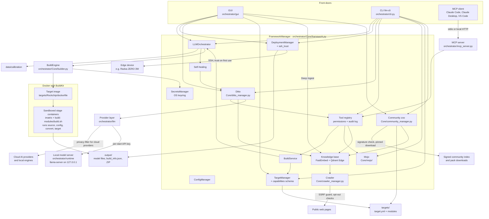
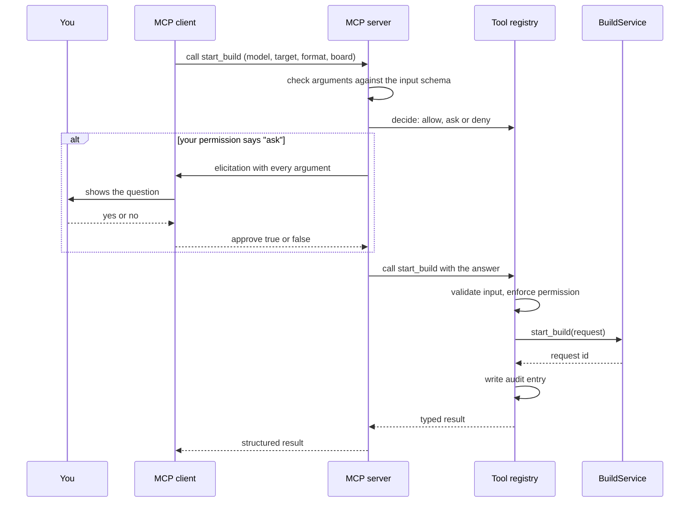
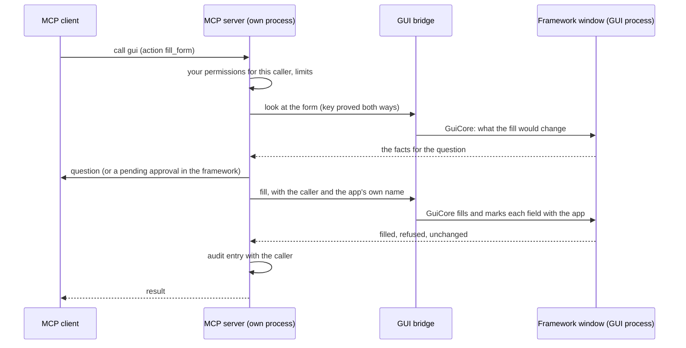

Version 3.4.0 · Last updated 2026-11-10

**English** · [Deutsch](DESIGN_DE.md)

# Design

This is the design document of the LLM Cross-Compiler Framework. It explains what the framework is for, how its
parts fit together, how data moves through it, how it protects you, and why it is built the way it is. It is one of
the three files of the [blueprint](BLUEPRINT.md): what comes next is in the [roadmap](ROADMAP.md), and what each
released version contains is recorded in the [changelog](../CHANGELOG.md).

The document is the build plan of the framework: it describes the system as it is meant to be, so that it can be
built from it, including what is decided but not built yet, marked "planned" with the roadmap row that builds it. What
is not in this design was never decided. The roadmap holds the build steps and their status, the changelog only what
was built.

## Contents

- [In short](#in-short)
- [Purpose and principles](#purpose-and-principles)
- [Architecture overview](#architecture-overview)
- [Data flows](#data-flows)
- [Components and decisions](#components-and-decisions)
- [Security model](#security-model)
- [Key decisions](#key-decisions)
- [Decision log](#decision-log)
- [Versioning and documentation policy](#versioning-and-documentation-policy)
- [History](#history)
- [Glossary](#glossary)

## In short

A language model as published on Hugging Face is usually too big and in the wrong format for a small computer
such as a Radxa ZERO 3W. The framework fixes that in three steps:

1. **Fetch** the model (a Hugging Face repo id such as `Qwen/Qwen3-0.6B`, or a folder on your disk).
2. **Convert and shrink** it ("quantize") inside a Docker container that has the right tools for your hardware.
3. **Install** the result on your device over SSH.

You can drive it in three ways: the desktop GUI, the command line `llm-cli`, or an AI client such as Claude Code
or Claude Desktop through the Model Context Protocol (MCP). All three use the same core.

The built-in assistant **Ditto** helps you choose models and settings, explains failed builds and can use the
framework's tools for you, always within the permissions you set. Ditto works with a cloud AI provider of your
choice or fully offline with a local model that the framework downloads and runs for you.

There is one official hardware target, **Rockchip** (boards RK3566, RK3568, RK3576, RK3588), with three output
formats:

| Format | Runs on | Boards | Typical use |
|---|---|---|---|
| GGUF (llama.cpp) | CPU | all four | chat models on any board |
| RKLLM | NPU | RK3588, RK3576 | chat models on the neural processor |
| RKNN | NPU | all four | ONNX vision and audio models |

`llm-cli` is the console command defined in `pyproject.toml`. If it is not on your PATH, run
`python -m orchestrator.cli` from the installation folder instead; the options are the same.

## Purpose and principles

The framework exists so that people without a background in compilers or machine learning can run a language
model on their own small hardware, and so that experts get a reproducible, inspectable pipeline. Six principles
guide every design choice.

| Principle | What it means in practice |
|---|---|
| **Local-first** | Conversions run on your computer in Docker. Models are downloaded on the host, and the conversion containers have no network. The knowledge base computes its embeddings and reranking locally, and Ditto can run completely offline on a local model. Apart from downloads, nothing leaves your computer unless you choose a cloud AI provider for Ditto (then the privacy filter applies, see [Security model](#security-model)), turn on the anonymous error reports (`enable_telemetry`, off by default) or open a pull request with a community pack (the framework prepares the pack; the GitHub CLI or the browser sends it, with their own credentials). |
| **Laypeople-friendly** | The GUI offers only what the selected target supports, the CLI refuses anything else, and both fill in sensible defaults per board (for example Q4_0 on the RK3566). `llm-cli mojo` explains problems with fix hints. AI errors are explained in plain words (for example that a Claude API key valid in every workspace needs the workspace ID). Self-healing proposals wait for your decision. |
| **Safe by default** | The conversion sandbox is on (`build_sandbox: true`). AI clients and Ditto may read freely but must ask before changing anything. New SSH devices are trusted only after you confirm their fingerprint. Passwords are never stored. Text suggested by an AI is never executed. The crawler honours every machine-readable opt-out of a site, and no switch turns that off. Community packs are installed only after checks in a quarantine folder and your confirmation. |
| **No standing rights that can do more than needed** | No part of the framework holds a right wider or longer than its task needs. So there is no general rights orchestrator that hands out rights and takes them back: it would itself need standing administrator rights, a bigger target than what it guards, and it looks like malware to virus scanners. The rights inside a build container exist only while that container runs (the stage runner's two switch rights, every other capability dropped, no new privileges). On the host the framework prefers a rootless container engine, the installers set one up by default (Docker as root only with `--rootful`, after a warning), and Mojo names it plainly when your account is in a group with root effect (Linux `docker`, Windows `docker-users`). On a board llmcf's account gets a key only, and the key may run only the few commands llmcf needs (planned: ROADMAP row "An own account `llmcf` on the host and on boards"). |
| **Data over code** | What a target can build is declared in its `target.yml` (`capabilities:` block, checked by a schema). AI providers are presets in `configs/llm_providers.yml`, the local model server and its models are pinned in `configs/llama_runtime.yml`, Ditto's evaluation cases live in `evals/ditto/cases.yml`, the retrieval evaluation's corpus and cases in `evals/retrieval/`, and the trusted community keys in `configs/community_keys.yml`. A new board, model or OpenAI-compatible server is an edit of data, as long as the code behind it supports it. |
| **Verifiable builds** | Every build writes a manifest (`build_info.json`) with the SHA256 hash of each model file, a `Model_Card.md` and a ZIP archive. The deployment package checks the hashes on the device before installing. Python dependencies are pinned by hash, downloads of the local model server and its models by size and SHA256, and the tool audit log can be verified. |

## Architecture overview

In plain words: there are three front doors (GUI, CLI, MCP). Behind them sits one core, the `FrameworkManager`,
which starts all other parts and hands them to each other. A build request ends up in the `BuildEngine`, which
builds a Docker image for the target and runs the conversion in sandboxed containers. The finished model lands in
`output/`, and the `DeploymentManager` copies it to the device. Ditto talks to AI providers only through the
provider layer, and uses the same tool registry as the MCP server. Deep Ingest, which a person starts in the GUI or
confirms for an AI client (`crawl_docs_site`), sends the crawler to public web pages for the knowledge base; the community zoo installs community packs into
`targets/`, the recipe folder and the knowledge base.

### Layers

The GUI, the CLI and the MCP server stay in one repository (maintainer decision of 2026-10-17); the coupling is kept
in check by layers, each importing only itself and the ones below it:

| Layer | Packages | May import |
|---|---|---|
| 1. Bottom | `orchestrator/utils/`, `orchestrator/security/`, `orchestrator/schemas/` | layer 1 |
| 2. Remote | `orchestrator/remote/`, `orchestrator/utils/ssh_trust.py` | layers 1 and 2 |
| 3. Kernel | the modules of `orchestrator/tools/` that define no tools (registry, policy, audit, approvals, signing, spec, ...) | layers 1 to 3 |
| 4. Domain | `orchestrator/Core/`, `runtime/`, `rag/`, `llm/`, `evals/` (`llm` and `rag` never import `Core`) | layers 1 to 4 |
| 5. Tool definitions | `orchestrator/tools/tools_*`, `framework_*`, `gui_bridge`, `gui_surface` | layers 1 to 5 |
| 6. Adapters | `orchestrator/cli.py` (with `orchestrator/acp_agent.py`, the ACP agent it starts), `orchestrator/mcp_server.py`, `orchestrator/gui/` with `main.py` | everything except another adapter |

PySide6 lives only in the GUI, click and rich only in the CLI, the ACP SDK `acp` only in the ACP agent and the ACP client (`Core/acp_client.py`), mcp and uvicorn only in the MCP server, paramiko only in
the SSH transport (`remote/transport.py` and the `utils/ssh_trust.py` it grew out of). `tests/test_layering.py` checks every import
(also inside functions and lazy ones) against these rules; today's exceptions stand in
`tests/data/layering_allowlist.json` with their reason and the chain that removes them, and the list and the largest
import cycle may only shrink. Shared helpers therefore live below the tools: path labels for AIs in `security/paths.py`,
private atomic files and the one owner-only rule (`owner_only`, an ACL on Windows) in `utils/atomic.py`, one-time notices in `utils/notice_store.py`, image references in
`utils/image_ref.py`, the SSRF-safe HTTP adapter in `security/http.py`, the audit key in `Core/vault_key.py`.

### Components

| Component | Where | Role |
|---|---|---|
| GUI | `orchestrator/gui/` (start: `llm-gui`, `orchestrator/gui/app.py`; PySide6, the optional extra `gui`) | Main window, build tab, deployment window, Ditto chat (its header shows the access in use), module wizard with Deep Ingest, Hugging Face browser, Community Hub, dialogs for AI settings, the sign-in panel (`sign_in.py`: method cards, key form, storage chooser, passphrase dialog; vault and network calls in worker threads), tool permissions, tool confirmations, healing proposals, SSH trust, the Deep Ingest notice and the export for the community. |
| CLI | `orchestrator/cli.py` (`llm-cli`, also `llmcf`) | Top-level commands `acp`, `build`, `config`, `deploy`, `ditto`, `doctor`, `knowledge`, `mcp`, `mojo`, `module`, `scan`, `secrets`, `targets`, `tools`, `zoo` (`doctor`, `mojo` and `scan` are single commands, the others are groups; `doctor` is the old name of `mojo`). The sign-in commands `ditto login`, `logout` and `auth` use the same sign-in operations as the GUI (`orchestrator/llm/auth/signin.py`). |
| FrameworkManager | `orchestrator/Core/framework.py` | Starts all managers in four phases (security and infrastructure, core logic, AI and knowledge, guardians and operations), connects them, keeps one long-lived asyncio loop for builds and resolves relative data paths against the installation folder, not the working directory. |
| ConfigManager | `orchestrator/Core/config_manager.py` | Settings with a schema (type, default, validation rule). The config folder is `LLM_FRAMEWORK_CONFIG_DIR` if set, otherwise the installation's `configs/` if it is writable, otherwise the per-user folder; never the working directory. User settings are saved to `config.yml` there. Environment variables with the prefix `LLM_FRAMEWORK_`, `FRAMEWORK_` or `LLM_` override known settings. Personal state lives in `~/.llm-framework` (override with `LLM_FRAMEWORK_HOME`), made private (mode 0700) when it is created on Linux and macOS; an existing folder keeps its mode, and Mojo Oracle reports one others can read (`state.permissions`). |
| SecretsManager | `orchestrator/Core/secrets_manager.py`, `orchestrator/Core/vault_key.py`, `orchestrator/utils/file_lock.py` | Encrypted vault (`secrets.store` in the per-user folder, format v2: Fernet entries with key ids, read with MultiFernet, key rotation). Its key comes from the operating system's keyring by default (one entry per vault; a keyring that hangs, keeps nothing or stores in plain text is refused) or from the explicit choice in `secret_storage` (credential helper, passphrase, unencrypted key file, memory only). Every change runs under a cross-process lock; the vault refuses a location inside a git working copy. Holds API keys (as records under `cred/<provider>/api_key`; the old names still work) and the Hugging Face token (`hf_token`). The secrets of a store in the old location (config folder) are taken over once and re-encrypted with the vault key, also into an existing per-user store; secrets already there win, and the old file is left unchanged. A long-running process (GUI, MCP server) re-reads the vault when another process has changed it. |
| Secret patterns and log redaction | `orchestrator/security/` | One standard-library table of secret formats (`secret_patterns.py`), loaded by `scripts/secret_scan.py` and used by `redact_secrets`. `redaction.py` redacts every log record when it is created (framework, SDK and HTTP loggers, tracebacks), keeps the SDK loggers at INFO or above unless `--debug-http` is given, and provides `SecretStr`, in which the provider layer holds its keys. |
| TargetManager and capabilities | `orchestrator/Core/target_manager.py`, `orchestrator/schemas/targets.py` | Loads the `target.yml` of every target folder (folders starting with `_` or `.`, such as `_template`, are skipped) and validates its `capabilities:` block: boards, formats, quantization types (also per board), aliases, board defaults, default board, importance matrix and calibration needs, support level (`official`, `community`, `experimental`). What a target offers as formats is `build_formats.offered_formats`: exactly the declared formats, every format but `hf` (unchecked) for a target without capabilities; the Builder tab's format list and `llm-cli build start --format` (its help, completion and refusal) read it. Which of them a build for one board gets is `build_formats.format_refusal`: NPU formats (RKLLM, RKNN) only when the board's hardware probe shows its NPU, RKLLM only for its SoCs and on an x86_64 build computer, else GGUF; the build service and the Builder tab read it. The board's probe (`BuildRequestIn.probe`, else the newest stored probe of a board of the request's SoC) reaches every build container read-only as `HARDWARE_CONFIG_FILE`, and the config stage plans the build for that board. |
| BuildService | `orchestrator/Core/build_service.py`, `orchestrator/schemas/build.py` | The one build-submission path: validate, start, status, cancel, log tail, artifacts, healing decision. `llm-cli build start`, the Builder tab's Start Build, the MCP server and Ditto all queue builds through `start_build` (an installed community recipe through `start_recipe`, which pins its calibration dataset and checks the recipe's revocation when it is built; `installed_recipe` is the only path that builds a recipe, and `community_manager.read_recipe` the only reader of `recipe.yml`). The person's own callers (`local_paths=True`) may name any path, choose the priority and the folder the build is saved to, and build a target without capabilities unchecked; AI callers may not. The person's builds carry no owner, so the queue limit for tool callers never refuses them. |
| Pre-flight check | `orchestrator/Core/consistency_manager.py`, `orchestrator/schemas/targets.py` (`SdkNeeds`), `orchestrator/gui/preflight_box.py` | Compares the hardware probes with what a build and the target's SDK need, before anything starts: this computer's NVIDIA driver with the CUDA version of the target's GPU image for a GPU build, the board's NPU driver and runtime with the format's `sdk:` declaration. `BuildService.preflight_for` runs it for every build start (`start_build`, `continue_interrupted`), the build plan and `llm-cli build preflight`; a stop starts nothing unless the person overrides it for that build (see [Build pipeline and target modules](#build-pipeline-and-target-modules)). |
| Network locality | `orchestrator/utils/locality.py`, `orchestrator/Core/local_network.py` | The one offline check (`offline_mode`) and the one rule, asked two ways: `check_reach` (may offline mode reach it: the person's opt-outs count) and `check_location` (where the server stands: the privacy filter and the local/cloud label; the opt-outs never count). Connections go to `connect_addresses` (the checked local addresses only), a crawl the person starts to `crawl_addresses`; `tailscale_vpn` reads the VPN, `forget` drops a lookup after a failed connection (see [Offline mode and the local network](#offline-mode-and-the-local-network)). `local_network.py` is the only writer of the person's opt-outs (File > Settings... > Local network and `llm-cli config local-network`); no module an AI can reach imports it. |
| AI settings change | `orchestrator/llm/settings_change.py` | `AISettingsChange`: the rules of a change of the AI settings in one Qt-free place (known fallback providers, no cloud provider offline, key required and not an admin key, workspace ID, server address without user name or password, model, the plain-http question, the key stored for its address, the settings written, the knowledge base started, Ditto reloaded). The AI settings dialog keeps only its message boxes; sign-in and `ditto login` use its address rules; MCP `update_settings` and the dialog's GUI-tool fields use its tighten-only rule (`direction_problem`). `current()` and `with_setting()` serve a change of one setting, and `problems_of_settings()` runs every rule for it: MCP `update_settings` refuses what `offline_mode` or `enable_rag_knowledge` would break (offline mode with a cloud provider), while a problem the saved settings already have stays yours to fix in the dialog. |
| LLMOrchestrator | `orchestrator/Core/orchestrator.py` | Queue and pipeline: prepares calibration text, expands a request into jobs (model x target x format x quantization), runs them on the build engine, handles cancellation and the self-healing approval loop. |
| BuildEngine | `orchestrator/Core/builder.py`, `orchestrator/utils/build_context.py`, `orchestrator/utils/hadolint.py` | Stages the Docker build context, checks its Dockerfile with hadolint when it is installed (advisory: findings go to the build log and the progress warnings, the build goes on), builds the image (BuildKit when available), downloads or mounts the model, runs the optional Trivy scan, the importance-matrix stage and the build stage in sandboxed containers, writes the manifest, model card and ZIP into a hidden staging folder, moves them into the output folder once the build can no longer be cancelled, and cleans up. |
| DockerManager | `orchestrator/Core/docker_manager.py` | Makes the framework's one build engine (with its Docker client) and checks that the Docker daemon answers; no Qt. `container_resources()` turns a `docker stats` sample of a running build container into CPU and memory figures (Docker's own formulas, memory without the inactive page cache); the build engine samples them into the build's progress, `BuildService.live_resources` hands them to the Builder (under the progress bar), and the build log warns once near the memory limit. |
| Container engine | `orchestrator/utils/docker_engine.py` | Which engine the framework talks to: a rootless one first (install.sh sets up rootless Podman by default, rootless Docker with `--engine=docker`, Docker as root only with `--rootful`); `ensure_docker_host()` sets `DOCKER_HOST` to the person's rootless Docker, else the person's Podman socket, before a Docker daemon that runs as root, for the process and the programs it starts (a `DOCKER_HOST` the person set always wins). `root_effect_group()` names a group of the account with root effect (`docker`, `docker-users`). Every place that makes a Docker client calls it first (the build engine, the builder image's `DockerEngine`, Ditto's `DittoDocker`, the one Docker check `check_docker_environment`, `scripts/build_container_image.sh` through `python3 -I ... --docker-host`). `engine_name()` tells Docker from Podman by `/version`; `podman_refusal()` refuses early what Podman does not provide (Docker's GPU request, BuildKit): `BuildService` before a GPU build is queued, the builder, Ditto's GPU passthrough. `create_container()` creates every container of the framework (the build stages, the llama.cpp builder, Ditto's check and server containers); under rootless Podman one that runs as the person gets Podman's `keep-id`, so it can write the person's folders. Mojo names the engine. Standard library only (the system's Python 3.9 too). |
| Rockchip reference target | `targets/Rockchip/` | `dockerfile` (Debian bookworm-slim; llama.cpp v0.6.0 tools; three Python venvs), `modules/build.sh` (the stage runner) with the four stage modules `source_module.sh`, `config_module.sh`, `convert_module.sh` and `target_module.sh` (`gguf`, `rkllm`, `rknn` and the `imatrix` job), `modules/rkllm_module.sh` and `modules/rknn_module.sh` (format helpers of the convert stage), `scripts/export_rkllm.py`, `scripts/rknn_converter.py`, `scripts/model_check.py` (the convert stage's checks; the template ships the same file), `target.yml`. `targets/_template/` is the starting point for new targets ([Module Developer Guide](Module_Developer_Guide.md)). |
| DeploymentManager and SSH trust | `orchestrator/Core/deployment_manager.py`, `orchestrator/utils/ssh_trust.py` | Builds the deployment package, checks the device's host key, pairs the framework's SSH key, uploads and runs the installer. |
| Deploy steps | `orchestrator/runtime/device/person_steps.py`, `orchestrator/runtime/device/steps.py`, `orchestrator/runtime/device/service.py` | One deploy per use case. `deploy_build` (the person's only) deploys a build for `llm-cli deploy run` and the Deployment tab: the package (`make_package`, its reason returned with the result; with Docker images exactly the containers of `deployment_manager.package_containers` that the Deployment tab's table has ticked, every one for `--docker`), the deploy, then the board's trusted record with the CLI's audit row. `deploy_runtime_flow` deploys a board's self-built runtime for `llm-cli device runtime deploy`, the Boards window and the AI's `deploy_device_runtime`: login, trusted record, refusal of root, benchmark question with its consent, install, "tested on" record. Each caller passes its login and its words as hooks; only the person's channels pass the trusted record and the question. |
| Remote layer | `orchestrator/remote/` | Everything that talks to a board, Qt-free and importing only `orchestrator/utils` and `orchestrator/security`: the board's address (`address.py`: `Endpoint` with its known_hosts, stored and displayed forms, the one host, port and SSH-user check, ASCII only), why a board cannot be reached (`reasons.py`: the four reason codes and `local_problem` for a problem on this computer, never recorded with a board, `check_port`, `classify`, `reach_code`; a dropped connection while a deploy waits for the board counts as "not back yet"), `RemoteFailure`, the base of every board step's error (`errors.py`), a board's words and a running deploy's state as one line for the person or an AI (`text.py`), the connection (`transport.py`: whether SSH works here, paramiko imported on first use; every command as one `sh -c` with a time limit and an output cap; the login, SFTP and keepalive in `ParamikoTransport`; the same over this computer's OpenSSH client in `SystemSshTransport` where paramiko is missing, with the one OpenSSH command-line builder: `openssh_argv`, `openssh_options` with a login time limit and keepalive and `-F` with the framework's own settings file, so OpenSSH reads neither `~/.ssh/config` nor `/etc/ssh/ssh_config`, `config_value` quoting a path, `openssh_file` writing a `%` of the framework's own paths as `%%`), the framework's own OpenSSH settings file (`ssh_config.py`: created owner-only on first use, holding only the `Host` blocks the person adds; the lines that would change the trust settings on the command line, run a command or include a file refused, a `ProxyJump` or `ProxyCommand` only knowingly; written only by `runtime/device/person_steps.py` `save_ssh_block` for the CLI and the GUI, never by a tool), the framework's `known_hosts`, read-only (`trust.py`: `TrustStore` with `status`, `status_of`, `check` giving a `KeyCheck`, `read_presented_key`; `fingerprint`, `device_id_for`, `parse_public_key` for a key the person pastes; the host-key errors), the person's writers of a board's trust (`pairing.py`: a trusted key with its audit row in one step, the one decision of trust on first use behind `deploy run`, `scan --device` and the GUI's question, pairing over a one-time password session, Q5's change of a board's address or host key with the old and the new fingerprint, audited before anything changes; for a new key the board's data moves to its new device ID with it, `runtime/device/board_move.py`: copied and checked before the change, the old copies removed only after it; and a consent's audit row) and the session with a board (`session.py`: `RemoteSession` logs in with the host key checked through `TrustStore` at every login, with typed credentials, `KeyOnly` for every AI path and the person's `OneTimePassword`, the only one that can pair; a private folder, the upload that resumes after a network drop, the wait for the board (N5), a job that runs on the board on its own and is followed again (`run_detached`, `follow`), a command that may run twice sent again after a drop (`run_resumable`); one `CancelToken`, and closing a session ends its waits). No module an AI can reach imports `pairing.py` (an import-graph test). The deploy of a package is a thin adapter over the session, over paramiko or, where it is missing, over OpenSSH (it waits for the board, resumes the upload and runs `deploy.sh` on the board on its own either way), and the runtime deploy, the checks on the board, the on-board benchmark and the probe run on it too (`runtime/device/remote.py` `RemoteShell` is their facade): the runtime tarball goes over SFTP and continues after a network drop (a board without SFTP gets it on stdin), the checks run again, the benchmark runs on the board on its own and is followed again, and the AI path (`runtime/device/service.py`, `KeyOnly`) and the person's board steps (`person_steps.connect_stored`, a one-time password allowed) both open a session that waits for the board (N5). The old paths `orchestrator/runtime/device/reasons.py` and `orchestrator/utils/ssh_trust.py` keep working. What a contact found is recorded for Mojo by `record_reach` in `orchestrator/runtime/device/trusted.py`. |
| Tool registry, permissions, audit | `orchestrator/tools/` (`registry.py`, `policy.py`, `audit.py`, `confirmation.py`, `framework_tools.py`) | Eleven typed tools with risk tiers, the user's stored permissions, the confirmation text (shared by MCP and Ditto) and a hash-chained audit log. |
| MCP server | `orchestrator/mcp_server.py` | Exposes the tool registry over MCP (official SDK `mcp` 2.3.0) via stdio or local Streamable HTTP. The launch command it writes for clients uses `python -P`, so nothing is imported from the folder a client starts it in. |
| ACP agent | `orchestrator/acp_agent.py`, `orchestrator/Core/acp_editor_servers.py`, `orchestrator/utils/stdio_programs.py` | Ditto as an agent of editors that speak the Agent Client Protocol (`llm-cli acp`, version 1 over stdio, SDK `agent-client-protocol` 0.12.1): every turn is Ditto's chat turn with the channel `acp`, every tool call goes through the registry, permission requests offer only once-options, editor paths become folder labels, the editor's MCP servers are recorded and none is used ([decisions](#acp-agent-ditto-in-editors); setup: [Editors and agents](Editors_and_Agents.md)). |
| Provider layer | `orchestrator/llm/` | One client (`LLMClient`) for every AI provider, built on the official `anthropic` and `openai` SDKs; OpenAI-compatible servers go through `openai`. Picks provider, model and effort per task from the settings and the presets in `configs/llm_providers.yml` (a file of the same name in the config folder adds or replaces presets). Retries (two, the SDKs' own retries are off), a fallback chain for refusals and outages (`ai_fallback_chain`), structured answers validated against schemas with one repair attempt, typed errors, the privacy filter for cloud providers, and a tool loop. The sign-in core (`orchestrator/llm/auth/`) resolves the credential of each call from the sign-in methods in the catalog: keys from the vault (keys of custom servers bound to their address) or from the environment variables the catalog lists, a free credential check, errors with a known cause and the next step, and token renewal under a lock shared by all processes. |
| Ditto (rebuilt) | `orchestrator/Core/ditto_manager.py` | The assistant: chat with the framework tools (at most 8 model turns per question, tool calls as actor `ditto` through the registry), analysis of failed builds, module proposals from a hardware probe and build recommendations. The last three are validated structured answers; an invalid answer is an error and is never applied. A healing analysis or build recommendation with a dangerous command is discarded; a module proposal is checked again by the module generator. The chat history is append-only (`chat_history.json`); a long conversation is summarized into a new one. |
| Managed local model | `orchestrator/runtime/`, `configs/llama_runtime.yml` | Builds `llama-server` on the machine from the pinned llama.cpp commit (b11429, the same commit as v0.6.0): the CPU build first, then a GPU build (Vulkan in this version), each verified before it is used; imports a build of another machine of the same kind; downloads the official prebuilt archive only on explicit request, labelled not self-built. Downloads pinned GGUF models in tiers (Qwen3.5 9B, 4B and 2B, 2-bit variants for weak hardware, and an IBM Granite 4.2 3B model on request), each checked by size and SHA256. Runs `llama-server` on 127.0.0.1 with a free port and a per-start API key, within one memory budget from the measured hardware (KV-cache type by the boards' rule, prompt cache, keep time; `llm-cli ditto cache`). The `local` provider finds the running server by itself. |
| Ditto evaluation | `orchestrator/evals/ditto_eval.py`, `evals/ditto/cases.yml`, `evals/retrieval/` | `llm-cli ditto eval`: 19 fixed cases (build-log analysis, build recommendations, module proposals, chat with tools, prompt injection) graded by rules, against the configured provider or per local model tier. Nothing is built: chat cases use the real tool definitions over a stand-in build service. With `--kind retrieval`, 42 searches grade the knowledge-base search on a fixed corpus, without an AI model (see [A knowledge-base search](#a-knowledge-base-search)). With `--kind tokens`, multi-turn conversations record the provider's own token and cache numbers per turn, and `--kind openai_paid` is the paid OpenAI cache and count test that only the person starts (see [Measured token numbers](#measured-token-numbers)). |
| Self-healing | `orchestrator/Core/self_healing_manager.py` | Recognizes known failures with fixed patterns first and asks Ditto only for unknown ones. Applies only framework-defined fixes, and only after your approval. |
| Knowledge base and crawler | `orchestrator/Core/rag_manager.py`, `orchestrator/rag/`, `orchestrator/Core/crawler_manager.py` | Optional (`enable_rag_knowledge`). Web pages, PDFs, community knowledge packs and, when you index them (`llm-cli knowledge index-docs`, the GUI or the tool `index_framework_docs`, never by themselves), the framework's own documentation and code are split into chunks and stored with a local dense embedding (FastEmbed on ONNX Runtime, CPU; model chosen by hardware unless `rag_embedding_model` is set) and a BM25 vector. Searches combine both rankings with Reciprocal Rank Fusion; a local cross-encoder can rerank the results and drop those below a relevance floor (see [A knowledge-base search](#a-knowledge-base-search)). Qdrant Edge, the Rust engine of Qdrant, runs in the process with its storage in the per-user folder (a knowledge base of an earlier version is converted on first use, see [The knowledge base's storage](#the-knowledge-bases-storage-qdrant-edge)); a Qdrant server is used only when `qdrant_url` is set. The crawler of Deep Ingest honours the sites' machine-readable opt-outs (see [Deep Ingest](#deep-ingest-from-a-web-page-to-the-knowledge-base)). |
| Deep Ingest notice and spoken announcements | `orchestrator/utils/crawl_notice.py`, `orchestrator/utils/announce.py` | The one-time notice before the first Deep Ingest, remembered per user, and short announcements through the speech engine of the operating system. |
| Community zoo | `orchestrator/Core/community_manager.py`, `orchestrator/Core/community_pack.py`, `orchestrator/Core/community_maintainer.py`, `orchestrator/schemas/recipes.py`, `orchestrator/gui/community_hub.py`, `orchestrator/gui/community_maintainer.py`, `configs/community_keys.yml` | Signed and encrypted community packs (targets, recipes, knowledge), the signed community index, installation through a quarantine with trust levels, export with privacy scrub and the hand-over to a pull request, and the maintainer actions on the community repository (signing key, review and publish, revoke) (see [Community packs](#community-packs-format-trust-and-exchange)). |
| Input history | `orchestrator/utils/input_history.py` | Recent values of the GUI input fields, per user and without secrets (see [Recent inputs](#recent-inputs)). |
| Mojo (the doctor until 3.0.0) | `orchestrator/Core/mojo/` (`findings.py`, `checks/`, `runner.py`, `offers.py`, `repairs/`, `views.py`, `docker_objects.py`, `banner.py`); `orchestrator/Core/doctor.py` re-exports it | Deterministic health checks (Python, Docker and BuildKit, disk space, targets, state folder permissions, secrets and keyring, tool permissions and audit log, calibration data, installed community packs, knowledge snapshots) with stable codes, fix hints and, for every warning and error, where, why and what Mojo Miracle can do about it (Mojo Oracle). The Python and Docker checks run on the framework's original checks in `orchestrator/utils/validation.py` (`validate_python_version`; `check_docker_environment`, which the build engine's start uses as well). Mojo Miracle applies only harmless repair plans (the class computed from the steps; a dry run bound to its sha256, audited first, compare-and-swap, one at a time, checked again) and reports every problem as repaired or not repaired with the reason. Deleting is never a repair: `docker_objects.py` builds a deletion plan of every framework build image (`framework_image_plan`: left over without a name, named `last-build`, runtime builders; `DeletionPlan` of `tools/spec.py`), and `delete_framework_images` removes exactly the images the person ticked, after the person confirmed them at a terminal or in the GUI's Tools > Framework Build Images... (actor `cli` or `gui` only, audited first, refused when a chosen image changed); the Docker build cache is never cleared. `docker_storage` says where Docker keeps its images. `ai_findings` (`run_doctor`) and `oracle_rows` (`run_mojo_oracle`) are what an AI reads: folders by label, other paths by file name. `banner.py` is the console's crystal ball when Mojo Miracle ends after Mojo Oracle at a terminal (the drawing and its colour mask in one place, which line a result earns, and the note of the open Oracle run next to Mojo Miracle's lock); only the CLI prints it, nothing of it reaches an AI. |
| Deletion and trash | `orchestrator/Core/deletion.py`, `orchestrator/Core/trash.py`, `orchestrator/gui/deletion_dialog.py`, `orchestrator/gui/trash_window.py` | Every deletion of the person's objects takes an `AcceptedDeletion`: the plan the person accepted in the GUI or at a terminal (multiple choice rebuilds it from exactly the ticked items), its mode (trash or for good) and the channel. The deleting code builds the plan again and refuses a changed one (`PlanChanged`). The trash moves items with one rename into `.trash/<id>/` of their data folder (never across disks); its index `tool_trash.json` is signed; nothing leaves it by itself; only the person empties it; an AI restores only what it asked to delete. `tests/test_deletion.py` lists every place in the code that deletes, with how it is covered. |
| File hashing | `orchestrator/utils/helpers.py` | The one implementation of every file sha256 (whole files, open handles and their first bytes for a resume, descriptors, copies hashed while they are written so the bytes checked are the bytes used, a lock-protected cache, `SHA256SUMS` lines and `.sha256` sidecars, the constant-time compare). The old helper names in the build, deploy, runtime, trash and download code are delegates; `tests/test_hashing.py` refuses a new hash loop beside it. The hardware probe keeps no copy, and the `sha256sum` calls that run on a board stay on the board. |
| Disk rule and watchdog | `orchestrator/Core/disk_plan.py` | What a build lands where, the reserve (2 GiB or 2 %, 20 GiB or 10 % under a standing approval), the cross-process reservation ledger, and the watchdog: below half the reserve a running build container is stopped and staging ends (`DiskWatchdog`, `low_disk_text`), a full disk is reported by label with `insufficient_resources` (`disk_full_text`, `is_disk_full`), and the trivy scan is skipped (`low_disk_floor`). BuildEngine only calls them. The one disk rule for every free-space check (decision A4): `room` (one disk) and `check_disk` keep the reserve free beside what accepted calls of any process reserved in the ledger, for builds, downloads (`download_rule`, the downloader's `space`), the deployment package, the bench copy, the knowledge-base conversion, the snapshot export, Mojo's disk check and the AI's disk fact; `refusal` and `person_text` say what does not fit and the next step, English or German. The board package of a target stage is made in the build container, which has no framework: `scripts/board_package.py room` there applies the same reserve with the same words (a test compares them), without the ledger of the per-user folder. While a build runs, the engine records what of its reservation has landed on disk (`LandedMeter`, `ReservationLedger.landed`), so those bytes are not counted twice. |
| Hugging Face downloads | `orchestrator/Core/hf_hub.py`, `orchestrator/Core/hf_takeover.py`, `orchestrator/gui/huggingface_window.py` | One verified fetcher (`HubFetcher`: the commit pinned, a resumable `.part` file, the Hub's size and sha256 checked before the file gets its name, the token only to huggingface.co) for an AI's `download_hf_file`, the GUI's Hugging Face browser (`download_for_person`, decision A6) and the Builder's model download, one Hub API (`hub_api`: huggingface.co only, never the host in `HF_ENDPOINT`, never an implicit token) for every search, look-up and file list of the framework, the browser's and the Builder's included, and one token rule: a public repository's listings, look-ups and files carry no token, also with one stored; the token goes only to a gated or private repository (`needs_token` from the repository's gated and private fields, or the Hub's 401/403 answer to a request without it, then one request with it: `tokenless_first`, `HubFetcher(token_needed=...)`). The process runs with huggingface_hub's `HF_HUB_DISABLE_IMPLICIT_TOKEN` and `HF_HUB_DISABLE_TELEMETRY` on (`orchestrator/utils/hf_env.py`, set when the package `orchestrator` is imported; in huggingface_hub 1.33 the telemetry switch also stops its agent-harnesses registry request), and the knowledge base's fastembed models come through `fetch_snapshot` into fastembed's cache without a token, which fastembed then loads without contacting anybody; and one layout for single files, `download_path`: `<models_dir>/hf/<owner>--<name>/<commit[:12]>/<file>` (the Builder stages whole models in `cache/models/hf/`). The browser's download follows the one disk rule and holds its own reservation in the ledger while it runs; so does a knowledge base model fetched through `fetch_snapshot` (the knowledge base hands the factories its ledger: the disk rule's refusal before any file, the landed bytes recorded per file, the reservation released when the fetch ends). Each file and record of a download is moved into place with `utils/atomic.replace_file` (tried again for a moment on Windows while a reader holds the target): the fetcher's last move, `refs/main`, and the record of a complete Builder copy (`local_models.write_complete`). `hf_takeover` lists what earlier versions saved in huggingface_hub's cache inside the models folder (still listed and usable), copies it on the person's request, each file checked against the checksum it was downloaded with, and offers to remove the old copies only as an accepted deletion plan with the exact list (the browser's **Take over old downloads...** and `llm-cli models take-over` run the same calls). In offline mode the browser's, the Take over's and every AI caller's Hugging Face calls and the GUI's commit check refuse before any request with one refusal (`hf_hub.offline`, `offline_refusal`; the person reads `person_text`); a build in offline mode never downloads its model (see the next row). |
| Models on this computer | `orchestrator/Core/local_models.py`, `orchestrator/gui/offline_model.py` | What an offline build can use: `local_copy` finds a complete copy of a Hugging Face model (the Builder's own copy in `cache/models/hf/`, recorded as complete when its staging ends; a model folder the Hugging Face browser downloaded; the old huggingface_hub cache), which `BuildEngine` mounts instead of a download in offline mode. `models_here` lists the models already here, each with its label: a local-file reference for the models folder and the folders shared with the AI (`LocalFiles.list`), the repository id for the Builder's copies, the path for the inputs of earlier builds (their build records; the person's only). Without a copy `BuildService.check_model_here` raises `ModelNotHere` with that list: `build start` prints it and takes a listed label or a local path with `--model` (asked at a terminal), the Builder tab opens a choice with an open dialog for a model file or folder (when a recipe pins another commit than the copy chosen here, the tab asks instead of opening the choice again: No cancels, Yes builds the copy as the person's own build without the recipe, `bld.offline.pinned`), and an AI's build plan names the labels only. `ditto models download` in offline mode refuses and names the Ditto models already here (`runtime/ditto_models.offline_refusal`). |
| Texts (localization) | `orchestrator/utils/localization.py`, `orchestrator/utils/l10n_*.py`, `orchestrator/gui/localization.py` | The one text table (`TRANSLATIONS`, merged from the `l10n_*` modules) and `ui_text`, `tr` and `current_language`, without Qt, for every process. The window's language object (`LocalizationManager` with the `language_changed` signal the windows retranslate on, `get_instance`) and Qt's own translation of its standard buttons (`qtbase_<lang>`) live in the GUI; the old import path resolves to them on first use. Only `orchestrator/gui/` imports Qt (`tests/test_qt_free_core.py`). |
| Calibration data | `data/calibration/`, `orchestrator/utils/calibration.py` | Curated German, English and tool-use text (MIT licence) with SHA256 checks, used for importance matrices: the default calibration text of every GGUF build unless `default_calibration_dataset` names a file of the person's. |
| Untrusted text handling | `orchestrator/utils/untrusted.py` | Cleans and wraps external text before it reaches a language model. |
| Log text for a model | `orchestrator/utils/logtext.py` | The one log cleaner, `clean_log`: terminal escapes removed (`ANSI_RE`, CSI and OSC), only what a redrawn line shows last, identical runs and runs that differ only in numbers collapsed, a line that reports a problem (error, warning, fatal, failed, Traceback, and fail, exception, panic, abort, denied, cannot, unable, undefined, not found, no such, segmentation fault, killed, `ERR!`, `E:`) never touched; idempotent. Invisible characters, length caps, secrets and paths stay with `untrusted.py` and `security/paths.py`. The person's own log views stay raw. |

A build is the four stage modules of a target (`source_module.sh`, `config_module.sh`, `convert_module.sh`,
`target_module.sh`, the chain of version 1.x, made the build again by the maintainer's decision U9). `build.sh` is
only the stage runner: it runs them in order, writes a resume marker after every stage that finished (an input
digest and the files the stage named), skips a finished stage when it is run again on the same work folder with
the same inputs, and prints a progress line per stage that the BuildEngine reads from the container log. An
optional `rotate_module.sh` between convert and target is the slot for a step that changes the full-precision
intermediate before it is quantized; llmcf ships none, because in measurement a rotation (QuaRot, SpinQuant) made
GGUF models worse, not better (see the decision on rotation below). Benchmarks stay on the board: no stage runs one,
and the template's `benchmark_module.sh` is no stage.
Around every conversion the convert stage does what the convert module of 1.x promised in the maintainer's design
(decision U9, addendum): it detects the input's format and refuses what the build's format cannot use (an ONNX model
for GGUF, naming the format rknn instead), checks the integrity of the input and of the GGUF the converter wrote,
runs that GGUF briefly with `llama-completion` when the image has it, writes its statistics (sizes, ratio,
duration, the test's result) into the log and into `build_info.json` (`conversion`), and leaves nothing
half-written when it fails: a file it replaces is kept until the new one passed its checks. `scripts/model_check.py`
does these checks with the image's Python and the standard library only; every target ships the same file.
Started by hand with a board's hardware profile, the config stage plans the board and checks the plan (compiler
test, toolchain file, plan script), and the target stage makes the deploy-ready package of version 1.x (programs for
the board, model card, `test_model.sh`, `deploy.sh`, `MANIFEST.json`, `SHA256SUMS`); `build.sh --package` makes it
without a profile too, planned with the target's plain defaults. A build of the framework has no profile and makes no
package. The package follows the framework's build rules: the one disk rule before it copies the model, no llama.cpp
option that downloads in its cross build (the module generator and the folder check refuse a module's CMake flags
that would switch one on, `recipe.refused_option`), and for an x86_64 profile of another PC the CPU features of its
probe as the build recipe plans them, `-march=native` only for a profile of the build machine itself.
See the [Module Developer Guide](Module_Developer_Guide.md#6-the-build-stages).

`configs/project_sources.yml` is a catalogue of upstream projects and documentation links. At runtime the
framework reads only its hardware documentation links (they fill the Deep Ingest window for a probe's vendor and
SDK); see [SSOT_ARCHITECTURE.md](../configs/SSOT_ARCHITECTURE.md) for what each file in `configs/` is for.

### Where things are stored

| Place | Content |
|---|---|
| `targets/` | Target definitions (one folder per target). |
| `cache/models/hf/` | Models downloaded from Hugging Face for builds. |
| `cache/builds/<build id>/` | Work folder of a running build (build context, output, importance matrix, scratch space); removed after the build. |
| `cache/calibration/` | Calibration text written for importance matrices. |
| `output/` | Finished builds, one folder per build with model files, `build_info.json`, `Model_Card.md`, plus a ZIP next to it. |
| `models/ditto/` | Ditto's local GGUF models with a `.verified.json` marker each. |
| `models/embeddings/` | Embedding and reranking models of the knowledge base. |
| `models/hf/<owner>--<name>/<commit>/` | Single Hugging Face files the GUI's browser or an AI app downloaded, checked against the Hub (decision A6). |
| `models/models--<owner>--<name>/` | The browser's downloads of earlier versions, in huggingface_hub's own cache layout: still listed and usable; **Take over old downloads...** copies them into `models/hf/` and offers to remove them. |
| `community/` | Installed community recipes (`recipes/`) and knowledge packs (`knowledge/<topic or target>/<pack>/`: knowledge always belongs to a topic or a target; a loose knowledge file there is never imported until it is sorted into one), each with a `.lcf-provenance.json`, and the packs you export (`contributions/`). Community targets are installed into `targets/`. A `.quarantine/` folder inside an install folder holds a pack only while it is checked. |
| `~/.llm-framework/` (or `LLM_FRAMEWORK_HOME`) | `secrets.store` (also your community keys), `tool_policy.json`, `audit.db` with `audit.db.anchor`, `known_hosts`, the framework SSH key `id_ed25519_llm_framework` (+ `.pub`), `mcp_tokens.json` (the named MCP tokens, as SHA-256 hashes, with their permissions), `chat_history.json`, `llm_privacy_key` and `llm_install_id`; `crawl_notice.json` and `input_history.json`; the cached community index `community/index.json` with `index.json.sig` and the authors' public keys remembered at the first install, `community/authors.json`; the knowledge base `qdrant_edge/` with its lock file `qdrant_edge.lock` and the record of its conversion `knowledge_conversion.json` (the folder `qdrant/` of earlier versions stays until you delete it) and `knowledge_snapshots/`; the local model server under `runtime/llama.cpp/` (builds, `active.json`, `server.json` with the running server's process, port, model, `ctx`, `sleep_idle_seconds`, `cache_ram`, `kv_cache`, the memory-budget settings it was started with (`cache_settings`, so a changed setting restarts it once) and, from its `/props`, `n_ctx_slot` and `build_info`; the key file while the server runs) and its log in `logs/llama-server.log`; while the framework window is open, `gui_bridge/` with `bridge.json` (the bridge's address and key, mode 0600) and the socket `gui.sock`. |
| Config folder (usually `configs/`) | `config.yml` (user settings); optionally an own `llm_providers.yml` that adds or replaces provider presets. |
| `chat_feed.sqlite` in the per-user folder | The chat feed: what the chat panel on the right shows (your messages, Ditto's answers, questions that wait, decisions an AI made with its reason, results of work an AI started). Every row is signed; nothing in it is deleted by itself. |

`cache/`, `output/` (the framework's build folder) and `models/` are relative to the installation folder unless the
settings `cache_dir`, `build_dir` and `models_dir` say otherwise. If the user may not write to the installation
folder (for example `C:\Program Files`), their defaults are in the per-user folder instead
(`ConfigManager.default_data_root`). Finished models (golden artifacts) are saved to the output folder, setting
`output_dir`, default `~/llmcf/output` (see [Features](Features.md#where-finished-models-go)); a build
started in the GUI waits in the build folder until it is saved, and earlier builds stay listed there. None of them is
created at startup; a build, a download or the knowledge base creates what it uses.

## Data flows

### A build, from request to device

In plain words: you pick a model, a board and a quantization. The framework checks that the target can do it,
prepares everything on your computer, builds a toolbox image, converts the model in a locked-down container,
records hashes and lets you install the result on your device.

1. **Request.** The GUI build tab, `llm-cli build start -m <model> -t Rockchip -f gguf -b rk3566`, or the tool
   `start_build` (MCP client or Ditto) creates a request. An unknown target is refused with the list of known
   targets. The request is checked against the target's capabilities: unknown formats, boards or quantization
   types are refused with a sentence that lists the allowed values;
   spellings are normalized (case, aliases such as `INT8` for `Q8_0`); a missing board becomes the target's
   default board, a missing quantization the board default; low-bit types such as IQ2_XS require an importance
   matrix. An importance matrix or a calibration dataset the request leaves out comes from the settings
   `default_enable_imatrix` and `default_calibration_dataset`. Then the pre-flight check compares the hardware probes
   with what the build and the target's SDK need (this computer's NVIDIA driver for a GPU build, the board's NPU
   driver and runtime for an NPU format); a build that cannot succeed as asked starts nothing unless the person
   overrides it (both rules are in
   [Build pipeline and target modules](#build-pipeline-and-target-modules)).
2. **Queue and calibration.** The `LLMOrchestrator` queues the request. If an importance matrix is wanted (GGUF
   only) and the build has no dataset (neither its own nor the default file), it writes the shipped calibration text (`calibration_language`: `mixed`, `de`
   or `en`) to `cache/calibration/`.
3. **Jobs.** The request is expanded into one job per model, target, format and quantization. Each job goes to
   the `BuildEngine`.
4. **Build context and image.** The engine copies the target's `modules/`, `scripts/` and the shared
   `entrypoint.sh` into a fresh build context and builds the image `llm-framework/<target>:<build id>` with
   `docker buildx build` (BuildKit), or with the Docker API if BuildKit is missing. This step needs network: it
   fetches the llama.cpp commit pinned in `configs/llama_runtime.yml` (`b11429`; the build stops unless it got
   exactly that commit) and the Python toolchains. The llama.cpp conversion tools are built with the build recipe's
   options for this machine (`LLAMA_CMAKE_ARGS`, from a probe taken right before the image build), behind the
   options every build has (nothing downloaded at configure time, no subprocess support). The number of parallel
   compile jobs comes from `build_jobs` (0 means all cores).
5. **Staging on the host.** The model is made available before any conversion code runs: a local folder or file
   is mounted read-only; a Hugging Face repo is downloaded on the host into `cache/models/hf/`, using your stored
   `hf_token` if needed. The token never enters a container.
6. **Security scan.** If `enable_security_scan` is on (default), Trivy (`image_trivy`, default
   `aquasec/trivy:0.75.0`) scans the image for HIGH and CRITICAL vulnerabilities. It never gets the Docker socket:
   `docker save` writes the image to an archive in a private folder (0700) of the build, and the scanner runs
   without capabilities and reads only that file, read-only; the archive is removed after the scan, and without
   room for it the scan is skipped with a warning. Findings produce a warning; the
   build continues. A scan that does not finish within `build_timeout` is stopped with a warning.
7. **Importance-matrix stage** (GGUF with IMatrix only). A sandboxed container runs `modules/build.sh` with
   `JOB_TYPE=imatrix`: the stage runner runs source, config and convert, and the convert stage converts the model
   to F16 GGUF and runs `llama-imatrix` on the first 100 chunks of the calibration text. If this stage fails, the
   build stops.
8. **Build stage.** A second sandboxed container runs `modules/build.sh` with `JOB_TYPE=build`, and the stage
   runner runs all four stages: source names the tools of the image, config normalizes the request and refuses
   what the target cannot build, convert checks the input, picks the toolchain (the GGUF converter,
   `rkllm_module.sh` for RKLLM on RK3588 and RK3576 only, `rknn_module.sh` for RKNN), checks and briefly runs what
   it wrote and records its statistics, and target quantizes with `llama-quantize` (with the
   importance matrix if present) and writes `build_info.json`. The progress lines of the runner show the stage in
   the build status ("Running modules: convert (3/4)").
9. **Manifest and golden artifact.** The engine copies the results into a hidden staging folder next to the
   output folder (links in the build output are not followed), completes `build_info.json` with every model
   file's size and SHA256 hash and the primary file, writes `Model_Card.md` and creates a ZIP of these files. Only
   when the build can no longer be cancelled are they moved into `output/` and the ZIP next to the build folder; a
   cancelled or failed build leaves no files there. The build's image is named `llm-framework/<target>:last-build`
   and only its per-build name is dropped: the builder never deletes an image (an older one stays without a name until
   the person deletes it), and the next build reuses the layers. The work folder is removed.
10. **Deployment.** In the deployment window (or with `llm-cli deploy package` and `llm-cli deploy run`) you pick
    a build. The framework packs the model file, `build_info.json`, `Model_Card.md`, a generated `deploy.sh` and
    `checksums.sha256` into a ZIP.
11. **Trust on first use.** Before the first connection the device's host key fingerprint is shown (the same
    format as `ssh-keygen -lf`). Only after you confirm it, or pass a matching `--trust-fingerprint`, is it
    stored in the framework's own `known_hosts`. A changed key always stops the deployment.
12. **Pairing and install.** On the first connection your password is used once to install the framework's
    Ed25519 key on the device; it is never stored. The package is uploaded into a private temporary folder
    (`mktemp -d /tmp/llm_deploy.XXXXXXXX`), unpacked, and `deploy.sh` checks all hashes with `sha256sum -c`
    before it copies the model to `$MODEL_DIR` (default `$HOME/models`) and prints how to start it (for GGUF with
    `llama-server`).

The tool `cancel_build`, the Builder tab's Cancel button and Ctrl+C in `llm-cli build start` stop the running
stage container through the build service. No step has a hard time limit (`orchestrator/utils/step_limits.py`):
`build_timeout` (default 3600 seconds) is a soft cap that stops only an AI-started build, a person's build goes on with
one warning; `build_idle_timeout` (default 1800 seconds) stops a step that prints nothing for that long. Every build engine writes one record per build into `<cache_dir>/build_records/`
(`orchestrator/Core/build_records.py`), which `llm-cli build status` reads, so it sees builds of other programs too.
The CLI, the build service, the orchestrator and the engine resolve a target through the target registry's one
id -> folder map, so a target id may differ from its folder name.

### A tool call from an MCP client

In plain words: the AI client may look at things on its own, but before it changes something the framework asks
you, through the client, and writes down what happened.

1. **Names, arguments, schema.** The tool name and the raw arguments first go through the fool-proof layer
   (`orchestrator/tools/normalize.py`), the same one Ditto's calls use: spelling variants of a tool name, declared
   argument aliases, values coerced and matched against closed lists without ever guessing a near miss, and every
   repair recorded. Every tool has a pydantic input and output model; clients get the input model's closed JSON
   schema. Unknown names and invalid arguments are refused before anything runs, with a reason code and the next
   step, and the refusal is audited (`unknown_tool`, `invalid_input`); the same failing call a third time is
   refused without running (`repeat_refused`).
2. **Policy.** The registry looks up your stored permission for this tool (per-tool override first, then its
   tier). Defaults: `read` allowed, `local_write` ask, `external` ask. Tools in the `forbidden` tier cannot even
   be registered. If the permission file is damaged, every tool is denied until you set the permissions up
   again.
3. **Elicitation.** "Ask" becomes an MCP elicitation: the client shows you the tool and every argument in full
   (arguments too long to show cannot be confirmed). Only a real answer counts as approval, and a "no" is final
   for that call, even if the permission is loosened meanwhile. A confirmation that fails is refused and audited.
   When the client cannot ask (no form elicitation), the question is too long for an elicitation, or you set the
   tool to be confirmed in the framework, the call becomes a pending approval instead: the registry stores the
   question (signed, bound to caller, tool, argument hash and question hash, 15 minutes), the client gets
   `waiting_for_approval` with a job id, and you decide in the GUI or with `llm-cli tools approvals`. On approval the
   framework rebuilds the question and runs the call itself under the original caller if it reads the same.
4. **Execution.** A call that changes something is first recorded (`started`) and refused if that entry cannot
   be written. The handler runs in a worker thread; a client's cancel reaches it at once. Its result is checked
   against the output model and filtered: secrets redacted in every string, fields with external text (logs,
   healing proposals, manifests, knowledge excerpts, job errors) cleaned of invisible characters and capped, a
   result over 256 KiB refused. `notes` are added by the framework only. The client gets the structured result and
   a text block that starts with one sentence of framework facts, followed by the JSON wrapped as untrusted data.
   Errors come back as tool errors with a message meant for people, with secrets redacted; the part of an error
   that quotes external text (a server reply, a log line, a name from a pack) is cleaned first and wrapped as
   untrusted data, the framework's own words and the next step stay plain.
5. **Audit.** Every outcome (`ok`, `denied`, `not_confirmed` with the answer, `error`, `invalid_input`,
   `confirmation_timeout`, `cancelled`) is appended to `audit.db` with redacted, shortened arguments and a hash of
   the full text, the duration, a hash of the result and a link to the call's `started` entry. `llm-cli tools
   audit --verify` checks the chain and its anchor; `llm-cli tools audit --archive` puts the log aside and starts a
   new chain.
6. **Owner, waits and the end of a session.** The server lifespan gives each connection a session (one per stdio
   session, one for the HTTP server); the caller (actor `mcp`, or `mcp:<name>` for the named token ClientTracker
   checked for the request) with that session owns the builds and jobs it starts, and the same identity decides
   the permissions, is the audit actor and counts the waits. `cancel_build` and `cancel_job` on its own work are allowed without a question (a per-tool setting
   still wins, a tier you denied stays denied, a damaged permission file still denies); on another client's work
   the caller's permissions apply. A call with `wait_seconds` first waits on the event loop (no worker thread, at
   most 50 s and 4 waits per client, progress every 5 s when the client gave a progress token), then runs through
   the registry once; cancelling the wait leaves the build or job alone. When the session ends, its unfinished
   builds and jobs are cancelled and audited as `cancelled` ("client disconnected"), the server waits up to 30 s
   for build containers to stop, and `llm-cli mcp serve` then shuts the framework down. Over stdio a SIGTERM from
   the client ends the session the same way (it interrupts the server like Ctrl+C instead of ending the process at
   once).

The twenty-five tools: `list_targets`, `get_target_capabilities`, `list_build_requests`, `get_build_status`,
`read_build_log`, `list_artifacts`, `run_mojo_oracle`, `search_knowledge`, `list_knowledge_sources`,
`read_knowledge_source`, `search_hf_models`, `get_hf_model_info`, `list_local_files`, `get_status`, `get_job_status`,
`list_devices` (tier `read`), `start_build`, `cancel_build`, `resolve_healing`, `cancel_job`, `propose_healing_fix`,
`download_hf_file`, `create_deploy_package`, `run_mojo_miracle` (tier `local_write`) and `deploy_to_device` (tier
`external`). Tools your permissions deny are not listed to the client; `run_doctor`, the 3.0.0 name of
`run_mojo_oracle`, stays callable but is never listed (`TOOL_RENAMES` in `tools/policy.py`: a setting for either name
applies to both, the stricter one wins). `deploy_to_device` is always asked (no setting allows it without a
question) and reaches only a device you trusted and paired in the GUI or the CLI: the framework reads the device's
host key before the question, refuses an unknown or changed key, shows the key's fingerprint and the package's
sha256 in the question, and refuses the deploy when either differs afterwards. Seven optional tools (the local
runtime: `build_local_runtime`, `start_local_runtime`, `stop_local_runtime`, `run_benchmark`; a board's runtime:
`probe_remote_device`, `deploy_device_runtime`, `run_device_benchmark`) are registered with their runtime packages and
stay denied, and so unlisted, until you enable them. The GUI tool `gui` reads and fills the open
framework window, for Ditto and for every MCP client alike (see the next data flow).

### An AI app in the open window

In plain words: while you have the framework's window open, an AI app can read and fill its forms with the same tool
Ditto uses, and you see who filled what.

1. **One tool.** `gui` has an `action` field: `read_form`, `fill_form`, `wizard_state`, `wizard_open`, `wizard_fill`,
   `wizard_next`, `wizard_back`, `wizard_docs` and `show_window`. It is the fortieth listed tool, so a client
   that takes at most 40 tools still gets all of them. The reading actions are decided like read tools; the others
   like a tool that changes something on this computer (asked by default). Your setting for `gui` covers all actions.
2. **The same harness.** The code that works on the window (`GuiCore` in `orchestrator/tools/tools_gui.py`) runs in
   the GUI process for every caller. Ditto runs there and calls it directly. An MCP client's server process sends the
   call over the bridge (`orchestrator/tools/gui_bridge.py`). The question, the permissions, pending approvals and the
   audit entry stay in the caller's own process, as for every other tool.
3. **The bridge.** The window listens on a socket in the private folder `gui_bridge` of the per-user folder (POSIX:
   folder 0700, socket 0600) or on a named pipe with a random name (Windows). Both sides prove a random key from
   `gui_bridge/bridge.json` (0600) before anything is sent; on Linux the window also checks the account of the process
   that connects. Messages are JSON. Another account on the same computer cannot reach it.
4. **Marks.** Each filled field names who filled it: Ditto in purple; an AI app in another colour, with its MCP token's
   name or with the name it gives itself, in quotes, as its own claim. An app never gets Ditto's look. One undo takes
   back every AI change; fields you changed keep your value.
5. **No window.** When no framework window is open, `gui` is refused with the blocker `gui_not_open`, and you are
   asked to open the framework window. The tool stays listed, because clients keep the tool list of a session. The
   window that opens first serves the AI apps; another open window checks every few seconds and takes over when the
   first one has closed.

### A question to Ditto

In plain words: Ditto answers in the chat panel or on the command line. When it needs facts about targets or
builds, it asks the framework's tools, with the same permissions as an AI client. Before a question goes to a
cloud provider, personal details are replaced by placeholders.

1. **Question.** In the GUI chat, or with `llm-cli ditto ask "<question>"` (`--no-tools` answers without tools;
   `--provider` and `--model` override the AI settings for this question; such a choice is never saved, also not
   by a settings change during the question, and another provider does not inherit the saved provider's model,
   address or sign-in method).
2. **Provider and model.** The `LLMClient` takes provider, model and effort for the task from the AI settings
   and the preset in `configs/llm_providers.yml`. For the `local` provider it reads address, key and model of the
   running managed `llama-server`. In offline mode only local providers are used, at an address the
   network-locality rule counts as local ([Offline mode and the local
   network](#offline-mode-and-the-local-network)).
3. **Privacy filter** (cloud providers only). Secrets are always redacted. Depending on `ai_security_level`,
   addresses, e-mail addresses, logins, user names, host names, serial numbers and paths are replaced by stable
   placeholders, which are mapped back locally in the answer.
4. **Tool loop.** The model may call tools, at most 8 model turns per question. Each call goes through the tool
   registry as actor `ditto`. A call that needs confirmation shows its title and every argument: a dialog in the
   GUI, a prompt in the CLI; without a terminal, and with Ctrl+C at the prompt, the answer is no. Tool results go
   back to the model as untrusted data blocks, as compact JSON (sorted keys, no spaces); a result byte for byte the
   same as one of the same call still in the request goes back as "same result as tool call #<id>". Every tool call is answered before the conversation goes on: a call
   in an answer cut off at the length limit never runs and gets an error result.
5. **Errors.** Provider errors are typed and explained (missing credit, rejected key, rate limit, refusal, cut-off
   answer). Refusals and outages move on along the fallback chain. An error is never shown or stored as an
   answer; when tools already ran in the failed turn, the message names them and says that Ditto will not
   remember the turn. In the terminal, the answer, error texts and tool lines lose their control characters.
6. **History.** The finished turn is appended to `chat_history.json`. A long conversation is summarized and
   continued as a new conversation, and so is a conversation with tool turns asked without tools (tool turns need
   the tool definitions); earlier turns are never edited. A saved conversation whose tool calls and results do not
   pair up starts anew.
7. **Only this computer's tools.** Ditto's hands are the framework's own tools on this computer: the same registry,
   permissions, questions and audit log every MCP client gets. Ditto never connects to a framework on another
   computer. An earlier development version had such a remote mode; it was removed before a release (decision of
   2026-10-15). Its old settings are ignored with a log line, and a saved conversation of it starts anew once.

### Self-healing approval

In plain words: when a build fails, the framework looks for a known cause, tells you what it would do, and waits.
Nothing is changed without your yes.

1. A job fails. The orchestrator hands the error log to the self-healing manager.
2. **Known issues first.** Fixed patterns recognize, for example, an out-of-memory compiler during the image
   build, a killed conversion (exit code 137), a full disk, missing Docker permissions, DNS failures and outdated
   apt sources.
3. **Ditto second.** Only if no pattern matches, Ditto analyses the log (wrapped as untrusted text) and returns a
   structured analysis. The log reaches the model in one order: cleaned (`utils/logtext.clean_log`: escapes,
   progress redraws and repeated lines out, every line that reports a problem kept), then
   scrubbed (secrets, the framework's own folders by label, any other path on this computer by its file name), then
   cut to its last 6,000 characters (`task_prompts.log_for_ai`). Its answer is always treated as advice: the strategy is set to "manual step". A proposal
   that contains a dangerous command is discarded.
4. **Waiting for you.** The build status becomes `awaiting_approval`. You decide in the GUI dialog, at the prompt
   of a running `llm-cli build start`, or through the tool `resolve_healing`. Without a decision within
   `healing_approval_timeout` (default 900 seconds) the proposal is dismissed.
5. **Only fixed actions.** An approved proposal is applied only if it is one of two framework-defined
   strategies (`AUTOMATIC_STRATEGIES` in `self_healing_manager.py`): lower `build_jobs` to 1, or simply retry. The
   job is then retried once. Neither deletes anything: a full Docker disk (`docker_prune`) is a manual step that
   points to the list of the framework's build images (Tools > Framework Build Images..., `llm-cli doctor --fix
   --tier 2`), which deletes only the images the person ticks and confirms. Command text from patterns or AI is shown read-only and never executed;
   approving a manual step through MCP is refused.

### The local model for offline mode

In plain words: the framework builds the server program on your computer from a pinned source, downloads a small
language model, checks both, and runs them on your computer only. Ditto then needs no internet.

1. **Status.** `llm-cli ditto runtime status` shows the detected hardware, the build in use (self-built, imported,
   or "prebuilt, not self-built"), whether it should be built again, the model tier, and whether the server runs.
2. **Build the server.** `llm-cli ditto runtime install` probes the machine and detects the toolchain; the build
   recipe (`orchestrator/runtime/build/recipe.py`) turns the hardware profile into a CPU build plan and, when a GPU
   is worth it, a GPU build plan (Vulkan in this version; the recipe follows OS, architecture and C library). After
   you confirm, the pinned llama.cpp commit is fetched once and checked; configure and build run natively or in the
   builder container, without network (`orchestrator/runtime/build/host.py`, `executor.py`). Each build is verified
   on this machine (`verify.py`: version and commit, devices, the server refuses `--tools`) and kept in the build
   store (`store.py`, `~/.llm-framework/runtime/llama.cpp/builds/<build ID>/`). The CPU build becomes active first
   and stays the fallback; a verified GPU build then becomes active. A build of another machine of the same kind can
   be imported instead (`ditto runtime export` there, `ditto runtime import` here: checked against the pin and its
   manifest, confirmed by you, then verified here). The official prebuilt archive is only the explicit choice
   `--prebuilt` (size and SHA256 checked before unpacking).
3. **Download a model.** `llm-cli ditto models list` shows the tiers; `llm-cli ditto models download [TIER]`
   fetches one at its pinned Hugging Face revision and checks size and SHA256. The recommendation follows memory:
   the 9B model with at least 7.5 GiB of GPU memory, 2B at 4-bit up to 4.5 GiB, otherwise 4B, in each case only if
   the model fits next to the system. For 3 GiB of RAM or less it picks the 2B model at 2-bit today; planned
   (ROADMAP row "2-bit tiers only after a passed evaluation"): like every 2-bit tier, that model is offered there
   only after it passed Ditto's evaluation on this computer, because a model at 2-bit can be too weak for Ditto's
   tasks, and until then the recommendation names it as a candidate to evaluate. The other tiers (4B and 9B at
   2-bit, IBM Granite 4.2 3B) are never recommended; you download them by name, and the two 2-bit ones are offered
   to Ditto, like the 2B model at 2-bit, only after a passed evaluation.
4. **Start.** `llm-cli ditto runtime start` (`--model`, `--ctx`, `--sleep-idle`) starts `llama-server` on
   127.0.0.1 with a free port, but only a build that passed its verification on this machine and still matches its
   manifest (else the CPU fallback, else nothing; the prebuilt archive only after `--prebuilt`). The command line,
   the cleared environment, loopback and the key file come from the one launch policy every launcher uses
   (`orchestrator/runtime/server_policy.py`). A new random API key is written to a private file for every start;
   the framework checks that the server refuses requests without it. One memory budget plans the server from this
   computer's measured hardware (`runtime/hardware.py local_budget`): the KV-cache type (the boards' rule), the
   prompt cache in RAM and the keep time; then the context length follows the free memory left next to the model and
   the prompt cache (at most 32768 tokens), with one slot (`-np 1`). An idle model is unloaded after 10 minutes (or the
   setting) and reloaded on the next request. After the start the server's own `/props` gives the slot's real context.
5. **Use.** The `local` provider reads address, key and model from the running server on every call, so a server
   started from the CLI or the GUI is found without configuration. Requests to 127.0.0.1 never go through an
   HTTP(S) proxy. With effort `low`, thinking is turned off (Qwen3.5 otherwise thinks at full length, which takes
   minutes on a CPU).
6. **Stop.** `llm-cli ditto runtime stop` stops the server (and leftovers of a crash) and deletes the key file.

### Offline mode and the local network

In plain words: with offline mode on, the framework reaches only this computer and your own network, and you
decide what your own network includes. A name such as `nas.lan` counts by the addresses it resolves to, never by
its ending, and you can count a VPN, a host such as your reverse proxy or an address range as local yourself.

- **One check.** Every place that asks whether offline mode is on reads `offline_mode(config)` in
  `orchestrator/utils/locality.py` (the earlier getters, `hf_hub.offline` among them, delegate to it).
- **One rule** (`orchestrator/utils/locality.py`, decisions L-NET and "L-NET final"):
  1. A host counts by the addresses it resolves to. Loopback, private addresses (RFC 1918 and `fc00::/7`) and
     link-local addresses are local. A single-label name or a home suffix (`.fritz.box`, `.home`, `.lan`, `.local`,
     `.home.arpa`, `.internal`) is local only when it resolves to such addresses, and a name never makes a public
     address local. A name with local and public addresses (a home router that also registers a global IPv6 address)
     counts as local by its local ones: every connection goes only to those, in the resolver's order, and a public
     address of such a name is never used, not as a fallback either. A name with only public addresses is not local.
     `localhost` is this computer, without a lookup.
  2. Tailscale's ranges (`100.64.0.0/10`, `fd7a:115c:a1e0::/48`) are not local by default: traffic and coordination
     can pass servers outside your network. They count as local only when the VPN is Headscale in your own network,
     its DERP map holds only relays in your own network, and the address belongs to this computer or to a device of
     the tailnet. The framework reads all of it with the `tailscale` command when it is installed (`tailscale debug
     prefs`: `ControlURL`; `tailscale status --json`: `BackendState` and the `TailscaleIPs`, `AllowedIPs` and
     `PrimaryRoutes` of `Self` and every `Peer`; `tailscale debug derp-map`: every relay's `HostName`, `IPv4` and
     `IPv6`) and judges each control server and relay by rule 1 (all of their addresses local). A private address
     inside a device's advertised subnet route (beyond its own addresses; an exit node's default route is no subnet
     route) is reached through the VPN and is judged like a VPN address. Tailscale's own control server, a VPN that
     is not connected, a missing command or anything that cannot be read: not local. In an answer with local and
     public addresses a VPN address follows this rule too.
  3. A public name, such as a reverse proxy (Caddy with a DuckDNS name), resolves to a public address and is not
     local by default.
  4. You can count a VPN, a host or an address range as local: **File > Settings... > Local network** or
     `llm-cli config local-network`, each with a plain explanation of what can then leave your network (settings
     `offline_local_vpns`, `offline_local_hosts`, `offline_local_ranges`). Only you can: the AI settings change and
     MCP `update_settings` refuse these settings, an AI can neither read nor set them, and no AI tool or GUI-tool
     field reaches them (`orchestrator/Core/local_network.py` writes them, and no module an AI can reach imports it).
     The opt-outs count only for what offline mode may reach (`check_reach`): the privacy
     filter and a provider's local/cloud label ask where the server stands (`check_location`) without them, so a
     public host you count as local keeps the privacy filter on, online and offline, and keeps its label.
  5. The lookup uses the system resolver only (no DNS over HTTPS), with a 2 s timeout, and never on the GUI thread
     (the windows check in a worker thread first, also a Tailscale address, whose VPN check runs the `tailscale`
     command). A lookup and the VPN check are kept for 5 minutes (`LOOKUP_TTL`), and a connection that failed at
     every checked address drops the lookup at once (`forget`), so a laptop that moved to another network gets a
     fresh answer. Where a connection follows the check, it goes only to the checked local addresses, tried in turn
     as the system's own connection would (a link-local one with its zone; a `localhost` name to the loopback
     addresses, whatever a DNS server answers for it), and through no proxy, so a DNS answer that changes in between
     cannot reach a public host.
- **Where it decides.** The AI provider's address (Ollama and a custom server by their address, the managed local
  model on 127.0.0.1; `LLMClient.resolve`, the AI settings dialog and every settings change): in offline mode the
  requests go through a client without the proxy from the environment that connects only to the checked local
  addresses (`security/http.pinned_transport`; the certificate trust the environment names, `SSL_CERT_FILE` or
  `SSL_CERT_DIR`, stays). The sign-in check (**Check**, `ditto login --check`, the AI settings'
  sign-in panel): a provider offline mode may not reach is refused before any socket opens, a local server is
  checked through the same pinned client. A Qdrant server (setting `qdrant_url`): judged by the rule, a cloud Qdrant
  is refused in plain words, and qdrant-client connects only to the checked addresses (a server opened online is
  opened again under the rule once offline mode is switched on). The pinned llama.cpp source
  from a mirror (`device runtime build --mirror`, `ditto runtime export-source --mirror`, `ditto runtime install`)
  and the pin-bump check (`scripts/llama_cpp_pin.py`, `upstream_tag_commit`): only from your own network, and git
  connects to the checked local addresses (`http.curloptResolve`), through no proxy (an empty `http.proxy`, no proxy
  variables) and following no redirect (`http.followRedirects=false`); an international host name is refused until
  you write it in its `xn--` form (Python and git's curl convert a few characters differently). The llama.cpp
  repository override of an image build (`LLAMA_CPP_REPO_OVERRIDE`): the same rule; an offline build of the build container image
  fetches the pinned commit only from the mirror's checked local addresses (see **Builds** below). The runtime's downloads (a model
  from a local model mirror, the prebuilt archive) and the AI tools `build_local_runtime` and `deploy_device_runtime`:
  the same. Deep Ingest: a crawl **you** start reads only sites on this computer or in your
  own network, over a pinned connection without a proxy, and every redirect and every followed link is judged again
  by the same rule; IPv4 link-local addresses (`169.254.0.0/16`) and the cloud metadata services
  (`METADATA_ADDRESSES`, `METADATA_NAMES`, from the providers' documentation, also in their IPv4-mapped, NAT64 and
  6to4 spellings, and also when only one address of a name is one) are never read. A crawl an AI starts
  (`crawl_docs_site`) keeps the public-only guard, so it reads nothing in offline mode; online every crawl keeps it.
  A crawl that started online reads nothing more once offline mode is switched on (every address is judged again).
- **Builds.** A build you start in offline mode never downloads its model: a model named by its Hugging Face id is
  used from its copy on this computer, without any connection. Without one nothing starts; you choose a model already
  here or a model file or folder of your own (`build start --model`, the Builder tab's choice; see the row "Models
  on this computer" above). An AI picks only among the models already here, by label. The target's build container image
  (the Docker image with its toolchain; not the package that goes to the board) is used when one built earlier from
  the same settings is on this computer (label `org.llm-framework.inputs`). Without one it is built only when every
  source its Dockerfile needs is local by the same rule (`Core/build_image.offline_plan`): its base images on this
  computer, in a registry of your network or behind a registry mirror of the Docker daemon there; llama.cpp from the
  repository override in your network or the verified local copy of the pinned commit; apt and pip only through the
  mirror, apt cache or pip index you set in your network (`build image sources`); every other address it fetches
  from in your network. Otherwise the build stops before anything is pulled or fetched and names each source that is
  not local and how to provide it. A finished image moves to another offline computer as a file with its sha256
  (`build image export` / `build image import`). The security scan runs
  Trivy without any network and with the vulnerability database it already has; its image comes from this computer
  or a registry the rule counts as local (`utils/image_ref.offline_pull_refusal`), otherwise the scan is skipped
  with a warning.
- **Docker images.** A package with Docker images (`deploy package --docker`, the Deployment tab, the AI's
  `create_deploy_package` with `include_docker_images`) uses only images already on this computer, or pulls from a
  registry the rule counts as local (`utils/image_ref.offline_pull_refusal`); otherwise it stops and names the image.
- **After the question.** `download_hf_file`, `build_local_runtime`, `deploy_device_runtime` and
  `add_pack_from_index` look at offline mode again after your answer: switched on while the question was open, the
  same refusal follows and nothing runs.
- **Refusals** name the host, why it is not local, and that you can count it as local (the next step
  `settings.local_network`).
- **Labels.** The local/cloud labels of the bundled providers stay as they are (cloud: Claude API, OpenAI, Google,
  OpenRouter; local: Ollama and the managed local model; a custom server by its address, without your opt-outs).
  Ollama keeps its "local" label whatever its address; offline mode judges the address itself. A custom server
  labelled local by its address is reached online too only at its checked local addresses, so its prompts, which go
  without the privacy filter, never reach a public address; when its name no longer counts as local, the
  connection is refused in plain words. A turn decides the privacy filter and its client from the same check, so a
  turn without the filter always gets that pinned client.

### Deep Ingest: from a web page to the knowledge base

In plain words: you give the framework the address of a documentation site. It reads the public pages of that
site into your local knowledge base, so Ditto can use them. Before it keeps a page, it checks whether the site's
owner has said "no text and data mining" in a machine-readable way, and skips the page if so. You do not have to
judge that yourself.

1. **Start.** A person starts Deep Ingest in the GUI: the module wizard (Tools > Create Hardware Module...) has the
   button "Deep Ingest (Add Docs)", which needs the knowledge base (`enable_rag_knowledge`). The CLI has no crawl
   command. MCP clients and Ditto ask for a crawl with the one tool `crawl_docs_site`, which reaches
   the crawler only through `CrawlJobService` (`orchestrator/Core/crawl_jobs.py`): always asked, every start address
   in the question, refused while the notice below is not read, at most 5 public start addresses, `max_pages` and
   `max_depth` within the settings and never above 100 and 3, a delay of at least one second, one crawl at a time
   per user, 300 stored pages a day per client, and a job that `cancel_job` stops after the current page. The test
   `TestCrawlsStayWithTheUser` in `tests/test_security.py` fails if code of the MCP server, Ditto, the tools or the
   provider layer reaches the crawler in any other way, acknowledges the notice, or if another tool takes an
   address to read.
2. **Notice.** Before the first crawl a notice says what is read (only publicly reachable pages), which opt-outs are
   honoured, that the knowledge stays on this computer (only the excerpts Ditto uses go to the AI provider you
   chose) and that sharing it needs your explicit release. It is information, not a legal confirmation, so it has
   one button, "Understood". A short spoken hint starts once the notice is on screen. The per-user file
   `crawl_notice.json` (mode 0600, written atomically) records a SHA-256 hash of its English and German texts: the
   notice comes back when its text changes, and also when the file is missing or damaged.
3. **Options and snapshot.** The Deep Ingest dialog takes the start URLs and, for this crawl, the depth (0 to 5),
   PDF downloads and the delay between requests (0 to 10 seconds, fractions allowed). It opens with the settings
   `crawler_max_depth`, `crawler_download_pdfs` and `crawler_rate_limit` (a larger configured depth or delay raises
   the upper end, so the dialog never cuts a setting down); the values in the dialog decide. The page limit
   `crawler_max_pages` (default 50) and the languages `crawler_languages` (default `en` and `de`) come from the
   settings. There is no switch for robots.txt or any other opt-out. Before each start URL the knowledge base
   saves a snapshot of itself in `knowledge_snapshots/` (an empty knowledge base gets none). No snapshot is deleted
   by itself and there is no limit (`orchestrator/Core/knowledge_snapshots.py`): no number of them brings a
   reminder or a warning, and `llm-cli knowledge snapshots` lists them with full path, name and size for the
   person, who deletes or exports them. Neither the GUI nor the CLI can restore a snapshot yet.
4. **Checks before the request.** For each URL, breadth-first, in this order: the SSRF check of the address (see
   [Security model](#security-model)), then, with PDF downloads off, the skip of a URL ending in `.pdf`, the
   origin's robots.txt and `/.well-known/tdmrep.json` (origin: scheme, host and port; each file fetched once). Both
   files are fetched through the same SSRF guard as the pages, and every redirect hop on the way is checked again.
5. **Request.** The wizard shows "Page N of M: <url>", and the crawler waits the delay between requests (a Stop
   cuts it short). The request does not follow redirects: a redirect target is queued and goes through steps 4
   and 5 itself, so it is checked against its own host's robots.txt and `tdmrep.json`. A link that redirects to
   another host is skipped like any external link; only the start URL may move the crawl to another host (for
   example from `example.com` to `www.example.com`). More than five redirects count as a failure, and a crawl
   makes at most five times `crawler_max_pages` page requests (the fetches of robots.txt and `tdmrep.json` are
   not counted).
6. **Checks after the response.** First the `X-Robots-Tag` header and the TDMRep `tdm-reservation` header; then,
   for HTML, `<meta name="robots">`, `<meta name="llm-cross-compiler-framework-bot">` (and the earlier
   `<meta name="llm-conversion-framework-bot">`) and `<meta name="tdm-reservation">`, and for a PDF,
   `tdm:reservation` in its metadata. `noindex`, `none`, `noai` and `noimageai` keep the page out; `nofollow` and
   `none` stop the crawler from following its links.
7. **Store.** An HTML page loses its page furniture and every element hidden from its reader (inline styles such as
   `display:none`, off-screen or zero-size text, the `hidden` attribute, `aria-hidden="true"`, `<template>`,
   `<noscript>`; one rule, `hidden_kind` in `orchestrator/rag/html_text.py`, so the links of hidden elements are not
   followed either), is converted to Markdown (headings, code blocks and tables kept) and filtered by language
   (`crawler_languages`), a PDF is read as text; each page is stored at once through `RAGManager.ingest_page`,
   replacing its earlier version, cleaned like all outside text (NFKC, invisible characters and HTML comments removed,
   the cleaning a model's view of it gets too), with its source address, what it says about its licence and copyright
   (see below) and how much hidden text was left out, by kind (`hidden_removed`, shown in Knowledge Sources). A Stop,
   or closing the wizard, ends the crawl after the current page; what is stored stays.
8. **Outcome.** Only after the last write has returned does the result say success (pages stored; none failed
   or was reserved by the site, and the crawl was not stopped), partial (some pages stored; others failed, were
   reserved by the site, or the crawl was stopped) or failure (nothing stored). It is shown, logged and spoken.
   Pages left out by an opt-out, the address check, switched-off PDF downloads, a redirect or the language filter,
   and fetched pages that are neither HTML nor PDF or have no text, are listed in the crawl log with their reason,
   and so are pages that could not be fetched.

Which signals count, and when they are read:

| Signal | When | Rule |
|---|---|---|
| robots.txt ([RFC 9309](https://www.rfc-editor.org/rfc/rfc9309)) | before the request, once per origin (scheme, host and port) | The groups whose user-agent equals one of this crawler's product tokens (`LLM-Cross-Compiler-Framework-Bot`, or `LLM-Conversion-Framework-Bot` from before the repository was renamed, so an earlier opt-out still holds; any case; a group for `bot` is not ours) count, merged, otherwise all `*` groups together; `*` and `$` patterns work; the longest matching rule decides and `Allow` wins a tie. A 401, a 403, a server error or an unreachable file means "disallow everything" (for 401 and 403 this is stricter than RFC 9309, which allows crawling when the file is unavailable with a 4xx code); a missing file (404) means everything is allowed. A file that the SSRF guard blocks or that lies behind more than five redirects counts as unavailable, which RFC 9309 treats as allowed. |
| TDMRep file `/.well-known/tdmrep.json` | before the request, once per origin | The first rule whose location matches the path decides; `"tdm-reservation": 1` reserves the page. A missing or unreadable file means the site does not use the protocol. |
| `X-Robots-Tag` and `tdm-reservation` headers | after the response | `noindex`, `none`, `noai`, `noimageai` or `tdm-reservation: 1` reserve the page. Directives for other crawlers (`otherbot: noindex`) are ignored. |
| Robots meta tags (`robots`, `llm-cross-compiler-framework-bot` and the earlier `llm-conversion-framework-bot`), `tdm-reservation` meta tag | after the response, HTML | as for the headers |
| `tdm:reservation` in the PDF metadata | after the response, PDF | the value 1 reserves the PDF |

A reservation from any source wins. TDMRep lets a later source lift a reservation found in an earlier one; the
crawler deviates from that on purpose and stays on the cautious side: once any source reserves a page, nothing
lifts it. None of these checks can be switched off; the old *Respect robots.txt* option and the setting
`crawler_respect_robots` are gone.

**Licences and copyright** (`orchestrator/rag/licences.py`, eighth round Q-1 and Q-1'). That a page is public only
means the crawl may read it; what may be kept and passed on is decided by the page's licence and its opt-outs, never
by its being public alone (the maintainer's decision of 2026-11-09, which replaced an early statement that everything
public may be quoted and used). Text and data mining lets
the knowledge base keep the text the crawl was allowed to read; passing it on is decided per page. Before the footer
is dropped, the crawler records per page: a licence link (`rel="license"` on a link, or in the HTTP `Link` header),
licence metadata (`<meta name="license">`, `dc.rights`, `dcterms.license`, schema.org `license` in JSON-LD; in a PDF
`cc:license` or `xmpRights:WebStatement` in its XMP metadata), a link to a Creative Commons licence in the footer or in
a sentence that licenses the page, and an explicit copyright notice ("©", "(c)" with a year, "Copyright" with a year,
"All rights reserved"). Only what names the page's own licence counts: an address, an SPDX id, the licence's own title
with its version or its standard grant text. A licence address counts only on the licence's own site: its host is
that site or one of its subdomains (www.gnu.org for gnu.org), compared as a parsed host name, so a host that only ends
in the same letters (notgnu.org) or the site's name in a path or query names nothing. A licence named in passing, an image credit, a link in a PDF's text and
another version of a licence name nothing, and a bare link never outweighs an explicit "All rights reserved". For code
from GitHub only the repository's licence file decides, and only when the same crawl read it; the site's own footer
is not read there. It covers the code (start page, files, folders), not the issues, pull requests, discussions, wiki
or releases.
A knowledge pack, and the knowledge snapshot in a generated target, carry a page's full text only when its licence
allows passing the text on (CC0, public domain, CC BY, CC BY-SA, MIT, Apache-2.0, BSD, ISC, 0BSD, Unlicense,
MPL-2.0), with the attribution the licence requires (title, address, copyright notice, licence, the changes made).
A licence that asks for its text or permission notice (MIT, BSD, ISC, Apache-2.0, MPL-2.0, CC BY, CC BY-SA) also puts
its canonical text into the pack (`LICENSES/<SPDX id>.txt`, unchanged from the SPDX License List 3.29.0, checked by
sha256; `orchestrator/rag/licence_texts.py`), and a `NOTICE` lists every page with its source address, its copyright
line as found and its SPDX id: for MIT, BSD and ISC code from GitHub every copyright line of its repository's licence
file, for Apache-2.0 the notices of the work's `NOTICE` file when the crawl read it
(`orchestrator/rag/pack_licences.py`). Without the canonical text of such a licence a page goes out as its address and
short facts (state `no_licence_text`).
Every other page goes out as its address and short facts (title, section names, technical terms): a page with a
copyright notice and no such licence, code without a licence, a licence that forbids changes or commercial use, a
copyleft licence (it needs the whole licence text and the source with every copy), an unrecognised licence and a page
without any. The recipient crawls those pages under their own checks. `llm-cli knowledge sources` and
`list_knowledge_sources` show each source's licence and what a pack would carry; the export lists every page with
what it carries and why. An AI sees only the fixed words (licence id, state, how it is shared), never the notice.

A short hint with the notice and the outcome are also **spoken**, through the speech engine built into the operating
system and in the interface language: Windows PowerShell 5.1 with System.Speech (started from the system folder; the
text travels in environment variables, so it never becomes code), macOS `say` (with an installed voice of the
language when there is one), Linux `spd-say`, otherwise `espeak-ng` or `espeak`. There are no audio files and no new
dependency, and the system volume is never touched. Speech runs in a background thread, one announcement at a time,
at most 300 characters, with a time limit; it never blocks or fails the caller, and every announcement is also
written to the log. It stays silent when the setting `audio_announcements` (Tools > Spoken Announcements) is off,
with `LLM_FRAMEWORK_NO_AUDIO=1`, under CI, in an SSH session without a display, on Linux without a display,
and when no engine works. The shape of the call follows the USB watcher of rag4ll (MIT licence, see
[THIRD_PARTY_NOTICES.md](../THIRD_PARTY_NOTICES.md)), and so does its rule that a state is announced only once it is
true: the outcome is spoken after the last write has returned.

### A knowledge-base search

In plain words: when Ditto needs background knowledge, it searches your local knowledge base by meaning and by
keywords at the same time and merges both result lists. A small second model can then read the question together
with each hit and throw out the hits that do not answer it. Only as much text as fits into a third of Ditto's
context goes into the prompt.

**Storing.** Text is split into chunks along its structure (headings, paragraphs, lists, code blocks, tables),
sized with the embedding model's tokenizer; each chunk is embedded together with a line naming its source, title
and section. Code blocks and tables stay whole as long as the embedding model sees them whole. A larger one
(above the model's context minus 96 tokens for that line; the default model reads 512 tokens) is split at line
boundaries, and each piece repeats the table header or reopens the code block, so its later parts can be found
at all; a document is split this way when it is imported again. Every chunk gets a dense vector (FastEmbed:
`intfloat/multilingual-e5-small` on a CPU, `BAAI/bge-m3` with CUDA and at least 8 GB RAM, or the model in
`rag_embedding_model`) and a BM25 vector. For the BM25 vector only, identifiers are added split into their parts:
`-DGGML_CUDA=ON` adds `GGML_CUDA`, `GGML` and `CUDA`, `rknn_toolkit2` adds `rknn` and `toolkit2`,
`rknnToolkitLite` adds `rknn`, `Toolkit` and `Lite`. A leading `-D` is dropped only from definitions
(`-DNAME=VALUE`, `-DNAME_WITH_UNDERSCORE`, not `-DEBUG`), and parts of one or two digits are left out (`x86_64`
adds only `x86`). The dense input and the stored text stay as they are. The parts only add tokens of the same
hashed BM25 vocabulary, so chunks imported before the splitting stay valid in the same index without a migration;
importing a document again adds its parts.

**Searching.**

1. **Query.** The query gets a dense vector. It also gets a BM25 vector when it has at least three words or
   contains an identifier (a digit, an underscore, two capital letters in a row, or a dot or hyphen inside a
   word), so one-word searches such as `E2041` or `GGML_CUDA` use the keyword index as well.
2. **Hybrid search.** Qdrant Edge ranks the candidates by both vectors (the dense search is exact) and fuses the
   two rankings with Reciprocal Rank Fusion (k = 2). The same text stored under several sources is returned once.
3. **Reranking (optional).** A cross-encoder reads the query together with each candidate (its heading and the
   first 1500 characters; up to 20 candidates, at least 12) and rates it between 0 and 1. Candidates below the
   relevance floor are dropped, so the list may be empty: no excerpt is better than an unrelated one. The floor is
   `rag_rerank_min_score` (0 turns it off) or, when it is not set (the default), the model's own floor, 0.2 for
   both registered models. The model comes from `rag_reranker`: `auto` takes
   `onnx-community/bge-reranker-v2-m3-ONNX` with CUDA and at least 16 GB RAM,
   `cross-encoder/mmarco-mMiniLMv2-L12-H384-v1` (a download of about 0.12 GB) from 6 GB RAM, and none below that;
   `off` turns reranking off; a model id picks one. The model is downloaded on first use, never in offline mode.
   Scores are cached by text. A reranker that cannot run is logged once, and searches keep the fused order until
   the next start or a change of `rag_reranker`.
4. **Excerpt budget.** Ditto takes the excerpts, best first, that fit together into a third of
   `chat_context_limit` (default 4096 tokens). One that does not fit is skipped, so a smaller one after it can
   still come along; a first excerpt that alone is too long is cut at a line, an open code block is closed and
   the cut is marked. The excerpts reach the model as untrusted data. The MCP tool `search_knowledge` returns its
   hits cleaned, each shortened to 4000 characters.

Where reranking is used:

| Search | Reranked | Why |
|---|---|---|
| Build recommendation with knowledge-base excerpts | yes, unless `rag_reranker` is `off` or no reranker suits the machine | Its query is prose about model, target and quantization; there the reranker improved the order and its floor kept unrelated excerpts out. |
| Ditto chat, MCP tool `search_knowledge` | only with `rag_rerank_default` (off by default) | In the retrieval evaluation the gain was too small for the cost of about 1 to 2.5 seconds per search on one free CPU core. |
| Build-log analysis of self-healing | no | The cross-encoder rates log lines against prose poorly: it lost relevant excerpts that the hybrid search found. |
| Module proposal | no | For its keyword search string the floor dropped every excerpt, the relevant ones too. |

`rag_rerank_default` covers the chat and `search_knowledge` only; the build-log analysis and the module proposal
keep the hybrid order with the setting on as well.

**Model memory.** The embedding, keyword and reranking models are unloaded after `rag_model_idle_minutes`
(default 10; 0 keeps them loaded) without use and loaded again on the next search. The time counts from the end
of the last search or import, never during one. The embedded storage itself is released after 30 seconds without
use, so the GUI and the MCP server can take turns.

**The retrieval evaluation decides the defaults.** `llm-cli ditto eval --kind retrieval` indexes a fixed corpus
(`evals/retrieval/corpus/`, 30 German and English documentation excerpts) into a temporary knowledge base with
the configured embedding model and runs 42 searches from `evals/retrieval/cases.yml`: German, English and
cross-lingual questions, identifiers, answers deep inside an oversized table or script, the last lines of failed
builds, Ditto's own search strings, and unrelated questions that must get no excerpt. No AI model is involved,
your own knowledge base is not touched, and no Qdrant server is used. `--rag-variant fused` grades the hybrid
search, `--rag-variant rerank` adds the reranker and its floor (an attempt where the reranker did not run counts
as failed). The report gives hit@1, hit@3, MRR over 10 results, the share of unrelated questions without an
excerpt, figures per tag and the search latency. A GitHub workflow (`retrieval-eval.yml`) runs both variants
nightly and on demand with cached models. A change to the search becomes a default only when this evaluation
shows that it helps: the floor, the identifier splitting and the block splitting were measured this way, and the
reranker stays off where it did not help. The figures are in the [changelog](../CHANGELOG.md).

### The knowledge base's storage: Qdrant Edge

Earlier versions kept the local knowledge base in qdrant-client's local mode: a pure-Python re-implementation of
Qdrant, meant for development. It loads every point into memory when it opens and compares a query with each point in
Python. Qdrant Edge is Qdrant's own engine (Rust) as a library in the framework process (PyPI `qdrant-edge-py`,
Apache-2.0, a range within 0.9 (a new minor can change the storage format); wheels for Linux x86_64 and aarch64, Windows x86_64 and macOS, one wheel for every Python
from 3.10). qdrant-client stays for an optional Qdrant server (`qdrant_url`) and to read the old storage once.

- **Layout.** `~/.llm-framework/qdrant_edge/` holds one Edge shard per collection (`collections/<name>/`), what each
  collection holds (`collections/<name>.json`: embedding model, dimension) and which one is active (`aliases.json`).
  The callers did not change: a collection per embedding model, point ids and `chunk_hash`, payload fields and
  filters, replacing a source, the reranker, the excerpt budget and the snapshots work as before. The dense search is
  exact (no graph index), as before: a few milliseconds even for 50 000 excerpts, and every result is the true nearest
  one. The rankings are fused with Reciprocal Rank Fusion with k = 2, the value of the old storage, so the fused scores
  stay the same.
- **One process at a time.** Qdrant Edge locks a shard's write-ahead log, so even a reader cannot open a shard that
  another process holds. The framework takes its own lock first (`qdrant_edge.lock` next to the folder, through
  `filelock`, on Linux and Windows), for the whole time the storage is open and around the conversion. GUI, CLI and
  MCP server take turns: each releases the storage after 30 seconds without use. A second process waits up to 5
  seconds and then gets the error "in use by another framework process", never a half-written state. To share one
  knowledge base between processes that run at the same time, use a Qdrant server (`qdrant_url`).
- **Conversion.** On the first use of an old store (`~/.llm-framework/qdrant`), under that lock:
  1. The disk: the new storage needs about the old one's size again, and 512 MB must stay free.
  2. Every collection of the knowledge base is copied with its vectors and payloads into a separate folder
     (`qdrant_edge.converting`). Nothing is embedded again.
  3. The check: every collection holds as many points as before, and a sample of 16 points per collection is compared
     one by one (payload, direction of the vector, keyword vector) and searched for in both stores (exact dense search;
     four of them also by keyword search with the IDF, which the old storage computes slowly in Python). Both stores
     must give the same results.
  4. Only then the folder is moved into place, and the conversion is recorded (`knowledge_conversion.json`: when, the
     collections, the points, what was checked, how long it took, the engine version).

  The old folder stays. Only the person deletes it, through the deletion list (Tools > Knowledge Snapshots... > Delete
  the old storage..., or `llm-cli knowledge storage delete-old`; trash or for good; audited as `old_store_deleted`).
  A failed conversion leaves the old store in use, removes the half-made copy and records why; Mojo Oracle and
  `llm-cli knowledge storage` show it. A failure of the moment (disk space, the old store held by an older framework)
  is tried again on the next start. A failure that would repeat (a check that did not match, an error while copying)
  waits for the person (Tools > Knowledge Snapshots... > Try the conversion again, which runs in the background, or
  `llm-cli knowledge storage convert`) or a new engine version. Once the knowledge base is in Qdrant Edge, the old
  folder never stands in for it again: when the engine cannot be loaded later (a missing or broken package), the
  knowledge base is refused with the reason and Mojo Oracle reports an error. The old folder lacks what was added since
  the conversion, and what would be written into it would never reach Qdrant Edge.
- **Snapshots.** A snapshot is a portable file (gzip, one JSON line per point with its vectors and payload), the same
  for every storage. Format 2 names the storage it came from. Snapshots of format 1, written by earlier versions,
  restore into Qdrant Edge and are converted that way. A newer format is refused before anything changes.

**Measured** with synthetic excerpts (384-dimensional vectors, a keyword vector and about 1 KB of text each), through
the store layer as the framework uses it, on 4 CPU cores shared with other jobs (so the times are rough):

| | Old storage, 5 000 | Qdrant Edge, 5 000 | Old storage, 50 000 | Qdrant Edge, 50 000 |
|---|---|---|---|---|
| Storing every excerpt (64 per call) | 21.9 s | 3.6 s | 246 s | 79 s |
| Opening the stored knowledge base | 2.9 s | 0.1 s | 19.1 s | 1.1 s |
| Hybrid search, median / 95th percentile | 414 / 586 ms | 2.6 / 4.3 ms | 4949 / 5935 ms | 12.3 / 17.7 ms |
| Memory after opening (more than before) | 291 MB | 118 MB | 2026 MB | 520 MB |
| Disk used | 42 MB | 38 MB | 415 MB | 370 MB |
| Conversion from the old storage | | 13.5 s | | 159 s |

Qdrant Edge reserves its files in advance: the folder looks larger (187 MB for 5 000 excerpts) than what the disk
really uses on Linux. Its memory includes the files it maps. With Qdrant's graph index instead of the exact search,
50 000 excerpts were searched in 6.5 ms, but each larger import then needed 37 s of indexing; the exact search was
chosen. The embedding model (tens of milliseconds per excerpt on a CPU) stays the slowest part of storing.

A second run with the same setup at another time on the same machine (other jobs running too) gave the same picture with
lower times for the old storage. 50 000 excerpts: storing 187 s (old) against 39 s (Qdrant Edge), opening 10.6 s against
0.9 s, a search 2492 / 3013 ms against 13.7 / 19.5 ms, memory after opening 1630 MB against 408 MB, disk 297 MB against
280 MB; the conversion took 68 s with 2.0 GB of memory at its peak. 5 000 excerpts: a search 254 ms against 2.2 ms,
opening 2.9 s against 0.1 s.

### Community packs: format, trust and exchange

In plain words: you can share a target, a recipe (how a model was built) or knowledge as a pack. A public pack is
signed, so others can check that nobody changed it; a private pack is encrypted, so only the people you choose
can open it. Packs are listed in a signed community index. Installing always goes through a quarantine folder
where every file is checked, and you confirm before anything is put in place. Nothing is sent unless you open a
pull request, which goes through the GitHub CLI or the browser; the framework never asks for a token.

**The pack.** A zip file with `pack.json`, an optional author signature `pack.sig` and exactly the files the
manifest lists. The manifest names the schema version, the kind (`target`, `recipe` or `knowledge`), id, version,
author, licence (an SPDX id), the minimum framework version, the creation time in UTC and, for every file, its path,
sha256, size and mode (0644 or 0755). Paths are plain relative paths that every operating system can store; links
and special files are refused (binary files are refused by the export and by the target validators); a pack holds at
most 10,000 files and 512 MB. The zip entries carry a fixed date, so the same manifest and files always give the
same zip bytes. Reading a pack accepts exactly the listed files and checks every size and hash; on any problem
nothing of it stays.

**Recipes**, the zoo's model templates, carry no weights. A recipe names a Hugging Face model at a pinned commit,
the target with a fingerprint of its files, board, format, quantization, options (importance matrix, context length,
the calibration dataset's hash) and verified results (artifact name, size and sha256, framework version, toolchain
image pinned by digest, device tests). It is generated from a finished build's `build_info.json`, which records what
it needs (device tests are not recorded there); only builds of a Hugging Face model at a known commit qualify. A
recipe is checked against the target's capabilities and becomes a normal build request. It is built as a target
template: the target it names holds the build code, its values are variables the person may change in the build
menu, and the build compares its result with the recipe's (see [Community, recipes and
packs](#community-recipes-and-packs)).

**Signatures.** Ed25519 over a purpose prefix followed by the signed bytes: the canonical JSON of a pack manifest
(sorted keys, no whitespace, UTF-8), the exact bytes of `index.json`, or the age file of an encrypted pack. There
is one prefix each for these three, so a signature made for one purpose never verifies for another. A key id is the
first 16 hex characters of the SHA-256 of the raw public key. An author signature is provenance, not trust: it is
checked when the pack carries the public key, the author's whole public key (not the short key id, which a key made
for the purpose could match) is remembered at the first install (`authors.json`), and a different key later is
shown as a warning.

**Encryption for private sharing** in the [age](https://age-encryption.org/v1) format, for your own machines or a
team:

- The pack is encrypted by rage, the Rust implementation of age, through its Python binding `pyrage` (pinned
  exactly): to the recipients' X25519 keys (`age1...`, at most 64) or to one passphrase (scrypt, at least 12
  characters, with the work factor rage picks for the sender's computer), never to both, as age requires. There is
  no cipher of our own.
- An encrypted pack (`.lcfpack`) is a zip with two members: `pack.zip.age`, a standard age file that the `age` and
  `rage` tools open too, and `pack.zip.age.sig`, the sender's Ed25519 signature over it (the `pack.sig` format with
  the public key). The signature covers the whole age file, so an added or removed recipient, or a recipient who
  re-encrypts the pack, breaks it.
- A reader checks, in this order and before anything is decrypted: the zip layout and sizes, the age header (at
  most 68 stanzas, 64 recipients and room for rage's grease stanza, because rage's header processing grows with the
  square of their number; a scrypt stanza must be alone, and its work factor at most 2^20: pyrage's own limit
  follows the machine's speed and lets through work factors whose memory need aborts the process), the signature,
  and the sender if trusted senders are given (`--from`). Without `--from`, the sender's key id is shown.
- Each user gets an Ed25519 key (signing) and an age identity (receiving) on first use. They are kept only in the
  encrypted secrets store, created under the store's lock for that entry (two processes never create two keys)
  and never replaced silently; `llm-cli zoo keys` prints the public keys as text to give to others. The shared
  secret pattern table knows age secret keys, so the secret scan and the runtime redaction catch them.

**The signed index.** `index.json` lists the packs (kind, id, version, author, licence, trust `verified` or
`community`, HTTPS address, size and sha256) and the revocations (by sha256, or by kind and id, optionally for one
version, each with a reason). Its version number grows with every signed index, and `index.json.sig` signs its
exact bytes. The keys that may sign it ship with the framework in `configs/community_keys.yml`, each with an
expiry date. The index comes from `community_index_url`, is verified, cached per user and fetched again when the
cache is older than a day. An index that does not verify is not used, and one with a lower version than the
cached one is refused. For revocations only, a cached index stays valid after the key that signed it has
expired, so a revocation never stops applying because the framework was not updated.

**Install** (`llm-cli zoo install`, or Install in the Community Hub):

1. Installing by id always fetches the current index first; without it nothing is installed, so a revocation is
   never missed. A revoked pack is refused.
2. The pack is downloaded, pinned by the size and sha256 from the index, into a `.quarantine/` folder inside the
   install folder.
3. It is read as described above and must match its index entry (kind, id and version, and for a knowledge pack the
   topic or target the entry names, when it names one).
4. Validators: a target must pass the same checks as a generated module (capabilities, every image a Dockerfile
   pulls pinned by digest unless it is an official base image, no prebuilt llama.cpp, the shell deny-list, `bash -n`,
   no template placeholders, no binary files); a recipe must match its schema and the capabilities of its target if that is
   installed; knowledge must be a list of entries that each keep their source. A recipe or knowledge pack may hold
   only its `recipe.yml` or `knowledge.json` and a `README.md`; a knowledge pack also `LICENSES/<SPDX id>.txt` and
   `NOTICE`. These must match its pages: every licence text is the canonical one byte for byte, every licence that
   asks for its text and covers a page carried in full has its text there, and `NOTICE` lists each such page. A target
   pack's knowledge snapshot is checked the same way (`knowledge/LICENSES/`, `knowledge/NOTICE`; its licence texts
   also without a snapshot); `llm-cli zoo verify` checks installed packs again.
5. A summary in plain text shows kind, id, version, author, licence, trust level, source, files and destination,
   and you confirm. `--yes` skips the question only when the signed index lists the pack (trust `verified` or
   `community`), also for a pack file.
6. An atomic rename puts the pack in place, never over an existing folder (also when only the case differs),
   together with `.lcf-provenance.json` (trust, source, hashes, signer, sender; for knowledge its topic or target).
   A knowledge pack, and the knowledge snapshot of a target pack, is then imported into the knowledge base, or when
   the knowledge base starts if it is off: every excerpt carries the pack, its content digest and its topic or target
   (a page cannot set them), and once every page is in, the excerpts of an older version of the pack are removed.
   Only installed packs whose files are unchanged are imported, never a loose file (`community_manager.prepare_sort`
   checks one the same way before it is sorted into a topic or target folder). Anything that fails on the way is
   removed.

A pack file (`llm-cli zoo install --file`, or Import file... in the Community Hub) goes through the same
quarantine; an encrypted one is decrypted first (`--from`, `--passphrase`). Its trust comes from the index when
the index lists its sha256; otherwise it is `local`.

**Trust levels.** `verified` (in the signed index: reviewed and reproduced independently), `community` (in the
signed index: reviewed), `local` (a file without an index entry: always confirmed, and every build of it shows a
warning) and `revoked` (in the signed revocation list: not installed; installed copies are flagged by
`llm-cli zoo list`, `llm-cli mojo` and the Community Hub and are not built). Shipped targets carry no provenance
file; they are not packs and have no trust level. `llm-cli zoo verify` finds installed packs that were changed or
revoked.

**Export and hand-over.** `llm-cli zoo export target|recipe|knowledge`, the check box "Export for community" on the
module wizard's last page and "Export a finished build for the community..." in the Builder log's context menu make
a pack: its files are privacy-scrubbed (home folders, IP and MAC addresses, e-mail addresses, JWTs, the host and
user name, keys; the changes are shown), validated and signed with your key. With `--to` (files with age
recipients) or `--passphrase` the signed pack is also encrypted for private sharing; an encrypted pack is never
submitted with `--pr`. The licence defaults to MIT, for knowledge to `NOASSERTION`, and every page keeps its source
address; a page's full text goes in only where its licence allows it, every other page as its address and short facts
(see [Licences and copyright](#deep-ingest-from-a-web-page-to-the-knowledge-base)), and the export lists
every page with what it carries and why. Pages carried in full under a licence that asks for its text get that text in
`LICENSES/` and a `NOTICE`, and the export names each licence text and why. A target you installed from someone else
is not re-signed as yours, and pages imported from installed community knowledge packs are left out of a knowledge
export. "Open pull request" (`--pr`) hands the pack to the community repository (`community_repo`, by default
`Smilez1985/Edge-LLM-Knowledge-Base`): through the GitHub CLI when it is installed and logged in, otherwise the
repository's upload page opens in the browser. Both keep their own credentials; the framework never asks for, reads
or shows a token.

**Maintainer actions.** The maintainer's work on the community repository is three actions in
`orchestrator/Core/community_maintainer.py`, reached from **Tools > Open Community Hub > Maintainer**
(`orchestrator/gui/community_maintainer.py`) and `llm-cli zoo maintainer key|review|revoke`; `scripts/zoo_sign_index.py`
(`keygen`, `entry`, `sign`) is a thin wrapper over the same code. **Create signing key** puts the index key into the OS
keyring (service `lcf-community-index`, never replaced) and shows its public entry for `configs/community_keys.yml`.
**Review and publish** lists the open pull requests that add packs under `contributions/<kind>/` (and packs merged
there but not published), checks a pack with `zoo verify` and shows every member of the pack file (a pull request
that changes anything besides new packs is not merged from here), and after the person's "Yes" merges
the contribution (its required check `validate` passed, its head unchanged since the review), moves the pack to
`packs/<kind>/` in a local clone in the per-user folder, adds the index entry with the raw address, raises version
and time, signs, and merges that as a pull request from a new branch after the required check. **Revoke** adds a
revocation the same way. `main` is protected, so nothing is ever pushed to it; each merge pins the checked commit; the
index on `main` must verify with the maintainer's key or a trusted key before anything is signed on top of it; every
step is reported, audited (tool `zoo_maintainer`) and can be cancelled before the last merge (a cancel after the push
closes the publication's own pull request and deletes its branch). gh and git use the
person's own login; no token is read, stored or shown, and no AI-reachable module imports the code (a test guards it).
`scripts/community_repo/validate-contribution.yml` is the workflow template for the community repository: the
required check `validate` of `main`, run on every pull request into `main` from `main`'s own copy
(`pull_request_target`, read-only, no secret), so a pull request cannot rewrite it. The pull request's head commit
is data only (fetched by its id into a repository without a working tree, never checked out, read with git alone,
never run). The changes come from git between `main` and the head, from their one merge base (a pull request with
none or several fails); links, executable files and file names with control characters fail; anyone but the owner, a
member or a collaborator may only add pack zips under `contributions/<kind>/`, and their other changes are notices
(the maintainer's publication passes). Every added pack must be at most 5 MB and pass `llm-cli zoo verify`, which
also rejects packs that still contain keys or personal data (the repository's secret scan skips binary files, so it
does not run on the zips). The signing key never reaches CI.

**State.** The community repository is chosen (maintainer, 2026-10-22): `community_repo` names
[Smilez1985/Edge-LLM-Knowledge-Base](https://github.com/Smilez1985/Edge-LLM-Knowledge-Base) by default, and `--pr` hands
packs to it. Its contribution workflow, its signed index and the maintainer's key are not published yet:
`configs/community_keys.yml` lists no key, and `community_index_url` stays empty until the first signed index exists in
that repository. Listing the index and installing by id therefore stop with a message (`llm-cli zoo list` still shows
installed packs). The framework release the workflow template checks packs with (`LCF_REF`) is a placeholder that the
maintainer sets. Packs can already be exchanged as files (trust `local`) and encrypted between users.

**The community knowledge download (planned:** ROADMAP row "Community knowledge as an opt-in download"**).** Beside
the packs you install one by one, the community's knowledge can come to you by download, but only after you switch
it on: the setting `community_knowledge_download` is off by default, it is yours alone (no AI changes it), and while
it is off nothing is downloaded. Which ways the community offers is the maintainer's choice, written into the signed
index as the field `knowledge_offer`: `packs` (only the packs installed one by one), `download` (only the archive) or
`both`, which is the start value, because the download is offered and the signed packs stay for now. The maintainer
changes the field at any time from the maintainer's side, with a new choice in **Tools > Open Community Hub >
Maintainer** and with `llm-cli zoo maintainer offer packs|download|both`; it signs a new index through the same pull
request as every other publication, so no framework release is needed and every installation follows with its next
index fetch, while the signature makes sure that only the maintainer can make the change. The archive is one entry
of the signed index with its address, size, sha256 and version, made by the maintainer's publication from the
published knowledge packs. When the index offers it and you switched the download on, the framework fetches the
archive when the knowledge base is used, at most once a day like the index, pinned by the size and sha256 of its
entry and through the same quarantine as a pack, takes a snapshot before the import and imports it under its own
holder, so a newer archive replaces its older version and leaves the excerpts of your packs and your own crawls
alone. An index without the field, or with a value this framework does not know, counts as `packs`, the safe way of
today; when the maintainer withdraws the download, the framework stops fetching and keeps what was imported until you
remove it. The field enters with the first published signed index, so no older client meets it.

### Recent inputs

In plain words: the input fields of the GUI remember what you used recently, so you need not type it again.
Nothing secret is remembered.

- **Fields.** Model, calibration dataset, Deep Ingest URL and device (Deployment window, remote hardware scan) are
  editable lists, newest first. The most recent model and device are filled in; datasets and URLs are only
  offered. Targets and boards come from the target definitions: the most recently built one that is still offered
  is preselected, and a target without declared boards offers recent boards as suggestions.
- **When.** A value is remembered once it was used: a submitted build (model, target, board, dataset), the URLs
  of a crawl, a device whose host key was confirmed (for a deployment also its hardware profile).
- **Where.** `input_history.json` in the per-user folder (mode 0600, written atomically), at most 20 values per
  field; a value longer than 1000 characters is not remembered. Every read loads the file, so several windows stay
  in step. A damaged file starts a new history and is kept as `input_history.json.bad`; errors are logged and never
  break the GUI.
- **Never secrets.** A value is refused when the secret redaction would change it (API keys, tokens), when it is a
  URL with a user name or password, when its query, fragment or path parameters have a credential-like name
  (token, key, secret, password, auth, signature, credential, session, jwt, sid and similar), when it has the form
  `user:password@host`, and when it contains control characters. A file edited by hand is held to the same rules.
- **Forget.** Tools > Clear Input History... lists the file and the copy of a damaged one (full path, file name,
  size, what it is; "No" is the default) and deletes only what it listed. The earlier setting
  `input_history` in the shared `config.yml` was removed: the history is personal.

## Components and decisions

Every component in detail, with the decisions that shape it: what each decision says, how the code does it (or the
roadmap row that will) and why. Each of the maintainer's decisions is written here at the component it concerns,
without private data, and each round of decisions is recorded in the [Decision log](#decision-log). The newest
decision wins; a replaced one stays as one line under **History** (round and date, what it said, what replaced it).
Decisions that concern no single component are under [Key decisions](#key-decisions).

### Build pipeline and target modules

A build turns a model into a package for one board. `BuildEngine` in `orchestrator/Core/builder.py` stages the model on
the host, builds the target's toolchain image and runs the target's stage modules in a sandboxed container without
network, through the framework's own stage runner: the runtime layer (`orchestrator/runtime_layer/`, host side
`orchestrator/Core/runtime_layer.py`), which the host mounts read-only into every build container and runs over the four
modules source, config, convert and target and the target's own modules in fixed slots.

#### Decisions

| What | How | Why |
|---|---|---|
| The four modules source, config, convert and target are the build: the stage runner only orchestrates them, each module also runs on its own with its options, the hardware profile becomes the toolchain and the build plan. | The runtime layer's `runner.sh` runs `modules/source_module.sh`, `config_module.sh`, `convert_module.sh` and `target_module.sh` (and the modules of the target's slots) with resume markers and progress per stage; a module started by hand runs the build up to its stage through the same runner (`/llmcf` in a container, the repository's copy in a checkout); the module generator writes working stage modules. | It is the maintainer's original design and keeps each step testable and resumable; the inline dispatcher had hidden it. |
| No rotation stage for GGUF: rotating the weights before quantization (QuaRot, SpinQuant) is not built, because against the importance-matrix k-quants and IQ types every GGUF build uses below 5 bits per weight it made the 4-bit models worse, not better; the slot stays for a format where a measurement shows a gain. | Measured with the build image's llama.cpp at the pin ([research](recherche/Rotation.md)): the rotations that need no runtime change (R1 on the residual stream, R2 per attention head) were folded into the F16 weights, the model checked equal to the original in float, the importance matrix computed again on the rotated model from the shipped calibration text, and each type compared by its KL divergence to the F16 model on WikiText-2. The rotation spreads the activation outliers the importance matrix protects over all channels, which takes away the matrix's leverage, while the small blocks of the k-quants already contain the weight outliers; a model with tied embeddings also grows by an untied output head. The rotation that helps GGUF at inference, a Hadamard rotation of a quantized KV cache, is applied by llama.cpp itself at the pin, for every model, with no change to the file. SpinQuant learns its rotations in a GPU training loop and its code is non-commercial (CC BY-NC 4.0), so it is no candidate either. The slot stays: the stage runner runs a target's `modules/rotate_module.sh` between convert and target (the `target.yml` slot `between_convert_and_target`, or the file alone in a target without a `stages:` block). A module there that changes GGUF weights must also have the importance matrix computed after it; the `imatrix` job ends at convert, so it would quantize with a matrix of the unrotated model. RKLLM, which quantizes its activations at w8a8 with its own calibration, is the one format where a rotation could help; it stays a ROADMAP row that starts with a measurement. | A model llmcf builds must never be silently worse: a step that costs quality and memory on the format of every CPU build is left out, and whether a rotation helps is a property of the format that only a measurement settles. |
| The hardware probe goes into every build: the config module turns the probe file into compiler and GGML flags, and the template helpers clone llama.cpp at its pinned commit. | `builder.py` mounts the request's probe into the build container; `config_module.sh` reads it (L2 cache, Vulkan, OpenCL among the keys of probe 3.1.0). Every way to start a build names it the same: the CLI, the Builder tab, and over MCP `start_build` and `start_recipe_build` (`probe`, checked before the question; without it the newest stored probe of a board of the SoC). | A build tuned to the real board is faster and never uses an instruction the board lacks. |
| CMake flags of a module follow an allowlist; a valid flag outside it is explained and the person decides (remembered per module version); download options are never run inside the build: what they would fetch is fetched before, pinned and hash-checked, and handed in read-only. | One verdict, `recipe.cmake_flag_verdicts`: `-DNAME=VALUE` and CMake's `-W` words allowed; code-loading variables, a module toolchain file, `CMAKE_MODULE_PATH`, variables that run another program (launchers, code checkers, the cross emulator, `CMAKE_MAKE_PROGRAM`), `-S`/`-B`, `-C`/`-P`, presets, `FETCHCONTENT_*` and a `CMAKE_PREFIX_PATH` outside the build container refused; a valid switch outside the list is a "decision" with what it does. The module generator, `validate_target_folder` (also `CMAKE_OPTIONS` and a Dockerfile's `LLAMA_CMAKE_ARGS`) and the package's last check in the container (`module_flag_verdicts` of `target_module.sh`, same verdicts over a shared vector list) use it; a module's own cmake call starts from a fresh cache and without a toolchain from the environment. The person's decision: `Core/module_flags.py` builds the question (each option with what it does, a recommendation from the target's recipe plan for the model and quantization), the Builder and `build start` ask it, `BuildService.start_build` carries the answer (`flag_decision`) into the build container (`LLMCF_ALLOWED_FLAGS`, `LLMCF_FLAG_DECISION=standard`), and a remembered decision is kept per module version and flag set in `Core/confirmed_builds.py` (kind `module_flags`); an AI-started build without one stops with `needs_person` (blocker `module_flags_undecided`); what a download option would fetch (BoringSSL, LibreSSL, KleidiAI: `runtime/build/deps.py` DEPENDENCIES, read from the pinned llama.cpp) is fetched before the build, outside the sandbox and never in offline mode, pinned as llama.cpp declares it (an archive also against its declared MD5), its tree sha256 recorded on the first fetch and checked at every later use and fetch, kept read-only below the framework's cache folder (a fetch takes a reservation in the ReservationLedger), and bind-mounted read-only into the build (`LLMCF_DEPS`; the cross build sets `FETCHCONTENT_SOURCE_DIR_<NAME>` and keeps `FETCHCONTENT_FULLY_DISCONNECTED=ON`); in offline mode one not in the cache stops the build in plain words; the build plan names each one's source, pin and size as facts of the question; `build deps list|fetch|delete` and Build > Build Dependencies... list, fetch and delete them (the deletion list of `Core/deletion.py`, the trash or for good). | Code-loading CMake variables could run anything; the sandbox has no network, so a download inside it cannot work anyway. |
| The template plans x86 with the same plan as the recipe: explicit flags for another machine, `-march=native` only for this machine. | `orchestrator/runtime/build/recipe.py` plans the flags; the template's config module uses the same rule. | A build for another computer must not take this computer's CPU features. |
| No hard time limit for a step: a soft cap the person can override, loop protection and an idle timeout; the package manifest records duration, sizes, quantization and tool versions. | `utils/step_limits.py` (StepClock) is the one rule for the stage containers (`BuildEngine._run_container`) and the runtime build's configure and build steps (`runtime/build/executor.py`): the soft cap `build_timeout` stops an AI-started build (the request's owner; for the llama.cpp runtime builds of the tools `build_local_runtime` and `deploy_device_runtime`, `ai_started` of the executor) and is never extended for it, a person's build goes on past it with one warning; `build_idle_timeout` stops a step that prints nothing; an AI may only lower the soft cap (`TIGHTEN_ONLY`), the idle timeout is the person's alone (`PERSON_DECIDES`). Loops: the stage runner counts the starts of a stage with the same inputs that never finished and stops after `STAGE_RESTART_LIMIT` (3), and the functional test (`model_check.py`) stops a model that repeats itself; `FUNCTIONAL_TEST_SECONDS` is its idle limit. The package's `MANIFEST.json` records in `build` the convert, quantize and cross-compile seconds, the size before and after the conversion and the tool versions (python3, cmake, the cross compiler; never a path); `build_info.json` adds `quantize_seconds`, and the build record readers (`build_history.statistics_text`: `llm-cli build status`, Build > Build History...) show them as "Statistics". | A step takes as long as it takes; a build stopped shortly before its end wastes the person's time. |
| One setting, one meaning for the idle timeout: the llama.cpp runtime builds (Ditto's own server, a board's runtime) stop a silent step after `build_idle_timeout`, like the stage containers of a model build. | `BuildExecutor(settings=...)` (`runtime/build/executor.py`) reads the setting through `StepLimits.from_settings` (`utils/step_limits.py`); both callers pass the framework's settings (`LocalLLMRuntime.executor`, `runtime/device/steps.build_runtime`); a number given as `idle_timeout` still wins; `executor.DEFAULT_IDLE` is `step_limits.DEFAULT_IDLE`. | A person who raises the idle timeout for a slow computer must not see the next runtime build stopped at the old value. |
| "Identical build" means exactly the same chosen options; other weights or another quantization is not identical. | `check_build_request` and the builder form compare the full option set and offer the earlier result ("Use"). | Rebuilding the same thing wastes hours; a near match must not pass for the same. |
| The Builder shows a progress bar with stage and percent and the live log; the model download shows a percentage. | The stage runner reports progress per stage; the build's model download reports bytes done of the total over all files of the snapshot (`utils/download.SnapshotProgress` from the fetcher's progress callback, at most once a second, resumed bytes counted, bytes only when a size is unknown) as the stage "Fetching model NN %" and the percent band 40-50 (`BuildEngine._download_meter`); the Builder's bar, `build start --follow`, `get_build_status` and the Hugging Face browser's download worker show it. | A person must see that a long build moves. |
| The build form keeps the person's values; clearing it is a separate button with a question; recipes are kept or published only for a successful build, a failed one is analysed and a fix proposed. | The Builder tab keeps its fields after a build; recipes are written from finished builds only. | A person must never face an empty form after a mistake, and a recipe must work. |
| hadolint runs at build time with its findings shown ("tool missing" and "lint failed" told apart); ruff style and ShellCheck at warning level cover the repository, the template and generated modules. | The builder runs hadolint before an image build; CI runs ruff and ShellCheck. | Mistakes in Dockerfiles and scripts are found before a long build. |
| The Rockchip image is a multi-stage build. | `targets/Rockchip/dockerfile` builds the tools in one stage and copies the results into the final one. | Smaller images and no build tools left in the final image. |
| Unused data is made usable instead of removed: optimization profiles corrected and wired, performance benchmarks given a source, the model list of the source catalogue feeds the Builder suggestions; unmeasured values are marked as such. | The optimization profiles and benchmark rows of `target.yml` are read by `Core/board_profiles.py` (see "Targets, hardware and templates"); every benchmark row names its source (measured, published or unmeasured). The model list of the source catalogue (`configs/project_sources.yml`, sections `tiny_models` and `models`: exact Hugging Face ids checked on the Hub with size, recommended quantization, licence, gating and the check date) is read by `Core/doc_sources.model_suggestions` for the Builder's model list, `llm-cli models suggestions` and the resource `lcf://models/suggestions`; a gated model is never a default; `scripts/validate_ssot.py` checks the section. | Data that exists should serve the person; a value that was never measured must say so. |
| Offline mode may build the build container image (the toolchain image) when every source is local by the one locality rule; otherwise it stops early and names the missing source; images can be imported and exported as checked files. Terms: "build container image" is the toolchain image, "target artifact, package or bundle" is what goes to the board. | `Core/build_image.py` is the one plan (`offline_plan`): base images (`community_pack.dockerfile_bases`) on this computer, from a registry in the own network or through a Docker daemon registry mirror there (every mirror judged); llama.cpp from `LLAMA_CPP_REPO_OVERRIDE` (pinned to its checked local addresses, `source.offline_reach`) or the verified local copy of the pin (`source.cached_source`, staged into the build context's `sources/`, `LLAMA_CPP_SOURCE=context`); apt and pip through the person-only settings `build_apt_mirror`, `build_apt_proxy`, `build_pip_index`, passed as the build arguments `APT_MIRROR`, `APT_PROXY`, `PIP_INDEX_URL` (and `PIP_TRUSTED_HOST` for an http index) that the target Dockerfiles take; every other fetched address (a URL in a RUN or ADD line or an ARG default; an ARG named `..._PIP_URL` is a pip location the index replaces) judged by its host. `BuildEngine._build_docker_image` uses an image built earlier with the same `INPUTS_LABEL` first, else asks the plan and stops with `OfflineImageMissing` naming each missing source by label, else builds with no proxy and `--add-host` pins. Its `INPUTS_LABEL` is one sha256 of the target, its folder's content digest, the Dockerfile, the build arguments and every file the build context copies into the image (`CONTEXT_COPIES` modules/, scripts/ and docker/, by path and content, so an image built from older copies is never reused); the source arguments are no inputs of the image (`SOURCE_ONLY_ARGS`), and neither is `sources/` (the local llama.cpp copy is the pinned commit). `export_image` writes `docker save` (the one helper `utils/docker_engine.save_image`, also used by the package export and the scan) with a `.sha256` sidecar; `import_image` checks the sha256 and the labels (`IMAGE_LABEL`, the `INPUTS_LABEL` a build here computes, `BuildEngine.image_labels` on a build context staged as a build stages it, with the target's `installed_digest`) before `docker load`; both follow the disk rule and are person-only (an AI gets `needs_person`). CLI `build image plan / sources / export / import`, Build > Build Container Images..., MCP `get_target_capabilities` with `check_image` (labels only). Every source is judged as the build uses it: a llama.cpp override the builder does not take (only https without credentials) is not local, since the image would fetch from GitHub; addresses of every scheme (git, ssh, the scp-like form) are judged by their host, and a package manager other than apt and pip (apk, dnf, npm, ...) is named as not local. A Docker Hub base image through a daemon registry mirror is pulled from the mirror's own address before the build (`build_image.pull_from_mirror`; one pinned by digest is then pulled by its name, which the mirror now holds), and a mirror that does not provide it stops the build. An offline build never runs on a buildx builder apart from the daemon (driver docker-container, remote, kubernetes: it sees neither the images here nor the daemon's mirrors); the daemon's own builder builds it. An import hashes, checks and loads one open file, and refuses an archive that would name the image other than `llm-framework/<target>:...` or whose OCI `index.json` names another image config than its `manifest.json`. | Air-gapped computers must be able to cross-compile when everything is there; the result is saved and deployed later or over the local network. A local network is not the internet: a mirror there is as safe as this computer once the locality rule judged it. The INPUTS_LABEL check on import keeps an image tuned to another CPU or another pin from being used. A daemon's registry mirror falls back to Docker Hub when it fails, and a buildx builder of its own pulls from the registry itself: neither may decide where an offline build fetches from. |
| A build container image is portable: nothing in its inputs label (`INPUTS_LABEL`) depends on the computer that built it, so an image exported on one computer is found and accepted on another; a change of what the image holds still refuses it. | `Core/builder.MACHINE_ONLY_ARGS` (user and group id, `BUILD_JOBS`, the llama.cpp fetch address `LLAMA_CPP_REPO`; the commit stays pinned and checked) stays out of `_image_inputs` like `SOURCE_ONLY_ARGS`; `image_labels` no longer passes `USER_ID`/`GROUP_ID`, so the image keeps the Dockerfile's default build user and the stage containers run as the host user (the sandbox's `--user`, or the entrypoint's `PUID`/`PGID` mapping); `Core/build_image.import_image` compares the labels as before. The build host's CPU tuning (`LLAMA_CMAKE_ARGS`), the target folder, the Dockerfile and the pin stay inputs. | The image holds the same build whoever builds it with how many jobs; a user id baked into it made every exported image useless on the next computer. Images built before 3.3.0 carry another label and are built once more. |
| Docker images are never deleted without the person; the person may choose where images are stored. | No cleanup path removes an image by itself; image removals go through the deletion list (`Core/deletion.py`). | Images take long to build and may belong to other projects. |
| Builds run locally in Docker that emulates the target hardware; SSH and SCP are for deploying the finished artifact to the board, never for build hosts. | `BuildEngine` runs local containers; `orchestrator/remote/` serves deployment only. | The framework builds itself; there are no remote build hosts to trust. |
| A build ends because it is DONE, caught by an explicit end record, never by a timeout after it finished. One end reason per build from a fixed vocabulary: done, failed, cancelled, soft_cap, idle; only done counts as finished successfully. | The stage runner writes `stages/<job>/build.end` (temporary file, then moved) as its very last step: `status done` only after the last stage's marker and "Done.", `status failed` through the same writer for a failing stage, a refused loop and every `set -e` path (an EXIT trap); a SIGKILL leaves no record, which reads as not finished; a record of an earlier run is removed at the start; the framework never follows a link to read or remove one (the record, its job folder or the stages folder: the container writes the work folder, so a link there may point anywhere on this computer); the entrypoint passes the runner's exit code through. `BuildEngine._run_container` watches the mounted work folder (every 5 s): once the runner's own record says done for the job's last stage, `StepClock.finish()` switches the step's clock off and the container gets `build_end.END_GRACE` (30 s) to exit by itself, then the framework stops it and the build is not done (its exit status is not 0); an exit 0 without the record fails with "the build ended without its end record". `StepTimedOut.kind` gives soft_cap or idle, a Cancel gives cancelled. The vocabulary, the record's reader and the speaking names are `Core/build_end.py`; the reason is in `BuildProgress.end_reason`, the build record and `build_info.json` (`end`: reason, exit, stage). The old statuses stay for old readers: done is completed; failed, soft_cap and idle are error; cancelled is cancelled. | A finished build must never be stopped as idle or at its soft cap because its container lingered after the last step, and a container that ends without saying so must never pass for a success. 30 s is enough for a container to exit after its last line and short enough that nobody waits on a hanging one. |
| Only the stage runner writes the end record, and the framework checks it against the container's real exit status: a module script cannot end a build early as done. | The stage runner (the runtime layer's `runner.sh`) is the first program after the layer's entrypoint; it writes the record only after its last stage returned, into its own end folder (the row on the end folder above). Before writing, the runner removes whatever is in the record's places (a folder, a link, a forged record), and a record it cannot put in place fails the run. `build_end.end_problem` is the one verdict: done only for an exit status 0 AND the runner's own record (`sealed`: read from its end folder by `read_runner_record`) AND status done AND the job's last stage (the last module of the stage order, else `LAST_STAGE`: target for a build, convert for the importance matrix). Every other end is failed with a plain reason: a record not written by the stage runner, a done record with an exit status other than 0, a done record before the last stage. A record that is not the runner's never switches the step's clock off. The end reasons and the doorbell and chat feed words stay as they were. | The module scripts run in the same work folder, so they could write `status done` early, hang, and pass for a finished build, or switch off the time limits of an AI-started build. The container's exit status comes from the runner itself, which a module cannot make exit 0 before the last stage; the end folder tells the runner's record from one a module wrote. The end folder and the sandbox guard the end of a build, not its results: a module can still write wrong files, which the build's own checks and the board test catch. |
| The stage modules run under their own user, the stage account, and the stage runner keeps only the two rights that switch needs; the build checks both before the first module runs, and the framework checks the container before it trusts an end. | The image has two accounts: `llmbuilder`, which the stage runner becomes (the person's uid:gid, passed as `STAGE_RUNNER_IDS`; 0:0 under a rootless engine, where root in the container is the person), and `llmstage` with the fixed uid and gid 64010 (the runtime layer's `stage_user.sh` `STAGE_UID`/`STAGE_GID`, `utils/sandbox.STAGE_ACCOUNT`). The stage container starts as root with `cap_drop: ALL`, `cap_add: [SETUID, SETGID]`, `no-new-privileges`, no network and a read-only image (`utils/sandbox.stage_user_sandbox`); the layer's entrypoint turns root into the runner with exactly those two rights as ambient capabilities (the layer's own static `setpriv`). Every stage module starts through one helper, `run_as_stage` (`setpriv --reuid/--regid 64010 --groups <the runner's groups> --inh-caps=-all --ambient-caps=-all --no-new-privs`, umask 0002): another uid, no capabilities. Before the first stage `stage_preflight` reads the runner's own effective, permitted, bounding, inheritable and ambient sets, no-new-privileges and ids and refuses the build when a right is missing, one more is there, or the runner has the stage account's ids; then a test child switched like a module must have the stage ids, no capability, be refused `/proc/<runner>/mem` and `/proc/<runner>/environ`, write in every folder a module writes and read every input (model, dataset, importance matrix, hardware profile). A refusal is one reason from a fixed vocabulary (`build_end.STAGE_USER_EXIT`: rights_missing, rights_extra, no_new_privileges, same_account, no_setpriv, switch_failed, stage_has_rights, reads_runner, folders, inputs) as the exit code, with the end record failed at the stage `preflight`; the build ends failed with that reason (`build_end.stage_user_problem`), and the runner never runs a module as itself instead. The folders a module writes (work folder with tmp, home and cache, the job's stage folder, output, importance matrix) are made group-writable for the runner's group with setgid, the work and stage folders also sticky, so a module adds files but cannot change, move or remove the runner's (markers, loop counts, the end record); the stages folder itself and the end folder are the runner's; the runner writes its files through a new temporary file of its own. Before the container starts, `BuildEngine._verify_sandbox` compares its inspect with the decision (`utils/sandbox.sandbox_problem`: user, exactly the two capabilities with CapDrop ALL, or Podman's list relative to its defaults or its effective set, no privileged mode, no-new-privileges, read-only image, no network, every read-only mount read-only); a container that differs never starts and the build fails with what differs. A rootless engine needs sub-ids that reach the stage account; without them the build is refused before it starts (`utils/sandbox.stage_user_support`), and the doctor says so (`docker.stage_user`). The log, `BuildProgress.isolation` and `build_info.json` (`end.isolation`: stage_user or same_user) say which mode a build ran in. The legacy mode (`build_sandbox: false`) keeps the image's entrypoint (root maps the image user, the runner has no rights) and still runs the layer's runner on the layer's own sh, with the modules as the runner's own user: there the end folder is not protected from the modules, so the end counts as "unprotected" (exit status and inspect). A run started by hand has no end folder (`stages/<job>/build.end` in the work folder, never trusted). | A module running as the runner's own user could read the runner's memory (then: the end record's key) where Yama `ptrace_scope` is 0 or absent; seccomp and dropped capabilities do not stop that, a different uid does: the kernel refuses ptrace and `/proc/<pid>/mem` of a process of another user to a process without CAP_SYS_PTRACE, and also its signals. CAP_SETUID and CAP_SETGID are the minimum for setresuid and setgroups; the runner gets nothing else (no CAP_CHOWN: the folders are opened through the group, and no CAP_SETPCAP: the bounding set stays as the engine set it, two rights, while the stage account has empty sets and no-new-privileges keeps setuid files and file capabilities from giving any back). no-new-privileges stays on, since dropping to another uid needs no new privileges. The container starts as root because Docker gives a container that starts as another user no usable capabilities. The runner takes the person's ids, not a fixed one, so the results and the work folder belong to the person; the stage account is fixed (64010) and distinct, so no host id needs to be known in the image. Checking the rights and the container, and refusing instead of falling back, turns a host or an engine that cannot give the decided options into a plain reason instead of a build that only looks protected. |
| The stage account's helper is the framework's in every build: a target cannot ship its own `modules/stage_user.sh`. | The helper is the runtime layer's `stage_user.sh`, sourced by the layer's runner from `/llmcf`; no build reads a `modules/stage_user.sh` of the image. `utils/build_context.stage_build_context` still puts the layer's helper (`FRAMEWORK_STAGE_HELPER`, deprecated) into `modules/stage_user.sh` of every build context in place of whatever the target has there, so an image's own scripts that source it by hand get the framework's; the image inputs label is computed on that context. `utils/sandbox.runner_text_problem` keeps the old description of a runner's text (`STAGE_RUNNER_OLD`, `STAGE_RUNNER_REPLACES_HELPER`); `stage_runner_problem` refuses nothing (deprecated). | The helper grants and checks the switch, so it belongs to the framework like the entrypoint. A target is code the person chose to run; its modules, `target.yml` and Dockerfile stay the target's, the runner and its helper are the framework's. |
| A target cannot get around the stage-account switch at all: every build container runs the framework's runtime layer, never the target's own runner. | The host mounts ONE framework-owned folder read-only at `/llmcf` into both stage containers (`runtime_layer.layer_volumes`): `tools.sh`, `entrypoint.sh`, `runner.sh`, `stage_user.sh`, `stage_env.sh`, `cleanup.sh` and `bin/` with a static busybox and a static util-linux setpriv. It is assembled from the shipped copy (`orchestrator/runtime_layer/`, its `MANIFEST.sha256`) and the toolbox, and checked file by file before every build (`ready_layer`, `layer_check`: a fixed vocabulary intact, missing, changed, shipped_changed, no_toolbox, toolbox_changed; any extra file, a link or a group- or world-writable file counts as changed). A changed layer refuses the build with the next step Mojo Miracle (`RESTORE_STEP`), a missing one is assembled. The host sets entrypoint (`/llmcf/bin/busybox sh /llmcf/entrypoint.sh`) and command (`--job build|imatrix`) itself (`BuildEngine._sandbox`); the image's ENTRYPOINT, CMD and USER are never used. The checks passed, the verdict, the toolbox way and the stage order go into `BuildProgress.runtime_layer` and `build_info.json` (`end.runtime_layer`); every refusal, check, ignored runner and unprotected end is an audit row with time and actor (`BuildEngine._audit_build`, labels only). | Before, the host ran the target's `modules/build.sh` as the runner with CAP_SETUID and CAP_SETGID: a runner that skipped `run_as_stage`, a hollow helper, a fake `setpriv` or bash on the image's PATH, or a `BASH_ENV` of the image could run code with those rights. A layer the image cannot change and the host checks closes all of these at once. The remaining limit is a bug of the kernel or of the container engine. |
| The runtime layer's two static tools are made once per computer, the person's way: built from pinned sources with util-linux setpriv (default), built from pinned sources with the framework's own Rust llmcf-setpriv, or fetched from one pinned table, where setpriv is only ever llmcf-setpriv from a release of this project; the toolbox record says which setpriv it holds; offline with nothing cached the build is refused naming the ways. | `runtime_layer.ensure_toolbox` with the setting `runtime_layer_toolbox` (`build`, `build-rust` or `fetch`, default `build`; person-only: `llm/settings_change.PERSON_ONLY_SETTINGS`, set by `runtime_layer.set_toolbox_way` from `llm-cli build image layer --toolbox` and Build > Build Container Images...). `build`: the framework's builder image (`orchestrator/runtime_layer/toolbox/Dockerfile`, pinned base by digest) over the util-linux, busybox and libcap-ng tarballs pinned by sha256 (`BUILD_SOURCES`, checked on the host and again in the Dockerfile), both tools linked statically against musl: a static glibc program still loads the NSS modules the computer's `nsswitch.conf` names, from the image's or the host's own glibc (setpriv looks up every `--reuid`/`--regid`/`--groups` value by name first; on Ubuntu it loaded `libnss_systemd` and died with SIGFPE), and the Dockerfile refuses a tool that is dynamic or names `nsswitch.conf`; `build-rust`: busybox the same way, and llmcf-setpriv from the workspace `rust/` of this repository in its own builder image (`orchestrator/runtime_layer/toolbox/Dockerfile.rust`: the Rust release `rust/rust-toolchain.toml` pins, base by digest `RUST_BUILDER_BASE`, the crates by `Cargo.lock`'s sha256 with `--locked`, linked statically with rust-lld and the toolchain's musl; `runtime_layer.rust_context` copies the workspace without a build folder); `fetch`: the one pinned table `orchestrator/runtime_layer/toolbox/prebuilt.json` (`read_prebuilt`: per tool and architecture an https URL with its sha256; a Debian package with the archive's and the member's sha256, or the program itself), all or nothing; a setpriv entry is taken only as llmcf-setpriv from this project's releases (kind `file`, named `llmcf-setpriv-<version>-<x86_64|aarch64>`, URL `.../releases/download/tools-v<version>/<name>`, `release_asset`), every other setpriv entry is left out. Every made tool must be a static ELF and is kept with its sha256 (`toolbox.json`, version 3, with `setpriv`: `util-linux` or `llmcf-setpriv`, `toolbox_setpriv`; shown by `layer_status`, the CLI, the GUI and Mojo); the layer check compares it on every build. A record of version 2 (before it named its setpriv) holds the musl util-linux setpriv and is read as such, so an offline computer keeps its tools; an older one is made again on the next online build, and an assembled layer that held exactly the shipped scripts and the tools of the old record is then assembled again from the shipped copy and the new tools (before, that build was refused as "changed"); any other layer (changed by hand, or tools no record names) is never replaced silently: the build is refused as "changed" and Mojo Miracle restores it. The table holds no setpriv until a release exists, so `fetch` refuses with `PREBUILT_MISSING` ("no release yet"), which names `build` and `build-rust`. A toolbox made before stays until it is made again; the person's way applies to the next toolbox made. The CI job "Runtime layer tools" builds both the way `build` (`scripts/runtime_toolbox.py`), runs the layer's tests on the real kernel with them and uploads them with their SHA256SUMS as a workflow artifact. | Decided: both ways, the person picks, default the local build; no third-party binary is committed to the repository. History: 2026-11-01, the tools were first linked statically against glibc; replaced by musl because glibc's NSS modules load from the image. The proposed source of a prebuilt setpriv is a release of this project built by its own CI; publishing it is the maintainer's step, so until then the honest answer of `fetch` is a refusal, not a silent switch to `build`. A prebuilt privilege-drop tool comes only as a compiled Rust program, so the release carries llmcf-setpriv and never util-linux setpriv (C, only built locally); the local util-linux build stays the default because it is what every computer already makes and checks. History: until 2026-11-01 the ways were `build` and `fetch` only, the record named no setpriv, and `fetch` would have taken a prebuilt util-linux setpriv. |
| The runtime layer's uid switch also exists as the framework's own small Rust program, llmcf-setpriv: exactly the setpriv options the layer uses, with setpriv's names and meaning, and nothing else. | `rust/llmcf-setpriv` in the Cargo workspace `rust/` (toolchain pinned in `rust/rust-toolchain.toml`, one dependency, `libc`, pinned exactly, `Cargo.lock` committed). It takes `--reuid`, `--regid`, `--groups`, `--clear-groups`, `--inh-caps`, `--ambient-caps`, `--bounding-set`, `--no-new-privs` and the program (after `--` or as the first argument that is no option), and refuses every other option and every user or group name: ids are numbers, nothing is looked up, so no NSS module can ever load. Like setpriv, `--regid` needs `--groups` or `--clear-groups`, the two exclude each other and an option given twice is refused. The order: the supplementary groups, setresgid, setresuid (PR_SET_KEEPCAPS keeps the permitted set across it), no_new_privs, the bounding set, the inheritable set, the ambient set; for ids other than root the permitted and effective sets are cut to the ambient set before the program starts (what execve gives a program without file capabilities). Then it checks the ids, the groups, no_new_privs, the capability sets and that becoming root again fails, and stops with exit 127 at any difference; the program starts through execvp, never through a shell. Unsafe code only in `src/sys.rs`, one commented call per block; the parser and the capability lists forbid it. Static musl programs for x86_64, aarch64 and armv7, linked with rust-lld and the toolchain's own musl. Tested by unit tests of the options, by `tests/as_root.rs` on the real kernel as root, and by the runtime layer's real-kernel tests a second time with it as the layer's `bin/setpriv` (CI job "Runtime layer tools"). | A prebuilt privilege-drop tool may come from a release of this project only as a compiled Rust program; util-linux setpriv is C, so it is only ever built on the person's computer. A small program with exactly the used subset is easy to read and to check, memory-safe, and static without a C library or a C cross toolchain. |
| The framework's static Rust tools are released only by CI, from a tag `tools-v<version>`, checksummed and attested, never with a secret key; nothing is tagged or released by a change itself. | `.github/workflows/release-tools.yml`: on a pushed tag `tools-v*` only (never a push to a branch, no manual start); job `build` (contents read) runs the unit tests and builds every real tool of `rust/` (llmcf-setpriv, and llmcf-install once it is no placeholder) for x86_64, aarch64 and armv7 musl with rust-lld, checks each is static (no interpreter, no needed library), names it `<tool>-<version>-<arch>` and writes `SHA256SUMS`; job `release` (the only one with contents, id-token and attestations write) checks the files against `SHA256SUMS`, creates a build provenance attestation of each (`actions/attest-build-provenance`, signed keyless through the workflow's OIDC identity) and uploads them to the GitHub release of the tag, never replacing an asset. Every action is pinned by its sha. The fetch table gets an entry only after a real release (its URL and the sha256 from `SHA256SUMS`); a test pins the empty table's refusal. | Decided: a prebuilt tool comes from a release of this repository built by its CI, only as a compiled Rust program; the attestation lets anyone check which workflow run made which file without a key that could leak; publishing stays the maintainer's step. |
| Mojo Oracle checks the runtime layer, and Mojo Miracle puts a changed one back. | `mojo/checks/runtime_layer.py` `check_runtime_layer` (in every Mojo Oracle): `runtime_layer.layer_check` (`intact`, `missing`, `no_toolbox`, `changed`, `shipped_changed`, `toolbox_changed`), the toolbox's way and the setting's, and `build_end.mounts_keep_owners` with the setting `build_sandbox` (`END_PROTECTED` or `END_UNPROTECTED`, an information line). Its messages are fixed texts with the layer's own file names only (`runtime_layer.label_names`: any other name is counted). `mojo/repairs/runtime_layer.py` `runtime_layer.restore` for `runtime_layer.changed`: one `restore_file` step per file (class delegable), a compare-and-swap on the file's digest and mode, from a source that still has the layer's digest (`expected_files`, `shipped_source`, `layer_mode`); the replaced file is moved to `runtime-layer/replaced/<time>/`; the engine audits start and end with time and actor and checks again. | A changed layer refuses every build and is never replaced silently (the person sees which files and the way); the repair is harmless because it only puts the framework's own files back and keeps what it replaces. A file that is not the layer's is not planned: removing it is a deletion, which no repair makes. The end folder line is information, not a warning: it is a fact of the host that every build records. |
| An interrupted build is kept when it can be continued, and the person decides: continue it or delete what it left. | `Core/interrupted_build.py`: `resumable` (a readable `build_config.json` of its own id, at least one stage marker `work/stages/<job>/<stage>.done`, no AI caller's pinned local inputs); a build that still runs is never kept (`still_running`: its build record unfinished and its process alive, in any program); `BuildEngine._keep_or_discard` after a failure or a Cancel keeps it (`BuildProgress.resumable`, a warning, an audit row) or `discard_now` at once. `decide(engine, cache, build_id, choice, actor, service=...)`: `continue` queues the same `BuildConfiguration` (`configuration`) on the same work folder as a build request of the one build path (since the decision that a continued build shows its progress wherever a build can be watched: `BuildService.continue_interrupted` builds a `BuildRequest` with `resume`, and the orchestrator runs exactly that configuration as the request's one job, with its own build id; `BuildService._submit` is the one submission of `start_build` and `continue_interrupted`), so it is followed, cancelled and reported like a started build: `llm-cli build interrupted continue` runs the one follow loop of `build start` (`cli._follow_build`: status lines with stage and percent, Ctrl+C cancels, the end and its exit code), the GUI's Continue hands the request to the Builder's progress panel (`BuilderTab.track_build`), and `get_build_status` reads its stage and percent; without a build service the engine path is kept (deprecated). History: until that decision `continue` ran the configuration on the engine directly, outside any request, and the CLI only said to follow it with `build status`; `delete` takes the person's accepted `DeletionPlan` (`deletion_plan`, kind `failed_build`, mode permanent) through `discard` (`require_same`, audit first, `note_kept`). An AI actor is refused with `needs_person` and its question is recorded (`record_pending`, `interrupted_builds.json` in the state folder); `get_build_status` adds `ai_notes` (labels, fixed stage names, size). GUI: Build History > Continue or delete... (`gui/interrupted_build_dialog.py`); CLI: `build interrupted list/continue/delete` and the question after `build start`. The clean-up container (`cleanup_container`, `run_cleanup`): the stage account with the runner's group, `CLEANUP_ENTRYPOINT`, no network, no capability, read-only image and layer, only the work folder writable, its inspect checked by `sandbox_problem(..., caps=())` before it starts. | A resumable build is hours of work: it is never deleted without the person, and an AI cannot choose for them. A module killed in the middle can leave files only the stage account may change: making them removable needs that account, not more rights for anyone. |
| The stage order comes from `target.yml`: the four stages plus three fixed slots that take any module of the target. | `runtime_layer.stage_order`: `stages:` with `before_convert`, `between_convert_and_target` and `after_target`, each a list of names N for `modules/N_module.sh` (lower case letters, digits and `_`, at most 32, not one of the four stages, not `benchmark`, every file present, no name twice); a target without the block keeps the rotate slot when it has `rotate_module.sh`. The importance-matrix job runs up to convert. The host hands the order to the runner (`LLMCF_STAGES`), the runner checks every name again; a done record must name the last stage of the order (`build_end.end_problem(last=...)`). `validate_target_folder` checks the same order, and the template's `target.yml` carries the block with three empty slots. | Decided: fixed slots take any own module, so a target extends its build without a runner of its own. `benchmark_module.sh` measures the build computer and never runs in a build. |
| A runner that a target or a pack ships is ignored with a plain note, never run and never refused. | `runtime_layer.own_runner_note` names `modules/build.sh` and `modules/stage_user.sh` of a target that is not one the framework ships (`rag_manager.shipped_target`: the template, or an official target without a pack's provenance file that no AI made); the builder shows it as a warning and writes the audit row `build.own_runner` "ignored". The shipped targets keep `build.sh` and `stage_user.sh` only as deprecated hand-overs to the layer for a start by hand. | Decided: a pack's `build.sh` is ignored with a note rather than refused, so older packs keep building, now safely. |
| No key in the container: the end record lives in the runner's own end folder, and "done" needs that folder, the real exit status and the inspect check. | One end folder per job and build (`runtime_layer.end_folder`, `end-build`, `end-imatrix`), made fresh and owned by the runner, 0755 (`prepare_end_folder`), mounted at `/llmcf-end`; the runner writes `build.end` there (its `end` line: protected or unprotected). After the container the host reads it with `build_end.read_runner_record` and `end_folder_state` (owner the runner's host uid: the person under a rootless engine, `runtime_layer.runner_owner_on_host`; no link, no hard link, nobody else may write). A record a module wrote anywhere else never counts; a folder or record that is not the runner's gives the plain reason and no trusted record. On a host whose mounts keep no owner or mode (Docker Desktop on Windows and macOS, `mounts_keep_owners`) the build runs and is marked "end folder unprotected" in the log, the audit row, `BuildProgress.end_protection` and `build_info.json` (`end.end_folder`); then the exit status and the inspect check decide. What the host hands the runner alone (`STAGE_RUNNER_IDS`, `LLMCF_END_DIR`, `LLMCF_STAGES`, `LLMCF_TARGET_LABEL`) is removed from every module's environment. | A key in the work folder or in the runner's memory was only as safe as the separation of the module from the runner; a folder only the runner's uid may write needs no secret. Decided: on Docker Desktop the build runs, plainly marked, instead of being refused. |
| The host's inspect check covers the runtime layer: nothing the host did not decide sits inside the read-only layer. | `utils/sandbox.sandbox_problem` checks for every stage container that `/llmcf` is mounted read-only, that the entrypoint and command are the framework's, and refuses any mount inside a read-only mount (an image's `VOLUME /llmcf/bin` would fill an anonymous volume from the image over the layer's files). The end folder `/llmcf-end` is guarded the same way (`GUARDED_MOUNTS`): an image's `VOLUME /llmcf-end/build.end` would take the runner's record into the image's volume and leave the engine's folder in the host's end folder. Podman 4 reports the entrypoint as one string joined by spaces; the framework's words hold no spaces, so it is split exactly (`_argv`). | The layer is worth nothing if the image can mount its own files over it; the inspect is the host's proof of what the engine really did. |
| The runner runs nothing of the image while it holds its two rights. | `tools.sh` makes every applet the runner uses a function over the layer's busybox and sets the runner's PATH to a folder inside the read-only layer that does not exist (nothing can appear there: `layer_check` refuses any extra file, the inspect check any mount inside it); the image's PATH (`LLMCF_IMAGE_PATH`) is kept for the stage modules only. The runner and its preflight are POSIX sh on the layer's busybox; the stage account's test child changes to `/` first, so its checks never depend on the runner's working folder. | A folder elsewhere on the PATH (for example a fixed name under `/`) is one any image can create and fill. |
| Under a rootless engine the runner stays root in the container, and its group is gid 0. | `runner_ids` gives 0:0 under rootless Docker or Podman: root in the container is the person outside, and gid 0 maps to the person's group; the shared group of runner and stage account is then 0, which outside is the person's own group, not root's. | Root in a rootless container has no rights outside it; the person can read and remove everything a build left. |
| The runner and the stage account share one group, the runner's, and everything a build writes belongs to it, so the person can always read and remove it. | The shared group is the runner's own gid (from `STAGE_RUNNER_IDS`): the person's gid under rootful Docker and rootful Podman, 0 under a rootless engine, where it maps to the person's group outside; the stage account gets the runner's groups as supplementary groups (`run_as_stage`, `setpriv --groups`). `stage_folders` makes the folders the modules write group-writable and setgid to it; the modules run with umask 0002; after each module returns, also with an error, `run_as_stage` runs `stage_share` as the stage account (no capability): `chmod -R u+rwX,g+rwX,-t`, `chgrp` of its own files to the shared group and setgid (never sticky) on its own folders, in the folders the modules write, links never followed; the module's exit status is kept. On the host the per-build folders are the person's (made by the framework as the person; `hand_over` for a root host), so no `--group-add` and no id mapping beyond the decided ones is needed (rootless: the sub-ids that reach the stage account). | A tool that writes a 0600 file, a 0555 folder or a sticky folder left files the person (another uid than the stage account) could not read and folders `remove_tree` could not clear. A shared group gives both ids the same rights without chown back and forth and without a new capability for the runner (no CAP_CHOWN, no CAP_FOWNER): the stage account changes only what it owns. A fixed group in the image would be no group of the person outside, so the runner's group, which is the person's, is the shared one. |
| A person's or an AI's Cancel is not counted as a restart by the stage runner's loop protection. | `BuildEngine.cancel_build` writes `build_end.CANCEL_NOTE` (`stages/<job>/cancelled`) into the job folder whose stage runs (the runner's own note `running`) before it stops the container; the runner, when it finds the note, gives back the start it counted for that stage and removes the note. A stop from outside without the note (rc 128 and above) still counts. | Three cancels are three decisions of the person, not a loop; a container that keeps getting killed is still caught. |
| The waiters end on the end reason: the CLI, the Builder, the MCP long polls and Ditto's waits stop at once when a build has ended, and say how. CLI exit codes (decided and confirmed): 0 done, 1 failed/soft_cap/idle, 2 cancelled, also for a build cancelled elsewhere (by the person in the GUI, another CLI or an AI client) while `build start --follow` or `build status --wait` waits on it, 3 still running after `--wait`. | `LLMOrchestrator.end_reason_of` is the one rule for a request (cancelled; done only when it completed with no failed build; else the first failed build's reason from the engine, else failed); it is set on `WorkflowState.end_reason` before the end is shared and announced, carried by the shared summary (`request_store`), `BuildStatusOut.end_reason`, the end listener's facts and build history ("End"). `BuildService.wait_for_change(_async)` counts it as a change and returns at once once it is set. `build status REQUEST --wait` reads the shared build state; `build start --follow` uses the same rule and `build_end.exit_code`. A runtime build job maps its end the same way (`job_service.job_end_reason`: a StepTimedOut in the error's chain, or the limit's own sentence in its text, `step_limits.stop_kind`). | A waiter must never time out on a build that is done, nor report a failure as done; one vocabulary for every reader keeps the CLI, the GUI and the AI clients in agreement, and the old statuses stay for old readers. |
| The build image keeps the container modes of the original design: interactive (the default), pipeline, one module on its own, the system test and status. | `entrypoint.sh`, copied into every build context: `interactive`, `pipeline`, `source`, `config`, `convert`, `target`, `test`, `status`; a build itself runs through the runtime layer, whose entry the host sets. | The maintainer's original design: each step can be run and tested by hand inside the image. |
| When no target fits the probe, the Builder offers to create one with the wizard or to ask Ditto, the probe file ready for both; never only a log line. | `gui/builder_parts.py` (the offer under the board recommendation), `builder_tab.create_target_requested`. | A log line leaves a person without a terminal stuck. |
| Build egress with allowed destinations: build containers run in an internal network, a small DNS filter in Rust resolves only the names on an allow list and logs every lookup per build, offline mode resolves local names only, a network rule closes raw addresses; no bundled Caddy and no system-wide Unbound. | planned: ROADMAP row "Build egress with allowed destinations" (Rust parts). | A build must reach only what it needs; a second TLS proxy would duplicate the Rust gateway, and a system resolver would take port 53 and change the person's computer. |
| A build that cannot succeed stops before it starts: the pre-flight check compares what the hardware probes found with what the build and the target's SDK need, in the one place every build start passes, and says what stops the build and what to do. Only what makes the build or its result fail for certain stops it; what may work with limits is a warning; a fact a probe does not have is named as not checked, never guessed. A person can build anyway, for that one build; an AI never on its own. | Built: `orchestrator/Core/consistency_manager.py` (`check`, `Preflight`, `Finding`; decided by the assistant under the maintainer's mandate to choose where the design is silent). **What is compared.** Two probes, each for what it can tell. *This computer* (`BuildService.host_profile`, the probe's GPU section, kept for a minute) only for a GPU build (`use_gpu`): the CUDA version of the target's GPU image is read from `Dockerfile.gpu` (`ARG CUDA_VERSION`, a `CUDA_VERSION` in the target.yml `docker.build_args` wins, else an `nvidia/cuda:X.Y` base image); the driver's own CUDA version (`NVIDIA_DRIVER_CUDA_MAX`, what `nvidia-smi` reports) is the driver's place in NVIDIA's compatibility matrix. A CUDA major version newer than the driver supports stops (`cuda_driver`: NVIDIA's CUDA runtime refuses a driver of an older major version, so the build's GPU work cannot run); a newer minor version of the same major is a warning (`cuda_minor`: minor version compatibility runs it, code compiled at run time can still fail); no NVIDIA GPU with a working driver is a warning (`no_nvidia_gpu`: the build runs on the CPU), and so is a target without a GPU image (`no_gpu_image`). *The board's probe* the build is for (the one the request names or the board's newest, `BuildService._board_probe`) for what the result needs on the board, from the format's `sdk:` declaration in the target's capabilities (`orchestrator/schemas/targets.py` `SdkNeeds`: the toolkit's name and version, the probe keys of the board's runtime and NPU driver, the driver's minimum and recommended version): a driver below the minimum stops (`npu_driver`; Rockchip RKNN: 0.9.2, the minimum of Rockchip's development guide and the same refusal as the vision engine `llmcf-detect`), below the recommended version it is a warning (`npu_driver_old`, 0.9.8); a runtime on the board older than the toolkit or of another major version is a warning (`npu_runtime`: the board's vendor package is updated, or the bundle brings its pinned runtime). RKLLM declares its toolkit 1.3.1 and the runtime key; it declares no driver minimum, because no source in the framework names one. A value the probe does not have (the driver version needs root on the board, no probe of the board, this computer not probed) goes into the result's *not checked* list with how to get it. What `_validated` and `build_formats.format_refusal` already refuse (the NPU missing in the board's probe, RKLLM on another SoC or on a build computer that is not x86_64, a probe of another board, a GPU build under Podman) stays a refusal there, since no override could make it work; the pre-flight runs right after them, in the same place, and replaces the old class `ConsistencyManager`, which nothing called, which read keys the schema-2 probe no longer writes, skipped every check without a probe and assumed CUDA 11.8. **Where it runs.** `BuildService.start_build`, so `llm-cli build start`, the Builder's Start Build, `start_recipe`, and the tools `start_build` and `start_recipe_build` of MCP clients and Ditto; `BuildService.continue_interrupted` (a continued build is checked again: a driver can change between); and the build plan (`build_plan.plan_build`, so `check_build_request` and the AI's start question). No second gate: every caller reads the same `check`. **Who overrides a stop.** Only the person, for one build, never remembered: `llm-cli build start --ignore-preflight` (likewise `build interrupted continue`), or at a terminal the question "Build anyway?" with No as the default; without a terminal and without the option nothing starts (exit code 2). The Builder asks the same question with the findings and Cancel as the default button (also for Continue in the build history). For an AI caller a stop is the security warning `preflight_error` of the start question (facts catalogue), which only the person answers; with a stop the plan carries no facts for a standing approval, and a delegation never covers a security warning. The start is bound to exactly the stops the person was shown (`preflight_accepted`); a stop that appears after the question refuses with needs_person. An override and every warning go into the build's warnings (`build status`, the end of `build start`, the Builder). **How it shows.** `llm-cli build preflight -t <target> -f <format> [-b <board>] [--probe <id>] [--gpu] [--json]` (exit 0 passed or warnings only, 1 stopped, 2 an invalid request); `build start` prints the result before it starts; the Builder's button **Pre-flight check** beside Start Build shows the same lines, and Start Build writes them into the Builder log; `check_build_request` returns them (`preflight`) and the start question lists every finding. | The person's time is precious: a build that fails after an hour on a driver mismatch, or a model the board's driver cannot run, costs that hour. Stopping only what fails for certain keeps the check from blocking a build that works; a fact that was not known is said, so a pass never pretends more than was compared. The driver's own CUDA version instead of a table of driver numbers kept by hand: the driver reports its place in the matrix itself, and a table goes stale (the old one ended at CUDA 12.6). The person may override, because only they know that they will update the board's kernel before deploying, or that their image uses the GPU differently; an AI may not, because a wrong yes costs the person's hours and hardware. |
| LoRA adapters are supported: merged into the model, kept as an adapter, or both, RKLLM LoRA included. | planned: ROADMAP row "LoRA adapters". | Fine-tuned variants are common, and nobody should have to merge them by hand. |
| Optional LoRA training is a lean trainer of the framework's own; Unsloth is never installed or used; ideas and solutions come from Unsloth's repository only within its licence: from its Apache-2.0 core, nothing from its LGPL part (unsloth_zoo) or its AGPL part (Unsloth Studio). | planned: ROADMAP row "Optional LoRA training". | A trainer of its own stays small and fits the pipeline; the licence decides what may be taken. |
| The importance matrix and the calibration text are defaults, not extras: a GGUF build below 5 bits per weight gets an importance matrix unless the caller says no, and every build takes its calibration text from one setting (decided by the assistant on 2026-11-10, under the maintainer's mandate of 2026-11-09 to choose). | One rule, `orchestrator/Core/build_defaults.py`, applied by `BuildService._validated` to every request that leaves `use_imatrix` or `dataset_path` out (`None`), so the Builder tab, `llm-cli build start`, `start_build` and `check_build_request` of MCP clients and Ditto, the identical-build check and the build plan all get the same values. **Importance matrix** (`default_enable_imatrix`, default `true`): on for the GGUF types below 5 bits per weight that llama.cpp quantizes with an importance matrix (`Q2_K`, `Q2_K_S`, `Q3_K_S`, `Q3_K_M`, `Q3_K_L`, `Q4_0`, `Q4_1`, `Q4_K_S`, `Q4_K_M` and every `IQ` type); off for `Q5_*`, `Q6_K`, `Q8_0`, the float types, `TQ1_0`, `TQ2_0`, `MXFP4_MOE`, `Q1_0` and `Q2_0`, and for every other format. With the setting `false` only the types the target says need one (`needs_imatrix`) get it by default. An explicit choice wins (`--imatrix` or `--no-imatrix`, the Builder's box once the person ticked it, `use_imatrix` of a tool call); an explicit no for a type that needs a matrix is refused as before. **Calibration text** (`default_calibration_dataset`, default empty): empty means the shipped, checksummed text of `data/calibration` in the mix of `calibration_language`, used for the GGUF importance matrix only; a value names a text file of the person's, a name inside `datasets_dir` or an absolute path, used for the GGUF importance matrix and for RKLLM, never for RKNN (which reads a sample list). A default file that is missing refuses the build and names the setting. An explicit dataset wins; `--no-dataset` (`dataset_path: ""` in a tool call) builds without the default file. A community recipe keeps its own pins and never takes a default. The Builder's box follows format and quantization until the person ticks it, and the dataset field's placeholder names the default; `check_build_request` and the question before an AI's build show the resolved values, a default file as `datasets:<name>`. The person changes the three settings with `llmcf config set` or in File > Settings... (General, "Build defaults"); an AI may change `default_enable_imatrix` (an ordinary setting) and reads the dataset setting as a label, never sets it. | The maintainer's standard is a model as well tuned to the board as possible, and at low bits the importance matrix decides that: llama.cpp refuses the `IQ1`/`IQ2` types without one, and the measurements in the llama.cpp pull requests that introduced it show the gain growing as the bits shrink, clearly at 4 bits and below, small at 5 and 6 bits; `Q8_0` and the float types do not read it. `Q4_K_M` and `Q4_0` are the board defaults, so the default build gains. Above 5 bits the gain does not pay for the extra stage (a second conversion and `llama-imatrix` over 100 chunks of text). The calibration default was `wiki.train.raw` (WikiText-2: English only, CC BY-SA, never shipped and never downloaded): a file nobody had. The shipped set is MIT-licensed, pinned to a revision, checked by SHA256 and covers German, English and tool use, the languages llmcf serves. RKLLM keeps getting only the person's own file: the shipped text is cut for `llama-imatrix`, and RKLLM's toolkit, which takes up to 64 samples, was never measured with it. |
| Large models can be quantized: disk space and RAM checked before a build, F16 intermediates reused, GGUF as input, per-tensor recipes checked by KL divergence. | planned: ROADMAP row "Large models". | A large model must fail before the build, not after hours, and must not need more memory than the computer has. |
| airllm is taken on board where it makes sense and gives llmcf real added value, for example where its layer-by-layer loading lets a model that is larger than the computer's memory be run, checked or converted on small memory. Whether and where that is the case is decided by an evaluation first, and nothing of airllm is built in before that evaluation has passed. | planned: ROADMAP row "airllm, evaluated as an option". The evaluation compares airllm with the framework's own way for large models (the disk and RAM check, reused F16 intermediates, GGUF as input) on the uses where it could help: converting large weights on a computer with little memory, and a check run of a large converted model layer by layer, such as a smoke test or the KL-divergence comparison of a quantization recipe. A use that passes becomes an optional part in its own pinned environment, like every toolchain, and the pipeline keeps working without it; a use that fails is recorded with its numbers, and airllm stays out of it. | airllm is a runtime for inference and training, not a converter, which is why it was first left out of the pipeline; but its layer-by-layer loading aims at exactly the case of a large model on a small computer that the framework wants to serve. Measuring first makes sure that a new dependency comes in only where it does something the framework cannot already do. |
| An RKNN vision model leaves the build with its model card: the converter writes `<name>.card.json` next to the `.rknn`, from the model's own configuration and the settings it converted with. | Built (step 1 of the [build plan of the vision engine](#build-plan-the-vision-engine-llmcf-detect)). `targets/Rockchip/scripts/rknn_converter.py` (the same file in the template) passes mean and std to `rknn.config` and writes the card (`llmcf-model-card/1`) by the rules of `card_from_facts`, or no card and what is missing; the host checks it with `orchestrator/runtime/bundle/model_card.py` when it takes the artefact in (`model_cards` in `build_info.json`), with the vectors the engine shares (`tests/data/model_card_vectors.json`). | Only the conversion knows how the model was converted; a card written afterwards by hand could disagree with the model. |

**History**

- Until the runtime layer was wired into every build in 3.3.0 the host ran the target's `modules/build.sh` as the
  stage runner (the image's entrypoint and `setpriv`), sealed the end record with a one-run key in the work folder
  (`stages/<job>/end.key`), and refused a target runner that did not start its modules through `run_as_stage`
  (`stage_runner_problem`); the order of the stages was the runner's own.
- Until the framework's own helper in 3.3.0 a build context carried the target's `modules/stage_user.sh`, and the
  runner check also judged the target's helper (it had to define `run_as_stage` and `stage_preflight`).
- Until the shared group in 3.3.0 the stage account's files kept the modes its tools chose; the folders were already
  group-writable and setgid for the runner's group and the modules ran with umask 0002.
- Until the stage account in 3.3.0 the stage modules ran as the stage runner's own user, and the seal of the end
  record had a stated limit: on a host that lets a process read the memory of another process of the same user
  (Yama `ptrace_scope` 0, or no Yama) a module could read the key; the stage containers ran as the person's user
  with no capabilities at all.
- Until the forged-end-record fix in 3.3.0 a stage container that had not exited `END_GRACE` after its done record
  was stopped and the build still counted as done, and any done record counted, whoever wrote it; since then done
  needs the container's real exit status 0 and the stage runner's sealed record.
- Until 3.2.0 the inputs label of a build container image held the user and group id and the build jobs of the
  computer that built it, and the image was built with that user id.
- Until 3.2.0 an AI could lower `build_idle_timeout` over MCP (tighten-only); since 3.3.0 only the person sets it.
- Until 3.2.0 the llama.cpp runtime builds used a fixed idle timeout of 1800 seconds and ignored `build_idle_timeout`.
- The decision of 2026-10-22 planned an own executor over SSH and SCP for builds; a later decision the same day replaced it: SSH and
  SCP are for deployment only, build hosts were dropped.
- Until 3.1.0 offline mode never built the build container image (only an image built earlier from the same settings
  was used, and every other offline build stopped); since 3.2.0 it builds it when every source is local.
- The decision of 2026-10-17 kept the four-module scripts while their role was open; a later decision the same day made them the
  canonical build.

### Targets, hardware and templates

A target is a hardware family with its own toolchain image and `target.yml` (capabilities as data). The module wizard
and `create_target_module` let a person or an AI make a target for hardware the maintainer cannot test; every generated
module stays marked untested until a run on the board proves it.

#### Decisions

| What | How | Why |
|---|---|---|
| Any base image is allowed for an AI-made module, but pinned by digest; an official image gets the normal question, another registry is shown plainly (registry, image, digest, "prebuilt image, built with network") and the person decides; Ditto prefers an official image plus the vendor's package sources and says why when it picks a vendor image. | `validate_module_data` and `validate_target_folder` in `Core/module_generator.py` check digests and official names; the confirmation shows non-official images; `Core/community_pack.pack_base_images` lists a pack's images in the order of the relative POSIX paths, the same on every system. | Some vendors ship their toolchain only as an image; a block would make those targets impossible, an unpinned image would make them unsafe. |
| Vendor toolchains in AI-made modules (pip packages, pinned downloads) have soft caps: exceeding one shows a clear warning and needs the person's override, never a hard block; https, sha256, size and pinned versions stay required and listed. | `soft_cap` checks in `Core/module_generator.py` and `tools/tools_targets.py`; the facts catalogue marks them person-only. | The person must be free to build their own projects; the security checks protect them. |
| Rockchip was only the start: a generic ARM64 target (the next row), and the further families and formats (Llama, ONNX, NVIDIA, Hailo, Intel, Qualcomm) and the "useful later" list are on the roadmap. | The generic ARM64 target: the next row; the rest planned: ROADMAP sections 3.2.0 and Later. | One family must not limit the framework. |
| The generic ARM64 CPU target (`ARM64`, "Generic ARM64 (CPU)") builds GGUF models and llama.cpp's programs for 64-bit ARM boards that need no vendor SDK, with tuned board defaults for the Raspberry Pi 4 and 5. **Boards.** A board id is the SoC of the board's device tree, as on Rockchip: `bcm2711` (Raspberry Pi 4 Model B, Pi 400, Compute Module 4: 4x Cortex-A72, Armv8-A, 1.5 GHz, 1.8 GHz on later boards, LPDDR4, up to 8 GB) and `bcm2712` (Raspberry Pi 5, Pi 500, Compute Module 5: 4x Cortex-A76, Armv8.2-A, 2.4 GHz, 32-bit LPDDR4X, up to 16 GB); `bcm2712` is the default board. The structure assumes no particular board: a board is data, its row of board defaults in the config stage (cores, core count, CPU features) and its optimization profile in `target.yml`, checked against each other, so a further SoC without a vendor SDK, a Cortex-A53 board with little memory among them, joins as a row and a profile with its own memory profile and order of quantizations. No plain "generic Cortex-A53/A55/A72/A76" board is shipped: the build plan follows the board's probe, a probe of another SoC is refused for a board it is not, and without a probe such a board could only get the bare ARMv8-A baseline and lose dot product and FP16 where the core has them; another ARM64 board gets its exact plan from its own probe (the device runtime, `llm-cli device runtime build`, or a target made from the probe). **CPU facts.** The Cortex-A72 is Armv8-A with CRC and nothing ggml can use beyond NEON; the Cortex-A76 is Armv8.2-A with FP16 arithmetic, RCpc and the dot product instructions, without int8 matrix multiply and without SVE. **Source side.** Planned by the build recipe like every board: `bcm2711` `-march=armv8-a`, `GGML_CPU_ARM_ARCH=armv8-a`; `bcm2712` `-march=armv8.2-a+dotprod+fp16`, `GGML_CPU_ARM_ARCH=armv8.2-a+dotprod+fp16`; `GGML_NATIVE` OFF (a cross build), never `-mfpu`. **Target side.** With dot product, llama.cpp's ARM kernels repack Q4_0, IQ4_NL and Q8_0 into 4x4 blocks and Q4_K, Q5_K and Q6_K into 8x4 blocks when the model is loaded (the 4x8 and 8x8 forms need int8 matrix multiply, which the A76 lacks); without dot product nothing is repacked. So the Raspberry Pi 5 recommends Q4_K_M, Q4_0, IQ4_NL, Q5_K_M, Q6_K and Q8_0 in this order (all repacked; Q4_K_M keeps the most quality at 4 bits, Q4_0 and IQ4_NL are smaller, the 5 to 8 bit types are for the boards with more memory), memory profile high; the Raspberry Pi 4 recommends Q4_K_M, Q4_0, IQ4_XS and Q5_K_M (no type is repacked there, so quality per bit decides, and IQ4_XS is the smallest 4-bit type, for the boards with the least memory), memory profile medium. Q4_K_M is the default quantization of both; the build defaults add the importance matrix below 5 bits as for every target. The optimization level is balanced on both (size is the start value of low-memory boards only). Threads: all four cores; they are equal cores without SMT, and llama.cpp's default thread count on Linux (its count of physical cores) is already four, so the profile names it in its note and nothing is set. **The package.** A Raspberry Pi needs no vendor runtime, so every GGUF build of this target also makes the board package with `llama-cli` and `llama-server` cross-built for the board: from the board's stored probe when there is one, else from the board defaults of its SoC (the CPU features every BCM2711 or BCM2712 has), which the manifest names; a 32-bit system on the board is refused with the way to its 64-bit system. **No SDK.** The one format, GGUF, names no `sdk:`, so the pre-flight check has nothing to ask of the board. The target ships no benchmark rows: no estimate is presented as a measurement, and a board test fills measured rows. | Built: `targets/ARM64/` (`target.yml` with the capabilities and the two optimization profiles; the `Dockerfile`, the Rockchip image without the NPU toolkits; the stage modules, whose shared functions `tests/test_target_stage.py` compares with Rockchip and the template, and `load_board_defaults` in `config_module.sh`); the probe schema knows `bcm2711` and `bcm2712` (`soc_models_known`), and `match_target` finds the board from the probe; the boards added since (the Raspberry Pi Zero 2 W, Allwinner H616 and H618, Amlogic S905X3) are in the row of the further boards below; the target counts as shipped in the AI tools (`SHIPPED_TARGET_FOLDERS`); `tests/test_arm64_target.py` and the probe fixtures of a Raspberry Pi 4 and 5. The run on a real board and its measured tokens per second wait for hardware: ROADMAP row "The generic ARM64 target on a real Raspberry Pi 4 and 5". | These boards are common, run llama.cpp on their CPU without any vendor software, and differ in exactly the features llama.cpp's fast kernels need: a Pi 4 build with the Pi 5's flags would crash, a Pi 5 build with the Pi 4's would waste the dot product. Sources: the Raspberry Pi documentation (processors page, read 2026-11-10: BCM2711 and BCM2712, their cores and boards; product pages: memory sizes), the Raspberry Pi kernel's device trees (`brcm,bcm2711` and `brcm,bcm2712` as the last compatible entry), GCC's core table `aarch64-cores.def` (cortex-a72: Armv8-A with CRC; cortex-a76: Armv8.2-A with F16, RCpc and DOTPROD), llama.cpp at the pinned commit (`ggml/src/ggml-cpu/repack.cpp`, `ggml_repack_get_optimal_repack_type`; `common/common.cpp`, `common_cpu_get_num_math`; `docs/build.md`: `GGML_NATIVE=OFF` for cross builds). |
| Targets come from the hardware probe the person runs on the board (also air-gapped, carried back) or that Ditto runs over SSH; a benchmark on the board is the proof ("tested on <board>"). | `llm-cli scan --import` and the probe tools read probes; a passed benchmark is recorded with the build; the proof in packs is planned: ROADMAP row "Targets from the hardware probe, proven on the board". | The maintainer does not own most boards; only the real board shows that a target works. |
| On the RK3566 the LLM runs on the CPU (GGUF); RKNN only as an optional step for voice and vision models that never blocks the LLM build; the RK3566 gets its own template, the other Rockchip SoCs keep the standard one, updated to the newest toolkits; the RK3568 joins the RK3566 template, since the official RKLLM list does not support it; first only the slot for NPU voice models, their converters (piper, vosk, whisper) come as the next numbered step; the RK3566 template becomes the first entry of the community hub. | planned: ROADMAP rows "An own target template for the RK3566" and "NPU converters for voice models on Rockchip". | RKLLM does not support the RK3566 and its NPU is too weak for language models. |
| Formats follow the probe: NPU formats only when the board's probe shows an NPU; on an ARM build computer GGUF runs natively, RKNN natively too (it has ARM wheels), RKLLM is refused with the reason (x86-64 wheels only, GGUF offered). | The builder and the CLI offer formats from the probe and the target capabilities; the RKLLM SoC list is RK3588, RK3576, RK3562 and RV1126B. | Offering a format the board cannot run, or a toolkit the build computer cannot install, only produces failed builds. |
| The NVIDIA GPU target is planned; Jetson, TensorRT, OpenVINO and ROCm are prepared for people who make targets for them (template and wizard choices, probe keys, recipe hooks, docs). | Probe keys `JETSON_L4T_VERSION`, `CUDA_TOOLKIT_VERSION`, `TENSORRT_VERSION`, `OPENVINO_VERSION`, `ROCM_GFX_TARGETS` and others in the hardware probe; the NVIDIA target is planned: ROADMAP row "NVIDIA GPU target". | The maintainer cannot test every platform, but the community can when the groundwork is there. |
| Hailo: the probe reads the Hailo architecture (keys of probe 3.1.0, `HardwareProfile.hailo()`); the gated Dataflow Compiler is never built in or shipped, only found where the person has it (pip install, the vendor's suite image or a wheel, mounted read-only) and what needs it is shown locked until then; Hailo-8 first, Hailo-10 experimental; optimize on the CPU for now; measurements stay on the PC and the board, packs carry only "tested on"; a local Hailo model server is detection-only with a warning when it listens openly. | The probe part is built (`scripts/hardware_probe.py`, `.sh`, `.ps1`; `llm-cli scan` prints a "Hailo:" line); the target is planned: ROADMAP Later "Hailo". | The compiler's licence forbids shipping it, and vendor benchmark terms must be respected. |
| When the board's temperature can be read and gets too hot, the person gets a warning with a recommendation. | Benchmark, verify and deploy read the board's temperature and warn. | A hot board throttles and gives wrong benchmark numbers. |
| CUDA per detected GPU with a strict driver clamp; the GPU template on Ubuntu 24.04 LTS; the Rockchip image and the CPU template on Debian 12 pinned by digest; Alpine 3.24, Ubuntu 26.04 only with a recipe fallback, Debian 11 kept with an end-of-life note. | `recipe.choose_cuda_toolkit` picks the toolkit from the probe; the image bases are in the target Dockerfiles; the rest follows planned: ROADMAP row "Step 7 - Newest fitting versions kept automatically". | The newest version that fits the driver and the board avoids both old advisories and broken builds. |
| A board's optimization profile (`optimization_profiles.<board>` in `target.yml`) has a source side and a target side. The source side (llama.cpp's CMake options and compiler flags) is exactly what the build recipe plans for a cross build of the SoC: never `-mfpu` on arm64, `GGML_NATIVE` OFF, no download option; the cores are named as `-mcpu` does for the reader only. The target side recommends quantizations (offered first), a memory profile (low: under 4 GB, medium: under 8 GB, high: 8 GB and more) and an optimization level (the start value of a build when none is given; size on the RK3566 and RK3568, balanced elsewhere). | `Core/board_profiles.py`: `plan_problems` plans the build from a reference probe with the profile's CPU features and names every difference (`llm-cli targets validate`, a test per shipped board); `ordered_quantizations` and `optimization_for` feed the Builder, `llm-cli build start`, `start_build` and `check_build_request`; `board_lines` is the text of `llm-cli targets boards` and Build > Targets... > Boards...; the module generator writes a profile per board from the board's probe; an entry in the format before 3.2.0 (`cmake_flags`, benchmarks as a mapping) is left unread, never refused (`old_format_entries`). | The recipe stays the one planner, and older target packs keep passing the check, so a profile can never become a second one that drifts; the old profiles had AArch32 flags and a native build for a cross build. |
| More boards get profiles of their own: the Raspberry Pi Zero 2 W and the boards of Orange Pi and Banana Pi, each in the target of its SoC. | Built: board profiles as data in the target that matches each board's SoC, so no new target format and no copy of a target: a board joins the generic ARM64 CPU target as a row of its board defaults and an optimization profile (the target's row above), a Rockchip board is served by the Rockchip target's board of its SoC. **Board ids and the probe.** A board id is the SoC as the last entry of the board's device tree `compatible` names it, the rule of both targets, so a probe of the board finds it. Raspberry Pi's kernel writes `raspberrypi,model-zero-2-w`, `brcm,bcm2837` for the Zero 2 W (`bcm2710-rpi-zero-2-w.dts`), so its board is `bcm2837`; the Raspberry Pi 3 Model B and B+ and the Compute Module 3 write the same SoC (their BCM2837 and BCM2837B0 have the same four Cortex-A53 cores and 1 GB) and are found by the same board. Mainline Linux writes `allwinner,sun50i-h618` for the Orange Pi Zero 3 and Zero 2W, `allwinner,sun50i-h616` for the Orange Pi Zero 2 and `amlogic,sm1` for the Banana Pi BPI-M5 and BPI-M2 Pro (Amlogic S905X3); Orange Pi's own kernel (`linux-orangepi`, its 6.1 kernel for these SoCs) writes `sun50i-h616` for the H618 boards too, so `sun50i-h616` and `sun50i-h618` are both boards, with the same cores and the same profile values. The Rockchip target's boards are per SoC (`rk3566`, `rk3568`, `rk3576`, `rk3588`), so Orange Pi's and Banana Pi's Rockchip boards are served by them with the NPU formats, and their names join the boards' lists of known boards: Orange Pi 5, 5B, 5 Pro, CM5 (RK3588S), 5 Plus, 5 Max, 5 Ultra, Banana Pi BPI-M7, BPI-W3 (RK3588), BPI-M7S (RK3588S) under `rk3588`; Orange Pi 3B under `rk3566`; Banana Pi BPI-R2 Pro under `rk3568`; Banana Pi BPI-M5 Pro and BPI-CM5 Pro (RK3576) under `rk3576`. Radxa's ROCK 5 boards and the other RK3588-class boards join the same way (Radxa's pages and mainline Linux's device trees): ROCK 5B, 5B+, 5T, 5 ITX (RK3588), ROCK 5A, 5C and CM5 (RK3588S) and ROCK 5C Lite, E52C and E54C (RK3582) under `rk3588`; the ROCK 4D (RK3576) under `rk3576`. The RK3582 (two Cortex-A76 and four Cortex-A55, an NPU of up to 5 TOPS: Radxa's ROCK 5C page and its RK3582 NPU page) gets no board of its own: mainline Linux writes `rockchip,rk3582`, `rockchip,rk3588s` for the E52C and E54C (`rk3582-radxa-e52c.dts`, `rk3582-radxa-e54c.dts`), so its probe reads the RK3588S, its cores have the RK3588's features, and Radxa says to name the rk3588 platform for RKNN and RKLLM on it; so it is the board `rk3588`, and only its smaller core count and NPU differ, which the board's own probe and measurement show. An RK3588J (the industrial grade of the RK3588) is a letter variant of `rk3588`. No RK3688 is published by Rockchip, so none is added. Mainline Linux names an RK3588S `rockchip,rk3588s` (Orange Pi 5, 5B, 5 Pro, CM5), Orange Pi's own kernel `rockchip,rk3588`: the target match takes a letter variant of a board's SoC as that board (`rk3588s` is an `rk3588`), as the build's probe check already does, and a probe whose SoC is no board's but whose board model is in a board's list of known boards finds the target and the board by the name. **The Raspberry Pi Zero 2 W (`bcm2837`).** RP3A0: a BCM2710A1, the die of the BCM2837, with 512 MB of DRAM in one package; four Cortex-A53 at 1 GHz, no NPU. GCC's core table gives the Cortex-A53 Armv8-A with CRC only, so the build recipe plans `-march=armv8-a`, `GGML_CPU_ARM_ARCH=armv8-a` as on the Raspberry Pi 4, and without the dot product llama.cpp repacks nothing. So size and quality per bit decide the order: IQ4_XS (4.25 bits per weight, the smallest 4-bit type), IQ3_M (3.66), IQ2_M (2.7; it needs the importance matrix, which the build defaults add below 5 bits anyway) and Q4_0 (the plain 4-bit type, built without an importance matrix as well); IQ4_XS is the board's default quantization. At those sizes the weights of a model of 1B parameters take at least about 530, 460 and 340 MB. The board's 512 MB hold the graphics core's share, the system and the model, and the board measurement keeps at least 128 MiB of the free memory as its reserve: a model of about 1B is at the board's limit even at 2 to 3 bits, models of a few hundred million parameters fit with room for a context. So the profile recommends the smallest 4-bit type first for the small models and the 3-bit and 2-bit types for the models near 1B. It recommends, it never caps: a model of 2B or 4B, or a larger type, is built and deployed when the person wants it, with the warning below, because only the person knows what they ask of their board. Reports from the community, not measurements of this framework: one guide runs SmolLM2-135M at Q4_K_M with llama.cpp and 2 GB of swap on a Zero 2 W at about 9 to 11 tokens per second of generation (github.com/ravijo/pi-llm), another runs SmolLM2-135M through Ollama with 1 GB to 2 GB of swap at about 3 to 5.5 tokens per second and lists a 1.1B model of about 630 MB as using swap heavily (github.com/Gilzone/Installing-a-LLM-on-Raspberry-Pi-Zero-2-W); both read 2026-11-10. Memory profile low, optimization level size (the module generator's rule for boards with little memory). The context length is not a number of the profile: the board decides it. The board measurement (`runtime/device/measure.py`, the board test's short benchmark) measures the free memory and the server's need for the chosen model and gives the largest context that fits next to it and the reserve (in steps of 256, the KV cache in q8_0 when little is left), and says plainly when a model leaves fewer than 512 tokens. A fixed context in the profile would be wrong for every model but one. **Too large for the board: a warning, the person decides (every board of every target).** No memory rule refuses a model only because it is larger than the board's memory. After a build, its model file is compared with the board's memory (the board's probe when the build has one, else the most memory the board comes with, `ram_max_gb`): a file plus a tenth for the server's buffers above the memory is a warning that the board will swap and run much slower (with the numbers), above three quarters of it a warning that little room is left for the system and the context; the build is never stopped for it (the same estimate before the build starts is planned: ROADMAP row "The memory estimate before a build starts"). On the board, the start script takes the measured context; when the measurement says the model does not fit, it starts the server only with a context the person gives (`-c`), and says so. The board bundle's plan, which refused a bundle whose memory the measurement or the probe said was short, now refuses it only until the person accepts the memory risk themselves (`llm-cli bundle plan|build --accept-memory-risk`, the checkbox in the Board bundle window; never an AI, whose plan has no such switch): then the plan carries the warning with the numbers and the bundle is built, the language model with its block's context unless the person sets one. Threads: the four cores (llama.cpp's default). **Allwinner H618 and H616 (`sun50i-h618`, `sun50i-h616`).** Four Cortex-A53 up to 1.5 GHz (Orange Pi: Zero 3 and Zero 2W 1 GB, 1.5 GB, 2 GB or 4 GB LPDDR4, Zero 2 512 MB or 1 GB DDR3; Banana Pi: BPI-M4 Berry and BPI-M4 Zero with the H618), the same core plan as the Zero 2 W; memory profile low, optimization level size, order Q4_K_M, IQ4_XS, Q4_0 (nothing is repacked: Q4_K_M keeps the most quality at 4 bits, IQ4_XS is smaller for the 1 GB boards). **Amlogic S905X3 (`sm1`).** Four Cortex-A55 up to 2.0 GHz (BPI-M5 4 GB, BPI-M2 Pro 2 GB LPDDR4); GCC gives the Cortex-A55 Armv8.2-A with FP16, RCpc and the dot product, so `-march=armv8.2-a+dotprod+fp16` and the repacked types first, as on the Rockchip target's RK3566 with the same core: Q4_0, IQ4_NL, Q4_K_M, Q4_0 the default; memory profile low, optimization level size. **Left out** until their facts can be checked: boards whose maker's kernel names no SoC the probe can tell apart (the Orange Pi 4A with the Allwinner T527: Orange Pi's kernel writes `arm,sun55iw3p1` and the model `sun55iw3`), boards of a SoC the targets have no board for (RK3399: Orange Pi 4 LTS and 800; Allwinner H6, A64 and H5; Amlogic G12B: BPI-M2S, BPI-CM4), and boards that are no ARM64 boards (Orange Pi RV, BPI-F3: RISC-V) or no single-board computers for this framework (router boards, the Orange Pi AIpro). Built in: `targets/ARM64/target.yml` (the boards `bcm2837`, `sm1`, `sun50i-h616` and `sun50i-h618`: capabilities, `board_default_quantization`, optimization profiles), `BOARD_DEFAULTS` in `targets/ARM64/modules/config_module.sh`, the Rockchip boards' lists of known boards in `targets/Rockchip/target.yml`, `soc_models_known` in `configs/hardware_probe_schema.yml`, `match_target`, `HardwareProbes.for_board` (`runtime/probe_service.py`) and `recommend_board` (`runtime/board_recommendation.py`) with the letter variant and the board name; the memory rule in `board_profiles.memory_warning` and `BuildEngine._board_memory_warning` (after the build), the start script's message (`runtime/device/launcher.py`) and `plan_bundle(memory_risk_ok=)` with `BundlePlan.memory_short` (`llm-cli bundle plan|build --accept-memory-risk`, the Board bundle window's checkbox); `tests/test_arm64_target.py`, `tests/test_board_measure.py` with the probe fixtures of a Zero 2 W (`probe_rpizero2w_raspios.txt`, `cpuinfo_bcm2837.txt`). The run on each real board and its measured tokens per second wait for hardware: ROADMAP row "The new board profiles on real boards". | Small boards are what many people have: a 1B model on a Zero 2 W's CPU is still useful for small tasks, and the generic ARM64 target exists so that boards without a vendor SDK are served. Putting each board under the target of its SoC keeps one place per kind of hardware and lets Orange Pi's and Banana Pi's Rockchip boards use the NPU. The board id from the device tree is what the probe reads, so a board is found by its probe and never by a name the person has to know; a board whose kernel names its SoC otherwise is found by its board name or left out rather than guessed. On 512 MB the smallest types that keep quality come first, and what fits is measured, not assumed; a larger model is never refused for its size alone, because what the person asks of their hardware is theirs to decide, so they get the numbers and the choice. Sources: Raspberry Pi's documentation (the processors RP3A0, BCM2837 and BCM2837B0), Raspberry Pi's kernel (`bcm2710-rpi-zero-2-w.dts`, `bcm2710-rpi-3-b.dts`, `bcm2710-rpi-3-b-plus.dts`, `bcm2710-rpi-cm3.dts`), mainline Linux's device trees (`sun50i-h618-orangepi-zero3.dts`, `sun50i-h618-orangepi-zero2w.dts`, `sun50i-h616-orangepi-zero2.dts`, `meson-sm1-bananapi-m5.dts`, `meson-sm1-bananapi-m2-pro.dts`, `rk3588s-orangepi-5.dts`, `rk3588-orangepi-5-plus.dts`, `rk3566-orangepi-3b-v2.1.dts`, `rk3588-rock-5b.dts`, `rk3588-rock-5b-plus.dts`, `rk3588-rock-5t.dts`, `rk3588-rock-5-itx.dts`, `rk3588s-rock-5a.dts`, `rk3588s-rock-5c.dts`, `rk3582-radxa-e52c.dts`, `rk3582-radxa-e54c.dts`, `rk3576-rock-4d.dts`), Radxa's documentation (the ROCK 5C and 5C Lite introduction, the E54C's "RK3582 NPU Platform Specific Instructions"), Orange Pi's kernel (`linux-orangepi`: `sun50i-h618-orangepi-zero3.dts`, `rk3588s-orangepi-5.dts`, `sun55i-t527-orangepi-4a.dts`), the makers' product pages (orangepi.org: Orange Pi Zero 3, Zero 2W, Zero 2, 5, 5B, 5 Pro, 5 Plus, 5 Max, 5 Ultra, CM5, 3B, 4A; docs.banana-pi.org: BPI-M5, BPI-M2 Pro, BPI-M4 Berry, BPI-M4 Zero, BPI-M7, BPI-M7S, BPI-W3; all read 2026-11-10), GCC's core table `aarch64-cores.def` (cortex-a53: Armv8-A with CRC; cortex-a55: Armv8.2-A with F16, RCpc and DOTPROD) and llama.cpp at the pin (`tools/quantize/quantize.cpp`: the bits per weight; `ggml/src/ggml-cpu/repack.cpp`). |
| A chip that is served by another chip's profile is named in the board list with the reason, and a board profile says what model sizes suit which tasks. | Built: a board list (the Builder's board selection, `llm-cli targets boards`, the AI tools `list_targets` and `get_target_capabilities`) shows each SoC variant that has no profile of its own as an entry that points to the profile it uses, with the reason and its source: the RK3582 uses the RK3588 profile (Radxa's own instructions name the rk3588 platform for RKNN and RKLLM, mainline's device tree lists it as `rk3588s`, and its cores are the RK3588's), as do the RK3588S and the RK3588J. In the GUI the reason is the entry's tooltip, in the CLI a note line, for an AI a field of the listing; choosing the entry chooses the profile it points to. A board profile also carries guidance on model sizes as text: on the Raspberry Pi Zero 2 W, models of about 135M to 360M parameters run smoothly and suit narrow tasks (switching a light or the watering through an MQTT trigger, recognising a command, a fixed tool call), not chat or writing code; from about 1B on the memory warning applies and the person decides. The guidance shows as the board's tooltip in the Builder, in `llm-cli targets boards` and in the AI's start question; it never refuses anything, and a model of any size is accepted. The entries are data of the target, `capabilities.variants.<chip>` in `target.yml` (the board it uses, a label, the reason and its source), checked by the capabilities schema (the board must be one of the target's, a chip is never a board's id), so a community target declares its own; the Rockchip target declares `rk3582`, `rk3588s` and `rk3588j`. A chip's id is taken wherever a board id is: a build request, a recipe and a probe whose SoC is the chip find the board it points to, the build runs and is recorded as that board, and the CLI's build start (a note line), the AI's start question (a fact) and the Builder's build log (a line) say so. In the Builder the chips are listed after the boards, and an entry's value is the board it points to. The guidance is `model_sizes` of the board's optimization profile (`optimization_profiles.<board>`, plain text of at most 500 characters), written only where it can be grounded: the Zero 2 W (`bcm2837`); the other boards leave it out until their facts are known. The reasons, checked against their sources on 2026-11-10: Radxa's RK3582 NPU page ("the platform to specify for models is rk3588"); mainline Linux builds `rk3588s.dtsi` and `rk3588.dtsi` on the same `rk3588-base.dtsi` (cores, NPU), and `rk3588-extra.dtsi` adds the larger package's interfaces such as PCIe 3.0; `rk3588j.dtsi` is the RK3588's tree with its own lower clock steps (its commit: "the industrial-grade version of RK3588 SoC"). Built in: `BoardVariant`, `TargetCapabilities.variants`, `variant`, `variants_of`, `variant_note` and `OptimizationProfile.model_sizes` in `orchestrator/schemas/targets.py`; `variants:` in `targets/Rockchip/target.yml` and `model_sizes` of `bcm2837` in `targets/ARM64/target.yml`; `variant_lines` and `board_tooltip` in `Core/board_profiles.py` (`board_lines`: `llm-cli targets boards`, Build > Targets... > Boards...); the Builder's entries, tooltips and log line in `gui/builder_tab.py` with the texts `bld.board.*` in `utils/l10n_build.py`; the note line of `llm-cli build start` in `cli.py`; `variants` of `TargetOut` (`schemas/build.py`, `list_targets`) and of `get_target_capabilities`, a chip as a valid board of the AI tools (`tools/framework_tools.py`); the facts "Board" and "Model sizes for this board" of the start question in `Core/build_plan.py`; the probe's chip in `match_target` and `HardwareProbes.for_board` (`runtime/probe_service.py`) and `recommend_board` (`runtime/board_recommendation.py`); tests in `tests/test_board_variants.py`, among them a 135M-class model built for the Zero 2 W without a memory warning. | A person who owns a RK3582 and finds no profile for it would make one, a copy of the RK3588's that is not maintained with it; naming the chip and the reason prevents that. Small models are often the better choice for a small board, and saying what they are good for helps the person choose without being bound. |
| A board profile for the Raspberry Pi Zero 3 W once it is released (planned). | Planned: ROADMAP row "A board profile for the Raspberry Pi Zero 3 W, once released". Raspberry Pi's own kernel fork already has its device tree, which names the BCM2711 (four Cortex-A72 cores, as in the Raspberry Pi 4); the board is not announced, and a device tree does not say how much RAM it has. Its profile is written from what Raspberry Pi publishes at release, starting from the Raspberry Pi 4's core settings; until then it is only this planned row, never a profile built on reports. | An unreleased board gets no profile from rumours: a profile from wrong facts would build a model that is not tuned to the real board. |
| Every benchmark number names its source: measured by llmcf on a board (its label and the date of the board test), published (address and the date it was read) or unmeasured; an unmeasured value is shown as unmeasured wherever a board is described, never as a measurement. A board test fills `gen_ts` and `prompt_ts`; the other values stay estimates until measured. | `BenchmarkEntry` and `BenchmarkSource` in `schemas/targets.py`; `board_profiles.row_text` puts the source at the end of every row; `measured_row` turns a board test record (`device_tests.json`) into a measured row; `list_targets` and `get_target_capabilities` carry the rows with `source_label`, labels only. | A number without a source misleads; the shipped numbers are estimates of version 1.x that nothing measured. |
| The board tests of this computer's builds show up where a target's boards are described: the newest passed test per board, model and quantization joins target.yml's rows, marked measured by llmcf on the board's label; and a check names the entries in the format before 3.2.0 it ignored, in one plain line. | `build_service.measured_records` (every folder that holds builds, `device_tests.json` of each) and `board_profiles.newest_measured` (the pure choice, `measured_row` for each) feed `BuildService.measured_benchmarks`, which `board_data_out` (`list_targets`, `get_target_capabilities`), `llm-cli targets boards` and the GUI's Boards... text put before target.yml's rows; `TargetCheck.old_format` (from `old_format_entries`) and `board_profiles.old_format_note` give "N entries in the old format were ignored: <names>" in `llm-cli targets validate`, `targets boards` and the GUI's target check (`bld.check.old_format`). | A measurement the person made is the best number there is; an entry that is silently ignored looks as if it worked. |
| Every CPU feature ggml can use is detected and planned by one planner. The hardware probe (`.py`, `.sh`, `.ps1`) writes a key for each (probe 3.2.0 adds RISC-V, LoongArch, POWER and s390x); only the build recipe turns them into GGML options and `-march`; the config stage of each target mirrors it and is tested against it. An inventory of the pinned llama.cpp's CPU options names each one as planned or not usable, with the reason, and a test fails when a new pin adds one. The build plan, the board package's manifest and every plan view name the features the build uses and the ones the board has but the build cannot use, each with its reason. | `runtime/build/ggml_cpu_options.py` (the inventory of the pin), `recipe.arm_plan` (armv8.2-a plus the tags in ggml's order +dotprod +fp16 +sve +i8mm +sve2 +sme; a tag only with the one it builds on: +fp16 for +sve, +dotprod for +i8mm, +sve for +sve2, +sve2 for +sme; +sme only with GCC 14 or Clang 18; armv8-a without any), `recipe._x86_options`, `BuildPlan.cpu_features` (outside the build ID), `recipe.cpu_feature_lines` for `llm-cli runtime device plan`, the Boards window and the deploy facts over MCP; `plan_arm_cpu` and `plan_x86_cpu` in `targets/*/modules/config_module.sh`, `hardware.cpu_features` in `MANIFEST.json`. `tests/test_cpu_feature_coverage.py` checks the inventory against excerpts of the pinned CMake files, `tests/test_target_stage.py` the shell against the recipe on the same profiles. A board of an architecture the recipe does not plan yet (RISC-V, LoongArch, POWER, s390x) is refused with the features its probe found. | A board's acceleration must never be lost silently: a second planner in the config stage drifted and built the RK3566, RK3568 and RK3588 packages without dotprod and fp16. |
| The hardware probe records the board's access facts: which SSH server runs (OpenSSH or Dropbear) and its version, whether sudo is there and lets the account in without a password prompt, the ssh-keygen version, the init system, the package manager and the installed packages that provide Dropbear (asked from the package manager without root). Read without network, without root and without ever prompting (sudo is asked only `sudo -k -n true`); fixed words and versions only. When several servers are found at one step, Dropbear counts before OpenSSH, and a program behind a link counts as the one it points to (a Dropbear behind `sshd` is Dropbear). A profile of an older probe has no access record. | Probe 3.3.0, schema group `access` (`SSH_SERVER`, `SSH_SERVER_VERSION`, `SSH_SERVER_SOURCE`, `SSH_SERVERS_INSTALLED`, `SUDO`, `SSH_KEYGEN`, `SSH_KEYGEN_VERSION`, `PACKAGE_MANAGER`, `DROPBEAR_PACKAGES`; `INIT_SYSTEM` as before) and its tables of fixed paths and names, in the `.py`, `.sh` and `.ps1`; the order is the listener of TCP port 22 (where its process is readable), the running processes, an enabled service, the installed program. `HardwareProfile.access()` returns `AccessFacts` (with `sudo_present`, `sudo_without_password`, `keygen_signatures`), `None` before 3.3.0; `probe_service.access_line` is the one `Access:` line of `llm-cli scan` and the Builder tab's scan, and `get_hardware_probe` returns `access`. | Most private DietPi boards run Dropbear, and many have no passwordless sudo: the pairing takes its protection tier from these facts and a board installer its plan (OpenSSH as a dependency). Claiming OpenSSH for a Dropbear board would give the pairing key options Dropbear does not know; the other way round only costs protection. History: until the decision against DietPi's software store, the probe recorded whether DietPi's dietpi-software was there (`DIETPI_SOFTWARE`) instead of the packages that provide Dropbear; a file with that key stays readable and the key is ignored. |
| A probe run as root through sudo or doas records the calling account's own sudo fact; the root step of the pairing has the same time limit in both probes. | `hardware_probe.py`/`.sh`: the account is `SUDO_USER`, else `DOAS_USER` (`invoking_account`; doas on Alpine names it like sudo); the existing check runs as that account (`sudo -n -u ACCOUNT sudo -k -n true`: root becomes the account without a password, `-n` never prompts) and anything else than a yes, also a check that cannot run, is recorded as `password`; only a real root login records `root`. The root step of the kit's pairing gets 300 seconds (`PAIR_STEP_SECONDS`): `timeout` where it works, else a watchdog of the shell probe itself, which reads the step's answer from a private file instead of a pipe, so a program the step started that hangs cannot hold the probe past the limit either. | The facts a board's access is planned from (key tiers, the AI's view) must describe the account the framework will use, never more than it has; a hanging sshd reload must not hold the probe forever. |
| llama.cpp follows its semver releases. | The pinned commit lives in `configs/llama_runtime.yml`; images and templates check it. | A release is a tested point; a person still moves the pin. |
| Hailo builds take only what the case needs: the vendor's suite image as base when it is there, otherwise the person's installation mounted into a small own image; the optimization runs on the CPU for now and on the GPU later, together with the NVIDIA target; the vendor's public repositories (the Raspberry Pi 5 examples, the model zoo, the apps, HailoRT, the application examples, TAPPAS) are the sources of the Hailo plan; the GUI gets the same "Hailo:" line as `llm-cli scan`. | planned: ROADMAP Later "Hailo" and row "The Hailo line in the GUI's scan"; today `llm-cli scan` prints the line and `gui/menus/deploy.py` names the GUI line as coming with the Hailo wave. | Only what a case needs keeps images small; one list of sources keeps the plan checkable. |
| A vendor toolchain is installed with guidance: the framework shows the vendor's licence text, and the person's own yes to it is the licence acceptance; an AI never accepts a licence. | planned: ROADMAP row "Guided install of vendor toolchains". | Vendor SDKs come under their own terms; only the person can accept them. |
| An "edit all files" step in the module wizard covers the stage modules, `target.yml` with its slots and the Dockerfile, never the stage runner; the checks run again with a diff. | Built on 2026-11-10 (`orchestrator/Core/module_edit.py` with `ModuleEdit`, the page and window in `orchestrator/gui/module_edit.py`, the wizard's last page in `orchestrator/gui/wizards.py`, `llm-cli module create --edit` and `llm-cli module edit` in `orchestrator/cli.py`, Edit Files... in `orchestrator/gui/targets_window.py`; `tests/test_module_edit_step.py`): the wizard makes the module in a private scratch folder outside the targets folder when its last page, the edit step, opens, so nothing is in the targets folder before Finish (going back and changing a page makes it again; the edits made so far are then dropped, and the page says so). The step lists the four stage modules, the slot modules that `target.yml` names in its `stages:` block, `target.yml` and every Dockerfile of the folder, each as plain text with its diff against the version the generator wrote (for a module made earlier: against the files as they were last saved); never the stage runner, nor a runner file a target ships (`build.sh`, `stage_user.sh`), nor the helper scripts or the crawled knowledge. It changes the files it lists; it neither adds nor deletes a file. Finish (Save, for an existing module) runs `validate_target_folder` (the shell deny patterns, the placeholders, the pinned images, the slots, `bash -n`) on a copy with the edits and refuses while a check fails, with the reasons; an edit may not remove the marks `untested` and `provenance` of `target.yml`, which only a run on the board changes, never an edit (a build's result is kept beside `target.yml`, the row after the next). An AI proposes through the existing path: Ditto or an AI app fills the step's field "proposal" with a unified diff through the GUI tools (the files are fields it reads, never fills; the proposal applied in the editors, marked, in the banner with its Undo, shown in the diff; a file the person edited is never changed by it), or the person applies a diff (from an AI or written by hand) with `llm-cli module edit --apply` or the step's Apply a Diff...; no tool and no AI saves an edit, only the person's Finish or Save. `llm-cli module create --edit` opens each file in `$EDITOR` before the module is saved, and `llm-cli module edit <target>` does the same for a module of the targets folder (the diff shown, the checks run, then the person asked); Build > Targets... > Edit Files... opens the same step for the selected target, the place of a repair by hand. Not fixed yet: the variables view comes with the general template (the step then shows the template's variables first where a module records them, its files after them; the CPU template records none beyond the wizard's own pages, so the step shows the files), as do the build's error next to the files and the healing's proposal in the step (it enters as a diff, the path of `--apply`). | Vendor paths and flags can be finished before the module is saved; the runner is the framework's runtime layer. |
| The module wizard makes the target templates llmcf lacks, also for NPUs and GPUs with a conversion of their own (planned). | Planned, in this order. **First a check from start to end**: the wizard (Tools > Create Hardware Module...), `llm-cli module create` and the tool `create_target_module` are each run through with a hardware probe, the generated target validated (`validate_target_folder`) and built once in the build image, and what fails is fixed before anything is added. Run through on 2026-11-10 (`tests/test_module_wizard_end_to_end.py`, with the Raspberry Pi 5 probe): each way now makes a target that passes the check, whose board is the probe's SoC (`module_generator.probe_board`: before, the module name was the board, so the probe the target was made from did not find it), that is marked untested whoever made it (before, only an AI's), that `list_targets` and the build plan give the trust `own` or `ai-generated` (`community_manager.own_target_trust`, one rule for both), and whose build image gets GCC for the module's system (`[GNU_TRIPLET]` in the template Dockerfiles: the board package's cross build had no compilers); the wizard's texts are English and German, its summary plain text, and its flags page says the cross build uses the flags. Then the wizard's import proposes the module name from the probe (its board, else its SoC or CPU, unique among the targets: `probe_module_name`) and the SDK from the accelerator keys of the current probe schema (`probe_sdk`), and no flags (it proposed `-DGGML_NEON=ON`, no llama.cpp option, and read the schema-1 key `SUPPORTS_FP16`; the build recipe plans the flags from the board's probe); it adds no cross-compiler packages of its own (the template's runtime stage has the compilers); every text that called the flags never applied now says that the config stage uses them for the board package's cross build, the plan from the board's probe winning where it decides, and that the `runtime:` block keeps them as a record; and `llm-cli module create` has an option for every value of the wizard (`--description`, `--base-image`, `--packages`, `--cpu-flags`, `--cmake-flags`, `--setup-commands`, `--quantization-logic`, `--knowledge-root`), stores its `--probe` in the probe store through the wizard's import and proposes name, architecture and SDK from it (a test compares the definition both hand to the generator). The build in the build image is still open: ROADMAP row "The module wizard checked from start to end". **Then the "edit all files" step** (the row above; built on 2026-11-10). **Then templates for every kind of hardware**: today the generator writes the four stage modules for the CPU path with llama.cpp; for an NPU or a GPU with a conversion of its own (Hailo's HEF, NVIDIA's TensorRT, Qualcomm's QNN and the like) the wizard makes the missing template itself from the hardware probe (the device, its driver and runtime versions) and the pages it crawled from the vendor's documentation (Deep Ingest, within their licences): the conversion and packaging stages, the format's capabilities and its `sdk:` needs for the pre-flight check, and the Dockerfile's toolchain steps, with vendor files that may not be redistributed only referenced and fetched with the person's own licence acceptance (the guided install of vendor toolchains). Nobody writes stage code by hand, and nothing is built anew that already exists: the starting point is the template the repository already has (`targets/_template` with its placeholders, its CPU and GPU Dockerfiles and its RKNN and RKLLM stage modules, rendered by `orchestrator/Core/module_generator.py`), which is checked first for what it already makes a variable and adapted only where it is still bound to one kind of hardware. The template holds the pattern of every stage and is valid for any hardware, and what depends on the board or the SoC is its variables (for example the vendor's converter and its arguments, the input and output formats, the toolchain's image and packages, the runtime libraries and their versions, the paths on the board). The wizard asks only for those variables: Ditto proposes their values from the hardware probe and the crawled pages, the person checks and fills the gaps, and the template turns them into the stages. The result goes through the edit step with its diff and the checks, is marked untested and community, and stays so until a run on the hardware proves it. An AI never saves or signs a module on its own. | The maintainer cannot own every NPU and GPU; the wizard is the way the targets llmcf lacks are made by the people who have the hardware, from the hardware itself and its vendor's documentation. A check from start to end comes first, because templates added to a wizard that does not work end to end would not reach a board; the edit step comes before the NPU and GPU templates, because vendor paths and flags need it. |
| A generated module is marked tested after its first successful target build; a failed one is marked for rework and repaired by hand or from its error log. | Built on 2026-11-10 (`orchestrator/Core/module_test.py` with the record, the states, `module_failure`, `propose_repair` and `store_client_proposal`; the build's end in `BuildEngine._mark_module`, `orchestrator/Core/builder.py`; the reserved name `MODULE_TEST_NAME` in `orchestrator/Core/community_pack.py`; `host_cause` of the pattern library in `orchestrator/Core/self_healing_manager.py`; Ditto's `propose_module_repair` with `MODULE_REPAIR_SYSTEM` and `module_repair_parts` in `orchestrator/llm/task_prompts.py`; the repair recorded by `ModuleEdit.save`, `orchestrator/Core/module_edit.py`; `BuildTestOut` and `TargetOut.build_test` in `orchestrator/schemas/build.py`, filled by `BuildService.build_test`; `module_files` of `get_target_capabilities` in `orchestrator/tools/tools_targets.py` and `module_diff` of `propose_healing_fix` in `orchestrator/tools/tools_healing.py`; `llm-cli module repair` and the column of `llm-cli targets list` in `orchestrator/cli.py`; the failed build and the proposal in the edit step, `orchestrator/gui/module_edit.py`, the column of `orchestrator/gui/targets_window.py`, the Builder's tooltip, log line and question in `orchestrator/gui/builder_tab.py`; `tests/test_module_build_test.py`): a module made by the wizard, `llm-cli module create` or `create_target_module` starts as untested (`metadata.untested: true`). The first build of it that ends with its target stage passed (the board package made) marks it tested: the module's record (beside `target.yml`, see below) holds the state, the build's id, the date and the framework version, and the Builder, `llm-cli targets list` and the AI's listing show it. A build that fails marks the module "needs rework" with a link to the failed build and its log, and offers two ways to repair it. **By hand**: the edit step opens the module's variables and files with the error in view, the checks run again with a diff. **From the error log**: the self-healing's analysis (the pattern library first, then Ditto, the log cleaned, scrubbed and wrapped as untrusted text as for any build) proposes a change to the module, as changed variable values of its template or, where the module has none for it, as a diff of its files; the proposal is shown in the edit step, the person approves it, the module is validated again and the build retried, never a command run from the proposal and never a change saved by an AI on its own. Every repair keeps the module untested until a build passes; the history of repairs and results stays with the module. A board run later adds its own mark (run on the board), as the board rows describe. Decided before it was built: **where the state lives**: in a record beside `target.yml`, `.lcf-module-test.json`, not in `target.yml` itself. Every file of a target folder counts in its content digest, which the build image's inputs, the check for an identical build, a recipe bound to the target and an installed pack's check against its signature compare; a mark written into `target.yml` would build the image again after every result, make every recipe of the module stop matching and mark an installed pack changed. The record's name is reserved like the pack provenance file (never in a pack, never in the digest). `metadata.untested` and `metadata.provenance` stay as the generator wrote them: untested says that no run on the board proved the module, which only the board run changes; neither the edit step nor the framework changes them for a build. **Which modules**: every target that is not shipped (own, ai-generated and installed packs); a shipped target gets no record. **The states**: untested (no build passed since the module was made or changed), tested (a build of exactly these files passed its target stage: the build's id, the date, the framework version and the files' digest) and needs rework (the newest build of these files failed in the module's part). The state shown is that of the files as they are now: when the folder's digest differs from the one of the build the state came from, the module is untested again (changed since that build), so a repair, an edit or a change outside the framework keeps it untested until a build passes. The newest result counts; the first passed build stays in the history. **Which failures count**: a build that failed (not cancelled, not stopped by a time limit) while the module's own part ran (its build image from its Dockerfile, or its stage modules) and whose log the pattern library does not trace to the host (a full disk, the container engine's permission, the network, memory); a failure before (model download, checks, disk reservation) marks nothing. **The log**: the record keeps the last 400 lines of the newest failed build (secrets redacted, lines cut at 2,000 characters), readable by its owner only; the history keeps each result and each repair or edit saved through the edit step (id, date, stage, the error's first line, the files; the newest 50). **The proposal**: the CPU template records no variables of its own, so a proposal is a unified diff of the edit step's files until the general template brings variables. The pattern library goes first (a known cause gives its step as text, no diff); otherwise Ditto reads the log (cleaned, scrubbed, wrapped as untrusted text) and the module's files (untrusted text) and answers with a summary, the cause, a diff and its confidence; a diff that does not apply to the files or names a dangerous command is refused, and the checks of the folder with it run and are shown with it. It waits in the record, who proposed it and for which build, until the person opens the edit step, where it is applied as an AI proposal (marked, with its Undo); only the person's Save writes it, after the checks, and records the repair; the build is then offered again with the failed build's settings (the Builder starts it on the person's click, the CLI after a yes). **AI tools**: `list_targets` and `get_target_capabilities` carry `build_test`; `get_target_capabilities` with `module_files` gives the edit step's files and, for a module that needs rework, the failed build's log as cleaned, scrubbed untrusted text; an AI client proposes a repair through `propose_healing_fix` with the new field `module_diff` for the failed build's request, checked the same way and stored as the waiting proposal, never saved; no new tool (the listed tools are at their cap). **CLI**: a column of `llm-cli targets list`, and `llm-cli module repair TARGET` (the failed build, its error and log end, `--propose`, `--apply DIFF`, `--file`, `--retry`). | A module that built once is worth more than one that never did, and the person should see the difference; a failed build is the moment when the log says what the module lacks, so the repair starts from it. The healing's existing rules (advice only, the person decides, nothing run from a proposal) keep a repair from the log as safe as any other. |
| The first targets are RK3566 boards, NVIDIA RTX GPUs of the 20 and 30 series and the AMD Ryzen Z1 Extreme; every other target comes from the community, through the module wizard and target packs. | planned: ROADMAP rows "An own target template for the RK3566", "NVIDIA GPU target" and "AMD RDNA3 APU target"; the module wizard and `create_target_module` are built. | These targets can be tested first; nobody can bring every board alone. |
| The AMD Ryzen Z1 Extreme is a target on Windows and on Linux: on Linux a container with ROCm or Vulkan (HIP for its GPU, gfx1103), on Windows a native deploy over SSH and PowerShell with llama.cpp (Vulkan, ROCm optional), since Docker passes no AMD GPU through there. ROCm is offered also where AMD does not support the GPU officially, through the known workarounds (such as `HSA_OVERRIDE_GFX_VERSION`); whether that is useful is the person's call. | planned: ROADMAP row "AMD RDNA3 APU target". | The framework should be able to do it; whether it is worth it on a given machine only the person can judge. |
| The NVIDIA GPU target brings everything feasible: GGUF with CUDA for RTX GPUs of the 20 and 30 series (the CUDA version chosen by driver), the vLLM formats AWQ and GPTQ, EXL3 (ExLlamaV3), and a native deploy to Windows machines with NVIDIA GPUs (llama.cpp with CUDA, without Docker and without WSL2). | planned: ROADMAP row "NVIDIA GPU target". | RTX GPUs are the most common GPUs at home, and each format serves another runtime. |
| The NVIDIA target builds for the machines it runs on, not for the machine that builds: the toolchain in the container, the GPU architectures and the CUDA version from the target machines' probes, the CUDA runtime libraries in the package (planned). | Planned, part of the NVIDIA GPU target. **Build in the container**: llama.cpp with CUDA is compiled in the target's build image with its fixed toolchain, whatever CUDA, compiler or driver the build computer has; compiling needs no GPU, so a build for a Linux PC with an RTX 2080 Ti can run on a Windows PC with an RTX 3090 or on any other computer. **For the target machines**: the hardware probe of each machine the build is for gives its GPU's compute capability and its driver's highest CUDA version. The build compiles for the compute capabilities of all of them (`CMAKE_CUDA_ARCHITECTURES`, for example `75;86` for an RTX 2080 Ti and an RTX 3090), and its CUDA version is the highest that every target driver supports (the lowest of their maxima; the strict driver clamp, `recipe.choose_cuda_toolkit`, applied to the target machines instead of the build computer); the pre-flight check refuses a build whose CUDA a target driver cannot run. **The package**: the model file (GGUF) is the same for every GPU; the runtime (llama-server with CUDA) carries the CUDA runtime libraries it needs (cudart, cuBLAS and the like, as far as NVIDIA's licence allows passing them on), so a target machine needs only NVIDIA's driver, never a CUDA toolkit. The driver itself always comes from the target machine: a container brings CUDA's libraries, not the kernel driver. On Linux the package runs as it is, or in a container with NVIDIA's container toolkit as an option; on Windows the build makes a native Windows program (no Docker, no WSL2), as the target row says. **Quantization** stays the pipeline's own automatic step (conversion, importance matrix, quantization), no other program needed. | A program built for the CUDA and the GPU of the build computer breaks on another machine: a newer CUDA than the target driver supports does not start, and code compiled only for one architecture (an RTX 3090's sm_86) does not run on another (an RTX 2080 Ti's sm_75). The container fixes the toolchain; the target machines' probes fix what the program must run on; the libraries in the package take the CUDA toolkit off the target machines. |
| New quantization methods, runtimes and formats are taken in as they appear; the research of 2026-10-10 named NVFP4 and FP8 (llm-compressor, ModelOpt), ExecuTorch, MNN-LLM, MLC LLM, ONNX Runtime GenAI and OpenVINO with NNCF as candidates. | Taken in so far (see the changelog): llama.cpp's IQ types and the importance matrix, RKLLM 1.3.1, RKNN 2.3.2; the candidates are planned: ROADMAP Later, the item "Newly researched formats and runtimes". | A framework that knows only last year's formats loses its use. |
| A target is found by its id or its folder name: a target without `metadata.id` takes its folder name, a folder whose name starts with `_` or `.` (the template) is never a target, and every component resolves targets through one map. | `read_target_folders` and `resolve_target_name` in `Core/target_manager.py`, used by the target registry, the build service, the orchestrator and the build engine; `-t` takes the id or the folder name, exactly first, then ignoring case. | Components that each resolved targets their own way disagreed; a person types what they see. |
| The hardware probe comes in three forms: `scripts/hardware_probe.py` and the two scripts `scripts/hardware_probe.sh` (Linux) and `scripts/hardware_probe.ps1` (Windows), which stay as fallbacks the person runs by hand, also on a board without network. | The three write the same keys (`tests/test_hardware_probe_keys.py`); the file is carried back and read with `llm-cli scan --import`. | A board without Python or without network must still be probed. |

**History**

- The decision of 2026-10-23 first took the default "refuse x86-only toolkits on an ARM build computer"; the maintainer
  replaced it the same day: RKNN runs natively there, only RKLLM is refused.
- The decision of 2026-10-23 planned the Dataflow Compiler as a vendor file the person provides; a later decision the same day
  replaced that: llmcf only finds and uses an installed compiler.
- The config stage of the targets once planned `-mcpu` from the core's name and `-march=armv8-a` beside the build recipe;
  it now mirrors the recipe's plan of the probe's features (one planner).
- A probe run with sudo first recorded the access fact `root` (the probe ran as uid 0); since the pairing during the probe is run with sudo, the fact is the calling account's own.

### Deployment to boards

A finished build reaches a board over SSH. There are three ways, and the person picks one: way 1, the golden artifact
ZIP with `deploy.sh` (`deploy package`, `deploy run`); way 2, the runtime package with `SHA256SUMS` into a private
folder (`device runtime deploy`, MCP `deploy_device_runtime`); way 3, the bundle (`bundle deploy`, Boards > Board bundle..., MCP
`bundle_deploy`; its root steps run through the Rust root helper llmcf-install after a second yes), which reuses the code of ways 1 and 2.

#### Decisions

| What | How | Why |
|---|---|---|
| Both existing ways stay exactly as they are; way 1 keeps accepting root as the SSH user (at most a plain notice). | `person_steps.deploy_build` (way 1) and `steps.deploy_runtime_flow` (way 2); no change alters their behaviour. | They serve different use cases; the person chooses. |
| The bundle is a third, hybrid way: llmcf and the person prepare a complete, hash-listed bundle on the host (LLM, speech, voice, vision and the gateway, each cross-compiled in its own step, and, as an opt-in, the person's harness, which brings its own installer) and send it with an idempotent installer that sets up users, units, cgroups and files; offline the bundle is complete, online the installer fetches only pinned, hash-checked items of the manifest through the locality rule; root only with the person's yes at deploy time. | `orchestrator/runtime/bundle/`: building blocks (`blocks.py`, schema `llmcf-bundle-block/1`: kind, ready or template, typed variables with defaults and bounds, the files with role, source, formats, sizes and licence, memory needs, the start as a program in its folder with argument templates; the framework's blocks in `blocks/`, community and own blocks in `community/blocks/`), the manifest (`manifest.py`, `llmcf-bundle/1`: every value checked by its type, `check_value`; root steps only as typed `RootAction`s), the generator (`generator.py` `plan_bundle`, `build_bundle`, `BundleStore` in `<state>/bundles/<id>/`), the installer (`installer.py`: one fixed POSIX sh program and `render_steps`, the steps as tab-separated data), the gate operations `bundle-run` and `bundle-kept` (`gate_ops.py`, defined through `board_ops`) and the deploy over the board session (`board.py` `run_bundle`). Way 2's runtime package is the llm block's runtime (the same tarball, unpacked and checked against its `SHA256SUMS`); uploads use the gate's file operations as way 2 does. Root actions run through `llmcf-install` (two rows below). What stays: speech output and the gateway as built blocks. The person's harness is the block `harness-agent` (the row "A harness on the board" below). Usable through `llm-cli bundle`, Boards > Board bundle... and the MCP tools `bundle_plan` / `bundle_deploy` (the rows below). |  One prepared image for the whole board, built where the tools are, set up the same way every time. |
| The bundle's installer is split by privilege (decision on the board installer): every unprivileged step is one fixed, signed POSIX sh program reading the bundle's signed steps; every root step (users, units, cgroups, root-owned files, their rollback and removal) is a typed action of the manifest that only the Rust helper `llmcf-install` carries out. Blocks are publishable packs like target modules, each with a guide naming its models; enterprise mode takes only the framework's and indexed blocks. Defaults taken here: the bundle's files live in `~/.local/share/llm-framework/bundle/<id>/components/<component>/`, its state (step markers, journal, last run, lock) in `.state/` and the signed installer of the last apply in `.kept/` beside it; a component starts from its own `start.sh` with a cleared environment; autostart is off, and with it the root actions create_user, install_unit and set_cgroup are listed; the memory reserve for the system is 384 MB or a tenth of the board's memory; the runtime's key file is kept at uninstall (way 2 shares it). | `installer.py` checks every field of the steps with its own patterns before it acts, hashes every file of the bundle and measures the free space first (nothing changes when one check fails), marks a step done only after it is, writes a file under its name only after its sha256 passed, and undoes from its journal newest first; the gate copies the three signed files into a `.run-XXXXXXXX` folder no upload operation can write and checks them there with `gate.signed_sh` (ssh-keygen or openssl, root-owned or home signers by tier); an apply that stopped keeps its upload folder (the store's `boards.json`), so the next deploy continues there; the signed installer is kept in `.kept/` before the first step, so a cut-off apply can be rolled back or uninstalled too; before an apply `board.run_bundle` asks the installer's status and does not send a file the board holds in place; a community block counts as indexed or signed only while `Provenance.installed_unchanged` holds (a changed one is own), and `load_catalog(index=...)` leaves out a block the verified index revoked. | No string-built shell from a value; a re-run is safe on a board whose network drops; a stolen key can neither change what runs nor install a bundle the framework did not sign; the root part stays in one audited helper for both modes. |
| The root part of the bundle is one Rust helper, `llmcf-install`, the same for private and enterprise mode and without a shell variant: it reads the signed manifest, checks the signature itself and carries out only the manifest's typed root actions, each only when it is not in place yet, with a journal for rollback and uninstall. It runs on the board only through the gate operation `bundle-root`, after the person's own yes for exactly these actions in the CLI or the Board bundle window; root through `sudo -n`, and in private mode also through the board account's password typed once for that run (sent on stdin, never kept); enterprise mode only `sudo -n`. An AI never starts a root action (the MCP tool `bundle_deploy` runs the unprivileged installer only). Defaults taken here: the signer files are `/etc/llmcf/allowed_signers`, else `/etc/llmcf/signing_key.pem`, used only when they, their folder and the folder above are root-owned and not writable by group or others; the journal and the root copy of the signed manifest live in `/var/lib/llmcf/install/<bundle id>/`, a service account's home in `/var/lib/llmcf/home/<user>` (comment `llmcf bundle account`), the component's files the unit runs from in a root-owned copy in `/var/lib/llmcf/bundle/<bundle id>/<component>/`; the helper is built static for x86_64, aarch64 and armv7 (musl) and kept per target in the framework's cache with a record of version, target and sha256. | `rust/llmcf-install/` (crate in the workspace `rust/`, `#![forbid(unsafe_code)]`, three exact-pinned crates: `ed25519-dalek`, `sha2`, `serde_json`): `sig.rs` checks the SSHSIG signature (Ed25519, namespace `llmcf-board`) against the root-owned signer files only; `manifest.rs` ports the rules of `manifest.py` (both read the shared vectors in `tests/data/bundle_manifest_vectors.json`); `install.rs` runs `plan`, `apply`, `status`, `rollback`, `uninstall` and `plan-uninstall` under a lock, prints `llmcf-bundle:` result lines, writes every file atomically, keeps a backup of what it replaces and records one run number per apply, so a rollback undoes exactly that run, newest first; it calls `useradd`/`adduser`, `userdel`/`deluser` and `systemctl` with a fixed argv and a cleared environment, reads no environment for a path and opens no network. The root action `allow_unit_control` (the gateway's account may start, stop and restart exactly the bundle's engine units; both sides check that it belongs to the gateway component, names the account of the gateway's own unit and only units an `install_unit` of the same bundle writes for an llm, stt or vision component, named `llmcf-<component>.service`, at most three, no pattern) is written as a polkit rule `/etc/polkit-1/rules.d/60-llmcf-<bundle>.rules` where polkit reads JavaScript rules (`pkaction --version` 0.106 or later, or polkitd with its rules folder), otherwise as a sudoers drop-in `/etc/sudoers.d/llmcf-<bundle>` (dots as `_`, 0440, checked with the board's `visudo -c` where it has one) with exactly one `systemctl start|stop|restart <unit>` line each plus the gateway unit's drop-in `NoNewPrivileges=no`, which sudo needs; a board with neither is refused before anything changes, a run that finds the other way's file moves to the board's current way; journaled like every file, so rollback and uninstall take it away. The gateway (`control.rs`) tries `sudo -n systemctl VERB UNIT` only when systemctl itself was not allowed. An `install_unit` with `on_demand` (true or absent; both sides check that only an engine unit the bundle's `allow_unit_control` names carries it) is written but not enabled at boot, one an earlier bundle enabled is disabled and never stopped by llmcf-install, and the undo of a unit file stops the unit first, since the gateway may have started it. The test mode `--root` exists only with the cargo feature `test-root`; the CI job `rust` checks that the release build refuses it. On the host `runtime/bundle/root_helper.py` builds or reuses the helper (cargo here or the builder image `runtime/bundle/llmcf_install/Dockerfile` over the container engine; offline only a kept one, through the one offline rule), `generator.build_bundle` signs it into the bundle, the unprivileged installer keeps it in `.kept/`, and `gate_ops.py` `bundle-root` copies it into a `.run-XXXXXXXX` folder, checks it there against the root-owned signers only and runs it through sudo; `service.run_root_on_board` serves the CLI and the window. | One audited helper instead of shell for everything root does; a stolen board key cannot run it with a manifest the framework did not sign, and a home-owned key is never trusted for root. The root copy costs the component's size a second time on the board, because the service account cannot read the deploying account's private home. |
| A board must be able to run the bundle's root steps: whatever llmcf-install needs is its **root readiness**, set up like any other dependency after the person's yes, with the plan shown first; llmcf-install then runs only from a fixed root-owned place. | `orchestrator/runtime/bundle/readiness.py` (one implementation for `llmcf bundle deploy`, `llmcf bundle prepare-root [--remove]`, the Board bundle window's Prepare root... and Remove root readiness... buttons, and the MCP tool `bundle_deploy`, which only reads it) over three gate operations in `bundle/gate_ops.py`: `bundle-ready` reads without root and without a password what is there (sudo; the root-owned signer files of /etc/llmcf; llmcf-install at `/usr/local/libexec/llmcf/llmcf-install`, root-owned with its two folders, its sha256 against the bundle's own; the sudoers drop-in `/etc/sudoers.d/llmcf-install`, asked with `sudo -n -l`, which never prompts); `bundle-ready-setup` sets up only what is missing, as root once: sudo through the board's package manager (openssh_switch's known managers and commands, root's password through `su` on stdin, private mode only; an unknown distribution is refused before anything runs), llmcf-install copied from the bundle the last apply kept after its signature (root-owned signers) and its sha256 are checked, installed root-owned (0755) under a temporary name, moved in and checked again, and the drop-in (0440, `visudo -cf` before it is moved in from a name sudo's includedir skips) that lets only the board account run only that program with its six actions, without a password; `bundle-ready-remove` removes exactly the drop-in and the program after a separate yes. `bundle-root` takes the bundle's llmcf-install sha256 and runs only that root-owned program (result `not-ready` otherwise), through the drop-in (`sudo -n`) or, in private mode without it, the person's password for that run. The signer files never come from here: they come from pairing's root-owned key line (the plan says to pair again with the password). Defaults: No for every question; the one-time setup password may be typed in both modes (like pairing), the root actions afterwards run with `sudo -n` only in enterprise mode; a declined or failed setup ends `llmcf bundle deploy` with exit 1 and says what is missing and how to set it up; passwords go on stdin only, never into an argv, a log or the audit log. | The user-owned `.run` copy left a gap between the signature check and the run; a fixed root-owned program and a rule that allows only it close it, and the person no longer types a password at every deploy. The signer files stay with pairing, because a gate operation that wrote them would let a stolen key replace the framework's signing key. History: before the root readiness, bundle-root copied the kept llmcf-install into the account's `.run` folder, checked it there and ran that copy through sudo. |
| The person works with the bundle at the command line as in the window: the full plan before anything runs, a question with "No" as the default before anything changes a board, stored bundles deleted only from the list the person ticks. Defaults taken here: a component is named by its kind (a second one of the same kind `<kind>-2`); a deploy always runs the installer's dry run first and asks only after it passed; a block the signed index revoked since the build stops a deploy before anything is sent, in every channel (`service.revoked_blocks`), while status, rollback and uninstall stay possible; an uninstall shows the installer's list of what it removes first, a rollback its status; the board is reached as the deploy settings' user with the framework's key only; a stored bundle goes to the trash of the per-user folder by default. | `cli.py` `llm-cli bundle plan|build|list|deploy|status|uninstall|rollback|delete` and `bundle block list|new` over `runtime/bundle/service.py` (`selection_from`, `plan_for_device(index=...)` with `catalog_sources(framework)`: the community blocks folder and `CommunityManager.cached_index(revocations=True)`, `run_on_board`, `question` with the fixed words `DEPLOY_QUESTION`, `UNINSTALL_QUESTION`, `ROLLBACK_QUESTION`, `CHANGING_ACTIONS` naming the read-only action shown first, `bundle_rows`); the login is `person_steps.connect_stored` with the key only (`cli._open_device` without a password), in the CLI, which no AI-reachable code imports; `BundlePlan.checks` holds the checks against the probe facts (architecture, init system, sudo, offline mode, memory), each result read from the problems the plan found, never from a second rule, and `labels()` carries them scrubbed; `BundleStore.deletion_plan` / `delete` go through `Core/deletion.py` (`require_person`, `require_same`, audit before anything goes) and `Core/trash.py` (kind `bundle`). | The person sees exactly what will happen before it happens; one rule per check keeps the plan and its summary from disagreeing; deleting a bundle here never touches the board. |
| The bundle has its own window beside the Boards window, Boards > Board bundle..., with the same steps and questions as the command line; one step runner serves both windows. Defaults taken here: the window lists only boards with a stored probe; a value is checked against its type as it is typed (the plan checks it again); an https address in the file table makes the file an online item; the store's list shows where each board's last run stands. | `gui/bundle_window.py` `BundleWindow(BoardSteps, QDialog)`: the step runner `BoardSteps` was taken out of `BoardsWindow` in `gui/boards_window.py` (worker thread, busy line, Cancel that closes the board session, the person's words for a failed step, the honest deletion report), not copied; the window builds its choice through `service.selection_from` (the reader of the command line's options), plans with `plan_for_device(index=...)`, logs in with `person_steps.connect_stored` (key only) and runs `service.run_on_board`; the menu entry `act_boards_bundle` is installed by `gui/menus/boards.py` (CLI_PATHS and WINDOW_OBJECTS for every `bundle` path) and placed by MENU_LAYOUT; the activity vocabulary names the window `board_bundle`. | Many people never use a terminal; one runner keeps Cancel and the error words the same in every board window. |
| An AI may propose a bundle and ask to deploy one the person built, never more: the plan as labels only (no file, path, address or account), every deploy the person's decision in the framework's own window. Defaults taken here: both tools are optional and hidden until the person enables them (the list a client sees stays within its cap); the AI cannot choose files or online addresses, the person does in the window; a deploy installs only the unprivileged steps (apply) and never uninstalls or rolls back. | `tools/tools_bundle.py` `bundle_plan` (tier read, `BundlePlan.labels()` and `Block.label()`, values checked as plain words or numbers before the plan checks their types) and `bundle_deploy` (tier external, `channels=("framework",)`, in `grants.NEVER_GRANT` and `delegation.NEVER_DELEGATE` with the scope "person", facts with the login only for the person, the job bound to the manifest's sha256 and the host key shown, the login through `device/service.connect` with the key only, the installer's lines through `security/paths.device_text`); registered by `tools_runtime.register_runtime_tools` with its one set of board helpers; `facts_catalog.TOOL_FACTS`, `tool_windows.TOOL_WINDOWS` (window `board_bundle`), `framework_tools.KNOWN_TOOLS` name both; every catalog read passes `CommunityManager.cached_index(revocations=True)` through `service.catalog_sources`. | Device accounts and host paths never reach an AI; a change on a board is always confirmed by a person. |
| A bundle component whose program the framework can build is built by the framework for the board, through the same self-build path as llama.cpp: one path, parameterised by the project, never a copy. whisper.cpp is the second project, at a pinned commit, for boards only (a device runtime, cross-compiled, CPU), with every option that can download something off; its board package is kept with its record like llama.cpp's. A program the person picks stays possible as its own block, with a warning in the plan. The plan checks each component against the board's probe facts: the package's architecture, the CPU features it was built for, the memory. A wake word is offered only where whisper.cpp has one in what the framework builds; its server has none. Defaults taken here: whisper.cpp v1.9.5; the targets `whisper-server`, `whisper-cli` and `whisper-bench`; the server's `--convert` (ffmpeg through a shell), `--public`, `--tmp-dir`, `--request-path`, `--inference-path` and `--ov-e-device` refused, exactly one `--host 127.0.0.1`; a missing package is built only after the person's yes ("No" as the default). | `runtime/build/projects.py` (`LLAMA_CPP`, `WHISPER_CPP`: folder, targets, program names, licence file, package name, start script) read by `recipe.plan_build(project=...)` (`WHISPER_DOWNLOAD_OPTIONS_OFF`, `WHISPER_FIXED`; the project joins the build ID only when it is not llama.cpp, so llama.cpp's IDs stay the same), `source.py`, `store.py`, `executor.py`, `verify.py`, `device/package.py` and `device/steps.py`; the pin is `whisper_cpp.source` in `configs/llama_runtime.yml` (`catalog.WhisperCppSource`). A block file `{role: runtime, from: runtime, project: whisper.cpp}` takes that package (`stt-whisper-cpp` 2.0.0, started as `runtime/@RUNTIME@/bin/whisper-server`); `stt-whisper-cpp-program` keeps a picked `whisper-server`. `generator.plan_bundle` names `missing_runtimes` and adds the checks `component <id>`; `service.build_components` builds them through `steps.build_runtime` after `COMPONENT_QUESTION`, in the CLI (`bundle build`) and the Board bundle window (Build...); `server_policy.check_whisper_command` checks the start. | One build path keeps the pin, the download refusals and the record the same for every component; a program the framework built for exactly this board is one less thing the person has to trust. |
| Vision is a real bundle component: llama-server with `--mmproj`, its model and projector checked as a pair, both counted in the memory. Defaults taken here: a projector that is not a vision projector or names another model is a problem; a different embedding size or a projector over four times the model's size is a warning; the memory limit of its unit is 3072 MB. | `vision-mmproj` 1.0.0 (ready): the llama.cpp runtime's start script takes `-mm`/`--mmproj` of the new kind `file` (an absolute path to a readable file, checked by the script itself, `device/launcher.py`, `server_policy.START_SCRIPT_OPTIONS`); `generator.gguf_header` reads both GGUF headers and `_vision_checks` adds `vision pair <id>`; a runtime package whose start script does not take `--mmproj` yet is a problem (`start_script_takes`) and is packed again from the kept source (`package.start_script_current`). | The pair check catches the most common vision mistake before anything is sent. |
| A runtime package is packed again for a newer start script only when the bundle needs it: a vision component's `--mmproj`, which an older start script refuses; every other caller (the device runtime deploy, a bundle without vision) keeps the package that is there, and so does an AI's read-only `bundle_plan` (its plan names the older package as a problem; the person's plan packs it again). Whether a package's start script is current is read once per package content. | `steps.ensure_package(current_script=)`, `steps.stored_runtime(current_script=)`, `steps.build_runtime(current_script=)`; `bundle/service.needs_current_script` (a vision block chosen) passed by `plan_for_device` to `runtime_for` (`repack=False` from the AI's `bundle_plan`); `package.start_script_current(path, sha256)` keeps its answer per package sha256 and start script. | A package the person tested must not change under them without a reason, and a check must not unpack a large tarball on every plan. |
| A block whose parts come under their own licence terms shows them in full before anything of it is built, sent or fetched; a block with a term that is not free is an opt-in, never part of a preset, never on by default. Defaults taken here: at most eight terms per block, each text at most 4000 characters; the acceptance is bound to the text's sha256. | `blocks.Terms` (the block field `terms`), `Block.opt_in`, `Selection.accepted_terms`, `BundlePlan.terms_needed`, `service.accept_terms`; the CLI asks per block (or `--accept-terms BLOCK`), the window asks in Build..., the MCP tool `bundle_plan` only says that the person must accept them in the framework. `tts-sherpa-onnx` lists onnxruntime (MIT) and eSpeak NG (GPL-3.0-or-later); `stt-nemo-sherpa` and `stt-kws-gigaspeech` are opt-in templates. | The person decides about other terms, after reading them; an AI can never accept them. |
| A harness on the board is the person's opt-in and its own project (its own repository, never code in llmcf): the person names it as files, a zip, a folder or a link to its repository, llmcf takes it in at a pinned commit or hash and does not build it: a harness is mostly scripts, and what it compiles it ships itself (its own releases). Its own installer sets it up on the board and may fetch what it needs (apt, curl, git); llmcf runs it after the person's yes, does not block it, watches what it does (network targets, packages, files, processes) in two ways together, traced with `strace` where the board has it and always compared before and after (packages, files, listening ports), flags suspicious activity and reports plainly before (what it may do, from the installer's own dry run where it has one; the responsibility is the person's) and after (what it did: done, done with findings, or failed, by the exit codes the harness names, with the installer's log). The installer's own questions reach the person live, each one as the installer asks it: it gets a terminal of its own on the board, its output is passed through, and the person's answer goes back into it; the harness's own "assume yes" switch (for Chimera `CHIMERA_ASSUME_YES=1`) is an opt-in only. The run is detached from the SSH session: when the connection drops, the installer goes on, and llmcf attaches again and reads on from where it was. llmcf itself has no board harness: its own assistant is Ditto, with a local model or a cloud API. | The take-in: `orchestrator/runtime/bundle/harness.py` (`HarnessSpec`, `take_in` at the pin, `tree_listing` / `tree_sha256`; where the host keeps no executable bit (Windows, `NO_EXEC_BIT`) the source's own modes, recorded at take-in in `modes.json` beside the tree (git: `ls-tree` 100755/120000, a folder: its git index, archives: the tar member's mode, the zip entry's attributes or 7-Zip's), count instead of `os.stat`, so the checksum and the pack are the same on Windows and Linux; where the source records no mode (a plain folder on Windows, a zip made on Windows, a FAT image) the content rule decides, deterministically (`content_modes`: a file starting with `#!` or an ELF or Mach-O magic, and the installer, is executable; the person's text names the count and the files, `harness.json` only the count), a git index still winning and Linux keeping its own modes; the format of an archive by its content (`utils/archives.sniff`), never its name: zip, tar (plain, gzip, bzip2, xz; zstd where Python has `compression.zstd`) and a single compressed file through the standard library, 7z, rar, iso, cpio, SquashFS and zstd otherwise through 7-Zip (`utils/archives`: listed, checked, extracted into the staging quarantine under the disk rule, compared with the listing; a hard link inside the tree materialised as a file of its own, one out of it refused; an encrypted archive raises `PasswordNeeded` and the CLI (getpass) or the window (a password field) asks the person, three tries, the password on 7-Zip's stdin only, never kept, logged, audited or in a result, ZipCrypto without 7-Zip through Python's zipfile; an AI is refused), disk images never extracted whole (`_extract_disk`: the MBR or GPT read by `utils/ext4_read.partitions`; an ext2/3/4 partition read in place by the read-only `utils/ext4_read.Ext4`, its folders only while the installer is searched, then only the harness's folder, the spec's `image_path`; a FAT or NTFS partition through 7-Zip one at a time after the disk rule with its exact size; the spec's `image_partition` when the installer is there more than once; how much was read of the image in the person's text and `harness.json`), a script or a program (a makeself `.bin`) as a harness of one file whose installer is the file itself; the pin of every archive is the file's sha256; the checkout's read-only `.git` goes through `utils/atomic.remove_tree`; the store `<state>/harnesses/<id>/<tree sha256>/`, `pack`: the tree as one plain tar file, the same bytes every time). In the bundle: the ready block `harness-agent`, its component's `HarnessPart` in the signed manifest (tree checksum, installer path, dry-run options, exit-code meanings, the assume-yes switch only after the person's opt-in), the files `harness.tar` and `harness_watch.sh`, and the typed root action `run_harness` (`manifest.py`, `generator.py`). On the board: `llmcf-install` (`rust/llmcf-install/src/harness.rs`): its apply unpacks the tar root-owned (a strict USTAR reader of its own) into `/var/lib/llmcf/bundle/<bundle>/<component>/` and checks the tree checksum (the same algorithm as `harness.py`, `tests/data/harness_tree_vectors.json` checked by both test suites); its actions `harness-start` (the checksum computed again, then `harness_watch.sh start` as root: dry, run, or run-yes only with the switch in the manifest), `harness-read` (the output from a byte offset, waiting up to 15 s for more), `harness-answer` (one stdin line into the installer), `harness-stop` and `harness-records` (`index`: every record file with its size and sha256, made once after the run ended in the run's `export/` folder: only the lines that differ before and after, the trace lines the report reads, nothing cut off; `N.OFFSET.LENGTH`: one part of a record, at most 4 MiB, base64 with its own sha256). Every record stays root-only on the board (0700); the board account reads them only through these actions, so attach and status go through `llmcf-install` too. The gate operation `bundle-harness` runs them through the root readiness's sudo rule only (`sudo -n`, never a password; the rule names the harness actions, an older rule reads as missing). On the host: `harness_run.py` (the run's state before it starts, `Follower` from the stored offset into the local log, `follow_on_board` attaching again in a new session, `answer_run` on stdin only, `stop_run`, `collect_report` through `fetch_records`: the index, the one disk rule `Core/disk_plan.room` for what is still to come, the parts into `records/` (each checked, a dropped connection read on from the last good offset by `report_on_board`), every file's sha256 checked before `harness_report.read_report` reads them line by line; the report says whether the installer brought its own account(s) and service unit(s) (`own_units`, `brings`: both, accounts, units or neither; counts only in the scrubbed view), because llmcf never nests an account or a service of its own around a harness that brings its own (Chimera makes its own system accounts and systemd units), and only when it brought neither does the report point to the roadmap's opt-in; `ready_plan` and `ready_setup` for a harness step that found the root readiness missing: the plan, the person's yes, the one setup `readiness.setup` (an older sudo rule reads as `dropin=old` and is replaced, a current one left; a second time changes nothing), audit rows for the answer and the result, refused for any actor but the CLI and the GUI; audit rows for start, stop and report, never an answer; `plain_output` takes every terminal escape out of the output). Usable through `llm-cli bundle harness`, Boards > Board harness... and, read only and scrubbed, the MCP tool `harness_report`. Still planned: ROADMAP row "An agent harness on the board as an opt-in bundle component". | The person decides about their own board; llmcf must make it transparent, not patronize. |
| A harness installer gets what it fetches in three ways, the person's choice per board: the board online; the board linked only to the PC with llmcf relaying and caching (every request logged); or fully offline from what llmcf fetched beforehand into the bundle (Python wheels cross-built for the board where none exists). | planned: ROADMAP row "Three ways for a harness installer to reach what it fetches". | The more ways there are, the easier it is for each person: many boards have no internet of their own. |
| The harness take-in refuses what is unsafe, the installer runs in a clean environment, and the report flags by a fixed list. Disk images (a `.img` or `.bin` file or another standard image format) have no use case: taking a harness out of a broken system makes no sense, so a harness is always set up cleanly from its repository. The reader for them that is built is kept as it is and not extended, so its three limits stay (an ext partition wins over a FAT one when both hold the installer; logical partitions inside an MBR extended partition are not read; a GPT with 4096-byte sectors is not supported, 512-byte sectors are assumed); it stays in the code as an unused feature for a future use case, because it works and removing it would throw away tested work: today nothing needs it. If a harness ever had to come out of a disk image, it would work like this: the take-in recognizes the image by its content, reads its partition table (MBR or GPT), reads an ext2/3/4 partition in place with the framework's own read-only reader (`utils/ext4_read.py`: superblock, group descriptors, inodes, extents or the old block map, directories and symlinks; only the files asked for are copied out, never the whole rootfs, without root or a loop device, every structure checked against the image size so a crafted image is refused, not followed) and a FAT or NTFS partition through 7-Zip, then hands the harness folder found there to the same checks as any other take-in. Its tests (`tests/test_harness_formats.py`) keep it working. A harness published as a container image is taken out of that image instead (next row). Chimera is only an example of a harness, itself still in development, and never shapes the design; its installer must still run through end to end under llmcf on a real aarch64 board. | Refused at take-in (`harness.check_spec`, `take_in`): a link with a user name or password in it, options that could carry shell commands (the dry-run options and the assume-yes switch only in their fixed forms), links out of the tree, archive entries outside it, a wrong sha256, a missing installer. The installer runs under `env -i` with only `PATH`, `HOME`, `LANG` and `TERM`, plus the assume-yes switch where the person opted in (`harness_watch.sh`). The report (`harness_report.py`, English and German) warns on a sudoers or authorized_keys file written, a new account with uid 0, a setuid or setgid bit, a program started from a temporary folder, a download piped into a shell, a firewall switched off and a port opened on every address; it notes a kernel module loaded or built, the boot configuration changed, a system unit added, a port opened on loopback and a connection outside the local network. The disk-image reader is `utils/ext4_read.py`, kept unchanged and never removed without the maintainer's consent. Planned: ROADMAP row "Chimera's installer run through on a real aarch64 board". | A foreign installer runs as root: what it may bring in is checked before, what it did is shown after. A test with one example harness proves the path for every harness, but the example must not bend the path to itself. |
| A harness that is published as a container image (an OCI or Docker image; OpenClaw is one example) is taken out of the image and installed bare metal on the board, without Docker: llmcf applies the image's layers on the host, reads from the image's configuration how the harness runs, and installs the result as a harness of the bundle like any other, so the board needs no container engine and the harness runs under its own account like every harness. The image comes from a registry or from a saved image file, and its architecture must match the board's; an image for another architecture is refused with the reason before anything is unpacked. | planned: ROADMAP row "A harness taken out of a container image". The take-in reads the image's index and manifest (a registry pull, or a file made by `docker save` or in the OCI layout), picks the manifest for the board's platform (such as `linux/arm64`) and refuses when there is none. It checks every layer against its digest and applies the layers in their order into the quarantine folder, honouring the whiteouts: a `.wh.<name>` entry removes that path of the layers below, and `.wh..wh..opq` empties its folder. What the archive take-in refuses is refused here too (entries outside the tree, links out of it, device files), and setuid and setgid bits go into the report. The image configuration says how the harness runs: `Entrypoint` and `Cmd` become its start command, `Env` its environment, `WorkingDir` its working folder, and `User` is checked against the harness's own account (an image that needs root is shown as such and needs the person's yes). From there the result goes the way of every harness: the list of what it brings and its check, the refusals, the person's approval, the board's root readiness for the install, the clean environment, the report, and the systemd unit under the harness's account. A registry is reached with its anonymous token or a credential from the vault, never through a Docker daemon. | Many harnesses are published only as container images, but a small board has no memory to spare for a container engine; taken out of the image, the harness is checked, reported and started like every other, and the image already says how it runs, so nothing is guessed. |
| A long action on a board runs detached from the SSH session, like tmux: a dropped connection never ends it, and the host attaches again and reads on from where it was. | The harness run, end to end: on the board `harness_watch.sh` (its own session through setsid, output into a log, answers through a named pipe held open between them, stop ends every process below it and the end is still recorded), started and read through `llmcf-install`'s harness actions; on the host `harness_run.Follower` reads from the byte offset kept with the run's state, and `follow_on_board` opens a new session and reads on when the board did not answer again in time (the CLI's Ctrl+C and the window's Detach leave the run going, `attach` and Re-attach read on). The bench already runs detached (`RemoteSession.run_detached`, `follow`). Others: ROADMAP row "Every long board action detached and re-attachable". | Small boards on Wi-Fi drop often; an installer or a build must not die with the connection. |
| `llmcf-gateway` (on the board only, never on the llmcf host) is the one door between every harness and the board's models: OpenAI, Ollama and Anthropic interfaces, speech and images, all translated to the board's own servers; on loopback only for the accounts the kernel names as `llmcf` or an entered harness account (plus a key where the client sends one), also on 11434 for Ollama clients; the local network only with TLS and a token. Anthropic API versions answered like the real API (2026-10-21 refuses `temperature`, `top_p`, `top_k`). The board never fetches anything from the internet on a client's behalf: an image comes as a data URL, never as an address. | in progress: ROADMAP row "`llmcf-gateway` as the one door between every harness and the board's models". Order: the scheduler came first, then the speech and image routes (both built); next comes the vision engine on the NPU, then the Ollama interface, then the Anthropic one. Done: the OpenAI-compatible speech and image routes. The routing table was `rust/llmcf-gateway/src/engines.rs` `ROUTES` and is data since the universal adapter (row "The gateway is a universal adapter" below: the bundle's `routes.json`, without it the same table made from the gateway's options) (`GET /v1/models`, `POST /v1/chat/completions` and `POST /v1/completions` to the llm's llama-server, a chat with image parts to the vision engine, `POST /v1/audio/transcriptions` to whisper.cpp's whisper-server at `/inference`); `/health` lists it with each engine's port (null: no such engine; the speech route then answers 501 and names the blocks `stt-whisper-cpp` and `stt-whisper-cpp-program`), `/metrics` counts per route the requests, the gateway's own refusals and the body bytes (`llmcf_gateway_route_*_total{route=...}`) and the images sent, never content. Speech (`audio.rs`): multipart/form-data with `file`, `model` (taken, not passed on: the board's whisper-server has one model), `language` (auto or a code), `prompt` (2 KB), `response_format` (json, text, verbose_json, srt, vtt) and `temperature` (0 to 1), anything else refused; a bounded parser of its own (the body starts with its boundary, at most 16 parts, 1 KB part heads with Content-Disposition and Content-Type only, each field once, the parts slices of the one body); the audio's type from its first bytes: wav, mp3, flac and ogg with Vorbis, what whisper-server decodes without ffmpeg (the bundle never passes `--convert`, which runs ffmpeg through a shell), webm, Opus and mp4 refused with 415 and the reason; whisper gets its own form with its field names and the file under a fixed name, never the client's; its text answer goes back as text/plain, its errors as the gateway's own. Its body cap `--max-audio-mb` (25), apart from the JSON cap `--max-body-kb` (256 KB); a Content-Length above a route's cap is refused before the request waits, a body is read once into a buffer of its announced size (the form to whisper is slices of it), 120 seconds for an upload against 30 for JSON. Images (`images.rs`, `rules.rs`): the bundle's vision is a llama-server of its own with `--mmproj` on its own port (block `vision-mmproj`), so a chat request with OpenAI `image_url` parts in a user message goes there (`for_request`), unchanged; only data URLs are taken, since llama-server would itself download an http(s) URL (up to 10 MB, from any host) and read a `file://` one with `--media-path`; png, jpeg or gif by their first bytes against the type the data URL names (stb_image reads them; webp needs llama-server's ffmpeg build and is refused); `--max-image-kb` (2048) per image and `--max-images-kb` (4096) per request, decoded, `--max-images` (4); a chat's body cap is the JSON cap plus those images in base64. Image tokens: each image counts `--image-tokens` (768) against the vision engine's context (`--vision-ctx-size`, the vision component's ctx_size), a fixed conservative number, since the projector's own count depends on the model and the picture (LLaVA 1.5 576, Gemma 3 256, others more with the picture's size); a request that does not fit is refused like a long prompt. The bundle sets `stt_port` from a whisper block, `vision_port` and `vision_ctx_size` from the vision component (`generator.GATEWAY_FROM_ENGINE`). The log line holds the route, the audio's type and size, the image count, never audio, an image, a prompt or a transcript. Text to speech (`/v1/audio/speech`) waits for a speech output block with an HTTP server: `tts-sherpa-onnx` is a template without one. Still planned: the Ollama and Anthropic interfaces, the kernel-checked accounts, port 11434. | Any harness reaches the model llmcf built in the format it already speaks, without a change; no process on the board that the person did not name reaches the model, and nothing is open on every address. |
| The board speaks German and English like llmcf, and takes language packs the person makes. | planned: ROADMAP row "Languages on the board like in llmcf". | The board talks to people in a room; their language is theirs to add, checked before it is used. |
| An AI may deploy to a device only after asking, and only to a device whose host key a person already confirmed in the GUI or CLI. | `deploy_to_device` is capped at "ask"; an unknown or changed host key is refused over MCP. | The first trust of a device is a person's decision. |
| A device is reached by host name or address, whatever the person knows; a deploy waits for a board whose network drops and continues; SSH failures have reason codes with next steps; the KV-cache quantization is always offered, on by default with an opt-out where memory is small (since 3.2.0 Ditto's own server follows the same automatic rule, `local_kv_cache = auto`). | `remote/address.py`, the wait in `RemoteSession`, `remote/reasons.py` (`device_host_down`, `device_port_closed`, `device_auth_failed`, `device_host_key_changed`, `local_problem`), the KV-cache choice in the deploy settings. | Small boards on Wi-Fi drop often; the person needs to know why and what to do. |
| Benchmarks of target artifacts run on the target after deploy (or optionally in Docker once the artifact is ready), never natively on the host; host-native runs only for Ditto's own local model. | Bench runs on the board through `RemoteSession.run_detached`/`follow`; a passed run is recorded as "tested on <board>". | Only the real hardware gives real numbers; taking a target model out of its container is meaningless. |
| An unmeasured board is not restarted in a loop: the start script's measurement refusal (not measured, measured with another model, a larger KV cache than measured, the model does not fit) has its own exit code, and the board's systemd unit does not restart on it; the deploy says plainly that the board needs its measurement (the benchmark) first. Default taken here: exit code 78 (EX_CONFIG of sysexits.h); every other refusal stays 2, so too little free memory right now is still tried again every 10 seconds. | `launcher.MEASURE_EXIT`, the start script's `unmeasured`, `RestartPreventExitStatus=` in `launcher.render_systemd_unit`; `steps.NEEDS_MEASUREMENT` and `RuntimeDeploy.needs_measurement` from `steps.deploy_runtime_flow` (a passed deploy without a measurement after it), said by `llm-cli device runtime deploy`, the Boards window's Deploy runtime... and the AI's `deploy_device_runtime` (`needs_measurement`, `next`). | A refusal that cannot pass without the person's step must not run every 10 seconds, and the person must hear what the next step is. |
| The KV-cache type the person sees is the one the deploy uses: one helper for every place that shows or records it, with the board's measurement when there is one. | `steps.kv_choice_of` (the measured limits for the settings' own KV choice): the deploy, `llm-cli device settings`, the Boards window's Settings... (its text and the automatic choice it offers), and the KV type recorded with a board test (`device runtime verify`, the Boards window's Verify..., the AI's benchmark). | Two answers for the same board would contradict each other. |
| On a board the person enters the admin password once and may choose the device account; the framework creates the account and its key and keeps the key, never the password; what build and deploy need as root goes through a root-owned helper with a fixed set of subcommands and one sudoers rule, no general sudo. | partly: the bundle's root actions run through the root helper `llmcf-install` (a fixed set of subcommands, through `sudo -n` or the password typed once in private mode); the one sudoers rule for it and the own account are planned: ROADMAP row "An own account `llmcf` on the host and on boards". | A fixed account makes paths the same everywhere; a narrow helper is safer than sudo. |
| Board processes run under their own Linux users: `llmcf` for gateway, model server and voice, each harness under its own user; two ways for the privileged set-up: the person created the users beforehand, or the installer runs as root with the person's yes. | planned: ROADMAP row "An idempotent installer on the board". | Separate users keep a harness from touching llmcf's files and the other way round. |
| The first deployment target is SCP plus SSH: the file goes to the board and is installed there, the self-built llama.cpp server included. | `orchestrator/remote/` (`RemoteSession` over Paramiko or the system OpenSSH) with resumable upload. | It needs nothing on the board but SSH. |
| Where the board runtime lives is a deploy setting chosen before the deployment, never asked at deploy or run time: the home folder with a start script (the default) or a systemd unit (only when the probe reports systemd, and with the confirmation that the deploy may run `sudo -n`). | `runtime/device/settings.py` (`install: user` or `systemd`, kept in `<device id>.deploy.json` next to the device's hardware profile). | A question at run time interrupts the person; the unit needs root, the home folder does not. |
| The board side comes to Windows only after the remaining Linux points are done, as a port, for all three device kinds: x64 with an NVIDIA RTX GPU, AMD Ryzen Z1, Windows on ARM. Windows' own OpenSSH server installed like a dependency, the key line in `administrators_authorized_keys`, the command gate as a small Rust program, `llmcf-install` for Windows x64 and ARM64 under the program folder, a local account and a Windows service, Job Objects for the limits. Later the Rust gate replaces the POSIX-sh gate on Linux too. Jetson stays on Linux (JetPack has no Windows). | planned: ROADMAP row "The board side on Windows, after the Linux points"; today the board side is Linux only, and the Windows probe skips pairing (row "Pairing a Windows board during the probe"). | Finishing Linux first leaves only a port; the three device kinds are what people run Windows on. |
| The board installer prepares a board for the NPU and a camera: the overlays, Rockchip's camera service with the sensor's tuning file, MPP and RGA, the NPU runtime, the engine's account with its devices, and a restart only when an overlay changed; idempotent, shown in the plan, after the person's yes. | planned: [build plan of the vision engine](#build-plan-the-vision-engine-llmcf-detect), ROADMAP row "Vision on the NPU, step 2". New typed root actions of llmcf-install (`enable_overlay`, `install_package`, `place_vendor_file`, `reboot_board`) beside `create_user` and `place_root_file`, checked on both sides through `tests/data/bundle_manifest_vectors.json`; the camera table as data of the Rockchip target (`targets/Rockchip/cameras.yml`). | Camera makers publish exact steps; the installer follows them as typed, reversible actions instead of a shell line, so the plan can show them and a second run changes nothing. |

**History**

- The decision of 2026-10-29 made the bundle the one deploy path; a later decision the same day replaced that with three ways: the
  two existing ones stay and the bundle is the third. The planned "deploy run refuses root" was dropped.
- The bundle's first part stopped its installer before the root actions with the plain words that they need llmcf-install; since
  3.3.0 they run through it, after a second yes of the person.
- The bundle's first part started speech recognition from a `whisper-server` the person picked, and listed vision as a
  template; since 3.3.0 `stt-whisper-cpp` takes the framework's own whisper.cpp build for the board (the picked
  program stays possible as `stt-whisper-cpp-program`, with a warning), and `vision-mmproj` is ready.
- The decision of 2026-10-15 kept native host benchmarks of models by default; its second message the same day replaced that
  for target models: benchmarks run on the target.

### SSH, host keys and the remote package

`orchestrator/remote/` is the one way to a board: address parsing, one OpenSSH argument builder, two transports
(Paramiko and the system OpenSSH) behind `RemoteSession`, the trust store and pairing.

#### Decisions

| What | How | Why |
|---|---|---|
| **The framework's key on a board runs only llmcf's operations (its command gate).** No standing rights that can do more than needed: a stolen key can do nothing else, also while llmcf is not running. | Every board command is one operation of `orchestrator/remote/gate.py` / `orchestrator/runtime/device/board_ops.py`: a fixed verb, the kinds of its arguments and one script. An unrestricted login gets that script as `sh -c` (the same text as before); a restricted key's `authorized_keys` line has `command="/bin/sh ~/.config/llm-framework/llmcf-gate"` with no-pty, no-port-forwarding, no-agent-forwarding and no-X11-forwarding, and the gate (rendered from the same definitions) checks `llmcf-gate VERB ARG...` (no quoting characters, the verb, the count, each kind; places only in llmcf's install folder or `/tmp/llm_deploy.*`) before it runs its own copy. RemoteSession learns from the gate's refusal (exit 126, `llmcf-gate: refused:`) that the key is gated and sends gate calls from then on. Uploads go through the gate's file operations, not SFTP (an SFTP server would reach every file of the account); they resume as before. The probe runs only a script whose sha256 is one of the framework's own. Setup steps (gate-install, root-setup, the earlier `sudo -n tee` of the unit) never run in the gate. Root: llmcf's root helper (`/usr/local/libexec/llmcf/llmcf-root`, written from the one unit text of `render_systemd_unit`) writes, enables and restarts the unit for its caller; `/etc/sudoers.d/llmcf-USER` allows exactly those three actions, checked with `visudo -cf`, installed with `sudo -n` by the deploy that restricts the key (`sudo` reads only files without a `.` in their name from `sudoers.d`, so the `.` of an account name becomes `_`). Pairing installs the gate and the restricted line (the person's other lines stay); pairing again over a key that already runs the gate is no failure; a deploy over an unrestricted key restricts it with a note, with the systemd setting only after the root helper is installed (root-setup first: once the line is restricted, every new login runs in the gate; when the helper cannot be installed the key stays as it was, with the reason, so the unit can still be written); a board that cannot take the gate gets no key unless the person allows an unrestricted one; verify reports `board-key`. A newer gate, or the root helper on a board paired with the gate, goes in through the account's own login: remove the framework key's line from `authorized_keys`, then deploy once with the board's password (a restricted key cannot rewrite its own gate, and paramiko tries the framework key before a password, so pairing again alone logs in through the gate). **Root-owned key line and signed packages only (since the decision of 2026-10-31).** Pairing's root step (`root-board`, run once over the person's one-time password with `sudo -S`, or `sudo -n` when a deploy restricts an unrestricted key) checks first and changes nothing when a check fails: OpenSSH's sshd (Dropbear cannot read a `Match` block), `ssh-keygen` accepting a self-test signature with exactly the new signers line (OpenSSH 8.1 or later), `sh -n` of the gate, `sshd -t` of the configuration with llmcf's block and `sshd -T` showing the root-owned key file for the account. Then it installs, root:root, the gate at `/usr/local/libexec/llmcf/llmcf-gate` (0755), the key's restricted line at `/etc/ssh/llmcf_keys/<account>` (with `no-user-rc` besides the other no-* options, so sshd never runs the account's own `~/.ssh/rc` before the gate; the line in the account's home keeps the options Dropbear knows, because Dropbear refuses a line with an option it does not know) and the framework's signing key at `/etc/llmcf/allowed_signers` (0644, folders 0755), appends `Match User <account>` / `AuthorizedKeysFile /etc/ssh/llmcf_keys/%u .ssh/authorized_keys` at the end of `sshd_config` (the earlier file kept as `sshd_config.llmcf-backup`, put back when the reload fails), reloads sshd and only then removes the framework key's earlier line from the account's own `~/.ssh/authorized_keys` (as the account, never as root). The account's own keys keep working (its file is read after llmcf's); only the Match block names the account, every other account is untouched. **Key tiers (since the decision on Dropbear boards).** A board that cannot take the root-owned key line is no longer left without a key; `orchestrator/remote/key_tiers.py` holds the fixed words: `root` (OpenSSH with sudo, above), `dropbear` (Dropbear with sudo: the gate, `allowed_signers` and its PEM twin `signing_key.pem` are installed root-owned once with sudo by the setup step `dropbear-board`, checked as the gate checks them: owner root, no group or other write up the folder chain; the key line goes into the account's own `~/.ssh/authorized_keys` with the root-owned gate as forced command and only Dropbear's documented options `command=`, no-pty, no-port-forwarding, no-agent-forwarding, no-X11-forwarding; one step weaker: the account itself could edit the line, a stolen key cannot, because no gate operation writes to `~/.ssh`), `home` (no sudo: the home gate of `gate-install` with the signing key in `~/.config/llm-framework/signing`, which the gate trusts only when it is not root-owned itself and every folder up to the home belongs to the account and nobody else may write it; weaker protection), `password` (no key; the fallback when the person declines every key tier) and `unrestricted` (a plain line from an earlier pairing). How: when the root step fails, pairing reads the setup step `tier-facts` (fixed words only: which SSH server runs, also from the login's banner; sudo without password, with the one-time password, refused or none; ssh-keygen and openssl; whether the board's tools accept the framework's self-test signature; the system family from `/etc/os-release` as `install.sh` reads it; DietPi; the package managers; the installed packages that provide Dropbear; the init system) and `key_tiers.offer` gives the person the choices: the switch to OpenSSH (sudo and a known package manager), the Dropbear tier (Dropbear, sudo, a verifier), the home gate (no sudo, a verifier), password login always. Only the person's channels choose (`remote/pairing.py` `TierChooser`: the CLI's numbered prompt at a terminal, the GUI's yes/no questions through the worker relay, `gui/key_tier_ask.py`; every answer defaults to No); without a person to ask the pairing stops with the choices in its text (GateUnavailable with `offer`); no AI path pairs a board. Every offer, choice and step is written to the audit log with fixed words only. Mode rule: the setting `framework_mode` (private by default, the person's alone: `llm/settings_change.py` PERSON_DECIDES; read only through `Core/config_manager.py` `framework_mode`) decides; in enterprise mode the Dropbear tier and the home gate are refused as too insecure with the plain reason, and only the switch to OpenSSH or password login is offered. Signature check without ssh-keygen 8.1: `gate.verify_sh` tries `ssh-keygen -Y verify` first; where ssh-keygen is older (it does not know `-Y`) or missing, openssl 1.1.1 or later checks the very same SSHSIG signature against the root-owned PEM twin of the key (the signed message is rebuilt with printf from PROTOCOL.sshsig's fixed prefix and `openssl dgst -sha512 -binary`, the raw Ed25519 signature is the last 64 bytes of the decoded blob); a board with neither gets no key tier, with the reason `no-verifier`, and keeps password login or takes the switch. The switch to OpenSSH (`remote/openssh_switch.py`): installed like a dependency of the host installer, with the board's own package manager and known package names per family (apt `openssh-server` `openssh-client`, dnf and zypper `openssh-server` `openssh-clients`, pacman `openssh`, apk `openssh-server` `openssh-keygen`), only when sshd is missing, with the package lists read first as `install.sh`'s `pkg_install` does (`apt-get update`, `apk update`; dnf and zypper refresh themselves; pacman never runs `-Sy`, a board without its package database is told to update its system first), the install allowed to stay silent for 30 minutes so a slow board's package manager is never cut off halfway, and on an SELinux board the switch's port labelled for sshd with `semanage`; the plan is shown first and needs the person's yes; llmcf's port file `/etc/ssh/sshd_config.d/llmcf-port.conf` (port 2222, next to Dropbear on 22) is written before the package so a package that starts sshd at once never fights Dropbear; missing host keys come from `ssh-keygen -A`, `sshd -t` checks, sshd starts; the current session stays open until the new sshd answers on its port; the person confirms its new host key like a new board's, then the board is paired there with the root-owned key line and recorded at that port and key. Dropbear is turned off only after a separate yes (stopped and disabled by the init system, then its packages removed with the board's package manager, below). On DietPi the install uses apt, its package manager underneath. Existing boards: their tier is recorded at pairing and read again by verify (`status` answers `tier=`), shown in `llmcf deploy devices list` and the Boards window, and Mojo Oracle reports a weaker tier with the way up (pair again with the password and choose the switch), as a warning in enterprise mode when the board was paired with a tier that mode refuses (the person switched the mode afterwards). A switch that stops after the person's yes says so with its own reason (`SWITCH_REASONS`), not as a root-step failure that changed nothing. `allow_unrestricted` of `install_public_key` is deprecated (nothing passes it); the tier choice replaced it. **Enterprise mode at every use (since the decision on Dropbear boards was carried to the use of a board).** What: enterprise mode refuses a board whose key sits on the Dropbear tier or the home gate whenever a step uses it (a package deploy, a runtime deploy, a verify, a probe, a benchmark, the board's builds), not only at its pairing; the refusal names the ways on (pair again with the password and choose the switch to OpenSSH, or password login, or private mode, the person's alone). How: `key_tiers.use_problem(tier, mode)` is the one rule and `runtime/device/trusted.py` `tier_refusal(state_dir, device_id, mode, shell)` the one check: the tier recorded at the pairing or the last verify, else the gate's `status` asked once over the logged-in session and recorded; a recorded `password` (a pairing that ended with password login) is asked again, since an earlier framework key may still be on the board and log in (a gated tier it reports replaces the record); without either nothing is refused. A scan with the framework's key (`scan_steps.scan_device` without a password) is a use too (DeviceScanError `weaker_tier`). It runs after the login and before anything else in `person_steps.connect_stored` (BoardStepError `weaker_tier`; the CLI and the Boards window), `service.connect` (the AI's probe, runtime deploy and benchmark: `needs_person`, labels only) and `DeploymentManager`'s deploy (before the upload). Every caller with a framework passes its mode (`Core/config_manager.py` `framework_mode`): the CLI, the Boards window, the Deployment tab's benchmark and the runtime tools; `DeploymentManager` reads its own framework's. An unrestricted key is not refused there (a deploy restricts it; Mojo warns). The Boards window shows each board's tier in its Key tier column (weaker ones and those enterprise mode refuses marked), and `llmcf device list` and `llmcf deploy devices list` show the same. Why: a weaker board paired in private mode stays usable after the person switches to enterprise mode only if every use checks the mode; a warning alone would let the weaker key keep working there. **The stored probe proposes, the board decides (since the probe records the access facts).** What: when the board has a stored probe (probe 3.3.0 or later), pairing takes its tier proposal from it: OpenSSH with sudo and an ssh-keygen that checks signatures the root-owned key line, Dropbear with sudo the Dropbear tier (enterprise mode: the switch to OpenSSH), no sudo the home gate (enterprise mode: password login). How: `runtime/profile.py` `stored_access(state_dir, device_id)` reads `HardwareProfile.access()`; `key_tiers.proposal(access, mode)` is the mapping and `key_tiers.with_proposal(offer, access)` marks it in the offer only when the board's facts read now (the root step tried first, then `tier-facts`) offer it, else the offer gets a note that the board says otherwise now; `pairing.pair(access=...)` takes it from `scan_steps.scan_device` and `person_steps.connect_stored`, writes `proposed` and `probe_disagrees` to the audit log, the CLI marks the proposed line and the GUI asks it first, every answer still defaulting to No. Why: the probe is the cheap answer for most private DietPi boards (Dropbear), but a board changes after its probe; the probe facts never decide alone and never set up a tier without the person's yes. **Every password pairing offers the tiers, the switch included (since the tiers reached the deploy).** What: a password deploy (`llmcf deploy run`, the Deployment tab) and a stored board's step with its password (the CLI's `device runtime` steps, the Boards window's deploy) offer the same choices as a scan, the switch to OpenSSH included; after the switch the board is reached at its new sshd, so the step stops (it ran over Dropbear) and the board's data and record move to its new device ID. How: `DeploymentManager` and `RemoteSession.pair` take an optional `pairer` (`person_steps.PersonPairer`: `pairing.pair` with the person's TierChooser, the mode, the stored probe and the switch), made only by `person_steps.deploy_build` from the person's channels, so no module an AI can reach imports pairing (the AI's deploy logs in with the key only and never pairs); the tier a pairing set up is recorded. `person_steps.connect_stored` offers the switch when a chooser is given (before, a stored board was never offered it). `person_steps.adopt_switched_board` is the one follow-up of a switch: the P6 data move (`board_move.BoardDataMove`: stored probe, deploy settings, deployed runtime, deploy record, "tested on" in the builds) to the new sshd's device ID, the board's record replaced at the new port and key (its label and user kept), the tier recorded as root and the probe's address updated; the scan uses it too. The step ends with BoardStepError `switched` (the CLI and the Boards window say to run it again there) or, for a deploy, the result's reason. Why: the board key's protection must not depend on which window paired the board, and a switch changes the board's device ID, so its data must follow or the board would look new. **The switch on socket-activated sshd.** What and how: under systemd the switch runs `systemctl daemon-reload` after llmcf's port file, and where `ssh.socket` is enabled or active (Ubuntu 22.10 and later) it restarts `ssh.socket` instead of `ssh.service` (`openssh_switch.SSH_SOCKET`). Why: on socket-activated systems sshd's Port lines become the socket's listen address only at a daemon-reload, and a restart of the service alone keeps port 22, so the new sshd never answered on the switch's port. **Dropbear goes through the board's own package manager, never a software store (since the decision against DietPi's software store).** What: after the person's separate yes Dropbear is stopped and disabled by the init system, then only the packages that provide the running SSH server are removed with the board's real package manager; nothing is purged (the configuration stays) and nothing is autoremoved; `dropbear-initramfs` (the disk unlock at boot) is never removed, and the `dropbear-bin` it needs stays with it. Alpine is disable-only: `apk del` would also remove the libraries only Dropbear pulled in, so there Dropbear is stopped and switched off, its packages stay, the refusal keeps the reason `dependents`, and the plan, the question and the report say so in plain words (`openssh_switch.ALPINE_NOTE`; the answer names the package tool, `DropbearRemoval.tool`). How: the setup step `dropbear-disable` (`openssh_switch.remove_dropbear`, a `DropbearRemoval`; `disable_dropbear` is deprecated and delegates) runs over the new sshd's login, so the way in stays open; it asks the package manager without root which packages of `gate.DROPBEAR_PACKAGES` are installed (`dpkg-query -W`, `pacman -Qq`, `apk info -e`, `rpm -q`; the same table as the probe's `dropbear_packages`), then removes them with `apt-get remove -y` (APT's automatic remove off), `pacman -R --noconfirm`, `apk del`, `dnf remove -y --noautoremove` or `zypper remove --no-clean-deps`; apt's and apk's simulation and rpm's test removal must name no other package, else nothing is removed (`dependents`), and a package manager that fails is reported (`remove`), both with Dropbear left stopped and disabled; without a package manager the switch knows only the init system's disable runs, with a plain note (`no-manager`). The pairing's `tier-facts` and the probe record the packages (`dropbear_pkg=`, `DROPBEAR_PACKAGES`), the plan names those that would go, and the audit row names the removal and the packages (fixed words). DietPi: both steps use apt like any Debian system; the fact `dietpi` stays only for that line of the plan and the audit row. Why: a software store's IDs are not the system's own record of what is installed and cannot be checked; the package manager can, and it is what every distribution uses. History: until this decision, Dropbear was removed with `dietpi-software uninstall` and DietPi's software ID of Dropbear, falling back to the init system, and the probe recorded `DIETPI_SOFTWARE`. The signing key is the person's Ed25519 key that already signs their packs (`Core/community_pack.py` `UserKeys.signing_key`, `BoardSigner`, `board_signer`; `runtime/device/board_ops.py` `framework_signer`), never a second scheme. Every pairing and deploy path gets it from its caller's framework, opened as that framework's `secret_storage` says (keyring, passphrase or helper): `scan_steps.scan_device`, `person_steps.connect_stored` and `DeployHooks` take `signer=` (a signer, or `lambda: board_ops.framework_signer(framework)`, looked up only when it is needed; `board_ops.resolve_signer` / `pairing_bundle`), wired in the CLI, the Builder tab, the Boards window and the AI's deploy; a framework whose store gives none is never replaced by another store. Only a caller without any framework (a `DeploymentManager` without one, a direct call without `signer=`) opens the state folder's store, which then opens only as a keyring store, and says so plainly (reason `no-signer-store`: a passphrase or helper store cannot be opened there) instead of a silent no-signer. The envelope is OpenSSH's SSHSIG with the namespace `llmcf-board` (its domain separation), because the board checks it with its own `ssh-keygen -Y verify`. The framework signs each runtime tarball and package right before it sends it (the bytes it hashed and sends), for CLI, GUI and an AI's deploy alike. On the board the gate (and an unrestricted login once the signers file exists) verifies before anything is unpacked: runtime-check takes a tarball only from exactly the staging folder the framework made (`<install folder>/.staging-XXXXXXXX`, the gate kind `staging`: eight letters or digits, nothing below it, refused anywhere else), copies it into a folder of its own (`<install folder>/.verify-XXXXXXXX`), checks its sha256 and the signature there, unpacks and checks SHA256SUMS; runtime-install takes only that folder; the package's install job copies the package and its `.sig` into `/tmp/llmcf-run.XXXXXXXX`, verifies, then unzips and runs deploy.sh there (the upload folder is `$LLMCF_UPLOAD_DIR`). Upload operations write only into the upload folders (`.staging-*`, `.bench.*`, `/tmp/llm_deploy.*`), never into a build, the checked folder, the install folder itself, the gate or a key file; programs run only from a build; run-program and the benchmark jobs refuse every option of `server_policy.FORBIDDEN_FLAGS` and `--log-file` (it would write the log into any file the account may write, such as a build's start script) in the gate itself, a benchmark job before it is started, and the one `--tools` check is its own operation (`server-tools-check`, a model path that must not exist). `status` answers `keys=root|home` and `signing=yes|no`; verify's `board-key` passes only for a restricted key whose line is root-owned on a board that checks signatures. Rotation and revocation, a plain path: a new signing key or a new framework SSH key takes effect by pairing the board again with its password (the root step replaces both root-owned files); to revoke llmcf's access, remove `/etc/ssh/llmcf_keys/<account>` as root (and `/etc/llmcf/allowed_signers` to stop trusting the signing key). | A key that runs a shell is every right of the account; the gate leaves only the operations llmcf needs. Guarantee: a stolen framework key alone runs nothing new on the board (only runtimes and packages the framework's signing key signed, only llmcf's operations) and cannot change its own line or the gate. Conditions: the board took the root step (OpenSSH's sshd, ssh-keygen 8.1 or later, sudo once), the signing key stays in the person's secrets store, and kernel or sshd bugs stay outside. History: until this decision the line and the gate lived in the account's home and runtime-check trusted a caller-given sha256, so whoever held the key could install and run a package of their own as the board account. History: until the decision on Dropbear boards, a board without OpenSSH's sshd, without sudo or with an ssh-keygen older than 8.1 got no framework key at all. Why the tiers: Dropbear boards (the DietPi default) and accounts without sudo are common; a key behind the gate protects them against a stolen key far better than a password used every time, and the person decides how much weaker is acceptable; a company needs the one tier the account itself cannot change. |
| The system OpenSSH fallback is a full second transport: wait for the board, resume, detached install, timeouts, keepalive, quoted options. | `SystemSshTransport` beside `ParamikoTransport` behind `RemoteSession`. | A fallback that can do less than the main path fails exactly when it is needed. |
| llmcf keeps its own OpenSSH config file and passes it with `-F`, so neither `~/.ssh/config` nor the system file is read; entries the person needs (for example a jump host) are added by the person; a `%` in llmcf's paths is passed as `%%`; connection sharing comes later as an option. | The argument builder of `orchestrator/remote/` writes the trust options first and refuses lines that would change them; connection sharing is planned: ROADMAP row "One SSH connection shared by a board step's commands". | llmcf is sealed off from the host's SSH set-up, as with its own known_hosts. |
| A `ProxyJump` or `ProxyCommand` in llmcf's SSH settings is used only with the person's recorded knowing yes to exactly that block; a hand edit afterwards is refused with what the line does and the person's way to accept it. Lines that choose, load or hand out other login keys (`IdentityFile`, `CertificateFile`, `IdentityAgent`, `AddKeysToAgent`) are refused as their own kind, `SetEnv` and `SendEnv` as session changes; `LogLevel` stays allowed. A board reached through a jump or proxy command goes through OpenSSH, or gets a plain refusal where only paramiko can do the step. | `remote/ssh_config.py` (`REFUSED` with the kind `keys`, `record_accepted`, `accepted_digests`, `unaccepted`, `prepare`, `needs_proxy`), `person_steps.save_ssh_block` and `SshBlockPlan.pending_yes`, `RemoteSession._proxy_through_openssh`, `DeploymentManager.deploy_package`. | A line the person never saw must never decide through which computer or program a connection runs, nor which key logs in; `LogLevel` only changes what OpenSSH reports; paramiko reads no settings file, so it cannot honour a jump. |
| The first pairing of a board behind a jump host reads the board's key through the jump: the key it presents is fetched through this computer's OpenSSH with llmcf's own SSH settings and shown to the person for the usual fingerprint yes; a board reached directly keeps the direct read. | `TrustStore.read_presented_key` asks `ssh_config.needs_proxy`; then `presented_key_through_openssh` builds the call with the one argv builder (`transport.openssh_options(known_hosts=, accept_new=True)`: -F llmcf's file, a temporary UserKnownHostsFile, StrictHostKeyChecking=accept-new into that temporary file only, BatchMode=yes, PreferredAuthentications=none, -N, no command) and reads the key OpenSSH wrote there; the temporary file goes again and the framework's known_hosts is written only after the yes. OpenSSH stopping at a jump host it does not trust yet is `JumpHostNotTrusted` (the jump host is paired first); any other failure an OSError. | A direct connection cannot reach a board behind a jump host, or meets another machine's key; the trust decision stays the person's and stays the same for every board. |
| A board's host-key mapping is editable by the person (new host name, new address, new key, pasted, old and new fingerprint shown, "No" by default, audited, never over MCP); after a confirmed new key the board's data moves to the new device id; the old `trust_host` stays as a person-only delegate. | `remote/trust.py` (`replace_key`), `remote/pairing.py` (`trust_presented_key`), `DeploymentManager.trust_host` delegating to it. | A reflashed board gets a new key; the person must be able to say so without losing its history. |
| **Pairing during the hardware probe, way 1: the air-gapped probe kit and its result file (on by default, the person may switch it off per kit).** Finding a board is not trusting it: the person carries the trust. One pairing core serves both ways (this file and the short-code PAKE of the board's Rust tools). | `remote/pairing.py` `create_offer` (only the person's channels cli and gui: 128 random bits as a one-time nonce, valid 24 hours, kept owner-only in the per-user folder as its sha256 only) and `complete_pairing` (the one end of both ways: the result's state, fingerprints and nonce checked against an open offer of its way, the audit row first, then the board's host keys pinned in `paired_host_keys.json`, the offer marked used, the board marked paired with its key tier); `remote/trust.py` reads the pins (`TrustStore.pinned`, `paired_boards`, `pairing_overview` for the AI's read-only listing note). `runtime/scan_steps.py` `export_probe_kit` writes the kit (the three probes, a README and the folder `llmcf-pairing`: the framework's public key line, its signer file and PEM twin, the nonce, and `gate.probe_kit_root_step`, the very root step of the password pairing in its as-root form, with the gate program); the probe (`.py` and `.sh`, probe 3.4.0) runs that step only as root for the account that called sudo and writes the board's SSH host key fingerprints and the nonce (schema group `pairing`, never stored); without sudo it says that pairing was skipped. `scan_steps.import_probe` hands the block to `complete_pairing` and stores the probe under the board's device ID; a wrong, expired or used nonce is refused plainly and the hardware data is imported anyway. CLI `scan --kit FOLDER [--no-pair]`, GUI Builder tab > Scan / Import... > Make a Probe Kit for a Board... (the pairing box ticked), MCP: a read-only note in `list_devices`. | A first login that asks the person to compare a fingerprint is the weakest moment of a board's trust; a person who stands at the board and carries its fingerprints home closes it without a network and without a secret in the file. The kit holds only public data; the nonce binds a result to one offer of this framework. The Windows target port has no pairing yet: its probe says so. |
| **A pinned host key needs no question.** | `pairing.first_use`: an unknown key whose fingerprint a completed pairing pinned (of the same key family) is trusted and audited as "pinned" (verdict `paired`); a `--trust-fingerprint` that differs still refuses it, a changed key is still refused. | The question exists to replace a check the person could not make; after the pairing the person has made it. |
| One audit sink for every surface: CLI, GUI and the service record a device action through the same function. | `person_steps.device_audit` (the registry's log when there is one, else the per-user `audit.db`). | One source of truth; the Boards window's benchmark consent works without a registry, as in the CLI. |
| A local error (permissions, a full or read-only disk of this computer) is not "the board does not answer" but its own reason with a next step; the hardware scan of a device checks its SSH user like every board path; path labels for an AI also cover file URLs and account names with spaces. | `reach_code` returns `local_problem` (also for a missing OpenSSH on Windows, whose error names no file: `SystemSshTransport` names the program); `scan_device` uses `valid_user`; `security.paths.label_paths` and `device_text`. | Wrong reasons send the person to the wrong place; a host path must never reach an AI. |
| **Pairing by code during the hardware probe: a short code, never a secret on the network, local links only.** Finding a board is not trusting it: the person proves the pairing by typing the 8 digits the board shows on its own console. | The probe run with sudo (`--pair-code`, `hardware_probe.sh`/`.py`) starts `llmcf-pair announce` (Rust, `rust/llmcf-pair`, static musl for x86_64/aarch64/armv7, `forbid(unsafe_code)`, exact pins, cargo-deny clean): an 8-digit code from the system's random source, `_llmcf-pair._tcp` by a minimal own mDNS responder (PTR/SRV/TXT/A/AAAA for its one instance, answers only local askers, unicast to a one-shot asker) for at most 10 minutes, then it exits and answers nothing; one TCP session at a time with one end for the whole session (30 s at most and never past the window, so a peer sending byte by byte cannot stretch it; the framework's side bounds its exchange the same way), peers only from private, link-local (169.254/16, fe80::/10) or ULA addresses (the address rule of `utils/locality.py`, Tailscale's ranges not), at most 3 wrong codes. The protocol (`proto.rs`): SPAKE2 over Ed25519 (RustCrypto `spake2` 0.4, code as password, fixed identities), HKDF-SHA-256 keys bound to the transcript, key confirmation both ways (HMAC, constant time; the board answers only after the framework proved the code), then ChaCha20-Poly1305 with one key and a counter nonce per direction (the counter big-endian in the nonce's low 8 bytes, each key HKDF's output written into the cipher's own key type; known-answer tests pin the keys and sealed frames, so a change of either cannot go unnoticed): the board sends its SSH host keys (type, key, SHA256 fingerprint; never a comment) and the probe's identity (version, sudo account), the framework sends its pairing content (`pair_pake.pairing_content`: the public key line, the root-owned key line, the signer files and the gate, the same rendered content as the root step), which the board writes 0600 for the probe's install of a probe kit's content. The framework's side `orchestrator/remote/pair_pake.py` (Python: libsodium's Ed25519 through PyNaCl, `cryptography` for the AEAD) browses with one mDNS question per local link, each from a socket bound to its own address on that link (IPv6: the link-local address with its interface index), never to all interfaces, runs the exchange and ends in `pairing.complete_pairing(..., method="pake")`, which pins the proven host keys through `trust_presented_key` (audited); CLI `deploy devices pair-code` and the Boards window's **Pair by code...** share `person_steps.pair_by_code`; no MCP tool and no module an AI reaches imports it. | A code shown on the board and typed by the person proves both ends without a password on the wire and without a trust-on-first-use question; SPAKE2 gives an attacker on the link one guess per session, and three tries of 10^8 codes make a guess hopeless. The framework's side is Python, not a second host program of the crate: the framework runs on Windows, macOS and Linux, where a native helper would have to be built, shipped and checked for each, while libsodium already gives constant-time group operations; the end-to-end test runs both sides against each other. An own minimal responder instead of an mDNS crate: it answers one instance only, stays small and auditable, and needs no daemon. |
| **The two pairing ways meet in one core and one install.** The short code is a pairing of the same kind as the probe kit: an offer, a nonce, an audit row, a pin; the board installs the framework's content the same way for both. | `pair_pake.pair_by_code` makes a pairing offer of the way `pake` first (`pairing.create_offer`, valid 1 hour, single use; no signing key: refused `no-key`), sends its nonce with the content and, after the exchange, hands `pairing.complete_pairing` a `PairingResult` (way `pake`, tier `root`) whose fingerprints are recomputed from the key lines the board proved, never its own fingerprint strings. One vocabulary of ways: `trust.PAIRING_WAYS` = `file`, `pake` (the old name `PAIRING_METHODS` delegates). The content carries the kit's own root step (`gate.probe_kit_root_step`) and gate program as base64; the probe's `pair_install_content` (a shell function in `hardware_probe.sh`, a module function in `hardware_probe.py`) writes them as a kit's pairing folder and runs the kit's pairing step on it, so `--pair-code` reports `PAIR_*` like the kit (with `--pair-code` the kit next to the probe is not used). The pin keeps the board's SSH address: its IPv4 address on the link when its answer named one, else its link-local IPv6 address with the zone (`fe80::...%eth0`; `valid_host` accepts a zone on a link-local address only); `pairing_overview` (the AI's view) never shows it. A result paired before (the same file imported again, or the probe file of a pairing by code) counts as paired, nothing changes. When the probe cannot be stored after the pairing, `scan_steps.PairedButNotStored` says the board IS paired and the same file imports again. The module wizard's probe import goes through `scan_steps.import_probe` too. Refusals (`PairingRefused.text`) and pairing-by-code errors (`PakeError.text`) come in the person's language (`utils/l10n_pairing.py`, `l10n_boards`). | One pairing core means one place that decides trust, one audit trail and one install that is tested once; recomputing the fingerprints keeps the board from naming keys it did not prove; an address without its zone reaches no board on a direct cable, and an IPv4 address on the same link needs none; a person who reads "import failed" after a pairing would pair again for nothing. |
| **No on-screen code comparison (SAS); the first login stays the fallback.** The two ways of pairing during the probe are the probe kit's result file and the short code; a code compared on two screens is not built. A board paired neither way is trusted at its first login after the person compares its host-key fingerprint. A pairing counts only when the board's root step went through. | `pairing.first_use` asks for every board without a pinned key (or takes `--trust-fingerprint`). Known gap: when the board's root step fails after the exchange, llmcf still keeps the pairing; planned: ROADMAP row "A pairing is kept only when the board's root step went through". | Most boards run without a screen; the console over a serial cable or SSH is enough to show the short code. A pairing whose root step failed leaves a board trusted that does not carry the framework's key line. |
| A repository or server URL with a password or token in it is refused, in the CLI and the GUI, with a pointer to the secrets store; a URL stored earlier is shown without its userinfo. | `Core/settings_view.py` (`url_credential`); `Core/rag_manager.py` shows a server URL without its userinfo. | A credential in `config.yml` sits in plain text. |

**History**

- Trust on first use was the first step for every new board: its first login always asked the person to compare the host key fingerprint (or took `--trust-fingerprint`). Since the pairing during the hardware probe a board the person paired that way is trusted at its first login without the question; the question stays for every other board.
- The pairing by code first trusted the proven host keys straight into the framework's known_hosts for the board's address, beside the probe kit's pairing core; since the two ways were joined it goes through the one pairing core (an offer, the nonce, the pin) and the board installs its content with the kit's own root step.

### MCP server, tools and permissions

One tool registry (`orchestrator/tools/`) serves the MCP server and Ditto alike: typed tools with risk tiers, the
person's stored permissions on every call, confirmations, pending and standing approvals and an HMAC-chained audit log.

#### Decisions

| What | How | Why |
|---|---|---|
| No secret or credential passes through MCP; an AI never changes its own permissions, the vault protection or the audit log; every call is audited; untrusted text stays marked. | The registry's policy, `AISettingsChange` with `TIGHTEN_ONLY` and `PERSON_ONLY_SETTINGS`, the audit chain, `orchestrator/utils/untrusted.py`. | These are the limits that keep the person in control. |
| There is no "ask Ditto" tool: an MCP client takes Ditto's job itself and gets everything Ditto gets (the same knowledge base, build logs, probes, capabilities, the same actions with the same filters), plus prompts that mirror Ditto's tasks; the server came first, then the tools, MCP Apps later. | The core tools of `tools/` and the prompts of `tools/framework_prompts.py`; MCP Apps are in the roadmap's Later list. | The client already has a capable model; a second model behind a tool would only add cost and a weaker answer. |
| An AI may change ordinary settings after asking; never tool permissions, secrets, vault protection, the audit log or anything that widens what an AI may do. | `update_settings` through `AISettingsChange.problems()`; person-only keys in `PERSON_ONLY_SETTINGS`. | Settings are work people gladly hand over; the limits of an AI are not. |
| An argument a tool does not know is never dropped silently on any path: tool inputs forbid extra fields, the server checks the raw arguments first, schemas are closed, declared aliases are the only mapping; a guard test covers every registered tool. | Input models with `extra="forbid"`, the raw-argument check in `mcp_server.py`, the registry-wide guard test. | A dropped argument makes a tool do something else than asked; this was a bug of 3.0.0. |
| When a client cannot ask the person (also a headless client), the request becomes a pending approval in the framework instead of a refusal. | `tools/approvals.py` (pending approvals), shown under Tools > Pending Approvals... and `llm-cli tools approvals`. The store is one signed file, replaced atomically; a reader waits while the writer's done marker (`.tool_approvals.replacing`, set right before the replace and removed right after) is there, at most 2 seconds and without a lock, and on Windows tries again for a moment as the fallback. A yes counts only for the asking of the question the process that holds the call puts to the person now: each time it asks, also again with the same text, the record gets a new random value (`asking`), which that process keeps in its own memory too. The call starts, and a changed question is asked again, only through a compare-and-swap under the writers' lock (`ApprovalStore.swap`): the file must still hold the record exactly as the deciding look read it, and the process must still ask what it asked when that look began; it takes a new asking as its own only once the file holds it. So a stale view never starts anything: not the watch thread and a second look at the same moment, not an older signed copy of the file put back (also one that brings back exactly the view a look read, or a yes to the same text asked earlier), not another process writing meanwhile; at worst the person is asked once more. Readers still take no lock. | A client without a person in front would decline by itself; the person decides later instead. A yes the person gave to an earlier asking, or one a look saw before the record changed, is not the person's answer to the question that runs. |
| Permissions per caller: Ditto, local stdio clients and each named HTTP token; a new token can only read; tokens are managed only in GUI and CLI; standing approvals for the shared stdio caller come with a warning and the narrowest scope; one click releases the shared caller; stdio is not outdated (stdio and Streamable HTTP are the two standard transports). | `tools/mcp_tokens.py`, per-caller policies in `tools/policy.py`, the warning in the standing-approval dialog. | Each client should get only what the person gives that client. |
| Packs over MCP: knowledge, target and recipe packs from the signed index, each confirmed, with an optional "yes, and do not ask again" (only knowledge packs and recipe packs that hold tested settings only, both trust levels, and verified target packs; a recipe pack holds settings only: the build code it builds with is the target pack it names, which keeps its own rules, so its first build of code an AI installed is shown to the person once); `export_pack` always asks; publishing a pull request over MCP is not offered, only the local export. | `add_pack_from_index`, `export_pack` and the standing-approval rules of `tools/approvals.py`. | A shared pack leaves the person's computer; that must be the person's step. |
| Small models get the same tool set; they must say honestly and specifically when they cannot do a task (what is missing: information, capability, permission, hardware, a tool); the tools are made fool-proof. | `report_cannot_do` and the reason codes with next steps on every refusal. | A smaller tool set would make small models useless; a vague refusal helps nobody. |
| No fixed size cap for weight downloads: free disk and whether the hardware can run the model are checked and the size is shown in the question; technical defaults: fail-closed audit, shared build state, own builds cancellable without a question, denied tools hidden, new tools start at "ask". | The disk rule (`Core/disk_plan.py`), the registry's listing and default tiers. | A large model must be possible when the person's hardware can take it. |
| An AI app's builds are not cancelled when the app disconnects or its server crashes; the app (or the person) can reconnect and follow them; the owner identity allows re-attaching, never a takeover by another app. | Build ownership by caller in the build service; `get_build_status` follows a running build. | The person's time is precious; a run stopped shortly before its end is annoying. |
| Toward an AI: ids and labels; whatever the person sees uses speaking names (device labels, target and model names, folder labels), translated back before display. | `Core/speaking_names.py`; the facts an AI may see never hold person-only facts (D0). | The AI's text must stay readable for the person without giving the AI host paths or accounts. |
| Delegations: the person's release lets an AI answer its own routine questions (situation warnings: disk tight but enough, slow hardware, long build, large download); security and legal warnings, licences, the first trust of a host key, the AI's own permissions, stopping another client's work and every deletion stay with the person; lifetimes 8 hours, 24 hours or 30 days, "until revoked" lapses after 90 days without use; the first build of AI-made code is shown once; a parked question waits until the person interacts. | The shared vocabulary exists (`tools/delegation.py`: ids, scopes, tools never covered); the engine is planned: ROADMAP row "Delegations". | Real work should be the AI's so that a layperson can run the software; the hard rules stay the person's. |
| "Do not ask again" is a tick box; presence is proved by a click, PIN, password or fingerprint only as an opt-in. | Standing approvals (`tools/approvals.py`) are created only in the framework's own window; the opt-ins are planned: ROADMAP row "Presence proof and access control as opt-ins". | Asking for a password every time annoys people without making it safer. |
| Harness-agnostic: everything that speaks MCP can operate the framework; the framework never starts a client program by itself (it starts only the ACP agents the person added, on the person's start: [ACP client](#acp-client-agents-the-person-picks)); it reaches running clients through a message box for every client, optional client-specific pushes, and an optional wake-up the person sets up that carries only fixed keywords (details over MCP); the broker is open to other applications' feeds and activated automatically when needed; the framework builds its own mechanism, taking ideas from an earlier design, no foreign code. | The wake-up is built: the build doorbell on the person's own MQTT broker (the rows below); planned: ROADMAP row "A message box for every MCP client" and the MQTT broker of the Rust gateway, which takes over the same topics. | People use many different harnesses; a wake-up payload lands in a model's prompt, so it must be fixed text. |
| A remote agent reaches the framework directly through the MCP server, authenticated by OAuth, a token or a pre-shared key; a pre-shared key is an HMAC signature on every request, a token serves apps that can only send a fixed header. | Streamable HTTP is loopback-only today; the network gateway is planned: ROADMAP row "Network MCP gateway in Rust". | A phone app must be able to connect safely without a second installation. |
| External AI apps get the GUI tools the same way as Ditto, with the same rules, the mark "filled by <app>" and the same audit; they work while the GUI is open. | The `gui` tool over the private bridge (`tools/gui_bridge.py`, `tools/tools_gui.py`). | One harness for every AI; the person sees who filled what. |
| Transparency everywhere: what was done, found and decided and why, except secrets, which are never shown. | The chat feed, the audit log and every result say what happened; secrets are redacted everywhere. | The person must be able to follow every step. |
| Every build's end is announced once in the chat feed, with a fixed vocabulary and speaking names: "Build ready" (done), "Error while building" (failed, soft_cap, idle, the reason as a fixed word), "Build stopped" (cancelled); the details only over MCP. | `ActivityProducer.on_build_end` (the orchestrator's end listener, in every process that runs a build) writes one `job_result` row per request id (an ordered set of ended request ids makes it edge-triggered); `activity.row_for_build` takes the end reason (else the old status), the caller is the AI that started or cancelled the build, else the framework for the person's own; its params are the end reason and the cancelling AI's caller id, its refs the request id and the Builder; the texts are `activity.build.ready`, `activity.build.error.<reason>`, `activity.build.stopped` (EN and DE in `chat_feed.TEXTS`), the names `build_end.NAME_OF_EVENT`. | The person and every AI see the end at once and the same way; a row must never carry outside text into a notification, so the folder label (it may hold a model's name) left the row. |
| Every build's end rings a doorbell on the person's own MQTT broker, when one is set: `<prefix>/v1/build/<request_id>/end` and `<prefix>/v1/events` (QoS 1, not retained), `<prefix>/v1/status` online or offline (retained, the last will); the payload is `{v, event, reason, name, request_id, ts}` with fixed words only (build_ready, build_error, build_stopped; done, failed, cancelled, soft_cap, idle), never a path, log text or a model's name; the framework only publishes, it never subscribes; a broker that is down never blocks or fails a build. The topics and the payload are a contract: the Rust gateway's broker takes over the same ones later. | `orchestrator/Core/doorbell.py` on the orchestrator's end listener of every process that runs builds: its own thread, a bounded queue (a full queue drops and logs), one connection per doorbell with timeouts; a process that ends with doorbells queued sends them first (an exit hook, at most `doorbell.EXIT_FLUSH`, 15 s), and `llm-cli build start` waits for the orchestrator's end announcement (`LLMOrchestrator.wait_end_announced`) and the chat row and the doorbell before it exits; the last result in `doorbell_status.json` for Mojo's line; `llm-cli config doorbell --test` and Send a test doorbell in the settings send through the same code. | A person or an AI client waiting on a build needs a wake-up without polling; a wake-up lands in a model's prompt, so it carries fixed words and the details come over MCP. |
| The doorbell's MQTT client is aiomqtt 2.5.1 over Eclipse Paho MQTT 2.1.0, pinned with hashes and imported only when a doorbell is sent. | `pyproject.toml`, `uv.lock`, the exported requirements; the licences in `THIRD_PARTY_NOTICES.md` (aiomqtt BSD-3-Clause; Paho EPL-2.0 or EDL-1.0, used under the EDL-1.0). | Paho is the reference client, but its newest release (2.1.0 of 2024-04-29) is more than twelve months old; aiomqtt is maintained (2.5.0 of 2026-01-04, 2.5.1 of 2026-03-05, 3.0.0a1 of 2026-04-02), asyncio-native with timeouts on every call, and uses Paho only as its protocol layer, so Paho comes along pinned. |
| The doorbell's settings are the person's alone: `mqtt_broker_url`, `mqtt_username`, `mqtt_topic_prefix` (default `llmcf`, `[a-z0-9_-]{1,32}`), `mqtt_ca_file`; the password only in the credential vault (`mqtt_password`); plain `mqtt://` only to this computer (the name `localhost` or a loopback address; a name under `.localhost` is asked of the system resolver, which may answer with any address, so it needs TLS), every other broker `mqtts://` with its certificate checked; in offline mode only a broker the locality rule counts as local, and the connection goes only to the addresses the rule checked (in offline mode the local addresses of a name, never a public one of a name with both; the loopback addresses for the name `localhost`), as every connection of offline mode; the certificate is still checked against the broker's name. | `PERSON_ONLY_SETTINGS` (the AI settings change and `update_settings` refuse them); `check_broker()` with `utils/locality` before every save and every send; `pinned_addresses()` (`utils/locality.connect_addresses`) before every send, and the MQTT client's TCP connection opens only to those addresses, tried in turn (`locality.forget` when every one failed); the broker's ACLs should let only the framework publish under the prefix, which the framework cannot check. | Whoever sets the broker decides where build ends go, so no AI may redirect or silence it; a password on the network needs TLS. |
| Mojo's doorbell line keeps the broker's address (`scheme://host:port`) and the last send error, also where an AI reads it (Mojo's AI view, the `run_doctor` tool, Ditto); never the user name or the password. | `Core/mojo/checks/doorbell.py` names the broker by `Broker.label()` (scheme, host and port only) and reads the last result from `doorbell_status.json`; the send error is kept by `doorbell._error_text`, which redacts secrets and replaces the password and the user name by `***`; the AI view (`mojo/views.labeller`) labels paths and redacts secrets but keeps the address and the error. | Transparency: with the address and the error the person (or the AI helping them) can see which broker failed and why, and fix it; the broker's address is a setting the person chose, the credentials stay out of every text. |
| Limits per client: calls per minute and concurrent builds and jobs per caller, configurable; they never cap the size of a weight download. | `tools/limits.py`, applied by the registry to every caller. | One client must not starve the others; a large model is the person's choice, not a limit. |
| "Do not ask again for this model version": a tick box in the build question, off by default, for one security or legal warning on exactly that repository and commit; never for deleting or licences. | planned: ROADMAP row on "Do not ask again for this model version" (on the stable warning codes). | The same warning on the same model asked again and again is noise; a new version can change what the warning means. |
| No feature relies on MCP sampling (the server asking the client's model for an answer); an MCP client does Ditto's work itself with the framework's tools and prompts. | The server offers tools, resources and prompts (`tools/`, `tools/framework_prompts.py`) and sends no sampling request; it only notes whether a client declares sampling among its capabilities. | The research of 2026-10-10 found sampling being phased out, and many clients never offered it; a feature built on it would fail with them. |

**History**

- The decision of 2026-10-11 took the default "cancel a session's builds on disconnect"; the decision of 2026-10-22 replaced it:
  builds keep running and can be followed again.
- The decision of 2026-10-12 proposed lapsing after twice the lifetime without use; a later decision the same day replaced it: fixed
  lifetimes, only "until revoked" lapses after 90 days.
- The decision of 2026-10-12 planned a broker run by the person and then an asyncio broker inside the framework's process;
  the decision of 2026-10-16 replaced both: the MQTT broker sits inside the Rust network gateway.
- The decision of 2026-10-12 named an existing wake-on-agent project of the same author as the model; a later decision the same day:
  that project does not go into the framework, only its useful ideas.
- The decision of 2026-10-15 built the GUI tools for Ditto first and left external apps open; its answers of 2026-10-16 gave
  them to external apps too.
- An earlier decision said the framework never starts a client program itself; the decision of 2026-11-02 replaced it
  for one case: the framework starts the ACP agents the person added, only on the person's start.

### ACP client: agents the person picks

Beside Ditto, the person can chat with external coding agents that speak the Agent Client Protocol (ACP version 1,
over stdio): agents from the ACP registry or a command the person names. The framework is their ACP client, like an
editor's "bring your own agent", as its own implementation. Each agent works with the framework's own tools only.

#### Decisions

| What | How | Why |
|---|---|---|
| The framework is also an ACP client: the person adds external agents (from the ACP registry or an own command) and chats with them in the chat panel beside Ditto or at the terminal; Ditto stays the default and works as before. | `Core/acp_hosts.py` (the agents' list, the registry cache, install, start, removal; Qt-free), `Core/acp_client.py` (the SDK `agent-client-protocol` 0.12.1, the only place that imports it), the chat panel's picker and live box (`gui/chat_panel/agent_chat.py`), **Ditto > Agents...** (`gui/acp_agents_window.py`), `llm-cli agents list\|search\|add\|remove\|login\|run`; setup step by step: [Editors and agents](Editors_and_Agents.md#c-agents-in-the-frameworks-own-window). | One place to use the framework with any agent the person prefers; same function as an editor's agent support, no copied code. |
| Every action of an agent goes through the framework's tools: `session/new` carries exactly one MCP server, the framework's own over stdio (the current Python with `-m orchestrator.cli -q mcp serve` and its `PYTHONPATH`), with the channel label `acp-client:<agent name>`; the client offers no file system and no terminal capability and refuses `fs/*` and `terminal/*`. | `AgentStore.mcp_entry` over `utils/stdio_programs.launch_command` (the one launch entry of every MCP client entry, the same one the MCP server's copyable entries and Ditto as an ACP agent use; `tools/mcp_env.launch_command` and `mcp_server.launch_command` stay as delegates), `LCF_MCP_CHANNEL` read once by `mcp serve`, shown by the MCP `ClientTracker` in front of the client's name in the log and the audit; the client's `fs`/`terminal` handlers answer "method not found". | The tool registry, the person's permissions, the approvals and the audit log stay the only way to act; an agent's own file and shell access would bypass them. |
| What the agent sees of this computer: the stdio entry in `session/new` names local paths, the Python interpreter and the framework's installation folder (`PYTHONPATH`), and `cwd` is the agent's own working folder; the agent's own AI may see them, as with any MCP client configuration. The framework's home (`LLM_FRAMEWORK_HOME`, `LLM_FRAMEWORK_CONFIG_DIR`) is added only when the person runs the framework from another home than the default one, because the MCP server the agent starts must then act on the same home (its permissions, approvals and audit log); device accounts are never added; the working folder is one folder per agent. | `AgentStore.mcp_entry` (the two variables only when they are set), `AgentStore.workspace` (`acp/workspaces/<agent id>`); the agent's own process environment never gets them (`clean_environment`). | An MCP stdio entry cannot start the server without these paths; nothing beyond them reaches the agent. |
| One helper set for both ACP directions: the ACP client and Ditto as an ACP agent clean outside text (one printable line, secrets in known formats redacted), make a self-reported name a short label, recognise a secret name (a form field, a flag, a variable) and redact secret command-line values with the same helpers. | `Core/acp_common.py` (`one_line`, `label`, `names_a_secret`, `redact_secret_arguments`, `REDACTED`); the earlier names `acp_client.looks_secret`, `acp_hosts._text`, `acp_editor_servers._clean`/`_clean_args` and `acp_agent._label_text` delegate. | What one direction calls a secret, the other does too; two copies would drift apart. |
| Start time: the first start of a freshly added npx or uvx agent may take up to 300 seconds, because its runner may download the agent's package first; every later start (and every own program or binary) keeps 60 seconds. The chat panel, the sign-in in Ditto > Agents... and the terminal say so in a wait line while it starts. | `acp_client.FIRST_START_TIMEOUT` (300 s, a default chosen here) and `START_TIMEOUT` (60 s), `AgentSession.start_timeout`, `LaunchSpec.first_start` from `AgentStore.first_start`; the first answered start is noted in the agents' list (`AgentEntry.started`, `AgentStore.mark_started`). | A slow link must not turn the first download into a refused start; a later start that hangs is still stopped after a minute. |
| Person-only: adding, installing, signing in, storing a key and starting an agent are the person's actions in the GUI or at the terminal; no MCP tool and no Ditto tool reaches them. | `acp_hosts.require_person` (actors `gui` and `cli` only) on every such action; `tests/test_acp_hosts.py` checks that no module outside the GUI, the CLI and the two Core modules imports them. | An AI that could start agents could widen its own reach. |
| Clean environment, own workspace: an agent gets `PATH`, `HOME`, the locale and the desktop's display variables (`DISPLAY`, `WAYLAND_DISPLAY`, `XAUTHORITY`, `XDG_RUNTIME_DIR`, `DBUS_SESSION_BUS_ADDRESS`: no secret; its browser sign-in and the console window of its own login reach the person's screen only with them; on Windows the system basics), the entry's own settings and only its own keys from the credential vault (`acp/<agent id>/<VARIABLE>`); its working folder is `acp/workspaces/<agent id>` under the framework home, never the person's home or a project folder; settings that change what runs (`PATH`, `LD_*`, `DYLD_*`, `NODE_OPTIONS`, `PYTHON*`, `LCF_*`, ...) are refused. | `AgentStore.clean_environment`, `workspace`, `clean_env`; the client starts the process itself (`asyncio.create_subprocess_exec` with exactly that environment), not through the SDK's spawn helper, which would add the account name and the shell. | A third-party agent runs with the person's rights; it must not see other agents' keys, the framework's tokens or anything else it does not need. |
| Install per distribution: npx and uvx agents run through the node or uv found on `PATH` with the exact version the registry names (never `latest` or a range); a binary is downloaded only over HTTPS with the registry's sha256 (its size asked from the server first), through the framework's pinned downloader and the one disk rule, and unpacked into `acp/bin/<id>/<version>`; without a checksum it is refused with a plain reason. Before the yes the person sees name, description, distribution, licence, the exact command, the download and its checksum; "No" is the default. | `AgentStore.preview_registry`, `NPX_PIN`/`UVX_PIN`, `AgentDownloader` (`utils/download.PinnedDownloader` with `Core/disk_plan.download_rule`), `utils/helpers.safe_extract_archive`; the first start of an npx or uvx agent is checked by the disk rule for 500 MB (`RUNNER_ESTIMATE`, a default chosen here). | A registry entry is outside text; only a pinned version and a checked download are ever run. |
| The ACP registry is fetched only on the person's click (or `--refresh`), over HTTPS and at most 4 MB, and kept as `acp/registry.json`; offline mode refuses the fetch through the one locality rule. | `AgentStore.refresh_registry`, `utils/locality.check_reach`. | No background traffic; the person decides when the framework asks the internet. |
| Sign-in through the agent's own methods: type `agent` calls `authenticate` (the agent opens its own browser login with the provider's sign-in and second factor); type `terminal` runs the agent's login command in a console window the person sees (GUI, only on the click) or attached to the terminal (CLI), without vault keys; `env_var` methods store keys in the credential vault (masked, asked twice). Forms (elicitation) are form mode only; a form whose message or field asks for something secret is declined (the long words also inside a word, such as `accessToken`; the short ones, `otp`, `2fa`, `pin`, `pass`, `pwd`, `auth` and `session`, only as words of their own, so "mapping" or "author" is no secret; the same rule redacts an editor server's secret arguments, where `pass`, `pwd`, `auth` and `session` also count inside a flag or variable name, such as `--dbpass` or `MYSQLPWD`, as the editor-server record always did: one value too many hidden is harmless, one too few would keep a password in the record). | `AgentSession.authenticate`, `acp_client.open_console`/`run_login_attached`, `AgentStore.set_key`, `acp_client.form_question` over `Core/acp_common.names_a_secret`. | The framework never sees a password or a second factor; secrets never travel through a form. |
| Permission requests are answered in the framework's own dialog: Allow once or Reject (Reject is the default); an agent's "always" option is never selected; when it is offered, a button opens the framework's approvals window. An agent that offers no "allow once" (only "always" or reject) gets no Allow button and no allow question at the terminal: only the rejection can be sent. Every answer is audited as what was sent to the agent. A start that fails (also: no answer within the start time) stops the process it started, and a closed session refuses every further call instead of waiting. | `gui/chat_panel/agent_chat.PermissionDialog`, `acp_client._Client.request_permission`, `AgentStore.record_event`; at the terminal a yes/no question ("No" default). | Standing approvals are made only in their own window; an agent's own "always" would bypass them. |
| Offline mode refuses an agent that needs the internet (every registry agent; an own command unless the person marked it as local) with a plain reason; a local agent starts. | `AgentStore.offline_refusal` over `utils/locality.offline_mode`. | Offline mode means nothing leaves this computer and the own network. |
| Process ownership and audit: the chat panel or the terminal that started an agent stops it when it closes or the application ends (input closed, then terminate, then kill: only that PID; a kill after a stop that did not end in time also reaps the process, so no zombie stays; the sign-in in Ditto > Agents... closes the agent it started on a worker thread, never on the GUI thread); start, stop, sign-in, stored keys, permission answers, adding and removal are audited (tool `acp_agent`). Removal lists the agent's folders and its entry through Core/deletion (trash or for good, "No" default) and takes its keys from the vault. | `AgentSession.close` and `_kill_now` (kill and wait through the process's own handle), `AgentChat.close_all`, `acp_agents_window.close_in_background`, `AgentStore.deletion_plan`/`delete`, deletion kind `acp_agent`. | Nothing keeps running unseen; deletions follow the one deletion rule. |

**History**

- Every start of an agent first had at most 60 seconds; a first npx or uvx start now has up to 300 seconds.
- The client first declined forms by its own word list (with `otp`, `2fa` and `pin` as whole words) and the editor servers
  redacted arguments by their own pattern; both now use one rule, `Core/acp_common.names_a_secret` (for arguments
  together with the editor servers' earlier inside-a-name words `pass`, `pwd`, `auth` and `session`).
- The stdio entry first came from its own copy of the launch command in `tools/mcp_env.py`; it now comes from the one
  launch command in `utils/stdio_programs.py`.

### Ditto, the local runtime and the LLM layer

Ditto is the built-in assistant: optional, experimental, with a cloud provider or a local model. Its hands are the
framework's own tools; its local model runs on a self-built llama.cpp server.

#### Decisions

| What | How | Why |
|---|---|---|
| Ditto's hands are the framework's own tools, the same ones every MCP client gets; there is no remote mode (Ditto as a client of a framework on another computer): it was removed, local files stay reachable. | Ditto calls the registry in process; the remote mode's code, CLI and texts were removed in wave 3b. | Ditto is a harness for a local model or a cloud API; remote compiling was never planned. |
| Ditto stays optional and marked experimental, with a notice "use at your own risk and responsibility; the creator is not liable" at first use and in the documents. | The one-time notice in the GUI and CLI; README and Features say so. | An assistant can be wrong; the person must know it. |
| The person can question a decision of an AI: a connected client is asked; otherwise Ditto explains from the recorded facts and reason and says it did not decide; Ditto re-sends the recorded facts per request; the framework never starts a person's subscription client itself. | The chat feed keeps the reason of every decision (`Core/chat_feed.py`). | Consumer subscriptions must not be routed through third-party apps; the record lets anyone explain later. |
| Ditto's local server runs bare metal or in Docker, chosen automatically with the least work for the person, as an idempotent module of the installer; switching from one to the other removes the first completely, only after the second was verified, with the disk for both checked first and one question with the full list. | `orchestrator/runtime/runtime_mode.py`; `llm-cli ditto runtime` and the switch with its removal list. | Bare metal avoids Docker's overhead; leftovers of an old mode only cost disk and confuse. |
| Ditto's own local model runs natively on the host, its server under a powerless identity. | `orchestrator/runtime/llama_server.py` with the launch policy of `server_policy.py`. | Only Ditto's model really runs on the host. |
| One memory budget for Ditto's local server, from the measured hardware of this computer (never a guess): the KV-cache type by the boards' rule (`local_kv_cache = auto`: `q8_0` when less than 2 GiB of RAM is left next to the model and the system reserve, else `f16`; `f16` also when a dedicated GPU holds the model and its KV cache; `q4_0` only by choice; a quantised cache with flash attention on `auto`), the prompt cache in RAM (`local_cache_ram_mib`, `--cache-ram`: the eighth of the RAM of 3.1.0, 256 to 8192 MiB, but at most half of the free RAM left next to the weights, the KV cache of the minimum (or asked) context and one OS margin of 1 GiB; below 64 MiB off), the keep time (`local_cache_keep_minutes`, the catalogue's 10 minutes; 0 = never unload), one slot (`-np 1`). The context is computed afterwards in what is left, with the prompt cache as reserve, so the same RAM is counted once; a model a dedicated GPU holds does not count in RAM. The automatic value is the soft cap; the hard limit is the RAM physically there next to the model and that context (minus the 1.5 GiB system reserve). Above the hard limit everyone is refused; above the soft cap an AI is refused and the person is warned once (No by default) unless `local_cache_over_cap_ok`, which only the person sets. An AI may only shorten the keep time over MCP (`TIGHTEN_ONLY`, auto counts as the probe value, never 0 minutes); the prompt cache size and the KV-cache type are the person's alone (`PERSON_DECIDES`): pinning auto to a number would freeze a value that may no longer fit this computer; a value is never negative, so llama.cpp's -1 (no limit) cannot be reached. `server.json` records `cache_ram`, `kv_cache` and the settings the server was started with, so a changed setting restarts it once and the same settings never; after the health check `GET /props` (loopback, with the key; it does not wake a sleeping model) gives the slot's real context (`n_ctx_slot`) and the build. Mojo names a saved value above the current soft cap. Slot files on disk are not used (`disk_mib` 0). | `runtime/hardware.py` (`OS_MARGIN`, `KV_TYPE_FACTORS`, `kv_bytes_for`, `CacheBudget`, `local_budget`, `over_cap`, `compute_context(kv_kind=, reserve_bytes=)`), `runtime/llama_server.py` (`server_extra_args` for both launchers, `read_props`, `cache_budget`), `llm/settings_change.py` (`AISettingsChange.cache_change`, `cache_problems`, `cache_warnings`), `runtime/ditto_models.cache_overview`, `llmcf ditto cache`, `gui/prompt_cache_box.py`, `Core/mojo/checks/runtime.py`. | A second RAM planner beside the context would count the same memory twice; the 3.1.0 rule gave a 2 GiB board 256 MiB it did not have and made small computers swap, and the boards already had the KV rule. |
| A quantised KV cache needs flash attention: when `local_kv_cache` is auto and the server refuses the quantised V cache for want of it, the launcher starts once more with f16 and says so; a q8_0 or q4_0 the person set is never replaced, that start fails with the plain reason. | `llama_server.needs_flash_attention` reads llama.cpp's refusal from the startup log; both launchers (bare metal and Docker) plan the start again with `kv_kind="f16"` (`_memory_plan`, so the context fits the larger cache), record `kv_fallback` in server.json (`RuntimeStatus.kv_fallback`, the running block of `cache_overview`) and remember the server in `kv_fallback.json`, so its next start goes straight to f16. `llm-cli ditto runtime start`, `ditto cache`, the Prompt cache group of the GUI (`prompt_cache.kv_fallback`) and the Mojo check `runtime.kv_cache.fallback` say it; a set value fails with `kv_needs_flash_attention_text` (names `local_kv_cache` and f16). | A build without flash attention (some CPU and GPU backends) otherwise never starts with the boards' rule; the person's own choice stays theirs. |
| Ditto's Docker image follows the offline image rule: in offline mode its runtime base (the base image and the runtime libraries from the distribution's mirrors) is never built; a runtime base that is there is used, Ditto's own stage, which only copies files, is made on it; without one Docker mode stops before anything is built and names the image. A tag of an AI-proposed base image is pinned offline only in a registry the locality rule counts as local. | `runtime/container_server.build_runtime_base` and `build_runtime_image` with `offline` (`offline_base_refusal`), passed by `runtime_mode` from the framework's one offline check; `Core/ditto_manager.pin_reference` with the settings (`utils/image_ref.offline_pull_refusal`). | The same rule as the target images: offline mode never fetches from outside the person's own network, and the stop comes before a long llama.cpp build, not after it. |
| A wave "Ditto: security and measurability": eval verdicts with fingerprint, seeded repeats, intervals, pass^k and a pass-to-fail gate, a tainted-turn rule, provenance on knowledge excerpts, new eval case groups, replay cases, fuller tool-use metrics, excerpt packing for small contexts, fact-keeping summaries. | planned: ROADMAP row "Ditto: security and measurability". | What Ditto does must be measurable, and outside text must not steer it. |
| Tool results reach the model as compact JSON: sorted keys, no spaces, non-ASCII text as it is, every control character escaped (DEL and C1 too); only new results are made this way, a stored turn keeps its bytes. | `tool_result_text` with `json_dumps` in `orchestrator/llm/types.py` (the one copy; the provider adapters import it). | Fewer tokens for the same facts, and the same value always gives the same bytes, so the prompt cache keeps hitting; a rewritten old turn would break the cached prefix. |
| One log cleaner for every log a model reads, with five rules in a fixed order (escapes, carriage-return redraws, identical runs, runs that differ only in numbers, never a line that reports a problem (error, warning, fatal, failed, Traceback, and fail, exception, panic, abort, denied, cannot, unable, undefined, not found, no such, segmentation fault, killed, `ERR!`, `E:`)). | `orchestrator/utils/logtext.py` (`clean_log`, `clean_lines`, `ANSI_RE`); hadolint uses the same escape pattern; vectors in `tests/fixtures/context_rules/`. | Colour codes, progress redraws and repeated lines cost tokens and carry nothing; an error line is what the model needs, so it is never shortened. |
| Everywhere a log goes to a model, the order is clean, scrub, cut; the person's own log view stays raw. | `task_prompts.log_for_ai` for the healing prompt (Ditto and the MCP prompt `diagnose_build_failure`), `BuildService.log_tail` for `read_build_log` (raw line numbers kept through `clean_lines`). | A colour code inside a path would hide it from the scrubber, and repeated lines cut first would push the error out. |
| The healing prompt names the framework's own folders by label, as every other AI reader of a build log does: a path in the output, build or installation folder becomes `<label>:<relative path>`, any other path its file name. | `task_prompts.log_for_ai(..., roots=)` and `healing_parts(..., roots=)` hand the labels to `security/paths.scrub_for_ai`; Ditto's healing analysis passes `Core/folder_labels.ai_folder_labels` of its framework (a leaf module, also re-exported from `Core/mojo/views`); the labels come in as data, so llm/ imports nothing of the Core for them. | Before, the healing prompt only shortened the home folder, so a path in an output folder elsewhere reached the model whole while `read_build_log` labelled it. |
| The conversation summary copies ids, numbers, version strings, labels and error messages exactly and invents no paths. | `SUMMARY_SYSTEM` in `orchestrator/llm/task_prompts.py`, the one source (Ditto imports it). | A summary is the only memory of the earlier conversation; a changed request id or version is a wrong fact from then on. |
| A tool result byte for byte the same as one of the same tool with the same arguments that is still in the request is sent as "same result as tool call #<id>"; never for an error, never rewriting an old turn, never pointing at a result that left the request. | `ResultIndex` and `result_key` in `orchestrator/llm/tool_loop.py` (sha256 of the text without the random ids of untrusted-data blocks, `utils/untrusted.without_boundary_ids`); vectors in `tests/fixtures/context_rules/duplicate_result.json`. | A model that checks a status again gets the same answer many times; the pointer costs a few tokens, and the model still has the original. |
| Context and cache: lower cost with cloud providers and a local KV cache that does not overflow so fast; the context limit and compaction depend on the model (local from the measured hardware, API models from the provider's server where possible); cache lifetime a setting whose default follows the resources with a soft cap; cloud caching follows each provider's own way and guides. | planned: ROADMAP section "Ditto's context". | Every token costs money in the cloud and memory on the device. |
| Ditto keeps a searchable archive that everyone who uses the harness may read (Ditto and AI clients over MCP); only knowledge about llmcf and building, never the person's private talk; kept until the person deletes it or a newer fact replaces it (a real upsert); stored as its own collection in the knowledge base's storage; first facts from tool results, facts from Ditto's answers later. | planned: ROADMAP rows "Ditto's archive, phase 1" and "phase 2". | What Ditto learned must not be lost between sessions, and nothing private may stay. |
| LLMLingua-2 if feasible: about 150 lines of the MIT method ported, the model fetched on demand from its original source and only if missing, never shipped in the repository. | planned: ROADMAP row "LLMLingua-2 on demand". | Compression saves tokens; shipping the model would make the repository carry a model. |
| One paid test call with the person's own OpenAI key is allowed, to settle the 12-hour cache and token counting; it runs in the person's own llmcf, started by the person, never from a development sandbox; the key never leaves the person's computer. | The evaluation kind `openai_paid` (`orchestrator/evals/ditto_eval.py` `run_openai_paid`, gate `eval_run.check_paid`): never by default, only by `--kind openai_paid --provider openai --i-pay` at a terminal with one more question ("No" by default, the most it costs) or the evaluation window's confirmation; refused in CI, in offline mode and with another provider; no MCP or Ditto tool reaches the evaluation. The person's run itself: ROADMAP row "Real token numbers: the person's paid run". | Only a real call shows how the provider behaves; the key is the person's. |
| Real token numbers come first, before the context and cache work changes anything: the evaluation records, per turn, the provider's own input, output, cache-read and cache-write tokens and the cache-read share per conversation, never an estimate. | The case group `tokens` in `evals/ditto/cases.yml` (data, example values only: documentation addresses and `example.com` names), run by the one runner `eval_run.run_evaluation` for the CLI and the window; `ProbingClient` records each call's `Usage`, without the fallback chain (`LLMClient.chat(fallback=False)`: an outage fails the turn, and the paid OpenAI test never sends its prompt to another provider); the report's `tokens` part, the **Tokens** table. Opt-in like `retrieval`: only by `--kind tokens` or a case id. | Cost and memory decisions need measured numbers; extra calls must never run unasked. |
| Cases that fail today and that later work is to fix are kept in the set, marked `expected_fail`: they are not counted in the pass rates, and an unexpected pass is reported loudly, never hidden. | `Case.expected_fail` with its pinned `expected_fail_reason` (a code of `EXPECTED_FAIL_REASONS`: `answer_lost_after_summary`, `context_shift_disabled`), `CaseResult.outcome` (`xfail` only when every failed attempt failed for that reason, `xpass`; a failure for another reason is an ordinary `fail` and counted), the report's `expected_failures` (with `failed_otherwise`); a case that needs a managed local model (`needs_local`) is skipped elsewhere. Today: the follow-up on the last answer after compaction, and 20 turns on a 4096-token local window. Ditto's compaction summary is a request of its own: the evaluation's `ProbingClient` neither chains it to the previous response nor lets it move the chain. `openai_cache_check.json` is merged per check (`eval_run.save_openai_check`): a run of one check never drops the other's earlier result. | The measurement shows the gap now, and the mark is removed by the change that closes it. |
| The evaluation asks Claude why its prompt cache missed (cache diagnostics with the previous answer's id), in the evaluation only; Ditto's normal chat never sends it. | `llm/types.CacheProbe` (an evaluation-only request field), `AnthropicAdapter.build_params` (`diagnostics`, a native field of the pinned SDK), `ChatResult.cache_miss_reason` per call. | It proves whether Ditto's prompt prefix is byte-stable before cloud caching is tuned. |
| OpenAI's own token count goes out like a call: the sanitized request through the same SDK client, only for the provider that has the endpoint. | `LLMClient.count_input_tokens` → `OpenAIResponsesAdapter.count_input_tokens` (`responses.input_tokens.count`); the 12-hour lifetime goes as `prompt_cache_options` through `extra_body`, because the pinned SDK types only "30m". | The privacy filter covers count calls too, and one client per provider stays the rule. |
| A pause between the turns of a measurement compares cache lifetimes; there is none by default and none in CI. | `--pause-minutes`, `DittoEval(pause_minutes=...)`; the stop event ends a pause (Cancel); refused in CI (`eval_run.in_ci`). | A 5-minute and a 1-hour lifetime can only be told apart with real waiting, which must never make a CI run hours long. |
| A token-saving middleware can run on the target after deploy, in front of the local model llmcf built, offered as a finished deployment together with a harness, voice and vision. | planned: ROADMAP row "`llmcf-gateway`, stage 1 in Rust". | The same savings help on the board, where memory is smallest. |
| When a build ends that Ditto started or waited for, Ditto gets one turn of its own for it, in the GUI process only: once per build, after the person's running turn, never for another build (nor for one Ditto only cancelled: the row's caller is then Ditto also for the person's own build), at most three in a row without a message of the person; the turn's input is a fixed framework note (the end's fixed words and the request id), and Ditto checks the result over its tools and proposes or runs the next step within its permissions and approvals. | `Core/ditto_build_turns.py` (`BuildTurns`, `note_wait` from `get_build_status` with `wait_seconds`); the chat panel offers it every new feed row (the build end's row of any process) and starts the queued turn when no turn runs. | A build that ends while nobody looks should not wait for the person to ask; fixed words, because the note lands in the model's prompt; the limit keeps a chain of builds from looping. |
| The self-built runtime's sources and defaults: CUDA from NVIDIA's single redist archives, pinned by size and SHA256, never from `nvidia/cuda` images unless the person opts in (an AI cannot pick them); Clang for the Windows CPU part; a rebuild when the llama.cpp commit or the GPU changes; every build without subprocess support (`LLAMA_SUBPROCESS=OFF`) and with one shared list of forbidden server options. | `configs/llama_runtime.yml` (the redist manifests, `prebuilt_images` with `opt_in`), `runtime/build/recipe.py`, `runtime/build/host_tools.py`, `runtime/server_policy.py`. | A pinned archive is checkable and small; a prebuilt image is a choice the person makes knowingly. |
| Start thresholds for Ditto's local model: at least 8 tokens per second and a KL divergence of at most 0.05 (0.10 as the outer bound) against the reference, on one fixed evaluation text, tuned by `ditto eval`. | planned: ROADMAP row "Start thresholds for Ditto's local model". | A model that is too slow or too far from its original makes Ditto worse than no local model. |
| Ditto's server in Docker is reachable only from this computer and gets the GPU where it can; a forced switch of the mode reuses the models and rebuilds only llama-server; forcing works in the installer, the CLI and the GUI. | `runtime/container_server.py`: the port published on 127.0.0.1 only, the models folder mounted read-only, `--gpus all` for NVIDIA and `/dev/dri` with its render groups for AMD and Intel, an honest note where it cannot. | The local model's port must not face the network; downloading a model twice costs time and disk. |
| A real upsert in Ditto's archive also replaces an entry the person verified, but the verified text is kept as a copy, with a notice and Undo. | planned: ROADMAP row "Ditto's archive, phase 1: facts from tool results." | A newer fact must win, and the person's own check must not be lost silently. |
| The person never has to write a prompt for Ditto's work: provider, model and the choices of a task are picked from lists (drop-down menus) in the GUI, and the task texts are the framework's own; the chat stays for questions and tasks in the person's own words. | "Set up Ditto..." with the provider presets of `configs/llm_providers.yml` and the model list loaded live; the template and wizard choices of the module wizard; the task texts in `orchestrator/llm/task_prompts.py`. | A layperson does not know what to write; a choice from a list cannot be phrased wrong. |
| A 2-bit (Q2) model must first prove in Ditto's evaluation on the person's machine that it is smart enough for Ditto's tasks, and it is never Ditto's default. Every 2-bit tier is offered only after such a passed evaluation: the 2B model at 2-bit just like the 4B and 9B models at 2-bit. | Today `llm-cli ditto eval --tier small --tier small-q2` measures it; the 4B and 9B tiers at 2-bit are never recommended and only downloaded by name, while the recommendation still picks the 2B model at 2-bit (`small-q2`) for 3 GiB of RAM or less without an evaluation. The gate for all three is planned: ROADMAP row "2-bit tiers only after a passed evaluation". Until a 2-bit tier has passed on this computer, the recommendation names it only as a candidate to evaluate, and after a failed evaluation it says so and leaves Ditto with a cloud provider or with a larger tier the person chooses. | The 9B model at 2-bit was larger and slower than the 4B model at 4-bit, and a model that fails the tasks makes Ditto worse than none. The 2B model at 2-bit is the smallest and least accurate tier, so it needs the proof most, and one rule for every 2-bit tier is easier to follow than an exception for the weakest computers. |
| Each model works with its own context window, and a conversation that grows past it is compacted into a summary and continued, as built today; there is no fixed default of 1M tokens. Prompt caching is used wherever the provider offers it, in the provider's own way. | Ditto's local server takes its context length from the measured hardware (the memory budget, at most 32768 tokens, and the server's `/props` reports the real one); a conversation longer than the setting `chat_context_limit` is summarized with `SUMMARY_SYSTEM` and continues as a new conversation. The window of API models asked from the provider's server, the counting and the budget are planned: ROADMAP row "The real context window per model"; the provider's caching: ROADMAP row "Cloud caching the provider's way". | Models differ widely in their windows, so one fixed 1M default would be wrong for most of them and would make a local model run out of memory; a window taken from the model and a compaction keep every conversation within what the model can really read. Caching lowers the cost of every request where a provider offers it. |
| Ditto lives only in llmcf, on the person's computer, and works only for llmcf, and so does Mojo: both may check a board over SSH and fix problems there, but no part of them is ever installed, copied or run on a board, and the board's model is never a model source for Ditto. Ditto's model is the local model on this computer or a cloud or API provider, nothing else. | The provider catalogue and the AI settings offer only the local runtime of this computer and the cloud and API providers; no block of the bundle carries Ditto or Mojo, and the board's gateway serves the harness and the people at the board, never Ditto. Ditto and Mojo reach a board only from the person's computer, over the framework's SSH session and its tools (probe, deploy, measure, the bundle, the health checks), with the same questions as every other AI and every repair. | Ditto's job is llmcf: building, converting and deploying, and checking and repairing what it deployed. A board serves its own harness and the people in its room; an assistant with the framework's tools has no place on a device that may stand in a public room, and the board's memory belongs to the engines the person deployed. |

#### Measured token numbers

The evaluation gate for context and cache changes: what `llm-cli ditto eval --kind tokens` measures, and where the
numbers go. Per turn: the provider's input, output, cache-read and cache-write tokens and the calls of the turn (a
summary call of a compaction included), with Claude also the cache miss reason; per conversation: the sums and the
cache-read share. The paid OpenAI test adds `openai_cache_check.json` (per-user state folder, `evals/`): whether the
12-hour lifetime was accepted or refused with its HTTP status, the cached and written tokens of the second identical
request, and OpenAI's count against the usage of the real call, booleans and token numbers only. That file is the
input of the cloud-cache work, which keeps the long lifetime and the OpenAI count off until it exists. The memory of
Ditto's own server during the same cases comes from `scripts/measure_cache_ram.py` (development only: peak RSS of the
server this run started and its `--cache-ram`). No numbers are recorded here yet: they are entered after the first
measurement runs.

**History**

- The decision of 2026-10-11 read "hybrid" as Ditto also working as an MCP client of a framework on another computer; the decision of
  2026-10-12 kept the local registry always; the decision of 2026-10-15 clarified "hybrid" as the tools being Ditto's hands
  and removed the remote mode.
- In 3.2.0 an AI could lower `local_cache_ram_mib` and `local_kv_cache` over MCP (tighten-only); since 3.3.0 they are
  the person's alone.
- Until 3.2.0 Ditto's server got an eighth of the RAM (256 to 8192 MiB) as prompt cache on every computer, counted
  nowhere beside the model and the context, the f16 KV cache, llama.cpp's default slots, and three separate memory
  margins in the context rule (1 GiB, 512 MiB, 1.5 GiB); one memory budget replaced them in 3.2.0.

### ACP agent (Ditto in editors)

An additional way in to Ditto: editors that speak the Agent Client Protocol (ACP, version 1: Zed, JetBrains IDEs,
Android Studio, Neovim, Emacs) start `llm-cli acp` and chat with Ditto, and through Ditto they drive the framework.
Ditto's chat in the GUI and the CLI stays exactly as it is. The adapter is `orchestrator/acp_agent.py`, on the official
Python SDK `agent-client-protocol` (0.12.1, a range within 0.12: its minor releases change the protocol's types; import name `acp`), over stdio only.

#### Decisions

| What | How | Why |
|---|---|---|
| A new, additional entry point, not a rebuild: the editor is the client, Ditto the agent; every turn is Ditto's own chat turn and every tool call goes through the registry like any other (schema, the person's permissions, confirmation, pending approvals, audit, output filter). | `DittoAcpAgent` calls `DittoCoder.chat` with a `ChatTurn` (channel `acp`, the editor's self-reported label as the client, pending approvals on, a cancel event, listeners for the model's text between tool calls and for the start of each tool call). The tool loop takes the cancel and the listener (`run_tool_loop(cancelled=, on_text=)`). | One assistant and one tool path; an editor adds a front end, not a second set of rules. |
| The module belongs to the CLI adapter (started only by `llm-cli acp`) and imports no other adapter; what it shares with the MCP server (the launch entry, the copy-safe command line, stdout to stderr, SIGTERM like Ctrl+C, no programs from the working folder on Windows) lives in the bottom layer. | `orchestrator/utils/stdio_programs.py`; `orchestrator/mcp_server.py` keeps every moved name as a re-export; `tests/test_layering.py` homes the `acp` library in `orchestrator.acp_agent` and the ACP client's `Core/acp_client.py`. | The layer rule forbids one adapter importing another; one helper instead of a copy. |
| stdout carries only ACP messages. | The protocol gets its own copy of the stdout descriptor; descriptor 1 then points at stderr (child processes, C code) and so does `sys.stdout`; logs go to stderr; stdin is read in a thread on every system. | The protocol forbids anything else on stdout, and a stray print would break the editor's connection. |
| Capabilities: no session loading (an ACP session lives in memory for the connection; the GUI's conversation stays its own), text and resource links in prompts, MCP servers over stdio only, session close. | `initialize` answers protocol version 1 with `agentInfo` `llmcf` and these capabilities. | Ditto's saved history belongs to the person's window; loading it into an editor would mix two conversations. |
| Sign-in through the existing sign-in only: while Ditto has no AI provider, `initialize` offers one `terminal` auth method that runs `llm-cli acp --login` (it asks for the provider and runs `llm-cli ditto login`), and sessions answer "authentication required" until Ditto can answer; `authenticate` reads the settings and keys again. | `TerminalAuthMethod` with `args: ["--login"]`; no key ever passes through ACP. | The provider's own browser sign-in or the encrypted vault stay the only ways a key arrives. |
| No host path of the editor reaches the model: `cwd` and `additionalDirectories` become folder labels (`project`, `project-2`, ...) next to the framework's own labels; every prompt text and resource link is labelled and redacted; the first prompt of a session says which labels exist. | `folder_roots` + `security/paths.scrub_for_ai` (the one label rule) in `DittoAcpAgent.prompt_text`. | Device and host paths and account names never reach an AI. |
| Permission requests offer only "allow once" and "reject"; the question is the framework's own question text. A question only the framework's window may ask (a deletion, a tool that takes no other channel or that the person set to "confirm in the framework") is never put to the editor; a question the editor cannot answer (an error, no reply within 10 minutes, an option never offered) becomes a pending approval in the framework, as for an MCP client; a cancelled turn answers an open question with "cancelled". Person-only decisions keep their rules. | The confirm callback has the channel `elicitation` (a client's own form, never a person's confirmation in the framework); the registry no longer asks such a callback about a framework-only tool (`ToolRegistry._run`), and a callback may answer `NOT_ASKED` (nobody could be asked: no "no", not recorded as declined) or `CANCELLED` (answer "cancelled"). | Standing approvals stay in the framework's own window; an editor's dialog is the same kind of channel as an MCP client's form. |
| Each registry call is a `tool_call` (in progress, with the tool's kind) and a `tool_call_update` (completed or failed, with the filtered result); a build Ditto started is its own tool call with in-progress updates and a `plan` of the four build stages (fixed names only, never the stage's own text); the experimental notice is the first message of every session; slash commands `/status`, `/targets`, `/builds`, `/mojo` ask for one existing tool each. | `_tool_started`, `_tool_done`, `_follow_build` (polls the build service, stops when the build ends or the session closes), `SLASH_COMMANDS`. | The editor shows what Ditto does while it does it; the notice must reach editor users too. |
| Provider and model per session through the shared settings overlay, never saved; the LLM layer's rules apply unchanged (offline mode, the privacy filter for every cloud call). | `session/set_config_option` with the options `provider` and `model`, `DittoCoder.for_run`. | The editor chooses for its session; the saved AI settings stay the person's. |
| The editor's `mcpServers` are recorded and shown to the person, and none is used: accepting an stdio entry, as the protocol requires, means recording it. The person enables an entry in the framework only (CLI and the settings tab); this version has no client for editor servers, so an enabled entry is the person's consent for a later version that connects with its results marked untrusted and through the privacy filter. Each session tells the editor so in plain words. | `Core/acp_editor_servers.py` (name, transport, command and arguments with secrets redacted: known token formats and the value of a flag or variable that names a secret, such as `--api-key VALUE`, `--token=VALUE` or `GITHUB_TOKEN=VALUE`; environment variable names only, the editor's label, first and last seen, enabled; the entry's id is made from its transport, name, command, arguments, address and variable names, so an entry the person enabled is a new entry, asked again, as soon as its command or the names of its variables change), `llm-cli acp servers list/enable/disable`, File > Settings... > Ditto in editors. | Their tools would bypass the registry's permissions and audit; a minimal MCP client with its own approval path is a separate piece of work (roadmap). |
| The editor's file system and terminal services are never used. | The client capabilities are read and never called. | Builds and deploys run only through the framework's own tools. |
| The GUI shows how to add the agent: the command and the `agent_servers` entries (Zed, JetBrains), each with a Copy button, and the recorded editor servers with a consent box each. There is no MCP view of ACP sessions: they live in the editor's own `llm-cli acp` process. | `orchestrator/gui/acp_settings.py`, `llm-cli acp config`. | The GUI never tells a person to type a command. |
| Each editor gets its entries in its own documented format, all made from the one launch command: Zed's `agent_servers` entry carries `"type": "custom"` (Zed's format for an own agent), a JetBrains IDE's `acp.json` entry stays the generic one, and the MCP server gets a Zed `context_servers` entry (command, arguments, environment; Zed has no working folder field, and `-P` with `PYTHONPATH` is all the launch needs). Android Studio's own MCP settings take no stdio server, so the guide points to the agent's own MCP configuration there instead of an entry of its own. The setup guide `docs/Editors_and_Agents.md` explains the three ways (the MCP server in an editor's agent, Ditto as the editor's agent, agents in the framework's window) and points to these entries instead of hand-written paths; what no primary source confirms is marked as unconfirmed. | `utils/stdio_programs.acp_entries` (`zed` beside `command` and `json`), `mcp_server.client_snippets` (`zed`), both over `stdio_programs.launch_command`; `llm-cli acp config` and `llm-cli mcp config` print them, the **Ditto in editors** tab and **Security > AI App Connections (MCP)...** show them with Copy buttons; `tests/test_editor_entries.py`; `tests/test_docs.py` parses every `llm-cli` line of the guide with the real argument parser and checks its quoted messages and menu paths against the code. | A path typed by hand drifts and breaks with the next move; an entry in the editor's own format is pasted, not edited. |

### On the board: gateway, voice and MCP (planned)

The board side is Rust, prebuilt and signed: a gateway in front of the board's local model, voice with whisper.cpp,
vision, an MCP server and a bridge to other MCP servers, all deployed as components of the bundle. Ditto and Mojo are
not part of it: they live only in llmcf on the person's computer; they may check a board over SSH and fix problems
there, but nothing of them is ever installed, copied or run on a board, and the board's model is never one of Ditto's
model sources. The gateway adds no behaviour of its own to what an engine or a harness does: it is the adapter a
harness reaches and binds to, and it passes answers on as they come, streams as streams.

#### Decisions

| What | How | Why |
|---|---|---|
| The board's gateway is Rust, delivered prebuilt and signed so that the person's computer needs no Rust toolchain (until that release exists, the framework builds it and signs it into the bundle); Rust wherever possible. Defaults taken here: one small async stack (tokio current-thread and hyper 1, HTTP/1.1), exact pins; TLS only for the local network, then rustls with its ring provider (clang cross-compiles ring's bit of C); port 8088, body cap 256 KB, the body read within 30 seconds once its in-flight permit is taken (else 408, so a stalled client frees the permit), answer cap 512 tokens, 60 requests a minute per client, 2 in flight and behind them a fair queue of 32 that waits at most 120 seconds (then 503, a full queue 429, both with Retry-After), new requests held back below 64 MB of free memory or above a memory pressure of 50 % ("some avg10"), a 64 MB unit until the gateway is measured on the board; prompts counted with the host's rough rule (3 characters a token plus 4 a message), the budget the llm's context per slot (the smaller of its start parameter and llama-server's own /props); the prompt text is never logged. | `rust/llmcf-gateway` (`rules.rs` the checks and savings, `server.rs` the routes and limits, `tls.rs` the certificate, `probe.rs` the board's own check, `control.rs` systemctl with a fixed argv, `queue.rs` the wait queue, `peer.rs` the client key, `memory.rs` the memory guard); the block `gateway-llmcf` (`from: framework`, built by `root_helper.ensure_helper(crate=...)` like llmcf-install, cargo here or the builder image over the framework's container engine; an AI's `bundle_plan` takes only a kept program, `service.framework_programs(build=False)`, so its plan stays read-only); `generator._gateway_from_llm` takes the llm component's port and context size, with the board's measured context where the person set none (`generator.measured_llm_values`, the one rule for both components); the gate operation `bundle-gateway` runs the bundle's own gateway's `probe`; `board.check_gateway` reads it for `bundle status` (CLI and Board bundle window, `--bench` / Status with gateway bench); it keeps its result and its own time (`gateway_at`) in the board's record, never the time of the last installer run (`at`, what `bundle list` shows). The gateway's start and stop right for its engines: the root action `allow_unit_control` (row of `llmcf-install` above). The prebuilt delivery is planned: ROADMAP row "Prebuilt, signed Rust binaries for boards". | Memory safety and a small process on a small board; the savings follow Ditto's own rules, tested with the same vectors. |
| Network: loopback first, the local network only with TLS (own certificate, pinned fingerprint), never plain HTTP. | `bind lan`: TLS 1.3 only on every address, an ECDSA certificate made on the board's first start (0600 key in the service account's state folder), a bearer token for clients that are not on the board; the host pins the SHA-256 fingerprint at the first check over the board's SSH session (its host key pinned) and reports a changed one without pinning it again. MCP on the network: ROADMAP row "MCP on the board's network address". | A board on a home network must not offer an open, unencrypted port. |
| The board's limits come from a measurement on that board, never from a guess: the benchmark on the board also measures free memory, swap, zram, CPUs and clock at rest (before and after) and the build's own llama-server with the model at the context steps 512 and 1536 (resident memory, free memory under load, clock, the model's training context; numbers only, never the log's text). Chosen defaults: the reserve is 5 % of the measured RAM (at least 128 MiB) plus the measured swing of the free memory at rest; the KV cache per token is the growth between the steps (another KV type by ggml's block sizes); the KV type is the person's, else the boards' rule (q8_0 below 2 GiB left next to the model and the reserve); the prompt cache is Ditto's rule (an eighth of the RAM, 256 to 8192 MiB, at most half of what is left next to the model and 2048 tokens, off below 64 MiB); the context is what fits in the rest in steps of 256, never above the training context or 32768; below 512 tokens the model does not fit. The record is versioned (a record of another version is measured again). The start script reads the derived limits from the board and takes context, KV cache and prompt cache from them unless given, refuses a start below the measured need plus the reserve, with another model than the measured one, with a larger KV-cache type than the measured one without `-c`, and without a measurement and without `-c`. Whether the LLM runs on the board is the person's choice first (the llm block of the bundle or not); with it the measured limits decide its context, KV type and memory; an unmeasured board is refused unless the person says yes; a bundle the measured (or declared) memory cannot hold is refused only until the person accepts the memory risk themselves (never an AI): then it is a warning with the numbers, since what the person asks of their board is theirs to decide (the row of the further boards under Targets, hardware and templates); an LLM off the board stays the fallback. | `runtime/device/measure.py` (gate operations `measure-idle`, `measure-load` (a job like the benchmark, `remote.follow_job`), `limits-write`; `parse_idle`, `parse_load`, `derive` → `BoardLimits`, `MeasureRequest`, `measure_on_board`, `board_limits`, `person_lines`, `ai_facts`); `remote.verify_on_device(measure=)` (check "measure", skipped, never failed, when it cannot run); `steps.record_measurement`, `board_limits_of`, `kv_choice_of`, `measured_limits_facts`; `ProfileStore.save_limits`/`load_limits` (`<id>.limits.json`, moved with the board's data); `measure.gateway_memory_floor_mib`, `engine_memory_limits_mib`, `gateway_memory_max_mib` (the gateway's memory floor and the units' memory from the measurement; the record's optional `gateway_rss_mib`, 0 until the measurement step runs the gateway); `launcher.LIMITS_REL` and the start script's `read_limits`; `bundle/generator.plan_bundle(limits=, unmeasured_ok=, memory_risk_ok=)` (every component, also in a bundle without the llm block, is checked against the memory the measurement leaves: the "memory" check and each "component <id>" check), the llm block's `kv_cache` variable; `bundle plan|build --without-measurement` and `--accept-memory-risk` and the Board bundle window's two checkboxes (the person's only); `device runtime status`, `device list --json`, `list_devices` (`board_limits`). | Guessed limits either waste the board or make it swap; a measured number holds for exactly the board and the model it was measured with. |
| Speech recognition and wake word with (tiny) whisper.cpp, a special Hailo build later; other voice parts may be offered with their licence shown before download and use, never on by default for non-free terms. | partly: speech recognition with the framework's own whisper.cpp build and the licence terms of a block are there (Deployment to boards); a wake word is not, because whisper.cpp's server has none: ROADMAP row "A wake word on the board, and the opt-in voice parts runnable". | One open engine for both jobs; the person decides about other terms. |
| The board's middleware gets an MCP server too, and a bridge mode that connects to MCP servers that already run (never starts one) and offers their tools in one place; discovered tools are listed automatically but offered only after the person enables them; bridged tools are untrusted, no secrets are passed on; the gateway starts and stops the model server, which runs in its own unit outside the gateway's memory limit. | planned: ROADMAP rows of the MCP set on the board (server, host link, approvals, change tools, bridge, tool loop, network address). | Anything can plug in on the board; the person keeps the allow-list. |
| A harness may ask its own person, except a harness that listens to the room; standing approvals are offered by llmcf only as a recommendation with a soft cap. | planned: ROADMAP row "Approvals for the board's tools". | A television in the room can say "yes". |
| The gateway is the board orchestrator of the models: it queues instead of refusing, loads the engines in turn when they do not fit together (the person's choice per case, the fit of all together always checked and shown), and keeps the kernel's out-of-memory killer from being reached; a KV state on disk is an opt-in with a size cap, an encrypted, recomputable cache, the memory is the session's text. Its unit ceiling comes from a measurement; the core stays one program, separate programs only for big, seldom used parts (MQTT broker, MCP bridge), started on demand where a measurement shows a gain. polkit (0.106 or later) is a dependency of the board installer: installed where it is missing or too old, through the three ways of every dependency (the board online, through the PC, fetched beforehand), a second run changes nothing; the sudoers rule only where the distribution has no polkit package, which the plan names with polkit's memory cost. | in progress: ROADMAP row "`llmcf-gateway` as the board orchestrator of the models" (decisions of 2026-11-07). Done: the queue (`rust/llmcf-gateway/src/queue.rs`: a bounded wait queue in front of the places in flight, round robin over the client keys, first come first served within one; `--queue-max` 32, then 429 with Retry-After 5; `--queue-wait-seconds` 120, then 503 with Retry-After 15; a client that hangs up while it waits frees its place, seen through a second descriptor of its socket; the 30-second body read still starts once the place is taken; a streamed answer holds its place to its end; `/metrics` the queued gauge, the wait histogram, timeouts, full, gone; `/health` the queue), the client key (`peer.rs`: the client's own bearer key as a digest, never the gateway's own token; else on the board the account the kernel names for the client's socket, the uid column of its row in `/proc/net/tcp{,6}`; else the address), the memory guard (`memory.rs`: MemAvailable and, where the kernel has it, `/proc/pressure/memory` "some avg10", read at most every 250 ms; below `--memory-floor-mb` or above `--memory-psi-max` new requests wait in the queue, never refused for it, and go in once memory recovers, checked every second; one log line per change, numbers only; the bundle sets the floor to half the measured reserve, `measure.gateway_memory_floor_mib`, else 64 MB), the units (the root action `set_cgroup` with `memory_high_mb` and `oom_score_adj`, both sides checked by the shared vectors, written by llmcf-install into the unit's drop-in; `generator._cgroup_action`: OOMScoreAdjust -500 for the gateway, 500 for the llm, whisper and vision units; on a measured board the llm unit's MemoryHigh and MemoryMax from its measured need, `measure.engine_memory_limits_mib`, need plus 5 % and plus 10 %; the gateway's MemoryMax from its measured peak plus 64 KiB a waiting request, four bodies a request in flight and 16 MiB, `measure.gateway_memory_max_mib`, while the measurement record's `gateway_rss_mib` is still 0 the block's 64 MB; a limit the person set wins). Done since: the engines in turn (`rust/llmcf-gateway/src/engines.rs`: `--engine KIND=UNIT:MIB[:PORT]` for llm, stt and vision (since the universal adapter `ID=UNIT:MIB[:PORT]` with the component id of any engine), `--llm-unit` kept as the llm without its memory; `--engines together|in-turn`, `--engines-budget-mb` the memory the engines may use together in turn, 0 one at a time, `--engine-hold-seconds` 30 the least time an engine stays loaded; `for_route` named each route's engine, one line per route of the routing table `ROUTES` (since the universal adapter the route table names it): chat, completions and models the llm (a chat with image parts the vision engine), transcriptions the speech engine; a request takes its place in the fair queue first and then its engine: a running one at once, otherwise under one FIFO turn, so the switches follow the order the queue let the requests in, the engines that do not fit next to it, least recently used first, take no new request, finish what they have in flight, are stopped through `control.rs` and the needed engine is started and its health awaited, at most 120 seconds, then 503 with Retry-After 15 and one log line, an engine that does not come up is stopped again; never an engine with requests in flight; together: started on demand only; at the gateway's start the running engines are read with `systemctl is-active` and in turn those that do not fit are stopped; the idle stop per engine; `/health` the engines with mode, budget, unit, memory, state and requests, `/metrics` `llmcf_gateway_engine_switches_total`, `llmcf_gateway_engine_switch_wait_seconds_total`, per engine `llmcf_gateway_engine_running` and `llmcf_gateway_engine_inflight`; tested with a fake systemctl and health, with two upstreams on their own ports through the scheduler itself, and since the speech route is there through the gateway's real HTTP routes: a chat, an upload and a chat again switch llm, speech and llm on a fake board whose engines are HTTP servers on their own ports), the start and stop right (`allow_unit_control`, row of `llmcf-install` above), the plan (`generator.engines_check`: the check "engines" always shows all together, the engines plus the rest of the bundle plus the reserve against the board's measured free memory, else the probe's declared RAM, and in turn, the largest engine plus the rest plus the reserve; `Selection.engines`, the person's choice only: `bundle plan|build --engines together|in-turn` and the Board bundle window's checkbox `chk_bundle_in_turn`, the read-only `bundle_plan` tool takes no such field; in turn the memory check takes the need of one engine at a time, is refused when even the largest engine alone does not fit and needs the gateway's and every engine's unit; `generator._engine_control` passes `--engine` with the plan's memory, `--engines`, in turn `--engines-budget-mb` the usable memory less the rest, and the block's `idle_stop_minutes`; `service.engines_lines` the numbers in the person's language, `utils/l10n_boards.py` keys `bundle.engines.*`). Done since: the speech and image routes (row "`llmcf-gateway` as the one door" above), so a speech or image request goes through the same fair queue, memory guard and scheduler as the llm's; the boot in turn (the root action `install_unit` with `on_demand`, both sides checked by the shared vectors: in turn `generator._tell_engines` sets it on every engine unit the gateway controls, llmcf-install writes the unit and leaves it disabled at boot, disables one an earlier bundle enabled without stopping it, and stops it before an uninstall takes it away; the gateway starts the llm at its own start and every other engine for its requests; together every unit is enabled and started at boot as before); the gateway's unit limit makes room for the uploads in flight (`measure.gateway_request_kib`: an audio body once, a chat with images like any JSON body with its images in base64 on top; without a measurement `measure.gateway_fallback_mib`, 64 MB plus the uploads in flight, 114 MB with speech and the default caps). Still planned: the board measurement step that records the gateway's own peak (`gateway_rss_mib`); the KV state on disk; RKLLM's queue; polkit installed by the board installer as a dependency. Measured on x86_64 (release build): 2.0 MB program, 3.2 to 3.4 MB resident at rest; 64 parallel clients sending 2000 requests with 9 KB bodies to a stub upstream with a queue of 64: every request answered, 7.6 MB peak; 8 clients uploading 16 audio files of 5 MB to a stub whisper: 15.9 MB peak; 4 clients uploading 8 of 24 MB: 53 MB peak (two bodies in flight, each held once); 32 clients with 400 chats and 8 uploads of 5 MB mixed: 14.7 MB peak. | A board must not lose its model or the harness to the out-of-memory killer; every extra process costs its own 2-3 MB, so splitting the core gains nothing. Polkit before sudoers: polkit is asked over D-Bus, so the gateway's unit keeps `NoNewPrivileges=yes`; the sudoers way exists for boards without polkit's rules and costs that one hardening line of the gateway's unit. |
| Together or in turn is measured, never guessed: an optional step "measure the engines" starts every engine of the bundle together on the board, loads them at the same time with text, audio and images or video, and records memory, memory pressure, CPU load, temperature and how much each engine slows down next to the others (answer time, tokens and frames a second); its recommendation (together works or better in turn, the llm's slots, the number of whisper processes) is kept with the board's limits, and the person decides. Parallel work is the together mode, and the hardware is split so the engines do not slow each other: fixed CPU cores per engine unit, the NPU cores per engine on a board with several, a GPU share where there is one, proposed by the measurement and chosen by the person. Lazy loading is the default on small boards: an engine starts on its first request and stops after an idle time from the measurement, the weights are mapped (`mmap`) and never locked (`mlock`), a vision projector loads only when images come, and the gateway's extras (MCP server, MQTT) start on first access through systemd; the measurement says what a small board is, the person can always override it, and large boards keep all together. | planned: ROADMAP row "`llmcf-gateway` as the board orchestrator of the models"; it extends the existing board measurement (`runtime/device/measure.py`), never a second one; the board's start script already knows the load modes `auto`, `mmap` and `mlock` (`runtime/device/launcher.py`). | Together only where the board carries it: an engine that slows the others or pushes the board into swap helps nobody, and on a small board what is not in use costs no memory. |
| The gateway is a universal adapter: every model and engine type, future ones included, works with only a target module that builds it and a bundle block that says how it runs and how it is reached; the gateway's code does not change for it. How it is reached is said per block (its `reach`), never per board or per deploy; the route table is generated by the bundle generator from the chosen blocks and the board's measurement. Protocol adapters where the gateway knows the protocol, a generic checked passthrough with declared limits for everything else. Block kinds are open. | done (decisions of 2026-11-08). A block's optional `reach` section (`orchestrator/runtime/bundle/reach.py`; the schema stays `llmcf-bundle-block/1`: the field is additive, a block without it keeps the routes its kind always had, `generator.block_reach`/`LEGACY_REACH`, and a framework version that does not know it refuses the block instead of serving it wrongly) lists routes: `path` (under `/v1/` or `/api/`, lower-case segments; `/health`, `/metrics` and everything below `/v1/llmcf` and `/api/llmcf` are the gateway's own and refused), `method`, `protocol`, `upstream_path`, `max_body_kb`, `timeout_s`, `stream`, `types` (http-binary), `fields` (http-multipart), `engine_route_key` (the route's name within its engine) and `match: images` (openai-chat: the chats that carry image parts); `port` names the block's port variable. Protocols: the adapters `openai-chat`, `openai-completions`, `openai-models`, `openai-embeddings`, `openai-audio-transcription`, `openai-audio-speech`, and the generic `http-json` (one strict JSON object), `http-multipart` (the bounded form parser, the declared fields only, a file by its magic type, the engine gets the gateway's own form with each file under a fixed name), `http-sse` (an event stream passed through, the timeout between two events) and `http-binary` (a body of a declared magic type: jpeg, png, gif, webp, bmp, tiff, wav, flac, ogg, mp3, mp4, webm, pdf, sent with that type's media type). The framework's llm, whisper and vision blocks carry `reach` sections that reproduce the old routes exactly. The generator (`generator._route_table`) makes `routes.json` (`llmcf-gateway-routes/1`): each engine component with its port from its block's variables, the runtime's key only where its block makes one (`keygen`), its context size, each route with its body cap (the smaller of the block's and the gateway's own cap for the protocol: `max_body_kb` for JSON, `max_audio_mb` for speech uploads); two blocks that want the same method, path and match refuse the plan. The table is a file of the gateway component (block file `from: routes`, role config), listed with its sha256 in the signed manifest, copied and checked like every payload file, and passed as one `--routes` argument (the gateway block 2.0.0 no longer passes `--stt-port`, `--vision-port`, `--vision-ctx-size`, `--max-audio-mb`); the plan shows it line by line and as labels. The gateway (`rust/llmcf-gateway/src/routes.rs`) reads it once at its start: at most 64 KiB, strict JSON, every key known, the same rules as reach.py (shared vectors `tests/data/gateway_routes_vectors.json`); without `--routes` it makes the old table from its options. `generic.rs` holds the generic adapters, `rules.rs` the embeddings and speech checks; every route goes through the same fair queue, memory guard and engine scheduler (lazy start), has its own timeout for the answer's head and every gap inside it, an event stream only where it declares one, counts in `/metrics` (`route=...`, an images route with `match="images"`, `llmcf_gateway_generic_total`) and its entry in `/health` (protocol, `<engine>.<key>`, cap, timeout); the log line holds the protocol, sizes and counts, never content; the remote-URL refusal for images stays. Open kinds: `manifest.RE_KIND` (2 to 32 lower-case letters, digits and `-`), every kind but gateway and harness is an engine (`manifest.is_engine`; llmcf-install the same), up to 15 engine units under `allow_unit_control`; the scheduler, `--engine ID=UNIT:MIB[:PORT]`, the engines' memory check, the out-of-memory order and together or in turn know engines by their component id, never by a fixed list; the plan of an llm, speech and vision bundle stayed the same byte for byte. Measured again with a generated route table (release build, x86_64, fake upstreams, a Python load generator on the same machine, the gateway of the previous commit measured the same way next to it): 2.1 MB program, 3.3 to 3.6 MB resident at rest with the table of the voice bundle or of a bundle with a detection engine (the previous gateway 3.1 to 3.3 MB); 64 parallel clients sending 2000 chats of 9 KB through a queue of 64: 9.7 to 10.8 MB peak (the previous gateway 7.9 to 10.9 MB under the same generator); the same with every tenth request a 1 MB image form to the detector's http-multipart route: 8.9 MB peak. The route table changes the gateway's memory by no more than the noise of the measurement. The reach prefilled from a model: the next row. | A new model needs a module and a block, never a gateway release; the person and the signed block decide what the board exposes, the gateway only enforces it, the same in Python and Rust. |
| A block is proposed from a model: the Hugging Face pipeline task (the library where the model has none) gives the block's kind and a `reach` draft; every field says where it came from; the person reviews and writes it; an AI may propose, never write or sign a block. | done (2026-11-08). `orchestrator/runtime/bundle/propose.py` (pure, no network): `TASKS` maps text-generation to `llm` (openai-models, openai-chat, openai-completions), image-text-to-text to `vision` (openai-chat with `match: images`), feature-extraction and sentence-similarity to `embed` (openai-embeddings), automatic-speech-recognition to `stt`, text-to-speech to `tts` (the OpenAI audio adapters), object-detection, image-classification, image-segmentation and keypoint-detection to `detect`, `classify`, `segment`, `keypoints` (an `http-multipart` image form, jpeg or png, the answer JSON, and an `http-sse` camera route), video-classification and video-text-to-text to `video-classify` and `video-text` (a video form, mp4 or webm, a prompt for the second, and the event route); `LIBRARY_TASKS` (sentence-transformers, ultralytics, timm) only where the model has no task; any other task gives a generic `http-json` draft of the task's kind (else `custom`) that needs the person. `LIMITS` holds the conservative body caps and timeouts per route family; the model files set the formats (gguf, an mmproj projector, ggml-whisper, onnx) and the memory limit (the largest model file times 1.2 plus 128 MB). Every field carries a `Reason` with its origin (task, library, default, model files, needs the person); `MODEL_CARD_TASKS` add the hints input size, classes, pre- and post-processing with where each should come from (the model's `preprocessor_config.json`, `config.json` `id2label`, else the target module), into the block's notes and its guide's `## Models` section. A draft is status `template` and always passes `blocks.parse_block`. Facts: `hf_hub.HubClient.info` keeps `pipeline_tag` and `library_name` from its one lookup (model_info, else the card; plain words), `hf_hub.folder_facts` reads a local folder without the network (its files, `config.json`, the README front matter, the classes and input size; never its path). The person: `llm-cli bundle block propose --hf/--from-folder/--task [--write [DIR]]` (written only at a terminal after a yes, "No" by default) and Propose from model... in the Board bundle window (a review dialog: the reasons read only, `block.yml` editable and checked again, Save writes it through `blocks.new_block(spec=, guide=)` as an own block). An AI: the optional read-only tool `propose_bundle_block` (facts, draft, reasons; no path, no token; a `note` kept by `ProposalNotes` in the per-user folder, at most 10 per model, shown to the person as AI-generated text, never applied); writing is `NO_TOOL_ACTIONS` `write_bundle_block`. | A new model needs a block, and the person should not have to know the gateway's protocols to write one; the rules make the draft explainable field by field, and the person, not an AI, decides what the board exposes. |
| Air-gapped conversion takes a model archive (`llmcf-model/1`: commit, every file, licence and gating, sha256s, signature) and modular tool packs; archives stay with the person, only recipes and target modules are shared. | planned: ROADMAP row "A portable model archive for a computer without a network". | The network-less sandbox can check a conversion only when everything it needs came in one checked piece; weights are never redistributed. |
| The board's vision engine (`llmcf-detect`, Rust) runs every RKNN vision model through a model card from the target module: input, normalisation, classes, thresholds, the role of each output and one of the post-processing kinds (YOLO with anchors, anchor-free, DFL, NMS-free, NMS in the model, SSD priors, instance segmentation, pose, oriented boxes, classification, semantic segmentation, embeddings, depth, CTC text, DB text detection; two-stage pipelines composed of these). It takes every camera a Raspberry Pi or Radxa board can use (the CSI modules of every maker and USB cameras), plus RTSP, video files and images. The Raspberry Pi camera modules (such as the Camera v1.3 and v2) work on Rockchip boards too: the board installer enables the camera overlay for the person's camera model as the board maker describes it, on Radxa boards in `rsetup` under System Configuration, where the camera overlay is enabled and the overlay for the camera model selected (the maker's camera page for the Radxa ZERO 3 shows the steps). The board installer sets up what a camera needs by its maker's official instructions: the driver, the overlays for the NPU and the camera (on Radxa boards through `rsetup`), Rockchip's camera service (`rkaiq_3A`) and the sensor's tuning (IQ) file, idempotently, showing what it changes, after the person's yes, and then restarts the board. What it answers follows what the model can process (boxes, masks, keypoints, text or embeddings): JSON, an event stream and video with the results drawn in; only the engine's own account opens the camera. | Step 1 built: the engine `rust/llmcf-detect` with its model cards, posted images and image files as sources, the six detection kinds, JSON and the event stream, and the block `vision-rknn-detect` (the [build plan](#build-plan-the-vision-engine-llmcf-detect) below, section 10). Planned: the ROADMAP rows "Vision on the NPU, step 2" to "step 4" and "Vision on the NPU on a real board". The block `vision-rknn-detect` with its `reach` routes through the gateway, started on demand. Frames through V4L2 (a device found by its name under `/sys/class/video4linux`, never by its number), Rockchip's MPP to decode and RGA to scale and convert colours, the CPU where MPP or RGA is missing; GStreamer only as a fallback where it is strictly needed. Rockchip's `librknnrt.so` (`librknnmrt.so` on RV1103 and RV1106) is never shipped (its licence allows no redistribution): the board's own copy first, else a download pinned to a commit and its SHA256, with the person's consent and Rockchip's licence shown, kept in a folder of its own and loaded by its absolute path; runtime at least the toolkit version that converted the model, runtime and driver version checked at start; Rust for aarch64 with glibc. The tests use a simulated NPU runtime, so CI checks the engine without a board. Delivery in four steps: (1) the core, the cards, the image sources and every detection kind; (2) cameras and video; (3) segmentation, pose, oriented boxes, classification, semantic segmentation, depth and text; (4) embeddings and multi-stage pipelines. The Raspberry Pi AI Camera (IMX500) is supported as well (planned: ROADMAP row "The Raspberry Pi AI Camera (IMX500)"). It needs Raspberry Pi's own stack: its kernel driver configures the module over I2C, the sensor's network firmware is downloaded at every start (the package `imx500-all` on Raspberry Pi OS), and an RP2040 on the module is driven by a Raspberry Pi specific SPI driver; Ubuntu's libcamera does not cover it either, and no Rockchip or Radxa driver or overlay exists. On Raspberry Pi targets it therefore comes with the Raspberry Pi target modules, through Raspberry Pi's own stack; on Rockchip boards it is planned as a port of the imx500 driver, the firmware download and the RP2040 SPI driver to the Rockchip vendor kernel, whose feasibility is checked first, and until then it is not usable there. Research: [RKNN vision research](recherche/RKNN_Vision.md). | All variants, all cameras: a new model family needs a card, not new code, as for the gateway. Cameras have official drivers and their makers' exact instructions, so the installer follows them instead of leaving the set-up to the person, and a Raspberry Pi camera on a Rockchip board costs a choice of overlay, not new code; Raspberry Pi boards are to get target modules of their own, so the AI Camera belongs with them, and on Rockchip it goes as far as it is technically possible; without GStreamer the board carries fewer dependencies. |
| whisper.cpp's own `whisper-server` is never reachable from outside the board: it listens on the board's loopback only, and speech reaches clients only through `llmcf-gateway`. | Block `stt-whisper-cpp` (`--host 127.0.0.1`; the plan refuses another host); the gateway's `/v1/audio/transcriptions` passes the checked form on. | `whisper-server` loads files it is told and has no key; the Rust gateway is the one checked door. |
| llmcf designs no speech behaviour of its own: the gateway passes speech on as the engine and the harness do it. Whether a transcription comes as one answer or as a stream, and what is done with it, is decided by the engine and by the harness or its programmer (a harness such as Chimera manages that itself); the gateway's job is to be the adapter that every harness can reach and bind to, and to pass a streamed answer on as a stream. | Built: every route of the route table names its engine and how it is reached; an answer that is an event stream (`text/event-stream`) goes back as a stream on a route that declares `stream`, and the answer of an `http-sse` route must be one (`rust/llmcf-gateway/src/server.rs`, `forward` and `is_event_stream`), under the same limits as every request. Nothing beyond that is planned: the earlier proposal of an llmcf-made transcription in parts at speech pauses is dropped. | The harness knows how its conversation should behave; an adapter that adds behaviour of its own would bend every harness to llmcf instead of letting each one bind to the board as it is. |
| The bridge's guards: a bridged tool is switched off again when its description changes; a changing foreign tool always asks; no key is passed on; loop guards; a fixed list is never done over the board's MCP: deploy, delete, network release, keys, rules. | planned: ROADMAP row "Bridge mode with autodiscovery". | A foreign server can change what its tool does after the person enabled it. |
| Whether the language model runs on the board is the person's choice first, then bounded by the measured limits; running it elsewhere stays the fallback. | The bundle plan shows the measured fit of the chosen components (rows on the measured limits and "Together or in turn is measured" above); the person picks the components. | The person knows the use; the board's memory decides what fits. |
| A contract test for harnesses checks the gateway's interfaces the way a harness uses them, without any harness code in llmcf. | planned: ROADMAP row "A contract test for harnesses". | A harness is its own project; llmcf must still not break it. |

#### Build plan: the vision engine `llmcf-detect`

This is the build plan of the board's vision engine, written before it was built (step 1 is built now: each section ends with what step 1 built), under the rule that work which needs
real hardware waits and the plan comes before the build: nothing here needs hardware to be built, and what needs a board
is named and waits. It refines the vision row of the table above with the [RKNN vision
research](recherche/RKNN_Vision.md) and fits into what exists: the Rust workspace, the bundle's blocks and their
`reach`, the gateway's route table, scheduler and memory guard, the root helper llmcf-install, and the Rockchip target
module. Where the research left a question open, the answer below is the assistant's, marked "decided here" with its
reason; the maintainer reviews the plan.

##### 1. Purpose and boundaries

`llmcf-detect` is one Rust program on the board that runs vision models on Rockchip's NPU: it takes an image or the
frames of a source, prepares them the way the model wants them, runs the model, decodes its outputs into results and
gives them back as JSON, as events or as video. It is a new crate `rust/llmcf-detect` in the existing workspace, under
the same pinned toolchain, release profile, cargo-deny rules and exact pins as the gateway, and it serves HTTP with the
gateway's stack (tokio current-thread and hyper 1), so the board carries one way of serving HTTP and whoever reads one
program can read the other. It listens only on the board's loopback, on its block's port (8093, the port `propose.py`
gives the `detect` kind), and is reached only through `llmcf-gateway`, like whisper-server: the gateway checks every
request, queues it fairly, guards the memory and starts the engine on demand.

What it does not do: no language model (a vision language model that describes a picture stays the llama-server `vision`
engine with its projector), nothing of Ditto or Mojo, no cloud and no network beyond loopback (an RTSP camera aside,
section 9), no downloads, no recording of frames or results, no gallery of faces or persons and no identification (it
returns embeddings; a harness decides what they mean), and no tracking across frames in the four steps (a harness can
follow the event stream; a tracker can come later as a step after the post-processing). Why: one engine per job keeps
each one small and testable, and every decision about what a picture means for the person belongs to the harness, not to
the engine.

##### 2. The NPU runtime

The engine never links Rockchip's runtime: it loads it at start with `dlopen` from an absolute path given on its command
line (`--rknn-runtime`), never by a library name, so no search path, `LD_LIBRARY_PATH` or other package can put another
library in its place. Which file: the board's own copy first (a vendor package such as Radxa's `rknpu2-rk356x` or
`rknpu2-rk3588`, found by the probe at its fixed places), else the pinned download: rknn-toolkit2's
`rknpu2/runtime/Linux/librknn_api/aarch64/librknnrt.so` at commit `2c723177a94fac65cbc036d722907ddbc91980cf` (tag
v2.5.0), SHA256 `4b6cc575bedf8952b13db4b1190fa3b3d2ac213f00be774ff6ccd19d651970c0`, fetched by the board installer from
Rockchip's repository after the person has seen the RKNN SDK License and said yes (the block's `terms`), placed
root-owned in a folder of its own (`/opt/llmcf/vendor/rknn/2.5.0/`) and checked against its SHA256 when it is placed and
again at every start of the engine. The board's own copy is not checked by a hash, because vendor packages are stripped
and differ per release (research 1.1); it is taken as the board's package manager installed it and checked by its
version. The plan prefers the board's copy when its version is at least the card's toolkit version and proposes the
download otherwise; the file never enters the repository or the bundle, since its licence gives no right to pass it on.

At start `rknn_query(RKNN_QUERY_SDK_VERSION)` gives the runtime's API version and the driver's version. The runtime must
be at least the toolkit version in the model's card (the same major version 2), the driver at least 0.9.2, the
development guide's minimum; below 0.9.8, which the 2.5.0 quick start recommends, `/health` and the plan show a warning.
Decided here: a driver below 0.9.2 is refused, not tried, because an NPU job on an unsupported driver can hang the
device for every engine of the board; the first run on a real RK3566 image with driver 0.8.8 (research 1.3) shows
whether an exception is needed. The model must fit the board: the card's target platform against the SoC named in
`/proc/device-tree/compatible`, RK3566 and RK3568 interchangeable, every other pair exact (research 1.3). On the RK3588
(three NPU cores) and the RK3576 (two) the engine sets its core mask with `rknn_set_core_mask` from the block variable
`npu_cores` (`auto` by default, else a list of cores), so the measurement can split the cores between engines (section
6); on a single-core SoC the plan refuses a mask.

The mini runtime `librknnmrt.so` of the RV1103 and RV1106 has a smaller interface (INT8 only, NHWC output, buffers made
with `rknn_create_mem`) and runs on uClibc systems, for which Rust has only a tier-3 target. Decided here: these SoCs
get their own later row, outside the four steps, and the trait below already carries the mini runtime's differences, so
the port is a build target, not a new design.

All NPU access goes through one Rust trait, `Npu`: load a model from its bytes, query its inputs and outputs
(dimensions, layout, type, zero point, scale), set the core mask, run with input buffers and hand back the output
buffers. One implementation calls the runtime through hand-written FFI declarations of exactly the functions and
structures the engine uses; no header of Rockchip's is copied or generated into the repository, the structure sizes are
checked at start against what the runtime reports, and the first run on a board checks them for real. The other
implementation, `SimNpu`, is the simulated NPU of the tests (section 8). It exists only in a test build (the cargo
feature `sim-npu`), and the release build refuses it, as llmcf-install's release build refuses its test root, so a board
never runs a simulation by mistake.

Built in step 1 (`rust/llmcf-detect/src/npu.rs`, `rknn.rs`, `sim.rs`). Because a block's argument can name no absolute
path, `--rknn-runtime` takes one of three words of the engine's own fixed table instead of a free path where a block
starts it: `board` is the first of the vendor package's fixed places that is there (`/usr/lib/librknnrt.so`, then
`/usr/lib/aarch64-linux-gnu/librknnrt.so`, where Radxa's packages put it), `pinned` is the pinned download's place,
checked by its SHA256 at every start, and an absolute path a person placed is taken as it is; a library name or a path
with `..` is refused. The block's variable `rknn_runtime` chooses between board and pinned; which of the two the plan
proposes from the probe and the download itself come with the board installer's setup of step 2. The engine starts in
this order, each step refusing with its reason before the next: the card is read by its rules, the model's SHA256 is
compared with the card's before the runtime parses a byte of it, the board's SoC (from the device tree) with the card's
platform, the core mask with the SoC's cores, then the runtime loads the model and answers its versions, which are
checked as above, and the model's input and every output are compared with the card. The declarations of
`rknn_tensor_attr` (376 bytes on aarch64), `rknn_sdk_version`, `rknn_input` and `rknn_output` are checked by the tests,
and every answer of the runtime is checked for sane values (a dimension count above 16, an element count that does not
fit the dimensions, a tensor type or layout the engine does not read, such as NC1HWC2, is refused). The outputs are
taken with `rknn_outputs_get` in the type and the layout the runtime's output query reports, quantised (`want_float` 0),
so the post-processing compares in the quantised domain. A correction of the plan above, recorded in the decision log: the native NHWC
output through the zero-copy interface (`rknn_create_mem`, `rknn_set_io_mem`) is a speed-up that only a real board can
measure, so it belongs to the performance tuning on a board, not to step 1; the layout helper of section 4 already reads
both layouts, so that path adds no new post-processing.

##### 3. The model card

Every RKNN model comes with a model card, a strict JSON file of the schema `llmcf-model-card/1` next to the `.rknn`
(`<name>.card.json`); it is what makes a new model family a matter of a card, not of new code. The Rockchip target
module writes it at conversion, because only the conversion knows how the model was converted: `rknn_converter.py` (kept
identical in the template) takes the input size, colour order, mean and std from the model's own configuration
(`preprocessor_config.json`; the metadata of an Ultralytics ONNX export with its class names, stride, image size and
task; `config.json` with `id2label`), passes mean and std to `rknn.config`, so the normalisation is in the model as in
Rockchip's model zoo and the engine feeds plain uint8 RGB, reads the output names and shapes from the ONNX graph,
chooses the post-processing kind by its rules and records the toolkit version, the target platform and the quantisation
it converted with. Where the rules cannot decide the kind or a role, the converter writes no card and says what is
missing; the person then gives a card with the model (the same schema), which the module checks and completes. A block
may override only what is a decision of use, not a fact of the model: the score threshold, the NMS IoU, the most results
and a subset of the labels, as block variables passed as arguments; a whole card from the person is the block's card
file, checked the same way. The model-card hints of `propose.py` (input size, classes, pre- and post-processing, "else
the target module") now point to this card.

The card holds: `schema`; `model` (name, source repository and commit, licence); `rknn` (file name, SHA256, toolkit
version, target platform, quantisation w8a8 or fp16); `input` (width, height, layout NHWC or NCHW, colour order rgb or
bgr, resize by letterbox, stretch or centre crop, the pad value, 114 by default as in the zoo, mean and std per channel,
whether the normalisation is in the model, the input type); `task` (detect, segment, pose, obb, classify, semantic,
depth, embed, text, text-detect); `postprocess` (the kind, one of the fifteen, and its parameters: anchors per stride,
strides, the DFL's `reg_max`, the number of classes, top-K, prior boxes and their variances, the number of keypoints,
the number of mask prototypes, the CTC blank index, the DB thresholds and unclip ratio, the angle formula); `labels`
(the class names or a dictionary of characters, at most 20,000 entries of at most 64 bytes); `thresholds` (score, NMS
IoU, most results); `score_activation` (in the model, or sigmoid or softmax on the board); `outputs` (for each output
its index, its role among boxes, scores, score_sum, objectness, mask_coeffs, protos, keypoints, angle, class_logits,
embedding, depth, text_logits and prob_map, and its expected shape with named dimensions; a role may be `auto`, found by
its shape as the zoo's code for YOLO26 and YOLOv8 finds it). The quantisation's scales and zero points are not in the
card: the engine reads them from the model at load (`rknn_query`), so a card can never disagree with the model about
them. At load the engine compares the card's outputs with what the model reports and refuses a mismatch, naming the
output and both shapes; nothing is guessed.

The card is checked on both sides by the same rules: on the host by `orchestrator/runtime/bundle/model_card.py` (when
the build's artefact is taken in, and in the bundle plan, which also checks by the card's SHA256 that card and model are
a pair, as it checks a model and its projector), on the board by the engine's `card.rs`, with one set of shared vectors,
`tests/data/model_card_vectors.json`, as the route table (`gateway_routes_vectors.json`) and the manifest
(`bundle_manifest_vectors.json`) already have: at most 1 MiB, strict JSON, every key known, every value bounded. The
card is a block file of the role `data` with the new format `model-card`, and the model one of the role `model` with the
new format `rknn`: the role says what the installer does with a file, and a card is copied like any data file, so no new
role is needed. Why a versioned schema: a framework that meets a card of a newer schema refuses it instead of misreading
it, as with the route table.

Built in step 1: the card is checked by `orchestrator/runtime/bundle/model_card.py` and by the engine's `card.rs` with
the shared vectors `tests/data/model_card_vectors.json` (two base cards, the cases each side must take and those it must
refuse, and raw texts such as a key named twice, which both sides refuse: serde's JSON keeps the last of two keys, so
the engine reads the card through a strict reader of its own that refuses a key twice, as Python's `object_pairs_hook`
does). What the plan above leaves to the building, decided here with the reason that the card must be read the same way
by every reader: an output's `shape` is its logical shape (NCHW order for four dimensions, as the ONNX graph has it,
whatever layout the runtime reports), with optional `dims` naming each dimension; the number of classes is the length of
`labels` (for `ssd-prior` with `background` the scores have one column more, the background's column 0); the scores'
activation `softmax` belongs to `ssd-prior` alone, and a model with NMS inside gives its scores as they are (`model`).
The parameters of the six kinds: `yolo-anchor` the `strides` and the `anchors` per stride as `[width, height]` pairs in
input pixels; `yolo-anchorfree-obj` the `strides`; `yolo-dfl` the `strides` and `reg_max`; `yolo-nms-free` the
`box_format` (`dfl` with `strides` and `reg_max`, as YOLOv10's branches, or `xyxy`, YOLO26's decoded boxes) and `top_k`;
`device-nms` the `box_format` (`xyxy` or `yxyx`) and the `box_units` (`pixels` or `normalized`); `ssd-prior` the
`encoding` (`center-variance` against the prior boxes, with `variances`, or `distance` from the anchor centres,
SCRFD's), the `steps` with their `min_sizes`, from which the engine generates the prior boxes, `clip`, `background` and
the number of `keypoints`. The kinds of steps 3 and 4 are known by name and refused with the reason that their step has
not come yet, so their parameters are decided with them and a card of theirs is never misread meanwhile. The converter's
rules (`rknn_converter.py`, `card_from_facts`, pure and tested without the toolkit): the labels from the Ultralytics
metadata's `names`, else `config.json`'s `id2label`, else a `labels.txt` next to the ONNX file; the normalisation from
the Ultralytics metadata (RGB scaled to 0 to 1) or `preprocessor_config.json`; the input size from the ONNX input's
static shape; the kind from the output shapes: three heads of three anchors with 5 + C channels each at strides 8, 16
and 32 are `yolo-anchor` with YOLOv5's anchors, heads of 5 + C channels are `yolo-anchorfree-obj`, branches of 4 x
reg_max, C and 1 channels are `yolo-dfl`, a `[1, 4, N]` and a `[1, C, N]` output are `yolo-nms-free` with decoded boxes.
The stock Ultralytics export with its one combined output fits none of the kinds, so it gets no card, and the log says
so: it is exported the way Rockchip's model zoo exports it, or a card comes with the model. The host checks every card a
build produces when it takes the artefact in (`Core/builder.py` records its verdict under `model_cards` in
`build_info.json` and warns when a card is missing or refused), and the bundle plan checks the pair (the check line
`model card <component>`, shown by the CLI and the Board bundle window alike). An RKNN model is recognized by its first
bytes `RKNN`; the first run on a real board confirms them with the files of the toolkit. The engine compares the model
with the card's SHA256 at every start; the card's own integrity is the installer's check of the signed manifest, since
the engine has no hash of the card to compare with (a correction of section 9, recorded in the decision log).

##### 4. Post-processing

The post-processing is one module per kind behind one function signature (the model's outputs with their attributes and
the card's parameters in, results out), pure code without I/O, so every kind is tested on recorded tensors without an
NPU. The fifteen kinds of the research (section 2.3) come in three groups, delivered in the steps of section 10. (a) The
detection kinds, with step 1: `yolo-anchor` (YOLOv5, v7), `yolo-anchorfree-obj` (YOLOX), `yolo-dfl` (YOLOv6, v8, 11,
PP-YOLOE), `yolo-nms-free` (YOLOv10, YOLO26), `device-nms` (NMS compiled into the model) and `ssd-prior` (SSD,
RetinaFace, SCRFD, with the landmarks where the model has them). (b) With step 3: `yolo-seg-protos`, `yolo-pose`,
`yolo-obb` (with the probIoU NMS), `classification` (softmax, top-K), `semantic-seg` (argmax per pixel), `depth-map`,
`ctc-text` (LPRNet) and `db-text-det` (the DB probability map, its contours and the unclip). (c) With step 4:
`embedding` (L2-normalised vectors: ArcFace, CLIP, re-ID) and the two-stage composition: a card of the kind `pipeline`
names two cards, a first model whose results (boxes, faces with landmarks, text regions) are cut out of the frame,
aligned where the kind asks for it (faces by their five landmarks, text regions by their rotated rectangle) and handed
to the second model (classification, embedding, CTC text), with a cap on the crops per frame.

Open-vocabulary models (YOLO-World, CLIP zero-shot) need text embeddings of the person's words. Decided here: the target
module computes them at conversion with the model's text encoder on the host and writes them into the card, so the board
runs only the image model; a new vocabulary is a new conversion, which costs minutes on the host instead of a second
model's memory on every board. MobileSAM's promptable segmentation, super-resolution and lanes stay "later" (research
2.3).

Two rules, both taken from the model zoo, make the post-processing fast on a small board. The thresholds are compared in
the quantised domain: the score threshold is turned once per output into the output's integer type with its scale and
zero point (through the inverse sigmoid where the activation is applied on the board), so the many candidates below it
are dropped without ever becoming floating point, and only the few above it are dequantised and decoded. And the layout
is read, never assumed: the engine asks the runtime for each output's format, takes the native NHWC output where it
saves the driver a conversion (always on the RV110x, on the others where the query offers it) and NCHW otherwise; every
kind indexes through one layout helper and is tested in both layouts against the same golden results. Results are given
in the coordinates of the source image (the letterbox's scale and padding undone), with the card's labels and class ids.

Built in step 1 (`post.rs`, `tensor.rs`): each of the six kinds is tested on outputs built by hand in the quantised
domain, so the expected result is known before the code runs: the YOLOv8-style branches in both layouts with the same
golden result, a score exactly on the threshold (kept) and one step below it (dropped), a cell skipped by its score sum,
two boxes of one class overlapping (the lower one suppressed) next to an overlapping box of another class (kept), ties
in NMS (the earlier candidate wins), the cap, an empty frame, YOLOv5's anchors, YOLOX's exponential sizes, YOLO26's
decoded boxes and YOLOv10's branches with top-K, NMS inside the model with normalised `yxyx` boxes, RetinaFace's priors
with variances and a landmark, and SCRFD's distances. The tensors of real models run on the host, decoded by the model
zoo's own Python post-processing, are made by a developer tool that needs the model zoo at its tag and the models, so
they come with the first run on a board, which compares the NPU's results with them.

##### 5. Frame sources

A frame comes from one of four kinds of sources, and each ends in the same place: an image in the model's input size,
colour order and layout, ready for the NPU. (1) Images posted through the gateway, JPEG and PNG (the magic types the
route declares), decoded as below. (2) A CSI camera on a Rockchip vendor kernel: the ISP's V4L2 node, found by its name
in `/sys/class/video4linux/*/name` (`rkisp_mainpath` or `rkisp_selfpath`), never by its number, captured as multiplanar
NV12 into DMA-BUF buffers (research 3); its image is usable only with Rockchip's 3A service and the sensor's tuning
file, which the board installer sets up (section 7). (3) A USB camera (`uvcvideo`): MJPEG for 720p and above on USB 2.0,
YUYV for small sizes; MJPEG is decoded by MPP, else by libjpeg-turbo, else by a JPEG decoder in Rust built into the
engine. (4) An RTSP camera or a video file (H.264 or H.265), decoded by MPP. Decided here: there is no CPU decoder for
these, because it would bring a large C library onto every board for a case that a Rockchip board's MPP covers; the plan
tells a board without MPP so. libcamera is not used: it does not work on the vendor kernels (research 3).

Scaling, colour conversion and the letterbox are done by RGA on the DMA-BUF that the camera or MPP produced, so a camera
frame reaches the NPU without the CPU touching its pixels; where RGA is missing or refuses a format, a CPU path in Rust
does the same, slower but correct, and it is the path the tests take. MPP (`librockchip_mpp`), RGA (`librga`) and
libjpeg-turbo are loaded at run time like the NPU runtime, by absolute path from the board's own packages, because they
are vendor libraries whose versions differ per image and whose absence must make the engine take the CPU path, not fail
to start; the Rust decoders and the CPU path are compiled in. GStreamer stays a fallback only for a source that none of
these paths can read. Decided here: none of the research's sources needs it, so no GStreamer code is planned in the four
steps.

Only the latest frame counts: a source keeps a small ring of capture buffers (four by default), the inference takes the
newest frame whenever it is free, and every older frame goes back to the driver unprocessed. Frames are dropped, never
queued, and each result carries its frame's sequence number, its time stamp and how many frames were dropped since the
last result. Why: a result about a frame of two seconds ago is worse than a skipped frame, and a queue of frames would
grow without bound whenever the NPU is slower than the camera. A camera source runs only while at least one client
follows its events or its video and stops a short time after the last one leaves; several clients share one capture and
one inference and get the same results, and a slow client skips results instead of making the engine keep them for it.
One source per engine in these steps; several cameras on one engine (one model in memory, their frames taken in turn)
need the source named in the request, which waits until the gateway passes a checked query parameter on a stream route.

Only the engine's own account (`llmcf-vision`, a system account without login) opens the camera: the installer puts it
into the groups that own the NPU's, RGA's and MPP's device nodes and gives the chosen camera's node to it alone with a
udev rule; the gateway's account and the harness are not in these groups. An RTSP camera's address with its credentials
is a secret: the person enters it at deploy over the board's SSH session, it is written with mode 0600 into the engine's
own state folder and never into the manifest, a plan, an argument or a log. A video file source is a file name inside
the engine's own media folder, never a path.

Built in step 1: posted images (JPEG and PNG, their size read from the header first) and a folder of still images as the
engine's source, decoded by pure Rust decoders and prepared by the CPU path (bilinear scaling with half-pixel centres,
the letterbox with its pad value, centre crop, stretch, colour order, layout, and the uint8, int8 or float32 input of
the card). The source is the folder `media` next to the model, named by `--source-files media` (a plain name, never a
path: the engine's own media folder, as the plan says for video files) and played in name order at `--source-fps` frames
a second (the block's variables `file_source` and `source_fps`). For still images, frame k is due at start plus k
divided by the frame rate, so no capture ring is needed: the inference takes the newest due frame whenever it is free,
and the frames due in the meantime are counted as dropped. The source starts with its first follower and stops five
seconds after the last one left; every follower has a channel of one result, so a slow one skips results, and a comment
line every ten seconds keeps an idle stream alive within the gateway's 30 seconds.

##### 6. Outputs and reach

What the engine answers follows what the model can produce: boxes, masks, keypoints, oriented boxes, classes, class
maps, depth, text or embeddings. Each result is one JSON object of the schema `llmcf-vision-result/1`: the model and the
task; the frame (source, size, sequence number, time stamp, dropped frames); the timings of preparation, NPU and
post-processing in milliseconds; and the results: detections with label, class id, score and box in the source's pixels,
plus keypoints, an angle or a mask as a run-length code inside its box where the kind has them; classes with their
scores; a class map or a depth map as a PNG (8 or 16 bit, base64) at the model's output size with its scale to the
source; text with its score and polygon; embeddings as normalised arrays of floats. Why run-length codes and PNG: a mask
or a map written as plain JSON numbers would be many times larger than the image it describes.

The block `vision-rknn-detect` (kind `detect`, one of the framework's own blocks) declares its routes in its `reach`, so
the gateway needs no code for the engine (the universal adapter). `POST /api/detect` is `http-multipart` with the file
field `image` (jpeg or png, required) and the optional text field `options` (JSON: thresholds, most results, a subset of
the labels, within the card's bounds), the route that `propose.py` drafts for a detection model. `POST
/api/detect/image` is `http-binary` (jpeg, png) for clients that only send an image, answered with the card's defaults.
`GET /api/detect/events` is `http-sse`, the stream of results of the engine's source, one event per processed frame.
With step 2 comes `GET /api/detect/video`, the source's video with the results drawn in. The caps are those of
`propose.py`'s route families: 8 MB and 60 seconds for an image, 30 seconds of silence for an event stream. Blocks for
other kinds that the same program serves (`classify`, `segment`, `keypoints`, `embed`, with `propose.py`'s ports and
paths) come with the steps that bring their kinds; they differ only in their block, never in the program.

Video comes first as MJPEG over HTTP (`multipart/x-mixed-replace`), which every browser and player shows without a
plug-in: boxes, labels and keypoints are drawn into the NV12 frame itself, so drawing needs no colour conversion, and
the frame is encoded by MPP's JPEG encoder where the SoC has one, else on the CPU at a lower rate, at most `video_fps`
frames a second (10 by default) and `video_width` pixels wide (640 by default). The gateway passes on only what it can
check, so the video route needs a new generic protocol `http-mjpeg` in `reach.py` and `routes.rs`, with shared vectors:
a GET whose answer must be `multipart/x-mixed-replace` with JPEG parts, each part checked by its magic bytes and against
a size cap, with the idle timeout between two frames as for `http-sse`. H.264 through MPP's encoder comes later. Decided
here: as fragmented MP4 over HTTP through the same kind of checked stream route, not as an RTSP server, because the
gateway is the board's one door and it speaks HTTP; an RTSP output would be a second door. RTSP stays an input.

Under the gateway's scheduler the engine lives like every engine. The block has a unit (`llmcf-detect.service`, run as
`llmcf-vision`), its memory and its port, so the generator passes `--engine detect=llmcf-detect.service:<MiB>:8093`; in
turn its unit is installed but not enabled at boot, the gateway starts it on its first request and stops it after the
idle time, and together it is started on its first request as well. Decided here: its memory is 96 MB plus twice the
model file until it is measured, since the runtime holds the model file and the NPU's copy of the weights, plus the
capture ring. The engine answers `/health` with 503 until the model is loaded and the version checks have passed, so the
gateway's wait after a start sees real readiness. Memory that the NPU driver allocates is not charged to the unit's
cgroup, so `MemoryMax` alone cannot bound it; what keeps it in bounds is the gateway's memory guard, which watches the
board's free memory, and the measurement step "measure the engines", which measures the board's free memory under load
rather than the process's resident size.

Two rules for long streams, decided here because the gateway's places in flight were made for requests that end: an open
event or video stream does not take one of the `max_inflight` places but one of a small pool of its own per route
(`max_streams`, two by default), so a person watching the camera never blocks the language model's requests; and in
turn, when another engine needs the memory, the gateway ends the vision engine's open streams after the engine's hold
time with a last event that says why, and the client reconnects later (an event stream reconnects by itself); together
nothing is ended. Next to the other engines: on an RK3566 the language model runs on the CPU (RKLLM does not support
it), so the NPU belongs to the vision engine alone and together is usually possible, with the CPU cores for capture and
post-processing pinned by the measurement; on an RK3588 with an RKLLM model, the NPU's cores are split between the two
by the measurement's proposal and the person's choice (`npu_cores`); whisper stays on the CPU.

Built in step 1: the block `vision-rknn-detect` is one of the framework's own blocks (kind `detect`, port 8093, the
program `llmcf-detect` from the framework, the model in the format `rknn` and its card in the format `model-card`,
memory 96 MB plus twice the model, the account `llmcf-vision`), with the three routes of the image and the events. A
request's `options` (strict JSON) may set `score`, `nms_iou` (each above 0 and at most 1), `max_results` (up to the
card's) and `labels` (names of the card's labels, within the block's class subset); anything else is refused with 400.
The block's decisions of use are the variables `score_pct`, `nms_pct` and `max_results` (0: the card's) and `classes`
(all, or class ids joined by '.', since a block variable is a plain word), and `npu_cores` takes cores joined by '.' as
well. A result names the model, the task and the kind; the frame's source (`upload` or `files`), size, sequence number,
time stamp and dropped frames; the timings; and each detection with `label`, `class_id`, `score` (four decimals), `box`
(x1, y1, x2, y2 in the source's pixels, two decimals) and `keypoints` where the kind has them. `/health` answers 503
until the model is loaded and its checks passed (with the reason when they failed), then the model, its kind, the
runtime's and driver's versions and their warnings, the source and the number of followers.

##### 7. Board setup by the board installer

What the NPU and a camera need is set up by the board installer, planned as typed root actions of llmcf-install: each is
carried out only when it is not in place yet, recorded in its journal for the removal, shown in the plan before the
person's yes, and checked on both sides with the shared manifest vectors. `enable_overlay` switches on the NPU's overlay
where the probe finds no NPU, and the camera's overlay for the person's camera model, the way the board maker's own tool
does it (on Radxa images the same steps as `rsetup`'s overlay menu). `install_package` installs from the board's own
signed vendor repository: Rockchip's camera engine with its `rkaiq_3A` service, MPP and RGA, and the board's NPU runtime
package where it is newer than the one there. `place_vendor_file` places a pinned download with its SHA256 and its
licence shown: the NPU runtime of section 2, and a sensor's tuning file when the board maker's package does not carry
it. The engine's account comes through `create_user` with its device groups, the udev rule through `place_root_file`,
and `reboot_board` comes last and only when an overlay changed; the host then connects again, runs the installer once
more (which now changes nothing) and checks that the NPU and the camera's node are there.

The camera cannot be found before its overlay is on (a CSI camera is on no bus until then), so the person picks the
camera model in the plan. The list of cameras, with the sensor, the overlay per board, where the tuning file comes from
and the link to the maker's instructions, is data of the Rockchip target (`targets/Rockchip/cameras.yml`), because
hardware facts live with the target module and a new camera is a new row, not new code. The plan shows the maker's
instructions it follows, every overlay, package, file and group it changes, and that the board restarts; nothing of it
happens without the yes, and enterprise mode takes it only from the framework's and indexed blocks. Why typed actions
and not a script: they can be shown, checked, undone and repeated without effect, which a shell line cannot promise.

##### 8. Build and test without hardware

`librknnrt.so` exists only for glibc (research 1.3), and a static musl program cannot load a glibc library, so the
engine is the first board program of the workspace built for `aarch64-unknown-linux-gnu` instead of musl. Decided here:
it is linked by zig through `cargo-zigbuild`, both pinned exactly, against glibc 2.31 (`--target
aarch64-unknown-linux-gnu.2.31`). zig carries the glibc symbol stubs of every version, so the baseline is set exactly,
whatever C library the build computer or the runner has, without a sysroot to download, and the same pinned tool works
in CI and in the framework's builder image on the person's computer, which builds the board programs today
(`root_helper.ensure_helper`). 2.31 (Debian 11, Ubuntu 20.04) covers the vendor images in use with a margin, while the
runtime itself needs only 2.17; the probe's C library fact lets the plan refuse an older board with the reason. Every
library the engine needs from the board beyond the C library is loaded at run time, so the program's needed libraries
are only the C library's own (libc, libm, libdl, libpthread, libgcc_s). `rust-toolchain.toml` gains the target,
`root_helper` learns a target per program (the gateway and llmcf-install stay static musl) and its ELF check accepts
this one program as dynamic with exactly that list.

CI needs no board. The existing Rust job runs fmt, clippy and the engine's unit tests on the host; a new step builds the
release program with zig and checks its ELF (the aarch64 interpreter, the needed libraries above and nothing else, no
glibc symbol version above 2.31, the simulated NPU refused); and a new job on GitHub's arm64 runner runs the tests and
the end-to-end test again on aarch64, with the test build made the same way. The unit tests drive each post-processing
kind with recorded tensors through `SimNpu`, which reads a recorded model (its input and output attributes as JSON and
its outputs as raw little-endian files per input) and can also play the runtime's failures (a driver too old, a load
error, an output that does not match the card).

The golden results come from two places. Tensors built by construction from known boxes in the quantised domain: the
expected result is known before the code runs, and the edge cases (scores on the threshold, NMS ties, empty frames) are
made on purpose. And tensors from real models run on the host's CPU at small input sizes, decoded by the model zoo's own
Python post-processing at its pinned tag v2.5.0 where the zoo has one, else by a line-by-line Python port of its
`postprocess.cc`: a developer tool makes them and is never part of a test run, the zoo's code is fetched at its tag and
never copied into the repository, and only the tensors and the results (tens of kilobytes) are committed, no weights.
The end-to-end test (`tests/test_bundle_detect.py`, like the tests of llmcf-install and the gateway with their test
builds) plans a bundle with the block, starts the gateway with the generated `routes.json` and the engine's test build
with a file source (a folder of still images played at a fixed rate), posts an image through each image route and
compares the answer with its golden result, reads the event stream and checks the order, the dropped count while the
client reads slowly, and the refusals: a wrong type (415), a body too large (413) and an image whose header announces
more pixels than the cap (422). What waits for real hardware has its own ROADMAP rows: the first run on a real NPU (the
FFI structures, the versions, the timings, the core mask), the camera bring-up per camera and board, and the performance
tuning.

Built in step 1, as far as a computer without a board can check it: the engine's unit tests (with and without the
feature `sim-npu`), the end-to-end test `tests/test_bundle_detect.py` (each image route with its golden result through
the gateway, the event stream in order with its dropped frames, the refusals 415, 413 and 422, a driver too old and an
output that does not fit the card played by the simulated NPU), the plan's pair check, the glibc ELF check of
`root_helper.py` (`is_glibc_elf_for`, against ELF files built by the test) and the converter's card rules. The simulated
NPU reads a folder: `model.json` with the versions and the attributes of the inputs and outputs (and a failure or a
delay to play), the outputs per input under the SHA256 of the input tensor or under `default`, and the board's
`compatible` list. `root_helper.py` builds `llmcf-detect` with `cargo zigbuild` for `aarch64-unknown-linux-gnu.2.31`
where zig and cargo-zigbuild are on the computer, else in the builder image, which installs zig 0.13.0 from its official
tarball checked by its SHA256 and cargo-zigbuild 0.19.8; the musl programs build as before. CI's Rust job runs the
cross-build, the ELF check, the refusal of the simulated NPU by a release build (it does not compile, and without the
feature the program answers `--sim-npu` with exit 2) and the end-to-end test, and the job `rust-arm64` runs the tests
once more on GitHub's arm64 runner. zig and cargo-zigbuild were not run on the computer step 1 was built on (running a
downloaded program was not allowed there), so their first run is CI's.

##### 9. Security

The engine's attack surface is what it needs and no more. Network: it listens on loopback only and the plan refuses
another address; its unit allows loopback only, plus exactly an RTSP camera's address when the person configured one (on
the local network, by the locality rule). Inputs: the gateway caps the body and checks its magic type before the engine
sees it; the engine reads an image's dimensions from its header before it decodes it and refuses more than 40 megapixels
(decided here: above a 12-megapixel still and far below what would exhaust a small board's memory), so a small file
cannot unpack into gigabytes; options are strict JSON bounded by the card. Devices: only the engine's account opens the
camera and the NPU's, RGA's and MPP's nodes, and its unit allows exactly those devices. Files: the model and its card
are listed with their SHA256 in the signed manifest, copied and checked by the installer like every payload, and checked
again by the engine at every start before the runtime parses the model, because that parser is a closed vendor library;
the engine never downloads a model and loads one only from its component's folder. Vendor libraries run inside the
engine's process, which is why that process has its own account, no network and only its devices, and the downloaded NPU
runtime is pinned by its hash. The log holds numbers and states only, never an image, a result's content or an RTSP
address.

##### 10. Delivery

Four steps, each wired and tested green before the next, and the work that needs a board apart, waiting for it. Step 1,
the engine without a camera: the crate, the `Npu` trait with the runtime and the simulated NPU, the model card on both
sides with its vectors and the converter writing it, the six detection kinds, posted images and image files as sources,
JSON and the event stream, the block with its reach, the cross-build and the tests of section 8. Step 2, cameras and
video: the UVC and rkisp sources with MPP and RGA, RTSP and video files, the MJPEG video with the gateway's `http-mjpeg`
protocol and the pool for streams, and the board installer's setup of section 7 with the camera table. Step 3, the
remaining single-model kinds of group (b). Step 4, embeddings and the two-stage composition with the open-vocabulary
text embeddings. Apart: the first run on a real NPU, the camera bring-up, the performance tuning and the port to the
RV1103 and RV1106 (ROADMAP rows "Vision on the NPU, step 2" to "step 4" and "Vision on the NPU on a real board").

Step 1 is built: the crate, the `Npu` trait with the runtime and the simulated NPU, the model card on both sides with
its vectors and the converter writing it, the six detection kinds, posted images and image files as sources, JSON and
the event stream, the block with its reach, the cross-build in CI and the tests of section 8. Steps 2 to 4 and the work
on a board come next (ROADMAP rows "Vision on the NPU, step 2" to "step 4" and "Vision on the NPU on a real board").

### Knowledge base and Deep Ingest

The knowledge base is local: FastEmbed embeddings on the CPU and Qdrant Edge in the process. Deep Ingest reads public
documentation sites after the person starts it (or confirms an AI's request) and checks every opt-out. That a page is
public lets the crawl read it; what may be kept and shared is decided by the page's licence and its opt-out.

#### Decisions

| What | How | Why |
|---|---|---|
| Deep Ingest over MCP: yes, capped at "ask", the question shows every address, and the opt-out checks, limits and the one-time notice apply as in the GUI. | `crawl_docs_site` in `tools/tools_crawl.py`; a guard test keeps every other way to the crawler out of reach. Under a delegation the crawl runs without its own question, only for the start addresses the delegation names (planned: ROADMAP row "Deep Ingest under a delegation"); every other crawl asks. | Text in a log or a page could steer an AI into crawling. |
| Only publicly accessible knowledge is shared, and for every page its licence and the page's own opt-out decide what may be kept and passed on, not the mere fact that the page is public. robots.txt and the other machine-readable opt-outs are respected, copyright is kept wherever it is recognisable, a page without a licence counts as all rights reserved and goes out only as its link and short facts, and a pack that carries text under a licence that asks for its text ships that text. | `orchestrator/rag/licences.py` recognises a page's licence and copyright notice, the licence texts come from the SPDX list, and the pack exporter decides per page between the full text with its attribution and the link with short facts (see "Licences and copyright" under Deep Ingest); this is built. An early statement that everything publicly accessible may be quoted and used was replaced by the maintainer's decision of 2026-11-09, so the crawler does not quote every public page freely. | Being reachable on the web gives nobody the right to copy a page; its author says through the licence and the opt-out what is allowed. Following that keeps the project within the law, and Ditto still gets the information it may use, because a page it may not pass on still travels as its address and the facts a recipient can crawl again under their own checks. |
| The local knowledge base is stored in Qdrant Edge (the Rust engine in the process), with a verified migration; qdrant-client stays only for an optional Qdrant server. | `orchestrator/rag/` with `qdrant-edge-py`; the conversion keeps the old folder until the person deletes it. | The old local mode compared every query with every point in Python. |
| `qdrant-edge-py` stays a range and is never pinned to one exact version; a newer Qdrant Edge minor comes only after a cross-version shard test and an automatic snapshot. | The range stays within 0.9 (`>=0.9.0,<0.10`): patch releases come with the lock, the update run and the installers after the cooldown and the tests; the next minor follows planned: ROADMAP row "Step 7". | The person's knowledge must survive an engine update. An exact pin would soon be too old, and Dependabot would then raise its update again and again; the range takes the fixes of the patch releases and leaves only the minor, which can change the storage format, to a deliberate step. |
| Hidden HTML carriers are stripped and text is sanitized at Deep Ingest, with fixture pages in CI. | `orchestrator/rag/html_text.py`, `RAGManager.ingest_page`; the nightly retrieval evaluation. | Hidden text is a common way to inject instructions. |
| Knowledge snapshots have no count limit and are never deleted automatically; before a snapshot its size is estimated (does not fit: blocked with the list to delete or export; little room: a warning); a snapshot is taken before every pack import. | `create_snapshot` with `snapshot_estimate`; Mojo Oracle reports the snapshot folder against free space. | The disk is the real limit, and an import must be undoable. |
| The source catalogue's documentation links feed the wizard and Ditto, with a Deep Ingest offer when knowledge is missing; the framework's own code can be indexed. | `orchestrator/Core/doc_sources.py`; `knowledge index-docs --with-code` and `index_framework_docs`. | Ditto answers better with the vendor's own documents. |
| Knowledge always belongs to a topic or a target; loose files are sorted into such folders, never imported unsorted or without the pack checks; a newer pack version or a new crawl replaces the old version's chunks. | `knowledge loose` / `knowledge sort`, upsert per pack in `RAGManager`. | Old and new answers must not mix. |
| An excerpt that several installed packs (or a pack and your own crawl) carry is held by each of them: the excerpt id stays the page and chunk (default taken, the maintainer can overrule it), every excerpt names its holders with each holder's digest, topic or target; a newer pack version, a re-crawl or an uninstall releases only its own hold, and an excerpt goes only when nobody holds it any more. A shared excerpt is found under every holder's topic or target. | `holders` and `holder_info` on every point, written by `RAGManager._ingest`; `RAGManager.release_holder` (used by `remove_pack_leftovers`, the re-crawl and the uninstall); excerpts stored before name one holder, the one their fields name, so when that pack lets go of one, the other imported packs carrying the page store their copy again (`CommunityManager._reimport_shared`). | A real upsert replaces old knowledge, but one pack's update must never take away what another pack or your own crawl still holds; keeping the id format leaves every stored knowledge base readable. |
| Your own crawled pages belong to a topic from the start: the crawl start asks for it, the default is the site's name (the person can change it), an AI-started crawl takes the derived one; a re-crawl of the same start address replaces its pages and, only when it read the whole site, removes the excerpts of pages that are gone (holders respected); a partial or failed crawl removes nothing, nor does one whose depth limit or language filter left links unread. | `RAGManager.ingest_url(topic=...)`, `site_topic`, the Deep Ingest window's Topic field; the crawler reports `complete`; `release_holder("crawl:<start address>")`. | Knowledge always belongs to a topic; outdated knowledge is replaced, never kept beside the new; a crawl that stopped early must not delete what it did not see. |
| A crawl the person starts may reach own-network addresses in offline mode (by the one locality rule, pinned, every hop judged again), except link-local and the known cloud metadata addresses; an AI's crawl keeps the public-only guard. | `PublicOnlyAdapter` and the locality rule in `Core/crawler_manager.py` and `utils/locality.py`. | A local documentation server is legitimate; a metadata service never is. |

### Community, recipes and packs

People share target templates, recipes and knowledge as packs through a public git repository; the framework pulls the
signed index and installs through a quarantine. The community's knowledge can also come as a download the person
switches on (planned), and the maintainer decides in the signed index which of the two ways is offered.

#### Decisions

| What | How | Why |
|---|---|---|
| A recipe is a target template: the build code is the target it names, and model, quantization, format and deployment are variables the person picks in the build menu, never bound to the creator's choice; the recipe's tested values are what the menu starts with. The builder uses everything a recipe holds: its values build, its pins are checked, its reference results are compared with the new build, and what describes it is shown; nothing in it is silently ignored. A recipe pack holds settings only ("tested settings"), never code; existing templates are fixed and improved, not reinvented (decided by the assistant on 2026-11-10, under the maintainer's mandate of 2026-11-09 to choose). | Built: `orchestrator/schemas/recipes.py` (`Recipe`, `RecipeChoices`), `BuildService.recipe_request` and `start_recipe`, the build engine's recipe record. **The template and its variables.** The build code is the target the recipe names (its Dockerfile and stage modules), bound by the target pack's content digest; the target is the one thing a recipe fixes, so choosing another target leaves the recipe. The variables are the model (a Hugging Face model with its commit, or a model of the person's own), format, board, quantization, importance matrix, calibration text and optimization level (`RecipeChoices`; the level in the next row); the context length stays the recipe's, tuned to the board's memory like the target's code. A variable the person leaves takes the recipe's value, never a build default (a changed format takes the target's default quantization and the build defaults' importance matrix unless they are chosen too, because the recipe chose them for its own format), and the recipe's commit belongs to the recipe's model only: another model is built at the commit given or its default branch. Deployment is never part of a recipe: the finished build is deployed like any other (Deployment, `llmcf deploy`, the board bundle), so nothing binds it. The build machine's choices (GPU, hardware probe, priority, output folder) stay the person's, as for any build. **One path.** Every recipe build goes through `BuildService.start_recipe(recipe_id, choices=...)` and from there through `start_build`, with the build defaults' rule and the pre-flight check like any build: the recipe is read as installed now (a revoked or unreadable one is refused), the variables are applied, and the request carries a recipe record (id, the recipe's digest, the changed variables). There is no second path for "the person's own values at the recipe's commit". **Every field used.** Model, commit, target, board, format, quantization, importance matrix and context length build. The calibration file's sha256 is checked when the recipe's file is given (`dataset_path`); a file with another sha256 is the person's own choice, the variable "dataset" (the Builder and the CLI tell the two apart by the sha256 and say which it is; an AI names its own file as `own_dataset_path`, so a swapped file is never taken for the pinned one). The target's digest and version are compared with the installed target before the build: a different target is a warning on every path (the start question, the Builder log, `build start`, the build's warnings), never a refusal, because a target is fixed and improved over time and the person chose the one installed. The results (artifact name, size and sha256, framework version, toolchain image, device test) are the reference: the question and the Builder show them, and after a build that changed no variable on the same target the build engine compares the primary artifact's sha256 with them and records `reproduced` true or false in `build_info.json` (`recipe`: id, digest, changed variables, target same or different, reproduced), with a warning naming the framework version and toolchain image of both when it differs; with a changed variable or another target there is nothing to compare, recorded as null. Id, author, creation time and the model's licence are shown with the recipe (the build's licence check reads the model's own licence on the Hub at the commit). **Where.** The Builder keeps a recipe while its target is selected: the Community Hub's Build fills the form, every field stays editable, the log names the changed variables before the start; `llm-cli build start --recipe ID` takes `--model`, `--format`, `--board`, `--quantization`, `--imatrix/--no-imatrix`, `--dataset`/`--no-dataset` and `--optimization` as the variables (`--target` may only name the recipe's target); the tool `start_recipe_build` of MCP clients and Ditto takes `model`, `revision`, `format`, `board`, `quantization`, `use_imatrix`, `own_dataset_path` and `optimization`, and its question lists what changed and the reference. **Room for what follows.** A new tuning step (the rotation stage, ROADMAP row "Rotation stage before quantization") enters a recipe as an optional field of its options and becomes a variable like the others, recorded from `build_info.json`; a new target ("Generic ARM64 CPU target") gets recipes without any change, since a recipe names its target by id and digest. | A template is about the hardware; the person who pulls it decides the rest. The build code already lives in the target, checked by the target pack's rules (content digest, signature, the first build of AI-installed code shown once), so putting code into a recipe as well would make a second, less checked copy of it; a recipe that names its target by digest keeps every existing recipe valid and the format unchanged. Variables instead of a fixed request let a tuned build be reused for another model or quantization on the same board, which is what the maintainer's standard asks for; one path keeps the revocation check, the pins, the defaults' rule and the pre-flight check from being skipped on a side path. Comparing the result with the recipe's hashes is what makes a recipe testable: a pin that was only stored would be a field the builder ignores. A different target warns instead of refusing, because refusing would bind the person to a template version they may not even be able to get. |
| A recipe also records the build's optimization level, in a code module of its own. | Built: `orchestrator/Core/recipe_optimization.py` holds the whole rule, and `read_recipe`, the recipe pack check and the export of a build as a recipe (`orchestrator/Core/community_manager.py`), `BuildService.start_recipe`, `recipe_level` and `recipe_changes` (`orchestrator/Core/build_service.py`), the Builder (`orchestrator/gui/builder_tab.py`), `llm-cli build start --recipe` (`orchestrator/cli.py`) and the tool `start_recipe_build` (`orchestrator/tools/tools_recipes.py`) call it instead of each knowing it. `Recipe`, `RecipeOptions` and `RecipeChoices` (`orchestrator/schemas/recipes.py`) only declare the field, the format number and the variable: the schemas are the bottom layer and may not import the domain (the layering test), so the module applies the rule wherever a recipe enters or leaves the framework, reading every recipe.yml (`recipe_optimization.read`, behind `read_recipe`) and making every recipe from a build (`recipe_optimization.from_build_info`, around `Recipe.from_build_info`). **The field.** A recipe has an optional `options.optimization`, one of the levels the build knows (`OPTIMIZATION_LEVELS` in `orchestrator/schemas/targets.py`: fast, balanced, size, speed, aggressive). A recipe made from a finished build takes the level from its `build_info.json` (the build's recorded options, `build_options.optimization`); a build that recorded none, or an unknown level, gives a recipe without one. **The format version.** A recipe that names a level is written with `schema_version: 2`; a recipe without one stays `schema_version: 1`, byte for byte as before, and keeps its digest (`recipe_optimization.canonical` leaves the empty field out of `BuildService.recipe_digest`), so every existing recipe and every recipe that does not use the field can still be read by older llmcf versions and the build records that name it stay valid. An older version refuses a version-2 recipe as an unknown format; this version reads both. A format-1 file that names a level is refused as invalid, because an older version would refuse its field; a format-2 file without one is read. The module keeps a table of each format and the llmcf version that first reads it (`FORMAT_NEEDS`: format 2 needs llmcf 3.4.0 or later) and checks the format of a recipe.yml before its schema (`check_raw` in `read_recipe`), so a later format is refused with a sentence naming the llmcf version it needs and asking to update the framework, never with a schema error about unknown fields: the install check (`zoo verify`, the Community Hub) shows that sentence as the pack's problem, and a recipe build refuses with it. A later format adds its row to the table when it is made. The pack itself is unchanged: its manifest, content digest and signature cover recipe.yml's bytes in either format. **In the build.** The level is a variable like the others (`RECIPE_VARIABLES`, `RecipeChoices.optimization`, `--optimization` with `--recipe`, the tool's `optimization`): the person's choice wins, else the recipe's level, else the board profile's level as for any build (`optimization_for`; `recipe_optimization.resolve`). The recipe's value of the variable is the level a build that leaves it takes: the recipe's level, or for a recipe without one the board profile's, so a level that differs from it counts as a changed variable (`recipe_optimization.changed`) and the result is not compared with the recipe's reference, as for any other changed variable. `BuildService.start_recipe` takes the level only as `choices.optimization`, never as a build option, and passes the resolved level to `start_build`; the level the person was shown is part of the start check (`expect`), so a level that changed after the question starts nothing. **Where.** The Builder shows the recipe's level as the start value of its optimization field (kept when the board changes; a recipe without one leaves the field to the board profile) and its log names the level and a changed one with the recipe's; the CLI's summary (`Optimization level: speed (the recipe's)`) and the AI's start question (`Optimization level`) name the level and whether it is the recipe's, yours, or the board profile's. **The community repository's check** runs the release named in its workflow (`scripts/community_repo/validate-contribution.yml`, `LCF_REF`): a version-2 recipe pack passes there once that release is 3.4.0 or later. | The level changes the build's compiler flags and therefore the artifact: a recipe that does not record it cannot be reproduced exactly, and its reference hashes would compare builds made with different levels. The maintainer decided the field and that its rule lives in a code module of its own, so the recipe schema, the build service and the three ways to start a build share one rule. Writing version 2 only when the field is used keeps the recipes that do not need it readable by older versions. Taking the board profile's level as the value of a recipe without one is what a build of that recipe did before the field, so leaving the level still reproduces it; checking the format before the schema is what lets the refusal name the version to get instead of a field the reader does not know. |
| What people share are target templates through the public community repository (pull request hand-off); nothing image-like goes into the hub, never models to Hugging Face; a person's own images are free; the framework pulls the list of ready templates automatically; companies build cluster images themselves from the Dockerfiles into their own registry. | `Core/community_manager.py` (`submit_contribution`, the index), the Community Hub; how the community's knowledge reaches the person is the next row. | Templates are small and checkable; images would need a rebuild for every update. |
| The community's knowledge can also come by download: a person who switches the download on gets the community knowledge archive fetched and imported by itself when the knowledge base is used, and nothing is downloaded before the person switches it on. The signed packs that are installed one by one stay for now beside it. Which of the two ways the community offers is the maintainer's choice, and the maintainer can change it at any time from the maintainer's side of the community repository, without effort and without a framework release. | planned: ROADMAP row "Community knowledge as an opt-in download". The signed index gets the field `knowledge_offer` with `packs`, `download` or `both` (the start value); the maintainer sets it in Tools > Open Community Hub > Maintainer or with `llm-cli zoo maintainer offer`, which signs a new index through the usual publication pull request. The archive is an index entry with address, size, sha256 and version; the framework fetches it only when the index offers it and the setting `community_knowledge_download` (off by default, the person's alone) is on, at most once a day, pinned and through the quarantine, with a snapshot before the import and under its own holder. An index without the field, or with an unknown value, counts as `packs`; a withdrawn download stops the fetching and keeps what was imported until the person removes it. The whole flow is described under "Community packs: format, trust and exchange". | An early decision wanted the community's knowledge to arrive by itself, and the maintainer kept that, but as a choice of each person, because a download on its own changes the person's knowledge base and uses their network. Keeping the signed packs keeps the checked way that exists today, and a signed field in the index lets the maintainer react at once and for every installation to how the community develops, while only the maintainer's key can make that change. |
| The community repository is the project's knowledge-base repository (default of `community_repo`); the index address follows once the first signed index exists; workflows of fork pull requests need approval for all outside contributors. | `community_repo` default; publishing the index is planned: ROADMAP row "Community repository and index published". | A pull request from outside must not run the repository's checks unreviewed. |
| Board knowledge in a target pack is imported at the recipient. | The pack installer imports a target's `knowledge/` into the knowledge base. | The template's documentation belongs with it. |
| A recipe names its target by the target pack's own content digest, and an installed target pack counts as that target as long as it is unchanged since its install, also where the file system keeps no execute bit (Windows); an edited target is another target. | One helper in `Core/community_manager.py`: `installed_digest` (what a build records) and `same_content` (what a recipe check compares), over `Provenance.installed_unchanged`; the builder, the build service's identical-build check, the recipe tools and the recipe install check all use it. | A recipe made on Linux must verify on Windows, and the other way round; the content check itself stays the security gate. |
| An installed pack (knowledge, target, recipe) can be uninstalled: by the person in the CLI or the Community Hub, by an AI only as a request the person decides in the framework's own window (trash only); the exact list (folder with provenance, import notes, the excerpts only this pack holds) comes first with "No" as the default; excerpts another pack or your own crawl still holds stay. | `CommunityManager.uninstall_plan` / `uninstall` over `Core/deletion.py` and `Core/trash.py`, `RAGManager.holding` / `release_holder`; `llm-cli zoo uninstall`, the hub's **Uninstall...**, the optional tool `remove_pack`; the note `<pack>.released` makes a pack restored from the trash with its import notes import again. | A newer pack version needs the old one gone; deleting stays the person's decision, and one pack's removal must not take another pack's knowledge. |
| The note an uninstall leaves for a pack whose excerpts left the knowledge base (`<pack>.released`) is written atomically: after a crash it is there whole or not at all, never empty or cut. | `utils/atomic.write_file` (the one atomic plain write beside the private writers: a temporary file in the same folder, flushed and synced, then replaced over the target; no mode or folder change, the temporary file removed on every error, opened with `O_BINARY` where the system has it so Windows writes each line end once), called by `CommunityManager.uninstall`. | A cut note would read as a release that never happened or hide one that did; the private writers would have narrowed the knowledge folder's modes. |
| A link in the knowledge folder (the folder itself or an entry of its first two levels) stays ignored, and the pack listing and Mojo Oracle name it with the reason. | `CommunityManager.ignored_links` / `links_note` / `LINK_REASON`; the listing's note; the Mojo finding `community.knowledge.links`. | The framework never follows a link out of its own folders: what is installed and checked must stay where it was checked, and a link can point anywhere; saying it keeps the packs behind it from seeming lost. |
| Excerpts an earlier version imported without their pack's digest and topic or target are found when the knowledge base is open, and imported again only through Mojo Miracle after the person's own yes, with each pack, its folder, pages and size shown first and a snapshot taken before. | `RAGManager.untagged`, `CommunityManager.untagged_imports` / `import_again`; Mojo finding `community.knowledge.untagged`; repair `knowledge.reimport` with the step kind `reimport`, plan class `person_yes`, verdict `miracle_yes`; the engine applies that class only with decision and answer `person` (`Mojo.miracle(confirm=...)`: the CLI at a terminal, the Mojo window), an AI reads it as `person`. | Re-importing rewrites what the person keeps and takes time, so the person sees the cost and decides; it stays undoable through the snapshot, and Mojo never opens the knowledge base just to look. |
| An installed pack whose files changed since its install stays out of the import and is not the signed pack; the refusal and Mojo say why and how to go on (uninstall and install again, or keep the edits as a pack of your own). A topic folder taken by a pack installed before topic folders names that pack and points to its uninstall. | `community_manager.CHANGED` (the stable problem of `verify_installed`) and `changed_text`; the knowledge import's waiting reason; `_knowledge_group` with the step `pack.remove`. | The check against the signed digest is the security gate and stays; a refusal names the way out the person can take, never one only a pack author has. |
| The list of knowledge sources has one column order in the CLI and the GUI, with Topic or target third. | `knowledge_sources.COLUMNS`; `llm-cli knowledge sources` adds its columns from it, the Knowledge Sources window's `sources.col.*` texts are those words in English and in the same order. | One list keeps the two views from drifting apart; where a source belongs is read right after what it is. |
| A signed index entry of a knowledge pack names the topic or target of its manifest; an installed pack must belong where its entry says. | `IndexEntry.topic` / `target` / `belongs()` (left out when unset), written by `community_maintainer.entry_for`; one rule for manifest and entry (`community_pack.check_belongs`) and one text (`belongs_text`); `prepare_install` refuses a mismatch. | The person sees where knowledge goes before the download; the signed entry and the pack cannot disagree. A 3.1.0 client rejects an index with the new fields, so entries with them are published once 3.2.0 is out. |
| A bot may propose new models with a compatibility test as a tested pull request; it never takes anything over by itself. | planned: ROADMAP Later "A bot that proposes new models as a tested pull request". | New models appear faster than releases; a person still decides. |
| Self-healing grows with use: build errors and their fixes, cleaned of personal data, are shared with the community as knowledge, opt-in, through the scrubbed, signed packs and the pull-request hand-off; a shared fix stays advice, applied only through the fixed strategies and with the person's approval. | planned: ROADMAP row "Shared healing knowledge". | One person's solved error spares the next person the search; personal data never leaves the computer. |

**History**

- The decision of 2026-10-22 said "we publish no images" without a scope; a later decision the same day narrowed it: only templates
  go into the shared hub, a user's own images are free.

### Offline mode and the own network

Offline mode means no internet; a local network may be there. One locality rule decides every reach-out.

#### Decisions

| What | How | Why |
|---|---|---|
| Host names are judged by their addresses (private, loopback and link-local count as local); a VPN address counts as local only with the person's own control server and no public relays (a relay in the own network is fine); a public name, also of a reverse proxy, is not local unless the person opts in; every default has a person-only opt-out with a plain explanation. | `orchestrator/utils/locality.py`, `Core/local_network.py`; `config local-network`. | The person decides what their own network allows; llmcf must not patronize. |
| The person's opt-outs count only for what offline mode may reach, never for the privacy filter; a name with local and public addresses counts as local and is reached only through its checked local addresses. | `check_reach` versus the location API in `utils/locality.py`; `pinned_transport`. | A host counted as local for convenience must still not see unfiltered data; pinning makes mixed answers safe. |
| The tailnet is judged as this node uses it: a peer's subnet route counts only when this node accepts routes (Tailscale's `RouteAll`); an exit node without LAN access (`ExitNodeID` or `ExitNodeIP` set, `ExitNodeAllowLANAccess` off) sends private addresses through the VPN rule; on the GUI thread, before the VPN check ran, a private address is "not checked yet", never "own network"; a refusal of the locality rule during the sign-in check is a plain result; a person's crawl started offline is judged again when offline mode is switched off. | `utils/locality.py` (`_check_tailscale` reads `tailscale debug prefs`, ipn.Prefs whose Go field names are its JSON keys; `VpnCheck.lan_via_exit`, `VpnCheck.pending`, `label`), `llm/auth/signin.SignIn.check`, `Core/crawler_manager.CrawlerManager._address_refusal`. | A route this node does not use, or traffic that leaves through an exit node, is not the own network; a GUI label must not claim more than was checked; an AI never gets a raw exception. |
| A build started in offline mode never downloads: it offers a local file or folder (a preloaded model or one already on this computer); an AI picks only among local models by label, a file pick is the person's. | The offline choice in the Builder and `build start`; the AI label list of local models. | Offline means nobody can load from the internet. |
| The apt mirror, the apt cache proxy and the pip index an offline image build may fetch through are the person's settings, judged by the locality rule on every build; an address must be plain http or https without a user, password, token or query. | `utils/locality.BUILD_SOURCE_SETTINGS` (`build_apt_mirror`, `build_apt_proxy`, `build_pip_index`) in `llm/settings_change.PERSON_ONLY_SETTINGS`; set only through `Core/local_network.set_build_source` (`build image sources`, Build > Build Container Images...); the MCP status shows them as labels. | Where packages come from is the person's decision about their own network; a build argument shows in the image's history, so it carries no credential. |
| The local links of this computer are listed and labelled for the pairing by code: cable (link-local, a direct cable without router), hotspot (the computer's own hotspot) or lan. | `locality.local_links()` (psutil's interface addresses, down interfaces left out) and `link_kind()`: private and link-local addresses by rule (a), hotspot from the default ranges of NetworkManager's shared connection (10.42.0.0/24) and Windows' mobile hotspot (192.168.137.0/24); a board as access point gives a private address (lan). The pairing asks only over these and talks only to such addresses; no relay outside the own network. | A board without network is still paired: a cable or a hotspot is a local link like a LAN, and the one locality rule already counts its addresses as local; the label tells the person which link is used. |

**History**

- The decision of 2026-10-23 first asked whether a VPN control server must also avoid public relays; its final answer the
  same day settled it and added the person's opt-outs.

### Hugging Face

Models and datasets are only downloaded from Hugging Face, never uploaded; every call goes through one helper.

#### Decisions

| What | How | Why |
|---|---|---|
| Single-file downloads (gated files with proper checks) and local preloaded files; the "ungated only" filter matters; GUI downloads use the same verified downloader as the AI path into `models/hf/<owner>--<name>/<commit>/`; the old cache stays listed and usable with an optional one-time take-over. | `Core/hf_hub.py` (`HubFetcher`), `ModelManager.download_file`, `models take-over`. | One checked path for every caller; nothing the person downloaded before is lost. |
| Tokens never leave the device except on Hugging Face's own encrypted way and only when it needs one (gated or private); no implicit token for any library, telemetry and side requests off, public files without a token. | `HF_HUB_DISABLE_IMPLICIT_TOKEN` and `HF_HUB_DISABLE_TELEMETRY` for the process; fastembed gets the token only through `hf_hub` and only for huggingface.co. | Nothing is sent that does not have to be. |

### Secrets, sign-in and accounts

Secrets live in an encrypted vault whose key is in the OS keyring; sign-in follows each access type; the framework is
for everyone who can start it.

#### Decisions

| What | How | Why |
|---|---|---|
| Private mode uses the framework's own keyring solution; enterprise mode adds HashiCorp Vault and CyberArk Conjur (also opt-in in private mode): values fetched at use, kept in memory only, never in the local store, every fetch audited, leases renewed and revoked; later dynamic secrets and signed SSH certificates for boards. | `Core/secrets_manager.py` and `Core/vault_key.py` today; the backends are planned: ROADMAP row "Step 4 - Secret backends". | Companies keep secrets centrally and must see every use. |
| On Linux the framework ships its own keyring service; on Windows the Windows Credential Manager. | planned: ROADMAP row "Step 6 - Own keyring service on Linux" (the open decision is written there). | Many Linux installations have no usable keyring. |
| A dedicated account `llmcf` on the host, created by the installer with the folder rights it needs, used for everything that needs no admin rights; on Windows code and data under the program folder (code admin-only and readable for `llmcf`, data folders writable by `llmcf` through explicit permissions), on Linux the same idea. | planned: ROADMAP row "An own account `llmcf` on the host and on boards". | A fixed account keeps paths the same and separates the framework from the person's own files. |
| Everyone who can start the program may use it; it is installed for all users; access control is only an opt-in; no prompts to join or leave the docker group. | No account check at start; access control is planned: ROADMAP row "Presence proof and access control as opt-ins". | Opening the software is not security-critical; constant prompts annoy. |
| The revision anchor of a signed file (tool policy, tokens, approvals) never goes down: every process compares and writes it under one lock per file, reads the stored value first and keeps the higher one. | `tools/signing.RevisionAnchor` (`adopt`, `saved`, `_process_lock`: a `<file>.anchor.lock` next to the file; without the lock the step goes on as before). | An older copy put back over the file must stay refused, also when two processes save at the same moment. |
| A locked vault waits for unlock; the GUI and the CLI pass their environment, an AI-started service gets only basics. | The vault's unlock path; the service part is planned: ROADMAP row "Step 1 - Build service". | An AI must not inherit the person's whole environment. |
| A device's SSH key is made by the framework and kept in the keyring under the target's host name: only the key, never the password the person typed once. | planned: ROADMAP row "An own account `llmcf` on the host and on boards". | A password kept is a password that can leak; a key can be revoked per device. |
| Sign-in follows each access type, for all common cloud and API providers and the common local engines: an API key first; a browser sign-in (OAuth with PKCE) or a device code only where the vendor offers it to third-party apps; the cloud platforms' own credential chains; local engines (Ollama, LM Studio, Unsloth Studio and others) only as a client, never installed or bundled; credentials only in the vault, never in the repository; the framework never reuses another program's login. | Built: API keys with their check, keys from environment variables, the sign-in panel and `llm-cli ditto login`, `logout`, `auth` (`orchestrator/llm/auth/`); the rest is in progress: ROADMAP row "Sign-in per access type". The browser sign-ins wait for registrations of the project (a public Hugging Face OAuth app, an Entra app for Azure) and a test with a real ChatGPT plan. | Each provider has its own way to sign in, and OAuth is the preferred way where a vendor allows it; a borrowed login breaks the vendor's terms. |
| The key of a custom OpenAI-compatible server or a local engine is bound to the address it was saved for (scheme, host and port); a cloud key never goes to a leftover custom address. | `orchestrator/llm/auth/store.py` stores the key with its origin and sends it only there (a key saved without one is bound to the first address it is used with); cloud presets have fixed endpoints (security model, "Secrets leak"). | A key sent to whatever address is set today can end up at a third party's server. |
| Nothing derived from an API key is kept: the language-model client reuses an adapter only for the same key, by comparing the key itself. | `orchestrator/llm/auth/resolver.py`: `ResolvedCredential.fingerprint` covers only what is not secret (kind, method, headers, profile, whether a token provider is used), and `same_key` compares the keys in constant time (`hmac.compare_digest`); `orchestrator/llm/client.py` keeps each adapter with the credential it was made for, reuses it only when `same_key` holds and replaces it for another key. | A hash of a key is something to guess against and to leak; a comparison leaves nothing behind (CodeQL had counted the short hash of the key as weak hashing of a password). |

### GUI and the person's path

The GUI is for people who never use a terminal. Ditto never controls the mouse: it works through the framework's
functions, and the person sees fields fill and windows show the result. Everything the person sets, from the language
to Ditto's model and its keys to the update of the framework, is set in one settings window, and the same settings stay possible at the command
line: everything in llmcf is possible through both the GUI and the CLI.

#### Decisions

| What | How | Why |
|---|---|---|
| Ditto never controls the mouse; the mouse path is for the person: the GUI never tells a person to type a command, every next step names the mouse path in the person's language, what an AI does shows up in the GUI, every window gets a usability review; every action a person can start in the CLI is also startable by mouse. | The `gui` tool fills fields visibly; `orchestrator/utils/next_steps/` renders steps for CLI, GUI and AI; `tests/test_cli_gui_parity.py` and `tests/test_no_command_texts.py`. | A missing or unintuitive GUI means the software is not used, however good it is. |
| Finished models go to an output folder the person sets once (default `~/llmcf/output`), with a save dialog for every golden artifact; without a person the default folder is used and the report says where; Cancel keeps it in the build folder for "Save..." later. | Setting `output_dir`, `config output-folder`, `build save`. | The storage path the person meant is where results go, not Docker's storage. |
| GUI tools for AIs: read what the person entered, fill fields visibly and marked (the person can change and undo), steer the template wizard, open a window; secrets only as set or not set, paths as labels, nothing submitted silently, a field the person edits never overwritten; the board preselection from the probe is only a recommendation that says where it came from and how sure it is; when unsure, ask instead of guessing. | `tools/tools_gui.py`, `tools/gui_surface.py`, `gui/form_surface.py`; the board recommendation of the Builder. | The person knows which board is in their hand. |
| When a step needs the person's yes, the command is prepared and the person asked "Allow `<command>`?" with what it does and why; yes runs exactly that, no runs nothing; only steps from the closed catalogue with checked arguments; secrets are asked in a field, never on a command line. | Allow-to-run proposals of `orchestrator/utils/next_steps/`. | The person never has to type, and still sees the full command. |
| Menu paths in texts come from the live menu labels; technical terms explain themselves on mouse-over with a link to a good source; starting without a terminal is the normal case (a Linux application-menu entry, a Windows shortcut without a console window, a crash dialog with "Open log folder" and "Copy details"); the window holds the chat and a separate Ditto console that shows what Ditto and external AI apps type and do, each area shown or hidden and resized by dragging, the sizes remembered. | `mouse_path` and the `{path:}` placeholder, the glossary hover cards (`utils/l10n_glossary.py`); the rest is planned: ROADMAP rows "Starting without a terminal" and "The Ditto console beside the chat" (today the Windows shortcut starts a batch file with a console window, there is no crash dialog, and AI activity shows as chat-feed rows). | Paths typed by hand drift; people must understand what they read. |
| German form of address asked at first start; menus regrouped (Ditto menu with "Set up Ditto..." first); the permission dialog moves into "Set up Ditto..." and the first AI app connection; the Models tab becomes a real list of downloaded models and builds, and the Auto-Tuning tab is marked planned instead of "coming soon"; settings without a mouse path become editable; technical terms stay English, error reports are in the person's language with the English detail folded away. | The first-run dialog, the menu modules, File > Settings..., the error box; planned: ROADMAP rows "The Models tab as a real list" and "Auto-Tuning" (both tabs are placeholders in `gui/main_window.py` today). | The GUI must speak to the person, not to a developer. |
| What Ditto or an AI app does through the framework's tools shows as signed rows of the chat feed with closed values and labels only, never paths, device accounts or secrets; a row that cannot be written never stops the action. | `Core/activity.py` (one producer per process, `FeedWriter`, fails open: the row is logged and dropped). | The person must see what an AI did, and logging must not become a way to block work. |
| The GUI has one settings window, File > Settings..., in which the person sets everything that is a setting: the language of the program (German or English) and the German form of address, Ditto's options, the language model Ditto uses (the local runtime on this computer, a cloud provider with its API key, the sign-in) and the update of the framework ("Update Framework"). The person never has to use the command line to enter or change their data; the command line stays an equal path that changes the same settings in the same way, because the rule for all of llmcf is that everything is possible through both the GUI and the CLI (the update, for one, stays `llm-cli update` beside its page in the window). | planned: ROADMAP row "One settings window". Today these places are spread out. File > Settings... (`gui/settings_window.py`) has the pages General (form of address and framework mode), Effective settings, Source repositories, Local network, Build doorbell and Ditto in editors. The language is chosen only in the first-run dialog (`gui/app.py`, `LanguageSelectionDialog`) and with `llmcf config set language`, although `form_of_address.apply_language_and_form` already switches it at once and the windows retranslate on `language_changed`. Ditto's options are in Ditto > AI Settings... (provider, model, fallback chain, KV cache, prompt cache, runtime mode) and in the Ditto menu's tool permissions and folders; keys and sign-in are under Security (Secrets..., Sign-in Overview..., Key Storage..., the OpenAI key); the updater is Tools > Maintenance > Update Framework.... The consolidation moves these into the one window as its pages: General gets the language choice beside the form of address and applies it at once; a page Ditto holds the AI settings with Ditto's permissions and folders; a page Language model holds the choice of the local runtime, the cloud providers with their keys and the sign-in (the forms of the Sign-in Overview and the choice of Key Storage); a page Update holds the update check and the update. Each page is the existing widget moved there, never a second copy, and it writes through the same core functions as the command line (`llmcf config set`, `llm-cli ditto login`, `llm-cli update`). The old menu entries stay where people look for them and open the matching page of the one window; windows for work rather than settings (Set up Ditto..., the approvals and proposals, Local Runtime..., Local Models..., Evaluation..., Mojo) stay where they are. | A person enters and changes their data by mouse, in one place they can find; settings spread over five menus are not found, and a person who has to type a command for them stops using the software. |

### Mojo, the health check

Mojo Oracle looks and reports what it found; Mojo Miracle repairs what can be repaired safely and says what it repaired,
what not and why. Mojo lives only in llmcf, like Ditto: it may check a board over SSH and repair problems there, but
it is never installed, copied or run on a board.

#### Decisions

| What | How | Why |
|---|---|---|
| The doctor is called Mojo: `llmcf mojo --oracle` (default, look only) and `--miracle` (repair); when Oracle finds something it proposes Miracle and a yes runs it without typing; an AI uses both through MCP tools; the old command name stays an alias. | `orchestrator/Core/mojo/`, `run_mojo_oracle`, `run_mojo_miracle`, Tools > Mojo Health Check.... | A health check that names and repairs is what a layperson needs. |
| The default Oracle run makes no network contact with boards; a board is checked only on request or when a recorded fact points to a problem with it. | Oracle reports recorded facts and offers `check_board`; the Deployment tab's "Check this board". | Contacting every board for nothing is noise and leaks presence. |
| After a successful Miracle following an Oracle run at a terminal, a large ASCII crystal ball shows with "Miracle managed", or with "404 - miracle not found" when there was nothing to repair; in colour where the console can; never with `--json`, for AI tools or in the GUI. | `orchestrator/Core/mojo/banner.py`. | A small reward for closing the circle, without touching anything an AI reads. |
| The open-Oracle note expires after one hour (older, unreadable or in the future counts as not open and is removed); `--miracle --json` and `doctor --fix` (also with `--json`) clear it without a logo, so does a Miracle run in the GUI, through Core; an AI's Miracle run leaves it; its functions never raise for a bad state folder and log only the error's type. | `orchestrator/Core/mojo/oracle_note.py` (`OPEN_FOR`, `record_oracle`, `oracle_open`, `close_oracle`, re-exported by `banner.py`); `Mojo.miracle(closes_circle=True)` from the CLI's runs and the Mojo window. | An old note must not trigger a logo days later, and a person's run without a logo still closes the circle; the note must never stop a health check. |
| Mojo's disk verdicts follow the one disk rule (reserves), not fixed thresholds. | `Core/disk_plan.py` (`reserve_for`, the reservation ledger) used by Mojo. | One rule for every free-space check. |
| Mojo names it plainly when the person's account is in a group with root effect (Linux `docker`, Windows `docker-users`): what it means (every program of the account can gain root's rights, permanently, also while llmcf is not running) and the way to a rootless engine; it says whether the engine runs rootless. The texts are fixed, with no account name and no path, so an AI reads the same verdict as the person. | `utils/docker_engine.py` `root_effect_group` (Linux: the process's groups and the group's member list; Windows: `whoami /groups`; only the group's name leaves it), `ROOT_GROUP_TEXT`, `ROOT_GROUP_WAY`; Mojo's `docker.root_group` (warning) and `docker.rootless` (ok, or info for an engine that runs as root) in `Core/mojo/checks/docker.py` with the next step `docker.rootless`; `llmcf mojo`, the Mojo window and the AI's Mojo tools read the same check. | No standing rights that can do more than needed: the group gives more than a build needs, and the person may not know it. |
| Mojo's freshness check is offline by default, online only on request. | planned: ROADMAP row "Step 7". | A health check must not reach out unasked. |
| Both lines of the crystal ball carry the `[Mojo]` prefix ("[Mojo] Miracle managed. The oracle is pleased.", "[Mojo] 404 - miracle not found"); no logo when a problem is left after Miracle. | `Core/mojo/banner.py` (`MANAGED_LINE`, `NOT_FOUND_LINE`). | The logo closes the circle only when there is nothing left to do. |
| In the Mojo window the next step is a proposal like everywhere: Run Mojo Miracle... asks with its plan (what it will do and what it costs), "No" the default, and a yes runs it without typing. | `gui/mojo_window.py` (the CLI's rule `views.miracle_acts`, the question in the CLI's words). | The person never has to type a command, and still sees what will run. |

**History**

- The decision of 2026-10-15 named the commands; its second message the same day added that Oracle proposes Miracle right
  away.

### Deletion and the trash

Nothing is deleted without the person: every deletion shows the exact list and defaults to "No".

#### Decisions

| What | How | Why |
|---|---|---|
| Deleting never happens without asking the person first, listing exactly what goes (full path, file name, size, what it is), for every deletion, the trash included; never delegable, never a standing approval; the person sees full paths, the AI labels; the Docker cleanup names every object with name, id and size; clearing the chat lists path, file and size with "No" preselected. | `Core/deletion.py` (`AcceptedDeletion`), `Core/trash.py`; the registry registers a deleting tool only when the framework's own window can ask. | A deletion cannot be undone; the person must know exactly what goes. |
| Residues are removed only when they are truly unneeded, otherwise used; never removed without a replacement; each case decided and reported. | The removals of the consolidation each came with proof (see the changelog of 3.1.0). | Unfinished feature code is the maintainer's plan, not waste. |
| Uninstalling a community pack is a deletion like every other: the exact list, "No" by default, the trash or for good, audited first; an AI's request only moves to the trash and is never granted or delegated. | `CommunityManager.uninstall` (audit outcome `pack_uninstalled`), the optional tool `remove_pack` with `deletes=True`. | A pack folder can hold the person's knowledge base excerpts; nothing goes without the person seeing it. |
| A deletion says "done" only when it is true: when anything of an accepted item stays (a file open elsewhere on Windows, a read-only file or mount), the item is kept with a plain reason, and the person's own text names every path that stayed so they can delete it by hand; an AI gets the reason with relative names only. | `Core/deletion.note_kept` records the item as kept with `kept_reason` ("kept: could not remove N items (a, b, ...)", names relative to the item) in `failed` and the full paths in the result's `remaining`; `deletion.kept_lines` is the one text of the GUI's result boxes and the CLI (`deletion.kept`, then `deletion.remaining` per path). It covers Ditto's mode switch (`runtime_mode._remove_item`, which forgets a build only when its folder is gone), the trash's emptying, Ditto's old runtime builds, the build dependencies, the old Hugging Face downloads, the old knowledge base storage, knowledge snapshots, deploy packages and pack uninstalls; every removal goes through `utils/atomic.remove_tree`, which returns what stayed. | A report of "deleted" for something still on disk misleads the person about their space and leaves files they cannot find; a host path in an AI's text would break the rule that host paths never reach an AI. |
| The framework's own bookkeeping on a fixed, documented and tested list is removed without asking: expired approval entries, chat entries past their retention, partial downloads, quarantine copies of refused packs, lock files; never models, downloads, caches, artifacts, snapshots, images, packs, modules or the trash. | Each store cleans its own entries; folders go through `utils/atomic.remove_tree` (Tests, CI and the Windows hazards). | Bookkeeping is not the person's data; asking about it would bury the questions that matter. |

**History**

- The decision of 2026-10-12 first made deleting to the trash delegable; its third message the same day replaced that: no
  deletion without asking, never delegable.

### Installer, platforms and dependencies

`install.sh` and the Windows installer set up the framework from the repository's own files with hash-pinned
dependencies: on every run the newest compatible set, resolved fresh and checked, else the tested lock; each Linux
distribution through its own package manager.

#### Decisions

| What | How | Why |
|---|---|---|
| No prebuilt framework images are published; people who want the framework in a container build it locally by running the same installation inside it; defaults name no registry image; the installer always uses the newest framework state with the current `pyproject.toml`, the stale copy is gone. | `scripts/build_container_image.sh` (`make build`), docs/Container_Setup.md; the image settings name local images. | A published image would need a rebuild and maintenance for every update. |
| uv replaces Poetry: PEP 621 metadata, `uv.lock`, a hash-pinned requirements export for the installer, Dependabot on uv. | `pyproject.toml`, `uv.lock`, `requirements*.txt` exported exactly as CI checks. | Poetry was more pain than use; the installer needs plain pip with hashes. |
| PySide6 is an optional `gui` extra; desktop installers install it, headless, server and container installs skip Qt. | The extra in `pyproject.toml`, `requirements-gui.txt`, `install.sh --headless`; Core stays Qt-free (`tests/test_layering.py`). | A server needs no desktop libraries. |
| Each Linux distribution through its native package manager and sources (apt, dnf, zypper, pacman, apk), signatures checked the way each manager does; Docker only with a checked key (repository key against the published fingerprint, any script pinned by sha256, a mismatch stops in plain words); for the whole RHEL family Docker CE from Docker's repository, with the exact list shown before dnf would remove a package (never `--allowerasing` silently); Podman as the fallback with `DOCKER_HOST` set by llmcf and the features it lacks refused plainly. | Family detection, the dry-run plan and the package mapping in `install.sh`; the Docker engine helper. 7-Zip for the harness take-in is a dependency of both installers: `install.sh` installs the family's package (`7zip`; apt and dnf try the older `p7zip-full` or `p7zip p7zip-plugins` next) and `install.bat` runs `winget install -e --id 7zip.7zip` in the person's session, each only when no 7-Zip is there and never stopping the installation when it fails (zip, tar and folders need none). | No detour scripts; the person's system stays the person's. |
| The installers set up a container engine without root rights by default: rootless Podman (sub-id ranges for the person, only where none are; the person's `podman.socket`), rootless Docker with `--engine=docker` or where Podman cannot be installed (Docker CE from Docker's repository with the checked key and `docker-ce-rootless-extras`, the root service off, `dockerd-rootless-setuptool.sh` as the person); Docker as root with the group `docker` only with `--rootful`, after a warning that the account then has root-equivalent rights permanently; a membership of the group `docker` is named, never changed. On Windows Podman with a rootless machine (winget `RedHat.Podman`), Docker Desktop only with `install.bat --rootful`; `docker-users` is named. `--dry-run` shows the plan per distribution. | `install.sh`: `setup_engine`, `setup_rootless`, `setup_rootless_podman` (`podman_plan`), `setup_rootless_docker` (`rootless_docker_plan` over the existing `docker_plan` and its key checks), `ensure_subids`, `root_group_note`, `rootful_warning`, `plan_engine`; `install.bat`, step [Engine]. | No standing rights that can do more than needed: the group `docker` and Docker Desktop's `docker-users` give the account root's rights for good; a rootless engine builds the same containers with the person's own rights. |
| The repository is named LLM_Cross-Compiler_Framework and every place tied to the old name follows (package name, install folders, bot name and keyring service with the old ones still honoured). | `pyproject.toml` (`llm-cross-compiler-framework`), the installers, the keyring fallback. | One name everywhere, without breaking older installations. |
| Python dependencies are always the newest compatible versions: ranges, not old pins; a 5-day cooldown; every installer run resolves fresh, audits, checks and rolls back to the tested lock; a weekly update run lands the newest lock only when green. | `pyproject.toml`: every dependency `>=tested,<next major` (0.x packages whose minor breaks: `<next minor`; fastembed, qdrant-edge-py, agent-client-protocol, ruff, shellcheck-py, uv), only `pyrage` exact (it encrypts user data); `[tool.uv] exclude-newer = "5 days"` (uv computes now minus 5 days in UTC at every lock, so `uv lock --check` agrees), dated `exclude-newer-package` entries for versions taken inside their cooldown on purpose, dropped once the cooldown passes them. `install.sh` and `install.bat` (also the update path: running them again) call `scripts/fresh_deps.py resolve`: uv and pip-audit from the hash-pinned `requirements-resolve.txt` in a temporary tool environment, `uv lock --upgrade` in a copy, the export with hashes, pip-audit as CI runs it; then the earlier `.venv` aside, the fresh set with `--require-hashes --no-deps`, `fresh_deps.py selfcheck` (pip check, every direct dependency and the core modules import, `llm-cli --help`); any failure (no index, offline, a finding, an audit that cannot run, a failed install or check) installs the tested export instead, and if that fails too the earlier `.venv` comes back and the installer stops; `--offline`/`LCF_OFFLINE=1` takes the tested lock at once. `.github/workflows/deps-update.yml` (Tuesdays): prune the expired exceptions, `uv lock --upgrade`, the four exports, pip-audit and the full test matrix, then push `deps/update` and open a pull request to `development`, never merged automatically. Dependabot keeps the same 5-day cooldown. Non-Python dependencies (CUDA, base images, toolkits) follow ROADMAP row "Step 7". | Old versions collect advisories; a version only lands when the tests and the audit say it does not break the framework; the cooldown lets a compromised or broken release be pulled before it is taken. `llm-cli doctor` is not the self-check: it checks the machine (engine, folders) and fails on a fresh computer. |
| With `--rootful` or `--engine=docker`, one install rule for the whole RHEL family: Fedora, RHEL, CentOS Stream and the RHEL rebuilds (Rocky Linux, AlmaLinux, Oracle Linux, ...) get Docker CE from Docker's repository (the system's own one, Docker's RHEL repository for the rebuilds) through the same dnf trial run; what dnf would remove or replace, also through a package's obsoletes, is listed exactly and installed only after the person's yes; a no, no terminal, an unreachable repository, a key that does not match or no package for the release means Podman (`podman-docker` from the distribution, the person's rootless socket, `DOCKER_HOST` set by llmcf), with the reason; Amazon Linux and the systems built on Fedora keep the distribution's package. On SLES a SUSE module (the Python 3 Module, the Containers Module) is switched on only after the person's yes; an unregistered system stops with the registration step. | `install.sh`: `rhel_family`, `docker_rpm_asked` with `docker_rpm_transaction` (`dnf install --assumeno --allowerasing`, which changes nothing and is the only `--allowerasing` without a yes), `install_podman_fallback`, `sles_python_module` and `sles_containers_module`; `--dry-run` names the way and why. | The framework needs BuildKit (for example for Hailo), so Docker CE is the standard wherever it can be had; a package of the person's system is never removed or replaced without their yes, and a module subscription is the person's choice. |
| The framework prefers a rootless engine when several are there: the person's rootless Docker, then the person's rootless Podman socket, before a Docker daemon that runs as root (root itself keeps the Docker daemon first); the choice is set as `DOCKER_HOST` for this process and its children. Under Podman its limits (no NVIDIA GPU request, no BuildKit) are an info with the way to rootless Docker, no longer a warning. | `utils/docker_engine.py`: `_decide`, `rootless_docker_socket`, `ensure_docker_host`; `DOCKER_CE_WAY` names `install.sh --engine=docker`. | No standing rights that can do more than needed: a rootless engine builds the same containers with the person's own rights. |
| The container engine adapts to the person's set-up instead of patronizing it: a `DOCKER_HOST` the person set always wins, also one left pointing at a Podman socket while the person's rootless Docker runs (Mojo then warns with the way out); under rootless Podman a container that gets `/dev/dri` uses Podman's `keep-groups` and keeps `keep-id`; under rootless Docker the person's containers run as `0:0`, which is the person outside. | `utils/docker_engine.py`: `_decide`, `stale_podman_host` (Mojo's `docker.host_stale` in `Core/mojo/checks/docker.py`), `create_container` with `rootless_podman` and `rootless_docker`; every container of the framework is created there (a test pins it), and `containers.run` stays at two known sites that check their image first and run as root in the container: the Trivy scan and the benchmark window, whose llama-bench container has no network (`network_mode="none"`), no capabilities and no new privileges. | A rootless user namespace maps ids differently: the host's render gid is not there, and another uid than 0 is a sub-uid that cannot write the person's folders. |
| The image security scan reads a saved image archive and gets no Docker socket. | The builder's Trivy step scans the archive. | The socket would give the scanner control over Docker. |
| The hash-pinned exports are installed with `--no-deps` everywhere: an export is complete, every package with its hash, and pip resolves nothing anew. | `install.sh`, `install.bat` and the CI install steps (`pip install --require-hashes --no-deps -r ...`). | A second resolution by pip could pull a package the lock never checked. |
| The framework's Rust parts come prebuilt and signed: release assets of this repository built by CI and signed keyless with Sigstore, their checksums kept in the repository, signature and checksum checked by the installer before a binary is used; building them yourself stays an opt-in. | planned: ROADMAP rows "The framework's Rust parts shipped prebuilt and signed." and "Prebuilt, signed Rust binaries for boards"; today they are built on this computer. | The person's computer needs no Rust toolchain; only prebuilt container images are ruled out. |
| The framework runs on host Python 3.11 to 3.14, and there is no pin to Python 3.12. An early pin to 3.12 existed only because a needed dependency was not yet available for 3.13, at a time when 3.13 and 3.14 were not even released; that reason is gone. The range moves with new Python releases under the same rules as every other dependency. | `requires-python = ">=3.11,<3.15"` in `pyproject.toml`, the CI test matrix 3.11 to 3.14, and both installers, which look for a Python between 3.11 and 3.14 and otherwise name how to get one. A new release such as 3.15 enters the range once the dependencies and the full test matrix support it, through ROADMAP row "Step 7"; this is the dependency policy, not a separate step. The build images stay independent of the host and keep Python 3.11 for the Rockchip wheels (see Key decisions). | A pin to an older Python would shut out the systems that ship a newer one and keep old versions with their security advisories. The images follow the toolkits they carry, so the host can stay current without breaking a build. |

**History**

- Until 2026-10-31 the installer set up Docker CE as root and added the person to the group `docker` without a flag (Podman only as the fallback of the RHEL family); the rootless default replaced that, and that route is now `--rootful`.
- Until 2026-10-31 a Docker daemon, also one that runs as root, came before the person's Podman socket, a rootless Docker's socket was not set as `DOCKER_HOST`, and a Podman `DOCKER_HOST` beside any Docker daemon counted as stale; the preference for a rootless engine replaced that.
- Until 2026-10-24 Fedora, RHEL and CentOS Stream kept their own way (`dnf install -y` without a trial run; a conflict
  stopped the installer), and only the rebuilds had the question and the Podman fallback; the one install rule for
  the whole RHEL family replaced that.

### Updates, backups and board images (planned)

Each side has one updater, and it is the idempotent installer that also set the side up. On the host, `install.sh`
and `install.bat`, run again by `llm-cli update` or the update page of the settings window, bring llmcf and all its
dependencies up to date, the Python packages resolved afresh by the dependency policy. On a board, the bundle's own
idempotent installer (the board installer with its root helper llmcf-install) brings what it installs up to date: the
runtimes, the vendors' SDKs, CUDA and the like where a target uses them. There is no separate update tool to maintain
beside them. The board's operating system updates, its backups and the board images are steps of llmcf on the board:
the PC does the heavy work, the board only reads and streams.

#### Decisions

| What | How | Why |
|---|---|---|
| The idempotent installers are the updaters for everything; there is no separate update orchestrator. On the host the installer brings llmcf and its dependencies up to date; on a board the bundle's installer brings what it installed up to date (runtimes, the vendors' SDKs, CUDA and the like where a target uses them); Windows follows the same steps without OS updates. | Host: `llm-cli update` and the settings window run `install.sh` or `install.bat` again (row below). Boards: the board installer and llmcf-install run their signed steps again; a step that is already done is skipped, a newer pinned version is installed and checked (planned: ROADMAP row "Board updates through the board installer"). Releases with SHA256SUMS and a signature stay planned (ROADMAP row "Signed updates"). The update orchestrator of the same author that was to be imported (decided on 2026-10-22) was never in the repository and is dropped. | An installer that can run again and again is already the best updater: it is tested with every installation, and one updater per side leaves nothing extra to maintain. |
| Board privileges: root only through the root helper llmcf-install and exact sudo lines for llmcf, updates on boards only with the person's yes; PCs need no root; OS updates offered and switched on with a plain sentence; without a backup they wait (the backup's maximum age a setting, 14 days by default) unless the person ticks the override; the git update path stays for developer checkouts. | planned: ROADMAP row "Board updates through the board installer": the board installer offers the OS updates with a plain sentence, checks the age of the board's newest backup before it runs them, and runs them as root steps of llmcf-install. | An update without a backup can brick a board. |
| The PC pulls every board backup over the deploy's SSH session; nothing is written to the board's own card; the image is built and shrunk on the PC and exported where the person wants it; two kinds: a device backup restores exactly this board, a fleet image is generalised (new host keys and machine id at first boot, per-board values from a list in the framework or a file on the boot partition); the unshrunk image is deleted once the small one is verified; the framework's own images come from an unprivileged assembler, PiShrink (pinned) only for raw card images from outside; a twin is named when one is seen. | planned: ROADMAP row "Board backups pulled by the PC, two image kinds". | A card-sized image eats storage, and writing to the board's card wears it. |
| llmcf updates itself by running its installer: the updater moves the checkout the installer ran from by a git fast-forward, then starts the platform's installer with the person's flags, which resolves the newest compatible dependencies; it has no update logic of its own. | `orchestrator/utils/updater.py` `UpdateManager.run` (`git pull --ff-only` in the checkout named by `.install_source`, which `install.sh` and `install.bat` write; then `sudo bash install.sh` or `install.bat` with flags such as `--offline`); `llm-cli update [--check] [--offline] [--yes]` and Tools > Maintenance > Update Framework.... The update becomes the page "Update Framework" of the one settings window, where the person checks for an update and starts it, and Tools > Maintenance > Update Framework... then opens that page, while `llm-cli update` stays the same update at the command line, since everything is possible through both the GUI and the CLI (planned: ROADMAP row "One settings window", see GUI and the person's path). Signed updates stay planned: ROADMAP row "Signed updates". | One way to install and to update: an update is a fresh run of the installer, so both are tested once. |
| Right after a deploy the person can take the board's full backup (OS included) to the PC; the device backup is preselected in private mode, the fleet image in enterprise mode; per-board values come from the framework's list by default, `llmcf-board.txt` on the boot partition only for a board that needs a fixed address at first boot; a fleet image clears a board's tick for OS updates without a backup; Raspberry Pi OS grows its root file system itself at first boot. | planned: ROADMAP rows "Board backups pulled by the PC, two image kinds" and "Board updates through the board installer". | A private person has one board to restore, a company a fleet to fill; a copied tick would carry one board's risk to all. |
| Beside the fleet image a periodic backup: the PC pulls each board's backup on a schedule, only when something changed since the last one, through the same container; the board only reads and streams (no `dd`: the image is rebuilt on the PC, the Rockchip bootloader area copied raw; database snapshots in memory; one exact sudo line for a fixed read script); the PC must be on; a NAS login comes from the framework's vault, never a config file; the catalog versions (CUDA, base images, toolkits) are kept current by Dependabot and the weekly update run (ROADMAP row "Step 7"). | planned: ROADMAP row "Periodic board backups next to the fleet image". | A backup is only useful when it is recent; the board's card must not wear out for it. |

**History**

- The decision of 2026-10-22 planned to publish the orchestrator under MIT after a history scan and fetch its newest release
  tag; a later decision the same day replaced that: it is imported natively and ships with llmcf.
- The decisions of 2026-10-22 made an imported update orchestrator of the same author the updater of every computer and of
  llmcf itself; the decision of 2026-11-09 dropped it before anything of it was imported: the idempotent installers are the updaters.
- The decision of 2026-10-22 said PiShrink never runs on a board and stays out; a later decision the same day imported it into the
  framework; the decision of 2026-10-23 narrowed it to images brought in from outside.
- The decision of 2026-10-22 sent images through the NAS; a later decision the same day replaced that: the PC pulls every backup, any
  export target except the board's own card.

### Build service, queue and modes (planned)

A background build service per account will own every build; GUI, CLI and MCP become its clients.

#### Decisions

| What | How | Why |
|---|---|---|
| A build worker of its own: a GUI crash no longer ends a build, it can be stopped and restarted without losing anything and resumes at the last finished stage; on demand, stops after 10 minutes idle, autostart as opt-in, a running conversion survives a stop or update and is re-attached. | planned: ROADMAP row "Step 1 - Build service" (the state already lives in files). | Today a build ends with the program that started it. |
| One queue across processes, admission by RAM, CPU and disk, extending what exists; no Celery; Kubernetes and Nomad only as opt-in executors; model builds first, own builds wait too, person before AI at equal priority. | planned: ROADMAP rows "Step 2" and "Step 5" (the queue in `Core/orchestrator.py`, `Core/disk_plan.py`). | Several programs start builds on one computer. |
| Private mode is the default, enterprise mode optional, chosen in the installer and in File > Settings...; an AI can read it, never change it; it reuses the existing advanced and enterprise scaffolding; later enterprise may be gated by a licence key. | The setting `framework_mode` in `Core/config_manager.py` (read only through `framework_mode(config)`, private when it cannot be read) and its one writer `set_framework_mode(config, mode)`: exactly private or enterprise, saved to config.yml (it is among the settings `save_user_config` writes), the old value kept when the save fails. The person sets it with `llmcf config set framework_mode private|enterprise`, in File > Settings..., tab General (a choice with its explanation), and in the installers: `install.sh` and `install.bat` take `--mode=private|enterprise` (or `LCF_MODE` for unattended runs), else ask at the terminal: on an update the default is the current mode, read with the earlier installation's own Python and this reader (`ConfigManager` and `framework_mode`, as the installing person), shown in the prompt (`[P/e]` private, `[p/E]` enterprise) and kept by Enter alone; a fresh install (or a mode that cannot be read) has private as its default; a run without a terminal and without a flag keeps the mode as it is (new: private); the installers set it through the CLI as the signed-in person (their own config.yml). An AI reads it (`get_settings`) and is refused every change (`llm/settings_change.py` PERSON_DECIDES). What it decides today: the board key tiers (enterprise mode refuses the Dropbear tier and the home gate, at pairing and at every use). Rest: ROADMAP row "Step 3 - Private and enterprise mode" (the company features of steps 4 and 5). | Company features must not burden a private installation; an unattended install must never pick the stricter or the looser mode by itself. History: until the installers read the current mode, Enter alone set private, also over an enterprise installation. Until the mode choice reached the installers, `framework_mode` was set only by editing config.yml, and a value set at runtime was not saved. |
| A read-only recon and design run comes before anything is built. | Every piece of work starts with a recon of what exists (see Repository and consolidation). | Building twice costs more than looking once. |
| The build service's behaviour toward the person: when it cannot start, a build is refused with the reason and a next step, never run the old way; Ctrl+C at the terminal only ends watching (cancel is `build cancel` or the build history); closing the GUI keeps builds running with a short note; Ditto's builds run on like the person's; an AI can never unlock the vault the service waits on; the service becomes the home of the local API server (HTTP access only on request). | planned: ROADMAP row "Step 1 - Build service"; today Ctrl+C in `llm-cli build start` stops the running stage through the build engine. | The person's time is precious: a run that ends just before its end is lost work. |
| The installer asks for its language first; a desktop install gets a small graphical page for the mode, a headless run takes `--mode=`; enterprise mode creates none of the old unused advanced folders. | planned: ROADMAP row "Step 3 - Private and enterprise mode"; today both installers ask at the terminal, in German. | A person without a terminal must be able to choose; unused folders confuse. |

### Repository, layers and consolidation

One repository with layers enforced by a test; every change extends what exists.

#### Decisions

| What | How | Why |
|---|---|---|
| Recon first: look at what exists and what a change touches before designing; use, extend and wire the existing implementation, never build a duplicate; "done" means wired and tested; check every change against the design, the roadmap and the changelog. | Every piece of work starts with a recon; its report names the existing code checked first. | The maintainer's original came first and could have been used. |
| Work that needs real hardware (a board, a GPU, a camera, the maintainer's tests on devices) waits; until then the assistant works through everything of the roadmap it can do alone, in the order it judges most important and most useful, and finishes each item to the standard of the whole project: not only working but working perfectly, and every model llmcf creates, quantizes and cross-compiles is usable and tuned to its target hardware. | Before building: read the roadmap row and DESIGN, look at what exists in the code, what the work touches and where it connects; write the plan into DESIGN and the roadmap first; build on the existing structures; done means wired and green-tested; then DESIGN, CHANGELOG and roadmap are brought up to date. | The maintainer cannot test on hardware all the time, and an unfinished or merely working result is not good enough for models that must run well on small boards. |
| One repository; layers enforced by a test with a shrinking allowlist and a cycle ratchet; no separately installable packages for now. | `tests/test_layering.py`. | Layers keep Core free of Qt and the GUI; a test keeps them from eroding. |
| One disk rule for every free-space check: reserves plus a cross-process reservation ledger; downloads count the space a running build reserved (wait or refuse with a plain reason). | `Core/disk_plan.py` (`reserve_for`, `ReservationLedger`). | Separate checks disagreed and let two jobs fill the same disk. |
| The removal answers of the unwired audit: one implementation per job, the original one where it is adequate (the duplicate link question, old text keys, duplicate localization keys, menu-name lookups, the legacy Docker build path, the credential check, the old validation module, the smoke-test script, an unused probe worker), each wired to the kept one or removed with proof. | The consolidation chains of 3.1.0 (see the changelog's "One implementation per job" entry). | Two copies of the same job drift apart. |
| Everything that exists but is not wired gets wired, then checked that it works, is complete or needs improving. | The wave-6 wiring and the consolidation stages. | Unwired code helps nobody. |
| Work lands on the branch `development`; main moves only when the maintainer says so, and then by fast-forward to a green `development`: no pull request, no merge commit, no force push. When main has commits of its own (a merged Dependabot pull request), main is first merged into `development`, and nothing merged on main is dropped there. | `git merge --ff-only` of main onto `development` once CI, CodeQL and Security are green there and GitHub Actions is idle (row "A running CI run is never cancelled" under Tests, CI and the Windows hazards); CI runs on pushes to both branches. | Main stays the stable state and is always a tested commit of `development`; the maintainer decides when it moves; a merge that drops what main already had brings it back as a new pull request. |
| The remote holds only `main`, `development`, one temporary branch `gate` for unfinished work and for a CI run before a merge (removed after each merge) and `deps/update` for the weekly dependency update's pull request; never a branch per piece of work or per run. | An old branch is deleted only after checking that each of its commits is in main or `development`; GitHub deletes a merged pull request's branch by itself (repository setting). | Some 130 branches of gate runs piled up and made the repository unusable. |
| No unnecessary commit; pushed history is never rewritten; a commit stages explicit paths. | `git add -- <paths>`, never all of the working tree; local commits are bundled and pushed together (Tests, CI and the Windows hazards). | Every push costs a CI run, and in a public repository a stray file or a rewritten history cannot be taken back. |
| Zero tolerance for leaks: no token, password or personal data (names, e-mail addresses, hosts, addresses, local paths) ever reaches the repository; a leak scan of the outgoing commits runs before every push. A leak, like an unnecessary commit, makes the maintainer delete the repository. | The scan runs before every push as a script of the repository with its tests: `scripts/secret_scan.py` with two rule modules beside it, which it loads by path from a bare checkout, standard library only. The table in `orchestrator/security/secret_patterns.py` refuses tokens, passwords and keys in every mode, as before. `orchestrator/security/personal_data.py` holds the rules for personal data at two levels. The level "blueprint" is the blueprint's scrub test in `tests/test_docs.py`: the design, roadmap and changelog name no address outside the documentation ranges and a few special ones, no e-mail address and no home folder outside the default accounts of CI runners and board images. The level "code" checks, in the modes `--staged` (pre-commit) and `--push` (pre-push), every line a commit adds and only those, so the examples already in the repository are not reported again; a merge adds only the lines that differ from every parent. What counts as an example there and passes: e-mail addresses at domains reserved for examples (example.com, .org and .net, *.example, *.invalid, *.test, *.local, localhost) and the few fixed addresses the project itself uses (the commit trailer's no-reply address, the licence's contacts); IPv4 addresses in the documentation ranges (192.0.2.0/24, 198.51.100.0/24, 203.0.113.0/24), private, loopback, link-local, shared (100.64.0.0/10), unspecified, multicast and other non-routable addresses, IPv6 outside the global unicast space or carrying such an IPv4 address, and a short list of well-known public examples (public DNS resolvers, example.com's addresses, the classic placeholder of four ascending digits); four dotted numbers that are a version (after `==`, `>=` or `v`, the word version, in a requirements or lock file) or an RFC section are never read as an address; home folders (`/home/<name>`, `/Users/<name>`, `C:\Users\<name>`) whose account name is one of the examples the documents and tests use (Jane, alice, bob, user, pi, radxa and the like) or a placeholder (`<name>`, `$USER`). Always reported: the paths of an AI session's sandbox (below `/tmp/claude…` and `/root/.ccr`); the marker `secret-scan: allow` spares a documented example but never such a path. The tracked-files mode and `--history` do not run the code level, because old commits cannot be fixed. The maintainer's own identifiers (names, accounts, hosts) are given only locally in `.git/info/secret-patterns`, never in the repository; the work environment fills that file before its first push, because private addresses and real account names cannot be told apart from examples by their shape. Neither module holds anything that looks like a secret or personal data: their patterns are assembled from parts when they run, and the sample values of the tests are generated when the tests run, so neither GitHub's push protection nor the scan flags the repository. It still lets nothing through: the tests prove that every rule catches its generated samples (public addresses, a real-looking e-mail address, a home folder of another account, a sandbox path) and passes the examples, and a rule that misses one fails CI. A finding stops the commit or push with the file and line and the value shown redacted; a local pattern's value is never shown. Beside it GitHub's secret scanning and push protection and the planned second secret scanner in CI (ROADMAP row "A second secret scanner in CI"). | The repository is public: what leaked once is copied and cannot be taken back. |
| Unfinished work is backed up regularly to the temporary branch `gate`, so that a restart of the work environment loses nothing; finished, checked work goes to `development`. | The assistant pushes its local commits to `gate` at regular points of a longer piece of work (after each finished step and before a pause), always after the leak scan. `gate` holds work in progress and is never merged as it is: the work is finished and checked, then brought to `development` by the branch rule above, and `gate` is removed after that merge. | The work environment can be reset at any time, and local commits that exist nowhere else are then lost; one temporary branch on the remote keeps them without bringing back the piles of branches. |
| Nothing is deleted without asking: the assistant asks with the exact list (path and name) before it deletes a worktree, a branch or a folder of its own, and cleans up its own leftovers itself instead of handing that to the maintainer. | Each yes holds for its list only. | Clean-up handed to the maintainer cost the repository once. |
| The repository was created anew on 2026-11-07 under the same name, public, with only `main` and `development`; its history starts on 2025-12-13 (older commits were not in the local copy); issues, pull requests, releases, the Actions history, secrets and settings of the old one did not carry over. Its settings: Dependabot alerts and security updates, secret scanning and push protection switched on; a merged pull request's branch deleted automatically (switched off when checked on 2026-11-09: three merged Dependabot branches had stayed; the maintainer switches it on and deletes them, a session cannot); no branch protection rules. | The settings are switched in GitHub's settings by the maintainer (a session cannot change them); the workflows and the Dependabot configuration are files of the repository and ran again at once. | Branch protection would block the direct pushes to `development`; the security switches guard against leaks; the deleted head branches keep the branch rule. |
| Questions come grouped, a few at a time, as numbered questions in plain text that the maintainer answers by number, never through multiple-choice forms; what is not asked now goes onto the roadmap as an ordered item with its open decisions in the row; nothing may be orphaned. | The roadmap rows carry their open decisions (for example the build-service steps). | The roadmap is a to-do list, not a dump. |
| The repository's secret scan reports a value in the exact format of a token GitHub push protection blocks, however fake it looks and whatever allow marker its line carries; only the documented test mocks of the old history are exempt, named by the sha256 of the exact value and only for `--history`; every new commit with such a value, and every real token, password, address or personal datum, still fails. | `scripts/secret_scan.py`, `orchestrator/security/secret_patterns.py` (`EXACT_FORMATS`), `.secret-scan-allow`, the history scan in `.github/workflows/security.yml`; CONTRIBUTING says how to write a fake token in a test. | A fake in the exact format blocked a push of 117 commits; an allow list in clear text would itself carry the value. |
| The assistant talks to the maintainer in German; the documents stay in English and German. It is not pedantic about names: when a name the maintainer gives is slightly off, the closest match is taken instead of asking. | Every answer and question to the maintainer is German; a near name (a repository, a file) is looked up and named as found. | The maintainer works in German; a question about a spelling costs a round trip and helps nobody. |
| The maintainer's own documents handed in for review are confidential: they are analysed line by line in the working folder, and nothing of them goes into the public repository before the maintainer approves. Third-party code (for example a project from GitHub such as densely) is used only after its licence is checked. | The analysis stays in the session's working folder; a licence check names the licence and what it allows before any line is taken. | The maintainer's work is his until he publishes it; code without a fitting licence cannot go into a public repository. |
| No engine-wide clean-up: a piece of work never runs a `prune` of the container engine (images, volumes, build cache); each chain has its own scratch and test folder and removes only what it created, one by one by ID. No additions are sent to a running workflow agent; they go into the decisions or the next step. | Each chain's folder carries its name; images and containers it made are removed by their IDs. | A `volume prune` deleted every unused volume of the sandbox, and two runs in one folder deleted each other's files; a message to a running agent resumed a duplicate that edited the same worktree. |
| When the maintainer writes while something runs, the real status is checked first, never assumed; before a usage limit hits, running work is stopped on purpose, unfinished work committed and a handover for resuming written into the repository; the work then pauses until the maintainer says it goes on. | The status of the background tasks and CI runs is read before an answer; the pause leaves every piece of work at a commit. | "Still running" was reported when nothing ran; a hard stop at the limit loses work. |
| The order of work as decided: the MCP server and its tools first, the self-built runtime in parallel and its tools after it; the consolidation (helpers, remote package, disk, build and deploy path) before the wave-6 area chains; the build worker right after consolidation stage C; Linux before Windows (the self-build, the `llmcf` account, the board side). | Carried out in 3.1.0 to 3.3.0 (see the changelog); what is left is ordered in the roadmap. | Each step builds on the one before; a port is cheaper than two parallel designs. |
| Foreign code handed in or found for inspiration (another project of the maintainer, a project from GitHub) is only read, unpacked into a folder of its own outside the repository, never run or installed, also not by subagents; what the framework takes from it are ideas within its licence, and the framework's own part stays lean. | The code lies in the session's working folder; nothing of it is executed; what is taken names its origin. | Code from elsewhere can do anything once it runs, and reading is enough to learn from it; a lean framework stays maintainable. |
| When work needs a credential the assistant does not have (for example a token to push), it asks the maintainer instead of working around the block; a credential never goes into the repository. | The question names what is needed and why. | A way around a block hides the problem, and a credential in a public repository cannot be taken back. |
| Unfinished feature code is never removed without the maintainer's consent: a review reports it and proposes its roadmap row. The benchmark window, the updater and eleven unread settings that a clean-up had removed as dead were restored unchanged, and the pre-flight check stayed. | `tests/test_core.py` keeps their modules and settings in the code; ROADMAP rows "Benchmark window", "Pre-flight check before a build", "Signed updates", and under Later "Local API server", "GUI theme and automatic refresh" and "Housekeeping". Two of the settings, `default_enable_imatrix` and `default_calibration_dataset`, are wired since 3.4.0 ([Build pipeline and target modules](#build-pipeline-and-target-modules)). | Code that is only not wired yet is the maintainer's plan, not waste. |
| Only finished, checked work is committed: files that a running agent is still writing wait until it ends and their tests are checked. | A request to commit untracked files is declined while an agent still writes them. | A half-written, possibly failing test must not land in the public branch. |

### Tests, CI and the Windows hazards

The suite runs on Linux and Windows; what only a Windows runner would find (allocated sparse files, read-only files
that cannot be deleted) is made visible on Linux too.

#### Decisions

| What | How | Why |
|---|---|---|
| One removal of the framework's own folders (caches, staging, work and quarantine folders, temporary copies), which reports what it could not remove; no `shutil.rmtree(..., ignore_errors=True)` beside it. A caller that needs the folder gone (a cache, a staging or work folder that feeds a hash or a later step) checks the result and stops with a plain reason; a best-effort clean-up stays best effort and is logged. A person's files are never removed with it. | `orchestrator/utils/atomic.remove_tree(path, label=...)` (Qt-free, so the Core and the runtime share it): read-only entries are made writable and tried once more, a folder that cannot be opened is made accessible and removed with one more pass, only what is inside the tree is changed (the folder around it, often a person's folder, keeps its mode), a link is removed and never followed, a pass that leaves something is repeated on Windows (3 passes, a short pause between them), and the list of what stays comes back with one warning that names the label and relative paths, never the folder's own path. `runtime/build/source.remove_tree` and `rag/storage_lock.remove_tree` are deprecated names that delegate to it. A build stops when an earlier attempt's staging folder stays (it would be published with the new artifacts), a pack export when a stale licence folder of its copy stays, the knowledge-base conversion when an earlier half-built copy stays, the dependency pre-fetch when `.git` stays. A person's deletion goes only through `Core/deletion.py` and `Core/trash.py`. `tests/test_removal.py` (an emulation of the NTFS read-only rule on any host, and an AST ratchet over `orchestrator/` and `scripts/` with an empty allowlist). | On Windows a read-only file cannot be deleted, and `rmtree(ignore_errors=True)` gave up on it without a word: a git checkout's `.git` stayed in the dependency cache and its hash, and unpacked archives, quarantine copies and staging folders stayed on the disk. Linux deletes such files, so the hazard never showed outside the Windows runner. |
| The test suite shows the NTFS cost on Linux: it counts apparent sizes (what NTFS allocates), never the blocks `du` reports. A test whose own temporary folders hold more than 512 MiB when it ends fails, naming its five largest files by relative path and size; at the end of a run, what the run kept (the pytest base folder after the per-test removal, the session's home folder, and what this process made directly in the system temporary folder and left there) must stay under 1 GiB, or the run fails and lists the biggest leftovers. A test that truly needs more says so with a marker and its reason, never a silent skip; a passed test's folder is removed when it ends. | `tests/conftest.py`: the autouse fixture `disk_budget_guard` (set up first, torn down last, before pytest removes `tmp_path`; it counts `tmp_path` and the `tmp_path_factory` folders the test made), the check in `pytest_sessionfinish` (entries in the system temporary folder are seen through an audit hook on `tempfile.mkdtemp`, `tempfile.mkstemp` and `os.mkdir`, so another program's files never count), `@pytest.mark.temp_budget(megabytes, reason=...)` registered in `pyproject.toml`, `tmp_path_retention_policy = "failed"`; the ini options `temp_test_budget_mb` and `temp_run_budget_mb` can only lower a budget (the guard's own tests in `tests/test_disk_guard.py`); `LCF_TEST_DISK_LOG=<file>` writes one line per test for a measuring run. | The Windows runner ran out of disk: a Qdrant Edge store sets up about 160 MB of write-ahead log and segment files, sparse on Linux (no real bytes) but allocated on NTFS, and pytest kept every test's folder. The budgets come from a measured run: the largest legitimate tests (Qdrant Edge stores and their conversion copies) end at about 375 MB apparent, so 512 MiB leaves room and still stops a test that writes gigabytes; a clean run keeps a few megabytes, and the Windows runner has some 14 GB for the whole job. |
| CI is a gate before `development`: nothing is merged onto it before `ci.yml` (Linux and Windows) and `security.yml` are green on the branch itself, started by hand (workflow_dispatch). One run per integration branch (several pieces of work bundled), not one per piece, to spare the Actions minutes. A red run blocks the merge; its logs are read and reported at once. | Both workflows have the `workflow_dispatch` trigger: `gh workflow run ci.yml --ref <branch>` and `gh workflow run security.yml --ref <branch>` (or Actions > CI > Run workflow), then `gh run watch`; CONTRIBUTING, "Commits and pull requests", says how a contributor does it before asking for a merge. | Only the Windows runner found the disk and read-only-file hazards; a merge before the run carried a red state onto `development`, where every later branch started from it. |
| A running CI run is never cancelled: nothing is pushed while a GitHub Actions run is in progress or queued; local commits are collected and pushed as one bundle, and the end of each run is awaited before the next push, the merge push included. | Before every push `gh run list` with the statuses `in_progress` and `queued` is empty twice, 60 seconds apart; the workflows keep their own `concurrency` settings. | Pushes in quick succession cancelled their own runs, and every run costs Actions minutes. |
| Dependabot pull requests do not lie around: each is merged once its CI is green; one that breaks the dependency rules is fixed on its own branch (a range inside the current 0.x minor, the exports made again) and merged when green; Dependabot never edits the hash-pinned requirements exports. | `.github/dependabot.yml` (`exclude-paths` for the exports, the same 5-day cooldown as `pyproject.toml`). | A point the maintainer raises is acted on, not asked about again; an export edited by hand loses its hashes. |
| Test environments come only from the lock: `uv sync --frozen`, never put together by hand. | A fresh environment from `uv.lock` (with `--extra gui --group dev` for the GUI and the dev tools); one that differs from the lock is built again. The dev tools include pytest-xdist, so a local run or a Codespace can spread the suite over every core (`python -m pytest -n auto`); without `-n` the suite runs one test after another as before, and CI keeps doing that, so its order and its Windows timing stay as they were. Being in the lock, xdist is there after every rebuild instead of being installed by hand, which this very row forbids. A test passes whatever ran before it in the same process and however long its temporary path is: the CLI's shared console is made new for each test, wide unless the test sets `COLUMNS` (rich fixes a console's width when it makes it, so the console of an earlier test had cut a later test's table), and the GUI bridge test that needs its socket in the bridge folder makes itself a short folder, as does the test that makes a GPG key (gpg's agent puts its socket in the key's home); a GUI test whose action reports from a worker thread takes that report before it ends, so the report never shows up in a later test's event loop. | A hand-made environment differed from the lock in 18 packages and showed a failure the lock did not have. |
| CI runs with simulated boards and agents; the maintainer tests on real hardware and with a real agent after the merge to main: pairing both ways, a real deploy, a real ACP agent, both start/stop rights paths of the gateway (polkit and sudo) on a real board, and Chimera's installer run through on a real aarch64 board. | planned: ROADMAP rows "The maintainer's test on real hardware and with a real agent", "Both rights paths of the engine switch on a real board", "Chimera's installer run through on a real aarch64 board" and "A real end-to-end run with a third-party ACP agent". | Merge first, test later (the maintainer's choice); a simulated board cannot show what a real one does. |
| The pip cache is off in CI for now: no setup-python step of `ci.yml`, `security.yml` and `retrieval-eval.yml` uses `cache: pip`; each says why in a one-line comment. | The steps install from the exported requirements as before, only without the cache; `tests/test_ci_pip_cache.py` keeps it so; ROADMAP row "Bring the pip cache back in CI once the quota allows" (3.4.0). | The account's cache and egress quota ran out and a job hung at the cache restore; a slower install is better than a job that hangs. |
| CodeQL scans Python, Rust and the workflows on every push and pull request to `main` and `development`, weekly and by hand, and keeps its findings as SARIF files for 14 days beside the Security tab. | `.github/workflows/codeql.yml`: build mode `none` for all three (nothing compiled), the `security-extended` queries, actions pinned by commit like every other workflow, checkout without kept credentials, the job with `contents: read` and `security-events: write` only; no `cancel-in-progress`. Results go to the repository's Security tab; the analysis also writes them as SARIF files (`output: sarif-results`), and the step "Keep the findings as an artifact" uploads them as the workflow artifact `codeql-sarif-<language>`, kept 14 days. | A second view on the code beside the tests and the secret scan, at no cost for a public repository; a running analysis is never cancelled by the next push. A session that cannot read the Security tab downloads the artifact, reads every finding and fixes it in the code instead of dismissing it. |
| A CodeQL finding is fixed in the code, never dismissed: a real problem properly, a false positive by a construction that keeps the behaviour and the test and that CodeQL reads correctly; no exclusions, no query filters, no weaker tests. | Modes that others may read or run (0644, 0755, 0444, 0555, and 0666 before the umask) are named in `orchestrator/utils/modes.py` and built from the `stat` bits, never written as octal numbers in a `chmod` or `open`; the tests set their modes, also the world-writable ones a refusal is proven with, from `tests/file_modes.py` (`MODE_755` and so on, each checked against its octal value). A host name is compared as a parsed host, never as a substring of an address or a text (`tests/hosts.py`: `names_host`, `url_host`, `image_registry`). A test server allows TLS 1.2 and newer only. The Rust gateway tests show a text the gateway or a stub sent through `shown` when they fail: one line, every byte outside printable ASCII escaped, nothing dropped. A finding that cannot be fixed without weakening a test stays open and is put to the maintainer; the only such case so far, a test that logs a secret on purpose to prove that paramiko stays quiet during a login, passes the secret on unnamed (`*args`) as the maintainer decided, so the test proves the same and CodeQL, which recognizes secrets by their names, no longer flags it. | A dismissed finding comes back unseen with the next change of the same code; a construction that says what it means (who may read, which host) is clearer for the reader and for CodeQL alike. |
| A Dockerfile and the build-base catalog name one digest per image. Dependabot moves the digest of an image in a Dockerfile; the same build base is named in `configs/llama_runtime.yml`, which Dependabot does not change. | `tests/test_target_dockerfiles.py::test_every_pinned_build_base_in_a_dockerfile_matches_the_catalog` compares every `FROM image@sha256` under `targets/` with the catalog entry of the same image and tag and names both lines when they differ; a Dependabot pull request is finished by copying its digest into the catalog. | The GPU template test compares the two and failed on a Dependabot update; the failure now says what to do. |
| A dev container for GitHub Codespaces: `.devcontainer/devcontainer.json`. | Python 3.13 (the Dev Containers image), uv at the pinned version, `uv sync --frozen --extra gui --group dev` (the locked dependencies, the GUI extra and the dev group), Rust and Docker in Docker as features, Docker in Docker with `"moby": false`: the image's Debian trixie has no moby packages, so the feature installs Docker CE (`docker-ce`, `docker-ce-cli`) from Docker's own repository, as the feature's own error message advises; `QT_QPA_PLATFORM=offscreen`. It reaches no board, GPU or NPU; boards stay on the person's computer. It is used only where it is really useful or needed: it has no boards, no GPU or NPU and no visible GUI, ARM builds are slow there, and its quota is limited. | Tests and builds without a local setup, before a push; the lock file is the one the CI installs. |
| Tests never touch the real home folder: before anything imports the framework, every variable that names a home or per-user folder points into a temporary folder, and the real home's sensitive folders are compared before and after. | `tests/conftest.py` (`_real_homes` and the guard around the session). | A test run once wrote placeholder SSH and Hugging Face tokens into the real home. |
| A smoke test with a real client: a nested, fully isolated Claude Code session drives the MCP server, and the audit log grades the run. | `scripts/mcp_client_smoke.sh`, `scripts/mcp_smoke_check.py` (the whole home isolated). | A fake client cannot show what a real one sends. |
| Every workflow step that starts the framework sets a secret storage; on a runner the vault lives in memory only. The CI test jobs may run 60 minutes on Linux and 90 on Windows. | `LLM_SECRET_STORAGE: ephemeral` (for example in `retrieval-eval.yml`), checked by `tests/test_container_setup.py`; `timeout-minutes` in `ci.yml` and `deps-update.yml`. | A runner has no keyring, and the nightly run failed every day without it; the Linux jobs hit their old 30-minute limit. |
| Dependabot opens its pull requests against `development`, and the assistant checks the open pull requests before new work and at every integration. Dependabot may propose every Ubuntu release, LTS or not; a proposal that breaks the GPU template's pairing with CUDA turns CI red and is fixed on its branch before it is merged. | `.github/dependabot.yml` (`target-branch: development` for uv, GitHub Actions and Docker; Dependabot reads it from the default branch). No Ubuntu release is ignored there any more. | The work lands on `development`; main receives only `development` as a whole; a non-LTS release broke the CUDA pairing. |
| A red run is an alarm: after every push the CI and Security runs are watched to the end, scheduled runs are checked daily, and Bandit is green locally before a piece of work is finished. A failure is fixed properly: wrong code in the code, an environment-dependent test made independent; no test is skipped or weakened to make a run green, and a test that truly cannot be fixed is turned off only with its reason written next to it. | `gh run watch` after each push, `gh run list` for the scheduled workflows; `bandit` from the dev group. | Eight red runs that nobody noticed were a silent witness, not an alarm. |
| Windows rules for every chain: no Linux-only command in a test without a Windows skip; scripts written with Unix line endings; a read-only file made writable before it is replaced; each change searched for Windows hazards before a push. | The chain's own check before the push; the Windows runner of `ci.yml` and the NTFS emulation in `tests/test_removal.py` catch what slips through. | Failures that only the Windows runner finds came back after every merge. |
| `docker.yml` checks the target images: hadolint over the Dockerfiles, then the Rockchip image built and smoke-tested, on changes to the targets and the build path, weekly and by hand. | `.github/workflows/docker.yml` (a path filter on `targets/**`, the build engine, the build context and the runtime Dockerfiles; a weekly schedule; `workflow_dispatch`), its actions pinned by commit like every workflow's. | An image that no longer builds must be found before a person's build fails on it. |
| Every piece of work gets an adversarial review before it lands: reviewers try to break the change, and confirmed findings are fixed and tested on every supported Python version. | A review workflow over the change's diff; its findings and their fixes go with the work. | A change checked only by its author misses what a second look finds. |
| The vision engine is built for aarch64 with glibc and tested without a board: host tests and an end-to-end run through the gateway with a simulated NPU, the cross-build checked for its glibc baseline, and the tests once more on an arm64 runner. | Built (step 1 of the [build plan of the vision engine](#build-plan-the-vision-engine-llmcf-detect), section 8). `cargo zigbuild --target aarch64-unknown-linux-gnu.2.31` with cargo-zigbuild (0.19.8) and zig (0.13.0) pinned exactly, in CI and in the builder image (`root_helper.py`, `GNU_PROGRAMS`); the ELF check of the needed libraries and symbol versions; the cargo feature `sim-npu`, refused by the release build; a job on GitHub's arm64 runner. | `librknnrt.so` exists only for glibc, so the engine cannot be a static musl program like the other tools; zig sets the glibc baseline exactly, whatever C library the runner has. |

### Documentation and the blueprint

Every document exists in English and German; the blueprint is three files: this design, the roadmap and the changelog.
This design is written so that someone can build from it: each decision stands at its component as explanatory text
with its what, how and why, never as a list of keywords.

#### Decisions

| What | How | Why |
|---|---|---|
| The blueprint is three files with German twins: DESIGN is the build plan of the target system (every component and decision: what, how, why), including what is decided but not built yet, marked "planned:" with its ROADMAP row; ROADMAP holds what comes (the build steps, their order and status, and the open questions); CHANGELOG what was (only finished, wired, tested and committed work, Keep a Changelog types, no Unreleased section, every entry with time stamp and version, committed with its code). Every decision goes into DESIGN at its component, scrubbed; there is no separate file of decisions, and what is not in DESIGN does not exist and was never decided. Each round of decisions is recorded in the Decision log section of DESIGN, which grows with every round; a reference to a round in code or tests ("DESIGN round N") points to its entry there. | docs/BLUEPRINT.md is the index; [Decision log](#decision-log) has one entry per round with the anchor `decision-round-N`, the same in both languages; `tests/test_docs.py` checks the files, the stamps, the roadmap, this section's decision blocks, that every round a reference names has its entry in both languages and that no reference names a separate file of decisions. | One place for each question: how and why, what comes, what was; a design written only after the build is no plan to build from. |
| The blueprint comes first: a plan is checked against the blueprint and the existing code and discussed with the maintainer before it is written down; before anything is built, its decision is written into DESIGN at its component (marked planned) and into the decision log, its ROADMAP row is added, and this is committed and its changed lines shown at the push; after the build DESIGN's planned mark becomes the built state, CHANGELOG gets its entry and ROADMAP its status (the row leaves, or keeps only the rest). | The changed blueprint lines are named at every push; the CHANGELOG entry is still written only for finished work, in the same commit as its code. | Decisions kept anywhere else were lost, and a blueprint updated only after the build cannot guide it. |
| Work kept outside the repository is not safe: whatever must last (decisions, research results, the decision log, scripts the work relies on) goes into the repository at once and is pushed with the next bundle. Research results go to `docs/recherche/`, in English and German. | `docs/recherche/` (the ACP research, MCP and ACP compared, the RKNN vision research). | The earlier working log of the decisions lived only in a session's scratch space and was lost with it. |
| A claim that a web search can check is researched, not left marked "unconfirmed". | The finding goes into the document with its source (for example the editors guide's section on Android Studio). | An open mark that a search would close leaves the reader with less than the project knows. |
| The documents get a clean-up pass (Keep a Changelog, roadmap); Auto-Tuning is planned (ROADMAP row "Auto-Tuning"); technical terms stay English in the German texts. | The documentation rules in this design and CONTRIBUTING; `tests/test_docs.py`. | Readers need one consistent structure in both languages. |
| Every decision is written into DESIGN at its component as coherent explanatory text that says what is decided, how it works and why, so that someone can build from it; a decision is never recorded as a list of keywords. Where a component has a decision table, each cell of the decision's row reads as full sentences, and where the decision changes how the component behaves, the component's prose is rewritten as well, so that the section reads as one explanation and no sentence in it contradicts the decision. | Each new or changed row is written in whole sentences in all three columns, in English and in the German twin (in the "du" form) with the same table structure, which `tests/test_docs.py` compares; the paragraphs and data flows of the component are adjusted in the same commit, text that the decision makes wrong is removed, and what is not built yet says "planned" with its ROADMAP row. The ROADMAP keeps only the tasks and the CHANGELOG only what was built. | A list of keywords keeps a decision but loses its reasons and its connections, so a reader can neither build the component from it nor judge a later change against it; the design is the build plan, and a plan has to explain. |

**History**

- The decision of 2026-10-29 first proposed an [Unreleased] section with the version 3.1.0-dev; its correction the same day
  dropped it: no Unreleased, planned work only in the roadmap; a later decision the same day settled the version: [3.1.0] with
  the version bump in the same commit.

## Security model

In plain words: the framework works with third-party conversion tools, AI-generated code, AI answers and text from
the internet. It treats all of them as potentially hostile and limits what each can reach. The table lists each
threat, the protection and where it is implemented.

| Threat | Protection | Where |
|---|---|---|
| Conversion code (vendor toolkits, AI-generated target scripts) harms the host or sends data out | Conversion stages run their modules under the image's stage account (uid and gid 64010, no capabilities), started by the stage runner, which is the host user (1000:1000 if the host user is root or on Windows; root inside under a rootless engine) and keeps only CAP_SETUID and CAP_SETGID for that switch; the container starts as root with only those two, with no network (`network_mode: none`), all capabilities dropped, `no-new-privileges`, a read-only image filesystem, a 1 GB `/tmp` tmpfs, a process limit (`build_pids_limit`, default 4096) and an optional memory limit (`build_memory_limit`). Only the per-build folders (work space, output, importance matrix) are writable; model, cache and dataset mounts are read-only. Hugging Face libraries are forced offline. The runner checks its rights and a test switch before the first module, and the framework checks the created container against these options before it starts. `build_sandbox: false` switches back to the old root-plus-entrypoint mode (modules as the runner's own user). | `BuildEngine._sandbox` and `_verify_sandbox` in `orchestrator/Core/builder.py`, `orchestrator/utils/sandbox.py`, `orchestrator/runtime_layer/` (runner, `stage_user.sh`) |
| The crawler is abused to reach internal services (SSRF), also through DNS rebinding or redirects | Only http(s); URLs with backslashes, whitespace, control characters or ambiguous hosts are refused; every resolved address must be public (no private, loopback, link-local, CGNAT, multicast or reserved ranges, also inside IPv4-mapped, NAT64, 6to4 and Teredo addresses). At connect time the address is resolved and checked again and the connection goes to exactly that IP. Redirects are never followed automatically: each target is checked like a new URL (at most 5 hops); robots.txt and `tdmrep.json` are fetched through the same guard; a request budget of five times `crawler_max_pages`; delay between requests (`crawler_rate_limit`). Behind a configured proxy only the URL check applies. | `validate_public_url`, `is_public_ip` in `orchestrator/utils/validation.py`; `PublicOnlyAdapter` in `orchestrator/Core/crawler_manager.py` |
| A hostile site fills the memory or holds the crawl with an endless, huge or dripping response | Every response body is read up to a limit for its type (HTML pages 8 MiB, PDFs 64 MiB, robots.txt 500 KiB, `tdmrep.json` 1 MiB; counted after decompression) and every request, headers and body together, has a deadline (60 s, PDFs 180 s), because the HTTP timeout only bounds each socket read. The request runs in a worker thread, so neither the deadline nor Stop waits for a socket read. A page over its limit is skipped and one over its deadline fails, each named in the crawl log; a robots.txt that does not arrive in time means "disallow everything". | `_guarded_get`, `BODY_LIMITS` in `orchestrator/Core/crawler_manager.py`; `TestCrawlerLimits` in `tests/test_security.py` |
| Pages whose owner reserved text and data mining end up in the knowledge base, or an AI is steered into crawling | The crawler checks robots.txt (RFC 9309), the `X-Robots-Tag` header, robots meta tags (also for its own bot name) and the TDM Reservation Protocol (site file, header, meta tag, PDF metadata) before and after each request. A reservation from any source wins, and no check can be switched off. Skipped pages are named in the crawl log. An AI client crawls only through `crawl_docs_site`: the person sees every start address and confirms every crawl (never a standing approval), the notice must be read by a person first, and no input reaches the opt-out checks or the delay; a test fails if the MCP server, Ditto, the tools or the provider layer reach the crawler another way. | `CrawlerManager` in `orchestrator/Core/crawler_manager.py`; `TestCrawlsStayWithTheUser` in `tests/test_security.py` |
| Instructions hidden in external text steer a language model (prompt injection) | Web pages, knowledge-base hits, build logs, hardware probes, tool results and conversation summaries never go into a system prompt. They are normalized, stripped of invisible characters and HTML comments, shortened and wrapped in a block with a random id; the system prompt tells the model to treat such blocks as data. Outside text is stored in the knowledge base already cleaned: a crawled page, and a knowledge pack's page that carries HTML, lose every element hidden from a reader (inline `display:none`, `visibility:hidden`, zero font size or opacity, off-screen or clipped boxes, text in its background colour, `hidden`, `aria-hidden`, `<template>`, `<noscript>`; an inactive tab panel stays) before their text and links are read, and the stored excerpt gets the same normalization a model's view gets; how much was left out, by kind, is shown in Knowledge Sources and never given to an AI. Fixture pages with one hidden payload each fail the tests and the nightly retrieval evaluation if a payload reaches the stored excerpts. MCP tool descriptions and server instructions mark logs and search results as untrusted; output schemas mark every field with external text, the tool registry cleans and caps those fields and redacts secrets in every result for every caller, and an MCP result's first line is built from framework facts only. Ditto's healing analyses, module proposals and build recommendations are validated structured answers; a healing fix or recommendation with a dangerous command (a download piped into a shell, deleting the root or home folder, world-writable permissions, overwriting a disk) is discarded. The chat panel shows every text as plain text, never as HTML; links open only after a question that shows the whole address. | `orchestrator/utils/untrusted.py`, `orchestrator/rag/html_text.py`, `RAGManager.ingest_page` in `orchestrator/Core/rag_manager.py`, `orchestrator/Core/ditto_manager.py`, `orchestrator/llm/tool_loop.py`, `orchestrator/gui/chat_panel/`, `orchestrator/mcp_server.py` |
| A generated or shared target module contains harmful code | Before any template is rendered, names, architecture, Debian package names, compiler/CMake flags and the detection command are checked against strict patterns; base images must be pinned by digest unless they are official base images (`debian:`, `ubuntu:`, `rocm/dev-ubuntu-*`, `rocm/rocm-terminal:`, `python:`); NVIDIA's prebuilt CUDA images are only an opt-in of the GPU template, pinned by digest, and a prebuilt llama.cpp image is refused. Shell code fields must pass a fixed deny-list (downloads, `sudo`, deleting `/`, `chmod 777`, raw device writes, Docker socket or `docker run`, evaluating generated code) and every generated script must pass `bash -n`. New targets stay inside `targets/`, never overwrite an existing target and are removed again if generation fails. The wizard and `llm-cli module generate-ai` show the proposal for review. Generated modules, community exports and community target packs in quarantine also pass `validate_target_folder`: valid capabilities, every image a Dockerfile pulls (`FROM`, `COPY --from`, `RUN --mount=...,from=`) pinned by digest unless it is an official base image, no prebuilt llama.cpp (images named after it, its binaries copied out of another image, release or binary downloads, prebuilt wheel indexes, distribution packages: the framework shares recipes, not binaries), a `runtime:` block that matches its schema, the deny-list on every script line that is not from the shipped template, `bash -n`, no template placeholders and no binary files. | `validate_module_data`, `validate_target_folder`, `ModuleGenerator` in `orchestrator/Core/module_generator.py` |
| An AI client or Ditto does something you did not want | Four risk tiers; the registry enforces your stored permissions on every call, whatever the client's tool annotations say. `forbidden` tools cannot be registered; `external` tools always ask at most, whatever is set; a tool's own default and cap come before and after your settings, tools you have not reviewed never inherit a loosened tier setting, Ditto, local MCP clients and each named MCP token can have permissions of their own, and denied tools are not listed; a damaged permission file denies every tool. The permission file and the token store are signed with a key derived from the audit key: a hand edit, another key or a missing signature denies every tool (the token store then accepts no token). Only a person changes them (the GUI, the CLI at a terminal); each save is audited with the old and new decisions before it takes effect, and a save based on an older revision is refused. The newest saved revision is kept in the keyring, one entry per framework home (`Core/vault_key.revision_anchor`), so an older signed copy put back over either file (also the very file a running process read, put back through a hard link: the file's change time tells it, NTFS's own on Windows), or a removed permission file, denies everything as well. A standing approval ("do not ask again") is created only in the framework's own window, scoped by facts the framework looked up, never for the tools that deploy, change settings, crawl, create modules, export, heal, delete or stop another client's work; its uses come from the audit log, so a use never rewrites the permission file. Confirmations show every argument in full (MCP elicitation, Ditto's dialog or prompt). Every call is recorded in an audit log whose entries are chained with an HMAC; a call that changes something runs only after its write-ahead entry is written (refused otherwise), and questions as well as every end (declined, timed out, unanswered, cancelled by the client) are recorded; the key is a separate entry in the OS keyring, not next to the database (without a keyring the chain is unkeyed, and Mojo says so). An anchor file (`audit.db.anchor`) also reveals removed newest entries. | `orchestrator/tools/` |
| An AI weakens your oversight, its unattended runs pass for yours, or it deletes something | Settings that keep you informed of what AIs do (spoken announcements and showing the chat panel when a question waits; later also the relay of questions, the trash reminder and the benchmark sandbox choice) are read-only for every AI in both directions, and `update_settings` is not registered at all if it could reach one; `crawler_download_pdfs` can only be switched off by an AI. Calls that ran without you answering their question (a standing approval now, a delegation later) are recognized by one helper, `unattended()`: they keep the larger disk reserve, a pack they install is marked as installed unattended, and they never count as your confirmation; a source test forbids checking those channels anywhere else. The builds you confirmed (`confirmed_builds.json`) are signed like the permission file and keep their newest revision in the keyring the same way, so a hand edit, another key, a missing signature or an older copy put back counts as no confirmation, and each one is bound to a pack's sha256, an AI-made module's content or a fetched model's sha256. A tool that deletes something is yours alone: the registry registers it only if nothing but the framework's own window can ask about it (never the client's form), it never gets a standing approval or a delegation, and every call asks; the same holds for every call whose looked-up facts carry a deletion plan. That window lists every item with its full path, file name, size and what it is, while an AI sees labels and sizes only. A client's form answer never counts for a call only the framework's window may ask about. Tools can be limited to certain callers (checked against the real caller, never through a linked token) or kept internal; a hidden tool called by name is refused and audited, and so is a resource or prompt built on it. | `orchestrator/tools/tools_status.py`, `orchestrator/Core/confirmed_builds.py`, `orchestrator/tools/registry.py`, `orchestrator/tools/delegation.py` |
| Other local programs or websites talk to the MCP server | stdio is the default. Streamable HTTP binds only to loopback addresses and requires a named token per client (`llm-cli mcp token` or the GUI's Tool Permissions dialog, only by a person; stored as SHA-256 in `mcp_tokens.json`, mode 0600; while others can read or change it, or it belongs to another user, no token is accepted and the server does not start; compared in constant time; a revoked or rotated token stops working at once). Before the token is checked, any request with an `Origin` header (a web page, a CORS preflight) is refused and the `Host` header must name a loopback address with the server's port (DNS rebinding); the SDK checks both again. At most 8 sessions, 4 per token, closed after 10 minutes without a request, 1 MiB per request; `X-Forwarded-For` and `X-Forwarded-Proto` are ignored and no access log is written; a request still open when its token is revoked or rotated is closed, and so are that token's sessions; and a session or a pending question round (2026-07-28) only answers the token value that opened it. The token's name is the caller (`mcp:<name>`) with its own permissions, a new token can only read, and an unknown or revoked one gets nothing; over stdio `LCF_MCP_TOKEN` does the same, taken out of the environment by `llm-cli` before any command runs and handed only to `mcp serve`; whatever runs outside a request the server checked gets no permissions at all; calls a revoked stdio token still sends are refused and audited. No token reaches a tool, a result, a log line or the audit log. | `orchestrator/mcp_server.py`, `orchestrator/tools/mcp_tokens.py` |
| Another account on the computer steers the window, or an AI app passes as Ditto there | The window is reached only through a socket in the 0700 folder `gui_bridge` of the per-user folder (mode 0600; in a new 0700 folder in the temporary folder when the path is too long for a socket) or through a named pipe with a random name, created exclusively (Windows). A random 32-byte key for every start, in `gui_bridge/bridge.json` (POSIX: mode 0600, and a key file others can read is not used; Windows: the per-user folder's own permissions, and the pipe's default permissions let only this account, SYSTEM and the administrators write to it), is proved by both sides with the documented challenge of `multiprocessing.connection` before anything is sent, and on Linux the account of the connecting process is checked (`SO_PEERCRED`). Messages are JSON, never pickle, at most 1 MiB. The key, the address and the folder never reach a message, an error, a log line or the audit log. An AI app's fields are marked with the caller the framework checked (the MCP token's name) and the client's own name as a quoted claim, in another colour than Ditto's; only the caller `ditto` gets Ditto's look. Paths reach an AI as labels, secrets only as set or not set, and nothing is submitted. | `orchestrator/tools/gui_bridge.py`, `orchestrator/tools/tools_gui.py`, `orchestrator/tools/gui_surface.py`, `orchestrator/gui/form_surface.py` |
| Personal data reaches a cloud AI provider | The privacy filter runs on everything sent to a cloud provider: system prompt, messages, tool results and tool arguments. `OFF`: only secrets are redacted (always). `BALANCED`: also IP and MAC addresses, e-mail addresses, `user@host` logins and user names in home paths. `STRICT` (default): also host names from probe files, serial numbers, UUIDs and the folders of absolute paths. Placeholders come from an HMAC with a per-install key and are mapped back locally. Local providers (an address on this computer or in your own network by the network-locality rule, without your opt-outs: a host you count as local for offline mode keeps the filter; a `*.local` name only when it resolves to such an address) are never filtered. Offline mode uses local providers only, and the knowledge base computes embeddings locally. | `orchestrator/llm/privacy.py`, `orchestrator/llm/client.py` |
| Offline mode still reaches the internet: a server name that points outside the own network, a name with local and public addresses, a VPN that relays through outside servers or routes a subnet through the tailnet, a DNS answer that changes after the check, a crawl of the own network that is redirected to a cloud metadata service | One network-locality rule for every reach-out of offline mode (the AI provider, the sign-in check, a Qdrant server, the pinned source, its mirror and the pin-bump check, the repository override of an image build, the runtime's downloads, a crawl the person starts): a host by the addresses it resolves to (the system resolver, 2 s, kept 5 minutes, dropped after a failed connection, never on the GUI thread), a Tailscale address only with the person's own Headscale, only own relays and only for a device of the tailnet, a private address in a peer's subnet route like a VPN address, a public name never by itself; the connection goes only to the checked local addresses (a public address of a name with both is never used) and through no proxy (`pinned_transport` for the provider client and qdrant-client, a local-only requests adapter, git's `http.curloptResolve` with an empty `http.proxy` and no redirects). A crawl never reads IPv4 link-local addresses or a cloud metadata service, and an AI's crawl reads nothing in offline mode. The person's opt-outs (a VPN, a host, an address range) come with a plain explanation, count only for what offline mode may reach (never for the privacy filter), and no AI can read or set them. | `orchestrator/utils/locality.py`, `orchestrator/Core/local_network.py`, `orchestrator/security/http.py`, `orchestrator/utils/validation.py` |
| The chat shows words an AI or a program never wrote, hides a decision, or keeps a secret | The chat feed (`chat_feed.sqlite`, mode 0600) is the one store of an AI's recorded reason; the audit log keeps only its hash. Every row is signed on its own with a key derived from the audit key (row signatures can never stand in for a file's or another row kind's); a row that was changed, is unsigned or was written with another key is not shown, and the reader is told how many were skipped. Every string is redacted before it is stored and before anything is cut (a key split by a length limit leaves no part behind), AI text is cleaned of invisible characters first (so look-alike characters cannot hide a key), and a row has no field for a tool's output or a call's raw arguments. Facts marked for the person only (full paths, addresses) never enter the facts an AI may use. Parameters are one line and marked as framework or outside text (Ditto's earlier tool notes and notices too); who a row is from comes from the caller id, never from text, and only the GUI and the terminal write in the person's name. A write an AI's decision depends on fails closed (nothing runs), every other write fails open, and reading never waits longer than a moment. Clearing the chat is the person's action only: the question names the file's full path, name, size and what it holds, the clear is audited with the plan's hash (`deletion_sha256`) before anything is deleted, the deleted text is overwritten, and the records of what AIs did are hidden, never deleted. Exact framework ids in AI text are shown as speaking names only when displayed; the stored words never change. The chat panel shows every row as plain text: hidden characters as escapes, outside values quoted on their own line, nothing clickable inline, the sender's look taken from the caller id and never from text (an app calling itself Ditto is shown as calling itself so); questions that wait come from the pending approvals only, and its "Clear chat" lists Ditto's conversation file as well, with "No" as the default. Message boxes, tooltips, notifications and button labels of the new and touched windows are plain text too (`gui/plain.py`). | `orchestrator/Core/chat_feed.py`, `orchestrator/Core/speaking_names.py`, `sign_row` in `orchestrator/tools/signing.py`, `orchestrator/gui/chat_panel/`, `orchestrator/gui/plain.py` |
| The local model server is misused | `llama-server` binds 127.0.0.1 only, on a free port, with a random per-start API key passed through a 0600 file (never on the command line); the framework checks that the key is enforced, and only after it checked that `llama-server` itself listens on the port (a program that took the port in the meantime never gets the key; a process that has exited listens nowhere, also where an account without root rights reads its sockets as "access denied"); the provider layer sends a key only to the port it was read with. Options that would give the server its own tools, agent mode, MCP clients, a web UI, remote compute, state endpoints, downloads or a prompt log are never passed, in any spelling llama.cpp accepts; it starts with a cleared environment that keeps only the variables choosing GPUs or locating their drivers. Only a build verified on this machine is started (the prebuilt archive only after `--prebuilt`). Ditto's tools run inside the framework, where permissions apply. | `orchestrator/runtime/llama_server.py`, `orchestrator/runtime/server_policy.py` |
| A tampered download of the local server or a model | Every entry in `configs/llama_runtime.yml` needs a pinned size and SHA256, otherwise it is refused; models are pinned to a Hugging Face commit, never a branch. Archives are checked before unpacking, extracted safely and installed atomically. | `orchestrator/runtime/` |
| Secrets leak | Secrets are stored encrypted in a vault whose key is in the OS keyring, or protected the way you choose explicitly (`secret_storage`); nothing falls back silently. The vault is changed under a cross-process lock, never lies inside a git working copy, and its key can be rotated. API keys are passed per call, never exported to the environment of child processes; every SDK client gets its key and base URL explicitly, and `OPENAI_CUSTOM_HEADERS`/`ANTHROPIC_CUSTOM_HEADERS` are removed at startup. Cloud presets have fixed endpoints, so a cloud key never reaches a leftover custom URL, and the key of a custom server is bound to the address it was saved for; Claude Admin API keys are refused. Key variables from the environment are read only as the provider catalog lists them and are shown as the key's source. The Hugging Face token stays on the host. The SSH password is used once and never stored. One table of secret formats is shared by the repository's secret scan and the runtime redaction, which covers every log record (also those of the SDKs and HTTP libraries, and tracebacks), build logs and errors handed to tools, the audit log, requests to cloud AI providers, telemetry reports and community exports. The SDKs' debug logs stay off unless `--debug-http` is given. The secrets manager's own log lines say what went wrong without naming the stored entry (CodeQL counted an entry's name as sensitive data logged in clear text). In the repository, a secret scan refuses credentials in commits and pushes, and CI scans the whole history. | `orchestrator/Core/secrets_manager.py`, `orchestrator/Core/vault_key.py`, `orchestrator/security/`, `orchestrator/llm/sdk_env.py`, `orchestrator/llm/client.py`, `orchestrator/llm/auth/`, `scripts/secret_scan.py` |
| Someone impersonates your device during deployment | Trust on first use, but never silently: unknown host keys are shown with their SHA256 fingerprint and stored only after confirmation; a changed key or key type always fails. Authentication uses the framework's own Ed25519 key. The OpenSSH fallback runs with `BatchMode=yes` and `StrictHostKeyChecking=yes`, the framework's key (private to your account, on Windows by its ACL) and known_hosts only (`GlobalKnownHostsFile` is the null device, so this computer's system-wide known_hosts never decides), and with the framework's own settings file (`-F`) instead of `~/.ssh/config` and `/etc/ssh/ssh_config`; these options come first on the command line, where the first value wins, and the settings file refuses every line that would change them. User names and IP addresses are validated; the upload goes into a private temporary folder; `deploy.sh` verifies all checksums. Without Docker a model package deploys only model files, never arbitrary programs; the device runtime deploys only the programs of a tarball built and format-checked on your machine, checked file by file against its `SHA256SUMS` on the board, as an unprivileged user (root is refused), only to the board whose host key the profile was made with, and it becomes active only after its checks there pass. | `orchestrator/utils/ssh_trust.py`, `orchestrator/Core/deployment_manager.py`, `orchestrator/runtime/device/` |
| A crafted archive writes outside its folder | Extraction refuses absolute paths and path traversal, links pointing outside (or every link where a caller refuses them: the dependency pre-fetch), devices, FIFOs and other special files before anything is written, and uses Python's `data` filter for tar files; without the filter (Python 3.11 before 3.11.4) a tar with links is refused. | `safe_extract_archive` and its tar part `safe_extract_tar` in `orchestrator/utils/helpers.py`, the one extraction (also `runtime/build/deps.py`); for the formats the standard library cannot read (a harness as 7z, rar, iso, cpio, zstd or a FAT/NTFS partition) `orchestrator/utils/archives.py` runs 7-Zip by the same rules: listed first (`7z l -slt -ba`, a field named twice refused so a name with a line break cannot forge an entry), absolute paths, `..`, links out, hard links out of the tree or to an entry not listed (one inside becomes a file of its own), devices, FIFOs and sockets and the caller's caps refused before anything is written, a password only on 7-Zip's stdin, extracted into a fresh quarantine folder (argument list only, stdin closed, a time limit), what was written compared with the listing, the tree checked again; a disk image's ext partition is read in place by `orchestrator/utils/ext4_read.py` (read-only, every offset checked against the partition, an extent tree deeper than 5 or a block map reached twice refused, unknown features refused by name), with the same refusals (links out, devices and other special files, the caps) and the disk rule for what it writes |
| A community pack is changed on the way, replaced by an older index, or revoked after its release | Packs from the index are downloaded pinned by size and sha256 from an index signed with a key that ships with the framework (with an expiry date). An index that does not verify is not used, an older one is refused, installing by id always fetches the current index, and revoked packs are neither installed nor built. Every pack is checked in a quarantine folder (exact file list and hashes, no links or special files, the validators, which refuse binary files in a target) and moved into place atomically only after you confirm a plain-text summary with its trust level, so text from a pack cannot hide it. A file without an index entry is `local` and warns on every build. | `orchestrator/Core/community_manager.py` (with `build_trust_check`, which `orchestrator/Core/builder.py` calls), `orchestrator/Core/community_pack.py` |
| Someone reads or changes a privately shared pack | Encrypted in the age format by rage (`pyrage`) to X25519 recipients or one scrypt passphrase, with the sender's Ed25519 signature over the whole age file. Any change, also to the recipient list, is detected before anything is decrypted; a header with more than 68 stanzas or a scrypt work factor above 2^20 is refused before rage reads it; `--from` accepts only known senders. The private keys live only in the encrypted secrets store. | `encrypt_pack`, `decrypt_pack`, `UserKeys` in `orchestrator/Core/community_pack.py` |
| A shared pack or the input history gives away personal data or a credential | Exports are privacy-scrubbed (home folders, IP and MAC addresses, e-mail addresses, JWTs, host and user name, keys) and the changes are shown; `llm-cli zoo verify`, also in the community repository's CI, rejects a pack that the scrub would still change. The input history refuses values that look like secrets and URLs with credentials. The framework never asks for or stores a repository token: a pull request goes through the GitHub CLI or the browser, which keep their own credentials. | `scrub` in `orchestrator/Core/community_pack.py`, `submit_contribution` in `orchestrator/Core/community_manager.py`, `orchestrator/utils/input_history.py` |
| A compromised dependency (supply chain) | Host dependencies are pinned with hashes (`requirements*.txt`, exported from `uv.lock`); every dependency is a range up to the next major and enters only after a 5-day cooldown, pip-audit and the tests (`pyrage` stays exact). GitHub Actions are pinned by commit SHA; CI runs pip-audit and bandit; Dependabot checks uv, Actions and Docker weekly. In the Rockchip image the RKLLM wheel is checked by SHA256 and the toolkit, torch and onnx versions are pinned. The calibration text is checked by SHA256. | `pyproject.toml`, `uv.lock`, `.github/`, `targets/Rockchip/dockerfile`, `orchestrator/utils/calibration.py` |

### Known gaps

These are real limitations of the current state. Most are scheduled in the [roadmap](ROADMAP.md).

- **The framework in a container builds no models.** The image you build with `make build`
  ([Container setup](Container_Setup.md)) has no Docker inside, so conversions run on a computer where the framework
  is installed directly; giving the container the host's Docker socket is not offered.
- **Sign-in covers API keys, local engines and the `ant` profile so far** (the GUI's sign-in panel and
  `llm-cli ditto login`). There is no browser sign-in and no cloud credential chain yet. For Anthropic an
  `ant auth login` profile is used only when you choose it. The remaining sign-in methods are being built for
  3.1.0.
- **The privacy filter works with patterns.** It recognizes the formats listed above, not every personal detail
  in free text, such as a name in a sentence. Use a local provider for sensitive material.
- **Generated targets are skeletons.** The module generator writes a `capabilities:` block (support level
  community: the boards, and GGUF with the types the build script handles) and a `runtime:` block, the template
  `build.sh` is the same stage runner as Rockchip's (its four stage modules hold the wizard's setup, quantization
  and packaging commands), and the template Dockerfile builds llama.cpp's conversion tools with the
  same recipe as `targets/Rockchip/dockerfile`. The boards, formats and quantizations are still a starting point,
  and a generated GPU target is untested on real hardware. See the
  [Module Developer Guide](Module_Developer_Guide.md).
- **The community zoo has no published index yet.** The community repository is set (`community_repo`:
  `Smilez1985/Edge-LLM-Knowledge-Base`), but its contribution workflow, its signed index and the maintainer's key
  are not published: `configs/community_keys.yml` lists no key, and `community_index_url` is empty. Listing the
  index and installing by id stop with a message; packs can be exchanged as files (trust `local`) and encrypted
  between users. Publishing is planned for 3.1.0.
- **Deep Ingest has no CLI command.** A person starts it in the GUI; MCP clients and Ditto ask for one with
  `crawl_docs_site` and the person confirms each crawl.
- **Hidden text is found by what an element says itself.** Inline styles and attributes count; rules in style sheets
  and classes (such as `.sr-only`) are not seen without a CSS engine, and a PDF's hidden text layer is not checked
  (its text still gets the cleaning). A page is read without its scripts, and an element hidden by a font size,
  visibility or colour goes with a child that sets its own. A knowledge pack's Markdown keeps its HTML tags as written,
  so attribute values such as `title` or `alt` reach the stored text. Excerpts stored before this check keep their
  text until the page is ingested or the pack imported again.
- **Reranking is on only for build recommendations.** The chat and the MCP search use it only with
  `rag_rerank_default`. The reranker's floor is calibrated for questions; for short keyword searches, such as the
  module proposal's, it drops relevant excerpts too.
- **Trivy image by tag.** The scanner image is pinned by tag (`aquasec/trivy:0.75.0`), not yet by digest. It no
  longer gets the Docker socket: it reads a saved archive of the image.
- **Pins inside images.** The Rockchip image and the CPU template use base images pinned by tag
  (`debian:bookworm-slim`; the GPU template pins Ubuntu 22.04 by digest), and the venvs inside the images have no
  hashed lock files. Planned for 3.5.0. llama.cpp is fetched by the commit of `configs/llama_runtime.yml`, which the
  image checks.
- **Image builds have network access.** This is by design (they download toolchains); only the conversion stages
  are offline.
- **The project-sources catalogue** (`configs/project_sources.yml`) is a reference for developers; at runtime only
  its hardware documentation links are read, for Deep Ingest (see
  [SSOT_ARCHITECTURE.md](../configs/SSOT_ARCHITECTURE.md)).

## Key decisions

| Decision | Why |
|---|---|
| **One venv per toolchain** in the target image | The toolchains pin conflicting versions: the llama.cpp converter uses a current torch (2.11, CPU), RKLLM-Toolkit 1.3.1 needs torch 2.6 and its own transformers, RKNN-Toolkit2 2.3.2 needs torch 2.4, setuptools below 81 and onnx 1.16.2. Separate venvs (`/opt/venv`, `/opt/venv-rkllm`, `/opt/venv-rknn`) keep each at its tested versions; the module scripts call the right interpreter. |
| **Debian bookworm and Python 3.11 in the images** | Rockchip publishes its toolkit wheels only for CPython 3.10 to 3.12 (the image uses the cp311 RKLLM wheel); bookworm ships Python 3.11. The host side is independent and supports Python 3.11 to 3.14. |
| **BuildKit for image builds** | Better layer caching than the legacy builder behind docker-py's `api.build`, which Docker has deprecated, and the same builder CI uses. The engine falls back to the Docker API if `docker buildx` is missing. |
| **Capabilities as data** | One declaration in `target.yml` feeds the GUI, the CLI, the build service, Ditto and the MCP tools, so they cannot disagree. The pydantic schema rejects inconsistent declarations (for example a default that is not in the list); tests in `tests/test_foundation.py` and `tests/test_review_capabilities_paths.py` keep it in sync with `config_module.sh`, `convert_module.sh`, `rkllm_module.sh`, `rknn_module.sh` and `export_rkllm.py`. |
| **Stage models on the host, run the sandbox without network** | Downloads need network and sometimes a token. Doing them on the host lets every piece of conversion code run offline: vendor toolkits and AI-generated target scripts cannot reach the internet or your LAN, and the token never enters a container. |
| **MCP first, one tool registry** | Many users already have a capable AI client (Claude Code, Claude Desktop, VS Code). Exposing typed tools with permissions and an audit log made the framework usable from those clients, and the client's credentials stay in the client. Ditto's tool loop uses the same registry, permissions and confirmation text, so both paths follow the same rules. |
| **Official SDKs instead of LiteLLM** | LiteLLM brought a large dependency tree; removing it and tiktoken dropped 19 indirect packages (among others aiohttp, boto3 and jinja2). Every API key passes through this layer, and LLM tooling is a frequent supply-chain target, so fewer layers mean less risk. The official `anthropic` and `openai` SDKs cover all presets directly or through OpenAI-compatible APIs and are pinned exactly. |
| **No Claude subscription login inside the framework** | Anthropic does not allow third-party developers to offer claude.ai login or subscription rate limits in their products ([Agent SDK overview](https://code.claude.com/docs/en/agent-sdk/overview)), and its [Usage Policy](https://www.anthropic.com/legal/aup), in force from 2026-11-12, bans routing requests through consumer subscriptions. Claude subscribers therefore use the framework from Claude Code or Claude Desktop through the MCP server, or give Ditto an Anthropic API key; Max and Team plans include monthly API credits. |
| **Providers as data** | New models and OpenAI-compatible servers appear faster than releases. Presets in `configs/llm_providers.yml` (model and effort per task, endpoint, how reasoning is sent) and a live model list mean that such changes need no code change. |
| **Local model through a managed llama-server** | The 3.0.0 offline mode loaded a Transformers model inside the framework, which needed torch and transformers (not part of the default installation). A llama.cpp server, built on the user's machine from a pinned commit for that machine (the official prebuilt archive only on explicit request), is small, runs on CPU, Vulkan, CUDA, ROCm and Metal, speaks the OpenAI-compatible API the provider layer already uses, and runs as a separate process with its own key; the framework itself stays free of GPU libraries. |
| **Local embeddings and an embedded vector store** | In 3.0.0 the knowledge base sent ingested text and search queries to OpenAI for embeddings and needed a Qdrant container. FastEmbed on ONNX Runtime and Qdrant embedded in the process keep all text on the computer and open no port; a Qdrant server remains optional. |
| **Qdrant Edge instead of qdrant-client's local mode** | The local mode is a Python re-implementation of Qdrant meant for development: it loads every point into memory and compares each query with every point in Python (measured with 50 000 excerpts: 5 s per search and 2 GB of memory). Qdrant Edge is the Rust engine of Qdrant as a library in the process: no server, no port, no Docker, milliseconds per search. An older knowledge base is converted and checked, never embedded again, and its old folder stays until the person deletes it. qdrant-client stays for an optional Qdrant server. |
| **Structured answers, never free text, for actions** | A healing fix, a module proposal or a build recommendation that comes back as free text cannot be checked. Pydantic models with limits make an invalid answer an error that is never applied, and the module generator checks every value again. |
| **Evaluation by rules** | Whether a small or 2-bit model is good enough for Ditto has to be measurable on the user's machine. Fixed cases graded by deterministic rules are reproducible and need no second model as a judge; the cases file is data. |
| **Low effort means no thinking on local models** | Qwen3.5 on llama-server otherwise thinks at full length, which takes minutes on a CPU. "medium" and up keep thinking on. |
| **Curated calibration data shipped instead of generated** | An importance matrix is only as good as the text it is computed on. The old generator downloaded a URL that returned 404 and fell back to repeated sentences. 3.0.0 ships subsets of `eaddario/imatrix-calibration` (MIT, pinned revision), checks their SHA256 and interleaves them so that the first chunks `llama-imatrix` reads already cover German, English and tool use. |
| **Only fixed self-healing actions** | A build log can contain text written by anyone, and model output can be wrong. Letting either one run commands on the host would be a remote-code-execution path. AI output is therefore advice; the framework applies only three fixed strategies, and only with your approval. |
| **Trust on first use with confirmation, framework key instead of passwords** | Silently accepting host keys makes man-in-the-middle attacks easy; stored passwords leak. Confirming a fingerprint once and pairing a dedicated key gives password-free, verifiable deployments. |
| **One version source** | `orchestrator.__version__` is the only place the version is written in code; a test keeps `pyproject.toml` and the changelog in line, so the GUI, CLI and MCP server always report the same version. |
| **The site's machine-readable opt-outs decide, and any reservation wins** | Text and data mining of public pages is allowed unless the rightsholder reserved it in machine-readable form (EU DSM Directive Art. 4, German UrhG § 44b). A user cannot judge that for each page, so the crawler reads the signals itself. TDMRep lets a later source lift a reservation from an earlier one; the crawler deviates on purpose and keeps a page out once any source reserves it, because skipping a page costs little and a wrong guess cannot be undone once the text is shared. |
| **No switch for robots.txt or the other opt-outs** | A switch would turn a reservation into a user choice. robots.txt is a machine-readable opt-out like the others, so the *Respect robots.txt* option and `crawler_respect_robots` were removed; the crawler keeps a parameter only for tests with a fake web. |
| **A notice instead of a legal confirmation** | A check box such as "I have the right to mine this site" would ask the user to confirm something they cannot know. The notice informs and has one button; its stored hash brings it back when its text changes. |
| **AI crawls only with a person's yes for every start address** | Text in a build log or a web page could steer an AI client or Ditto into crawling. So the one tool that crawls (`crawl_docs_site`) is capped at "ask", never covered by a standing approval, shows every start address, and needs the notice read by a person; a guard test keeps every other way to the crawler out of reach of the MCP server, Ditto, the tools and the provider layer. |
| **Spoken announcements through the operating system's speech engine** | No audio files, no new dependency and nothing that can fail a crawl: the engines ship with Windows, macOS and most Linux desktops, and an announcement is always also shown and logged. |
| **Rerank only build recommendations by default** | In the retrieval evaluation the reranker improved the order and kept unrelated excerpts out for questions, but for the chat the gain did not justify about 1 to 2.5 seconds per search on a CPU, and on build-log lines and the module proposal's keyword string it lost or dropped relevant excerpts. |
| **No excerpt rather than an unrelated one** | Unrelated excerpts take room in a small context and mislead small local models. A relevance floor, calibrated with the retrieval evaluation, lets a reranked search return nothing. |
| **The mMARCO cross-encoder is the default CPU reranker** | `cross-encoder/mmarco-mMiniLMv2-L12-H384-v1` is multilingual (German and English questions), small (about 0.12 GB) and fast enough on a CPU; its model card names the Apache-2.0 licence. It was trained on mMARCO, a translation of MS MARCO, which has its own terms of use; the maintainer accepted it as the default that `rag_reranker: auto` downloads on first use. `rag_reranker: off` or another model id replaces it. |
| **The retrieval evaluation is the gate for search defaults** | Retrieval changes can help one kind of question and hurt another. A fixed corpus with fixed cases, graded by rules and without an AI judge, shows that before a change becomes a default. |
| **Identifiers are split for the keyword index only** | Flags and names such as `-DGGML_CUDA=ON` were one token for BM25 and could not be found by their parts. Adding the parts only to the BM25 input leaves the dense vectors and the stored text unchanged. They share the hashed BM25 vocabulary, so older chunks need no migration: a re-import adds their parts. |
| **Public packs signed, private packs encrypted in the age format** | For public data, authenticity and integrity matter; for private sharing, confidentiality too. The XOR "SwarmCipher" could be undone by anyone. age is a published and well-reviewed format and rage a maintained implementation of it, so there is no cipher of our own to review, and recipients can also use the standard age tools. One signing prefix per purpose keeps a signature for one thing from verifying another. |
| **Installing always reads the current index first** | A revocation only protects users who see it. An install needs the network anyway, so it fetches the index first and installs nothing without it. A cached index serves listing and file installs, and is never replaced by an older one. |
| **No token in the framework, and no upload of its own** | A repository token in the framework would be a valuable secret in one more place, and an upload button sends data without a review step. The framework prepares a scrubbed, signed pack and shows what the scrub changed; only when you open the pull request do the GitHub CLI or the browser send it, with their own credentials. |
| **`NOASSERTION` for knowledge packs** | A knowledge pack holds other people's pages. The exporter cannot license them, so the pack claims no licence for them and every page keeps its source address. |
| **Canonical licence texts from the SPDX License List** | MIT, BSD, ISC, Apache-2.0, MPL-2.0, CC BY and CC BY-SA ask for their text or permission notice with every copy. The texts ship as data, unchanged from the SPDX License List data (CC0) at a pinned version, each with its sha256, so the framework never writes a licence text itself. Without the text, a page under such a licence goes out as its address and short facts rather than without its licence. |
| **Full text only where the licence allows it** | Text and data mining allows a copy for the miner, not passing the text on. So a pack carries a page's text only under a licence that allows it, with the attribution it requires; every other page goes as its address and short facts, and the recipient crawls it under their own checks. Code without a licence is all rights reserved. |
| **Recipes instead of shared model files** | Model files are large and come with their own licences. A recipe pins the model commit, the target fingerprint and the toolchain image and lists the artifact hashes, so anyone can rebuild the model and compare; "verified" means reproduced independently. |
| **Input history per user and without secrets** | The shared `config.yml` may sit in the installation folder and be shared. Recent inputs are personal, so they live in the per-user folder (mode 0600), and values that look like credentials are never written. |

**Further key decisions** (what, how, why):

| What | How | Why |
|---|---|---|
| The core stays Python; standalone parts at a trust boundary that are not built yet are Rust (the network MCP gateway with the MQTT broker inside, the board's root helper), prebuilt and signed, self-building an opt-in; the rest moves only after a measurement; lazy loading first; no Go; the GUI stays Qt; Rust wherever possible on the board. | Lazy loading is built (the CLI, the MCP server and the GUI load heavy parts on first use); the Rust parts are ROADMAP "Rust parts". | Speed and safety where the network and the board are; one compiled language next to Python is enough. |
| No builds in the cloud or on rented machines; if builds on another computer ever come, the framework builds them itself. | The roadmap names them only as "not planned"; a test keeps it so. | Remote compiling was never the plan. |
| Order: the rotation stage and the generic ARM64 target right after the recipes. | ROADMAP 3.2.0 lists them in this order. | They help the most boards soonest. |
| Messages of AIs arrive in a chat panel on the right of the main window, with bubbles per answer, where the person can ask, give tasks and question decisions. | `orchestrator/gui/chat_panel/` and the chat feed. | The person must see and question what AIs do, in one place. |

## Decision log

Every round of the maintainer's decisions, in order: what it decided, and where that decision now lives in this
design. The log grows with every round; a new round gets its entry here, with an anchor `decision-round-N`, in the
same commit that writes its decisions into the components. References in code and tests such as "DESIGN round 25
Q2" point to the entry of that round here; Q, item and letter numbers are the numbers of the questions within a
round. What is decided always stands at its component; where the two differ, the component wins.

Where the entries come from. The conversation in which the rounds were asked and answered is evaluated
completely, from its start on 2025-12-13 22:59 UTC to 2026-11-09 13:59 UTC, and every entry is taken from it: each
entry gives the date, every question of its round with its options and the assistant's recommendation, the
maintainer's answer (short answers quoted word for word in German, long ones summarized), the decisions that
followed, what the assistant decided itself without an objection (marked "not objected"), and what a later round
replaced. The decisions before the numbered rounds, from 13 December 2025 to 11 October 2026, stand in one entry
before round 1, [Before the rounds](#decision-before-rounds), listed by date. The working log in
which the rounds were first numbered was kept outside the repository and is lost; the round numbers here are the ones
the conversation names. Where the conversation names no number, an entry keeps the number the repository gives it when
its content matches (rounds 11, 12 and 17), and decision sets without a number stand under their date with their own
labels, as a sub-section of the round before them: the self-built runtime (R1 to R9), the Rust and Go answers (RG1 to
RG5), the paper recon, the maintainer actions and the version plan (D1 to D11), and the sets that were probably rounds
45, 50, 55 and 56. Rounds 13 and 18 cannot be told apart in the conversation (the sets of those days, the paper
recon and the version plan, stand under their date); they have no entry. Labels of the working log that references use instead of a round: U9 (round 11 and round 16), RG5 (the
Rust and Go answers under round 8), W1 to W4 (round 8).

Decisions of 6 to 9 November outside any round, all working rules of the maintainer: main moves only on the
maintainer's word and by fast-forward, after main was first merged into `development` without a pull request; the
remote holds only `main`, `development`, a temporary `gate` and `deps/update`; the repository was created anew on
2026-11-07 with its settings; no unnecessary commit and no leak of a token, password or personal data, with a leak scan
before every push; nothing is deleted without asking with the exact list, and the assistant cleans up its own
leftovers; open Dependabot pull requests are merged when green; test environments come only from the lock; the
Codespace is used only when it is really needed; 3.3.0 was frozen after the running push run ended and new work goes
under 3.4.0; development was merged into main before the test on real hardware; work kept outside the repository is not
safe; research goes to `docs/recherche/`; there is no separate file of decisions and what is not in this design was
never decided; this design is the build plan and is written before the build and brought up to date after it; a claim
a web search can check is researched.

Now in: [Repository, layers and consolidation](#repository-layers-and-consolidation),
[Tests, CI and the Windows hazards](#tests-ci-and-the-windows-hazards),
[Documentation and the blueprint](#documentation-and-the-blueprint),
[Versioning and documentation policy](#versioning-and-documentation-policy)

#### 13 December 2025 to 11 October 2026 · Before the rounds

The decisions before the numbered rounds, from the start of the conversation (2025-12-13 22:59 UTC) to 2026-10-11
15:57 UTC: the work that became 3.0.0 and the start of 3.1.0. They were asked as plans, phases and follow-up
questions, not as numbered rounds. Round 1's six questions (2026-10-11, 15:15 to 15:32 UTC) have their own entry, and
the two sets that followed them until 15:57 stand under it. Short answers are quoted in German; "not objected" marks
what the assistant announced and the maintainer let stand; what a later decision replaced is named with what replaced
it. Where an early answer and today's design still differ and no later decision settled it, the roadmap asks the
maintainer (its open questions).

- 2025-12-13, the opening request: analyse the code alone, read every file in full, in parts with a short status, and
  ask before each next part ("fahre fort"). A working rule of that analysis.
- 2026-10-09, the answers to the review: shared knowledge is filtered before it leaves the computer, without API keys
  or personal data, and "alle uploads sind opt-in!" (the framework has no upload of its own any more: sharing goes
  through a pull request the person opens); Ditto asks for no prompt, "der user wählt in der gui aus einem dropdown
  menü"; only publicly accessible content goes into the knowledge base, "was öffentlich zugänglich ist darf zitiert
  und verwendet werden" (superseded in [round 68](#decision-round-68): the licence and the page's opt-out decide), and crawled knowledge goes into a community
  archive that the framework downloads when the knowledge base is used (settled in [round 68](#decision-round-68): a
  download the person switches on, beside the signed packs);
  self-healing grows because users' errors, cleaned of personal data, are shared; Ditto and the knowledge base are
  each opt-in; deployment over SSH or Wi-Fi is enough for edge boards. "kannst du es fertig stellen? die lücken füllen?
  die fehlende verdrahtung erledigen?": the framework is finished by wiring what exists; the plan's phase 1: "ja". Not
  objected: a set-up dialog for Ditto with provider and model (replaced by "Set up Ditto..." and providers as data),
  start addresses only http(s), the crawler's SSRF check on every redirect hop, a target without `metadata.id` taking
  its folder name, the redaction of modern key formats, tests against the real code. "bitte auf deutsch antworten,
  danke": the assistant answers in German.
- 2026-10-09 23:59 to 2026-10-10 02:55, phase 1: new quantization methods, frameworks and formats must be supported,
  and the outdated dependencies updated; "bitte echte ci workflows erstellen", with pytest; for a while no GitHub CI
  (the minutes were used up), the checks ran locally; research on what better models and the newest MCP change. Not
  objected: formats declared once (now the capabilities in `target.yml`), a base URL only for Ollama and custom
  servers, with a key of their own (now bound to its address), `ci.yml`, `security.yml`, `docker.yml` and Dependabot
  with actions pinned by commit, one venv per toolchain, a real end-to-end conversion first, BuildKit with a fallback,
  the real cause in error messages, nothing built on MCP sampling; the automatic removal of build images was replaced
  later (no image is deleted without the person).
- 2026-10-10 11:03, the answers to the plan: "Reihenfolge > angenommen" (pipeline, MCP server, Ditto, formats and
  targets); fix every finding and wire every loose end; Python had been pinned to 3.12 because a dependency lacked
  3.13 (settled in [round 68](#decision-round-68): no pin, the host keeps 3.11 to 3.14); the first targets are RK3566 boards, RTX GPUs of the 20 and 30 series and the Ryzen Z1
  Extreme, with ROCm there through unofficial workarounds ("ist die sache des users ob es brauchbar ist oder nicht"),
  every other target from the community; "Erzwungene JSON-Ausgaben: wir brauchen Schemas"; tool permissions asked and
  stored at Ditto's first setup; a tiny or 2-bit local model should be enough for Ditto; "1 Million Token Kontext und
  automatisches Prompt-Caching: ja, woillen wir als standard" (settled in [round 68](#decision-round-68): the window per model with compaction); local embeddings
  and a deterministic health check (now Mojo) modelled on another project of the maintainer; repair what newer models
  broke; "MCP: JA"; security by best practice; look first, plan, ask back, then build; airllm suggested for large
  weights (settled in [round 68](#decision-round-68): an option after an evaluation), ideas from Unsloth without copying, LoRA adapters. Not objected: foreign code is only
  read, never run.
- 2026-10-10 14:14 to 15:03, the follow-up questions: Ditto's base "können wir weder noch nutzen und entweder was
  leicheres nehmen oder was eigenes bauen?" (now the own provider layer on the official SDKs); the local model on weak
  hardware too, an optional cloud API, a choice of models that changes when better ones appear, and "q2 muss getestet
  werden ob es überhaupt schlau genug ist"; the Ryzen Z1 Extreme: "Beides" (Windows and Linux); the extras: "alles was
  machbar ist" (vLLM AWQ and GPTQ, EXL3, a native Windows deploy for NVIDIA); LoRA training as an own, lean trainer,
  Unsloth never installed, ideas only within its licence. A sign-in with a Claude subscription, as another app offers
  it, was asked for; that app impersonates Claude Code, so the framework offers none (not objected), and a
  subscription works through the MCP server. Not objected: airllm out of the pipeline, the LLM on the RK3566's CPU,
  host Python 3.11 to 3.14, the order fixes, foundation, MCP server, Ditto, targets, an adversarial review of every
  phase, an OpenRouter sign-in with PKCE.
- 2026-10-10 16:40 to 23:52, documentation, sign-in and the container: the documentation moves with the work (README,
  design, roadmap and changelog with time stamps and versions, Keep a Changelog 1.1.0), English first and German
  second, the roadmap says what comes and the changelog what was; a cut with a handover, then a pause until the
  maintainer says go on; "im öffentlichen repo sollten nicht MEINE zugangsdaten geleaked werden!"; one sign-in per
  access type for every common provider and local engine (a device code included, Unsloth Studio only as a client);
  ask for a token instead of working around a block; the framework's own container: "Reparieren (Empfehlung)". Not
  objected: the sandbox for conversions, trust on first use with the framework key, curated calibration data, one
  version source, only finished and checked work committed.
- 2026-10-11 00:02 to 15:12, the old roadmaps and the knowledge base: the crawl notice with a spoken announcement,
  reranking and embedding taken from another project of the maintainer, the framework's part kept lean; no legal
  confirmation, the crawler checks the opt-outs itself; cloud builds only as API connections (replaced later: no
  builds in the cloud or on rented machines); the model zoo from the community's templates; the swarm upload: "jetzt
  entfernen und durch eine echte verschlüsselung ersetzen"; "Alles jetzt in 3.1"; "Echtes age via pyrage
  (Empfehlung)"; the mMARCO reranker: "Als Standard ok"; "Gezielt kürzen (Empfehlung)"; numbered questions in plain
  text instead of multiple-choice fields; the framework's own MCP server with tools for its functions, for AI clients
  and Ditto alike.

Now in: [Build pipeline and target modules](#build-pipeline-and-target-modules),
[Targets, hardware and templates](#targets-hardware-and-templates),
[MCP server, tools and permissions](#mcp-server-tools-and-permissions),
[Ditto, the local runtime and the LLM layer](#ditto-the-local-runtime-and-the-llm-layer),
[Knowledge base and Deep Ingest](#knowledge-base-and-deep-ingest),
[Community, recipes and packs](#community-recipes-and-packs),
[Secrets, sign-in and accounts](#secrets-sign-in-and-accounts),
[Repository, layers and consolidation](#repository-layers-and-consolidation),
[Tests, CI and the Windows hazards](#tests-ci-and-the-windows-hazards),
[Documentation and the blueprint](#documentation-and-the-blueprint), [Key decisions](#key-decisions), and the
roadmap's [open questions](ROADMAP.md#open-questions-for-the-maintainer)

### Round 1

2026-10-11, asked 15:15, answered 15:32 UTC: the first round of questions on the MCP server. The server existed with
11 tools; the full tool set was being designed, and what never goes over MCP was named first (entering or reading
secrets, changing the AI's own permissions, the vault protection or the audit log).

- Q1 Deep Ingest over MCP: may an AI have documentation pages fetched into the knowledge base, asked every time with
  every address shown and the opt-out checks as in the GUI? Recommended yes. Answer: "1. ja".
- Q2 Deployment to a device over MCP, asked, and only to devices whose SSH key a person confirmed in the GUI or CLI?
  Recommended yes. Answer: "2. ja".
- Q3 Publishing a community pull request over MCP? Recommended no, only the local export as a file. Answer:
  "3. nein".
- Q4 Changing settings over MCP, asked, with permissions, secrets and the vault excluded? Recommended yes. Answer:
  "4. ja".
- Q5 Ditto as a tool an external client can ask? Recommended no, the client is an AI itself. Answer: "5. nein, der
  externe client soll die aufgabe von ditto übernehmen, aber er muss die gleiche wissensbasis nutzen können wie ditto
  es lokal auch tut + sein eigenes cloud wissen...".
- Q6 MCP Apps (a UI of their own inside the client) now or later? Recommended later. Answer: "6. später, erst der
  server, dann die tools, dann die apps".

Built on 2026-10-12: Deep Ingest reaches AI callers only through the tool `crawl_docs_site`, as a job, asked every
time with every start address, and refused while the crawl notice is unread (Q1, item 1); an AI deploys only after
asking and only to a device whose host key a person confirmed (Q2); the community zoo for AI callers lists and
installs packs from the signed index only, and no tool uploads a pack or opens a pull request (Q3, item 3); status,
settings and honest limits for AI callers (`get_status`) (Q4, item 4); an external AI client does Ditto's job: it gets
Ditto's task texts as prompts and the same knowledge context, proposes healing fixes itself (`propose_healing_fix`)
and creates target modules through the module generator's validation (Q5, item 5); MCP Apps are on the roadmap's
Later list (Q6).

Now in: [MCP server, tools and permissions](#mcp-server-tools-and-permissions),
[Deployment to boards](#deployment-to-boards),
[Knowledge base and Deep Ingest](#knowledge-base-and-deep-ingest),
[Community, recipes and packs](#community-recipes-and-packs),
[Ditto, the local runtime and the LLM layer](#ditto-the-local-runtime-and-the-llm-layer)

#### 2026-10-11 · Before round 2 (no round number)

- 15:37 to 15:42, after the question what the clean-up had removed: "1. ja": the benchmark window, the updater and
  eleven unread settings restored unchanged, each with its roadmap row and a test that keeps them; "2. nein, aber der
  verwaltete llama server wird ja mittels hardware_probe selbst gebaut? wir wollen kein fertiges docker ziehen!":
  `preferred_tiny_model` stays removed, and nothing prebuilt is pulled; "3. ja": the pre-flight check stays and goes
  onto the roadmap. Not objected: nothing is removed from the code without the maintainer's consent.
- 15:56, the self-built runtime: "1. JA!": on every target hardware a llama-server built for it from the hardware
  probe, the prebuilt one only on request; "2.": the `.sh` and `.ps1` probes stay as fallbacks for runs by hand and
  without network, a Python probe beside them; "3. ja": the runtime image built locally instead of pulled; "4. ja":
  the integration state pushed at once as a backup.
- Pushing was blocked by GitHub's secret scanning (a fake token in a test). Options: 1) the maintainer releases the
  fake value on GitHub, 2) the assistant may rewrite only the history that was never pushed. Answer: "2". Only that
  one test line changed in the unpushed commits; pushed history is never rewritten.
- Not objected: MCP server and tools come first, the self-built runtime is designed in parallel, its MCP tools follow;
  the own secret scan reports a value in the exact format of a vendor token even when it looks fake, and the marker
  `secret-scan: allow` no longer exempts it.

Now in: [Repository, layers and consolidation](#repository-layers-and-consolidation),
[Targets, hardware and templates](#targets-hardware-and-templates),
[Build pipeline and target modules](#build-pipeline-and-target-modules),
[Ditto, the local runtime and the LLM layer](#ditto-the-local-runtime-and-the-llm-layer),
[Security model](#security-model)

### Round 2

2026-10-11, asked 16:37, answered 16:47 UTC (the second round on the MCP server, 34 core tools planned).

- Q1 When a client cannot show the person a question: show the approval in the framework (GUI note or CLI) instead of
  refusing the call? Recommended yes. Answer: "1. Ja". It becomes a pending approval in GUI and CLI.
- Q2 Ditto directly through the registry in its own process, or through the framework's own MCP server like every
  client? Recommended the MCP server, after phase S. Answer: "2. beides / hybrid". Built first as in-process plus an
  MCP client of a framework on another computer; round 8 clarified "hybrid" (the tools are Ditto's hands, no other
  computer) and the remote mode was removed.
- Q3 Separate permissions for Ditto, the local clients and each named HTTP token; a new token starts read-only; tokens
  managed only in GUI or CLI? Recommended yes. Answer: "3. ja".
- Q4 Target and recipe packs from the signed index over MCP, each time with a question; packs from files never over
  MCP? Recommended yes. Answer: "4. ja Optional einmal rückfrage für immer bestätigen (ja und nie wieder fragen inkl.
  warung...)". Decided: plus an optional "yes, and do not ask again" with a warning, given only by a person in the
  framework's own approval window, per caller and pack kind, never for revoked or local packs, deploy or settings.
- Q5 A smaller tool set (about 15 of 34) for Ditto's small local models, decided by `ditto eval`? Recommended yes.
  Answer: no, small models must do the tasks too and say honestly when they really cannot; the tools must be
  fool-proof for small models, like rag4ll's adapter. Decided: one tool set for every model, made fool-proof
  (forgiving input, suggestions, defaults, next steps in errors, loop detection); a repaired input never allows more
  than the original call.
- Q6 Only official Docker base images for modules an AI creates? The maintainer asked back which modules were meant;
  answered in round 3.
- Q7 Single GGUF files from Hugging Face as an optional tool, locked by default? Recommended yes. Answer: yes, and also
  local preloaded files, and gated files with proper checks; the "ungated" filter matters. Decided: as answered; the
  token is checked before the download and never passes MCP.
- Q8 Limits per session (at most 30 GB of downloads, caps on builds and jobs)? Recommended yes. Answer: yes, but a
  download cap for weights would be a blocker: a 72B weight must be possible when the person and the hardware can take
  it. Decided: call and job limits per client; no fixed cap for weights, the free disk with a reserve and a hardware
  estimate decide.
- Item 9 (the technical points the assistant would take as recommended) was left empty; not objected: the audit is
  written before every change and blocks on error, a disconnecting client's builds are cancelled (replaced in round
  16: they keep running), shared build state across processes, own builds and jobs cancellable without a question,
  denied tools hidden, new tools start at "ask", board probes imported with `llm-cli scan --import`.

Now in: [MCP server, tools and permissions](#mcp-server-tools-and-permissions), [Hugging Face](#hugging-face),
[Community, recipes and packs](#community-recipes-and-packs)

### Round 3

2026-10-11, asked 16:49, answered 16:53 UTC. The assistant explained round 2 Q6 (target modules with their Dockerfile
for the cross-compiling container) and proposed: modules an AI creates use only official base images pinned by digest,
vendor SDKs installed from the vendors' package sources. Question: does this rule fit?

- Answer, summarized: the honest "I cannot" needs an honest reason why; and the rule does not fit, it must not keep
  Ditto from doing its work, since creating modules for hardware the maintainer cannot test is exactly what the module
  wizard with Ditto is for.
- Decided (the assistant's revised rule of 16:54, not objected): nothing is blocked, everything is shown. Any registry
  is allowed; the image is pinned to the digest its tag points at before the person is asked and shown plainly
  (registry, image, tag, digest, whether it is a Docker Official Image); every `FROM` is shown (c); an image that is not
  official needs the AI's reason, which the person reads before approving (d); new modules stay marked untested. Every
  task text carries the rule that a model that cannot do something says so with the specific reason.

Now in: [Targets, hardware and templates](#targets-hardware-and-templates),
[MCP server, tools and permissions](#mcp-server-tools-and-permissions),
[Ditto, the local runtime and the LLM layer](#ditto-the-local-runtime-and-the-llm-layer)

#### 2026-10-11 · The self-built runtime, R1 to R9 (no round number)

Answered 17:41 UTC to the plan for a self-built, hardware-tuned llama.cpp server.

- R1 The official prebuilt llama.cpp only as an explicit `--prebuilt`, labelled "not self-built"? Answer: "1. Ja".
- R2 CUDA from NVIDIA's pinned single archives instead of `nvidia/cuda` images? Answer: "2. Ja, aber fertige images
  als option (opt-in)". NVIDIA's prebuilt images are an opt-in only.
- R3 The board runtime in the home folder with a start script by default, a systemd service only after confirmed sudo?
  Answer: yes, as an option, but set by the person before the deploy, never asked at run time.
- R4 The assistant's reading of conversion during cross-compiling. Answer: the hardware probe runs on the target, and
  the cross-compile container is built from its result so the architecture fits the target.
- R5 The order (Linux first in 3.1, Windows right after). Answer: "5. ja".
- R6 Warn instead of block when a community or generated target pulls prebuilt llama.cpp? Recommended warn. Answer:
  never pull the finished llama.cpp, only the recipe for the build; what is shared is the recipe, never the compiled
  image. Decided: targets build llama.cpp from source through the shared recipe; a prebuilt one is refused.
- R7 Benchmarks of foreign models natively after consent in the audit log? Answer: yes, Docker as an opt-in. Replaced
  in round 7 (2'): a model built for a board is measured on the board.
- R8 Which system the board runs. Answer: the framework is OS-agnostic; the probe reads the OS and the architecture.
  Decided: the probe reads OS, architecture and C library, and the build plan follows them.
- R9 The secret scan's old history: an exception list (recommended), strictness for new commits only, or rewriting
  history? Answer: only the exact mock strings go into the exception; no real token, password, IP or other secret or
  personal datum may slip through. Decided: the two known mocks by their sha256, in history mode only.
- Not objected (17:44): start thresholds measured by `ditto eval`, a fixed evaluation text, a tiny test model for
  post-build checks, Clang for the Windows CPU build, a rebuild when commit or GPU change, `LLAMA_SUBPROCESS=OFF` and one
  list of forbidden server options.

Now in: [Ditto, the local runtime and the LLM layer](#ditto-the-local-runtime-and-the-llm-layer),
[Targets, hardware and templates](#targets-hardware-and-templates),
[Community, recipes and packs](#community-recipes-and-packs), [Security model](#security-model)

### Round 4

2026-10-11, asked 18:15, answered 18:48 UTC (the MCP round 4).

- Finding before the questions: over MCP a misspelled argument (`quant`) was dropped silently and the build ran with
  the default. Answer: "bitte an der wurzel fixen! sowas darf garnicht erst passieren!" Decided: every tool input
  forbids unknown fields on every path, the raw arguments are checked before the SDK, declared aliases are the only
  mapping (shown and logged), a guard test covers every registered tool.
- Q1 Toward the AI only ids and paths relative to the framework's folders, user names and addresses masked by privacy
  level? Recommended yes. Answer: yes, but the person gains nothing from such statements and needs speaking names.
  Decided: ids and labels toward an AI, never the person's real paths; whatever the person sees is translated back
  into speaking names.
- Q2 Exporting a pack always asks, with no "do not ask again", since the person's key signs it? Recommended yes.
  Answer: "2. ja".
- Q3 "Do not ask again" for knowledge and recipe packs and verified target packs, not for community target packs?
  Recommended yes. Answer: "3. ja, so eingeschränkt und sicher". A community target pack always asks; round 7 Q13 later
  narrowed "recipe packs" to tested settings, never code.
- Q4 AI-made modules may name pinned pip packages and up to five https downloads with sha256 and size? Recommended
  yes. Answer: not artificially or rigidly limited, the person must be free to do their own projects with the
  framework; for security yes, but as a soft cap that may be overridden knowingly with a warning. Decided: soft caps;
  https, sha256, size, pinned versions and showing everything in the question stay required.
- Q5 "Do not ask again" for the local stdio clients, which share one caller: with a warning, or only for token clients
  and Ditto? Recommended with a warning. Answer: "5. mit warnung anbieten, aber dann nur mit eingeschränktem zugriff
  auf das nötigste...". Decided: with a warning naming every affected client, only in the narrowest scope.

Now in: [MCP server, tools and permissions](#mcp-server-tools-and-permissions),
[Community, recipes and packs](#community-recipes-and-packs),
[Targets, hardware and templates](#targets-hardware-and-templates)

#### 2026-10-11 to 2026-10-12 · Between rounds 4 and 5 (no round number)

- A test had written four placeholder files into the real home folder; may they be deleted? Answer: "1 ja". Tests got
  their own home folder with a guard for the real one (not objected).
- The assistant said a test with a real client was impossible here. Answer: "?? DU bist Claude Code...". Decided: a
  repeatable real-client smoke test with an isolated nested session, graded by the audit log.

Now in: [Tests, CI and the Windows hazards](#tests-ci-and-the-windows-hazards),
[Repository, layers and consolidation](#repository-layers-and-consolidation)

### Round 5

2026-10-12, in several messages from 09:43 to 14:00 UTC (delegation, the chat panel, Ditto; the working log's letters a
to k).

- a (09:43) A client without a person (such as `claude -p`) declines questions itself: queue them as pending approvals
  in the framework? Recommended yes. Answer: yes, and with the person's release the AI should also answer them itself
  with yes or no as the situation needs; "continue anyway" on a full disk helps nothing. Decided: per client the person
  sets where questions go; with a delegation the AI answers its own pending questions with a reason and fresh facts;
  blockers refuse before any question, for the AI and the person alike.
- Q1 (11:21) Situation warnings decided by an AI with a delegation, security and legal warnings always the person's?
  Answer: "1. Ja". Licences are never accepted by an AI.
- Q2 What a delegation covers; the proposal kept board checks, device benchmarks, settings and Deep Ingest with the
  person. Answer: these are exactly what people do not want to do; everything that is real work should be the AI's, so
  a layperson can run the software with AI help. Decided: real work may be delegated (builds, downloads, board checks,
  device benchmarks, settings, Deep Ingest, deploying, modules, healing, export); the hard rules stay with the person.
- Q3 How the person learns what the AI decided: a collecting notice? Answer: yes, messages in the GUI, best as a chat
  window on the right with bubbles, where the person can also ask, give tasks and question decisions. Decided: the
  chat panel on the right of the main window; the old "AI Chat" tab moves into it.
- (11:21) A cache file a library had written into the real home folder: "bitte diese datei aus dem rpo löschen". It was
  deleted and the smoke test isolates the whole home folder.
- Q4 Ditto's remote mode against another framework refuses a module that exists only locally. Answer: the maintainer
  asked why Ditto works with another framework and with Docker at all; local work must never be cut off. Decided then
  (not objected): Docker only for cross-compiling, local files always reachable. Replaced in round 8: there is no
  remote mode.
- f (11:54) The list of what stays with the person (hard rules, security and legal warnings, first host-key trust,
  licences, stopping others' work, emptying the trash). Answer: the templates fit; never delete without first asking
  the person with a list of exactly what (path, file name and so on). Decided: deleting is the person's alone, with the
  full list (name, full path, size, what it is), never by a delegation or a standing approval (b: a restore saves the
  current knowledge as a snapshot first).
- g Questioning a decision: relayed to the deciding client while it is connected, otherwise Ditto explains from stored
  facts. Answer: agreed where a local Ditto exists, and why not open the cloud channel again for every request, the AI
  is stateless anyway. Decided: Ditto sends the stored facts, the original reason and the question to its model per
  request; the framework never starts a person's subscription client.
- h Keep the image without a desktop as an option, or only on the roadmap? Answer: whoever wants the framework in a
  container on a server gets a build guide or a builder that runs the same installation inside it; no finished images
  are published, they would have to be rebuilt with every update. Decided: no framework image is published or pulled.
- Not objected: `registry:` in `target.yml` documented as a local image name (round 6 then removed the registry
  defaults).
- j, k (12:03) Answer: the framework need not start Claude Code itself while it runs in the background; any harness
  that speaks MCP may operate the framework. Decided: harness-agnostic; the framework never calls a client program
  itself.
- (12:54 and 13:59) Three ways to reach AI apps: an inbox for every MCP client, optionally a Claude Code channel,
  optionally a wake-up the person sets up. Answer: 1 to 3 yes; the wake-up as a small MQTT broker the model subscribes
  to, with a message only when a feed's status changes ("working" to "done"); MQTT inside the MCP server, the retrieval
  an MCP tool. Decided: the inbox for every client; MQTT is a doorbell with fixed words, never a command path; the
  broker's place was replaced on 2026-10-16 (it sits in the Rust gateway).
- (13:59) A recipe build uses exactly the checked data set? Answer: a template is for the hardware only; whoever pulls
  it picks weight, quantization, format and deployment and is not bound to the creator's choices.
- (13:59) Device user names in paths reach the AI? Answer: the installer creates its own user `llmcf` and puts
  everything in its home with the right permissions, so a leaked path is always the same, on Windows too.
- The eight follow-up questions (13:59): Q1 the first build of AI-made build code is shown to the person once: "1. Ja".
  Q2 delegation lifetimes: 8 hours, 24 hours, 30 days or until revoked, lapsing after twice the time unused (replaced in
  round 6). Q3 "do not ask again for this version" for a security or legal warning: "3. Ja, kästechen "nicht mehr
  fragen"". Q4 park questions of an ended headless session for 60 minutes? "4. Ja, parken, aber nicht 60 min, sodnern
  bis user interagiert". Q5 the inbox now; the maintainer offered his own wake-up project and rag4ll's bus as models
  (settled in round 6 Q6). Q6 the framework's own bookkeeping (expired entries, partial downloads, quarantine copies,
  lock files) removed without asking: "6. ja". Q7 pairing the other computer like a board: "7. ja" (void since round 8
  removed the remote mode). Q8 the remaining real work as tools, Doctor repairs like rag4ll's Mojo: "8. ja,
  Doctor-Reparaturen, > siehe Rag4ll "mojo"".
- Not objected (14:48): the Doctor touches only the framework's own objects and lists them first; an AI gets
  placeholders instead of real paths and "device account" instead of user names.

Now in: [Deletion and the trash](#deletion-and-the-trash),
[MCP server, tools and permissions](#mcp-server-tools-and-permissions),
[Ditto, the local runtime and the LLM layer](#ditto-the-local-runtime-and-the-llm-layer),
[GUI and the person's path](#gui-and-the-persons-path), [Community, recipes and packs](#community-recipes-and-packs),
[Secrets, sign-in and accounts](#secrets-sign-in-and-accounts),
[Installer, platforms and dependencies](#installer-platforms-and-dependencies)

### Round 6

2026-10-12, answered 18:15 UTC; decision 14 at 18:29 UTC.

- Lifetimes of a delegation: a) fixed, only "until revoked" lapses when unused, or b) an idle window? Answer: "1. Ja,
  denkfehler, klar, nur unbefristet verfällt bei nicht nutzung nach sagen wir 90 Tagen, dann sind es ein Quartal / 3
  Monate" and "1. a". Fixed lifetimes of 8 hours, 24 hours or 30 days; "until revoked" lapses after 90 days unused.
- For which machines the `llmcf` account holds, and how a device is prepared. Answer, summarized: the installer
  creates the user with the folder rights it needs and uses it for everything without admin rights, on Windows and
  Linux; for a device the person gives the root or admin password once and sets the device account's name and
  password; a key is then made and kept in the keyring under the target's host name, never a password.
- Q2 Where `llmcf` lives with the next installer. Answer: a fixed user `llmcf`, on Windows the folders source, logs,
  Data and Modules under that user's profile (replaced in round 7 Q1 by the program folder; the one `Data` folder
  stayed).
- Q4 Contents only in the framework's inbox, a common doorbell interface? Answer: "4. ja MQTT soll abonierbar und
  ansprechbar sein durch externe anwendungen, damit wir dem broker noch mehrere feeds geben können".
- Q5 The doorbell carries only fixed words? Answer: "5. ja, nur feste Schlagwörter, die KI soll ja nur wissen "Build
  ready" oder "Error while building" oder "success"".
- Q6 Change the maintainer's wake-up project so the framework can use it? Answer: that project does not go into the
  framework; take what is useful and build an own mechanism.
- Q7 A phone reaches the framework over SSH? Answer: "7. direkt per mcp server anbindung, oAuth, Token oder PSK".
- Q8 A later session of the shared stdio caller gets the person's question only after one click? Answer: yes, and
  isn't stdio outdated? Not objected: stdio and Streamable HTTP are the two standard transports, only HTTP+SSE is
  deprecated.
- Q9 Repair harmless problems automatically, as an option off by default? Answer: the default is Mojo Oracle, which
  only looks; when it finds an error it asks whether to run Miracle, and the person says yes or no. The Doctor becomes
  Mojo, like rag4ll's, with similar functions (decision 9).
- Q10 Builder tags and unused images among the bookkeeping cleaned without asking? Answer: "10. nein, nicht ohne
  rückfrage...".
- Q11 Keep recipes as build suggestions? Answer: always keep them, but only from a successful build; a failed build is
  analysed and a fix proposed; the form never empties itself, clearing it is its own button with an "are you sure".
- Q12 The first-build review only for target modules? Answer: recipes do hold the build code, with the person's choices
  (model, quantization, target format) as variables picked in the build menu, like the existing templates, never
  finished images. Recipes are target templates with code and get the first-build review too.
- Findings answered in the same message: no snapshot limit, the person deletes by multiple choice or exports them
  ("keine historie, der user darf soviele snapshots haben wie er platz auf der platte hat"); the Docker clean-up names
  path, name and size; "Clear chat" lists what it deletes with "No" preselected; no `ghcr.io` images in the defaults;
  Trivy without the Docker socket (not objected: it reads a saved image archive); the installer always uses the newest
  framework state ("der installer soll immer latest laden").
- Decision 14 (18:29): uv replaces Poetry, and the stale copy of `pyproject.toml` is deleted. Answer: "1. ja 2. ja".
- Named by the repository from this round's design document, not asked in the conversation: the deletion dialog's yes
  button reacts only after 600 ms, Docker's build cache is never cleared, the person ticks a subset of a deletion list
  (10.4, nothing ticked at first), H1 the planned host layout with one `Data` folder.

Now in: [Mojo, the health check](#mojo-the-health-check), [Deletion and the trash](#deletion-and-the-trash),
[Installer, platforms and dependencies](#installer-platforms-and-dependencies),
[Knowledge base and Deep Ingest](#knowledge-base-and-deep-ingest),
[MCP server, tools and permissions](#mcp-server-tools-and-permissions),
[Secrets, sign-in and accounts](#secrets-sign-in-and-accounts),
[Build pipeline and target modules](#build-pipeline-and-target-modules)

### Round 7

2026-10-15, 14 questions asked 17:29 (from the round-6 design document), answered 18:25 UTC; follow-ups 18:40 and
18:43 UTC.

- Q1 Where files live: program admin-only, Linux data under the `llmcf` home, Windows data in the program-data folder
  behind a junction? Answer: yes, but Windows data under the program folder `LLM-Conversion-Framework`, the standard
  place for software on Windows. Decided: code admin-only, data folders writable for `llmcf`.
- Q2 A powerless account `llmcf-run` for benchmarks of foreign models? Answer: aren't benchmarks run in Docker anyway?
  2' (18:40): bringing models compiled in Docker back to bare metal for benchmarks is nonsense; benchmarks belong on
  the target after the deploy, for real values, or optionally in Docker once the golden artifact is ready. Decided: a
  model built for a board is measured on the board or in the sandbox, never natively on this computer; only Ditto's
  own model runs natively, its server under a powerless identity (not objected).
- Q3 The OS asks for password, PIN or Windows Hello for deletions and hard rules, every time? Answer: every time is
  needless nagging; a click must do, PIN, password or fingerprint as an opt-in.
- Q4 Device keys: Windows Credential Manager, on Linux the framework's vault? Answer: "4. wir sollten unter linux
  einen dienst mitbringen als keyring, unter windows nehmenw ir die windowseigene verwaltung". On the roadmap.
- Q5 Only registered persons may use it? Answer: everyone who can start the program; it is installed for all and needs
  no protection; access control and account management as an opt-in.
- Q6 The installer asks "leave the docker group?" and "stop the system Docker service?", Mojo warns while in the group?
  Answer: "6. gleiche antwort wie bei frage 5, jedes mal grupee joinen / leaven ist total nervig." Decided: no questions
  to join or leave the docker group. The rootless default of 2026-10-31 (probably round 45) settled the group itself.
- Q7 Order: Mojo, recipes, device accounts, doorbell and network MCP first, then the `llmcf` service, Linux first?
  Answer: "7. ja".
- Q8 amqtt as a fixed part, the broker off by default, subscriber passwords as hashes? Answer: the broker exists to
  tell the LLM that a build is done and to start a turn; it is activated automatically when needed. Its place was
  replaced on 2026-10-16 (the Rust gateway).
- Q9 A 256-bit pre-shared key signs every request, a token for apps that send only a fixed header? Answer: "9. ja".
- Q10 Exactly one sudo right on the board (the own service)? Answer: "10. was zum build / deploy benötigt wird...".
  Decided (not objected): a root-owned helper with fixed subcommands and one sudoers rule, no general sudo.
- Q11 Tool names `run_mojo_oracle` and `run_mojo_miracle`, harmless repairs without a terminal? Answer: `llmcf mojo
  --oracle`, `llmcf mojo --miracle` and so on; an AI must be able to use them, also over MCP. 11' (18:40): when Oracle
  finds something, Miracle is proposed and a yes runs it without retyping; Oracle says what it found, Miracle what it
  could repair, what not and why. Decided: `llmcf` is the command line's new name, `llm-cli` stays.
- Q12 One tag `last-build` per target, older images marked, Mojo lists them? Answer: "12. user kann speicherpfad
  auswählen, aber images werden NIEMALS gelöscht ausser der user tut es selbst!". Where Docker keeps images is shown.
- Q13 "Recipe" means a template with code; value-only packs become "tested settings", and round 4's "do not ask again"
  for recipe packs holds only for them? Answer: "13. ja".
- Q14 Refuse settings a recipe does not use? Answer: what is in a recipe must be used by the builder, otherwise it does
  not belong there; the existing templates are fixed and improved, the wheel is not reinvented.
- 18:40: "Transparenz ist wichtig! (nur nicht bei secrets wie passwörtern, tokens, api keys etc...)". Every warning
  and error says where, why and what Mojo Miracle can do (M', T).
- D (18:43): Ditto's local server is installed automatically bare metal or in Docker, as an idempotent module of the
  installer; an existing install is skipped unless the person forces the other mode, which then replaces the old one.
  Not objected: bare metal by default, the image built on this computer and never pulled or pushed. Refined in round 8
  (W2): the old mode goes completely, only after the new one is verified.

Now in: [Secrets, sign-in and accounts](#secrets-sign-in-and-accounts),
[Ditto, the local runtime and the LLM layer](#ditto-the-local-runtime-and-the-llm-layer),
[Mojo, the health check](#mojo-the-health-check),
[Build pipeline and target modules](#build-pipeline-and-target-modules),
[Installer, platforms and dependencies](#installer-platforms-and-dependencies),
[Deployment to boards](#deployment-to-boards), [Community, recipes and packs](#community-recipes-and-packs),
[MCP server, tools and permissions](#mcp-server-tools-and-permissions)

### Round 8

2026-10-15, answers from 21:10 to 23:14 UTC (the gap check of the maintainer's old notes, N1 to N15, and Q-1 to Q-5);
W1 to W4 on 2026-10-16 13:34 UTC, which the working log filed under this round.

- Answer 2 A disk-space warning for snapshots instead of the count? "2. ja, speicherplatz warnung bitte". The size is
  estimated before every snapshot; when it does not fit, the change is refused, with little room a warning.
- Answer 3 Where finished models go. Answer: a default path the person sets once and, for every golden artifact, a
  save dialog that opens there, like the standard save dialog. Default `~/llmcf/output`; an AI's build goes there
  without a dialog.
- HYBRID CLARIFIED (21:12): "mcp tools sind die hände des llm, das hat nichts mit einem entfernten rechner zutun...".
  The remote mode is removed entirely ("der rest ist okay für mich", 22:57); deploying golden artifacts to boards over
  SSH stays. The GUI tools let Ditto read and fill the person's inputs visibly (not objected).
- A remote MCP client reaches the server directly at its address, by OAuth, token or PSK, without an SSH tunnel.
- N1 Rotation (SpinQuant) before quantization: a fixed external tool in the target image, only where the format
  supports it; Llama, ONNX and more formats follow. N2 A generic ARM64 target with Raspberry Pi defaults on the roadmap:
  "vorschlag angenommen". N3 Targets come from the hardware probe (air-gapped, or Ditto over SSH), the benchmark is the
  proof. N4 "4. ja aber beides unterstützen, hostname oder ip, user kann angeben was er weis". N5 "5. ja, eine while
  ping schleife...". N6 "6. ja" (SSH reason codes). N7 "7. immer opt-in anbieten, wo nötig als standart (mit opt-out)"
  (KV-cache quantization). N8 "8. genau, bitte anzeigen lassen" (build progress). N9 "9. ja" (no fitting target: the
  wizard or Ditto). N10 "10. ok" (documentation links for wizard, Ditto and Deep Ingest). N11 "11. identisch bedeuetet zu
  100% gleiche optionen gewählt, wenn anderes llm gewicht, oder andere quantisierung ist es NICHT identisch". N12 "12.
  bitte verdrahten": the framework's code and documentation index is wired for Ditto (that it runs on request was the
  assistant's design, not objected). N13 "13. ja" (a snapshot before every pack import). N14 ""Später, brauchbar" >
  Roadmap". N15 residues: removed if truly unneeded, used if useful.
- Q-1 Knowledge packs and copyright: only publicly accessible knowledge, robots.txt respected, the law kept. Q-1'
  (22:57): recognisable copyright is preserved and licences honoured, also for code from GitHub. Q-2 "2. ja, mit hinweis
  auf eigene gefahr und verantwortung, der ersteller von llmcf haftet nicht!" (Ditto optional and experimental). Q-3
  "3. streichen, wenn machen wir es selbst, aws/azure waren nur die vorlagen dafür..." (no cloud builds). Q-5 "5. ja,
  von mir aus" (rotation and the ARM64 target right after the recipes).
- N9' and N9'' (22:57, 23:14): the board preselection comes from the probe; when unsure, ask instead of guessing; it is
  only a recommendation the person can change.
- W1 Why does Mojo contact boards? Only where there is a problem to find: no board contact by default, a board only on
  request or when a recorded problem points to it. W2 Switching Ditto's mode: A is removed completely only after B is
  verified to work, with the disk for both checked first. W3 "3. Lizenztexte in Wissens-Packs: ja". W4 "4. ja, auf die
  selbe weise wie ditto, mit dem gleichen harness..": external AI apps get the same GUI tools as Ditto. W1' (13:43):
  what a person can start in the CLI must also be startable by mouse in the GUI.
- Not objected: the GUI tools combined into one `gui` tool over a private local bridge (2026-10-16 13:37); the new
  menu layout (19:49, regrouped in round 10 Q2); a test of CLI-to-GUI parity; repository URLs with embedded credentials
  refused (23:56).

Now in: [Knowledge base and Deep Ingest](#knowledge-base-and-deep-ingest),
[Build pipeline and target modules](#build-pipeline-and-target-modules), [Deployment to boards](#deployment-to-boards),
[Ditto, the local runtime and the LLM layer](#ditto-the-local-runtime-and-the-llm-layer),
[MCP server, tools and permissions](#mcp-server-tools-and-permissions),
[GUI and the person's path](#gui-and-the-persons-path), [Mojo, the health check](#mojo-the-health-check),
[Key decisions](#key-decisions)

#### 2026-10-16 · Rust and Go, RG1 to RG5 (no round number)

Answered 13:40 UTC, after the assistant measured start times and recommended Python for the core and Rust only for
standalone parts not built yet.

- RG1 Start times: "lazy loading einführen!". CLI, MCP server and GUI load heavy modules on first use.
- RG2 The network gateway for MCP, the MQTT broker and the board's root helper in Rust (roadmap): "1. ja". Rust parts
  ship prebuilt as signed binaries, self-building an opt-in; no prebuilt Docker images for targets.
- RG3 "3. ja, : rumqttd im Rust-Gateway", replacing amqtt in the Python process.
- RG4 "Go bleibt also draussen, ok" and "4. ja": no Go; the GUI stays Qt.
- RG5 Why is the Qdrant client Python when Qdrant is Rust? Not objected: the local knowledge base moves to Qdrant
  Edge; the old store is converted without new embeddings and kept until the person deletes it.

Now in: [Key decisions](#key-decisions), [Knowledge base and Deep Ingest](#knowledge-base-and-deep-ingest),
[MCP server, tools and permissions](#mcp-server-tools-and-permissions)

### Round 9

2026-10-16 22:00 and 22:02 UTC (M1 to M4) and 2026-10-17 00:09 UTC (U1, U2).

- M1 to M3 When, how and with which description PR #6 is merged into main: "1 nach Welle 5, 2 Merge-Commit, 3 ja".
  M4: further work goes to a new branch `development`, merged into main when stable. The merge commit was replaced
  later: main moves only by fast-forward, on the maintainer's word.
- U1, U2 (stated without a question): Ditto must not control the person's mouse; Ditto uses the CLI and the framework's
  functions, and the person sees the fields fill in the GUI; the mouse path is for the person, since not everyone knows
  the CLI and a laypeople's GUI decides whether the software is used. Decided: what Ditto or an AI app does shows up as
  rows of the chat feed and in the framework's windows; the GUI never tells a person to type a command.
- Not objected (00:10, wave 6): every next step rendered per audience (command, mouse path, tool); a newcomer review of
  every window; AI activity as signed feed rows with labels only, never paths. The "Show" notice without stealing focus
  was replaced by round 10 V4.

Now in: [GUI and the person's path](#gui-and-the-persons-path),
[MCP server, tools and permissions](#mcp-server-tools-and-permissions),
[Repository, layers and consolidation](#repository-layers-and-consolidation)

### Round 10

2026-10-17, answered 10:18 UTC (wave 6: findings V1 to V6 and questions Q1 to Q7); 10b at 10:25 UTC.

- V1 The chat shows commands meant for the AI: the AI must pass them to the person so that the command already waits
  in the background and "allow ... ?" with a short explanation runs it on yes; "gleiches für das mojo fenster". Not
  objected: only from a closed catalogue, deletions still list everything, passwords in a masked field, "No"
  preselected.
- V2 "52 von Hand geschriebene Menüpfade bitte umsetzen nach best practise...": paths come from the live menu labels.
- V3 "Start ohne Terminal soll normalfall sein, terminal nur wenn benötigt.": launchers without a console, a crash
  dialog.
- V4 What external AI apps do shows in its own area of the same window: the chat and a separate Ditto console,
  each shown or hidden and resized by dragging; the existing path is wired in.
- V5 "Alles was vorhanden ist und nicht verdrahtet bitte verdrahten und prüfen ob es funktionsfähig / vollständiog oder
  verbesserungbedürftig ist".
- V6 Technical terms get a tooltip on mouse-over with an explanation and a link to the best source.
- Q1 "du" or "Sie"? Recommended "du". Answer: "DU/ Sie beim ersten start der Software abfragen (in den optionen
  änderbar)".
- Q2 The AI administration into the Ditto menu with "Set up Ditto..." first, Tools with submenus? Recommended yes.
  Answer: "ja".
- Q3 The tool-permission dialog in "Set up Ditto..." and at the first AI app's connection, not at first start?
  Recommended yes. Answer: "ja".
- Q4 The Models tab a real list, Auto-Tuning marked planned? Answer: yes, it is planned and belongs on the roadmap; the
  docs need cleaning up (Keep a Changelog, roadmap).
- Q5 Replacing a changed host key in GUI and CLI, old and new fingerprint shown, never by an AI? Recommended yes.
  Answer: the mapping of host name or IP to SSH key must be editable by hand, with copy and paste ("niemand will so
  einen key tippen!"). Only the person's own channels write a board's trust.
- Q6 Settings without a mouse path editable, plus `llmcf config set`? Answer: "ja!".
- Q7 How complete German is: frame and next steps German, deep causes English (recommended), or everything German?
  Answer: best practice; technical terms must be English, error reports German, and the AI can explain English
  reports in German. Decided: the error box says what happened, why and one next step in plain words, the English
  details folded away.
- 10b: "bitte das repo umbennen (und alle stellen die damit in verbindung stehen) Neuer Name:
  "LLM_Cross-Compiler_Framework"". Not objected: an old installation is found and never removed by itself, the old
  bot name is still honoured.

Now in: [GUI and the person's path](#gui-and-the-persons-path),
[SSH, host keys and the remote package](#ssh-host-keys-and-the-remote-package),
[Installer, platforms and dependencies](#installer-platforms-and-dependencies),
[Repository, layers and consolidation](#repository-layers-and-consolidation)

### Round 11

2026-10-17, 15:06 to 15:11 UTC: the maintainer's architecture review (the monolith, two SSH classes, a hand-made SSH
fallback, hashing written several times, disk helpers inside `BuildEngine`) and the six questions A1 to A6 that
followed. The conversation does not number this round; the repository gives it 11. All six were answered "ja".

- A1 The consolidation before wave 6's area chains? "zu 1. reihenfiolge: ja".
- A2 One repository, the layers enforced by a test, no separate packages for now? "zu 2. repo und pakete: ja".
- A3 PySide6 an optional extra `gui`, the desktop installers still install it? "3. ja".
- A4 One disk rule for every check, with reserves and running builds counted? "4. ja".
- A5 The system-SSH fallback a full second transport (wait, resume, detached install)? "5. ja".
- A6 The GUI's Hugging Face downloads through the verified fetcher, the old cache usable with an optional take-over?
  "6. ja".
- In the same exchange, outside the A-questions: point 7 (U7) the never-switched-on enterprise mode: "Punkt 7:
  geplant"; point 9 (U9) the four-module pipeline nobody runs any more: "meine 4 modulk architektur war gut, warum soll
  die jetzt weg?" and "build.sh MUSS die3 4 templates nutzen ... build. sh ist ein orchestrator". Decided: the four stage
  modules are the build and carry its instructions; the runner only orchestrates them, resumable per stage, with a slot
  for rotation; benchmarks run on the board.
- Not objected: every refactor keeps behaviour and is pinned by characterization tests first. Which of the listed
  removals go was decided in round 12.

Now in: [Repository, layers and consolidation](#repository-layers-and-consolidation),
[Installer, platforms and dependencies](#installer-platforms-and-dependencies),
[SSH, host keys and the remote package](#ssh-host-keys-and-the-remote-package), [Hugging Face](#hugging-face),
[Build pipeline and target modules](#build-pipeline-and-target-modules),
[Build service, queue and modes (planned)](#build-service-queue-and-modes-planned)

### Round 12

2026-10-17, 15:11 to 15:18 UTC: the list of removals. The conversation does not number this round; the repository gives
it 12. The request to delete "1–6, 8, 10–13" by number was refused: "ich kannd as nicht feigeben wenn ich nicht sehen
kannw as du da löschen willst...", so every deletion request shows the exact list.

- Item 1 the GUI's own probe worker: "1. löschen". Item 2 the duplicate link question: "2. nicht doppeln, löschen wenn
  nicht verdrahtbar". Item 3 old text keys: "3. löschen".
- Item 4, and the rule R0: why was something rebuilt that already existed? Always recon first what is there before the
  same is built beside it, look at what a change touches and what must be wired; done means wired and functional
  (tested). The older keys win.
- Items 5, 6, 7, 8 and 10: "siehe 4": the menu constants stay; one build path (BuildService, orchestrator,
  BuildEngine), and the Builder shows the running container's CPU and memory; the enterprise scaffolding stays as
  planned; one credential check; newer code uses the original validation helpers, only true duplicates go.
- Item 9: "9. gibte s nicht ind einer auflistung" (the four modules were decided as U9).
- Item 11 `NetworkGuard`: "verdahten falls brauchbar, wenn nicht muss etwas neueres das bereits mit erledigen, erstazlos
  streichen geht agrnicht!"; removed with the proof that the pinned downloader does its job.
- Item 12 the smoke script: "12. mit aktuellem plan (blaupause) abgleichen,d ann löschen". Item 13 small helpers: "13.
  anpassen und verdrahten was brauchbar ist, was nicht> löschen".

Now in: [Repository, layers and consolidation](#repository-layers-and-consolidation),
[Build pipeline and target modules](#build-pipeline-and-target-modules)

#### 2026-10-17 · The paper recon (no round number)

Answered 16:18 UTC; the working log had a round 13 here, but the conversation does not say which set it was.

- Q1 Strip hidden HTML text (`display:none`, `hidden`, `aria-hidden`, zero font size, off screen) at ingest now, as
  its own chain? Q2 Recommendations 2 to 9 of the recon (eval fingerprints, a tainted-turn rule, provenance labels and
  more) as a wave "Ditto: security and measurability", 10 to 17 on the roadmap? Answer: "fragen 1 und 2: ja".
- Not objected: the removed counts only for the person, never an AI; local errors get their own reason instead of
  "the board does not answer"; the remote scan checks the SSH user like every path; paths in `file:///` links are
  hidden from an AI.

Now in: [Knowledge base and Deep Ingest](#knowledge-base-and-deep-ingest),
[Ditto, the local runtime and the LLM layer](#ditto-the-local-runtime-and-the-llm-layer),
[SSH, host keys and the remote package](#ssh-host-keys-and-the-remote-package)

### Round 14

2026-10-22, asked 13:27, answered 13:39 UTC, after the maintainer's critique of 2026-10-21 (the monolith as a single
point of failure, no cluster scheduling, no central secrets). The assistant's view: the real weak point is that build
control runs inside the starting program, so a GUI crash ends a build; proposed a build worker of its own with GUI, CLI
and MCP as clients, no microservices.

- On the monolith: "Die echte Schwachstelle > bitte beheben!" and "deine vorschläge sind angenommen". Missing parts are
  built into what exists, never a parallel structure; Kubernetes or Nomad only as an opt-in, the own first MVP is SSH
  and SCP ("Celery bleibt ganz draussen!"); secrets: "3. was fehlt implementieren dein vorschlag ist angenommen" (Vault
  and CyberArk as sources in enterprise mode, values in memory only, every fetch audited).
- Q1 One person and one PC as the main case with enterprise as an extra mode, or enterprise an equal goal? Answer:
  "1. ja, standart = privat modus, optional enterprise modus, in den optionen umstellbar, aber auch im installer bereits
  vorab wählbar sollte es sein...".
- Q2 The build worker right after stage C, after wave 6, or only on the roadmap? Answer: "2. direkt nach stufe c".
- Q3 One queue with RAM, CPU and disk admission in the worker, no Celery, Kubernetes or Nomad as optional executors on
  the roadmap? Answer: "3. ja".
- Q4 A company builds the cluster images itself from the Dockerfiles into its own registry, pinned by digest; the
  project publishes no images? Answer: "4. ja" (round 15 narrowed what "no images" means).
- Q5 Vault first, CyberArk after; CyberArk through the Conjur API or the existing helper path? Answer: "5. CyberArk über
  Conjur Api als enterprise lösung (für privat als opt-in anbieten), unsere keyring lösung für privat".
- Q6 A read-only recon and design run before building? Answer: "6. ja, immer erst recon vorher!".
- The daily failing CI mails: fixed (the nightly run keeps secrets in memory only, a guard test).

Now in: [Build service, queue and modes (planned)](#build-service-queue-and-modes-planned),
[Secrets, sign-in and accounts](#secrets-sign-in-and-accounts),
[Repository, layers and consolidation](#repository-layers-and-consolidation)

### Round 15

2026-10-22, answered 17:26 and 17:48 UTC, to three questions and the assistant's 28 detailed questions on the build
service, hosts and secrets.

- Dependabot pull requests are looked at and merged or closed, and the errors they found fixed by hand. Every
  dependency, CUDA included, is the highest fitting version without breaking anything on an update.
- Images: "publishing" meant that no images go into the shared hub where people upload their targets; a person who
  packs their own artifact into an image does not publish it, and that is not forbidden but should be made easier.
  17:48: "images: Ja, so stimmt es".
- Q1 Merge `development` into main once CI is green? Answer: "1. Ja (ich schliesse keinen PR, mach du das bitte!)".
  The merge mode was replaced later by fast-forward on the maintainer's word.
- Q2 Add the renamed repository to the session: the maintainer would check.
- Q3 "MVP is SSH and SCP" read as building on another computer over SSH? Answer: "3. NEIN!": the artifact the person
  made in the Docker build that emulates the target goes to the board by SCP and is installed over SSH, with the
  llama.cpp server. Decided: no build hosts; the questions on them (14 to 20, 22) were struck.
- Q14 Upload model and data set to a build host? Answer: download from Hugging Face, never upload; what is shared are
  the hardware templates people make, in a public git repository, so others look there first.
- 17:48: the community repository is the project's Edge-LLM-Knowledge-Base; the remaining questions grouped, few at a
  time, and what moves to the roadmap must not be orphaned there ("die roadmap ist eine todo liste, keine müllhalde").
- Not objected: steps 1 to 7 on the roadmap (build service, queue, modes, Vault and Conjur, Kubernetes and Nomad, an
  own Linux keyring service, the newest fitting versions), each with its open decisions; Pillow 13 over fastembed's
  cap and `--no-deps` installs.

Now in: [Build pipeline and target modules](#build-pipeline-and-target-modules), [Hugging Face](#hugging-face),
[Community, recipes and packs](#community-recipes-and-packs),
[Installer, platforms and dependencies](#installer-platforms-and-dependencies),
[Tests, CI and the Windows hazards](#tests-ci-and-the-windows-hazards),
[Repository, layers and consolidation](#repository-layers-and-consolidation),
[Build service, queue and modes (planned)](#build-service-queue-and-modes-planned)

### Round 16

2026-10-22, asked 17:52, answered 17:58 UTC (the grouped questions of round 15); the U9 addendum at 18:00 UTC.

- Q1 Push stage B and the running stage C as backup branches? "1. Ja". (Replaced later: the remote holds no branch
  per piece of work.)
- Q2 Delete the listed old scratch folders to free disk space? "2. Ja".
- Q3 The build service starts on demand, ends after 10 minutes idle, autostart only on request; if it cannot start,
  the build is refused with a reason, no fallback; a running conversion survives a stop or update; the future home of
  the local API server? "3. ja".
- Q4 Ctrl+C only ends watching; closing the GUI keeps builds running; an AI app's builds are cancelled when it
  disconnects; Ditto's builds run on? Recommended yes. Answer: "4. Ja, nicht abbrechen wenn getrennt wird, sondern
  erneut verbinden ermöglichen, die zeit des users ist kostbar, wenn der lauf kurz vor ende abbricht ist das
  ärgerlich...". Decided: an AI app's build keeps running when it disconnects or crashes, and the app or the person
  connects again and follows it (this replaced round 2's cancel on disconnect; the label G4 of the working log).
- Q5 A locked vault waits for the person, an AI never unlocks; GUI and CLI pass their settings, a service an AI app
  starts gets the defaults? "5. ja".
- Q6 Only model builds in the queue at first; own builds wait when resources are short, never refused; person before
  AI at equal priority? "6. ja".
- Q7 Each person may switch the mode; a selection in the installer, `--mode=` headless; the language asked first;
  enterprise no longer creates the old "Advanced" folders? Answer: "7. ja zwischen privat und enterprise muss man
  umstellen können... (evtl wird das später mit einem lizenz key gated, das man die enterprise quasi aktivieren muss,
  aber das kommt später)".
- Q8 Set up the community repository (README in both languages, `contributions/`, a check workflow; the index key made
  on the maintainer's PC)? "8. ja".
- 9 (the maintainer's own item): a model zoo for targets was planned that pulls the list of ready templates from the
  repository; most targets must come from the community, since modules are built only for hardware that can be tested.
- U9 addendum (18:00): "altes file aus alter version GANZ LESEN! so hatten wir uns das vorgestellt und angeblich war es
  auch mal bereits so...". Decided: the original design is binding: each of the four modules runs on its own with its
  options again; the convert module gets what version 1.x promised (format detection, integrity checks, statistics, a
  functional test); what existed is restored from git history, not rebuilt.

Now in: [Build service, queue and modes (planned)](#build-service-queue-and-modes-planned),
[MCP server, tools and permissions](#mcp-server-tools-and-permissions),
[Secrets, sign-in and accounts](#secrets-sign-in-and-accounts),
[Community, recipes and packs](#community-recipes-and-packs),
[Build pipeline and target modules](#build-pipeline-and-target-modules)

### Round 17

2026-10-22, 18:15 and 18:18 UTC. The conversation does not number this round; the repository names it 17 for the
refusal of ONNX models that came out of it.

- The maintainer gave a document on one exception: the RK3566 needs a template of its own; every other Rockchip SoC
  uses the standard RKLLM and RKNN template, adapted and updated to the newest toolkit. Not objected: on the RK3566 the
  LLM runs on the CPU (GGUF), RKNN only as an optional step for voice and vision models that never blocks the LLM build.
- Q1 The RK3568 into the RK3566 template if RKLLM's official list confirms it is unsupported? Q2 The voice model
  converters (piper, vosk, whisper) now, or first only the slot and the converters as the next roadmap step? Answer: if
  one template for all Rockchip works it stays and is only updated, a split would be cleaner; "1. ja 2. ja 3.". Not
  objected (18:21): the split, after U9.
- Not objected (22:17): an ONNX model for GGUF is refused with the plain reason (llama.cpp has no converter from ONNX)
  and names the format rknn for the NPU instead (`ONNX_NEXT`).

Now in: [Targets, hardware and templates](#targets-hardware-and-templates),
[Build pipeline and target modules](#build-pipeline-and-target-modules)

#### 2026-10-22 · Maintainer actions, the version plan and the update orchestrator (no round number)

From 18:25 to 19:37 UTC; the working log had a round 18 between rounds 17 and 19, but the conversation does not say
which of these sets it was.

- 18:25: when the maintainer has approved, the assistant merges itself.
- 18:31 Q1 The maintainer's community work as framework actions (create the signing key, review and publish with every
  file shown) and MAINTAINERS.md a short page? "1. ja". Q2 Protect `main` of the community repository (no direct push,
  pull requests with the green check only, for everyone)? "2. ja"; the maintainer set up the ruleset.
- 19:27 The version plan D1 to D11 (CUDA per detected GPU with a strict driver clamp, the GPU template on Ubuntu 24.04
  LTS, the Rockchip image and the CPU template on Debian 12 by digest, waiting times for new versions, llama.cpp by its
  releases, Mojo's freshness check offline by default). Answer: all recommendations accepted, and look at the
  maintainer's own update orchestrator, to be used through a module. The waiting time is 5 days since round 65.
- 19:32 to 19:37 The update orchestrator is for every computer, also for the framework itself (dropped in [Round 69](#decision-round-69): the idempotent installers are the updaters); its licence MIT and
  published only when free of secrets, tokens, passwords, addresses, host names and personal data; the installer takes
  its newest release; a private example address in its tests replaced in a new commit, history unchanged. Replaced in
  round 19 by the native import.

Now in: [Community packs: format, trust and exchange](#community-packs-format-trust-and-exchange),
[Targets, hardware and templates](#targets-hardware-and-templates),
[Mojo, the health check](#mojo-the-health-check),
[Updates, backups and board images (planned)](#updates-backups-and-board-images-planned)

### Round 19

2026-10-22, answered 20:43 UTC, to the plan for the update orchestrator.

- Q1 The first release after the planned chains and a real run on a board, "newest" meaning the newest release inside
  the range llmcf allows, verified by checksums and a signature? "1. ja".
- Q2 A new form for the orchestrator (modules call a shared library)? Answer: changing it would break the update
  routine already running elsewhere; it would need its own branch or fork, so it can as well be imported natively and
  reworked there, without two repositories. Q6 The catalog upkeep as modules in CI? Answer: with the native import the
  existing repository stays as it is. Decided: imported natively with its origin recorded; llmcf's own signed release
  is the verified source; its example modules are not imported (not objected).
- Q3 On boards root only through cron, `llmcf` only exact sudo lines, updates on a board person-only with the root
  password until the Rust root helper, no root on PCs? "3. ja".
- Q4 OS updates on boards offered and switched on with a plain sentence; a full backup only to a NAS or USB, never the
  same card; no PiShrink on boards? "4. ja" (the backup target was replaced in round 21).
- Q5 Windows follows the same steps? Answer: yes, but on Windows no Windows updates through the orchestrator.

Now in: [Updates, backups and board images (planned)](#updates-backups-and-board-images-planned)

### Round 20

2026-10-22, 20:47 to 20:48 UTC (N5, N6), the maintainer's corrections to the plan.

- N5 PiShrink shrinks the boards' backups, never on the board but in the framework, in its own built container (on
  Windows too), so a 32 GB card image of a card with 4 GB used does not eat the NAS. Not objected: the same container
  on Linux, PiShrink pinned with its checksum.
- N6 After the deploy a full backup of the board goes to the PC, is shrunk there and gives a small image to flash onto
  a fleet (or to distribute otherwise); after shrinking it is exported where the person wants. Not objected: the NAS
  login comes from the vault; a k3s agent in the image is a roadmap matter.
- Round 22 P4 narrowed PiShrink to card images brought in from outside.

Now in: [Updates, backups and board images (planned)](#updates-backups-and-board-images-planned)

### Round 21

2026-10-22, 20:54 UTC (N7 to N9).

- N7 Generalize the fleet image (new host keys, machine id at first boot)? Answer: it depends whether it fills a fleet
  (nameless, as proposed) or is exactly this device, since a private person has at most a few devices of a kind; for
  this device host name and address stay, for a fleet they are variables: both. Not objected: both kinds in both
  modes, the device backup preselected in private mode, the fleet image in enterprise mode, a twin named when seen.
- N8 Keep the board's own periodic backup to the NAS? Answer: the image must never be written to the board's own card;
  a NAS is one possibility, not a requirement, any place but the board's card; the PC makes and pulls the backup over
  the network, like a backup server. Not objected: the board only reads and streams over SSH.
- N9 "zu 2. ja beides": the periodic backup alongside the fleet image; the unshrunk image is deleted once the small one
  is verified.
- Not objected the same evening: the community repository's required check always comes from `main`, a pull request's
  files are only read; Dependabot opens its pull requests against `development`; fork workflows need approval for every
  outside contributor (the maintainer set it on 2026-10-23).

Now in: [Updates, backups and board images (planned)](#updates-backups-and-board-images-planned),
[Community packs: format, trust and exchange](#community-packs-format-trust-and-exchange),
[Community, recipes and packs](#community-recipes-and-packs)

### Round 22

2026-10-23, asked 2026-10-22 22:34, answered 04:48 UTC.

- P1 Where per-board name and address of a fleet image are entered: a) a file per card, b) a list in the framework,
  c) both? Recommended c. Answer: "1. c". The list is the default, the file on the boot partition for boards that need
  a fixed address at first boot.
- P2 OS updates without a verified backup: a) run with a warning, b) wait, c) wait unless the person ticks an override
  per board; maximum backup age 8 days? Recommended c. Answer: "2. c und x Tage (kann der user einstellen, standard 14
  Tage)". Only the person ticks it.
- P3 Which of the maintainer's own code may go: the git update path, the ordered shut-down, the shortcuts, PiShrink?
  Answer: "3. a, b, c, behalten, pishjrink kann raus wenn es keinen nutzen mehr hat". Not objected: the shortcuts are
  an opt-in at setup.
- P4 Decided from that answer: the framework's own images come from an unprivileged assembler; pinned PiShrink stays
  only for raw card images brought in from outside.
- P5 Remove `DeploymentManager.trust_host`, which writes trust without an audit entry? Recommended yes. Answer: "4. a:
  nur entfernen wenn komplett 7unbrauchbar, ansonsten verdrahten". It is a person-only delegate to the audited writer.
- P6 After a confirmed new host key, the board's data moves to its new device id? Answer: "4. b: ja".

Now in: [Updates, backups and board images (planned)](#updates-backups-and-board-images-planned),
[SSH, host keys and the remote package](#ssh-host-keys-and-the-remote-package)

### Round 23

2026-10-23, answered 08:42 UTC (findings 1 to 17 of the comparison with the old concept files and questions Q1 to
Q4); item 15 settled at 09:05 UTC.

- NVIDIA GPU targets on Windows and Linux with CUDA are planned and tested with the wizard once llmcf is finished;
  Jetson, TensorRT, OpenVINO and ROCm are prepared for people who make targets for them; Hailo-8 and 8L also use weights
  (vision models converted to `.hef`, quantized where needed), the probe reads the Hailo architecture so a server is
  built for the chip, and Hailo-10 is supported too. Poetry was already replaced by uv.
- 1 "Lose Wissensdateien: sollte es nicht geben,. sollen thematisch in ordner sortiert werden. wissen ist immer einem
  thema / target zugeordnet!". 2 Outdated knowledge is upserted; crawled documents go straight into the local RAG.
- 3 Docker installed by the script from the internet without a checksum: "bitte mit prüfsumme!" (Docker's package
  repository with its checked key). 4 hadolint's failure reported as skipped: "bitte beheben".
- 5 llama.cpp cloned unpinned: "llama.cpp klonen, ja, aber vor dem bau auf die hardwareflags anpassen (sollte
  builder.py machen anhand der hardware_probe ergebniss file...)". The board's probe goes into every build.
- 6 to 9 "beheben": the Deployment window reads the container table; a build offers the formats its target declares;
  a target pack's board knowledge reaches the recipient; "Use" copies an identical earlier build.
- 10 and Q2 Unread optimization profiles and benchmark rows and an outdated model list: remove them (recommended) or
  keep? Answer: not removed but made usable and wired, the model list updated and used for the Builder's suggestions;
  b) yes. Unmeasured values are marked.
- 11 more probe values (level-2 cache, Vulkan, OpenCL): "beheben"; 12 the download percentage: "prozentanagbe
  einfügen"; 13 ruff and ShellCheck at warning level: "beheben"; 14 the Rockchip image: "das bessere nehmen, mehrstufig
  hatte einen hintergund (und einen namen... multi stage build)".
- 15 An ARM build computer cannot build the Rockchip image. First answer: a Radxa target with NPU and ARM CPU needs a
  module of its own. 09:05: "Auf einem ARM-Bau-Rechner läuft der GGUF-Weg nativ, RKLLM und RKNN werden nur verwendet wenn
  benötigt, also eine npu vorhanden ist." An NPU format only with that NPU in the probe; RKLLM only on an x86_64 build
  computer (not objected).
- 16 A shareable problem and solution entry per board? Answer: what does that have to do with llmcf; but where the
  board gets measurably too hot, warn with a recommendation. 17 and Q4 A bot that proposes new models: "Bei 17 ja,
  aber nur als Bot", as a tested pull request.
- Q1 and Q3 The findings in their own chains: "1. ja", "3. siehe oben".
- Not objected (10:10): the probe's version 3.1.0, a local Hailo model server detected only, two targets `Hailo8` and
  `Hailo10`.

Now in: [Knowledge base and Deep Ingest](#knowledge-base-and-deep-ingest),
[Community, recipes and packs](#community-recipes-and-packs),
[Installer, platforms and dependencies](#installer-platforms-and-dependencies),
[Build pipeline and target modules](#build-pipeline-and-target-modules),
[Targets, hardware and templates](#targets-hardware-and-templates), [Deployment to boards](#deployment-to-boards)

### Round 24

2026-10-23, answered 12:31 and 12:39 UTC.

- Hailo: the Dataflow Compiler is gated and never built in; llmcf only looks for an installed one, asks for its path
  when none is found and locks what needs it with the reason until it is there. Q1 Which Hailo hardware first: the
  `Hailo8` target first, where it can be tested, `Hailo10` experimental. Q2 The compiler's build image: a) the
  person's file in llmcf's own image, b) Hailo's suite image? Answer: "2. b (nur weils einfacher ist, am liebsten wäre
  mir nur das was auch in dem einzelfall jeweils benötigt wird zu verwenden / kompailieren...)". Q3 No GPU for the
  optimization now: "3. vorschlag angenommen, jetzt nein, später ja". Q4 Hailo measurements stay local, packs say only
  "tested on": "4. ja, angenommen".
- L-NET Home-network names in offline mode: a) resolve and judge by the address, Tailscale stays non-local
  (recommended), b) like a with Tailscale local, c) leave it? Answer: b, but Headscale runs locally in the home network
  while Tailscale goes through Tailscale's servers on the internet, and these must be told apart.
- PKG Fedora, RHEL and SLES have no apt: a) stop with a link (recommended), b) their own path? Answer: all
  distributions are to be supported, so no detour: the native package managers and the distributions' sources.
- "L-NET final" (12:39) A Headscale address local only without public relays? Answer: a relay in the own network is
  fine, otherwise it is a connection from outside; the person must be left the choice of what their network allows,
  without being patronized; default as proposed, with an opt-out. Decided: only the person writes these opt-outs, never
  an AI; every reach-out (Docker images, the Qdrant server, the sign-in check, the llama.cpp override, the security scan)
  is judged by the one locality rule.

Now in: [Offline mode and the own network](#offline-mode-and-the-own-network),
[Installer, platforms and dependencies](#installer-platforms-and-dependencies),
[Targets, hardware and templates](#targets-hardware-and-templates)

### Round 25

2026-10-23, answered 17:32 UTC; the Q6 addendum at 17:54 UTC.

- Q1 A person's build downloads from Hugging Face in offline mode: stop before the download? Answer: offline nobody
  can load from Hugging Face, so an open dialog must let the person take a local file (preloaded, sideloaded or from an
  earlier build). The CLI shows the same list; an AI picks only among models already here.
- Q2 "Tokens dürefen nie das gerät verlassen, wenn hf einen token will, gehte s den offiziellen (verschlüsselten) weg
  den HF als standart nutzt. wir senden nix mit was nicht unbedingt sein muss." No implicit token or telemetry for any
  library.
- Q3 "alle schreiben in registry UND/ODER in audit.db, damit wir eine ssot basis haben": one audit sink for board
  decisions.
- Q4 Must `~/.ssh/config` be used, or can llmcf have a file of its own? An own file passed with `-F`, the person's
  entries imported after being shown.
- Q5 '%' written '%%' for OpenSSH, connection sharing later: "5. ok".
- Q6 CMake options limited to an allowlist? Answer: yes, but when the allowed flags do not match the needed ones, warn
  about a valid flag outside it and let the person decide, with a recommendation for the model and quantization.
  Remembered per module version. Addendum (17:54): what a download option would fetch is loaded beforehand (never in
  offline mode) and given to the container, so the build works without network; "ok" to the design (pinned, checked,
  mounted read-only).
- Q7 The template plans x86 like the recipe: "7. ja".
- Q8 The functional test fixed at 120 s: a setting? Answer: no hard time limit, a soft cap that can be overridden, a
  loop guard and an idle timeout; the MANIFEST records duration, sizes before and after, the quantization and the tool
  versions.

Now in: [Offline mode and the own network](#offline-mode-and-the-own-network), [Hugging Face](#hugging-face),
[SSH, host keys and the remote package](#ssh-host-keys-and-the-remote-package),
[Build pipeline and target modules](#build-pipeline-and-target-modules)

### Round 26

2026-10-23, asked 20:11, answered 20:35 and 20:36 UTC.

- Q1 Rocky, Alma and Oracle ship only Podman: Docker CE from Docker's RHEL repository (recommended) or podman-docker?
  Answer: "1. Können wir beides ermöglichen?" and "zu 1. also standart dockerCE, podman als fallback". A build the engine
  cannot run as asked is refused before it is queued. The rootless default of 2026-10-31 replaced the order.
- Q2 Keep the unrequested "Hailo:" line of `llm-cli scan` and add it to the GUI with the Hailo wave? "2. ok".
- Q3 A person's "local" opt-out: a) the same everywhere, privacy filter off for that server (recommended), b) only
  for offline mode, the filter stays on? "3. b".
- Q4 A name with a private IPv4 and a public IPv6 counts as local, connected only over the local addresses? "4. ja,
  vorschlag angenommen".
- Q5 A crawl the person starts may reach the own network offline, except link-local and cloud metadata addresses?
  "5. ja".
- Not objected (announced 20:11): the llama.cpp repository override follows the offline rule, so it must be a mirror in
  the own network (f); a VPN address counts only for a device of the own tailnet (h). Named by the repository, not seen
  as a question: an international host name only in its `xn--` form in offline mode (g).
- 22:25: the maintainer's own documents on context compression are analysed and kept private until approved; code of
  a third-party project is used only after its licence is checked.

Now in: [Offline mode and the own network](#offline-mode-and-the-own-network),
[Installer, platforms and dependencies](#installer-platforms-and-dependencies),
[Knowledge base and Deep Ingest](#knowledge-base-and-deep-ingest),
[Targets, hardware and templates](#targets-hardware-and-templates)

### Round 27

2026-10-23 23:39 to 2026-10-24 00:06 UTC, the maintainer's own request.

- When Mojo Miracle ends successfully after Mojo Oracle, the console shows a fitting ASCII logo and "[Mojo] Miracle
  managed. The oracle is pleased." to close the circle to the oracle mode.
- Addendum (23:46, 23:47): drawn like the maintainer's template pictures, in colour where the console can; when
  Miracle had nothing to repair, the logo comes anyway with another text, "404 - miracle not found".
- 00:06: "ja, gefällt mir" to the draft. Not objected: both lines carry `[Mojo]`; no logo when a problem is left; only
  at a terminal, never with `--json`, for AI tools or in the GUI.

Now in: [Mojo, the health check](#mojo-the-health-check)

### Round 28

2026-10-24, answered 00:41 UTC.

- Q1 Fedora, RHEL and CentOS Stream install Docker CE with `dnf install -y`, which may replace a package without a
  list; the same rule as Rocky, Alma and Oracle (the exact list and a question first, Podman on a no)? Answer: "zu frage
  1. ok, genau so". Since the rootless default this rule holds with `--rootful` or `--engine=docker`.
- 00:57: before the weekly usage limit, running work is paused cleanly, committed and backed up, with notes to resume.

Now in: [Installer, platforms and dependencies](#installer-platforms-and-dependencies)

### Round 29

2026-10-29, answered 15:33 UTC, to the report on the maintainer's documents on context compression.

- Q1 The main goal: lower cloud costs, or a small local model that does not overflow? Answer: "1. weniger kosten bei
  cloud anbietern und das der ditto lokale kv cache (bei lokalem modell) nicht sos chnell überläuft".
- Q2 Should Ditto keep old conversations as an archive, for how long, read by whom? Answer: everyone who uses the Ditto
  harness may read it; only what concerns llmcf and making projects, templates and the wizard is kept, never the
  person's private talk; searchable, kept until the person deletes it or newer knowledge replaces it.
- Q3 Context limit and compaction per model? "3. ja, je nach modell".
- Q4 The cache lifetime a setting? "4. ja, einstellbar, aber soll sich nach den verfügbaren hardware ressourcen richten
  und ein soft cab anlegen".
- Q5 LLMLingua-2? "5. ja, wenn es möglich ist, aber nicht ins repo legen, sondern bei bedarf aus der originalquelle
  nachladen (idempotent, if not exist)".
- Q6 Pursue the token-shield idea? Answer: take what helps the framework, and maybe use something on the target after
  the deploy: a token-saving middleware for the model llmcf built, offered as a ready deployment with a harness (Chimera
  as the example), voice and maybe vision.

Now in: [Ditto, the local runtime and the LLM layer](#ditto-the-local-runtime-and-the-llm-layer),
[On the board: gateway, voice and MCP (planned)](#on-the-board-gateway-voice-and-mcp-planned)

### Round 30

2026-10-29, answered 15:43 UTC (the first answer at 15:41 was read as being about Chimera and given again).

- Mojo's note of an open Oracle run: (1) it expires after one hour, (2) `--miracle --json` and `doctor --fix` clear it
  without a logo, (3) so does a Miracle in the GUI, (4) its functions never raise. Answer: "1. Ja, ablauf nach einer std
  2. ja 3. ja 4. ja".

Now in: [Mojo, the health check](#mojo-the-health-check)

### Round 31

2026-10-29, 15:52 UTC, the maintainer's own proposal.

- "für die middleware auf dem target lohnt sich sicher auch ein mcp server? ... (mcp bridge mode)". The assistant's
  split: board tools (status, health, benchmark, logs, model switch, voice and vision on or off), a bridge mode that
  gathers the tools of other MCP servers in one place, and llmcf on the PC attaching to the board; foreign tools
  untrusted, credentials never passed on, the own network only with a key, small on small boards. Answer: "ok, passt
  so, danke und weiter".
- Not objected (17:52 and 18:10, the drafts of the gateway and its MCP server): the gateway sits in front of the model
  server, which stays reachable on the board only; nothing is cut silently; it speaks the Ollama interface so a harness
  needs no change; MCP on loopback by default; the bridge off by default with an opt-in per tool; llmcf on the PC
  reaches the board over the existing SSH route.

Now in: [On the board: gateway, voice and MCP (planned)](#on-the-board-gateway-voice-and-mcp-planned)

### Round 32

2026-10-29, answered 18:31 UTC, to the drafts of the board gateway (questions 1 to 8) and of Ditto's context.

- Speech recognition and wake word: "(Tiny-) Whisper.ccp (auch für Hailo später spezielle -hef version verfügbar)";
  the licence-bound models are no longer defaults.
- Board Q1 How the gateway is built: a) in the person's Docker build, b) prebuilt and signed, c) C++ inside the
  llama.cpp build? "1. b". Today the framework builds and signs it; the prebuilt delivery is on the roadmap.
- Board Q2 Network: a) loopback, b) the own network with TLS? "2. a + b": loopback first, the own network only with
  TLS, an own certificate and a pinned fingerprint.
- Board Q3 Less memory reserve on a board without a GUI? Answer: depends on the board, it must be measured. The
  board's limits come from a measurement, never a guess.
- Board Q4 May llmcf use the licence-bound speech models, eSpeak NG's data and the prebuilt onnxruntime? "4. alles,
  der user entscheided was er nutzen WILL". Licences are shown before download and use.
- Board Q5 Whether the LLM runs on the board? "5. der user entscheided zuerst, dann entscheiden die hardware
  grenzen...".
- Board Q6 A pull request with the fix for a bug found in Chimera: the session could not push there, so the maintainer
  applied the patch himself (outside llmcf).
- Context Q1 Porting about 150 lines of LLMLingua-2: "1. LLMLingua-2: nur 150 zeilen sind kein fertiges llm das ins repo
  gelegt wird, ist okay, kannst du so machen". Context Q2 "2. Archiv: wir haben ein RAG (Qdrant Edge...)": the archive
  in the knowledge base's storage. Context Q3 "3. Neueres Wissen: Echtes Upsert". Context Q4 the context window: local
  from the measured hardware, API models per model, asked from the server where possible. Context Q5 cloud caching
  follows each provider's own caching and its published guides. Context Q6 "6. RUST wenn möglich immer bevorzugen"
  (not objected: everything on the board is Rust, llmcf on the PC stays Python).
- "Bridge-Modus: autodiscover der tools einbauen": discovered tools are listed, each enabled only by the person (not
  objected). Own Linux users: `llmcf` for its processes, each harness its own, set up by the harness's repository.
- MCP Q6 The gateway talks only to tool servers that already run, a harness under its own user: "6. Ja". MCP Q7 May a
  harness ask its own person? Answer: yes, but not a program that listens to the room, since a television can say "ja"
  too; standing approvals only as a recommendation with a soft cap. MCP Q8 The gateway starts and stops the model
  server: "8. Ja" (not objected: the model server in its own unit with its own memory limit).
- Not objected (19:15): the archive keeps a copy of a replaced entry the person verified, with an Undo; a contract test
  for harnesses without harness code in llmcf; speech through llmcf's own component instead of whisper.cpp's bundled
  server.

Now in: [On the board: gateway, voice and MCP (planned)](#on-the-board-gateway-voice-and-mcp-planned),
[Ditto, the local runtime and the LLM layer](#ditto-the-local-runtime-and-the-llm-layer),
[Deployment to boards](#deployment-to-boards)

### Round 33

2026-10-29, answered 19:37 UTC, confirmed 19:41 UTC.

- Q1 The archive stores facts from tool results first, facts from Ditto's answers later? "1. ja".
- Q2 One paid OpenAI test call with the maintainer's key to settle cache and token counts? "2. ja" (the person starts
  it in their own llmcf; the key never leaves their computer).
- Q3 Boards without sudo or user services: refuse the bundle, or install under the existing user with a warning?
  Answer: two ways: the person creates the users beforehand, or the board installer must run as root; the package goes
  over SSH with an installer that fetches and sets up everything, idempotently; every model (LLM, whisper, voice,
  vision) is cross-compiled in its own step and deployed together with the harness and the middleware by an on-device
  installer. 19:41, to the assistant's reading (offline the bundle is complete, online only what the manifest pins, the
  harness with its own installer under its own user): "ja, so meinte ichd as", as a new feature or an extension of
  what exists; recon first, never a duplicate, and always built against the blueprint.

Now in: [Ditto, the local runtime and the LLM layer](#ditto-the-local-runtime-and-the-llm-layer),
[Deployment to boards](#deployment-to-boards),
[Repository, layers and consolidation](#repository-layers-and-consolidation)

### Round 34

2026-10-29, 19:44 and 19:47 UTC.

- "Blueprint ist eine sammlung aus 3 dateien!": DESIGN describes the project, every component and every decision with
  its reason (what, how, why); ROADMAP what comes; CHANGELOG what was, after keepachangelog.com, with time stamp and
  version on every entry. All three have German twins; `docs/BLUEPRINT.md` is their short index.
- To the proposed `3.1.0-dev` entries under "Unreleased": "unreleased gehört nicht ind en changelog sondern in die
  roadmap! auf den changelog kommt nur was fertig ist, also verdrahtet und getestet und comittet (changelog und code
  mpssen zusammen comittet werden)". A finished item leaves the roadmap in the commit that writes its changelog entry.
- Not objected: the rebuilt changelog starts at 3.1.0, with the version raised in the same commit.

Now in: [Documentation and the blueprint](#documentation-and-the-blueprint)

### Round 35

2026-10-29, 19:52 UTC, to the plan for the board bundle, which merged the golden artifact (a ZIP with `deploy.sh`, root
allowed as the SSH user) and the runtime package into one way and would have refused root on the first.

- "zwei getrennte Wege aufs Board: ist okay, können wir beide behalten, der user enstcheided, vielleicht gibt es ja
  unterschiedliche usecases?" Both ways stay as they are; root on the golden artifact stays allowed, with at most a
  notice.
- The merged way becomes option 3, a hybrid that reuses the code of both ways, for the person to choose.
- Q1 May llmcf start the harness's own installer as root after a second yes, although it fetches outside llmcf's
  manifest? Answer: what the installer fetches is only checked for suspicious activity and reported, never stopped; the
  harness needs what it needs; that is the person's responsibility and must be said openly. llmcf says before the run
  what the installer may do, watches network targets, packages, files and processes, and reports afterwards.
- 19:52: "alle diese entscheidungen sind genau das was in design.md gehört!". Every decision goes into DESIGN at its
  component with what, how and why, scrubbed first (no credentials, addresses, host names, e-mail addresses, account
  names, which hardware the maintainer owns); each piece of work writes its decisions in the same commit as its code.

Now in: [Deployment to boards](#deployment-to-boards),
[Documentation and the blueprint](#documentation-and-the-blueprint)

### Round 36

2026-10-29, 20:36 UTC, against the assistant's statement that offline mode builds and pulls no target image.

- Answer: offline nothing can be pulled, but offline means no internet, a network may be there; with the files at hand
  air-gapped, why not cross-compile and make the image, to save and deploy later or over SSH in the own network.
  Decided: offline mode builds the build container image when every source is local (base images here or in a local
  registry, apt and pip through the person's mirrors that the locality rule accepts); a missing source stops early and
  is named; images are exported and imported as checked files (Build > Build Container Images..., `llm-cli build
  image`). "Build container image" and "artifact, package, bundle" are kept apart.
- Not objected (23:21): `ProxyJump` and `ProxyCommand` need the person's yes, lines that pass on keys or environment
  are refused, `LogLevel` stays; an excerpt carried by several packs keeps its id; older excerpts are imported again
  only through Mojo with the person's yes.

Now in: [Build pipeline and target modules](#build-pipeline-and-target-modules),
[Offline mode and the own network](#offline-mode-and-the-own-network),
[SSH, host keys and the remote package](#ssh-host-keys-and-the-remote-package),
[Knowledge base and Deep Ingest](#knowledge-base-and-deep-ingest)

### Round 37

2026-10-30, 03:37 UTC, decided by the assistant by the one-planner rule and confirmed by the maintainer in round 38.

- The Rockchip config stage planned its own `-march=armv8-a`, so llama.cpp for these boards lost dotprod and fp16.
  Only the build recipe plans ARM CPU flags from the probe; the config stage mirrors it.

Now in: [Targets, hardware and templates](#targets-hardware-and-templates)

### Round 38

2026-10-30, 06:15 UTC.

- "zu den Flags: alle bestehenden flags müssen erkannt werden, und es muss das passende verwendet erden können... wenn
  llama.cpp fürs Board wichtige Beschleunigungen (wie dotprod und fp16) fehlen würden, wäre das ein failure by design...
  danke fürs finden und beheben!" Every CPU feature the pinned llama.cpp can use is detected by all three probes and
  planned by one planner; a coverage test fails on an unknown new option; plan and manifest name the features used and
  those the board has but the build cannot use, with the reason.

Now in: [Targets, hardware and templates](#targets-hardware-and-templates)

### Round 39

2026-10-30, 09:18 UTC, two open design questions the assistant decided itself, not objected.

- Runtime builds read the idle-timeout setting like the build containers; the idle timeout and the KV-cache settings
  are the person's alone, never an AI's.

Now in: [Build pipeline and target modules](#build-pipeline-and-target-modules)

### Round 40

2026-10-30, 09:51 UTC.

- "wir müssen durch einen marker oder ein flag abfangen können wenn ein build angeschlossen ist (muss dann stppen wenn
  fertig, nicht wegen timeout oder leerlauf timeout) und möglich sein es über mqtt zu melden damit das llm und der user
  die darauf warten auch die benachrichtigung bekommt (und beim llm ein turn ausgelöst wird, zB überprüfung, oder
  nächster step, zB verpacken / deployen...)" ("angeschlossen" read as "abgeschlossen", not objected). Decided: the
  stage runner writes one end record as its last step with one end reason (done, failed, cancelled, soft_cap, idle); a
  finished build is never stopped by a clock; one chat-feed row per build; an MQTT doorbell to the person's broker, set
  only by the person; Ditto gets one turn to check the result and propose the next step within the person's approvals.
- Not objected (12:10, 12:21): the image's inputs label holds nothing machine-specific; MQTT topics and the client
  library, exit codes 0 done, 1 failed, 2 cancelled; other architectures are detected but refused for builds.
- 13:59 (working rule): after every push the CI and security runs are watched to the end; a red run is an alarm, read at
  once, reported and fixed properly, never by skipping or weakening a test.

Now in: [Build pipeline and target modules](#build-pipeline-and-target-modules),
[MCP server, tools and permissions](#mcp-server-tools-and-permissions),
[Ditto, the local runtime and the LLM layer](#ditto-the-local-runtime-and-the-llm-layer),
[Tests, CI and the Windows hazards](#tests-ci-and-the-windows-hazards)

### Round 41

2026-10-30, answered 18:04 UTC; before it, "bitte auf deutsch weiter..." (the assistant talks to the maintainer in
German).

- Q1 Every integration branch gets its own CI run (Linux, Windows, security), only green reaches `development`, a red
  run blocks the merge, one run per integration? Q2 A test guard for disk use and one removal function instead of 38
  silent `rmtree` calls, as a chain now? Answer: "1 und 2 ja".
- Not objected: pytest removes a passed test's temporary folder; the Linux test jobs get 60 minutes, Windows 90.

Now in: [Tests, CI and the Windows hazards](#tests-ci-and-the-windows-hazards)

### Round 42

2026-10-31, answered 01:30 UTC.

- Q1 `build start --follow` ends with code 2 when someone else cancels the build? "1. Bricht jemand anderes einen Build
  ab > ja richtig".
- Q2 Only the stage runner writes the end record, checked against the real exit code? "2. ja, bitte absichern". Built
  first as a sealed record; round 46 replaced the seal (no key in the container).
- Q3 Mojo's doorbell line without the broker address for an AI? "3. mit adresse, transparenz hilft hier dem menschen
  fehler zu beheben" (never the user name or password, not objected).
- Q4 3.3.0 now, 3.4.0 LoRA and large models, 3.5.0 supply chain? "4. passt" (3.3.0 was frozen later and new work went
  under 3.4.0).
- Q5 GitHub's cache quota ran out: switch the pip cache off, or raise the quota? "5. pip-cache temporär abschalten".
- Q6, Q7 A deletion reports "done" although something stayed? "6. ist keine frage 7. nur erledigt melden wenne s der
  wahrheit entspricht. transparent und ehrliche meldung inkl dem pfad zum manuell löschen!".

Now in: [Build pipeline and target modules](#build-pipeline-and-target-modules),
[MCP server, tools and permissions](#mcp-server-tools-and-permissions),
[Tests, CI and the Windows hazards](#tests-ci-and-the-windows-hazards),
[Deletion and the trash](#deletion-and-the-trash)

### Round 43

2026-10-31, answered 06:57 UTC.

- Q1 A module could read the seal's key from the runner's memory: run the module scripts under their own user (needs
  the right to switch users in the container), or keep the documented limit? Answer: "1. Ja, eigener benutzer für
  runner, nur die rechte die er wirklich rbaucht, aber es muss sicher gestellt seind as er die auch hat! gleiches gilt
  für den container...". The runner keeps only the two switch rights and checks them at start, without a silent
  fallback; the host checks the container before it trusts "done".

Now in: [Build pipeline and target modules](#build-pipeline-and-target-modules)

### Round 44

2026-10-31, answered 10:47 UTC.

- Item 1 The framework always puts its own user-switch helper into the image, so a target cannot replace it? "1. ja".
- Item 2 Files a build writes belong to a foreign id on the host: hand them back after each build? Answer: create them
  for both ids from the start, so nothing is moved back and forth; better still a rights orchestrator that gives and
  removes rights only while they are needed. Decided: one shared group for the stage runner and the stage account; the
  orchestrator was weighed in the next set and not built.

Now in: [Build pipeline and target modules](#build-pipeline-and-target-modules)

#### 2026-10-31 · Rights, rootless engines and the board key (no round number, probably round 45)

Answered 10:51 UTC; the conversation does not number this set.

- The assistant advised against a general rights orchestrator (it would need standing admin rights, looks like
  malware, `proot` is no security boundary). Q1 drop it and record the principle; Q2 rootless Podman by default
  (rootless Docker as fallback), rootful only on request with a warning, Mojo names a group with root effect; Q3 the
  board key restricted to a command gate with fixed operations, exact sudo rules, no forwarding. Answer: "1-3 ja".
  Principle: no standing rights that can do more than needed.

Now in: [Purpose and principles](#purpose-and-principles),
[Installer, platforms and dependencies](#installer-platforms-and-dependencies),
[SSH, host keys and the remote package](#ssh-host-keys-and-the-remote-package),
[Mojo, the health check](#mojo-the-health-check)

### Round 46

2026-10-31, answered 12:55 UTC; follow-ups at 13:03, 13:04 and 13:09 UTC.

- Q1 A target can still get around the user switch through its own Dockerfile or `build.sh`: "1. Ein Ziel, das den
  Benutzerwechsel gezielt umgehen will, schafft das weiterhin > bitte mach das unmöglich!". Not objected: a read-only
  runtime layer of the framework mounted by the host, entrypoint and user set by the host, a target's `build.sh` never
  run, the stage order from `target.yml`, no key in the container (the end record in a folder only the runner can
  write).
- Q2 A build interrupted in a module: the person is asked "continue or delete the failed artifact?", and delete must
  remove it cleanly; a build that cannot be continued is discarded at once.
- 13:03: the person must be able to make their own target modules (the four scripts) by design, helped by the wizard,
  publishable for others; check against the blueprint first. Only the runtime layer is the framework's.
- 13:03: Ditto must not be locked out, Mojo least of all, but it must be secure and transparent. Not objected: Ditto
  keeps writing targets through the wizard with the same checks, never the runtime layer; every refusal and check is
  shown and audited.
- 13:09: Mojo restores a changed runtime layer: "1. Mojo: Ja, im Modus "miracle"" and "ja, sind die modi oracle und
  miracle gedacht".

Now in: [Build pipeline and target modules](#build-pipeline-and-target-modules),
[Targets, hardware and templates](#targets-hardware-and-templates), [Mojo, the health check](#mojo-the-health-check)

### Round 47

2026-10-31, answered 13:11 UTC.

- Q1 A stolen board key could upload and run a package and rewrite its key line: a root-owned key line and only
  signed packages on the board? "1. ja, bitte lücken schliessen".
- Q2 A pack's own runner is ignored with a note instead of refused; the wizard's "edit all files" step covers modules,
  `target.yml` and the Dockerfile, never the runner; extra stages go into three fixed slots in `target.yml`? "2. ja,
  alle orschläge anmgenommen solange sie in die designvorlage passen".
- 14:30 A Dependabot pull request against main failed: a) raise only pypdf on main and close it (recommended), b)
  fast-forward main, c) leave it? "a". Not objected: Dependabot opens its pull requests against `development`. 14:41:
  green Dependabot pull requests are the assistant's to merge before new work, red ones fixed on their branch.

Now in: [SSH, host keys and the remote package](#ssh-host-keys-and-the-remote-package),
[Build pipeline and target modules](#build-pipeline-and-target-modules),
[Tests, CI and the Windows hazards](#tests-ci-and-the-windows-hazards)

### Round 48

2026-10-31, answered 18:37 UTC; additions at 18:38, 18:39, 18:41 and 18:43 UTC.

- Q1 busybox cannot switch ids: a) a static util-linux `setpriv` built from pinned sources, keeping the GPU groups
  (recommended), b) busybox `nsenter`? "1. a".
- Q2 Where it comes from: a) built locally and cached (recommended), b) a prebuilt download with a pinned checksum?
  "2. a und / oder b, beides ermöglichen". Round 50's answer limited b to a compiled Rust program of this project.
- Q3 Docker Desktop keeps no owner on mounts: a) run the build and mark it "end folder unprotected", b) refuse? "3. a".
- Q4 May CI really build and run the tool on a real kernel? "4. ja".
- Q5 Dropbear boards, boards without sudo or with an old ssh-keygen get no framework key: a) offer the switch to
  OpenSSH, else the restricted home key with a warning, only the person decides, b) a password every time? "5. a, warum
  können wir dropbear eigentlich nicht einfach optional mit supporten?, passwort nur als fallback...". Key tiers the
  person picks; password login as the fallback.
- 18:38: "dropbear nur im privatmodus erlauben mit warnung, im enterprise modus gilt es als zu unsicher...".
- 18:39: when the person agrees to install OpenSSH, it is set up like an installer dependency if missing. Not
  objected: the plan shown first, the session kept until the new sshd answers, Dropbear removed only after a separate
  yes.
- 18:41: an install-script generator that builds a one-click, idempotent on-board installer per target from building
  blocks with variables (LLM, whisper, audio, vision, middleware).
- 18:43: most private DietPi boards run Dropbear, so the hardware probe should already find out: the probe records the
  board's access facts (SSH server and version, sudo without a password, ssh-keygen, init system, package manager).

Now in: [Build pipeline and target modules](#build-pipeline-and-target-modules),
[SSH, host keys and the remote package](#ssh-host-keys-and-the-remote-package),
[Targets, hardware and templates](#targets-hardware-and-templates), [Deployment to boards](#deployment-to-boards)

### Round 49

2026-10-31, answered 18:49 UTC, to three questions on the installer generator.

- Q1 What runs on the board: a) a generated POSIX-sh installer first, the Rust `llmcf-install` later (recommended),
  b) Rust at once? "1. POSIX-sh-Installer, falls der sicher und enterprise konform ist, sonst muss es rust sein". Not
  objected: every root step is a typed action done only by `llmcf-install` in Rust; the unprivileged steps are a
  generated, signed, idempotent sh program.
- Q2 Building blocks made with the assistant and published as packages like target modules? "2. ja, als paket mit
  anleitung welche llms usw genau benötigt werden (stt modell mit besodnern anforderurngen, vision modell, tts modell
  das ein besonderes format brauch (sherpa oder wa andres))".
- Q3 After the running chains, or in parallel at once? Answered as "4. a, ssh / scp wird ja bereits zum übertragend es
  installers benötigt...": after them.
- "problem: dropbear kann kein scp, dazu MÜSSEN wir openssh nehmen...". Not objected: llmcf does not use scp, files go
  through the gate's own file operations; Dropbear stays allowed in private mode with a warning, enterprise mode needs
  OpenSSH.
- Not objected (2026-10-31 21:11 to 2026-11-01 07:17): no engine-wide `prune` and one own folder per chain; no
  release is published by the assistant; during the switch to OpenSSH the old board data goes only after the new is
  stored; the bundle generator's details (typed values, root steps only as fixed actions, `bundle_deploy` for the
  person, signed blocks only in enterprise mode).

Now in: [Deployment to boards](#deployment-to-boards),
[SSH, host keys and the remote package](#ssh-host-keys-and-the-remote-package)

#### 2026-11-01 · Questions 1 to 4 (no round number, probably round 50)

Answered 09:20 UTC; the conversation does not number this set.

- Q1 Enter at the installer's mode question keeps the current mode? "1. ich versetehe die frage nicht, wie meinst du
  enter im installer? enter? ist für mich eine taste auf dem keyboard..." (asked again in round 51).
- Q2 The prebuilt `setpriv` from a release of this repository, built by CI? "2. ja, wenn es ein rust binary ist und
  somit kompiliert und sicher". The framework writes `llmcf-setpriv` in Rust; the C setpriv is only built locally.
- Q3 Is Dropbear id 104 in DietPi's software store? "3. bitte keine diepi store kennungen, wir nehmen es aus dem
  paketmanager (apt, pacman, etc)". Not objected: `dropbear-initramfs` always stays.
- Q4 A continued build shows progress like `build start`? "4. ja, immer wenn möglich".

Now in: [Build pipeline and target modules](#build-pipeline-and-target-modules),
[SSH, host keys and the remote package](#ssh-host-keys-and-the-remote-package)

### Round 51

2026-11-01, answered 15:57 UTC.

- Q1 On an update, Enter alone at "privat oder enterprise? [P/e]" sets private even over enterprise: keep the current
  mode instead (recommended; a fresh install stays private)? "1. ja".
- Q2 On Alpine `apk del` also removes libraries only Dropbear pulled in: a) only stop and disable it (recommended), b)
  remove with the listed libraries? "2. a".
- Q3 `bundle deploy` exits 1 when a board cannot run the root steps: keep 1 or 0 with a note? Answer: "3. das board muss
  die root schritte ausführen können, das was dafür nötig ist muss llmcf / der on-target-installer herstellen wie die
  deps...". Root readiness is set up like a dependency after the person's yes with the plan shown (default "No").
- 15:57: no more failing CI mails: errors are found and fixed or an unfixable test turned off; chains follow a fixed
  Windows rule before every push (not objected).

Now in: [Build service, queue and modes (planned)](#build-service-queue-and-modes-planned),
[SSH, host keys and the remote package](#ssh-host-keys-and-the-remote-package),
[Deployment to boards](#deployment-to-boards), [Tests, CI and the Windows hazards](#tests-ci-and-the-windows-hazards)

### Round 52

2026-11-01, answered 16:35 UTC, after the question how the board side works on Windows.

- Q1 When the Windows port: right after root readiness (recommended)? Q2 Which devices first: a) x64 with an RTX GPU
  (recommended), b) a Ryzen Z1 handheld, c) Windows on ARM, d) all three? Q3 Should the Rust command gate later replace
  the sh gate on Linux too? Answer: "1. erst die übrigen Linux-Punkte fertig machen, dann ist es später nur noch ein
  port... 2. d, aber später, siehe 1 3. später einmal ja". Not objected: Jetson stays on Linux.
- Not objected (16:36): the remaining Linux points first: `llmcf-gateway` in Rust, whisper.cpp built by the framework,
  vision as a real block, the limits measured on the board.

Now in: [Deployment to boards](#deployment-to-boards),
[On the board: gateway, voice and MCP (planned)](#on-the-board-gateway-voice-and-mcp-planned)

### Round 53

2026-11-01, answered 19:05 UTC.

- Q1 Root readiness does not write the root-owned signer files: a) keep that, the deploy starts pairing again
  (recommended), b) the set-up writes them? Answer: the hardware probe runs on the target anyway, so why not pair in
  the same go, air-gapped, with the probe's result file as the key. The assistant's counter-plan (no secret in the
  file, a one-time nonce, the host-key fingerprints in the result) stayed open here and was carried out in round 57;
  the signer files stay with pairing.
- Q2 In enterprise mode the set-up asks once for the sudo password, afterwards only `sudo -n`: a) keep (recommended),
  b) never ask, an admin makes the rule? "2. a".
- Not objected (19:06, 19:11): an unmeasured board is not restarted in a loop; the gateway stops reading a request
  body after about 30 seconds.

Now in: [Deployment to boards](#deployment-to-boards),
[SSH, host keys and the remote package](#ssh-host-keys-and-the-remote-package)

### Round 54

2026-11-02, answered 07:17 UTC, after the request of 06:31: "llmcfs mcp server muss jetzt auch ACÜ (Agent cpontext
protokoll) können." with research on ACP and a comparison with MCP (read as the Agent Client Protocol, confirmed by the
maintainer's links).

- Q1 Should llmcf speak ACP as an agent (`llm-cli acp`, the same approvals, no "always allow", no paths or accounts to
  the AI)? "1. ja, zusätzlich als option zu dem was ditto heute tut... ein neues feature, kein kompletter umbau!".
- Q2 A tested guide for using llmcf's MCP server from editors? "2. ja, aber erst ANCHDEM das feature gebaut ist!
  knüpfe es an bestehendes an, bnaue nur neu was nicht da ist."
- Q3 The reverse role contradicts "llmcf starts no client programs"; leave it out (recommended)? Answer: it is about
  letting other agents steer llmcf, or Ditto for other agents, as an editor allows it; take the function into llmcf,
  no one-to-one copy (licences), where it makes sense and stays secure (OAuth, two factors, tokens). Decided: llmcf is
  also an ACP client for agents the person adds and starts, with only its own tools; the old rule falls for those.

Now in: [ACP agent (Ditto in editors)](#acp-agent-ditto-in-editors),
[ACP client: agents the person picks](#acp-client-agents-the-person-picks),
[MCP server, tools and permissions](#mcp-server-tools-and-permissions)

#### 2026-11-02 and 2026-11-06 · Caddy and Unbound, the agent's MCP entry (no round number, probably rounds 55 and 56)

The conversation does not number these sets.

- 2026-11-02 07:30: should llmcf bring its own Caddy or Unbound? The assistant advised against both (duplicate TLS,
  port 53, deep changes) and proposed a later roadmap row "build egress with allowed destinations" (a small Rust DNS
  filter beside the build). Answer: "ja".
- 2026-11-06 18:00: Q1 may the assistant recreate `/dev/null` in its container, Q2 delete the listed worktrees: "1. Ja
  2. ja". Q3 the stdio MCP entry llmcf gives a foreign agent names local paths, visible to the agent's AI, no accounts
  or secrets; accept it (recommended) or use HTTP with a token? "3. ja".

Now in: [ACP client: agents the person picks](#acp-client-agents-the-person-picks),
[Repository, layers and consolidation](#repository-layers-and-consolidation)

### Round 57

Decided and carried out 2026-11-06. The maintainer: a board is paired during the hardware probe, on by default with an
opt-out, air-gapped or by discovery in the local network, and asked whether a way was missing. The assistant answered
that finding a board is not trusting it and named four ways: the air-gapped result file, discovery with a short code
(PAKE), a code compared on two screens (SAS) and the old first SSH login. Q1: "P2P" means the local network only, from
the PC to the board over Wi-Fi (either side as the hotspot) or a cable without a router, never a relay on the internet.
Q2: the short code with SPAKE2, a new Rust program on the board. Q3: the board announces itself only during the probe,
for at most 10 minutes. Recorded by the assistant, not objected: the one-time nonce works once and expires after 24
hours; without sudo the probe skips only the pairing; a wrong, expired or used nonce is refused with its reason; three
wrong codes end the program; only the person pairs and types the code, never an AI; both ways end in one completion;
the first SSH login stays the fallback; SAS is not built, since most boards have no screen. Left open then and planned
since: pairing by code on by default, pairing a Windows board, and dropping a pairing whose root step on the board
failed.

Now in: [SSH, host keys and the remote package](#ssh-host-keys-and-the-remote-package)

### Round 58

Decided 2026-11-06. Every new push to the same branch cancelled the CI and security runs still in progress. The
maintainer: a running run is never cancelled, its end is awaited. The assistant proposed a branch of its own per gate
run; the maintainer refused it: no branch per run, which only clutters the repository; commits are collected and pushed
bundled, only when no run of GitHub Actions is in progress, and the end is always awaited before the next push. The
workflows' own concurrency settings stay as they are.

Now in: [Tests, CI and the Windows hazards](#tests-ci-and-the-windows-hazards)

### Round 59

Decided 2026-11-07. llmcf itself needs no extra harness: Ditto is its harness, with a local model or a cloud API. Ditto
does not go onto the board; the board gets what llmcf cross-compiles, and a harness on the board (Chimera for example)
is the person's opt-in and its own repository, given as files, a zip, a folder, git or a link, taken in at a pin and
installed on the board, never built by llmcf: what it compiles it ships itself. Its installer may need the internet:
all three ways to reach what it fetches are options (the board online, the PC relaying and caching, fully offline).
The board speaks German and English like llmcf and takes the person's own language packs. The installer is watched in
both ways together (`strace` where the board has it, and a comparison before and after). The installer's questions
reach the person live, one by one; the harness's own "assume yes" switch is an opt-in only (an earlier answer that used
it by default was corrected). Every long action on a board runs detached from the SSH session, like tmux, and llmcf
attaches again. The gateway runs on the board only, never on the llmcf host, and the existing `llmcf-gateway` is
extended there: one door between every harness and the board's models with the OpenAI, Ollama and Anthropic
interfaces, speech and images, never open on every address. Q1: on loopback the kernel names the calling account and
only `llmcf` and the registered harness accounts are let in, a key per harness on top where a client sends one, the
local network only with TLS and a token. Q2: also port 11434 on loopback when it is free. Q3: Ollama first, then
Anthropic, then speech and images, an order the next round put behind the scheduler. The Anthropic interface answers
both API versions, `2023-06-01` and `2026-10-21`, like the real API, the key read from either header. Asked and not
answered: whether the board's model becomes a third model source for Ditto through the board's gateway (answered in [Round 69](#decision-round-69): no, Ditto lives only in llmcf).

Now in: [Deployment to boards](#deployment-to-boards),
[On the board: gateway, voice and MCP (planned)](#on-the-board-gateway-voice-and-mcp-planned)

### Round 60

Decided 2026-11-07, written into roadmap and design the same day. Q1: when every place in flight is taken, the board's
gateway queues a request instead of refusing it: a fair order per harness, with a time limit. Q2: when the board's
memory cannot hold every engine (LLM, whisper, vision) together, the gateway loads and unloads them in turn. Q3: the KV
state of a waiting session goes to disk only as an opt-in with a size cap, since it wears SD cards and eMMC; RKLLM gets
the queue only. Q4: the tools a conversion runs with (container images, wheels, the llama.cpp commit) are modular tool
packs of their own, one pack for many models, apart from the model archive `llmcf-model/1`: repository and commit, every
file with configuration, tokenizer, chat template and model card, licence and gating of the model and of its base model,
sha256 checksums and a signature, checked on import before the network-less sandbox converts. With these answers the
gateway is the board orchestrator of the models ("board orchestrator", since the host's Python package is already
`orchestrator/`). Recorded by the assistant in this round: the gateway keeps the board from reaching the kernel's
out-of-memory killer (systemd memory limits; the model dies before the gateway, never the gateway; no new admission once
free memory runs low), and the scheduler comes first in the gateway's build-out, before Ollama, Anthropic, speech and
images.

Now in: [On the board: gateway, voice and MCP (planned)](#on-the-board-gateway-voice-and-mcp-planned)

### Round 61

Decided 2026-11-07. The maintainer asked whether the gateway's 64 MB could shrink, or the gateway be split into smaller
programs loaded lazily. Measured instead (release build, x86_64): a 1.8 MB program, 3.1 MB at rest, 4.4 MB at the peak
under load; the 64 MB are only the unit's `MemoryMax`. Recorded by the assistant from that measurement: the ceiling
comes from a measurement on the board, with room for the queue; the core is not split, since every process costs 2 to 3
MB of its own; separate programs only for big, seldom used parts (MQTT broker, MCP bridge), started on demand by systemd
on the first access to their socket, and only where a measurement shows a gain. On the assistant's review points: points
1 to 3 yes, point 2 as a queue (their wording was not kept). Point 4: "never logged" holds for the logs only; a
harness's conversation is its memory and stays available, appended, never edited, and compacted by Ditto's rule (ids,
numbers, versions and error messages copied exactly) in the board's session store; a KV file on disk is only a cache of
it that can be computed again, readable by the service account only (0600). Point 5: no weights in the repository;
weights are fetched from where they are published, every person converts their own model, only recipes and target
modules are shared. Q1: together or in turn is the person's choice case by case, and llmcf always checks and shows
whether all together really fits. Q2: yes, the KV files are encrypted as well, with a key held in memory only. Q3: a
person stores and carries a model archive locally, never uploads it; only recipes and target modules are shared.

Now in: [On the board: gateway, voice and MCP (planned)](#on-the-board-gateway-voice-and-mcp-planned)

### Round 62

Decided 2026-11-07. Q1 (an own Linux account and service for the harness after its installer): llmcf first checks
whether the harness's installer makes its own (Chimera makes its own system accounts and systemd units) and never nests
one around them; only when the installer brings neither, an own account and service as the person's opt-in, kept in the
roadmap. Q2 (records cut at 24 MiB): nothing is cut off; the records come from the board in parts, a list of every file
with size and checksum first, then parts of at most 4 MiB, read on from the last good part after a dropped connection,
every file checked against its checksum before the report, the room on the PC checked first. Q3 (the board's root
readiness missing): the CLI and the window say what will be done and ask for the person's yes ("No" by default), an AI
never gets it; the existing setup then runs idempotently (a second run changes nothing and says so, an older rule is
replaced, a current one kept); the answer and the result go to the audit log, a password never. The assistant's rule to
refuse a plain folder on Windows was not kept: a plain folder is taken in on Windows, its executable bits derived from
the content by one rule (a file starting with `#!`, an ELF or Mach-O program, and always the installer; in a git
checkout git's modes), and every common format besides. Recorded in this round: the format is recognised by its content,
never its name: zip, tar and single compressed files without an extra tool, rar, 7z, iso, cpio, zstd and disk images
through 7-Zip, the partition named by the person when the installer is on more than one; without 7-Zip llmcf names the
format it cannot open and that 7-Zip is needed; a `.bin` that is a script or a program is a harness of that one file;
every archive is first only listed and checked (absolute paths, `..`, links out of the tree, device files, too many or
too large files refused), then extracted into a quarantine folder and checked again, and nothing from it ever goes to a
shell. 7-Zip as the one extra tool was decided by the assistant: it covers rar and disk images and exists for Windows
and Linux. The maintainer then asked for it in the installers: `install.bat` sets it up with `winget install -e --id
7zip.7zip` in the person's session, only when no 7-Zip is found, without extra switches, and a failure gives a hint and
goes on; `install.sh` through each distribution's package manager; a Mojo finding for a missing 7-Zip stays in the
roadmap.

Now in: [Deployment to boards](#deployment-to-boards),
[Installer, platforms and dependencies](#installer-platforms-and-dependencies)

### Round 63

Decided 2026-11-07. Q1: a hard link whose target lies inside the archive is taken in, stored as a file of its own with
its target's content; only a target outside the archive, or a missing one, is refused. Q2: an encrypted archive asks for
its password instead of stopping: the CLI without echo, the window with a password field, three tries; the password goes
to 7-Zip on standard input, never on its command line, is never kept or logged, and an AI cannot give one. Q3: a disk
image is not extracted whole to search it. The maintainer asked for PiShrink first; the assistant proposed reading in
place instead, since PiShrink runs only on Linux with root, changes the image or needs a copy of its full size, and
shrinks only the last ext4 partition. Q4 (read in place with PiShrink as an action of its own, read in place only, or
PiShrink first): read in place, without PiShrink. llmcf reads the harness's files straight from the image, read-only,
without root and on every system: an ext partition through a small reader of the framework's own, the folder named by
`image_path` or the installer found by the folders alone, small FAT partitions through 7-Zip after the disk check with
their exact size, and the person sees how much of the image was read.

Now in: [Deployment to boards](#deployment-to-boards)

### Round 64

Decided 2026-11-08. Q1, the maintainer's decision: polkit is a dependency of the board installer, installed where it is
missing or older than 0.106, checked first so a second run changes nothing, through the three ways of every dependency
(the board online, through the PC, fetched beforehand for offline); the sudoers rule stays the last way for a
distribution without a polkit package, and the plan names it, with polkit's memory cost. Q2, proposed: together or in
turn is measured in an optional step "measure the engines", an extension of the existing board measurement; its
recommendation is kept with the board's limits, and the person decides. Q3, streaming and parallel work: by "parallel"
the maintainer means the together mode, LLM, speech and vision at the same time, and the measurement and the split of
the hardware must carry it: all engines loaded at once with text, audio and video, measuring memory, pressure, CPU,
temperature and each engine's slowdown next to the others; the CPU cores, NPU cores and a GPU share per engine proposed
by the measurement and chosen by the person; the llm's slots and the number of whisper processes from the measurement.
The speech streaming in parts at speech pauses stayed a proposal (closed in [Round 69](#decision-round-69): llmcf adds no speech behaviour of its own; the gateway passes on what the engine and the harness do). Lazy loading, raised by the maintainer, proposed by
the assistant in three levels: the engines start on their first request and stop when idle, the weights are mapped
(`mmap`, never `mlock` on small boards) and the vision projector loads only for images, the gateway's extras (MCP
server, MQTT) start on first access; the measurement says what a small board is, the person can override it, large
boards keep all together. Vision: YOLO was an example, a VLM takes single frames through the existing vision engine;
besides, an own detection engine on the NPU (a board like the RK3566 runs its LLM on the CPU, since RKLLM does not
support it, so its NPU is free), with a camera, reached through the gateway like every engine, the camera open only to
the engine's own account, Rockchip's runtime licence shown before use. Model families and their pre- and post-processing
are what the person feeds in through target modules and blocks, so every model works, future ones included; the
middleware is a universal adapter. The maintainer's picture of the architecture, validated against design and code:
llmcf builds the artefacts for the target board (LLM, whisper, speech output, VLM) and deploys them together with the
middleware and, optionally, the harness over SSH with the generated installer. Of the four gaps found (a fixed list of
engine kinds, routes in the gateway's code, no board engine for RKNN models, speech output not built by the framework
yet) the first two are closed by the universal adapter: each block says how it is reached (`reach`), once per kind of
engine, never per board or per deploy; the bundle generator makes the route table from the chosen blocks and the board's
measurement; adapters for the known protocols and a generic checked passthrough; open kinds. A block is prefilled from
the Hugging Face task, Ditto proposes the rest, the person confirms; an AI never writes or signs a block.

Now in: [On the board: gateway, voice and MCP (planned)](#on-the-board-gateway-voice-and-mcp-planned),
[Deployment to boards](#deployment-to-boards)

### Round 65

Decided 2026-11-08, carried out 2026-11-08 and 2026-11-09. The maintainer: no pin on an old version, the newest wherever
possible, an update with every installer run when one is there, and only when it breaks nothing. Proposed by the
assistant and taken: ranges instead of exact pins (from the tested version up to the next major); a regular update run
in CI (`uv lock --upgrade`, the full test suite and `pip-audit`; the new lock lands only when all is green); every
installer run takes the newest tested lock. Q1: ranges for anthropic, openai and fastembed too; only pyrage, which
encrypts the person's data, stays exact. Q2: pypdf goes to 7.0.0, its changes checked against the code first. Beyond the
proposal the maintainer made the fresh resolve mandatory instead of an optional `--latest`: the installer and the
updater always resolve the newest compatible versions, audit them with `pip-audit` before the switch, then llmcf checks
itself, and any failure falls back to the last tested lock and says why. Q3: a cooldown of 5 days (the assistant had
proposed 3), for the fresh resolve on the person's computer and for the update run in CI alike. Asked while carrying it
out: the weekly update run opens a pull request from the branch `deps/update` to `development`, never merged
automatically, an allowed exception to the branch rule. Decided by the assistant while carrying it out: an update is a
fresh run of the installer.

Now in: [Installer, platforms and dependencies](#installer-platforms-and-dependencies)

### Round 66

Decided 2026-11-09. The updater is in the menu and the CLI: `llm-cli update` and Tools > Maintenance > Update
Framework...; the installers record the checkout they ran from. A Dependabot pull request that breaks the dependency
rules is fixed on its branch and merged when green; Dependabot does not edit the requirements exports. A reader of the
tool approvals waits until the writer has replaced the file, with a retry on Windows as the fallback. The decisions log
lives in this design and grows with every round. The board's vision engine supports every model variant and every
camera that Raspberry Pi and Radxa boards can use, and also returns video with the results drawn in; `librknnrt.so`
comes from Rockchip's rknn-toolkit2 (or the board's own copy), never from this repository. Asked on the plan for the
vision engine: Q1: cameras have official drivers and their makers' instructions with the exact commands, so the board
installer sets up driver, overlay and tuning file by them, with the person's yes (the assistant's proposal of a camera
module the person or the community brings was not taken). Q2: what the engine returns depends on what the model can
process; no order of video transports was decided. Q3: the board installer may switch the NPU and camera overlays on,
install Rockchip's camera service with the tuning file and restart the board, idempotently and with the person's yes.
Q4: GStreamer only as a fallback where it is needed; V4L2, MPP and RGA directly. The rest of the plan, not objected: the
block `vision-rknn-detect`, a simulated NPU for the tests, delivery in three steps; the vision engine is the next piece
of work. The maintainer then set the blueprint rules: there is no separate file of decisions, every decision goes into
this design, and what is not in it was never decided; research goes to `docs/recherche/`; a session's scratch space is
no safe place, whatever must last goes into the repository at once; the design is the build plan and is written before
the build and brought up to date after it. Decided by the assistant, not objected: the references "DECISIONS round N"
in code and tests are renamed to "DESIGN round N".

Now in: [Installer, platforms and dependencies](#installer-platforms-and-dependencies),
[MCP server, tools and permissions](#mcp-server-tools-and-permissions),
[On the board: gateway, voice and MCP (planned)](#on-the-board-gateway-voice-and-mcp-planned),
[Documentation and the blueprint](#documentation-and-the-blueprint),
[Repository, layers and consolidation](#repository-layers-and-consolidation)

### Round 67

Decided 2026-11-09. Q1 Dependabot and the GPU template's Ubuntu: "kein lts mehr, ist jetzt egal ob lts oder latest" –
Dependabot may propose every Ubuntu release; a proposal that breaks the pairing with CUDA turns CI red and is fixed on
its branch before it is merged. Q2 May an AI app crawl with Deep Ingest under a delegation without a question each
time? "Ja" – only for the start addresses the delegation names (the assistant's proposal); every other crawl asks.
Every new decision goes into the design at its component at once (planned until built) and into the roadmap as a task,
and is pushed with the next bundle. Found while checking: the setting that deletes a merged pull request's branch was
off; the maintainer switches it on.

Now in: [Tests, CI and the Windows hazards](#tests-ci-and-the-windows-hazards),
[Knowledge base and Deep Ingest](#knowledge-base-and-deep-ingest),
[Repository, layers and consolidation](#repository-layers-and-consolidation)

### Round 68

Decided 2026-11-09. The maintainer answered the six open questions that the evaluation of the early decisions had put
on the roadmap. Q1 Public content: quoted and used, or the licence decides? "Lizenz und Opt-out der Seite
entscheiden" – as built: the licence and the page's opt-out decide what is kept and shared; the early statement that
everything public may be quoted and used is superseded. Q2 A community archive that the framework downloads by
itself? "Opt-in herunterladen, signierte pakete bleiben aber vorerst, mit der möglichkeit das von unserer admin seite
(als maintainer) jederzeit ohne aufwand zu ändern" – the download becomes an opt-in the person switches on, the signed
packs stay for now, and a signed field of the community index, set from the maintainer's side, says which way is
offered (planned; the field and the flow are the assistant's design). Q3 Python and the old 3.12 pin: "was soll ich
heute noch mit 3.12? damals gab es 3.13 und 3.14 noch gar nicht..." – no pin; the host keeps 3.11 to 3.14 and moves
with new releases by the dependency policy; the question is closed. Q4 airllm for large weights? "gerne mitnehmen,
wenn es sinn macht und wir / llmcf dadurch einen mehrwert hat" – an option after an evaluation that decides where it
adds value, for example running or converting large models layer by layer on small memory (planned). Q5 A 1M context
as the fixed default? "das Kontextfenster je Modell mit Verdichtung, wie heute" – no fixed 1M default; prompt caching
where the provider offers it stays as decided. Q6 The 2B model at 2-bit without an evaluation? "wird wie die anderen
2-Bit-Stufen erst nach bestandener Prüfung angeboten" (planned). The maintainer also set a rule for the design: a
decision goes into it at its component as coherent explanatory text with its what, how and why, so that someone can
build from it, never as a collection of keywords; where a decision changes a component, its prose is adjusted too.

Now in: [Knowledge base and Deep Ingest](#knowledge-base-and-deep-ingest),
[Community, recipes and packs](#community-recipes-and-packs),
[Community packs: format, trust and exchange](#community-packs-format-trust-and-exchange),
[Installer, platforms and dependencies](#installer-platforms-and-dependencies),
[Build pipeline and target modules](#build-pipeline-and-target-modules),
[Ditto, the local runtime and the LLM layer](#ditto-the-local-runtime-and-the-llm-layer),
[The local model for offline mode](#the-local-model-for-offline-mode),
[Documentation and the blueprint](#documentation-and-the-blueprint)

### Round 69

Decided 2026-11-09. The maintainer answered the open questions of the roadmap, added two decisions and then
corrected several of his first answers; the corrected answers stand. Q1 The updater's place in the menu, an Options
menu or Tools > Maintenance? The GUI gets one menu of settings and options where the person also sets the language
(German or English), Ditto's options and the language model used (local, API keys and the rest): "was denkst du wie
der user da seine daten eingibt oder mal was ändert? über die cli? sicher nicht!", and then "Updater, natürlich AUCH
über die CLI, die regel war alles soll sowohl über GUI als auch CLI möglich sein!" – one settings window, File >
Settings..., takes in the language, Ditto's options, the language model with the local runtime, the cloud providers
with their keys and the sign-in, and the update ("Update Framework"), and every one of these stays possible through
the CLI (`llm-cli update`, `llmcf config set`, `llm-cli ditto login`); the rule that everything is possible through
both the GUI and the CLI is restated (planned; how the pages are cut is the assistant's design). Q2 Speech to text in
parts at speech pauses? First "ja", then corrected: "spracherkennung? llmcf supportet keine spracherkennung, die
rust_middleware für auf die target boards soll das nur durchreichen, wie sich das verhält bestimmt der programmierer
oder der verwendete harness ohnehin (wie chimera das selbst verwaltet), es muss nur die schnittstelle (die
rust_middleware als adapter) erreichen und sich daran anbinden können..." – llmcf designs no speech behaviour; the
gateway passes on what the engine and the harness do, a streamed answer as a stream on its route (built for routes
that declare a stream and for `http-sse` routes); the proposal is dropped and the question closed. Q3 The board's
model as a third model source for Ditto? "nein! Dito gehört nicht aufs target! ditto ist rein für llmcf zuständig und
lebt da drin!", and then "ditto / mojo dürfen das board per ssh überprüfen und probleme lösen, aber werden nicht
lokal aufs board eingespielt / übertragen / ausgeführt!" – Ditto and Mojo live only in llmcf; they may check a board
over SSH and fix problems, but are never installed, copied or run on it; the question is closed. Q4 Disk images, the
three limits of the reader? "eigentlich brauchen wir images in der form garnicht zu unterstützen... ich dachte wenn
wir ein docker image zB von 'OpenClaw' hätten, das wir den harness da raus nehmen und ohne docker baremetal aufs bord
bringen... (openclaw ist nur ein beispiel)", and then "gemeint war auch ein .bin /.img file oder sonstige standard
image formate, aber mir fällt dafür eigentlich gar kein usecase ein, denn einen harness aus einem defekten system zu
exportieren macht kein sinn, dann setzen wir den lieber sauber neu aus dem repo auf..." – disk images and other
standard image formats have no use case, a harness is always set up cleanly from its repository; the built reader
stays as it is with its three limits, is not extended and is not removed without the maintainer's consent (new open
question: remove it?); planned from the first answer: a harness taken out of a container image (from a registry or a
saved image file), its layers applied in order with the whiteouts honoured, its entrypoint, command, environment,
working folder and user read from the image's configuration, the architecture matching the board, then installed bare
metal with the take-in's checks and the root-readiness and approval flow. Q5 A leak scan inside the repository? Build
it, as a script with its tests that scans every diff before a push for tokens, passwords, keys, addresses, e-mail
addresses, host names, local paths and the maintainer's own identifiers given only locally; "wenn er im repo ist darf
er aber selbst keine leaks enthalten!" and "er muss aber trotzdem funktionieren und darf nichts durch lassen!" – its
patterns are assembled from parts and its test values generated at run time, the tests prove that every pattern
catches its samples and a pattern that misses one fails CI (planned); it runs before every push. Q6 The Raspberry Pi
AI Camera on Rockchip boards? The Raspberry Pi cameras (such as v1.3 and v2) are supported on Rockchip: the board
installer enables the camera overlay for the camera model as the board maker describes it (Radxa's camera page for
the ZERO 3 was the reference). For the AI Camera: "ich weis es nicht! da wir auch später raspberry pis supporten und
target module erstellen wollen, JA" – supported: on Raspberry Pi targets through Raspberry Pi's own stack (its
kernel driver over I2C, the sensor firmware downloaded at every start, the RP2040 on the module through Raspberry Pi's
SPI driver), on Rockchip boards as a port whose feasibility is checked first (planned); the question is closed. Q7
Qdrant Edge's range or an exact pin? "wenn wir es pinnen wird es bald zu alt sein und dann schlägt dependabot wieder
aus" – it stays a range; the question is closed. Also decided: unfinished work is backed up regularly to the
temporary branch `gate` (with the leak scan before every push), so a restart of the work environment loses nothing,
and finished, checked work goes to `development`; CodeQL also keeps its findings as SARIF files in a workflow artifact
for 14 days, so a session that cannot read the Security tab reads every finding and fixes it in the code instead of
dismissing it (built). Built beside it: the secrets manager's log lines no longer name the stored entry, which CodeQL
had found as clear-text logging of sensitive data; the dev container's Docker in Docker uses `"moby": false`, since
Debian trixie has no moby packages, and installs Docker CE from Docker's own repository. Last, on the update orchestrator of the same author that was to be imported natively (decided on 2026-10-22): "ok, wenn uuo noch nie drin war, und wir es auch so können und es eigentlich nicht brauchen, weil der idempotente installer gleichzeitig der beste updater ist, scheiss auf uuo!" – it is dropped; it was never imported, so nothing was removed from the code (`updater.py` was a plain git-pull updater and now runs the installer). The idempotent installers are the updaters for everything: on the host `install.sh` and `install.bat`, run again by `llm-cli update` or the settings window, on a board the bundle's installer with llmcf-install for what it installs (SDKs, runtimes, CUDA and the like); the board OS updates that wait for a backup, the board backups, the fleet image and the periodic backups stay decided and are carried out by llmcf's board steps (planned).

Now in: [GUI and the person's path](#gui-and-the-persons-path),
[Updates, backups and board images](#updates-backups-and-board-images-planned),
[On the board: gateway, voice and MCP](#on-the-board-gateway-voice-and-mcp-planned),
[Ditto, the local runtime and the LLM layer](#ditto-the-local-runtime-and-the-llm-layer),
[Deployment to boards](#deployment-to-boards),
[Knowledge base and Deep Ingest](#knowledge-base-and-deep-ingest),
[Repository, layers and consolidation](#repository-layers-and-consolidation),
[Tests, CI and the Windows hazards](#tests-ci-and-the-windows-hazards),
[Security model](#security-model),
[Mojo, the health check](#mojo-the-health-check)

### Round 70

Decided 2026-11-09. Q1 Remove the disk-image reader of the harness take-in, which has no use case any more? "lass ihn
als ungenutztes feature für künftige anwendungsfälle liegen falls er funktioniert... dokumentiere das er aktuell keinen
einsatzzweck hat und wie er funktionieren würde wenn man ihn bräuchte" – it works (its tests pass), so it stays as an
unused feature; the design says that it has no use today and how it would work if it were needed. The roadmap has no
open question left.

Now in: [Deployment to boards](#deployment-to-boards)

### Round 71

Decided 2026-11-09. Q1 The last CodeQL finding is a test that logs a secret on purpose to prove that paramiko stays
quiet during a login: keep it as an open false positive (A) or pass the secret on unnamed so CodeQL no longer flags it
(B, recommended)? "B, umbauen" – the trap takes its arguments unnamed (`*args`); the test proves the same.

Now in: [Tests, CI and the Windows hazards](#tests-ci-and-the-windows-hazards)

### Round 72

Decided 2026-11-09. The maintainer: "alles was echte hardware benötigt muss warten! wir konzentrieren uns erst auf
alles was du hier alleine machen kannst... bevor du neu baust schaust du was schon da ist, was es berührt oder berühren
soll und wo du anknüpfen kannst, damit keine parallelen strukturen entstehen. du weißt besser als ich was jetzt das
wichtigste oder sinnvollste ist. wir müssen die roadmap abarbeiten (fertig bedeutet verdrahtet und grün getestet) und
ein sehr gutes ergebnis dabei abliefern. Es muss nicht nur funktionieren, es muss perfekt funktionieren und die ki ...
muss brauchbar / perfekt auf die target hardware abgestimmt sein." Hardware work waits; the assistant chooses the order.

Now in: [Repository, layers and consolidation](#repository-layers-and-consolidation)

### Round 73

Written 2026-11-09. The build plan of the vision engine `llmcf-detect`, written by the assistant under the rules of
round 72 (no hardware, the plan before the build, what exists first): its purpose and boundaries, the NPU runtime behind
a trait with a simulated NPU, the model card `llmcf-model-card/1` written by the target module and checked on both
sides, the post-processing kinds in groups, the frame sources with only the latest frame, the outputs and the block's
routes under the gateway's scheduler, the board installer's setup as typed root actions, the build for aarch64 with
glibc and the tests without a board, the security, and the delivery in four steps with the board's work apart. Where the
research left a question open, the assistant decided it, each with its reason in the plan: a driver below 0.9.2 is
refused; the RV1103 and RV1106 get a later row; open-vocabulary text embeddings are computed at conversion; no CPU
decoder for H.264 and H.265; no GStreamer code in the four steps; one source per engine until the gateway passes a
checked query parameter; video first as MJPEG through a new checked protocol `http-mjpeg`, H.264 later as fragmented MP4
over HTTP, never an RTSP server; long streams in a pool of their own and ended at a switch in turn; the engine's memory
96 MB plus twice the model until it is measured; zig and glibc 2.31 for the build; an image cap of 40 megapixels. The
owner reviews the plan.

Two corrections while step 1 was built (2026-11-10): the native NHWC output through the runtime's zero-copy interface is
a speed-up only a real board can measure, so it moves to the performance tuning on a board (the layout helper reads both
layouts already); and the engine checks the model against its card's SHA256 at every start, while the card's own
integrity stays the installer's check of the signed manifest, since the engine has no hash of the card to compare with.

Now in: [On the board: gateway, voice and MCP (planned)](#on-the-board-gateway-voice-and-mcp-planned),
[Build pipeline and target modules](#build-pipeline-and-target-modules),
[Deployment to boards](#deployment-to-boards),
[Tests, CI and the Windows hazards](#tests-ci-and-the-windows-hazards)

### Round 74

Decided 2026-11-09. The test environment lacked the option for parallel tests (`-n`). "Die Option für parallele Tests
(-n) in dieser Umgebung bitte nachinstallieren", then, asked whether it belongs in the dev group for good: "ja, fest in
die dev-Gruppe aufnehmen". pytest-xdist joins the dev tools in `pyproject.toml`, `uv.lock` and `requirements-dev.txt`;
CI keeps running the suite serially.

Now in: [Tests, CI and the Windows hazards](#tests-ci-and-the-windows-hazards)

### Round 75

Decided 2026-11-10. Recipes did not record the optimization level, and adding it changes the recipe format (older
versions refuse unknown fields). Asked whether to add it: "ja, Optimierungsstufe ins Rezeptformat aufnehmen, als
eigenes modul", then, asked what "eigenes Modul" means (a file of its own in the pack, a section of its own in
recipe.yml, or a code module of its own): "Eigenes Code-Modul". The level becomes an optional field of a recipe's
options with its whole rule in a code module of its own; a recipe that uses it is written as format version 2, one
that does not stays version 1.

Now in: [Community, recipes and packs](#community-recipes-and-packs)

### Round 76

Decided 2026-11-10. The maintainer: "Wir brauchen auch ein board profil für raspberry pi zero 2w (und wenn wir schon an
die specs kommen die im linux kernel geleakt wurden auch für raspberry zero 3w der wohl bald erscheint) und das gleiche
für orange pi / banana pi... (ab auf die roadmap) mir ist bewusst das der rpi zero 2w keine npu und nur 512mb ram hat,
aber ein 1b modell läuft für kleine aufgaben trotzdem auf der cpu..." Board profiles for the Raspberry Pi Zero 2 W, the
Zero 3 W and the boards of Orange Pi and Banana Pi, each in the target of its SoC; the Zero 3 W's profile waits for
Raspberry Pi's published specifications (its device tree in Raspberry Pi's kernel fork names the BCM2711, not its RAM).

Now in: [Targets, hardware and templates](#targets-hardware-and-templates)

### Round 77

Decided 2026-11-10. The maintainer: "wir wollen ja nicht künstlich auf 1b beschränken wenn theoretisch mehr möglich
wäre, am ende muss der user entscheiden was er seiner hardware zumuten will" and "was ist mit radxa rock 5 etc...
(rk3588 und größer)". A board's profile recommends what fits its memory well, but a larger model or quantization is
never refused only because it exceeds the board's memory: the person gets a clear warning with the estimate (the
model's size against the board's memory, that it will swap and run much slower) and decides; where the memory rules
refused for that reason alone, the person's own confirmation (never an AI's) turns the refusal into that warning. The
Radxa ROCK 5 boards and the other RK3588-class boards (RK3588, RK3588S, RK3582) and the ROCK 4D (RK3576) are mapped by
their probe to the Rockchip boards of their SoC.

Now in: [Targets, hardware and templates](#targets-hardware-and-templates),
[On the board: gateway, voice and MCP (planned)](#on-the-board-gateway-voice-and-mcp-planned)

### Round 78

Decided 2026-11-10. The maintainer on the RK3582 using the RK3588 profile: "das muss aber auch als tooltip oder so
erklärt werden, denn wer den rk3582 besitzt und kein profil dafür findet will eins erstellen..." and on the Raspberry Pi
Zero 2 W: "natürlich sollen M modelle (135M etc) auch problemlos angenommen werden, die werden sicher auch besser
funktionieren als ein 1B modell... sind aber nur für kleine spezielle aufgaben gut, nicht für chats oder code
erstellung... (für das licht im smart home ein und aus zu schalten, oder die bewässerung an und aus zu machen via mqtt
trigger würde ein 135M modell ja reichen)". A chip served by another chip's profile is named with the reason; a board
profile says which model sizes suit which tasks, and refuses none.

Now in: [Targets, hardware and templates](#targets-hardware-and-templates)

### Round 79

Decided 2026-11-10. On the missing templates for NPUs and GPUs with a conversion of their own: "dafür ist der wizard ja
da, er soll diese fehlenden vorlagen erstellen können, anhand der hardware_probe und dem was gecrawled wurde...", and on
the proposed order (first a check from start to end, then the "edit all files" step, then templates for NPU and GPU
targets): "ja". The module wizard makes the templates llmcf lacks from the hardware probe and the crawled vendor
documentation, after a check from start to end and the edit step.

Now in: [Targets, hardware and templates](#targets-hardware-and-templates)

### Round 80

Decided 2026-11-10. On who writes the NPU and GPU templates' stage code: "nicht von mir von hand geschrieben, es sollte
anhand des templates nur variablen angefragt werden. das leere template hat ja das muster und sollte allgemein gültig
sein, das board / soc abhängige sollte die variablen sein, damit der user / ditto nur die lücken / variablen ausfüllen
muss..." One general template holds the pattern; the board- and SoC-dependent parts are its variables, which the wizard
asks for and the person or Ditto fills; no stage code is written by hand.

Now in: [Targets, hardware and templates](#targets-hardware-and-templates)

### Round 81

Decided 2026-11-10. The maintainer: "Ein vom User erzeugtes Modul muss nach dem ersten erfolgreichen target build als
getestet markiert werden oder bei failed > reworked und repariert werden können (manuell / automatisch anhand des error
logs)". A generated module is marked tested after its first passed target build; a failed one is marked for rework and
repaired by hand in the edit step or from its error log through the self-healing's proposal, which the person approves.

Now in: [Targets, hardware and templates](#targets-hardware-and-templates)

### Round 82

Decided 2026-11-10. The maintainer brought the case of a Windows PC with an RTX 3090 (CUDA Y) and a Linux PC with an
RTX 2080 Ti (CUDA X) and proposed compiling for NVIDIA in a container, with the quantization an automatic step. The
assistant answered that a container carries CUDA's libraries but not the kernel driver, that the two GPUs differ in
architecture (sm_86 and sm_75) and that Windows is a native build; asked whether to write the plan built on that into
the design: "ja". The NVIDIA target builds in the container for the target machines: the GPU architectures and the CUDA
version from their probes, the CUDA runtime libraries in the package, only NVIDIA's driver on the target machine.

Now in: [Targets, hardware and templates](#targets-hardware-and-templates)

## Versioning and documentation policy

- **Semantic Versioning 2.0.0.** MAJOR for incompatible changes, MINOR for new features, PATCH for fixes.
- **The blueprint is three files** (decided 2026-10-29), each in English with a German twin and listed in the
  [index](BLUEPRINT.md): this design (what the framework is, every component, every decision with what, how and why),
  the [roadmap](ROADMAP.md) (what comes) and the [changelog](../CHANGELOG.md) (what was). Every change is checked
  against all three and discussed before it is written down. Before it is built, its decision is written into this
  design at its component (marked planned) and into the decision log, and its roadmap row is added, committed first.
  After it is built, the planned mark becomes the built state, the changelog gets its entry and the roadmap row it
  finishes is removed or narrowed to the rest.
- **The changelog says what was done, and only that.** [CHANGELOG.md](../CHANGELOG.md) (English) and
  [CHANGELOG_DE.md](../CHANGELOG_DE.md) (German) follow [Keep a Changelog 1.1.0](https://keepachangelog.com/en/1.1.0/)
  with its six types (Added, Changed, Deprecated, Removed, Fixed, Security), the newest version first, ISO dates and a
  link per version. One point differs on purpose: there is no `[Unreleased]` section. An entry is written only for
  finished work (wired, tested and committed), in the same commit as its code, under the version it lands in
  (`## [x.y.z] - YYYY-MM-DD`). Every entry starts with its time stamp and version, `` `YYYY-MM-DD HH:MM UTC` ·
  `vX.Y.Z` ``; the German entry carries the stamp of its English twin. Older entries got the author time of the
  commit that first wrote them.
- **The roadmap says what comes.** Planned and unfinished work is listed only in the [roadmap](ROADMAP.md), with the
  status "in progress" or "planned", never in the changelog. Half-done work is not entered in the changelog; what is
  missing stays in the roadmap.
- **Single version source.** `orchestrator/__init__.py` holds `__version__`; `pyproject.toml` carries the same
  value. `tests/test_versioning.py` checks that `pyproject.toml`, the newest changelog section, the framework info
  and the CLI agree, so the version is raised in the same commit that opens a new changelog section.
  `llm-cli --version` prints it.
- **English first, German second.** Every document exists twice: `<name>.md` in English and `<name>_DE.md` in
  German, with the same structure and content and a link to its counterpart at the top. The German text is natural
  German with correct umlauts and typographic quotes, not a word-by-word translation.
- **Version line.** Every document starts with its version and date, for example "Version 3.1.0 · Last updated
  2026-10-29" (German: "Version 3.1.0 · Stand 2026-10-29").
- **The design is the build plan.** It describes the target system so that it can be built from it, including what
  is decided but not built yet, marked "planned:" with its roadmap row; what is not in it was never decided. The user
  documents (README, guides) describe the code of their branch, checked against the code and the `--help` output, and
  the changelog only finished work.
- **Decisions live here.** Each of the maintainer's decisions is carried into this design, scrubbed of private data,
  at the component it concerns (see [Components and decisions](#components-and-decisions)), and each round of
  decisions gets its entry in the [Decision log](#decision-log), which grows with every round. The newest decision
  wins; a superseded one stays as one history line.

## History

What each released version contains is recorded in the [changelog](../CHANGELOG.md)
([German version](../CHANGELOG_DE.md)). In short:

| Version | Date | Theme |
|---|---|---|
| 1.0.0 | 2025-11-20 | First release: orchestrator, builder, Docker manager, basic Rockchip support, CLI and GUI. |
| 1.1.0 to 1.7.0 | 2025-11-28 to 2025-12-10 | Target-agnostic builder, Ditto and hardware probe, localization, smart calibration, knowledge base and crawler, deployment manager. |
| 2.0.0 to 2.4.0 | 2025-12-13 to 2026-01-14 | Self-healing, offline mode, telemetry, IMatrix calibration, project-sources catalogue (one reconstructed changelog entry). |
| 3.0.0 | 2026-10-10 | Repair, security and MCP: working pipeline, sandbox, capabilities, tool registry, MCP server, doctor, SSH trust on first use, CI. |

## Glossary

| Term | Meaning |
|---|---|
| Quantization | Storing a model's numbers with fewer bits (for example 4 instead of 16), so it needs less memory and runs faster, at some cost in quality. "2-bit" models are very small and noticeably less accurate. |
| GGUF | The model file format of llama.cpp; runs on ordinary CPUs (and GPUs). |
| Importance matrix (IMatrix) | Statistics computed on sample text that tell the quantizer which weights matter most; needed for very low-bit types. |
| Calibration text / dataset | The sample text (or sample inputs) used for an importance matrix or for NPU quantization. |
| NPU | Neural processing unit, a chip block for AI workloads, for example in the RK3588. |
| RKLLM / RKNN | Rockchip's model formats for its NPU: RKLLM for language models, RKNN for other (ONNX) models. |
| Target / board | A target is a hardware family with its own toolbox image (here: Rockchip); a board is one chip within it (for example RK3566). |
| Build container image | The Docker image with a target's toolchain (compilers, converters, llama.cpp tools) that the build stages run in on the build computer; built from the target's Dockerfile, labelled with its target and its inputs. It never goes to the board. |
| Target artifact / package / bundle | What a build makes for the board and what is deployed: the model files with their manifest (target artifact), the golden ZIP or runtime package (package) and the bundle that combines several components. |
| Capabilities | The `capabilities:` block of a target's `target.yml`: what the target can build, for which board, with which quantization. |
| MCP | Model Context Protocol, a standard that lets AI clients use tools of other programs. |
| Elicitation | An MCP feature: the server asks the user a question through the client. |
| Provider / preset | A provider is a service or program that runs a language model (cloud or local); a preset is its entry in `configs/llm_providers.yml`. |
| Effort | How much a model may think before it answers (`low` to `max`); more effort is slower and costs more. |
| Fallback chain | Providers tried in order when the first one declines or is unavailable. |
| Privacy filter | Replaces personal details by placeholders before a request goes to a cloud provider and restores them in the answer. |
| Tier | A size class of Ditto's local model (for example `small`, `small-q2`, `default`, `large`). |
| llama-server | The server program of llama.cpp; it offers an OpenAI-compatible API on your computer. |
| Embedding | A list of numbers that represents the meaning of a text, used to find similar text. |
| Hybrid search / RRF | Searching with keywords (BM25) and meaning (embeddings) at the same time and combining both rankings (Reciprocal Rank Fusion). |
| RAG | Retrieval-augmented generation: the assistant looks up relevant text in a local knowledge base before answering. |
| Reranker / cross-encoder | A small model that reads a question together with one search hit and rates how well the hit answers it; used to reorder hits and drop unrelated ones. |
| Relevance floor | The lowest reranker rating (0 to 1) a hit needs to be kept. |
| Deep Ingest | Reading the public pages of a documentation site into the local knowledge base. |
| Opt-out / TDM reservation | A machine-readable signal by which a site's owner says that its pages must not be used for text and data mining (robots.txt, robots tags, the TDM Reservation Protocol). |
| Community pack | A zip file with a target, a recipe or knowledge, a manifest of its files and usually a signature; private packs are encrypted. |
| Recipe | A target template with tested settings: how a model was built (model commit, target, format, quantization, options, result hashes), so others can rebuild it or build their own model with it; its values are variables you can change before a build; contains no model files and no code. |
| Community index | The signed list of reviewed community packs, with their download addresses, hashes and revocations. |
| Trust level | How far a pack was checked: verified, community, local or revoked. |
| Quarantine | A folder where a pack is unpacked and checked before it is installed. |
| Sandbox | A locked-down container with no network and minimal rights. |
| Trust on first use (TOFU) | The first time you connect to a device you confirm its key; afterwards any change is detected. |
| Prompt cache | Memory where the local server keeps the processed state of earlier prompts, so a request that starts the same way does not have to be read again; for Ditto's server it lives in RAM (`--cache-ram`, setting `local_cache_ram_mib`). |
| Soft cap / hard limit | A soft cap is the value this computer can spare (the automatic one): an AI may not go above it, the person may after one warning. A hard limit is what is physically there: nobody goes above it. |
