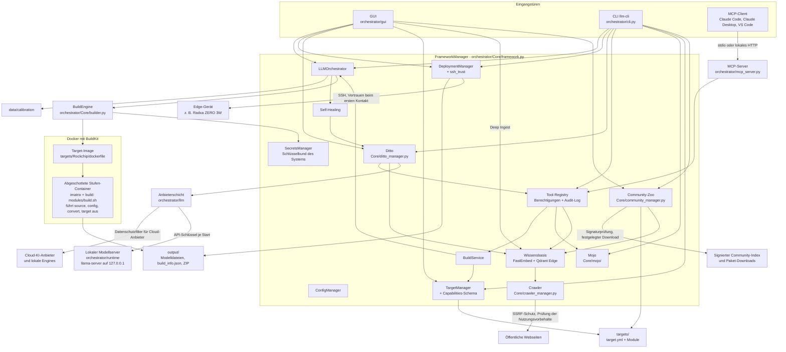
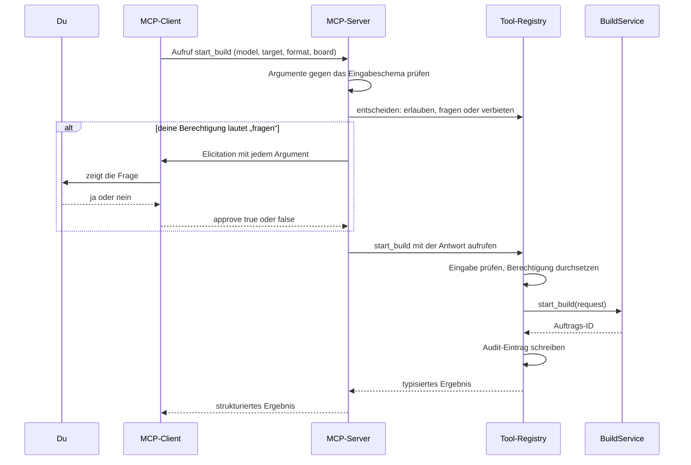
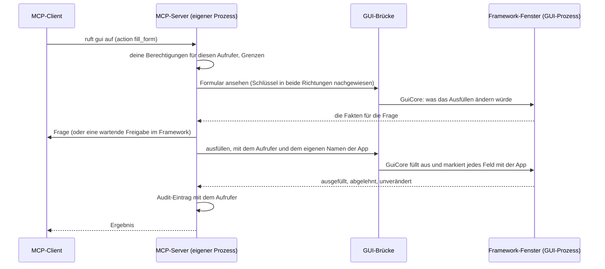

Version 3.4.0 · Stand 2026-11-10

[English](DESIGN.md) · **Deutsch**

# Design

Dies ist das Designdokument des LLM Cross-Compiler Frameworks. Es erklärt, wofür das Framework da ist, wie seine
Teile zusammenspielen, wie Daten hindurchfließen, wie es dich schützt und warum es so gebaut ist. Es ist eine der drei
Dateien des [Bauplans](BLUEPRINT_DE.md): Was als Nächstes kommt, steht in der [Roadmap](ROADMAP_DE.md), und was jede
veröffentlichte Version enthält, steht im [Changelog](../CHANGELOG_DE.md).

Das Dokument ist der Bauplan des Frameworks: Es beschreibt das System, wie es sein soll, damit man es danach bauen
kann, auch was entschieden, aber noch nicht gebaut ist, als „geplant“ markiert mit der Roadmap-Zeile, die es baut. Was
nicht in diesem Design steht, wurde nie entschieden. Die Roadmap hält die Bauschritte und ihren Stand, der Changelog
nur, was gebaut wurde.

## Inhalt

- [Kurz gesagt](#kurz-gesagt)
- [Zweck und Grundsätze](#zweck-und-grundsätze)
- [Architektur im Überblick](#architektur-im-überblick)
- [Datenflüsse](#datenflüsse)
- [Bausteine und Entscheidungen](#bausteine-und-entscheidungen)
- [Sicherheitsmodell](#sicherheitsmodell)
- [Wichtige Entscheidungen](#wichtige-entscheidungen)
- [Entscheidungsprotokoll](#entscheidungsprotokoll)
- [Versionierung und Dokumentationsregeln](#versionierung-und-dokumentationsregeln)
- [Geschichte](#geschichte)
- [Glossar](#glossar)

## Kurz gesagt

Ein Sprachmodell, wie es auf Hugging Face veröffentlicht wird, ist für einen kleinen Rechner wie ein Radxa ZERO 3W
meist zu groß und im falschen Format. Das Framework löst das in drei Schritten:

1. **Holen**: das Modell (eine Hugging-Face-Repo-ID wie `Qwen/Qwen3-0.6B` oder ein Ordner auf deiner Festplatte).
2. **Umwandeln und verkleinern** („quantisieren“) in einem Docker-Container, der die passenden Werkzeuge für deine
   Hardware enthält.
3. **Installieren**: das Ergebnis per SSH auf dein Gerät.

Du kannst es auf drei Wegen bedienen: über die Desktop-Oberfläche (GUI), über die Kommandozeile `llm-cli` oder über
einen KI-Client wie Claude Code oder Claude Desktop per Model Context Protocol (MCP). Alle drei nutzen denselben
Kern.

Der eingebaute Assistent **Ditto** hilft bei der Wahl von Modellen und Einstellungen, erklärt fehlgeschlagene Builds
und kann die Tools des Frameworks für dich bedienen, immer im Rahmen der Berechtigungen, die du festlegst. Ditto
arbeitet mit einem Cloud-KI-Anbieter deiner Wahl oder ganz offline mit einem lokalen Modell, das das Framework für
dich herunterlädt und betreibt.

Es gibt ein offizielles Hardware-Target, **Rockchip** (Boards RK3566, RK3568, RK3576, RK3588), mit drei
Ausgabeformaten:

| Format | Läuft auf | Boards | Typischer Einsatz |
|---|---|---|---|
| GGUF (llama.cpp) | CPU | alle vier | Chat-Modelle auf jedem Board |
| RKLLM | NPU | RK3588, RK3576 | Chat-Modelle auf dem Neuroprozessor |
| RKNN | NPU | alle vier | ONNX-Modelle für Bild und Ton |

`llm-cli` ist der Konsolenbefehl aus `pyproject.toml`. Wenn er nicht im PATH liegt, rufst du im Installationsordner
stattdessen `python -m orchestrator.cli` auf; die Optionen sind dieselben.

## Zweck und Grundsätze

Das Framework soll Menschen ohne Hintergrund in Compilern oder maschinellem Lernen ein Sprachmodell auf eigener,
kleiner Hardware ermöglichen und Fachleuten eine reproduzierbare, nachprüfbare Pipeline geben. Sechs Grundsätze
leiten jede Designentscheidung.

| Grundsatz | Was das praktisch heißt |
|---|---|
| **Lokal zuerst** | Umwandlungen laufen auf deinem Rechner in Docker. Modelle werden auf dem Host heruntergeladen, die Umwandlungs-Container haben kein Netzwerk. Die Wissensbasis berechnet ihre Embeddings und ihr Reranking lokal, und Ditto kann ganz offline mit einem lokalen Modell arbeiten. Außer Downloads verlässt nichts deinen Rechner, es sei denn, du wählst für Ditto einen Cloud-KI-Anbieter (dann greift der Datenschutzfilter, siehe [Sicherheitsmodell](#sicherheitsmodell)), schaltest die anonymen Fehlerberichte ein (`enable_telemetry`, standardmäßig aus) oder öffnest mit einem Community-Paket einen Pull-Request (das Framework bereitet das Paket vor; die GitHub-CLI oder der Browser verschickt es mit ihren eigenen Zugangsdaten). |
| **Laienfreundlich** | Die GUI bietet nur an, was das gewählte Target kann, die CLI lehnt alles andere ab, und beide setzen sinnvolle Vorgaben je Board (zum Beispiel Q4_0 auf dem RK3566). `llm-cli mojo` erklärt Probleme mit Lösungshinweisen. KI-Fehler werden in klaren Worten erklärt (etwa, dass ein Claude-API-Schlüssel, der in jedem Workspace gilt, die Workspace-ID braucht). Vorschläge des Self-Healing warten auf deine Entscheidung. |
| **Sicher von Haus aus** | Die Umwandlungs-Sandbox ist eingeschaltet (`build_sandbox: true`). KI-Clients und Ditto dürfen frei lesen, müssen aber fragen, bevor sie etwas ändern. Neuen SSH-Geräten wird erst vertraut, wenn du ihren Fingerabdruck bestätigt hast. Passwörter werden nie gespeichert. Von einer KI vorgeschlagener Text wird nie ausgeführt. Der Crawler beachtet jeden maschinenlesbaren Nutzungsvorbehalt einer Seite, und kein Schalter hebt das auf. Community-Pakete werden erst nach Prüfungen in einem Quarantäneordner und nach deiner Bestätigung installiert. |
| **Daten statt Code** | Was ein Target bauen kann, steht in seiner `target.yml` (Block `capabilities:`, von einem Schema geprüft). KI-Anbieter sind Vorlagen in `configs/llm_providers.yml`, der lokale Modellserver und seine Modelle sind in `configs/llama_runtime.yml` festgelegt, Dittos Evaluationsfälle stehen in `evals/ditto/cases.yml`, Korpus und Fälle der Abruf-Evaluation in `evals/retrieval/` und die vertrauenswürdigen Community-Schlüssel in `configs/community_keys.yml`. Ein neues Board, ein neues Modell oder ein OpenAI-kompatibler Server ist eine Datenänderung, solange der Code dahinter das unterstützt. |
| **Keine dauerhaften Rechte, die mehr können als nötig** | Kein Teil des Frameworks hält ein Recht weiter oder länger, als seine Aufgabe braucht. Darum gibt es keinen allgemeinen Rechte-Orchestrator, der Rechte vergibt und wieder nimmt: Er bräuchte selbst dauerhafte Administratorrechte, ein größeres Ziel als das, was er schützt, und sähe für Virenscanner wie Schadsoftware aus. Die Rechte in einem Build-Container gibt es nur, solange dieser Container läuft (die zwei Wechselrechte des Stage-Runners, jede andere Capability entzogen, keine neuen Rechte). Auf dem Rechner nimmt das Framework lieber eine Container-Engine ohne Root-Rechte (rootless), die Installer richten standardmäßig eine ein (Docker als root nur mit `--rootful`, nach einer Warnung), und Mojo sagt klar, wenn dein Konto in einer Gruppe mit Root-Wirkung ist (Linux `docker`, Windows `docker-users`). Auf einem Board bekommt das Konto von llmcf nur einen Schlüssel, und der Schlüssel darf nur die wenigen Befehle ausführen, die llmcf braucht (geplant: ROADMAP-Zeile „Ein eigenes Konto `llmcf` auf dem Host und auf Boards“). |
| **Nachprüfbare Builds** | Jeder Build schreibt ein Manifest (`build_info.json`) mit dem SHA256-Hash jeder Modelldatei, eine `Model_Card.md` und ein ZIP-Archiv. Das Deployment-Paket prüft die Hashes auf dem Gerät vor der Installation. Python-Abhängigkeiten sind per Hash festgelegt, Downloads des lokalen Modellservers und seiner Modelle per Größe und SHA256, und das Audit-Log der Tools lässt sich prüfen. |

## Architektur im Überblick

In einfachen Worten: Es gibt drei Eingangstüren (GUI, CLI, MCP). Dahinter sitzt ein Kern, der `FrameworkManager`,
der alle anderen Teile startet und miteinander verbindet. Ein Build-Auftrag landet bei der `BuildEngine`, die ein
Docker-Image für das Target baut und die Umwandlung in abgeschotteten Containern ausführt. Das fertige Modell liegt
danach in `output/`, und der `DeploymentManager` kopiert es auf das Gerät. Ditto spricht mit KI-Anbietern nur über
die Anbieterschicht und nutzt dieselbe Tool-Registry wie der MCP-Server. Deep Ingest, das eine Person in der GUI
startet oder für einen KI-Client bestätigt (`crawl_docs_site`), schickt den Crawler für die Wissensbasis auf öffentliche Webseiten; der Community-Zoo installiert Community-Pakete
nach `targets/`, in den Rezeptordner und in die Wissensbasis.

### Schichten

GUI, CLI und MCP-Server bleiben in einem Repository (Entscheidung des Maintainers vom 2026-10-17); die Kopplung
halten Schichten im Zaum, von denen jede nur sich selbst und die darunter importiert:

| Schicht | Pakete | Darf importieren |
|---|---|---|
| 1. Unten | `orchestrator/utils/`, `orchestrator/security/`, `orchestrator/schemas/` | Schicht 1 |
| 2. Remote | `orchestrator/remote/`, `orchestrator/utils/ssh_trust.py` | Schichten 1 und 2 |
| 3. Kern | die Module von `orchestrator/tools/`, die keine Tools festlegen (Registry, Richtlinie, Audit, Freigaben, Signaturen, spec, ...) | Schichten 1 bis 3 |
| 4. Fachlogik | `orchestrator/Core/`, `runtime/`, `rag/`, `llm/`, `evals/` (`llm` und `rag` importieren nie `Core`) | Schichten 1 bis 4 |
| 5. Tool-Definitionen | `orchestrator/tools/tools_*`, `framework_*`, `gui_bridge`, `gui_surface` | Schichten 1 bis 5 |
| 6. Adapter | `orchestrator/cli.py` (mit `orchestrator/acp_agent.py`, dem ACP-Agent, den sie startet), `orchestrator/mcp_server.py`, `orchestrator/gui/` mit `main.py` | alles außer einem anderen Adapter |

PySide6 gibt es nur in der GUI, click und rich nur in der CLI, das ACP-SDK `acp` nur im ACP-Agent und im ACP-Client (`Core/acp_client.py`), mcp und uvicorn nur im MCP-Server, paramiko nur im
SSH-Transport (`remote/transport.py` und das `utils/ssh_trust.py`, aus dem er entstand). `tests/test_layering.py` prüft jeden Import (auch in
Funktionen und verzögerte) gegen diese Regeln; die heutigen Ausnahmen stehen in `tests/data/layering_allowlist.json` mit
ihrem Grund und der Kette, die sie entfernt, und die Liste und der größte Import-Zyklus dürfen nur schrumpfen.
Gemeinsame Helfer liegen deshalb unterhalb der Tools: Pfad-Labels für KIs in `security/paths.py`, private atomare
Dateien und die eine Regel „nur du“ (`owner_only`, unter Windows eine ACL) in `utils/atomic.py`, einmalige Hinweise in `utils/notice_store.py`, Image-Referenzen in `utils/image_ref.py`,
der SSRF-sichere HTTP-Adapter in `security/http.py`, der Audit-Schlüssel in `Core/vault_key.py`.

### Bausteine

| Baustein | Wo | Aufgabe |
|---|---|---|
| GUI | `orchestrator/gui/` (Start: `llm-gui`, `orchestrator/gui/app.py`; PySide6, das optionale Extra `gui`) | Hauptfenster, Build-Reiter, Deployment-Fenster, Ditto-Chat (sein Kopf zeigt den genutzten Zugang), Modul-Assistent mit Deep Ingest, Hugging-Face-Browser, Community-Hub, Dialoge für KI-Einstellungen, der Anmeldebereich (`sign_in.py`: Karten für die Verfahren, Schlüsselformular, Auswahl für den Schutz des Tresors, Passphrase-Dialog; Zugriffe auf Tresor und Netz in Hintergrund-Threads), Tool-Berechtigungen, Tool-Bestätigungen, Self-Healing-Vorschläge, SSH-Vertrauen, den Deep-Ingest-Hinweis und den Export für die Community. |
| CLI | `orchestrator/cli.py` (`llm-cli`, auch `llmcf`) | Befehle der obersten Ebene `acp`, `build`, `config`, `deploy`, `ditto`, `doctor`, `knowledge`, `mcp`, `mojo`, `module`, `scan`, `secrets`, `targets`, `tools`, `zoo` (`doctor`, `mojo` und `scan` sind einzelne Befehle, die übrigen Gruppen; `doctor` ist der alte Name von `mojo`). Die Befehle zur Anmeldung `ditto login`, `logout` und `auth` nutzen dieselben Anmeldeoperationen wie die GUI (`orchestrator/llm/auth/signin.py`). |
| FrameworkManager | `orchestrator/Core/framework.py` | Startet alle Manager in vier Phasen (Sicherheit und Infrastruktur, Kernlogik, KI und Wissen, Wächter und Betrieb), verbindet sie, hält eine langlebige asyncio-Schleife für Builds und löst relative Datenpfade gegen den Installationsordner auf, nicht gegen das Arbeitsverzeichnis. |
| ConfigManager | `orchestrator/Core/config_manager.py` | Einstellungen mit Schema (Typ, Vorgabe, Prüfregel). Der Einstellungsordner ist `LLM_FRAMEWORK_CONFIG_DIR`, wenn gesetzt, sonst das `configs/` der Installation, wenn es beschreibbar ist, sonst der Benutzerordner; nie das Arbeitsverzeichnis. Benutzereinstellungen landen dort in `config.yml`. Umgebungsvariablen mit dem Präfix `LLM_FRAMEWORK_`, `FRAMEWORK_` oder `LLM_` überschreiben bekannte Einstellungen. Persönlicher Zustand liegt in `~/.llm-framework` (änderbar mit `LLM_FRAMEWORK_HOME`), unter Linux und macOS beim Anlegen privat gemacht (Modus 0700); ein vorhandener Ordner behält seinen Modus, und Mojo Oracle meldet einen, den andere lesen können (`state.permissions`). |
| SecretsManager | `orchestrator/Core/secrets_manager.py`, `orchestrator/Core/vault_key.py`, `orchestrator/utils/file_lock.py` | Verschlüsselter Tresor (`secrets.store` im Benutzerordner, Format v2: Fernet-Einträge mit Schlüssel-IDs, gelesen mit MultiFernet, Schlüsselwechsel). Sein Schlüssel kommt standardmäßig aus dem Schlüsselbund des Betriebssystems (ein Eintrag je Tresor; ein Schlüsselbund, der hängt, nichts behält oder im Klartext speichert, wird abgelehnt) oder aus der ausdrücklichen Wahl in `secret_storage` (Credential-Helper, Passphrase, unverschlüsselte Schlüsseldatei, nur Arbeitsspeicher). Jede Änderung läuft unter einer Sperre über Prozessgrenzen; der Tresor lehnt einen Ort innerhalb einer Git-Arbeitskopie ab. Enthält API-Schlüssel (als Datensätze unter `cred/<anbieter>/api_key`; die alten Namen gelten weiter) und das Hugging-Face-Token (`hf_token`). Die Secrets eines Speichers am alten Ort (Einstellungsordner) werden einmalig übernommen und mit dem Schlüssel des Tresors neu verschlüsselt, auch in einen schon vorhandenen Speicher im Benutzerordner; dort bereits vorhandene Secrets haben Vorrang, und die alte Datei bleibt unverändert. Ein lange laufender Prozess (GUI, MCP-Server) liest den Tresor neu, wenn ein anderer Prozess ihn geändert hat. |
| Secret-Formate und Schwärzung in Logs | `orchestrator/security/` | Eine Tabelle der Secret-Formate, die nur die Standardbibliothek braucht (`secret_patterns.py`); `scripts/secret_scan.py` lädt sie, `redact_secrets` nutzt sie. `redaction.py` schwärzt jeden Logeintrag beim Erzeugen (Logger des Frameworks, der SDKs und der HTTP-Bibliotheken, Tracebacks), hält die SDK-Logger auf INFO oder darüber, außer `--debug-http` ist angegeben, und stellt `SecretStr` bereit, in dem die Anbieterschicht ihre Schlüssel hält. |
| TargetManager und Capabilities | `orchestrator/Core/target_manager.py`, `orchestrator/schemas/targets.py` | Lädt die `target.yml` jedes Target-Ordners (Ordner, die mit `_` oder `.` beginnen, etwa `_template`, werden übersprungen) und prüft ihren Block `capabilities:`: Boards, Formate, Quantisierungstypen (auch je Board), Aliasse, Board-Vorgaben, Standard-Board, Bedarf an Importance-Matrix und Kalibrierdaten, Unterstützungsstufe (`official`, `community`, `experimental`). Welche Formate ein Target anbietet, ist `build_formats.offered_formats`: genau die angegebenen Formate, für ein Target ohne Capabilities jedes Format außer `hf` (ungeprüft); die Formatliste des Builder-Tabs und `llm-cli build start --format` (Hilfe, Vervollständigung und Ablehnung) lesen sie. Welche davon ein Build für ein Board bekommt, entscheidet `build_formats.format_refusal`: NPU-Formate (RKLLM, RKNN) nur, wenn die Hardware-Probe des Boards seine NPU zeigt, RKLLM nur für seine SoCs und auf einem x86_64-Build-Rechner, sonst GGUF; der Build-Dienst und der Builder-Tab lesen es. Die Probe des Boards (`BuildRequestIn.probe`, sonst die neueste gespeicherte Probe eines Boards des SoC des Auftrags) erreicht jeden Build-Container nur lesbar als `HARDWARE_CONFIG_FILE`, und die Stufe config plant den Build für dieses Board. |
| BuildService | `orchestrator/Core/build_service.py`, `orchestrator/schemas/build.py` | Der eine Weg, Builds einzureihen: prüfen, starten, Status, abbrechen, Log-Ende, Ergebnisse, Self-Healing-Entscheidung. `llm-cli build start`, Start Build im Builder-Tab, der MCP-Server und Ditto reihen Builds alle über `start_build` ein (ein installiertes Community-Rezept über `start_recipe`, das seinen Kalibrierungsdatensatz festlegt und beim Bauen prüft, ob das Rezept zurückgezogen wurde; `installed_recipe` ist der einzige Weg, der ein Rezept baut, und `community_manager.read_recipe` der einzige Leser der `recipe.yml`). Deine eigenen Aufrufer (`local_paths=True`) dürfen jeden Pfad nennen, die Priorität und den Ordner wählen, in den der Build gespeichert wird, und ein Target ohne Capabilities ungeprüft bauen; KI-Aufrufer dürfen das nicht. Deine Builds tragen keinen Besitzer, deshalb lehnt sie das Warteschlangen-Limit für Tool-Aufrufer nie ab. |
| Prüfung vor dem Build | `orchestrator/Core/consistency_manager.py`, `orchestrator/schemas/targets.py` (`SdkNeeds`), `orchestrator/gui/preflight_box.py` | Vergleicht die Hardware-Probes mit dem, was ein Build und das SDK des Targets brauchen, bevor etwas startet: bei einem GPU-Build den NVIDIA-Treiber dieses Computers mit der CUDA-Version des GPU-Images des Targets, den NPU-Treiber und die Runtime des Boards mit der `sdk:`-Angabe des Formats. `BuildService.preflight_for` führt sie bei jedem Build-Start aus (`start_build`, `continue_interrupted`), im Build-Plan und in `llm-cli build preflight`; ein Halt startet nichts, wenn die Person ihn für diesen Build nicht übergeht (siehe [Build-Pipeline und Target-Module](#build-pipeline-und-target-module)). |
| Regel des eigenen Netzes | `orchestrator/utils/locality.py`, `orchestrator/Core/local_network.py` | Die eine Prüfung des Offline-Modus (`offline_mode`) und die eine Regel, auf zwei Arten gefragt: `check_reach` (darf der Offline-Modus es erreichen: die Ausnahmen der Person zählen) und `check_location` (wo steht der Server: der Datenschutzfilter und die Kennzeichnung lokal/Cloud; die Ausnahmen zählen nie). Verbindungen gehen an `connect_addresses` (nur die geprüften lokalen Adressen), ein Crawl, den die Person startet, an `crawl_addresses`; `tailscale_vpn` liest das VPN, `forget` verwirft eine Auflösung nach einer gescheiterten Verbindung (siehe [Offline-Modus und das eigene Netz](#offline-modus-und-das-eigene-netz)). `local_network.py` schreibt als Einziges die Ausnahmen der Person (Datei > Einstellungen… > Lokales Netz und `llm-cli config local-network`); kein Modul, das eine KI erreichen kann, importiert es. |
| Änderung der KI-Einstellungen | `orchestrator/llm/settings_change.py` | `AISettingsChange`: die Regeln einer Änderung der KI-Einstellungen an einem Qt-freien Ort (bekannte Fallback-Provider, kein Cloud-Provider offline, Schlüssel nötig und kein Admin-Schlüssel, Workspace-ID, Serveradresse ohne Benutzername oder Passwort, Modell, die Rückfrage bei plain http, der Schlüssel für seine Adresse gespeichert, die Einstellungen geschrieben, die Wissensbasis gestartet, Ditto neu geladen). Der Dialog der KI-Einstellungen behält nur seine Hinweisfenster; die Anmeldung und `ditto login` nutzen seine Adressregeln; MCP `update_settings` und die GUI-Tool-Felder des Dialogs nutzen seine Nur-verschärfen-Regel (`direction_problem`). `current()` und `with_setting()` dienen der Änderung einer einzelnen Einstellung, und `problems_of_settings()` wendet dafür jede Regel an: MCP `update_settings` lehnt ab, was `offline_mode` oder `enable_rag_knowledge` kaputt machen würden (Offline-Modus mit einem Cloud-Provider), während ein Problem, das die gespeicherten Einstellungen schon haben, deins bleibt und im Dialog behoben wird. |
| LLMOrchestrator | `orchestrator/Core/orchestrator.py` | Warteschlange und Pipeline: bereitet Kalibriertext vor, zerlegt einen Auftrag in Jobs (Modell x Target x Format x Quantisierung), führt sie auf der Build-Engine aus, behandelt Abbrüche und die Freigabeschleife des Self-Healing. |
| BuildEngine | `orchestrator/Core/builder.py`, `orchestrator/utils/build_context.py`, `orchestrator/utils/hadolint.py` | Stellt den Docker-Build-Kontext zusammen, prüft sein Dockerfile mit hadolint, wenn es installiert ist (ein Hinweis: Funde gehen ins Build-Log und in die Fortschrittswarnungen, der Build läuft weiter), baut das Image (mit BuildKit, wenn vorhanden), lädt oder bindet das Modell ein, führt den optionalen Trivy-Scan, die Importance-Matrix-Stufe und die Build-Stufe in abgeschotteten Containern aus, schreibt Manifest, Model Card und ZIP in einen versteckten Zwischenordner, verschiebt sie in den Ausgabeordner, sobald der Build nicht mehr abgebrochen werden kann, und räumt auf. |
| DockerManager | `orchestrator/Core/docker_manager.py` | Erzeugt die eine Build-Engine des Frameworks (mit ihrem Docker-Client) und prüft, ob der Docker-Daemon antwortet; ohne Qt. `container_resources()` macht aus einer `docker stats`-Messung eines laufenden Build-Containers CPU- und Speicherwerte (Dockers eigene Formeln, Speicher ohne den inaktiven Seiten-Cache); die Build-Engine misst sie in den Fortschritt des Builds, `BuildService.live_resources` gibt sie an den Builder (unter dem Fortschrittsbalken), und das Build-Protokoll warnt einmal nahe der Speichergrenze. |
| Container-Engine | `orchestrator/utils/docker_engine.py` | Mit welcher Engine das Framework spricht: zuerst einer ohne Root-Rechte (install.sh richtet standardmäßig rootless Podman ein, rootless Docker mit `--engine=docker`, Docker als root nur mit `--rootful`); `ensure_docker_host()` setzt `DOCKER_HOST` für den Prozess und die Programme, die er startet, auf das rootless Docker der Person, sonst auf ihren Podman-Socket, vor einem Docker-Dienst, der als root läuft (ein `DOCKER_HOST`, das die Person setzt, gilt immer). `root_effect_group()` nennt eine Gruppe des Kontos mit Root-Wirkung (`docker`, `docker-users`). Jede Stelle, die einen Docker-Client anlegt, ruft ihn zuerst auf (die Build-Engine, `DockerEngine` des Builder-Images, Dittos `DittoDocker`, die eine Docker-Prüfung `check_docker_environment`, `scripts/build_container_image.sh` über `python3 -I ... --docker-host`). `engine_name()` unterscheidet Docker und Podman an `/version`; `podman_refusal()` lehnt früh ab, was Podman nicht bietet (Dockers GPU-Anfrage, BuildKit): `BuildService`, bevor ein GPU-Build in die Warteschlange kommt, der Builder, Dittos GPU-Weitergabe. `create_container()` legt jeden Container des Frameworks an (die Build-Stufen, den llama.cpp-Builder, Dittos Prüf- und Server-Container); unter rootless Podman bekommt einer, der als die Person läuft, Podmans `keep-id`, damit er in die Ordner der Person schreiben kann. Mojo nennt die Engine. Nur Standardbibliothek (auch das Python 3.9 des Systems). |
| Rockchip-Referenz-Target | `targets/Rockchip/` | `dockerfile` (Debian bookworm-slim; llama.cpp-Werkzeuge v0.6.0; drei Python-venvs), `modules/build.sh` (der Stage-Runner) mit den vier Stufenmodulen `source_module.sh`, `config_module.sh`, `convert_module.sh` und `target_module.sh` (`gguf`, `rkllm`, `rknn` und der Job `imatrix`), `modules/rkllm_module.sh` und `modules/rknn_module.sh` (Format-Helfer der Stufe convert), `scripts/export_rkllm.py`, `scripts/rknn_converter.py`, `scripts/model_check.py` (die Prüfungen der Stufe convert; die Vorlage bringt dieselbe Datei mit), `target.yml`. `targets/_template/` ist der Ausgangspunkt für neue Targets ([Leitfaden für Modulentwickler](Module_Developer_Guide_DE.md)). |
| DeploymentManager und SSH-Vertrauen | `orchestrator/Core/deployment_manager.py`, `orchestrator/utils/ssh_trust.py` | Baut das Deployment-Paket, prüft den Host-Schlüssel des Geräts, hinterlegt den SSH-Schlüssel des Frameworks, lädt hoch und startet die Installation. |
| Deploy-Schritte | `orchestrator/runtime/device/person_steps.py`, `orchestrator/runtime/device/steps.py`, `orchestrator/runtime/device/service.py` | Ein Deployment je Anwendungsfall. `deploy_build` (nur für die Person) bringt einen Build für `llm-cli deploy run` und den Deployment-Tab auf ein Board: das Paket (`make_package`, sein Grund kommt mit dem Ergebnis zurück; mit Docker-Images genau die Container von `deployment_manager.package_containers`, die die Tabelle des Deployment-Tabs angehakt hat, für `--docker` alle), das Deployment, dann der vertraute Eintrag des Boards mit der Audit-Zeile der CLI. `deploy_runtime_flow` bringt die selbst gebaute Runtime eines Boards für `llm-cli device runtime deploy`, das Boards-Fenster und das `deploy_device_runtime` der KI auf das Board: Anmeldung, vertrauter Eintrag, Ablehnung von root, Frage zum Benchmark mit der Zustimmung, Installation, Eintrag „getestet auf“. Jeder Aufrufer übergibt seine Anmeldung und seine Worte als Hooks; nur die Kanäle der Person geben den vertrauten Eintrag und die Frage mit. |
| Remote-Schicht | `orchestrator/remote/` | Alles, was mit einem Board spricht, ohne Qt und nur mit Importen aus `orchestrator/utils` und `orchestrator/security`: die Adresse des Boards (`address.py`: `Endpoint` mit seiner known_hosts-, Speicher- und Anzeigeform, die eine Prüfung von Host, Port und SSH-Benutzer, nur ASCII), warum ein Board nicht erreichbar ist (`reasons.py`: die vier Grundcodes und `local_problem` für ein Problem auf diesem Computer, das nie beim Board vermerkt wird, `check_port`, `classify`, `reach_code`; eine abgebrochene Verbindung, während ein Deployment auf das Board wartet, zählt als „noch nicht zurück“), `RemoteFailure`, die Basis jedes Fehlers eines Board-Schritts (`errors.py`), die Worte eines Boards und der Stand eines laufenden Deployments als eine Zeile für die Person oder eine KI (`text.py`), die Verbindung (`transport.py`: ob SSH hier geht, paramiko erst bei der ersten Nutzung importiert; jeder Befehl als ein `sh -c` mit Zeitlimit und Ausgabegrenze; Anmeldung, SFTP und Keepalive in `ParamikoTransport`; dasselbe über den OpenSSH-Client dieses Computers in `SystemSshTransport`, wo paramiko fehlt, mit dem einen Bauer für OpenSSH-Befehlszeilen: `openssh_argv`, `openssh_options` mit Zeitlimit für die Anmeldung und Keepalive und `-F` mit der eigenen Einstellungsdatei des Frameworks, so dass OpenSSH weder `~/.ssh/config` noch `/etc/ssh/ssh_config` liest, `config_value`, das einen Pfad quotet, `openssh_file`, das ein `%` in den eigenen Pfaden des Frameworks als `%%` schreibt), die eigene OpenSSH-Einstellungsdatei des Frameworks (`ssh_config.py`: bei der ersten Nutzung nur für den Besitzer lesbar angelegt, mit nur den `Host`-Blöcken, die die Person hinzufügt; Zeilen, die die Vertrauenseinstellungen auf der Befehlszeile ändern, einen Befehl ausführen oder eine Datei einbinden würden, abgelehnt, ein `ProxyJump` oder `ProxyCommand` nur wissentlich; geschrieben nur von `runtime/device/person_steps.py` `save_ssh_block` für CLI und GUI, nie von einem Tool), die `known_hosts` des Frameworks, nur lesend (`trust.py`: `TrustStore` mit `status`, `status_of`, `check`, das einen `KeyCheck` gibt, `read_presented_key`; `fingerprint`, `device_id_for`, `parse_public_key` für einen Schlüssel, den die Person einfügt; die Host-Schlüssel-Fehler), die Schreiber der Person für das Vertrauen in ein Board (`pairing.py`: ein vertrauter Schlüssel mit seinem Audit-Eintrag in einem Schritt, die eine Entscheidung für Vertrauen bei der ersten Nutzung hinter `deploy run`, `scan --device` und der Frage der GUI, das Koppeln über eine Sitzung mit Einmal-Passwort, die Änderung von Adresse oder Host-Schlüssel eines Boards aus Q5 mit altem und neuem Fingerabdruck, im Audit-Log, bevor sich etwas ändert; bei einem neuen Schlüssel ziehen die Daten des Boards mit zu seiner neuen Geräte-ID, `runtime/device/board_move.py`: vor der Änderung kopiert und geprüft, die alten Kopien erst danach entfernt; und der Audit-Eintrag einer Zustimmung) und die Sitzung mit einem Board (`session.py`: `RemoteSession` meldet sich mit dem über `TrustStore` geprüften Host-Schlüssel bei jeder Anmeldung an, mit Zugangsdaten mit Typ, `KeyOnly` für jeden KI-Weg und das `OneTimePassword` der Person, das als einziges koppeln kann; ein privater Ordner, der Upload, der nach einem Netzabbruch fortgesetzt wird, das Warten auf das Board (N5), ein Job, der auf dem Board selbständig läuft und wieder verfolgt wird (`run_detached`, `follow`), ein Befehl, der zweimal laufen darf, nach einem Abbruch erneut gesendet (`run_resumable`); ein `CancelToken`, und das Schließen einer Sitzung beendet ihr Warten). Kein für eine KI erreichbares Modul importiert `pairing.py` (ein Test über den Importgraphen). Das Deployment eines Pakets ist ein dünner Adapter über der Sitzung, über paramiko oder, wo es fehlt, über OpenSSH (es wartet in beiden Fällen auf das Board, setzt den Upload fort und lässt `deploy.sh` selbständig auf dem Board laufen), und das Laufzeit-Deployment, die Prüfungen auf dem Board, der Benchmark auf dem Board und die Board-Prüfung laufen ebenfalls darauf (`runtime/device/remote.py` `RemoteShell` ist ihre Fassade): Das Laufzeit-Archiv geht über SFTP und geht nach einem Netzabbruch weiter (ein Board ohne SFTP bekommt es über stdin), die Prüfungen laufen erneut, der Benchmark läuft auf dem Board für sich und wird wieder verfolgt, und der KI-Weg (`runtime/device/service.py`, `KeyOnly`) und die Board-Schritte der Person (`person_steps.connect_stored`, ein Einmal-Passwort erlaubt) öffnen beide eine Sitzung, die auf das Board wartet (N5). Die alten Pfade `orchestrator/runtime/device/reasons.py` und `orchestrator/utils/ssh_trust.py` funktionieren weiter. Was ein Kontakt ergab, hält `record_reach` in `orchestrator/runtime/device/trusted.py` für Mojo fest. |
| Tool-Registry, Berechtigungen, Audit | `orchestrator/tools/` (`registry.py`, `policy.py`, `audit.py`, `confirmation.py`, `framework_tools.py`) | Elf typisierte Tools mit Risikostufen, die gespeicherten Berechtigungen des Benutzers, der Bestätigungstext (gemeinsam für MCP und Ditto) und ein per Hash verkettetes Audit-Log. |
| MCP-Server | `orchestrator/mcp_server.py` | Stellt die Tool-Registry per MCP bereit (offizielles SDK `mcp` 2.3.0), über stdio oder lokales Streamable HTTP. Der Startbefehl, den er für Clients schreibt, nutzt `python -P`, sodass nichts aus dem Ordner importiert wird, in dem ein Client ihn startet. |
| ACP-Agent | `orchestrator/acp_agent.py`, `orchestrator/Core/acp_editor_servers.py`, `orchestrator/utils/stdio_programs.py` | Ditto als Agent von Editoren, die das Agent Client Protocol sprechen (`llm-cli acp`, Version 1 über stdio, SDK `agent-client-protocol` 0.12.1): Jede Runde ist Dittos Chat-Runde mit dem Kanal `acp`, jeder Tool-Aufruf läuft durch die Registry, Berechtigungsanfragen bieten nur Einmal-Optionen, Editor-Pfade werden zu Ordner-Labels, die MCP-Server des Editors werden vermerkt und keiner wird benutzt ([Entscheidungen](#acp-agent-ditto-in-editoren); Einrichtung: [Editoren und Agenten](Editors_and_Agents_DE.md)). |
| Anbieterschicht | `orchestrator/llm/` | Ein Client (`LLMClient`) für jeden KI-Anbieter, gebaut auf den offiziellen SDKs `anthropic` und `openai`; OpenAI-kompatible Server laufen über `openai`. Wählt Anbieter, Modell und Aufwand je Aufgabe aus den Einstellungen und den Vorlagen in `configs/llm_providers.yml` (eine gleichnamige Datei im Einstellungsordner ergänzt oder ersetzt Vorlagen). Wiederholungen (zwei, die eigenen Wiederholungen der SDKs sind aus), eine Fallback-Kette bei Ablehnungen und Ausfällen (`ai_fallback_chain`), strukturierte Antworten mit Schemaprüfung und einem Reparaturversuch, typisierte Fehler, der Datenschutzfilter für Cloud-Anbieter und eine Tool-Schleife. Der Anmeldekern (`orchestrator/llm/auth/`) bestimmt die Zugangsdaten jedes Aufrufs aus den Anmeldeverfahren im Katalog: Schlüssel aus dem Tresor (Schlüssel eigener Server an ihre Adresse gebunden) oder aus den Umgebungsvariablen, die der Katalog nennt, eine kostenlose Prüfung der Zugangsdaten, Fehler mit bekannter Ursache und dem nächsten Schritt sowie die Erneuerung von Tokens unter einer Sperre, die alle Prozesse teilen. |
| Ditto (neu gebaut) | `orchestrator/Core/ditto_manager.py` | Der Assistent: Chat mit den Tools des Frameworks (höchstens 8 Modellrunden je Frage, Tool-Aufrufe als Akteur `ditto` über die Registry), Analyse fehlgeschlagener Builds, Modulvorschläge aus einer Hardware-Probe und Build-Empfehlungen. Die letzten drei sind geprüfte strukturierte Antworten; eine ungültige Antwort ist ein Fehler und wird nie angewendet. Eine Self-Healing-Analyse oder Build-Empfehlung mit gefährlichem Befehl wird verworfen; einen Modulvorschlag prüft der Modulgenerator noch einmal. Der Chatverlauf wird nur ergänzt (`chat_history.json`); ein langes Gespräch wird zusammengefasst und als neues fortgesetzt. |
| Verwaltetes lokales Modell | `orchestrator/runtime/`, `configs/llama_runtime.yml` | Baut `llama-server` auf dem Rechner aus dem festgelegten llama.cpp-Commit (b11429, derselbe Commit wie v0.6.0): zuerst den CPU-Build, dann einen GPU-Build (in dieser Version Vulkan), jeder vor der Nutzung geprüft; importiert einen Build eines anderen Rechners derselben Art; lädt das offizielle vorgebaute Archiv nur auf ausdrücklichen Wunsch, als nicht selbst gebaut gekennzeichnet. Lädt festgelegte GGUF-Modelle in Stufen (Qwen3.5 9B, 4B und 2B, 2-Bit-Varianten für schwache Hardware und auf Wunsch ein IBM Granite 4.2 3B), jeweils per Größe und SHA256 geprüft. Startet `llama-server` auf 127.0.0.1 mit freiem Port und einem API-Schlüssel je Start, in einem Speicherbudget aus der gemessenen Hardware (KV-Cache-Typ nach der Regel der Boards, Prompt-Cache, Haltezeit; `llm-cli ditto cache`). Der Anbieter `local` findet den laufenden Server von selbst. |
| Ditto-Evaluation | `orchestrator/evals/ditto_eval.py`, `evals/ditto/cases.yml`, `evals/retrieval/` | `llm-cli ditto eval`: 19 feste Fälle (Build-Log-Analyse, Build-Empfehlungen, Modulvorschläge, Chat mit Tools, Prompt-Injection), nach Regeln bewertet, gegen den eingestellten Anbieter oder je lokaler Modellstufe. Gebaut wird nichts: Chat-Fälle nutzen die echten Tool-Definitionen über einen Stellvertreter-Build-Service. Mit `--kind retrieval` bewerten 42 Suchen die Suche der Wissensbasis auf einem festen Korpus, ohne KI-Modell (siehe [Eine Suche in der Wissensbasis](#eine-suche-in-der-wissensbasis)). Mit `--kind tokens` halten Gespräche über mehrere Runden je Runde die eigenen Token- und Cache-Zahlen des Anbieters fest, und `--kind openai_paid` ist der bezahlte OpenAI-Test zu Cache und Zählung, den nur die Person startet (siehe [Gemessene Token-Zahlen](#gemessene-token-zahlen)). |
| Self-Healing | `orchestrator/Core/self_healing_manager.py` | Erkennt bekannte Fehler zuerst mit festen Mustern und fragt Ditto nur bei unbekannten. Wendet nur vom Framework festgelegte Korrekturen an, und nur nach deiner Freigabe. |
| Wissensbasis und Crawler | `orchestrator/Core/rag_manager.py`, `orchestrator/rag/`, `orchestrator/Core/crawler_manager.py` | Optional (`enable_rag_knowledge`). Webseiten, PDFs, Wissenspakete der Community und, wenn du sie aufnimmst (`llm-cli knowledge index-docs`, die GUI oder das Tool `index_framework_docs`, nie von selbst), die eigene Dokumentation und der Code des Frameworks werden in Abschnitte zerlegt und mit einem lokalen dichten Embedding (FastEmbed auf ONNX Runtime, CPU; Modell je nach Hardware, sofern `rag_embedding_model` nichts anderes sagt) und einem BM25-Vektor gespeichert. Suchen verbinden beide Ranglisten mit Reciprocal Rank Fusion; ein lokaler Cross-Encoder kann die Ergebnisse neu ordnen und die unter einer Relevanzschwelle verwerfen (siehe [Eine Suche in der Wissensbasis](#eine-suche-in-der-wissensbasis)). Qdrant Edge, die Rust-Engine von Qdrant, läuft im Prozess, die Daten liegen im Benutzerordner (eine Wissensbasis einer früheren Version wird bei der ersten Nutzung umgewandelt, siehe [Der Speicher der Wissensbasis](#der-speicher-der-wissensbasis-qdrant-edge)); ein Qdrant-Server wird nur genutzt, wenn `qdrant_url` gesetzt ist. Der Crawler von Deep Ingest beachtet die maschinenlesbaren Nutzungsvorbehalte der Seiten (siehe [Deep Ingest](#deep-ingest-von-der-webseite-in-die-wissensbasis)). |
| Deep-Ingest-Hinweis und Sprachansagen | `orchestrator/utils/crawl_notice.py`, `orchestrator/utils/announce.py` | Der einmalige Hinweis vor dem ersten Deep Ingest, je Benutzer gemerkt, und kurze Ansagen über die Sprachausgabe des Betriebssystems. |
| Community-Zoo | `orchestrator/Core/community_manager.py`, `orchestrator/Core/community_pack.py`, `orchestrator/Core/community_maintainer.py`, `orchestrator/schemas/recipes.py`, `orchestrator/gui/community_hub.py`, `orchestrator/gui/community_maintainer.py`, `configs/community_keys.yml` | Signierte und verschlüsselte Community-Pakete (Targets, Rezepte, Wissen), der signierte Community-Index, die Installation über eine Quarantäne mit Vertrauensstufen, der Export mit Datenschutz-Bereinigung und die Übergabe an einen Pull-Request, und die Aktionen des Maintainers am Community-Repository (Signaturschlüssel, Prüfen und Veröffentlichen, Zurückziehen) (siehe [Community-Pakete](#community-pakete-format-vertrauen-und-austausch)). |
| Eingabe-Historie | `orchestrator/utils/input_history.py` | Zuletzt verwendete Werte der GUI-Eingabefelder, je Benutzer und ohne Geheimnisse (siehe [Zuletzt verwendete Eingaben](#zuletzt-verwendete-eingaben)). |
| Mojo (bis 3.0.0 der Doctor) | `orchestrator/Core/mojo/` (`findings.py`, `checks/`, `runner.py`, `offers.py`, `repairs/`, `views.py`, `docker_objects.py`, `banner.py`); `orchestrator/Core/doctor.py` exportiert es weiter | Deterministische Gesundheitsprüfungen (Python, Docker und BuildKit, Speicherplatz, Targets, Rechte des Zustandsordners, Secrets und Schlüsselbund, Tool-Berechtigungen und Audit-Log, Kalibrierdaten, installierte Community-Pakete, Snapshots der Wissensbasis) mit festen Codes, Lösungshinweisen und zu jeder Warnung und jedem Fehler, wo, warum und was Mojo Miracle dagegen tun kann (Mojo Oracle). Die Prüfungen von Python und Docker laufen über die ursprünglichen Prüfungen des Frameworks in `orchestrator/utils/validation.py` (`validate_python_version`; `check_docker_environment`, das auch der Start der Build-Engine nutzt). Mojo Miracle wendet nur harmlose Reparaturpläne an (die Art aus den Schritten berechnet; ein Probelauf, an seinen sha256 gebunden, zuerst auditiert, Vergleichen-und-Tauschen, immer nur einer, danach erneut geprüft) und meldet jedes Problem als repariert oder nicht repariert mit dem Grund. Löschen ist nie eine Reparatur: `docker_objects.py` baut einen Löschplan jedes Build-Images des Frameworks (`framework_image_plan`: ohne Namen übrig geblieben, benannt `last-build`, Builder der Laufzeit; `DeletionPlan` aus `tools/spec.py`), und `delete_framework_images` entfernt genau die Images, die die Person angehakt hat, nachdem sie sie im Terminal oder in der GUI unter Tools > Framework Build Images... bestätigt hat (nur Akteur `cli` oder `gui`, zuerst auditiert, abgelehnt, wenn sich ein gewähltes Image geändert hat); der Docker-Build-Cache wird nie geleert. `docker_storage` sagt, wo Docker seine Images ablegt. `ai_findings` (`run_doctor`) und `oracle_rows` (`run_mojo_oracle`) sind, was eine KI liest: Ordner unter ihrer Bezeichnung, andere Pfade nur mit dem Dateinamen. `banner.py` ist die Kristallkugel der Konsole, wenn Mojo Miracle nach Mojo Oracle im Terminal endet (die Zeichnung und ihre Farbmaske an einer Stelle, welche Zeile ein Ergebnis bekommt, und die Notiz zum offenen Oracle-Lauf neben der Sperre von Mojo Miracle); nur die CLI gibt sie aus, nichts davon erreicht eine KI. |
| Löschen und Papierkorb | `orchestrator/Core/deletion.py`, `orchestrator/Core/trash.py`, `orchestrator/gui/deletion_dialog.py`, `orchestrator/gui/trash_window.py` | Jedes Löschen von Objekten der Person nimmt eine `AcceptedDeletion`: den Plan, den die Person in der GUI oder im Terminal bestätigt hat (die Mehrfachauswahl baut ihn aus genau den angehakten Teilen neu), seinen Modus (Papierkorb oder endgültig) und den Kanal. Der löschende Code baut den Plan erneut und lehnt einen geänderten ab (`PlanChanged`). Der Papierkorb verschiebt Teile mit einem Umbenennen nach `.trash/<ID>/` ihres Datenordners (nie über Platten hinweg); sein Index `tool_trash.json` ist signiert; nichts verlässt ihn von selbst; nur die Person leert ihn; eine KI stellt nur wieder her, was sie selbst löschen wollte. `tests/test_deletion.py` listet jede Stelle im Code, die löscht, mit ihrer Absicherung. |
| Datei-Hashes | `orchestrator/utils/helpers.py` | Die eine Implementierung jedes sha256 einer Datei (ganze Dateien, offene Handles und ihre ersten Bytes für das Fortsetzen, Deskriptoren, Kopien, die beim Schreiben gehasht werden, damit die geprüften Bytes die benutzten sind, ein Cache mit Lock, `SHA256SUMS`-Zeilen und `.sha256`-Begleitdateien, der Vergleich in konstanter Zeit). Die alten Helfernamen im Build-, Deploy-, Laufzeit-, Papierkorb- und Download-Code sind Delegates; `tests/test_hashing.py` lehnt eine neue Hash-Schleife daneben ab. Die Hardware-Probe hat keine Kopie, und die `sha256sum`-Aufrufe auf einem Board bleiben auf dem Board. |
| Platzregel und Watchdog | `orchestrator/Core/disk_plan.py` | Was ein Build wo ablegt, die Reserve (2 GiB oder 2 %, 20 GiB oder 10 % unter einer dauerhaften Freigabe), das prozessübergreifende Reservierungsbuch und der Watchdog: Unter der halben Reserve wird ein laufender Build-Container gestoppt und das Staging beendet (`DiskWatchdog`, `low_disk_text`), eine volle Platte wird beim Label mit `insufficient_resources` gemeldet (`disk_full_text`, `is_disk_full`), und der Trivy-Scan wird übersprungen (`low_disk_floor`). Die BuildEngine ruft sie nur auf. Die eine Platzregel für jede Prüfung des freien Platzes (Entscheidung A4): `room` (eine Platte) und `check_disk` lassen die Reserve frei, neben dem, was angenommene Aufrufe irgendeines Prozesses im Reservierungsbuch reserviert haben, für Builds, Downloads (`download_rule`, das `space` des Downloaders), das Deployment-Paket, die Benchmark-Kopie, die Umstellung der Wissensbasis, den Snapshot-Export, Mojos Platzprüfung und die Platzangabe für eine KI; `refusal` und `person_text` sagen, was nicht passt, und den nächsten Schritt, auf Englisch oder Deutsch. Das Board-Paket einer Stufe target entsteht im Build-Container, der kein Framework hat: `scripts/board_package.py room` wendet dort dieselbe Reserve mit denselben Worten an (ein Test vergleicht sie), ohne das Reservierungsbuch des Benutzerordners. Während ein Build läuft, trägt die Engine ein, was von seiner Reservierung schon auf der Platte liegt (`LandedMeter`, `ReservationLedger.landed`), damit diese Bytes nicht doppelt zählen. |
| Hugging-Face-Downloads | `orchestrator/Core/hf_hub.py`, `orchestrator/Core/hf_takeover.py`, `orchestrator/gui/huggingface_window.py` | Ein geprüfter Fetcher (`HubFetcher`: der Commit festgelegt, eine fortsetzbare `.part`-Datei, Größe und sha256 des Hubs geprüft, bevor die Datei ihren Namen bekommt, das Token nur an huggingface.co) für `download_hf_file` einer KI, den Hugging-Face-Browser der GUI (`download_for_person`, Entscheidung A6) und den Modell-Download des Builders, eine Hub-API (`hub_api`: nur huggingface.co, nie der Host in `HF_ENDPOINT`, nie ein implizites Token) für jede Suche, Abfrage und Dateiliste des Frameworks, die des Browsers und des Builders eingeschlossen, und eine Token-Regel: Listen, Abfragen und Dateien eines öffentlichen Repositorys gehen ohne Token, auch wenn eines gespeichert ist; das Token geht nur an ein gated oder privates Repository (`needs_token` aus den Feldern gated und private der Repository-Infos, oder die Antwort 401/403 des Hubs auf eine Anfrage ohne Token, dann eine Anfrage mit ihm: `tokenless_first`, `HubFetcher(token_needed=...)`). Der Prozess läuft mit `HF_HUB_DISABLE_IMPLICIT_TOKEN` und `HF_HUB_DISABLE_TELEMETRY` von huggingface_hub (`orchestrator/utils/hf_env.py`, gesetzt beim Import des Pakets `orchestrator`; in huggingface_hub 1.33 stoppt der Telemetrie-Schalter auch dessen Abfrage der Agent-Harness-Liste), und die fastembed-Modelle der Wissensbasis kommen über `fetch_snapshot` ohne Token in den Cache von fastembed, der sie dann lädt, ohne jemanden zu fragen; und ein Ablageschema für einzelne Dateien, `download_path`: `<models_dir>/hf/<owner>--<name>/<commit[:12]>/<Datei>` (der Builder legt ganze Modelle in `cache/models/hf/` ab). Der Download des Browsers folgt der einen Platzregel und hält während er läuft eine eigene Reservierung im Reservierungsbuch; ebenso ein Modell der Wissensbasis, das über `fetch_snapshot` geholt wird (die Wissensbasis gibt den Fabriken ihr Reservierungsbuch: die Ablehnung der Platzregel vor jeder Datei, die angekommenen Bytes je Datei vermerkt, die Reservierung freigegeben, wenn das Holen endet). Jede Datei und jeder Vermerk eines Downloads wird mit `utils/atomic.replace_file` an seinen Platz gelegt (unter Windows einen Moment lang erneut versucht, solange ein Leser das Ziel offen hat): der letzte Schritt des Fetchers, `refs/main` und der Vermerk einer vollständigen Builder-Kopie (`local_models.write_complete`). `hf_takeover` listet, was frühere Versionen im Cache von huggingface_hub im Modellordner gespeichert haben (weiter aufgeführt und nutzbar), kopiert es auf Wunsch der Person, jede Datei gegen die Prüfsumme geprüft, mit der sie geladen wurde, und bietet das Entfernen der alten Kopien nur als angenommenen Löschplan mit der genauen Liste an (**Alte Downloads übernehmen…** im Browser und `llm-cli models take-over` rufen dasselbe auf). Im Offline-Modus lehnen die Hugging-Face-Aufrufe des Browsers, der Übernahme und jeder KI und die Commit-Prüfung der GUI vor jeder Anfrage mit einer Ablehnung ab (`hf_hub.offline`, `offline_refusal`; die Person liest `person_text`); ein Build im Offline-Modus lädt sein Modell nie (siehe die nächste Zeile). |
| Modelle auf diesem Computer | `orchestrator/Core/local_models.py`, `orchestrator/gui/offline_model.py` | Was ein Build im Offline-Modus nutzen kann: `local_copy` findet eine vollständige Kopie eines Hugging-Face-Modells (die eigene Kopie des Builders in `cache/models/hf/`, als vollständig vermerkt, wenn ihr Bereitstellen endet; einen Modellordner, den der Hugging-Face-Browser geladen hat; den alten Cache von huggingface_hub), die `BuildEngine` im Offline-Modus statt eines Downloads einhängt. `models_here` listet die Modelle, die schon hier sind, jedes mit seinem Label: eine Referenz auf eine lokale Datei für den Modellordner und die mit der KI geteilten Ordner (`LocalFiles.list`), die Repository-ID für die Kopien des Builders, der Pfad für die Eingaben früherer Builds (aus ihren Build-Einträgen; nur für die Person). Ohne Kopie wirft `BuildService.check_model_here` `ModelNotHere` mit dieser Liste: `build start` gibt sie aus und nimmt mit `--model` ein Label aus der Liste oder einen lokalen Pfad (am Terminal wird gefragt), der Builder-Tab öffnet eine Auswahl mit einem Öffnen-Dialog für eine Modelldatei oder einen Modellordner (nennt ein Rezept einen anderen Commit als die hier gewählte Kopie, fragt der Tab, statt die Auswahl erneut zu öffnen: Nein bricht ab, Ja baut die Kopie als eigenen Build der Person ohne das Rezept, `bld.offline.pinned`), und der Build-Plan einer KI nennt nur die Labels. `ditto models download` lehnt im Offline-Modus ab und nennt die Ditto-Modelle, die schon hier sind (`runtime/ditto_models.offline_refusal`). |
| Texte (Lokalisierung) | `orchestrator/utils/localization.py`, `orchestrator/utils/l10n_*.py`, `orchestrator/gui/localization.py` | Die eine Texttabelle (`TRANSLATIONS`, aus den `l10n_*`-Modulen zusammengeführt) und `ui_text`, `tr` und `current_language`, ohne Qt, für jeden Prozess. Das Sprachobjekt des Fensters (`LocalizationManager` mit dem Signal `language_changed`, auf das die Fenster neu übersetzen, `get_instance`) und Qts eigene Übersetzung seiner Standard-Schaltflächen (`qtbase_<lang>`) liegen in der GUI; der alte Importpfad führt beim ersten Gebrauch dorthin. Nur `orchestrator/gui/` importiert Qt (`tests/test_qt_free_core.py`). |
| Kalibrierdaten | `data/calibration/`, `orchestrator/utils/calibration.py` | Kuratierter deutscher, englischer und Tool-Nutzungs-Text (MIT-Lizenz) mit SHA256-Prüfung, für Importance-Matrizen: der vorgegebene Kalibriertext jedes GGUF-Builds, solange `default_calibration_dataset` keine eigene Datei nennt. |
| Umgang mit nicht vertrauenswürdigem Text | `orchestrator/utils/untrusted.py` | Bereinigt und verpackt externen Text, bevor er ein Sprachmodell erreicht. |
| Log-Text für ein Modell | `orchestrator/utils/logtext.py` | Der eine Log-Reiniger, `clean_log`: Escape-Sequenzen des Terminals entfernt (`ANSI_RE`, CSI und OSC), nur was eine neu gezeichnete Zeile zuletzt zeigt, gleiche Folgen und Folgen, die sich nur in Zahlen unterscheiden, zusammengefasst, eine Zeile, die ein Problem meldet (error, warning, fatal, failed, Traceback, und fail, exception, panic, abort, denied, cannot, unable, undefined, not found, no such, segmentation fault, killed, `ERR!`, `E:`) nie angefasst; zweimal angewandt ändert er nichts mehr. Unsichtbare Zeichen, Längengrenzen, Secrets und Pfade bleiben bei `untrusted.py` und `security/paths.py`. Die eigenen Log-Ansichten der Person bleiben roh. |

Ein Build sind die vier Stufenmodule eines Targets (`source_module.sh`, `config_module.sh`, `convert_module.sh`,
`target_module.sh`, die Kette der Version 1.x, die die Entscheidung U9 des Maintainers wieder zum Build gemacht hat).
`build.sh` ist nur der Stage-Runner: Er führt sie der Reihe nach aus, schreibt nach jeder fertigen Stufe eine Marke
zum Fortsetzen (eine Prüfsumme der Eingaben und die Dateien, die die Stufe genannt hat), überspringt eine fertige
Stufe, wenn er auf demselben Arbeitsordner mit denselben Eingaben erneut läuft, und schreibt je Stufe eine
Fortschrittszeile, die die BuildEngine aus dem Container-Log liest. Ein optionales `rotate_module.sh` zwischen
convert und target ist der Platz für einen Schritt, der die Zwischendatei in voller Genauigkeit vor der Quantisierung
ändert; llmcf liefert keinen mit, weil eine Rotation (QuaRot, SpinQuant) GGUF-Modelle in der Messung schlechter
gemacht hat, nicht besser (siehe die Entscheidung zur Rotation unten). Benchmarks bleiben auf dem Board: Keine Stufe
führt einen aus, und das `benchmark_module.sh` der Vorlage ist keine Stufe. Um jede
Umwandlung herum leistet die Stufe convert, was das convert-Modul von 1.x im Entwurf des Maintainers versprochen hat
(Entscheidung U9, Nachtrag): Sie erkennt das Format der Eingabe und lehnt ab, was das Format des Builds nicht
verwenden kann (ein ONNX-Modell für GGUF, mit dem Format rknn als Weg), prüft die Integrität der Eingabe und des
GGUF, das der Konverter geschrieben hat, lässt dieses GGUF kurz mit `llama-completion` laufen, wenn das Image es
hat, schreibt ihre Statistik (Größen, Verhältnis, Dauer, das Ergebnis des Tests) ins Log und in `build_info.json`
(`conversion`) und hinterlässt nichts Halbfertiges, wenn sie scheitert: Eine Datei, die sie ersetzt, bleibt
erhalten, bis die neue ihre Prüfungen bestanden hat. `scripts/model_check.py` erledigt diese Prüfungen mit dem Python
des Images und nur der Standardbibliothek; jedes Target bringt dieselbe Datei mit. Von Hand mit dem
Hardware-Profil eines Boards gestartet, plant die Stufe config das Board und prüft den Plan (Compiler-Test,
Toolchain-Datei, Plan-Skript), und die Stufe target macht das einsatzfertige Paket der Version 1.x (Programme für das
Board, Model Card, `test_model.sh`, `deploy.sh`, `MANIFEST.json`, `SHA256SUMS`); `build.sh --package` macht es auch
ohne Profil, geplant mit den schlichten Vorgaben des Targets. Ein Build des Frameworks hat kein Profil und macht kein
Paket. Das Paket folgt den Build-Regeln des Frameworks: der einen Platzregel, bevor es das Modell kopiert, keiner
Option von llama.cpp, die in seinem Cross-Build etwas herunterlädt (der Modul-Generator und die Ordnerprüfung lehnen
CMake-Flags eines Moduls ab, die eine einschalten würden, `recipe.refused_option`), und für ein x86_64-Profil eines
anderen PCs den CPU-Merkmalen seiner Probe, so wie das Build-Rezept sie plant, `-march=native` nur für ein Profil des
Build-Rechners selbst. Siehe den
[Leitfaden für Modulentwickler](Module_Developer_Guide_DE.md#6-die-stufen-des-builds).

`configs/project_sources.yml` ist ein Katalog vorgelagerter Projekte und Dokumentationslinks. Zur Laufzeit liest
das Framework nur seine Dokumentationslinks für Hardware (sie füllen das Deep-Ingest-Fenster für Hersteller und SDK
einer Probe); wofür jede Datei in `configs/` da ist, steht in
[SSOT_ARCHITECTURE_DE.md](../configs/SSOT_ARCHITECTURE_DE.md).

### Wo was liegt

| Ort | Inhalt |
|---|---|
| `targets/` | Target-Definitionen (ein Ordner je Target). |
| `cache/models/hf/` | Von Hugging Face heruntergeladene Modelle für Builds. |
| `cache/builds/<Build-ID>/` | Arbeitsordner eines laufenden Builds (Build-Kontext, Ausgabe, Importance-Matrix, Zwischenablage); wird nach dem Build entfernt. |
| `cache/calibration/` | Für Importance-Matrizen geschriebener Kalibriertext. |
| `output/` | Fertige Builds, ein Ordner je Build mit Modelldateien, `build_info.json`, `Model_Card.md`, daneben ein ZIP. |
| `models/ditto/` | Dittos lokale GGUF-Modelle mit je einer Markierung `.verified.json`. |
| `models/embeddings/` | Embedding- und Reranking-Modelle der Wissensbasis. |
| `models/hf/<owner>--<name>/<commit>/` | Einzelne Hugging-Face-Dateien, die der Browser der GUI oder eine KI-App geladen hat, gegen den Hub geprüft (Entscheidung A6). |
| `models/models--<owner>--<name>/` | Die Downloads des Browsers früherer Versionen, im eigenen Cache-Schema von huggingface_hub: weiter aufgeführt und nutzbar; **Alte Downloads übernehmen…** kopiert sie nach `models/hf/` und bietet an, sie zu entfernen. |
| `community/` | Installierte Community-Rezepte (`recipes/`) und Wissenspakete (`knowledge/<Thema oder Target>/<Paket>/`: Wissen gehört immer zu einem Thema oder einem Target; eine lose Wissensdatei dort wird nie importiert, bis sie in eins einsortiert ist), jeweils mit einer `.lcf-provenance.json`, und die Pakete, die du exportierst (`contributions/`). Community-Targets werden nach `targets/` installiert. Ein Ordner `.quarantine/` in einem Installationsordner enthält ein Paket nur, solange es geprüft wird. |
| `~/.llm-framework/` (oder `LLM_FRAMEWORK_HOME`) | `secrets.store` (auch deine Community-Schlüssel), `tool_policy.json`, `audit.db` mit `audit.db.anchor`, `known_hosts`, der SSH-Schlüssel des Frameworks `id_ed25519_llm_framework` (+ `.pub`), `mcp_tokens.json` (die benannten MCP-Tokens als SHA-256-Hashes, mit ihren Berechtigungen), `chat_history.json`, `llm_privacy_key` und `llm_install_id`; `crawl_notice.json` und `input_history.json`; der zwischengespeicherte Community-Index `community/index.json` mit `index.json.sig` und die bei der ersten Installation gemerkten öffentlichen Schlüssel der Autoren, `community/authors.json`; die Wissensbasis `qdrant_edge/` mit ihrer Sperrdatei `qdrant_edge.lock` und dem Eintrag ihrer Umwandlung `knowledge_conversion.json` (der Ordner `qdrant/` früherer Versionen bleibt, bis du ihn löschst) und `knowledge_snapshots/`; der lokale Modellserver unter `runtime/llama.cpp/` (Builds, `active.json`, `server.json` mit Prozess, Port, Modell, `ctx`, `sleep_idle_seconds`, `cache_ram`, `kv_cache` des laufenden Servers, den Einstellungen des Speicherbudgets, mit denen er gestartet wurde (`cache_settings`, damit eine geänderte Einstellung ihn einmal neu startet), und aus seinem `/props` `n_ctx_slot` und `build_info`; die Schlüsseldatei, solange der Server läuft) und sein Log in `logs/llama-server.log`; solange das Framework-Fenster offen ist, `gui_bridge/` mit `bridge.json` (Adresse und Schlüssel der Brücke, Modus 0600) und dem Socket `gui.sock`. |
| Einstellungsordner (meist `configs/`) | `config.yml` (Benutzereinstellungen); auf Wunsch eine eigene `llm_providers.yml`, die Anbietervorlagen ergänzt oder ersetzt. |
| `chat_feed.sqlite` im Benutzerordner | Der Chat-Verlauf: was der Chat-Bereich rechts zeigt (deine Nachrichten, Dittos Antworten, wartende Fragen, Entscheidungen einer KI mit ihrer Begründung, Ergebnisse von Arbeit, die eine KI gestartet hat). Jede Zeile ist signiert; nichts darin wird von selbst gelöscht. |

`cache/`, `output/` (der Build-Ordner des Frameworks) und `models/` sind relativ zum Installationsordner, sofern die
Einstellungen `cache_dir`, `build_dir` und `models_dir` nichts anderes sagen. Darf der Benutzer im Installationsordner
nicht schreiben (zum Beispiel `C:\Program Files`), liegen ihre Vorgaben stattdessen im Benutzerordner
(`ConfigManager.default_data_root`). Fertige Modelle (Golden-Artefakte) werden im Ausgabeordner gespeichert,
Einstellung `output_dir`, Standard `~/llmcf/output` (siehe
[Funktionen](Features_DE.md#wohin-fertige-modelle-kommen)); ein in der GUI gestarteter Build wartet im Build-Ordner,
bis er gespeichert ist, und frühere Builds bleiben dort aufgelistet. Keiner von ihnen wird beim Start angelegt; ein
Build, ein Download oder die Wissensbasis legt an, was sie nutzen.

## Datenflüsse

### Ein Build, vom Auftrag bis zum Gerät

In einfachen Worten: Du wählst ein Modell, ein Board und eine Quantisierung. Das Framework prüft, ob das Target das
kann, bereitet alles auf deinem Rechner vor, baut ein Werkzeug-Image, wandelt das Modell in einem abgeriegelten
Container um, hält Hashes fest und lässt dich das Ergebnis auf deinem Gerät installieren.

1. **Auftrag.** Der Build-Reiter der GUI, `llm-cli build start -m <Modell> -t Rockchip -f gguf -b rk3566` oder das
   Tool `start_build` (MCP-Client oder Ditto) erzeugt einen Auftrag. Ein unbekanntes Target wird mit der Liste der
   bekannten Targets abgelehnt. Der Auftrag wird gegen die Capabilities des Targets geprüft: Unbekannte Formate,
   Boards oder Quantisierungstypen werden mit einem Satz abgelehnt, der die erlaubten Werte nennt; Schreibweisen werden vereinheitlicht (Groß- und Kleinschreibung, Aliasse wie `INT8` für `Q8_0`); ein
   fehlendes Board wird zum Standard-Board des Targets, eine fehlende Quantisierung zur Vorgabe des Boards;
   Typen mit sehr wenigen Bits wie IQ2_XS verlangen eine Importance-Matrix. Eine Importance-Matrix oder einen
   Kalibrierungsdatensatz, die der Auftrag weglässt, geben die Einstellungen `default_enable_imatrix` und
   `default_calibration_dataset` vor. Dann vergleicht die Prüfung vor dem Build die Hardware-Probes mit dem, was der
   Build und das SDK des Targets brauchen (den NVIDIA-Treiber dieses Computers bei einem GPU-Build, NPU-Treiber und
   Runtime des Boards bei einem NPU-Format); ein Build, der so nicht gelingen kann, startet nichts, wenn die Person
   ihn nicht übergeht (beide Regeln stehen in
   [Build-Pipeline und Target-Module](#build-pipeline-und-target-module)).
2. **Warteschlange und Kalibrierung.** Der `LLMOrchestrator` reiht den Auftrag ein. Ist eine Importance-Matrix
   gewünscht (nur GGUF) und hat der Build keinen Datensatz (weder einen eigenen noch die vorgegebene Datei), schreibt er den mitgelieferten Kalibriertext
   (`calibration_language`: `mixed`, `de` oder `en`) nach `cache/calibration/`.
3. **Jobs.** Der Auftrag wird in einen Job je Modell, Target, Format und Quantisierung zerlegt. Jeder Job geht an
   die `BuildEngine`.
4. **Build-Kontext und Image.** Die Engine kopiert `modules/`, `scripts/` des Targets und das gemeinsame
   `entrypoint.sh` in einen frischen Build-Kontext und baut das Image `llm-framework/<Target>:<Build-ID>` mit
   `docker buildx build` (BuildKit) oder, falls BuildKit fehlt, über die Docker-API. Dieser Schritt braucht Netzwerk:
   Er holt den in `configs/llama_runtime.yml` festgelegten llama.cpp-Commit (`b11429`; der Build bricht ab, wenn er
   nicht genau diesen Commit bekommt) und die Python-Werkzeugketten. Die Konvertierungswerkzeuge von llama.cpp
   entstehen mit den Optionen des Build-Rezepts für diesen Rechner (`LLAMA_CMAKE_ARGS`, aus einer Probe unmittelbar
   vor dem Image-Build), hinter den Optionen, die jeder Build hat (nichts wird beim Konfigurieren heruntergeladen,
   keine Unterprozesse). Die Zahl paralleler Compile-Jobs kommt aus `build_jobs` (0 heißt alle Kerne).
5. **Bereitstellung auf dem Host.** Das Modell wird bereitgestellt, bevor irgendein Umwandlungscode läuft: Ein
   lokaler Ordner oder eine Datei wird schreibgeschützt eingebunden; ein Hugging-Face-Repo wird auf dem Host nach
   `cache/models/hf/` geladen, bei Bedarf mit deinem gespeicherten `hf_token`. Das Token gelangt nie in einen
   Container.
6. **Sicherheitsscan.** Ist `enable_security_scan` an (Vorgabe), durchsucht Trivy (`image_trivy`, Vorgabe
   `aquasec/trivy:0.75.0`) das Image nach Schwachstellen der Stufen HIGH und CRITICAL. Er bekommt nie den
   Docker-Socket: `docker save` schreibt das Image als Archiv in einen privaten Ordner (0700) des Builds, und der
   Scanner läuft ohne Capabilities und liest nur diese Datei, schreibgeschützt; das Archiv wird nach dem Scan
   entfernt, und ohne Platz dafür wird der Scan mit einer Warnung übersprungen. Funde ergeben eine Warnung;
   der Build läuft weiter. Ein Scan, der nicht innerhalb von `build_timeout` fertig wird, wird mit einer Warnung
   gestoppt.
7. **Importance-Matrix-Stufe** (nur GGUF mit IMatrix). Ein abgeschotteter Container führt `modules/build.sh` mit
   `JOB_TYPE=imatrix` aus: Der Stage-Runner führt source, config und convert aus, und die Stufe convert wandelt das
   Modell in F16-GGUF um und lässt `llama-imatrix` über die ersten 100 Abschnitte des Kalibriertexts laufen.
   Scheitert diese Stufe, stoppt der Build.
8. **Build-Stufe.** Ein zweiter abgeschotteter Container führt `modules/build.sh` mit `JOB_TYPE=build` aus, und der
   Stage-Runner führt alle vier Stufen aus: source nennt die Werkzeuge des Images, config vereinheitlicht den
   Auftrag und lehnt ab, was das Target nicht bauen kann, convert prüft die Eingabe, wählt die Werkzeugkette (den
   GGUF-Konverter, `rkllm_module.sh` für RKLLM nur auf RK3588 und RK3576, `rknn_module.sh` für RKNN), prüft, was
   sie geschrieben hat, lässt es kurz laufen und hält ihre Statistik fest, und target quantisiert mit
   `llama-quantize` (mit Importance-Matrix, falls vorhanden) und schreibt `build_info.json`. Die Fortschrittszeilen
   des Runners zeigen die Stufe im Build-Status („Running modules: convert (3/4)“).
9. **Manifest und „Golden Artifact“.** Die Engine kopiert die Ergebnisse in einen versteckten Zwischenordner neben
   dem Ausgabeordner (Links in der Ausgabe des Builds werden nicht verfolgt), ergänzt `build_info.json` um Größe
   und SHA256-Hash jeder Modelldatei und um die Hauptdatei, schreibt `Model_Card.md` und erstellt ein ZIP dieser
   Dateien. Erst wenn der Build nicht mehr abgebrochen werden kann, werden sie nach `output/` verschoben und das ZIP
   neben den Build-Ordner; ein abgebrochener oder gescheiterter Build hinterlässt dort keine Dateien. Das Image des
   Builds heißt `llm-framework/<Target>:last-build`, und nur sein Name für den einzelnen Build wird entfernt: Der
   Builder löscht nie ein Image (ein älteres bleibt ohne Namen, bis die Person es löscht), und der nächste Build nutzt
   die Schichten wieder. Der Arbeitsordner wird entfernt.
10. **Deployment.** Im Deployment-Fenster (oder mit `llm-cli deploy package` und `llm-cli deploy run`) wählst du
    einen Build. Das Framework packt Modelldatei, `build_info.json`, `Model_Card.md`, ein erzeugtes `deploy.sh` und
    `checksums.sha256` in ein ZIP.
11. **Vertrauen beim ersten Kontakt.** Vor der ersten Verbindung wird der Fingerabdruck des Host-Schlüssels des
    Geräts angezeigt (im selben Format wie bei `ssh-keygen -lf`). Erst wenn du ihn bestätigst oder ein passendes
    `--trust-fingerprint` angibst, wird er in der eigenen `known_hosts` des Frameworks gespeichert. Ein geänderter
    Schlüssel stoppt das Deployment immer.
12. **Kopplung und Installation.** Bei der ersten Verbindung wird dein Passwort einmal benutzt, um den
    Ed25519-Schlüssel des Frameworks auf dem Gerät zu hinterlegen; gespeichert wird es nie. Das Paket wird in einen
    privaten temporären Ordner hochgeladen (`mktemp -d /tmp/llm_deploy.XXXXXXXX`) und entpackt, und `deploy.sh`
    prüft alle Hashes mit `sha256sum -c`, bevor es das Modell nach `$MODEL_DIR` (Vorgabe `$HOME/models`) kopiert
    und anzeigt, wie man es startet (bei GGUF mit `llama-server`).

Das Tool `cancel_build`, die Schaltfläche Cancel im Builder-Tab und Strg+C in `llm-cli build start` stoppen den
laufenden Stufen-Container über den Build-Service. Kein Schritt hat eine harte Zeitgrenze
(`orchestrator/utils/step_limits.py`): `build_timeout` (Vorgabe 3600 Sekunden) ist eine weiche Obergrenze, die nur einen
von einer KI gestarteten Build stoppt, der Build einer Person läuft mit einer Warnung weiter; `build_idle_timeout`
(Vorgabe 1800 Sekunden) stoppt einen Schritt, der so lange nichts ausgibt. Jede Build-Engine schreibt je Build einen Eintrag nach
`<cache_dir>/build_records/` (`orchestrator/Core/build_records.py`), den `llm-cli build status` liest; so sieht es
auch Builds anderer Programme. CLI, Build-Service, Orchestrator und Engine lösen ein Target über die eine Zuordnung
von ID zu Ordner der Target-Registry auf, deshalb darf eine Target-ID vom Ordnernamen abweichen.

### Ein Tool-Aufruf eines MCP-Clients

In einfachen Worten: Der KI-Client darf sich Dinge selbst ansehen, aber bevor er etwas ändert, fragt das Framework
dich über den Client und schreibt auf, was passiert ist.

1. **Namen, Argumente, Schema.** Tool-Name und rohe Argumente laufen zuerst durch die Absicherungsschicht
   (`orchestrator/tools/normalize.py`), dieselbe, die Dittos Aufrufe nutzen: Schreibvarianten eines Tool-Namens,
   angegebene Argument-Aliasse, Werte umgewandelt und mit geschlossenen Listen abgeglichen, ohne je einen knapp
   danebenliegenden Wert zu erraten, und jede Reparatur festgehalten. Jedes Tool hat ein pydantic-Modell für Ein-
   und Ausgabe; Clients bekommen das geschlossene JSON-Schema des Eingabemodells. Unbekannte Namen und ungültige
   Argumente werden abgelehnt, bevor irgendetwas läuft, mit Grundcode und nächstem Schritt, und die Ablehnung wird
   im Audit-Log festgehalten (`unknown_tool`, `invalid_input`); derselbe fehlschlagende Aufruf wird beim dritten Mal
   abgelehnt, ohne zu laufen (`repeat_refused`).
2. **Berechtigungen.** Die Registry schlägt deine gespeicherte Berechtigung für dieses Tool nach (zuerst eine
   Einstellung für das einzelne Tool, dann seine Stufe). Vorgaben: `read` erlaubt, `local_write` fragen, `external`
   fragen. Tools der Stufe `forbidden` lassen sich gar nicht erst registrieren. Ist die Berechtigungsdatei
   beschädigt, wird jedes Tool verweigert, bis du die Berechtigungen neu einrichtest.
3. **Elicitation.** „Fragen“ wird zu einer MCP-Elicitation: Der Client zeigt dir das Tool und jedes Argument
   vollständig (Argumente, die zu lang zum Anzeigen sind, lassen sich nicht bestätigen). Nur eine echte Antwort
   zählt als Freigabe, und ein „Nein“ gilt für diesen Aufruf endgültig, auch wenn die Berechtigung inzwischen
   gelockert wird. Eine Bestätigung, die scheitert, führt zur Ablehnung und wird im Audit-Log festgehalten. Ein
   Kann der Client nicht fragen (keine Formular-Elicitation), ist die Frage zu lang für eine Elicitation oder hast du
   das Tool auf Bestätigung im Framework gestellt, wird der Aufruf stattdessen zu einer wartenden Freigabe: Die
   Registry speichert die Frage (signiert, gebunden an Aufrufer, Tool, Argument-Hash und Fragen-Hash, 15 Minuten), der
   Client bekommt `waiting_for_approval` mit einer Job-ID, und du entscheidest in der GUI oder mit
   `llm-cli tools approvals`. Bei der Freigabe baut das Framework die Frage neu und führt den Aufruf selbst unter dem
   ursprünglichen Aufrufer aus, wenn sie gleich lautet.
4. **Ausführung.** Ein Aufruf, der etwas ändert, wird zuerst festgehalten (`started`) und abgelehnt, wenn sich
   dieser Eintrag nicht schreiben lässt. Die Tool-Funktion läuft in einem eigenen Thread; der Abbruch eines Clients
   erreicht sie sofort. Ihr Ergebnis wird gegen das Ausgabemodell geprüft und gefiltert: Secrets in jeder
   Zeichenkette geschwärzt, Felder mit externem Text (Logs, Healing-Vorschläge, Manifeste, Auszüge aus der
   Wissensbasis, Fehler von Jobs) von unsichtbaren Zeichen befreit und gekürzt, ein Ergebnis über 256 KiB abgelehnt.
   `notes` fügt nur das Framework hinzu. Der Client bekommt das strukturierte Ergebnis und einen Textblock, der mit
   einem Satz aus Fakten des Frameworks beginnt, gefolgt vom JSON, eingepackt als nicht vertrauenswürdige Daten.
   Fehler kommen als Tool-Fehler mit einer für Menschen gedachten Meldung zurück, Secrets darin geschwärzt; der Teil
   eines Fehlers, der externen Text zitiert (eine Serverantwort, eine Log-Zeile, einen Namen aus einem Pack), wird
   zuerst bereinigt und als nicht vertrauenswürdige Daten eingepackt, die eigenen Worte des Frameworks und der
   nächste Schritt bleiben unverpackt.
5. **Audit.** Jedes Ergebnis (`ok`, `denied`, `not_confirmed` mit der Antwort, `error`, `invalid_input`,
   `confirmation_timeout`, `cancelled`) wird an `audit.db` angehängt, mit geschwärzten, gekürzten Argumenten und
   einem Hash des vollen Texts, der Dauer, einem Hash des Ergebnisses und einem Verweis auf den Eintrag `started`
   des Aufrufs. `llm-cli tools audit --verify` prüft die Kette und ihren Anker; `llm-cli tools audit --archive` legt
   das Log beiseite und beginnt eine neue Kette.
6. **Besitzer, Warten und das Ende einer Sitzung.** Die Lifespan des Servers gibt jeder Verbindung eine Sitzung
   (eine je stdio-Sitzung, eine für den HTTP-Server); dem Aufrufer (Akteur `mcp`, oder `mcp:<Name>` für das
   benannte Token, das ClientTracker für die Anfrage geprüft hat) mit dieser Sitzung gehören die Builds und Jobs, die
   er startet, und dieselbe Identität entscheidet über die Berechtigungen, ist der Akteur im Audit-Log und zählt die
   Wartevorgänge. `cancel_build` und `cancel_job` auf eigene Arbeit sind ohne Frage
   erlaubt (eine Einstellung für das einzelne Tool gilt weiter, eine verweigerte Stufe bleibt verweigert, eine
   beschädigte Berechtigungsdatei verbietet weiter); auf die Arbeit eines anderen Clients gelten die Berechtigungen
   des Aufrufers. Ein Aufruf mit `wait_seconds` wartet zuerst in der Ereignisschleife (ohne Thread, höchstens 50 s
   und 4 Wartevorgänge je Client, Fortschritt alle 5 s, wenn der Client ein Fortschritts-Token mitgegeben hat) und
   läuft dann einmal durch die Registry; ein abgebrochenes Warten lässt den Build oder Job in Ruhe. Endet die
   Sitzung, werden ihre unfertigen Builds und Jobs abgebrochen und als `cancelled` („client disconnected“) im
   Audit-Log festgehalten, der Server wartet bis zu 30 s, bis die Build-Container gestoppt sind, und
   `llm-cli mcp serve` fährt danach das Framework herunter. Über stdio beendet ein SIGTERM des Clients die Sitzung
   genauso (es unterbricht den Server wie Strg+C, statt den Prozess sofort zu beenden).

Die fünfundzwanzig Tools: `list_targets`, `get_target_capabilities`, `list_build_requests`, `get_build_status`,
`read_build_log`, `list_artifacts`, `run_mojo_oracle`, `search_knowledge`, `list_knowledge_sources`,
`read_knowledge_source`, `search_hf_models`, `get_hf_model_info`, `list_local_files`, `get_status`, `get_job_status`,
`list_devices` (Stufe `read`), `start_build`, `cancel_build`, `resolve_healing`, `cancel_job`, `propose_healing_fix`,
`download_hf_file`, `create_deploy_package`, `run_mojo_miracle` (Stufe `local_write`) und `deploy_to_device` (Stufe
`external`). Tools, die deine Berechtigungen verweigern, werden dem Client nicht aufgeführt; `run_doctor`, der Name von
`run_mojo_oracle` in 3.0.0, bleibt aufrufbar, wird aber nie aufgeführt (`TOOL_RENAMES` in `tools/policy.py`: Eine
Einstellung für einen der beiden Namen gilt für beide, die strengere gewinnt). `deploy_to_device` wird immer erfragt (keine
Einstellung erlaubt es ohne Frage) und erreicht nur ein Gerät, dem du in der GUI oder CLI vertraut und das du
gekoppelt hast: Das Framework liest den Host-Schlüssel des Geräts vor der Frage, lehnt einen unbekannten oder
geänderten Schlüssel ab, zeigt in der Frage den Fingerabdruck des Schlüssels und das sha256 des Pakets und bricht
das Deployment ab, wenn eins davon danach abweicht. Sieben optionale Tools (die lokale Laufzeit:
`build_local_runtime`, `start_local_runtime`, `stop_local_runtime`, `run_benchmark`; die Laufzeit eines Boards:
`probe_remote_device`, `deploy_device_runtime`, `run_device_benchmark`) werden mit ihren Laufzeitpaketen registriert
und bleiben verweigert, also nicht aufgeführt, bis du sie freigibst. Das GUI-Tool `gui` liest
und füllt das offene Framework-Fenster, für Ditto und für jeden MCP-Client gleich (siehe den nächsten Datenfluss).

### Eine KI-App im offenen Fenster

Einfach gesagt: Solange du das Fenster des Frameworks offen hast, kann eine KI-App seine Formulare lesen und ausfüllen,
mit demselben Tool wie Ditto, und du siehst, wer was ausgefüllt hat.

1. **Ein Tool.** `gui` hat ein Feld `action`: `read_form`, `fill_form`, `wizard_state`, `wizard_open`, `wizard_fill`,
   `wizard_next`, `wizard_back`, `wizard_docs` und `show_window`. Es ist das vierzigste aufgeführte Tool, so
   bekommt ein Client, der höchstens 40 Tools nimmt, trotzdem alle. Die lesenden Aktionen werden wie Lese-Tools
   entschieden, die anderen wie ein Tool, das etwas auf diesem Computer ändert (standardmäßig mit Frage). Deine
   Einstellung für `gui` gilt für alle Aktionen.
2. **Dasselbe Harness.** Der Code, der am Fenster arbeitet (`GuiCore` in `orchestrator/tools/tools_gui.py`), läuft für
   jeden Aufrufer im GUI-Prozess. Ditto läuft dort und ruft ihn direkt auf. Der Serverprozess eines MCP-Clients schickt
   den Aufruf über die Brücke (`orchestrator/tools/gui_bridge.py`). Die Frage, die Berechtigungen, wartende Freigaben
   und der Audit-Eintrag bleiben im eigenen Prozess des Aufrufers, wie bei jedem anderen Tool.
3. **Die Brücke.** Das Fenster lauscht auf einem Socket im privaten Ordner `gui_bridge` des Benutzerordners (POSIX:
   Ordner 0700, Socket 0600) oder auf einer Named Pipe mit zufälligem Namen (Windows). Beide Seiten weisen einen
   zufälligen Schlüssel aus `gui_bridge/bridge.json` (0600) nach, bevor etwas gesendet wird; unter Linux prüft das
   Fenster zusätzlich das Konto des Prozesses, der sich verbindet. Nachrichten sind JSON. Ein anderes Konto auf
   demselben Computer erreicht sie nicht.
4. **Markierungen.** Jedes ausgefüllte Feld nennt, wer es ausgefüllt hat: Ditto in Lila; eine KI-App in einer anderen
   Farbe, mit dem Namen ihres MCP-Tokens oder mit dem Namen, den sie sich selbst gibt, in Anführungszeichen, als ihre
   eigene Angabe. Eine App sieht nie aus wie Ditto. Ein Rückgängig nimmt alle KI-Änderungen zurück; Felder, die du
   geändert hast, behalten deinen Wert.
5. **Kein Fenster.** Ist kein Framework-Fenster offen, wird `gui` mit dem Blocker `gui_not_open` abgelehnt, und du
   wirst gebeten, das Framework-Fenster zu öffnen. Das Tool bleibt aufgeführt, weil Clients die Tool-Liste einer Sitzung
   behalten. Das Fenster, das zuerst geöffnet wird, bedient die KI-Apps; ein anderes offenes Fenster prüft alle paar
   Sekunden und übernimmt, wenn das erste geschlossen ist.

### Eine Frage an Ditto

In einfachen Worten: Ditto antwortet im Chat-Bereich oder auf der Kommandozeile. Braucht es Fakten über Targets oder
Builds, fragt es die Tools des Frameworks, mit denselben Berechtigungen wie ein KI-Client. Bevor eine Frage an einen
Cloud-Anbieter geht, werden persönliche Angaben durch Platzhalter ersetzt.

1. **Frage.** Im Chat der GUI oder mit `llm-cli ditto ask "<Frage>"` (`--no-tools` antwortet ohne Tools;
   `--provider` und `--model` überschreiben die KI-Einstellungen für diese eine Frage; so eine Wahl wird nie
   gespeichert, auch nicht durch eine Änderung der Einstellungen während der Frage, und ein anderer Anbieter erbt
   weder Modell noch Adresse noch Anmeldeart des gespeicherten).
2. **Anbieter und Modell.** Der `LLMClient` nimmt Anbieter, Modell und Aufwand für die Aufgabe aus den
   KI-Einstellungen und der Vorlage in `configs/llm_providers.yml`. Für den Anbieter `local` liest er Adresse,
   Schlüssel und Modell des laufenden verwalteten `llama-server`. Im Offline-Modus werden nur lokale Anbieter
   genutzt, unter einer Adresse, die die Regel des eigenen Netzes als lokal zählt ([Offline-Modus und das eigene
   Netz](#offline-modus-und-das-eigene-netz)).
3. **Datenschutzfilter** (nur Cloud-Anbieter). Secrets werden immer geschwärzt. Je nach `ai_security_level`
   werden Adressen, E-Mail-Adressen, Logins, Benutzernamen, Hostnamen, Seriennummern und Pfade durch feste
   Platzhalter ersetzt, die in der Antwort lokal zurückübersetzt werden.
4. **Tool-Schleife.** Das Modell darf Tools aufrufen, höchstens 8 Modellrunden je Frage. Jeder Aufruf läuft als
   Akteur `ditto` über die Tool-Registry. Ein Aufruf, der eine Bestätigung braucht, zeigt seinen Titel und jedes
   Argument: als Dialog in der GUI, als Rückfrage in der CLI; ohne Terminal, und mit Strg+C an der Rückfrage,
   lautet die Antwort Nein. Tool-Ergebnisse gehen als nicht vertrauenswürdige Datenblöcke an das Modell zurück,
   als kompaktes JSON (sortierte Schlüssel, keine Leerzeichen); ein Ergebnis, das Byte für Byte einem desselben
   Aufrufs gleicht, das noch in der Anfrage steht, geht als „same result as tool call #<id>“ zurück.
   Jeder Tool-Aufruf wird beantwortet, bevor das Gespräch weitergeht: Ein Aufruf in einer an der Längengrenze
   abgeschnittenen Antwort läuft nie und bekommt ein Fehlerergebnis.
5. **Fehler.** Anbieterfehler sind typisiert und werden erklärt (kein Guthaben, abgelehnter Schlüssel,
   Ratenlimit, Ablehnung, abgeschnittene Antwort). Bei Ablehnungen und Ausfällen geht es entlang der Fallback-Kette
   weiter. Ein Fehler wird nie als Antwort angezeigt oder gespeichert; liefen in der gescheiterten Runde schon
   Tools, nennt die Meldung sie und sagt, dass Ditto sich die Runde nicht merkt. Im Terminal verlieren die Antwort,
   Fehlertexte und Tool-Zeilen ihre Steuerzeichen.
6. **Verlauf.** Die fertige Runde wird an `chat_history.json` angehängt. Ein langes Gespräch wird zusammengefasst
   und als neues Gespräch fortgesetzt, ebenso ein Gespräch mit Tool-Runden, das ohne Tools gefragt wird
   (Tool-Runden brauchen die Tool-Definitionen); frühere Runden werden nie verändert. Ein gespeichertes Gespräch,
   dessen Tool-Aufrufe und Ergebnisse nicht zusammenpassen, beginnt neu.
7. **Nur die Tools dieses Computers.** Dittos Hände sind die eigenen Tools des Frameworks auf diesem Computer:
   dieselbe Registry, dieselben Berechtigungen, Fragen und dasselbe Audit-Log, die jeder MCP-Client bekommt. Ditto
   verbindet sich nie mit einem Framework auf einem anderen Computer. Eine frühere Entwicklungsversion hatte so einen
   Fernmodus; er wurde vor einem Release entfernt (Entscheidung vom 15.10.2026). Seine alten Einstellungen werden mit
   einer Logzeile ignoriert, und ein gespeichertes Gespräch daraus beginnt einmal neu.

### Freigabe beim Self-Healing

In einfachen Worten: Scheitert ein Build, sucht das Framework nach einer bekannten Ursache, sagt dir, was es tun
würde, und wartet. Ohne dein Ja wird nichts verändert.

1. Ein Job scheitert. Der Orchestrator übergibt das Fehlerlog an den Self-Healing-Manager.
2. **Bekannte Probleme zuerst.** Feste Muster erkennen zum Beispiel einen Compiler, dem beim Image-Bau der
   Speicher ausgeht, eine abgebrochene Umwandlung (Exit-Code 137), eine volle Festplatte, fehlende Docker-Rechte,
   DNS-Fehler und veraltete apt-Quellen.
3. **Ditto als Zweites.** Nur wenn kein Muster passt, analysiert Ditto das Log (als nicht vertrauenswürdiger Text
   verpackt) und liefert eine strukturierte Analyse. Das Log erreicht das Modell in einer Reihenfolge: gereinigt
   (`utils/logtext.clean_log`: Escape-Sequenzen, neu gezeichneter Fortschritt und wiederholte Zeilen heraus, jede Zeile,
   die ein Problem meldet, behalten), dann geschwärzt (Secrets, die eigenen Ordner des Frameworks mit ihrem Namen,
   jeder andere Pfad auf diesem Computer mit seinem Dateinamen), dann auf seine letzten 6.000 Zeichen gekürzt (`task_prompts.log_for_ai`). Seine Antwort gilt immer als Rat: Die Strategie wird auf
   „manueller Schritt“ gesetzt. Ein Vorschlag mit gefährlichem Befehl wird verworfen.
4. **Warten auf dich.** Der Build-Status wird `awaiting_approval`. Du entscheidest im GUI-Dialog, an der Rückfrage
   eines laufenden `llm-cli build start` oder über das Tool `resolve_healing`. Ohne Entscheidung innerhalb von
   `healing_approval_timeout` (Vorgabe 900 Sekunden) wird der Vorschlag verworfen.
5. **Nur feste Maßnahmen.** Ein freigegebener Vorschlag wird nur angewendet, wenn er eine von zwei im Framework
   festgelegten Strategien ist (`AUTOMATIC_STRATEGIES` in `self_healing_manager.py`): `build_jobs` auf 1 senken oder
   einfach neu versuchen. Der Job wird dann einmal wiederholt. Keine davon löscht etwas: Eine volle Docker-Platte
   (`docker_prune`) ist ein manueller Schritt, der auf die Liste der Build-Images des Frameworks verweist (Tools >
   Framework Build Images..., `llm-cli doctor --fix --tier 2`), die nur die Images löscht, die die Person anhakt und
   bestätigt. Befehlstext aus Mustern oder von der
   KI wird nur angezeigt und nie ausgeführt; die Freigabe eines manuellen Schritts über MCP wird abgelehnt.

### Das lokale Modell für den Offline-Modus

In einfachen Worten: Das Framework baut das Serverprogramm auf deinem Rechner aus einer festgelegten Quelle, lädt ein
kleines Sprachmodell herunter, prüft beide und betreibt sie nur auf deinem Rechner. Ditto braucht dann kein Internet.

1. **Status.** `llm-cli ditto runtime status` zeigt die erkannte Hardware, den genutzten Build (selbst gebaut,
   importiert oder „prebuilt, not self-built“), ob er neu gebaut werden sollte, die Modellstufe und ob der Server
   läuft.
2. **Server bauen.** `llm-cli ditto runtime install` untersucht den Rechner und erkennt die Toolchain; das
   Bau-Rezept (`orchestrator/runtime/build/recipe.py`) macht aus dem Hardwareprofil einen CPU-Bauplan und, wenn
   sich eine GPU lohnt, einen GPU-Bauplan (in dieser Version Vulkan; das Rezept folgt Betriebssystem, Architektur
   und C-Bibliothek). Nach deiner Zustimmung wird der festgelegte llama.cpp-Commit einmal geholt und geprüft;
   Konfiguration und Build laufen nativ oder im Builder-Container, ohne Netzwerk (`orchestrator/runtime/build/host.py`,
   `executor.py`). Jeder Build wird auf diesem Rechner geprüft (`verify.py`: Version und Commit, Geräte, der Server
   lehnt `--tools` ab) und im Build-Speicher abgelegt (`store.py`, `~/.llm-framework/runtime/llama.cpp/builds/<Build-ID>/`).
   Der CPU-Build wird zuerst aktiv und bleibt der Ersatz; ein geprüfter GPU-Build wird danach aktiv. Stattdessen
   lässt sich ein Build eines anderen Rechners derselben Art importieren (`ditto runtime export` dort,
   `ditto runtime import` hier: gegen die Festlegung und sein Manifest geprüft, von dir bestätigt, dann hier
   geprüft). Das offizielle vorgebaute Archiv ist nur die ausdrückliche Wahl `--prebuilt` (Größe und SHA256 vor dem
   Entpacken geprüft).
3. **Modell laden.** `llm-cli ditto models list` zeigt die Stufen; `llm-cli ditto models download [STUFE]` lädt
   eine davon in ihrer festgelegten Hugging-Face-Revision und prüft Größe und SHA256. Die Empfehlung richtet sich
   nach dem Speicher: das 9B-Modell ab 7,5 GiB Grafikspeicher, 2B mit 4 Bit bis 4,5 GiB, sonst 4B, jeweils nur,
   wenn das Modell neben dem System Platz hat. Bei höchstens 3 GiB RAM wählt sie heute das 2B-Modell mit 2 Bit;
   geplant (ROADMAP-Zeile „2-Bit-Stufen erst nach bestandener Evaluation“): Wie jede 2-Bit-Stufe wird dieses Modell
   dort erst angeboten, wenn es Dittos Evaluation auf diesem Rechner bestanden hat, weil ein Modell mit 2 Bit für
   Dittos Aufgaben zu schwach sein kann, und bis dahin nennt die Empfehlung es als Kandidaten, den du prüfen lässt.
   Die übrigen Stufen (4B und 9B mit 2 Bit, IBM Granite 4.2 3B) werden nie empfohlen; du lädst sie über ihren Namen,
   und die beiden 2-Bit-Stufen werden Ditto, wie das 2B-Modell mit 2 Bit, erst nach bestandener Evaluation angeboten.
4. **Starten.** `llm-cli ditto runtime start` (`--model`, `--ctx`, `--sleep-idle`) startet `llama-server` auf
   127.0.0.1 mit einem freien Port, aber nur einen Build, der seine Prüfung auf diesem Rechner bestanden hat und noch
   zu seinem Manifest passt (sonst den CPU-Ersatz, sonst nichts; das vorgebaute Archiv nur nach `--prebuilt`).
   Befehlszeile, geleerte Umgebung, Loopback und Schlüsseldatei kommen aus der einen Startregel, die jeder Starter
   nutzt (`orchestrator/runtime/server_policy.py`). Für jeden Start wird ein neuer zufälliger API-Schlüssel in eine
   private Datei geschrieben; das Framework prüft, dass der Server Anfragen ohne ihn ablehnt. Ein Speicherbudget plant
   den Server aus der gemessenen Hardware dieses Computers (`runtime/hardware.py local_budget`): den KV-Cache-Typ (die
   Regel der Boards), den Prompt-Cache im RAM und die Haltezeit; danach richtet sich die Kontextlänge nach dem freien
   Speicher, der neben Modell und Prompt-Cache übrig ist (höchstens 32768 Token), mit einem Slot (`-np 1`). Ein
   unbenutztes Modell wird nach 10 Minuten (oder der Einstellung) entladen und bei der nächsten Anfrage neu geladen.
   Nach dem Start gibt das eigene `/props` des Servers den wirklichen Kontext des Slots.
5. **Nutzen.** Der Anbieter `local` liest Adresse, Schlüssel und Modell bei jedem Aufruf vom laufenden Server; ein
   aus der CLI oder der GUI gestarteter Server wird also ohne Einrichtung gefunden. Anfragen an 127.0.0.1 laufen
   nie über einen HTTP(S)-Proxy. Beim Aufwand `low` ist das Nachdenken ausgeschaltet (Qwen3.5 denkt sonst in voller
   Länge, was auf einer CPU Minuten dauert).
6. **Stoppen.** `llm-cli ditto runtime stop` beendet den Server (und Reste eines Absturzes) und löscht die
   Schlüsseldatei.

### Offline-Modus und das eigene Netz

In einfachen Worten: Mit eingeschaltetem Offline-Modus erreicht das Framework nur diesen Computer und dein eigenes
Netz, und was zu deinem Netz gehört, entscheidest du. Ein Name wie `nas.lan` zählt nach den Adressen, zu denen er
auflöst, nie nach seiner Endung, und du kannst selbst ein VPN, einen Host wie deinen Reverse Proxy oder einen
Adressbereich als lokal zählen.

- **Eine Prüfung.** Jede Stelle, die fragt, ob der Offline-Modus an ist, liest `offline_mode(config)` in
  `orchestrator/utils/locality.py` (die früheren Abfragen, darunter `hf_hub.offline`, geben an sie weiter).
- **Eine Regel** (`orchestrator/utils/locality.py`, Entscheidungen L-NET und „L-NET final“):
  1. Ein Host zählt nach den Adressen, zu denen er auflöst. Loopback, private Adressen (RFC 1918 und `fc00::/7`)
     und Link-Local-Adressen sind lokal. Ein einteiliger Name oder eine Heim-Endung (`.fritz.box`, `.home`, `.lan`,
     `.local`, `.home.arpa`, `.internal`) ist nur lokal, wenn er zu solchen Adressen auflöst, und ein Name macht eine
     öffentliche Adresse nie lokal. Ein Name mit lokalen und öffentlichen Adressen (ein Heim-Router, der auch eine
     globale IPv6-Adresse einträgt) zählt nach seinen lokalen als lokal: Jede Verbindung geht nur an diese, in der
     Reihenfolge des Resolvers, und eine öffentliche Adresse eines solchen Namens wird nie genutzt, auch nicht
     ersatzweise. Ein Name mit nur öffentlichen Adressen ist nicht lokal. `localhost` ist dieser Computer, ohne
     Auflösung.
  2. Die Bereiche von Tailscale (`100.64.0.0/10`, `fd7a:115c:a1e0::/48`) sind standardmäßig nicht lokal: Verkehr
     und Koordination können über Server außerhalb deines Netzes laufen. Sie zählen nur als lokal, wenn das VPN ein
     Headscale in deinem eigenen Netz ist, seine DERP-Karte nur Relays in deinem eigenen Netz enthält und die Adresse
     zu diesem Computer oder zu einem Gerät des Tailnets gehört. Das Framework liest all das mit dem Befehl
     `tailscale`, wenn er installiert ist (`tailscale debug prefs`: `ControlURL`; `tailscale status --json`:
     `BackendState` und die `TailscaleIPs`, `AllowedIPs` und `PrimaryRoutes` von `Self` und jedem `Peer`;
     `tailscale debug derp-map`: `HostName`, `IPv4` und `IPv6` jedes Relays), und beurteilt jeden Steuerserver und
     jedes Relay nach Regel 1 (alle seine Adressen lokal). Eine private Adresse in einer angekündigten Subnet-Route
     eines Geräts (über seine eigenen Adressen hinaus; die Standardroute eines Exit-Nodes ist keine Subnet-Route)
     wird über das VPN erreicht und wie eine VPN-Adresse beurteilt. Tailscales eigener Steuerserver, ein nicht
     verbundenes VPN, ein fehlender Befehl oder alles, was sich nicht lesen lässt: nicht lokal. In einer Antwort mit
     lokalen und öffentlichen Adressen folgt auch eine VPN-Adresse dieser Regel.
  3. Ein öffentlicher Name, etwa ein Reverse Proxy (Caddy mit einem DuckDNS-Namen), löst zu einer öffentlichen
     Adresse auf und ist standardmäßig nicht lokal.
  4. Du kannst ein VPN, einen Host oder einen Adressbereich als lokal zählen: **Datei > Einstellungen… > Lokales
     Netz** oder `llm-cli config local-network`, jeweils mit einer einfachen Erklärung, was dann dein Netz verlassen
     kann (Einstellungen `offline_local_vpns`, `offline_local_hosts`, `offline_local_ranges`). Nur du kannst das: die
     Änderung der KI-Einstellungen und MCP `update_settings` lehnen diese Einstellungen ab, eine KI kann sie weder
     lesen noch setzen, und kein KI-Tool und kein GUI-Tool-Feld erreicht sie (`orchestrator/Core/local_network.py`
     schreibt sie, und kein Modul, das eine KI erreichen kann, importiert es). Die Ausnahmen zählen nur dafür, was
     der Offline-Modus erreichen darf (`check_reach`): Der Datenschutzfilter und die
     Kennzeichnung lokal/Cloud eines Anbieters fragen ohne sie, wo der Server steht (`check_location`); ein
     öffentlicher Host, den du als lokal zählst, behält also den Datenschutzfilter, online wie offline, und seine
     Kennzeichnung.
  5. Die Auflösung nutzt nur den Resolver des Systems (kein DNS über HTTPS), mit 2 s Zeitlimit, und nie im
     GUI-Thread (die Fenster prüfen vorher in einem Hintergrund-Thread, auch eine Tailscale-Adresse, deren
     VPN-Prüfung den Befehl `tailscale` ausführt). Eine Auflösung und die VPN-Prüfung gelten 5 Minuten
     (`LOOKUP_TTL`), und eine Verbindung, die an jeder geprüften Adresse scheiterte, verwirft die Auflösung sofort
     (`forget`), damit ein Laptop in einem anderen Netz eine frische Antwort bekommt. Folgt auf die Prüfung eine
     Verbindung, geht sie nur an die geprüften lokalen Adressen, der Reihe nach versucht wie bei der Verbindung des
     Systems selbst (eine Link-Local-Adresse mit ihrer Zone; ein `localhost`-Name an die Loopback-Adressen, egal was
     ein DNS-Server für ihn antwortet), und über keinen Proxy, damit eine DNS-Antwort, die sich dazwischen ändert,
     keinen öffentlichen Host erreicht.
- **Wo sie entscheidet.** Die Adresse des KI-Anbieters (Ollama und ein eigener Server nach ihrer Adresse, das
  verwaltete lokale Modell auf 127.0.0.1; `LLMClient.resolve`, der Dialog der KI-Einstellungen und jede Änderung der
  Einstellungen): Im Offline-Modus laufen die Anfragen über einen Client ohne Proxy aus der Umgebung, der sich nur
  mit den geprüften lokalen Adressen verbindet (`security/http.pinned_transport`; das Vertrauen in Zertifikate, das
  die Umgebung nennt, `SSL_CERT_FILE` oder `SSL_CERT_DIR`, bleibt). Die Anmelde-Prüfung (**Prüfen**,
  `ditto login --check`, der Anmeldebereich der KI-Einstellungen): Ein Anbieter, den der Offline-Modus nicht
  erreichen darf, wird abgelehnt, bevor ein Socket aufgeht; ein lokaler Server wird über denselben festgelegten
  Client geprüft. Ein Qdrant-Server (Einstellung `qdrant_url`): nach der Regel beurteilt, ein Qdrant in der Cloud
  wird in einfachen Worten abgelehnt, und qdrant-client verbindet sich nur mit den geprüften Adressen (ein online
  geöffneter Server wird nach der Regel neu geöffnet, sobald der Offline-Modus eingeschaltet wird). Die
  festgelegte llama.cpp-Quelle von einem Spiegel (`device runtime build --mirror`, `ditto runtime export-source
  --mirror`, `ditto runtime install`) und die Prüfung beim Anheben der Festlegung (`scripts/llama_cpp_pin.py`,
  `upstream_tag_commit`): nur aus deinem eigenen Netz, und git verbindet sich mit den geprüften lokalen Adressen
  (`http.curloptResolve`), über keinen Proxy (leeres `http.proxy`, keine Proxy-Variablen) und ohne einer
  Weiterleitung zu folgen (`http.followRedirects=false`); ein internationaler Hostname wird abgelehnt, bis du ihn in
  seiner `xn--`-Form schreibst (Python und das curl von git wandeln einige Zeichen verschieden um). Die
  llama.cpp-Überschreibung eines Image-Builds (`LLAMA_CPP_REPO_OVERRIDE`): dieselbe Regel; ein Offline-Build des
  Build-Container-Images holt den festgelegten Commit nur von den geprüften lokalen Adressen des Spiegels (siehe
  **Builds** unten). Die
  Downloads der Laufzeit (ein Modell von einem lokalen Modell-Spiegel, das vorgebaute Archiv) und die KI-Tools
  `build_local_runtime` und `deploy_device_runtime`: ebenso. Deep Ingest: Ein Crawl, den
  **du** startest, liest nur Seiten auf diesem Computer oder in deinem eigenen Netz, über eine festgelegte Verbindung
  ohne Proxy, und jede Weiterleitung und jeder gefolgte Link wird neu nach derselben Regel beurteilt;
  IPv4-Link-Local-Adressen (`169.254.0.0/16`) und die Metadatendienste der Cloud-Anbieter (`METADATA_ADDRESSES`,
  `METADATA_NAMES`, aus der Dokumentation der Anbieter, auch in ihren Schreibweisen als IPv4-mapped, NAT64 und 6to4,
  und auch wenn nur eine Adresse eines Namens eine solche ist) werden nie gelesen. Ein Crawl, den eine KI startet
  (`crawl_docs_site`), behält den Schutz „nur öffentlich“ und liest im Offline-Modus daher nichts; online behält
  jeder Crawl ihn. Ein online begonnener Crawl liest nichts mehr, sobald der Offline-Modus eingeschaltet wird (jede
  Adresse wird neu beurteilt).
- **Builds.** Ein Build, den du im Offline-Modus startest, lädt sein Modell nie: Ein Modell, das du mit seiner
  Hugging-Face-ID nennst, kommt aus seiner Kopie auf diesem Computer, ohne jede Verbindung. Ohne Kopie startet
  nichts; du wählst ein Modell, das schon hier ist, oder eine eigene Modelldatei oder einen Modellordner
  (`build start --model`, die Auswahl im Builder-Tab; siehe die Zeile „Modelle auf diesem Computer“ oben). Eine KI
  wählt nur unter den Modellen, die schon hier sind, nach Label. Das Build-Container-Image des Targets
  (das Docker-Image mit seiner Werkzeugkette; nicht das Paket, das aufs Board geht) wird genutzt, wenn eines, das
  früher mit denselben Einstellungen gebaut wurde, auf diesem Computer liegt (Label `org.llm-framework.inputs`).
  Ohne eines wird es nur gebaut, wenn jede Quelle, die sein Dockerfile braucht, nach derselben Regel lokal ist
  (`Core/build_image.offline_plan`): seine Basis-Images auf diesem Computer, in einer Registry deines Netzes oder
  hinter einem Registry-Spiegel des Docker-Daemons dort; llama.cpp von der Repository-Überschreibung in deinem Netz
  oder aus der geprüften lokalen Kopie des festgelegten Commits; apt und pip nur über den Spiegel, den apt-Cache oder
  den pip-Index, die du in deinem Netz einstellst (`build image sources`); jede andere Adresse, von der es holt, in
  deinem Netz. Sonst hält der Build an, bevor etwas gezogen oder geholt wird, und nennt jede Quelle, die nicht lokal
  ist, und wie man sie bereitstellt. Ein fertiges Image kommt als Datei mit seiner sha256 auf einen anderen
  Offline-Rechner (`build image export` / `build image import`). Der Security-Scan läuft
  mit Trivy ohne jedes Netz und mit der Schwachstellen-Datenbank, die er schon hat; sein Image kommt von diesem
  Computer oder aus einer Registry, die die Regel als lokal zählt (`utils/image_ref.offline_pull_refusal`), sonst
  entfällt der Scan mit einer Warnung.
- **Docker-Images.** Ein Paket mit Docker-Images (`deploy package --docker`, der Tab Deployment,
  `create_deploy_package` einer KI mit `include_docker_images`) nutzt nur Images, die schon auf diesem Computer
  sind, oder zieht aus einer Registry, die die Regel als lokal zählt (`utils/image_ref.offline_pull_refusal`); sonst
  hält es an und nennt das Image.
- **Nach der Rückfrage.** `download_hf_file`, `build_local_runtime`, `deploy_device_runtime` und
  `add_pack_from_index` sehen nach deiner Antwort noch einmal auf den Offline-Modus: wurde er eingeschaltet, während
  die Rückfrage offen war, folgt dieselbe Ablehnung, und nichts läuft.
- **Ablehnungen** nennen den Host, warum er nicht lokal ist, und dass du ihn als lokal zählen kannst (der nächste
  Schritt `settings.local_network`).
- **Kennzeichnungen.** Die Kennzeichnungen lokal/Cloud der mitgelieferten Anbieter bleiben, wie sie sind (Cloud:
  Claude API, OpenAI, Google, OpenRouter; lokal: Ollama und das verwaltete lokale Modell; ein eigener Server nach
  seiner Adresse, ohne deine Ausnahmen). Ollama behält seine Kennzeichnung „lokal“, egal unter welcher Adresse; der
  Offline-Modus beurteilt die Adresse selbst. Ein eigener Server, der nach seiner Adresse als lokal gilt, wird auch
  online nur unter seinen geprüften lokalen Adressen erreicht, damit seine Prompts, die ohne Datenschutzfilter
  gehen, nie eine öffentliche Adresse erreichen; zählt sein Name nicht mehr als lokal, wird die Verbindung in
  einfachen Worten abgelehnt. Ein Durchgang entscheidet den Datenschutzfilter und seinen Client aus derselben
  Prüfung, daher bekommt ein Durchgang ohne Filter immer diesen festgelegten Client.

### Deep Ingest: von der Webseite in die Wissensbasis

In einfachen Worten: Du gibst dem Framework die Adresse einer Doku-Seite. Es liest die öffentlichen Seiten dieser
Website in deine lokale Wissensbasis ein, damit Ditto sie nutzen kann. Bevor es eine Seite behält, prüft es, ob
der Inhaber der Website maschinenlesbar „kein Text- und Data-Mining“ erklärt hat, und überspringt die Seite dann.
Das musst du nicht selbst beurteilen.

1. **Start.** Eine Person startet Deep Ingest in der GUI: Der Modul-Assistent (Tools > Create Hardware Module...) hat
   den Knopf „Deep Ingest (Add Docs)“, der die Wissensbasis braucht (`enable_rag_knowledge`). Die CLI hat keinen
   Crawl-Befehl. MCP-Clients und Ditto bitten mit dem einen Tool `crawl_docs_site` um einen Crawl,
   das den Crawler nur über `CrawlJobService` (`orchestrator/Core/crawl_jobs.py`) erreicht: immer gefragt, jede
   Startadresse in der Frage, abgelehnt, solange der Hinweis unten nicht gelesen ist, höchstens 5 öffentliche
   Startadressen, `max_pages` und `max_depth` innerhalb der Einstellungen und nie über 100 und 3, eine Pause von
   mindestens einer Sekunde, ein Crawl gleichzeitig je Benutzer, 300 gespeicherte Seiten am Tag je Client und ein
   Job, den `cancel_job` nach der aktuellen Seite anhält. Der Test `TestCrawlsStayWithTheUser` in
   `tests/test_security.py` schlägt fehl, wenn Code des MCP-Servers, von Ditto, der Tools oder der Anbieterschicht
   den Crawler auf anderem Weg erreicht, den Hinweis bestätigt oder ein anderes Tool eine Adresse zum Lesen
   annimmt.
2. **Hinweis.** Vor dem ersten Crawl sagt ein Hinweis, was gelesen wird (nur öffentlich erreichbare Seiten), welche
   Nutzungsvorbehalte beachtet werden, dass das Wissen auf diesem Rechner bleibt (nur die Auszüge, die Ditto nutzt,
   gehen an den gewählten KI-Anbieter) und dass Teilen deine ausdrückliche Freigabe braucht. Er ist eine
   Information, keine rechtliche Bestätigung, und hat deshalb einen einzigen Knopf, „Verstanden“. Ein kurzer
   gesprochener Hinweis beginnt, sobald der Hinweis auf dem Bildschirm ist. Die Datei `crawl_notice.json` im
   Benutzerordner (Modus 0600, atomar geschrieben) hält einen SHA-256-Hash seines englischen und deutschen Texts
   fest: Der Hinweis kommt wieder, wenn sich sein Text ändert, und auch, wenn die Datei fehlt oder beschädigt ist.
3. **Optionen und Snapshot.** Der Deep-Ingest-Dialog nimmt die Start-URLs und für diesen Crawl die Tiefe (0 bis 5),
   PDF-Downloads und die Pause zwischen Anfragen (0 bis 10 Sekunden, auch Bruchteile). Er öffnet sich mit den
   Einstellungen `crawler_max_depth`, `crawler_download_pdfs` und `crawler_rate_limit` (eine größere eingestellte
   Tiefe oder Pause hebt die Obergrenze an, sodass der Dialog eine Einstellung nie kürzt); die Werte im Dialog
   entscheiden. Das Seitenlimit `crawler_max_pages` (Vorgabe 50) und die Sprachen `crawler_languages`
   (Vorgabe `en` und `de`) kommen aus den Einstellungen. Einen Schalter für robots.txt oder einen anderen
   Nutzungsvorbehalt gibt es nicht. Vor jeder Start-URL speichert die Wissensbasis einen Snapshot von sich in
   `knowledge_snapshots/` (eine leere Wissensbasis bekommt keinen). Kein Snapshot wird von selbst gelöscht,
   und es gibt keine Grenze (`orchestrator/Core/knowledge_snapshots.py`): Keine Anzahl bringt eine Erinnerung oder
   eine Warnung, und `llm-cli knowledge snapshots` listet sie mit vollem Pfad, Namen und Größe für die Person, die
   sie löscht oder exportiert. Weder die GUI noch die CLI kann einen Snapshot bisher wiederherstellen.
4. **Prüfungen vor der Anfrage.** Für jede URL, in der Breite zuerst, in dieser Reihenfolge: die SSRF-Prüfung der
   Adresse (siehe [Sicherheitsmodell](#sicherheitsmodell)), dann bei ausgeschalteten PDF-Downloads das Überspringen
   einer URL, die auf `.pdf` endet, die robots.txt und die `/.well-known/tdmrep.json` des Ursprungs (Schema, Host
   und Port; jede Datei einmal geladen). Beide Dateien werden über denselben SSRF-Schutz geladen wie die Seiten,
   und jeder Weiterleitungsschritt auf dem Weg wird erneut geprüft.
5. **Anfrage.** Der Assistent zeigt „Seite N von M: <URL>“, und der Crawler wartet die Pause zwischen Anfragen ab
   (ein Stopp verkürzt sie). Die Anfrage folgt keinen Weiterleitungen: Ein Weiterleitungsziel wird eingereiht und
   durchläuft die Schritte 4 und 5 selbst, wird also gegen robots.txt und `tdmrep.json` seines eigenen Hosts
   geprüft. Ein Link, der auf einen anderen Host weiterleitet, wird wie jeder externe Link übersprungen; nur die
   Start-URL darf den Crawl auf einen anderen Host verlegen (etwa von `example.com` nach `www.example.com`). Mehr
   als fünf Weiterleitungen zählen als Fehler, und ein Crawl stellt höchstens fünfmal `crawler_max_pages`
   Seitenanfragen (das Laden von robots.txt und `tdmrep.json` zählt nicht mit).
6. **Prüfungen nach der Antwort.** Zuerst der Header `X-Robots-Tag` und der TDMRep-Header `tdm-reservation`; dann
   bei HTML `<meta name="robots">`, `<meta name="llm-cross-compiler-framework-bot">` (und das frühere
   `<meta name="llm-conversion-framework-bot">`) und `<meta name="tdm-reservation">`, bei einem PDF
   `tdm:reservation` in seinen Metadaten. `noindex`, `none`, `noai` und `noimageai` halten die Seite heraus;
   `nofollow` und `none` verhindern, dass der Crawler ihren Links folgt.
7. **Speichern.** Eine HTML-Seite verliert ihre Seitenelemente (Navigation, Fußzeile, ...) und jedes Element, das
   vor der Leserin oder dem Leser versteckt ist (Inline-Styles wie `display:none`, Text außerhalb des Bildschirms oder
   ohne Größe, das Attribut `hidden`, `aria-hidden="true"`, `<template>`, `<noscript>`; eine Regel, `hidden_kind` in
   `orchestrator/rag/html_text.py`, also werden auch die Links versteckter Elemente nicht verfolgt), wird in Markdown
   umgewandelt (Überschriften, Codeblöcke und Tabellen bleiben erhalten) und nach Sprache gefiltert
   (`crawler_languages`), ein PDF wird als Text gelesen; jede Seite wird sofort über `RAGManager.ingest_page`
   gespeichert und ersetzt ihre frühere Fassung, gereinigt wie jeder Text von außen (NFKC, unsichtbare Zeichen und
   HTML-Kommentare entfernt, dieselbe Reinigung, die auch die Sicht eines Modells darauf bekommt), mit ihrer
   Quelladresse, dem, was sie über ihre Lizenz und ihr Urheberrecht sagt (siehe unten), und wie viel versteckter Text
   herausgefallen ist, Art für Art (`hidden_removed`, in den Wissensquellen zu sehen). Ein Stopp oder das Schließen des
   Assistenten beendet den Crawl nach der aktuellen Seite; was gespeichert ist, bleibt.
8. **Ergebnis.** Erst wenn der letzte Schreibvorgang zurückgekehrt ist, nennt das Ergebnis Erfolg (Seiten
   gespeichert; keine schlug fehl oder war von der Website vorbehalten, und der Crawl wurde nicht gestoppt),
   Teilerfolg (einige Seiten gespeichert; andere schlugen fehl, waren von der Website vorbehalten, oder der Crawl
   wurde gestoppt) oder Fehler (nichts gespeichert). Es wird angezeigt, protokolliert und gesprochen. Seiten, die
   ein Nutzungsvorbehalt, die Adressprüfung, ausgeschaltete PDF-Downloads, eine Weiterleitung oder der
   Sprachfilter ausgelassen hat, und geladene Seiten, die weder HTML noch PDF sind oder keinen Text haben, stehen
   mit ihrem Grund im Crawl-Protokoll, ebenso Seiten, die sich nicht laden ließen.

Welche Signale zählen und wann sie gelesen werden:

| Signal | Wann | Regel |
|---|---|---|
| robots.txt ([RFC 9309](https://www.rfc-editor.org/rfc/rfc9309)) | vor der Anfrage, einmal je Ursprung (Schema, Host und Port) | Es zählen die Gruppen, deren User-Agent einem der Produkt-Tokens dieses Crawlers gleicht (`LLM-Cross-Compiler-Framework-Bot` oder `LLM-Conversion-Framework-Bot` von vor der Umbenennung des Repositorys, damit ein früherer Vorbehalt bestehen bleibt; gleich in welcher Schreibweise; eine Gruppe für `bot` ist nicht unsere), zusammengeführt, sonst alle `*`-Gruppen zusammen; Muster mit `*` und `$` wirken; die längste passende Regel entscheidet, bei Gleichstand gewinnt `Allow`. Ein 401, ein 403, ein Serverfehler oder eine unerreichbare Datei heißen „alles verboten“ (bei 401 und 403 ist das strenger als RFC 9309, das Crawlen erlaubt, wenn die Datei mit einem 4xx-Code nicht verfügbar ist); eine fehlende Datei (404) heißt, alles ist erlaubt. Eine Datei, die der SSRF-Schutz blockiert oder die hinter mehr als fünf Weiterleitungen liegt, gilt als nicht verfügbar, was RFC 9309 als erlaubt behandelt. |
| TDMRep-Datei `/.well-known/tdmrep.json` | vor der Anfrage, einmal je Ursprung | Die erste Regel, deren Ort zum Pfad passt, entscheidet; `"tdm-reservation": 1` behält die Seite vor. Eine fehlende oder unlesbare Datei heißt, die Website nutzt das Protokoll nicht. |
| Header `X-Robots-Tag` und `tdm-reservation` | nach der Antwort | `noindex`, `none`, `noai`, `noimageai` oder `tdm-reservation: 1` behalten die Seite vor. Anweisungen für andere Crawler (`otherbot: noindex`) werden übergangen. |
| Robots-Meta-Tags (`robots`, `llm-cross-compiler-framework-bot` und das frühere `llm-conversion-framework-bot`), Meta-Tag `tdm-reservation` | nach der Antwort, HTML | wie bei den Headern |
| `tdm:reservation` in den PDF-Metadaten | nach der Antwort, PDF | der Wert 1 behält das PDF vor |

Ein Vorbehalt aus irgendeiner Quelle gewinnt. TDMRep erlaubt einer späteren Quelle, einen Vorbehalt aus einer
früheren aufzuheben; der Crawler weicht davon absichtlich ab und bleibt auf der vorsichtigen Seite: Hat eine
Quelle eine Seite vorbehalten, hebt nichts das wieder auf. Keine dieser Prüfungen lässt sich abschalten; die alte
Option *Respect robots.txt* und die Einstellung `crawler_respect_robots` gibt es nicht mehr.

**Lizenzen und Urheberrecht** (`orchestrator/rag/licences.py`, achte Runde Q-1 und Q-1'). Dass eine Seite öffentlich
ist, heißt nur, dass der Crawl sie lesen darf; was behalten und weitergegeben werden darf, entscheiden die Lizenz der
Seite und ihre Vorbehalte, nie allein, dass sie öffentlich ist (die Entscheidung des Maintainers vom 2026-11-09, die eine
frühe Aussage ersetzte, alles Öffentliche dürfe zitiert und verwendet werden). Text- und Data-Mining
erlaubt der Wissensbasis, den Text zu behalten, den der Crawl lesen durfte; die Weitergabe wird je Seite entschieden.
Bevor die Fußzeile entfernt wird, hält der Crawler je Seite fest: einen Lizenz-Link (`rel="license"` an einem Link oder
im HTTP-Header `Link`), Lizenz-Metadaten (`<meta name="license">`, `dc.rights`, `dcterms.license`, schema.org `license`
in JSON-LD; in einem PDF `cc:license` oder `xmpRights:WebStatement` in seinen XMP-Metadaten), einen Link auf eine
Creative-Commons-Lizenz in der Fußzeile oder in einem Satz, der die Seite lizenziert, und einen ausdrücklichen
Urheberrechtshinweis („©“, „(c)“ mit Jahr, „Copyright“ mit Jahr, „All rights reserved“). Nur was die eigene Lizenz
der Seite nennt, zählt: eine Adresse, eine SPDX-ID, der eigene Titel der Lizenz mit Version oder ihr üblicher
Erlaubnistext. Eine Lizenzadresse zählt nur auf der eigenen Website der Lizenz: Ihr Host ist diese Website oder eine
ihrer Subdomains (www.gnu.org für gnu.org), verglichen als ausgelesener Hostname, sodass ein Host, der nur auf dieselben
Buchstaben endet (notgnu.org), oder der Name der Website in einem Pfad oder einer Abfrage nichts nennt. Eine nebenbei
erwähnte Lizenz, ein Bildnachweis, ein Link im Text eines PDFs und eine andere Version
einer Lizenz nennen nichts, und ein bloßer Link wiegt nie ein ausdrückliches „All rights reserved“ auf. Bei Code von
GitHub entscheidet nur die Lizenzdatei des Repositorys, und nur wenn derselbe Crawl sie gelesen hat; die Fußzeile der
Website selbst wird dort nicht gelesen. Sie gilt für den Code (Startseite, Dateien, Ordner), nicht für Issues, Pull
Requests, Diskussionen, Wiki oder Releases. Ein Wissenspaket und der
Wissens-Snapshot in einem erzeugten Target enthalten den vollen Text einer Seite nur, wenn ihre Lizenz die Weitergabe
erlaubt (CC0, Gemeinfreiheit, CC BY, CC BY-SA, MIT, Apache-2.0, BSD, ISC, 0BSD, Unlicense, MPL-2.0), mit der
Namensnennung, die die Lizenz verlangt (Titel, Adresse, Urheberrechtshinweis, Lizenz, die vorgenommenen Änderungen).
Eine Lizenz, die ihren Text oder Erlaubnishinweis verlangt (MIT, BSD, ISC, Apache-2.0, MPL-2.0, CC BY, CC BY-SA), legt
zusätzlich ihren kanonischen Text ins Paket (`LICENSES/<SPDX-ID>.txt`, unverändert aus der SPDX License List 3.29.0,
über sha256 geprüft; `orchestrator/rag/licence_texts.py`), und eine `NOTICE` führt jede Seite mit ihrer Quelladresse,
ihrer Copyright-Zeile wie gefunden und ihrer SPDX-ID auf: bei MIT-, BSD- und ISC-Code von GitHub jede Copyright-Zeile
aus der Lizenzdatei seines Repositorys, bei Apache-2.0 die Hinweise aus der `NOTICE`-Datei des Werks, wenn der Crawl
sie gelesen hat (`orchestrator/rag/pack_licences.py`). Ohne den kanonischen Text einer solchen Lizenz geht eine Seite
als ihre Adresse mit kurzen Fakten hinaus (Zustand `no_licence_text`).
Jede andere Seite geht als ihre Adresse mit kurzen Fakten hinaus (Titel, Abschnittsnamen, Fachbegriffe): eine Seite
mit Urheberrechtshinweis ohne eine solche Lizenz, Code ohne Lizenz, eine Lizenz, die Änderungen oder kommerzielle
Nutzung verbietet, eine Copyleft-Lizenz (sie verlangt den ganzen Lizenztext und die Quelle bei jeder Kopie), eine
nicht erkannte Lizenz und eine Seite ganz ohne. Wer das Paket bekommt, crawlt diese Seiten unter eigenen Prüfungen.
`llm-cli knowledge sources` und `list_knowledge_sources` zeigen die Lizenz jeder Quelle und was ein Paket enthielte;
der Export führt jede Seite auf, mit dem, was sie enthält, und warum. Eine KI sieht nur die festen Wörter
(Lizenz-ID, Zustand, Art der Weitergabe), nie den Hinweis selbst.

Eine kurze Ansage zum Hinweis und das Ergebnis werden auch **gesprochen**, über die Sprachausgabe des
Betriebssystems und in der Sprache der Oberfläche: Windows PowerShell 5.1 mit System.Speech (aus dem Systemordner
gestartet; der Text reist in Umgebungsvariablen und wird so nie zu Code), macOS `say` (mit einer installierten
Stimme der Sprache, wenn es eine gibt), Linux `spd-say`, sonst `espeak-ng` oder `espeak`. Es gibt keine Audiodateien
und keine neue Abhängigkeit, und die Systemlautstärke wird nie angefasst. Die Ausgabe läuft in einem
Hintergrund-Thread, eine Ansage nach der anderen, höchstens 300 Zeichen, mit Zeitlimit; sie blockiert den Aufrufer
nie und lässt ihn nie scheitern, und jede Ansage steht auch im Log. Sie bleibt stumm, wenn die Einstellung
`audio_announcements` (Tools > Gesprochene Ansagen, in der englischen Oberfläche Spoken Announcements) aus ist, mit
`LLM_FRAMEWORK_NO_AUDIO=1`, in der CI, in einer SSH-Sitzung ohne Bildschirm, unter Linux ohne
Bildschirm und wenn keine Sprachausgabe funktioniert. Die Form des Aufrufs folgt dem USB-Watcher von rag4ll
(MIT-Lizenz, siehe [THIRD_PARTY_NOTICES.md](../THIRD_PARTY_NOTICES.md)), ebenso seine Regel, einen Zustand erst
anzusagen, wenn er stimmt: Das Ergebnis wird gesprochen, nachdem der letzte Schreibvorgang zurückgekehrt ist.

### Eine Suche in der Wissensbasis

In einfachen Worten: Braucht Ditto Hintergrundwissen, durchsucht es deine lokale Wissensbasis gleichzeitig nach
Bedeutung und nach Stichwörtern und führt beide Ergebnislisten zusammen. Ein kleines zweites Modell kann dann die
Frage zusammen mit jedem Treffer lesen und die Treffer aussortieren, die sie nicht beantworten. In den Prompt
kommt nur so viel Text, wie in ein Drittel von Dittos Kontext passt.

**Speichern.** Text wird entlang seiner Struktur in Abschnitte zerlegt (Überschriften, Absätze, Listen,
Codeblöcke, Tabellen), gemessen mit dem Tokenizer des Embedding-Modells; jeder Abschnitt wird zusammen mit einer
Zeile eingebettet, die Quelle, Titel und Kapitel nennt. Codeblöcke und Tabellen bleiben ganz, solange das
Embedding-Modell sie ganz sieht. Ein größerer Block (über dem Kontext des Modells abzüglich 96 Token für jene
Zeile; das Standardmodell liest 512 Token) wird an Zeilengrenzen geteilt, und jedes Stück wiederholt den
Tabellenkopf oder öffnet den Codeblock neu, sodass seine hinteren Teile überhaupt gefunden werden; ein Dokument
wird so geteilt, wenn es erneut eingelesen wird. Jeder Abschnitt bekommt einen dichten Vektor (FastEmbed:
`intfloat/multilingual-e5-small` auf einer CPU, `BAAI/bge-m3` mit CUDA und mindestens 8 GB RAM, oder das Modell in
`rag_embedding_model`) und einen BM25-Vektor. Nur für den BM25-Vektor werden Bezeichner zusätzlich in ihre Teile
zerlegt: `-DGGML_CUDA=ON` ergänzt `GGML_CUDA`, `GGML` und `CUDA`, `rknn_toolkit2` ergänzt `rknn` und `toolkit2`,
`rknnToolkitLite` ergänzt `rknn`, `Toolkit` und `Lite`. Ein führendes `-D` fällt nur bei Definitionen weg
(`-DNAME=WERT`, `-DNAME_MIT_UNTERSTRICH`, nicht bei `-DEBUG`), und Teile aus einer oder zwei Ziffern werden
ausgelassen (`x86_64` ergänzt nur `x86`). Die dichte Eingabe und der gespeicherte Text bleiben, wie sie sind. Die
Teile ergänzen nur Tokens desselben gehashten BM25-Vokabulars; Abschnitte, die vor dem Zerlegen aufgenommen wurden,
bleiben deshalb ohne Migration im selben Index gültig, und erneutes Aufnehmen eines Dokuments ergänzt seine Teile.

**Suchen.**

1. **Anfrage.** Die Anfrage bekommt einen dichten Vektor. Einen BM25-Vektor bekommt sie zusätzlich, wenn sie
   mindestens drei Wörter hat oder einen Bezeichner enthält (eine Ziffer, einen Unterstrich, zwei Großbuchstaben
   hintereinander oder einen Punkt oder Bindestrich innerhalb eines Worts); so nutzen auch Suchen aus einem Wort
   wie `E2041` oder `GGML_CUDA` den Stichwortindex.
2. **Hybride Suche.** Qdrant Edge ordnet die Kandidaten nach beiden Vektoren (die dichte Suche ist exakt) und
   verbindet die zwei Ranglisten mit Reciprocal Rank Fusion (k = 2). Derselbe Text, der unter mehreren Quellen
   gespeichert ist, kommt einmal zurück.
3. **Reranking (optional).** Ein Cross-Encoder liest die Anfrage zusammen mit jedem Kandidaten (seine Überschrift
   und die ersten 1500 Zeichen; bis zu 20 Kandidaten, mindestens 12) und bewertet ihn zwischen 0 und 1. Kandidaten
   unter der Relevanzschwelle werden verworfen, die Liste kann also leer sein: Kein Auszug ist besser als ein
   unpassender. Die Schwelle ist `rag_rerank_min_score` (0 schaltet sie ab) oder, wenn es nicht gesetzt ist
   (Vorgabe), die eigene Schwelle des Modells, 0,2 für beide eingetragenen Modelle. Das Modell kommt aus
   `rag_reranker`: `auto` nimmt `onnx-community/bge-reranker-v2-m3-ONNX` mit CUDA und mindestens 16 GB RAM,
   `cross-encoder/mmarco-mMiniLMv2-L12-H384-v1` (ein Download von etwa 0,12 GB) ab 6 GB RAM und darunter keines;
   `off` schaltet das Reranking aus; eine Modell-ID wählt eines. Das Modell wird bei der ersten Nutzung
   heruntergeladen, nie im Offline-Modus. Bewertungen werden je Text zwischengespeichert. Ein Reranker, der nicht
   laufen kann, wird einmal protokolliert, und Suchen behalten die verbundene Reihenfolge bis zum nächsten Start
   oder einer Änderung von `rag_reranker`.
4. **Budget für die Auszüge.** Ditto nimmt die Auszüge, die besten zuerst, die zusammen in ein Drittel von
   `chat_context_limit` passen (Vorgabe 4096 Token). Einer, der nicht passt, wird übersprungen, sodass ein
   kleinerer danach noch mitkommt; ein erster Auszug, der allein zu lang ist, wird an einer Zeile gekürzt, ein
   offener Codeblock wird geschlossen und die Kürzung markiert. Die Auszüge erreichen das Modell als nicht
   vertrauenswürdige Daten. Das MCP-Tool `search_knowledge` gibt seine Treffer bereinigt zurück, jeden auf 4000
   Zeichen gekürzt.

Wo Reranking genutzt wird:

| Suche | Reranking | Warum |
|---|---|---|
| Build-Empfehlung mit Auszügen aus der Wissensbasis | ja, außer `rag_reranker` ist `off` oder kein Reranker passt zum Rechner | Ihre Anfrage ist Fließtext über Modell, Target und Quantisierung; dort hat der Reranker die Reihenfolge verbessert und seine Schwelle unpassende Auszüge herausgehalten. |
| Ditto-Chat, MCP-Tool `search_knowledge` | nur mit `rag_rerank_default` (standardmäßig aus) | In der Abruf-Evaluation war der Gewinn zu klein für etwa 1 bis 2,5 Sekunden je Suche auf einem freien CPU-Kern. |
| Build-Log-Analyse des Self-Healing | nein | Der Cross-Encoder bewertet Logzeilen gegen Fließtext schlecht: Er hat passende Auszüge verloren, die die hybride Suche gefunden hatte. |
| Modulvorschlag | nein | Bei seiner Suchanfrage aus Stichwörtern hat die Schwelle jeden Auszug verworfen, auch die passenden. |

`rag_rerank_default` gilt nur für den Chat und `search_knowledge`; Build-Log-Analyse und Modulvorschlag behalten
auch mit eingeschalteter Einstellung die hybride Reihenfolge.

**Speicher der Modelle.** Embedding-, Stichwort- und Reranking-Modell werden nach `rag_model_idle_minutes`
(Vorgabe 10; 0 hält sie geladen) ohne Nutzung entladen und bei der nächsten Suche neu geladen. Die Zeit läuft ab
dem Ende der letzten Suche oder des letzten Einlesens, nie währenddessen. Der eingebettete Speicher selbst wird
nach 30 Sekunden ohne Nutzung freigegeben, sodass sich GUI und MCP-Server abwechseln können.

**Die Abruf-Evaluation entscheidet über die Vorgaben.** `llm-cli ditto eval --kind retrieval` liest einen festen
Korpus (`evals/retrieval/corpus/`, 30 deutsche und englische Doku-Auszüge) mit dem eingestellten Embedding-Modell
in eine temporäre Wissensbasis ein und führt 42 Suchen aus `evals/retrieval/cases.yml` aus: deutsche, englische
und sprachübergreifende Fragen, Bezeichner, Antworten tief in einer übergroßen Tabelle oder einem Skript, die
letzten Zeilen gescheiterter Builds, Dittos eigene Suchanfragen und themenfremde Fragen, die keinen Auszug bekommen
dürfen. Kein KI-Modell ist beteiligt, deine eigene Wissensbasis bleibt unberührt, und kein Qdrant-Server wird
genutzt. `--rag-variant fused` bewertet die hybride Suche, `--rag-variant rerank` nimmt Reranker und Schwelle
hinzu (ein Versuch, bei dem der Reranker nicht lief, gilt als gescheitert). Der Bericht nennt hit@1, hit@3, MRR
über 10 Ergebnisse, den Anteil themenfremder Fragen ohne Auszug, Werte je Schlagwort und die Suchdauer. Ein
GitHub-Workflow (`retrieval-eval.yml`) führt beide Varianten nachts und auf Anforderung mit zwischengespeicherten
Modellen aus.
Eine Änderung an der Suche wird erst zur Vorgabe, wenn diese Evaluation zeigt, dass sie hilft: Die Schwelle, das
Zerlegen der Bezeichner und das Teilen großer Blöcke wurden so gemessen, und der Reranker bleibt aus, wo er nicht
geholfen hat. Die Werte stehen im [Changelog](../CHANGELOG_DE.md).

### Der Speicher der Wissensbasis: Qdrant Edge

Frühere Versionen hielten die lokale Wissensbasis im lokalen Modus von qdrant-client: eine reine Python-Nachbildung
von Qdrant, gedacht für die Entwicklung. Sie lädt beim Öffnen jeden Punkt in den Speicher und vergleicht eine Anfrage
in Python mit jedem Punkt. Qdrant Edge ist die eigene Engine von Qdrant (Rust) als Bibliothek im Framework-Prozess
(PyPI `qdrant-edge-py`, Apache-2.0, ein Bereich innerhalb von 0.9 (eine neue Nebenversion kann das Speicherformat ändern); Wheels für Linux x86_64 und aarch64, Windows x86_64 und macOS, ein
Wheel für jedes Python ab 3.10). qdrant-client bleibt für einen optionalen Qdrant-Server (`qdrant_url`) und um den
alten Speicher einmal zu lesen.

- **Aufbau.** `~/.llm-framework/qdrant_edge/` enthält je Collection einen Edge-Shard (`collections/<name>/`), was jede
  Collection enthält (`collections/<name>.json`: Embedding-Modell, Dimension) und welche aktiv ist (`aliases.json`).
  Die Aufrufer blieben gleich: eine Collection je Embedding-Modell, Punkt-IDs und `chunk_hash`, Payload-Felder und
  Filter, das Ersetzen einer Quelle, der Reranker, das Budget für Auszüge und die Schnappschüsse funktionieren wie
  bisher. Die dichte Suche ist exakt (kein Graph-Index), wie bisher: wenige Millisekunden auch für 50 000 Auszüge, und
  jedes Ergebnis ist wirklich das nächste. Die Ranglisten werden mit Reciprocal Rank Fusion mit k = 2 verbunden, dem
  Wert des alten Speichers, sodass die verbundenen Werte gleich bleiben.
- **Immer nur ein Prozess.** Qdrant Edge sperrt das Write-Ahead-Log eines Shards, sodass nicht einmal ein Leser einen
  Shard öffnen kann, den ein anderer Prozess hält. Das Framework nimmt vorher seine eigene Sperre (`qdrant_edge.lock`
  neben dem Ordner, über `filelock`, unter Linux und Windows), für die ganze Zeit, in der der Speicher offen ist, und
  um die Umwandlung herum. GUI, CLI und MCP-Server wechseln sich ab: jeder gibt den Speicher nach 30 Sekunden ohne
  Nutzung frei. Ein zweiter Prozess wartet bis zu 5 Sekunden und bekommt dann den Fehler "in use by another framework
  process", nie einen halb geschriebenen Stand. Wer eine Wissensbasis zwischen gleichzeitig laufenden Prozessen teilen
  will, nimmt einen Qdrant-Server (`qdrant_url`).
- **Umwandlung.** Bei der ersten Nutzung eines alten Speichers (`~/.llm-framework/qdrant`), unter dieser Sperre:
  1. Die Platte: der neue Speicher braucht etwa die Größe des alten noch einmal, und 512 MB müssen frei bleiben.
  2. Jede Collection der Wissensbasis wird mit ihren Vektoren und Payloads in einen eigenen Ordner kopiert
     (`qdrant_edge.converting`). Nichts wird neu eingebettet.
  3. Die Prüfung: jede Collection enthält so viele Punkte wie vorher, und eine Stichprobe von 16 Punkten je Collection
     wird einzeln verglichen (Payload, Richtung des Vektors, Stichwort-Vektor) und in beiden Speichern gesucht (exakte
     dichte Suche; vier davon auch per Stichwortsuche mit der IDF, die der alte Speicher langsam in Python rechnet).
     Beide Speicher müssen dieselben Ergebnisse geben.
  4. Erst dann wird der Ordner an seinen Platz verschoben und die Umwandlung festgehalten
     (`knowledge_conversion.json`: wann, die Collections, die Punkte, was geprüft wurde, wie lange es dauerte, die
     Version der Engine).

  Der alte Ordner bleibt. Nur die Person löscht ihn, über die Löschliste (Tools > Knowledge Snapshots... > Alten
  Speicher löschen... oder `llm-cli knowledge storage delete-old`; Papierkorb oder endgültig; im Audit-Log als
  `old_store_deleted`). Eine fehlgeschlagene Umwandlung lässt den alten Speicher in Gebrauch, entfernt die halbe Kopie
  und hält den Grund fest; Mojo Oracle und `llm-cli knowledge storage` zeigen ihn. Ein Fehler des Augenblicks
  (Plattenplatz, der alte Speicher von einem älteren Framework belegt) wird beim nächsten Start erneut versucht. Ein
  Fehler, der sich wiederholen würde (eine Prüfung, die nicht passte, ein Fehler beim Kopieren), wartet auf die Person
  (Tools > Knowledge Snapshots... > Umwandlung erneut versuchen, läuft im Hintergrund, oder `llm-cli knowledge storage
  convert`) oder eine neue Version der Engine. Liegt die Wissensbasis einmal in Qdrant Edge, springt der alte Ordner nie
  wieder für sie ein: Lässt sich die Engine später nicht laden (ein fehlendes oder kaputtes Paket), wird die
  Wissensbasis mit dem Grund abgelehnt, und Mojo Oracle meldet einen Fehler. Dem alten Ordner fehlt, was seit der
  Umwandlung dazukam, und was hineingeschrieben würde, käme nie in Qdrant Edge an.
- **Schnappschüsse.** Ein Schnappschuss ist eine portable Datei (gzip, eine JSON-Zeile je Punkt mit Vektoren und
  Payload), für jeden Speicher gleich. Format 2 nennt den Speicher, aus dem er kommt. Schnappschüsse im Format 1, von
  früheren Versionen geschrieben, lassen sich in Qdrant Edge wiederherstellen und werden so umgewandelt. Ein neueres
  Format wird abgelehnt, bevor sich etwas ändert.

**Gemessen** mit künstlichen Auszügen (384-dimensionale Vektoren, ein Stichwort-Vektor und etwa 1 KB Text je
Auszug), über die Speicherschicht, wie das Framework sie nutzt, auf 4 CPU-Kernen, die andere Aufgaben mitbenutzten
(die Zeiten sind also grob):

| | Alter Speicher, 5 000 | Qdrant Edge, 5 000 | Alter Speicher, 50 000 | Qdrant Edge, 50 000 |
|---|---|---|---|---|
| Alle Auszüge speichern (64 je Aufruf) | 21,9 s | 3,6 s | 246 s | 79 s |
| Die gespeicherte Wissensbasis öffnen | 2,9 s | 0,1 s | 19,1 s | 1,1 s |
| Hybride Suche, Median / 95. Perzentil | 414 / 586 ms | 2,6 / 4,3 ms | 4949 / 5935 ms | 12,3 / 17,7 ms |
| Speicher nach dem Öffnen (mehr als vorher) | 291 MB | 118 MB | 2026 MB | 520 MB |
| Belegter Plattenplatz | 42 MB | 38 MB | 415 MB | 370 MB |
| Umwandlung aus dem alten Speicher | | 13,5 s | | 159 s |

Qdrant Edge reserviert seine Dateien im Voraus: der Ordner wirkt größer (187 MB für 5 000 Auszüge), als die Platte
unter Linux wirklich belegt. Sein Speicher enthält die Dateien, die es einblendet. Mit dem Graph-Index von Qdrant statt
der exakten Suche dauerte eine Suche in 50 000 Auszügen 6,5 ms, aber jeder größere Import brauchte danach 37 s für
den Index; gewählt wurde die exakte Suche. Das Embedding-Modell (Hundertstelsekunden je Auszug auf einer
CPU) bleibt der langsamste Teil des Speicherns.

Ein zweiter Lauf mit demselben Aufbau zu einer anderen Zeit auf derselben Maschine (auch mit anderen Aufgaben) ergab
dasselbe Bild mit kürzeren Zeiten für den alten Speicher. 50 000 Auszüge: Speichern 187 s (alt) gegen 39 s (Qdrant
Edge), Öffnen 10,6 s gegen 0,9 s, eine Suche 2492 / 3013 ms gegen 13,7 / 19,5 ms, Speicher nach dem Öffnen 1630 MB gegen
408 MB, Plattenplatz 297 MB gegen 280 MB; die Umwandlung dauerte 68 s mit höchstens 2,0 GB Speicher. 5 000 Auszüge: eine
Suche 254 ms gegen 2,2 ms, Öffnen 2,9 s gegen 0,1 s.

### Community-Pakete: Format, Vertrauen und Austausch

In einfachen Worten: Du kannst ein Target, ein Rezept (wie ein Modell gebaut wurde) oder Wissen als Paket teilen.
Ein öffentliches Paket ist signiert, sodass andere prüfen können, dass niemand es verändert hat; ein privates Paket
ist verschlüsselt, sodass nur die Menschen es öffnen können, die du auswählst. Pakete stehen in einem signierten
Community-Index. Die Installation läuft immer über einen Quarantäneordner, in dem jede Datei geprüft wird, und du
bestätigst, bevor irgendetwas an seinen Platz kommt. Verschickt wird nichts, außer du öffnest einen Pull-Request,
der über die GitHub-CLI oder den Browser läuft; das Framework fragt nie nach einem Token.

**Das Paket.** Eine ZIP-Datei mit `pack.json`, einer optionalen Autorensignatur `pack.sig` und genau den Dateien,
die das Manifest aufführt. Das Manifest nennt Schemaversion, Art (`target`, `recipe` oder `knowledge`), ID, Version,
Autor, Lizenz (eine SPDX-ID), die Mindestversion des Frameworks, die Erstellungszeit in UTC und für jede Datei Pfad,
sha256, Größe und Modus (0644 oder 0755). Pfade sind schlichte relative Pfade, die jedes Betriebssystem speichern
kann; Links und Spezialdateien werden abgelehnt (Binärdateien lehnen der Export und die Target-Prüfer ab); ein Paket
enthält höchstens 10.000 Dateien und 512 MB. Die ZIP-Einträge tragen ein festes Datum, sodass dasselbe Manifest mit
denselben Dateien immer dieselben ZIP-Bytes ergibt. Beim Lesen werden genau die aufgeführten Dateien angenommen und
jede Größe und jeder Hash geprüft; bei jedem Problem bleibt nichts davon übrig.

**Rezepte**, die Modellvorlagen des Zoos, enthalten keine Gewichte. Ein Rezept nennt ein Hugging-Face-Modell mit
festgelegtem Commit, das Target mit einem Fingerabdruck seiner Dateien, Board, Format, Quantisierung, Optionen
(Importance-Matrix, Kontextlänge, Hash des Kalibrierdatensatzes) und geprüfte Ergebnisse (Name, Größe und sha256 des
Artefakts, Framework-Version, per Digest festgelegtes Toolchain-Image, Gerätetests). Es entsteht aus der
`build_info.json` eines fertigen Builds, die festhält, was es braucht (Gerätetests stehen dort nicht); infrage
kommen nur Builds eines Hugging-Face-Modells mit bekanntem Commit. Ein Rezept wird gegen die Capabilities des
Targets geprüft und wird zu einem normalen Build-Auftrag. Gebaut wird es als Target-Vorlage: Das Target, das es
nennt, enthält den Build-Code, seine Werte sind Variablen, die die Person im Build-Menü ändern kann, und der Build
vergleicht sein Ergebnis mit dem des Rezepts (siehe [Community, Rezepte und
Pakete](#community-rezepte-und-pakete)).

**Signaturen.** Ed25519 über ein Zweck-Präfix, gefolgt von den signierten Bytes: dem kanonischen JSON eines
Paket-Manifests (sortierte Schlüssel, keine Leerzeichen, UTF-8), den genauen Bytes von `index.json` oder der
age-Datei eines verschlüsselten Pakets. Es gibt für diese drei je ein Präfix; eine Signatur für einen Zweck lässt sich
also nie für einen anderen verwenden. Eine Schlüssel-ID sind die ersten 16 Hex-Zeichen des SHA-256 des rohen
öffentlichen Schlüssels. Eine Autorensignatur ist Herkunftsangabe, kein Vertrauen: Sie wird geprüft, wenn das Paket
den öffentlichen Schlüssel mitbringt, der ganze öffentliche Schlüssel des Autors (nicht die kurze Schlüssel-ID, die
ein eigens dafür erzeugter Schlüssel treffen könnte) wird bei der ersten Installation gemerkt (`authors.json`), und
ein anderer Schlüssel später wird als Warnung angezeigt.

**Verschlüsselung zum privaten Teilen** im Format [age](https://age-encryption.org/v1), für die eigenen Rechner oder
ein Team:

- Das Paket wird von rage verschlüsselt, der Rust-Implementierung von age, über ihre Python-Anbindung `pyrage`
  (exakt festgelegt): an die X25519-Schlüssel der Empfänger (`age1...`, höchstens 64) oder an eine Passphrase
  (scrypt, mindestens 12 Zeichen, mit dem Arbeitsfaktor, den rage für den Rechner des Absenders wählt), nie an
  beides, wie age es verlangt. Eine eigene Verschlüsselung gibt es nicht.
- Ein verschlüsseltes Paket (`.lcfpack`) ist eine ZIP-Datei mit zwei Einträgen: `pack.zip.age`, eine übliche
  age-Datei, die auch die Werkzeuge `age` und `rage` öffnen, und `pack.zip.age.sig`, die Ed25519-Signatur des
  Absenders darüber (das Format von `pack.sig` mit dem öffentlichen Schlüssel). Die Signatur deckt die ganze
  age-Datei ab; ein hinzugefügter oder entfernter Empfänger oder ein Empfänger, der das Paket neu verschlüsselt,
  bricht sie also.
- Ein Leser prüft in dieser Reihenfolge und bevor irgendetwas entschlüsselt wird: Aufbau und Größen der ZIP-Datei,
  den Kopf der age-Datei (höchstens 68 Abschnitte, 64 Empfänger und Platz für den Grease-Abschnitt von rage, weil
  die Verarbeitung des Kopfs in rage mit dem Quadrat ihrer Zahl wächst; ein scrypt-Abschnitt muss allein stehen und
  sein Arbeitsfaktor höchstens 2^20 sein: die eigene Grenze von pyrage richtet sich nach der Geschwindigkeit des
  Rechners und lässt Arbeitsfaktoren durch, deren Speicherbedarf den Prozess abbricht), die Signatur und den
  Absender, wenn vertrauenswürdige Absender angegeben sind (`--from`). Ohne `--from` wird die Schlüssel-ID des
  Absenders angezeigt.
- Jeder Benutzer bekommt bei der ersten Nutzung einen Ed25519-Schlüssel (Signieren) und eine age-Identität
  (Empfangen). Sie liegen nur im verschlüsselten Secrets-Speicher, werden unter der Sperre des Speichers für diesen
  Eintrag angelegt (zwei Prozesse legen nie zwei Schlüssel an) und nie stillschweigend ersetzt; `llm-cli zoo keys`
  gibt die öffentlichen Schlüssel als Text zum Weitergeben aus. Die gemeinsame Tabelle der Geheimnis-Formate kennt
  geheime age-Schlüssel, damit der Secret-Scan und die Schwärzung zur Laufzeit sie erkennen.

**Der signierte Index.** `index.json` führt die Pakete auf (Art, ID, Version, Autor, Lizenz, Vertrauen `verified`
oder `community`, HTTPS-Adresse, Größe und sha256) und die Widerrufe (per sha256 oder per Art und ID, auf Wunsch
für eine Version, jeweils mit Grund). Seine Versionsnummer wächst mit jedem signierten Index, und
`index.json.sig` signiert seine genauen Bytes. Die Schlüssel, die ihn signieren dürfen, kommen mit dem Framework in
`configs/community_keys.yml`, jeder mit einem Ablaufdatum. Der Index kommt von `community_index_url`, wird
geprüft, je Benutzer zwischengespeichert und neu geladen, wenn der Zwischenspeicher älter als ein Tag ist. Ein
Index, der sich nicht prüfen lässt, wird nicht genutzt, und einer mit niedrigerer Version als der
zwischengespeicherte wird abgelehnt. Nur für Widerrufe bleibt ein zwischengespeicherter Index gültig, nachdem der
Schlüssel, der ihn signiert hat, abgelaufen ist; ein Widerruf hört also nie auf zu gelten, nur weil das Framework
nicht aktualisiert wurde.

**Installation** (`llm-cli zoo install` oder Install im Community-Hub):

1. Eine Installation per ID lädt immer zuerst den aktuellen Index; ohne ihn wird nichts installiert, ein Widerruf
   wird also nie übersehen. Ein widerrufenes Paket wird abgelehnt.
2. Das Paket wird, festgelegt durch Größe und sha256 aus dem Index, in einen Ordner `.quarantine/` innerhalb des
   Installationsordners geladen.
3. Es wird wie oben beschrieben gelesen und muss zu seinem Indexeintrag passen (Art, ID und Version, und bei einem
   Wissenspaket das Thema oder Target, das der Eintrag nennt, wenn er eins nennt).
4. Prüfer: Ein Target muss dieselben Prüfungen bestehen wie ein erzeugtes Modul (Capabilities, jedes Image, das
   ein Dockerfile bezieht, per Digest festgelegt, außer es ist ein offizielles Basis-Image, kein vorgebautes
   llama.cpp, die Shell-Sperrliste, `bash -n`, keine Vorlagen-Platzhalter, keine Binärdateien); ein Rezept muss zu seinem Schema passen und zu den
   Capabilities seines Targets, wenn dieses installiert ist; Wissen muss eine Liste von Einträgen sein, die jeweils
   ihre Quelle behalten. Ein Rezept- oder Wissenspaket darf nur seine `recipe.yml` oder `knowledge.json` und eine
   `README.md` enthalten; ein Wissenspaket außerdem `LICENSES/<SPDX-ID>.txt` und `NOTICE`. Sie müssen zu seinen Seiten
   passen: Jeder Lizenztext ist Byte für Byte der kanonische, jede Lizenz, die ihren Text verlangt und eine Seite mit
   vollem Text abdeckt, hat ihren Text dort, und `NOTICE` führt jede solche Seite auf. Der Wissens-Snapshot eines
   Target-Pakets wird genauso geprüft (`knowledge/LICENSES/`, `knowledge/NOTICE`; seine Lizenztexte auch ohne
   Snapshot); `llm-cli zoo verify` prüft installierte Pakete erneut.
5. Eine Zusammenfassung in reinem Text zeigt Art, ID, Version, Autor, Lizenz, Vertrauensstufe, Quelle, Dateien
   und Ziel, und du bestätigst. `--yes` überspringt die Frage nur, wenn der signierte Index das Paket aufführt
   (Vertrauen `verified` oder `community`), auch bei einer Paketdatei.
6. Ein atomares Umbenennen bringt das Paket an seinen Platz, nie über einen bestehenden Ordner (auch nicht, wenn
   sich nur die Groß- und Kleinschreibung unterscheidet), zusammen mit `.lcf-provenance.json` (Vertrauen, Quelle,
   Hashes, Signierer, Absender; bei Wissen sein Thema oder Target). Ein Wissenspaket, und der Wissens-Snapshot eines
   Target-Pakets, wird danach in die Wissensbasis eingelesen oder, wenn sie ausgeschaltet ist, sobald sie startet:
   Jeder Auszug trägt das Paket, seinen Inhalts-Digest und sein Thema oder Target (eine Seite kann sie nicht setzen),
   und sobald jede Seite drin ist, werden die Auszüge einer älteren Version des Pakets entfernt. Eingelesen werden nur
   installierte Pakete, deren Dateien unverändert sind, nie eine lose Datei (`community_manager.prepare_sort` prüft
   eine genauso, bevor sie in einen Themen- oder Target-Ordner einsortiert wird). Was unterwegs scheitert, wird
   entfernt.

Eine Paketdatei (`llm-cli zoo install --file` oder Import file... im Community-Hub) läuft durch dieselbe
Quarantäne; eine verschlüsselte wird zuerst entschlüsselt (`--from`, `--passphrase`). Ihr Vertrauen kommt aus dem
Index, wenn der Index ihren sha256 aufführt; sonst ist es `local`.

**Vertrauensstufen.** `verified` (im signierten Index: geprüft und unabhängig nachgebaut), `community` (im
signierten Index: geprüft), `local` (eine Datei ohne Indexeintrag: immer bestätigt, und jeder Build davon zeigt eine
Warnung) und `revoked` (in der signierten Widerrufsliste: nicht installiert; installierte Kopien werden von
`llm-cli zoo list`, `llm-cli mojo` und dem Community-Hub markiert und nicht gebaut). Ausgelieferte Targets haben
keine Herkunftsdatei; sie sind keine Pakete und haben keine Vertrauensstufe. `llm-cli zoo verify` findet installierte
Pakete, die verändert oder widerrufen wurden.

**Export und Übergabe.** `llm-cli zoo export target|recipe|knowledge`, das Kontrollkästchen „Export for community“
auf der letzten Seite des Modul-Assistenten und „Export a finished build for the community...“ im Kontextmenü des
Builder-Logs erstellen ein Paket: Seine Dateien werden datenschutzbereinigt (Home-Ordner, IP- und MAC-Adressen,
E-Mail-Adressen, JWTs, Host- und Benutzername, Schlüssel; die Änderungen werden angezeigt), geprüft und mit deinem
Schlüssel signiert. Mit `--to` (Dateien mit age-Empfängern) oder `--passphrase` wird das signierte Paket
zusätzlich zum privaten Teilen verschlüsselt; ein verschlüsseltes Paket wird nie mit `--pr` eingereicht. Die Lizenz
ist standardmäßig MIT, bei Wissen `NOASSERTION`, und jede Seite behält ihre Quelladresse; der volle Text einer Seite
kommt nur hinein, wo ihre Lizenz es erlaubt, jede andere Seite als ihre Adresse mit kurzen Fakten (siehe
[Lizenzen und Urheberrecht](#deep-ingest-von-der-webseite-in-die-wissensbasis)), und der Export führt
jede Seite auf, mit dem, was sie enthält, und warum. Seiten mit vollem Text unter einer Lizenz, die ihren Text
verlangt, bekommen diesen Text in `LICENSES/` und eine `NOTICE`, und der Export nennt jeden Lizenztext und warum. Ein
Target, das du von jemand anderem installiert hast, wird nicht als deines neu signiert, und Seiten aus installierten
Community-Wissenspaketen bleiben aus einem Wissens-Export draußen. „Open pull request“ (`--pr`) übergibt das Paket an
das Community-Repository (`community_repo`, standardmäßig `Smilez1985/Edge-LLM-Knowledge-Base`): über die GitHub-CLI,
wenn sie installiert und angemeldet ist, sonst öffnet sich die Upload-Seite des Repositorys im Browser. Beide behalten
ihre eigenen Zugangsdaten; das Framework fragt nie nach einem Token, liest keines und zeigt keines an.

**Aktionen für den Maintainer.** Die Arbeit des Maintainers am Community-Repository sind drei Aktionen in
`orchestrator/Core/community_maintainer.py`, erreichbar über **Tools > Community Hub öffnen > Maintainer**
(`orchestrator/gui/community_maintainer.py`) und `llm-cli zoo maintainer key|review|revoke`;
`scripts/zoo_sign_index.py` (`keygen`, `entry`, `sign`) ist eine dünne Hülle über denselben Code.
**Signaturschlüssel anlegen** legt den Index-Schlüssel im Schlüsselbund des Systems an (Dienst `lcf-community-index`,
nie ersetzt) und zeigt seinen öffentlichen Eintrag für `configs/community_keys.yml`. **Prüfen und veröffentlichen**
listet die offenen Pull Requests, die Pakete unter `contributions/<kind>/` hinzufügen (und dort gemergte, nicht
veröffentlichte Pakete), prüft ein Paket mit `zoo verify` und zeigt jedes Element der Paket-Datei (ein Pull Request,
der außer neuen Paketen noch etwas ändert, wird von hier nicht gemergt), und nach dem „Ja“ der Person mergt es
den Beitrag (seine Pflichtprüfung `validate` bestanden, sein Stand seit der Prüfung unverändert), verschiebt das Paket
in einem lokalen Klon im benutzereigenen Ordner nach `packs/<kind>/`, trägt es mit der Raw-Adresse in den Index ein,
erhöht Version und Zeit, signiert und mergt das als Pull Request von einem neuen Branch nach der Pflichtprüfung.
**Zurückziehen** trägt einen Rückzug auf demselben Weg ein. `main` ist geschützt, also wird nie dorthin gepusht; jeder
Merge legt den geprüften Commit fest; der Index auf `main` muss sich mit dem Schlüssel des Maintainers oder einem
vertrauenswürdigen Schlüssel prüfen lassen, bevor etwas darauf signiert wird; jeder Schritt wird gemeldet, im
Audit-Log festgehalten (Tool `zoo_maintainer`) und lässt sich bis zum letzten Merge abbrechen (ein Abbruch nach dem
Push schließt den eigenen Pull Request der Veröffentlichung und löscht seinen Branch). gh und git nutzen das
eigene Login der Person; kein Token wird gelesen, gespeichert oder gezeigt, und kein für eine KI erreichbares Modul
importiert den Code (ein Test sichert das ab). `scripts/community_repo/validate-contribution.yml` ist die
Workflow-Vorlage für das Community-Repository: die Pflichtprüfung `validate` von `main`, bei jedem Pull Request in
`main` aus der Kopie in `main` selbst ausgeführt (`pull_request_target`, nur lesend, kein Secret), deshalb kann ein Pull
Request sie nicht umschreiben. Der Head-Commit des Pull Requests ist nur Daten (über seine ID in ein Repository ohne
Arbeitsverzeichnis geholt, nie ausgecheckt, nur mit git gelesen, nie ausgeführt). Die Änderungen kommen von git
zwischen `main` und dem Head, ab ihrer einen Merge-Basis (ein Pull Request ohne oder mit mehreren fällt durch); Links,
ausführbare Dateien und Dateinamen mit Steuerzeichen fallen durch; wer nicht Besitzer, Mitglied oder Collaborator
ist, darf nur Paket-ZIPs unter `contributions/<kind>/` hinzufügen, deren übrige Änderungen sind Hinweise (die
Veröffentlichung des Maintainers besteht). Jedes hinzugefügte Paket muss höchstens 5 MB groß sein und `llm-cli zoo verify` bestehen, das
auch Pakete ablehnt, die noch Schlüssel oder persönliche Daten enthalten (der Secret-Scan des Repositorys überspringt
Binärdateien und läuft deshalb nicht über die ZIP-Dateien). Der Signierschlüssel erreicht die CI nie.

**Stand.** Das Community-Repository ist gewählt (Maintainer, 2026-10-22): `community_repo` nennt standardmäßig
[Smilez1985/Edge-LLM-Knowledge-Base](https://github.com/Smilez1985/Edge-LLM-Knowledge-Base), und `--pr` übergibt Pakete
dorthin. Sein Beitrags-Workflow, sein signierter Index und der Schlüssel des Maintainers sind noch nicht veröffentlicht:
`configs/community_keys.yml` enthält keinen Schlüssel, und `community_index_url` bleibt leer, bis in diesem Repository
der erste signierte Index liegt. Den Index auflisten und per ID installieren endet deshalb mit einer Meldung
(`llm-cli zoo list` zeigt installierte Pakete trotzdem an). Das Framework-Release, mit dem die Workflow-Vorlage Pakete
prüft (`LCF_REF`), ist ein Platzhalter, den der Maintainer einträgt. Pakete lassen sich schon als Dateien austauschen
(Vertrauen `local`) und zwischen Benutzern verschlüsselt weitergeben.

**Das Herunterladen des Community-Wissens (geplant:** ROADMAP-Zeile „Community-Wissen als Opt-in zum
Herunterladen“**).** Neben den Paketen, die du einzeln installierst, kann das Wissen der Community auch per Download zu
dir kommen, aber erst, nachdem du es eingeschaltet hast: Die Einstellung `community_knowledge_download` ist
standardmäßig aus, sie gehört dir allein (keine KI ändert sie), und solange sie aus ist, wird nichts heruntergeladen.
Welche Wege die Community anbietet, wählt der Maintainer und schreibt es als Feld `knowledge_offer` in den signierten
Index: `packs` (nur die einzeln installierten Pakete), `download` (nur das Archiv) oder `both`, der Startwert, weil
das Herunterladen angeboten wird und die signierten Pakete vorerst bleiben. Der Maintainer ändert das Feld jederzeit
von der Seite des Maintainers aus, mit einer neuen Auswahl in **Tools > Community Hub öffnen > Maintainer** und mit
`llm-cli zoo maintainer offer packs|download|both`; das signiert einen neuen Index über denselben Pull Request wie
jede andere Veröffentlichung, es braucht also kein Framework-Release, und jede Installation folgt mit ihrem nächsten
Abruf des Index, während die Signatur dafür sorgt, dass nur der Maintainer das ändern kann. Das Archiv ist ein Eintrag
des signierten Index mit Adresse, Größe, sha256 und Version, den die Veröffentlichung des Maintainers aus den
veröffentlichten Wissens-Paketen macht. Bietet der Index es an und hast du das Herunterladen eingeschaltet, holt das
Framework das Archiv, wenn die Wissensbasis genutzt wird, höchstens einmal am Tag wie den Index, festgelegt auf Größe
und sha256 seines Eintrags und durch dieselbe Quarantäne wie ein Paket, macht vor dem Import einen Snapshot und
importiert es unter einem eigenen Halter, sodass ein neueres Archiv seine ältere Version ersetzt und die Auszüge
deiner Pakete und deiner eigenen Crawls in Ruhe lässt. Ein Index ohne das Feld oder mit einem Wert, den dieses
Framework nicht kennt, gilt als `packs`, der sichere Weg von heute; zieht der Maintainer das Herunterladen zurück,
hört das Framework auf zu holen und behält, was importiert ist, bis du es entfernst. Das Feld kommt mit dem ersten
veröffentlichten signierten Index, kein älterer Client trifft also darauf.

### Zuletzt verwendete Eingaben

In einfachen Worten: Die Eingabefelder der GUI merken sich, was du zuletzt verwendet hast, damit du es nicht neu
tippen musst. Nichts Geheimes wird gemerkt.

- **Felder.** Modell, Kalibrierdatensatz, Deep-Ingest-URL und Gerät (Deployment-Fenster, entfernter
  Hardware-Scan) sind bearbeitbare Listen, das Neueste zuerst. Das zuletzt verwendete Modell und Gerät werden
  eingetragen; Datensätze und URLs werden nur angeboten. Targets und Boards kommen aus den Target-Definitionen:
  Das zuletzt gebaute, das noch angeboten wird, ist vorausgewählt, und ein Target ohne angegebene Boards bietet
  zuletzt verwendete Boards als Vorschläge an.
- **Wann.** Ein Wert wird gemerkt, sobald er verwendet wurde: ein abgeschickter Build (Modell, Target, Board,
  Datensatz), die URLs eines Crawls, ein Gerät, dessen Host-Schlüssel bestätigt wurde (bei einem Deployment auch
  sein Hardware-Profil).
- **Wo.** `input_history.json` im Benutzerordner (Modus 0600, atomar geschrieben), höchstens 20 Werte je Feld; ein
  Wert mit mehr als 1000 Zeichen wird nicht gemerkt. Jedes Lesen lädt die Datei, sodass mehrere Fenster gleichauf
  bleiben. Eine beschädigte Datei beginnt eine neue Historie und bleibt als `input_history.json.bad` erhalten;
  Fehler werden protokolliert und legen die GUI nie lahm.
- **Nie Geheimnisse.** Ein Wert wird abgelehnt, wenn die Secret-Schwärzung ihn verändern würde (API-Schlüssel,
  Tokens), wenn er eine URL mit Benutzername oder Passwort ist, wenn seine Query, sein Fragment oder seine
  Pfadparameter einen Namen tragen, der nach Zugangsdaten klingt (token, key, secret, password, auth, signature,
  credential, session, jwt, sid und Ähnliches), wenn er die Form `user:password@host` hat und wenn er
  Steuerzeichen enthält. Eine von Hand bearbeitete Datei unterliegt denselben Regeln.
- **Vergessen.** Tools > Eingabeverlauf löschen... (englische Oberfläche: Clear Input History...) zählt die Datei
  und die Kopie einer beschädigten auf (vollständiger Pfad, Dateiname, Größe, was es ist; „Nein“ ist die Vorgabe)
  und löscht nur, was es aufgezählt hat. Die frühere Einstellung `input_history` in der gemeinsamen `config.yml` ist
  entfallen: Die Historie ist persönlich.

## Bausteine und Entscheidungen

Jeder Baustein im Detail, mit den Entscheidungen, die ihn prägen: was jede Entscheidung sagt, wie der Code sie umsetzt
(oder die Roadmap-Zeile, die es tun wird) und warum. Jede Entscheidung des Maintainers steht hier beim Baustein, den sie
betrifft, ohne private Daten, und jede Entscheidungsrunde ist im [Entscheidungsprotokoll](#entscheidungsprotokoll)
festgehalten. Die neueste Entscheidung gilt; eine ersetzte bleibt als eine Zeile unter **Geschichte** (Runde und Datum,
was sie sagte, was sie ersetzte). Entscheidungen ohne einen einzelnen Baustein stehen unter [Wichtige
Entscheidungen](#wichtige-entscheidungen).

### Build-Pipeline und Target-Module

Ein Build macht aus einem Modell ein Paket für ein Board. `BuildEngine` in `orchestrator/Core/builder.py` legt das
Modell auf dem Host bereit, baut das Werkzeug-Image des Targets und führt dessen Stufen-Module in einem abgeschotteten
Container ohne Netz aus, über den eigenen Stufen-Runner des Frameworks: die Laufzeit-Schicht
(`orchestrator/runtime_layer/`, Host-Seite `orchestrator/Core/runtime_layer.py`), die der Host schreibgeschützt in jeden
Build-Container einbindet und die über die vier Module source, config, convert und target und die eigenen Module des
Targets in festen Plätzen läuft.

#### Entscheidungen

| Was | Wie | Warum |
|---|---|---|
| Die vier Module source, config, convert und target sind der Build: Der Stufen-Runner steuert sie nur, jedes Modul läuft auch für sich mit seinen Optionen, das Hardware-Profil wird zu Werkzeugkette und Bauplan. | Das `runner.sh` der Laufzeit-Schicht führt `modules/source_module.sh`, `config_module.sh`, `convert_module.sh` und `target_module.sh` (und die Module der Plätze des Targets) mit Fortsetzungsmarken und Fortschritt je Stufe aus; ein von Hand gestartetes Modul führt den Build bis zu seiner Stufe über denselben Runner aus (`/llmcf` in einem Container, die Kopie des Repositorys in einem Checkout); der Modulgenerator schreibt funktionierende Stufenmodule. | Es ist der ursprüngliche Entwurf des Maintainers und hält jeden Schritt prüfbar und fortsetzbar; der eingebaute Verteiler hatte ihn verdeckt. |
| Keine Rotationsstufe für GGUF: Die Gewichte vor der Quantisierung zu rotieren (QuaRot, SpinQuant), wird nicht gebaut, weil es gegenüber den k-Quants und IQ-Typen mit Importance-Matrix, die jeder GGUF-Build unter 5 Bit je Gewicht nutzt, die 4-Bit-Modelle schlechter gemacht hat, nicht besser; der Platz bleibt für ein Format, bei dem eine Messung einen Gewinn zeigt. | Gemessen mit dem llama.cpp des Build-Images am Pin ([Recherche](recherche/Rotation_DE.md)): Die Rotationen, die keine Änderung der Laufzeit brauchen (R1 auf dem Residualstrom, R2 je Attention-Head), wurden in die F16-Gewichte eingerechnet, das Modell in Gleitkomma gleich dem Original geprüft, die Importance-Matrix auf dem rotierten Modell aus dem mitgelieferten Kalibriertext neu berechnet und jeder Typ an seiner KL-Divergenz zum F16-Modell auf WikiText-2 verglichen. Die Rotation verteilt die Ausreißer der Aktivierungen, die die Importance-Matrix schützt, auf alle Kanäle und nimmt der Matrix damit ihren Hebel, während die kleinen Blöcke der k-Quants die Ausreißer der Gewichte schon in Schach halten; ein Modell mit gebundenen Einbettungen wächst außerdem um einen gelösten Ausgabekopf. Die Rotation, die GGUF bei der Inferenz hilft, eine Hadamard-Rotation eines quantisierten KV-Caches, wendet llama.cpp am Pin selbst an, für jedes Modell, ohne Änderung an der Datei. SpinQuant lernt seine Rotationen in einer Trainingsschleife auf der GPU, und sein Code ist nicht kommerziell (CC BY-NC 4.0), also auch kein Kandidat. Der Platz bleibt: Der Stufen-Runner führt das `modules/rotate_module.sh` eines Targets zwischen convert und target aus (der Platz `between_convert_and_target` in `target.yml`, oder allein die Datei in einem Target ohne Block `stages:`). Ein Modul dort, das GGUF-Gewichte ändert, braucht auch die Importance-Matrix nach sich; der Job `imatrix` endet bei convert und würde also mit einer Matrix des unrotierten Modells quantisieren. RKLLM, das seine Aktivierungen bei w8a8 mit eigener Kalibrierung quantisiert, ist das eine Format, bei dem eine Rotation helfen könnte; es bleibt eine ROADMAP-Zeile, die mit einer Messung beginnt. | Ein Modell, das llmcf baut, darf nie stillschweigend schlechter sein: Ein Schritt, der beim Format jedes CPU-Builds Qualität und Speicher kostet, bleibt weg, und ob eine Rotation hilft, ist eine Eigenschaft des Formats, die nur eine Messung entscheidet. |
| Die Hardware-Probe geht in jeden Build: Das Config-Modul macht aus der Probe-Datei Compiler- und GGML-Flags, und die Helfer der Vorlage klonen llama.cpp auf seinem festgelegten Commit. | `builder.py` hängt die Probe des Auftrags in den Build-Container ein; `config_module.sh` liest sie (L2-Cache, Vulkan, OpenCL unter den Schlüsseln der Probe 3.1.0). Jeder Weg, einen Build zu starten, nennt sie gleich: die CLI, der Builder-Tab und über MCP `start_build` und `start_recipe_build` (`probe`, vor der Frage geprüft; ohne sie die neueste gespeicherte Probe eines Boards des SoC). | Ein auf das echte Board abgestimmter Build ist schneller und nutzt nie einen Befehl, den das Board nicht kann. |
| CMake-Flags eines Moduls folgen einer Erlaubnisliste; ein gültiges Flag außerhalb wird erklärt und die Person entscheidet (gemerkt je Modulversion); Download-Optionen laufen nie im Build: Was sie holen würden, wird vorher geholt, festgelegt, per Hash geprüft und nur lesend übergeben. | Ein Urteil, `recipe.cmake_flag_verdicts`: `-DNAME=VALUE` und CMakes `-W`-Wörter erlaubt; Code ladende Variablen, eine eigene Toolchain-Datei des Moduls, `CMAKE_MODULE_PATH`, Variablen, die ein anderes Programm ausführen (Launcher, Code-Prüfer, der Cross-Emulator, `CMAKE_MAKE_PROGRAM`), `-S`/`-B`, `-C`/`-P`, Presets, `FETCHCONTENT_*` und ein `CMAKE_PREFIX_PATH` außerhalb des Build-Containers abgelehnt; ein gültiger Schalter außerhalb der Liste ist eine „Entscheidung“ mit dem, was er tut. Der Modul-Generator, `validate_target_folder` (auch `CMAKE_OPTIONS` und `LLAMA_CMAKE_ARGS` eines Dockerfiles) und die letzte Prüfung des Pakets im Container (`module_flag_verdicts` von `target_module.sh`, gleiche Urteile über eine gemeinsame Vektorliste) nutzen es; ein eigener cmake-Aufruf eines Moduls startet mit frischem Cache und ohne Toolchain aus der Umgebung. Die Entscheidung der Person: `Core/module_flags.py` baut die Frage (jede Option mit dem, was sie tut, eine Empfehlung aus dem Rezept-Plan des Targets für Modell und Quantisierung), der Builder und `build start` stellen sie, `BuildService.start_build` trägt die Antwort (`flag_decision`) in den Build-Container (`LLMCF_ALLOWED_FLAGS`, `LLMCF_FLAG_DECISION=standard`), und eine gemerkte Entscheidung liegt je Modulversion und Flags in `Core/confirmed_builds.py` (Art `module_flags`); ein von einer KI gestarteter Build ohne sie stoppt mit `needs_person` (Blocker `module_flags_undecided`); was eine Download-Option holen würde (BoringSSL, LibreSSL, KleidiAI: `runtime/build/deps.py` DEPENDENCIES, aus dem festgelegten llama.cpp gelesen), wird vor dem Build geholt, außerhalb der Sandbox und nie im Offline-Modus, festgelegt, wie llama.cpp es angibt (ein Archiv auch gegen seine angegebene MD5), die sha256 seines Baums beim ersten Holen festgehalten und bei jeder späteren Nutzung und jedem späteren Holen geprüft, schreibgeschützt unter dem Cache-Ordner des Frameworks abgelegt (ein Holen nimmt eine Reservierung im ReservationLedger) und nur lesend in den Build eingehängt (`LLMCF_DEPS`; der Cross-Build setzt `FETCHCONTENT_SOURCE_DIR_<NAME>` und behält `FETCHCONTENT_FULLY_DISCONNECTED=ON`); im Offline-Modus stoppt eine, die nicht im Cache ist, den Build in klaren Worten; der Build-Plan nennt Quelle, Pin und Größe jeder einzelnen als Fakten der Frage; `build deps list|fetch|delete` und Build > Build-Abhängigkeiten… listen, holen und löschen sie (die Löschliste von `Core/deletion.py`, Papierkorb oder endgültig). | Code ladende CMake-Variablen könnten alles ausführen; die Sandbox hat kein Netz, ein Download darin kann also ohnehin nicht klappen. |
| Die Vorlage plant x86 mit demselben Plan wie das Rezept: ausdrückliche Flags für einen anderen Rechner, `-march=native` nur für diesen Rechner. | `orchestrator/runtime/build/recipe.py` plant die Flags; das Config-Modul der Vorlage nutzt dieselbe Regel. | Ein Build für einen anderen Rechner darf nicht die CPU-Merkmale dieses Rechners übernehmen. |
| Keine harte Zeitgrenze für einen Schritt: eine weiche Obergrenze, die die Person aufheben kann, Schutz vor Schleifen und eine Grenze für Stillstand; das Paket-Manifest hält Dauer, Größen, Quantisierung und Werkzeugversionen fest. | `utils/step_limits.py` (StepClock) ist die eine Regel für die Stufen-Container (`BuildEngine._run_container`) und die Schritte configure und build des Laufzeit-Builds (`runtime/build/executor.py`): Die weiche Obergrenze `build_timeout` stoppt einen von einer KI gestarteten Build (der Owner der Anfrage; bei den llama.cpp-Laufzeit-Builds der Tools `build_local_runtime` und `deploy_device_runtime` `ai_started` des Executors) und wird für ihn nie verlängert, der Build einer Person läuft mit einer Warnung darüber hinaus; `build_idle_timeout` stoppt einen Schritt, der nichts ausgibt; eine KI darf nur die weiche Obergrenze senken (`TIGHTEN_ONLY`), die Grenze für Stillstand setzt nur die Person (`PERSON_DECIDES`). Schleifen: Der Stage-Runner zählt die Starts einer Stufe mit denselben Eingaben, die nie fertig wurden, und hält nach `STAGE_RESTART_LIMIT` (3) an, und der Funktionstest (`model_check.py`) stoppt ein Modell, das sich wiederholt; `FUNCTIONAL_TEST_SECONDS` ist seine Grenze für Stillstand. Das `MANIFEST.json` des Pakets hält unter `build` die Sekunden von Konvertierung, Quantisierung und Cross-Kompilierung, die Größe vor und nach der Konvertierung und die Werkzeugversionen fest (python3, cmake, der Cross-Compiler; nie ein Pfad); `build_info.json` ergänzt `quantize_seconds`, und die Leser der Build-Einträge (`build_history.statistics_text`: `llm-cli build status`, Build > Build-Verlauf…) zeigen sie als „Statistik“. | Ein Schritt dauert so lange, wie er dauert; ein Build, der kurz vor dem Ende abbricht, kostet die Zeit der Person. |
| Eine Einstellung, eine Bedeutung für die Grenze für Stillstand: Die llama.cpp-Laufzeit-Builds (Dittos eigener Server, die Laufzeit eines Boards) stoppen einen stummen Schritt nach `build_idle_timeout`, wie die Stufen-Container eines Modell-Builds. | `BuildExecutor(settings=...)` (`runtime/build/executor.py`) liest die Einstellung über `StepLimits.from_settings` (`utils/step_limits.py`); beide Aufrufer geben die Einstellungen des Frameworks mit (`LocalLLMRuntime.executor`, `runtime/device/steps.build_runtime`); eine Zahl als `idle_timeout` hat weiter Vorrang; `executor.DEFAULT_IDLE` ist `step_limits.DEFAULT_IDLE`. | Wer die Grenze für einen langsamen Computer hochsetzt, darf den nächsten Laufzeit-Build nicht am alten Wert scheitern sehen. |
| „Gleicher Build“ heißt genau dieselben gewählten Optionen; andere Gewichte oder eine andere Quantisierung sind nicht gleich. | `check_build_request` und das Builder-Formular vergleichen den ganzen Satz an Optionen und bieten das frühere Ergebnis an („Verwenden“). | Dasselbe neu zu bauen kostet Stunden; eine fast gleiche Wahl darf nicht als gleich gelten. |
| Der Builder zeigt einen Fortschrittsbalken mit Stufe und Prozent und das Live-Protokoll; der Modell-Download zeigt einen Prozentwert. | Der Stage-Runner meldet den Fortschritt je Stufe; der Modell-Download eines Builds meldet die geladenen Bytes von der Summe über alle Dateien des Snapshots (`utils/download.SnapshotProgress` aus dem Fortschritts-Callback des Fetchers, höchstens einmal pro Sekunde, fortgesetzte Bytes mitgezählt, nur Bytes, wenn eine Größe unbekannt ist) als Stufe „Fetching model NN %“ und im Prozentband 40-50 (`BuildEngine._download_meter`); der Balken des Builders, `build start --follow`, `get_build_status` und der Download-Worker des Hugging-Face-Browsers zeigen ihn. | Eine Person muss sehen, dass ein langer Build vorankommt. |
| Das Build-Formular behält die Werte der Person; Leeren ist ein eigener Knopf mit Rückfrage; Rezepte werden nur für einen erfolgreichen Build behalten oder veröffentlicht, ein fehlgeschlagener wird analysiert und eine Korrektur vorgeschlagen. | Der Builder-Reiter behält seine Felder nach einem Build; Rezepte entstehen nur aus fertigen Builds. | Eine Person soll nach einem Fehler nie vor einem leeren Formular stehen, und ein Rezept muss funktionieren. |
| hadolint läuft beim Build mit gezeigten Funden („Werkzeug fehlt“ und „Prüfung fehlgeschlagen“ unterschieden); ruff-Stil und ShellCheck auf Warnstufe gelten für das Repository, die Vorlage und erzeugte Module. | Der Builder führt hadolint vor einem Image-Build aus; die CI führt ruff und ShellCheck aus. | Fehler in Dockerfiles und Skripten fallen vor einem langen Build auf. |
| Das Rockchip-Image ist ein mehrstufiger Build. | `targets/Rockchip/dockerfile` baut die Werkzeuge in einer Stufe und kopiert die Ergebnisse in die letzte. | Kleinere Images und keine Bauwerkzeuge im fertigen Image. |
| Ungenutzte Daten werden nutzbar gemacht statt entfernt: Optimierungsprofile korrigiert und verdrahtet, Leistungswerte mit Quelle, die Modellliste des Quellenkatalogs speist die Vorschläge im Builder; nicht gemessene Werte sind als solche markiert. | Die Optimierungsprofile und Benchmark-Zeilen der `target.yml` liest `Core/board_profiles.py` (siehe „Targets, Hardware und Vorlagen“); jede Benchmark-Zeile nennt ihre Quelle (gemessen, veröffentlicht oder ungemessen). Die Modellliste des Quellenkatalogs (`configs/project_sources.yml`, Abschnitte `tiny_models` und `models`: genaue Hugging-Face-IDs, am Hub geprüft, mit Größe, empfohlener Quantisierung, Lizenz, Gating und Prüfdatum) liest `Core/doc_sources.model_suggestions` für die Modell-Liste des Builders, `llm-cli models suggestions` und die Ressource `lcf://models/suggestions`; ein gated Modell ist nie eine Vorgabe; `scripts/validate_ssot.py` prüft den Abschnitt. | Vorhandene Daten sollen der Person dienen; ein nie gemessener Wert muss das sagen. |
| Der Offline-Modus darf das Build-Container-Image (das Werkzeug-Image) bauen, wenn nach der einen Lokalitätsregel jede Quelle lokal ist; sonst hält er früh an und nennt die fehlende Quelle; Images lassen sich als geprüfte Dateien importieren und exportieren. Begriffe: „Build-Container-Image“ ist das Werkzeug-Image, „Target-Artefakt, Paket oder Bündel“ ist das, was aufs Board geht. | `Core/build_image.py` ist der eine Plan (`offline_plan`): Basis-Images (`community_pack.dockerfile_bases`) auf diesem Computer, aus einer Registry im eigenen Netz oder über einen Registry-Spiegel des Docker-Daemons dort (jeder Spiegel geprüft); llama.cpp von `LLAMA_CPP_REPO_OVERRIDE` (auf seine geprüften lokalen Adressen festgelegt, `source.offline_reach`) oder aus der geprüften lokalen Kopie des Pins (`source.cached_source`, in `sources/` des Build-Kontexts gelegt, `LLAMA_CPP_SOURCE=context`); apt und pip über die nur von der Person gesetzten Einstellungen `build_apt_mirror`, `build_apt_proxy`, `build_pip_index`, übergeben als Build-Argumente `APT_MIRROR`, `APT_PROXY`, `PIP_INDEX_URL` (und `PIP_TRUSTED_HOST` für einen http-Index), die die Target-Dockerfiles annehmen; jede andere geholte Adresse (eine URL in einer RUN- oder ADD-Zeile oder ein ARG-Vorgabewert; ein ARG namens `..._PIP_URL` ist ein pip-Ort, den der Index ersetzt) nach ihrem Host geprüft. `BuildEngine._build_docker_image` nutzt zuerst ein früher mit demselben `INPUTS_LABEL` gebautes Image, fragt sonst den Plan und hält mit `OfflineImageMissing` an, das jede fehlende Quelle mit ihrem Label nennt, und baut sonst ohne Proxy und mit `--add-host`-Festlegungen. Sein `INPUTS_LABEL` ist ein sha256 über das Target, den Inhalts-Digest seines Ordners, das Dockerfile, die Build-Argumente und jede Datei, die der Build-Kontext ins Image kopiert (`CONTEXT_COPIES` modules/, scripts/ und docker/, nach Pfad und Inhalt, damit ein Image aus älteren Kopien nie wiederverwendet wird); die Quellen-Argumente sind keine Eingaben des Images (`SOURCE_ONLY_ARGS`), `sources/` auch nicht (die lokale Kopie von llama.cpp ist der festgelegte Commit). `export_image` schreibt `docker save` (der eine Helfer `utils/docker_engine.save_image`, den auch der Paket-Export und der Scan nutzen) mit einer `.sha256`-Begleitdatei; `import_image` prüft sha256 und Labels (`IMAGE_LABEL`, das `INPUTS_LABEL`, das ein Build hier berechnet, `BuildEngine.image_labels` auf einem Build-Kontext, der wie bei einem Build bereitgelegt wird, mit dem `installed_digest` des Targets) vor `docker load`; beide folgen der Platzregel und sind der Person vorbehalten (eine KI bekommt `needs_person`). CLI `build image plan / sources / export / import`, Build > Build-Container-Images..., MCP `get_target_capabilities` mit `check_image` (nur Labels). Jede Quelle wird so geprüft, wie der Build sie nutzt: Ein llama.cpp-Override, den der Builder nicht annimmt (nur https ohne Zugangsdaten), ist nicht lokal, denn das Image holte dann von GitHub; Adressen jedes Schemas (git, ssh, die scp-artige Form) werden nach ihrem Host geprüft, und ein Paketmanager außer apt und pip (apk, dnf, npm, ...) wird als nicht lokal genannt. Ein Docker-Hub-Basis-Image über einen Registry-Spiegel des Daemons wird vor dem Build von der eigenen Adresse des Spiegels geholt (`build_image.pull_from_mirror`; eines mit festem Digest danach über seinen Namen, den der Spiegel nun hat), und ein Spiegel, der es nicht liefert, hält den Build an. Ein Offline-Build läuft nie auf einem buildx-Builder außerhalb des Daemons (Treiber docker-container, remote, kubernetes: Er sieht weder die Images hier noch die Spiegel des Daemons); der Daemon baut es mit seinem eigenen Builder. Ein Import hasht, prüft und lädt eine einzige offene Datei und lehnt ein Archiv ab, das das Image anders als `llm-framework/<target>:...` benennen würde oder dessen OCI-`index.json` eine andere Image-Konfiguration nennt als seine `manifest.json`. | Rechner ohne Netz müssen cross-kompilieren können, wenn alles da ist; das Ergebnis wird gespeichert und später oder über das lokale Netz deployt. Ein lokales Netz ist nicht das Internet: Ein Spiegel dort ist so sicher wie dieser Computer, sobald die Lokalitätsregel ihn geprüft hat. Die Prüfung des INPUTS_LABEL beim Import verhindert, dass ein Image genutzt wird, das auf eine andere CPU oder einen anderen Pin abgestimmt ist. Der Registry-Spiegel eines Daemons fällt auf Docker Hub zurück, wenn er versagt, und ein eigener buildx-Builder holt selbst aus der Registry: Keiner von beiden darf bestimmen, woher ein Offline-Build holt. |
| Ein Build-Container-Image ist übertragbar: Nichts in seinem Eingaben-Label (`INPUTS_LABEL`) hängt vom Computer ab, der es gebaut hat, so wird ein auf einem Computer exportiertes Image auf einem anderen gefunden und angenommen; eine Änderung dessen, was das Image enthält, lehnt es weiter ab. | `Core/builder.MACHINE_ONLY_ARGS` (Benutzer- und Gruppen-ID, `BUILD_JOBS`, die Abrufadresse von llama.cpp `LLAMA_CPP_REPO`; der Commit bleibt festgelegt und geprüft) bleibt wie `SOURCE_ONLY_ARGS` außerhalb von `_image_inputs`; `image_labels` gibt `USER_ID`/`GROUP_ID` nicht mehr mit, so behält das Image den Standard-Build-Benutzer des Dockerfiles und die Stufen-Container laufen als Benutzer des Hosts (das `--user` der Sandbox oder die Zuordnung `PUID`/`PGID` des Entrypoints); `Core/build_image.import_image` vergleicht die Labels wie bisher. Die CPU-Abstimmung des Build-Hosts (`LLAMA_CMAKE_ARGS`), der Target-Ordner, das Dockerfile und der Pin bleiben Eingaben. | Das Image enthält denselben Build, egal wer es mit wie vielen Jobs baut; eine eingebaute Benutzer-ID machte jedes exportierte Image auf dem nächsten Computer unbrauchbar. Images von vor 3.3.0 tragen ein anderes Label und werden einmal neu gebaut. |
| Docker-Images werden nie ohne die Person gelöscht; die Person darf wählen, wo Images liegen. | Kein Aufräumweg entfernt ein Image von selbst; das Entfernen von Images läuft über die Löschliste (`Core/deletion.py`). | Images brauchen lange zum Bauen und gehören vielleicht anderen Projekten. |
| Builds laufen lokal in Docker, das die Zielhardware nachbildet; SSH und SCP dienen dem Deployment des fertigen Artefakts auf das Board, nie Build-Hosts. | `BuildEngine` startet lokale Container; `orchestrator/remote/` dient nur dem Deployment. | Das Framework baut selbst; es gibt keine entfernten Build-Hosts, denen man trauen müsste. |
| Ein Build endet, weil er FERTIG ist, erkannt an einem ausdrücklichen Abschluss-Eintrag, nie an einer Zeitgrenze nach seinem Ende. Ein Endgrund je Build aus einem festen Vokabular: done, failed, cancelled, soft_cap, idle; nur done zählt als erfolgreich fertig. | Der Stufen-Runner schreibt `stages/<Job>/build.end` (temporäre Datei, dann verschoben) als allerletzten Schritt: `status done` erst nach der Marke der letzten Stufe und „Done.“, `status failed` über denselben Schreiber für eine fehlgeschlagene Stufe, eine abgelehnte Schleife und jeden `set -e`-Pfad (ein EXIT-Trap); ein SIGKILL hinterlässt keinen Eintrag, das heißt nicht fertig; ein Eintrag eines früheren Laufs wird am Anfang entfernt; das Framework folgt nie einem Link, um einen zu lesen oder zu entfernen (der Eintrag, sein Job-Ordner oder der Ordner stages: der Container schreibt den Arbeitsordner, ein Link dort kann überallhin auf diesem Computer zeigen); der Entrypoint gibt den Exit-Code des Runners weiter. `BuildEngine._run_container` beobachtet den eingehängten Arbeitsordner (alle 5 s): Sobald der eigene Eintrag des Runners für die letzte Stufe des Jobs fertig sagt, schaltet `StepClock.finish()` die Uhr des Schritts ab, und der Container hat `build_end.END_GRACE` (30 s), um sich selbst zu beenden, dann stoppt ihn das Framework, und der Build ist nicht fertig (sein Exit-Status ist nicht 0); ein Exit 0 ohne den Eintrag schlägt fehl mit „der Build endete ohne seinen Abschluss-Eintrag“. `StepTimedOut.kind` ergibt soft_cap oder idle, ein Abbrechen ergibt cancelled. Vokabular, Leser des Eintrags und sprechende Namen sind `Core/build_end.py`; der Grund steht in `BuildProgress.end_reason`, im Build-Eintrag und in `build_info.json` (`end`: reason, exit, stage). Die alten Status bleiben für alte Leser: done ist completed; failed, soft_cap und idle sind error; cancelled ist cancelled. | Ein fertiger Build darf nie als untätig oder an seiner weichen Grenze gestoppt werden, weil sein Container nach dem letzten Schritt noch da war, und ein Container, der endet, ohne es zu sagen, darf nie als Erfolg gelten. 30 s reichen einem Container, um nach seiner letzten Zeile zu enden, und sind kurz genug, dass niemand auf einen hängenden wartet. |
| Nur der Stufen-Runner schreibt den Abschluss-Eintrag, und das Framework prüft ihn gegen den echten Exit-Status des Containers: Ein Modul-Skript kann einen Build nicht vorzeitig als fertig beenden. | Der Stufen-Runner (das `runner.sh` der Laufzeit-Schicht) ist das erste Programm nach dem Entrypoint der Schicht; er schreibt den Eintrag erst, nachdem seine letzte Stufe zurückkam, in seinen eigenen Abschluss-Ordner (die Zeile zum Abschluss-Ordner oben). Vor dem Schreiben entfernt der Runner, was an den Stellen des Eintrags liegt (einen Ordner, einen Link, einen gefälschten Eintrag), und ein Eintrag, den er nicht an seinen Platz bringen kann, lässt den Lauf scheitern. `build_end.end_problem` ist das eine Urteil: fertig nur bei Exit-Status 0 UND dem eigenen Eintrag des Runners (`sealed`: aus seinem Abschluss-Ordner gelesen von `read_runner_record`) UND Status done UND der letzten Stufe des Jobs (das letzte Modul der Stufenfolge, sonst `LAST_STAGE`: target für einen Build, convert für die Importance-Matrix). Jedes andere Ende ist failed mit einem klaren Grund: ein Eintrag, den nicht der Stufen-Runner schrieb, ein Eintrag „fertig“ mit einem anderen Exit-Status als 0, ein Eintrag „fertig“ vor der letzten Stufe. Ein Eintrag, der nicht der des Runners ist, schaltet die Uhr des Schritts nie ab. Die Endgründe und die Wörter von Türklingel und Chat-Verlauf bleiben, wie sie waren. | Die Modul-Skripte laufen im selben Arbeitsordner, sie konnten also früh `status done` schreiben, hängen und als fertiger Build durchgehen, oder die Zeitgrenzen eines von einer KI gestarteten Builds abschalten. Der Exit-Status des Containers kommt vom Runner selbst, den ein Modul vor der letzten Stufe nicht mit 0 beenden kann; der Abschluss-Ordner unterscheidet den Eintrag des Runners von einem, den ein Modul schrieb. Abschluss-Ordner und Sandbox schützen das Ende eines Builds, nicht seine Ergebnisse: Ein Modul kann weiterhin falsche Dateien schreiben, die die eigenen Prüfungen des Builds und der Board-Test finden. |
| Die Stufen-Module laufen unter einem eigenen Benutzer, dem Stufen-Konto, und der Stufen-Runner behält nur die zwei Rechte, die dieser Wechsel braucht; der Build prüft beides, bevor das erste Modul läuft, und das Framework prüft den Container, bevor es einem Ende traut. | Das Image hat zwei Konten: `llmbuilder`, das der Stufen-Runner wird (die uid:gid der Person, übergeben als `STAGE_RUNNER_IDS`; 0:0 unter einer rootless Engine, wo root im Container die Person ist), und `llmstage` mit der festen uid und gid 64010 (das `stage_user.sh` der Laufzeit-Schicht `STAGE_UID`/`STAGE_GID`, `utils/sandbox.STAGE_ACCOUNT`). Der Stufen-Container startet als root mit `cap_drop: ALL`, `cap_add: [SETUID, SETGID]`, `no-new-privileges`, ohne Netzwerk und mit schreibgeschütztem Image (`utils/sandbox.stage_user_sandbox`); der Entrypoint der Schicht macht root zum Runner mit genau diesen zwei Rechten als Ambient-Capabilities (das eigene statische `setpriv` der Schicht). Jedes Stufen-Modul startet über einen Helfer, `run_as_stage` (`setpriv --reuid/--regid 64010 --groups <die Gruppen des Runners> --inh-caps=-all --ambient-caps=-all --no-new-privs`, umask 0002): eine andere uid, keine Capabilities. Vor der ersten Stufe liest `stage_preflight` die eigenen effektiven, erlaubten, Bounding-, vererbbaren und Ambient-Mengen des Runners, no-new-privileges und die IDs und verweigert den Build, wenn ein Recht fehlt, eines zu viel da ist oder der Runner die IDs des Stufen-Kontos hat; dann muss ein Test-Kind, gewechselt wie ein Modul, die Stufen-IDs haben, keine Capability, `/proc/<Runner>/mem` und `/proc/<Runner>/environ` verweigert bekommen, in jedem Ordner schreiben, den ein Modul schreibt, und jede Eingabe lesen (Modell, Datensatz, Importance-Matrix, Hardware-Profil). Eine Verweigerung ist ein Grund aus einem festen Vokabular (`build_end.STAGE_USER_EXIT`: rights_missing, rights_extra, no_new_privileges, same_account, no_setpriv, switch_failed, stage_has_rights, reads_runner, folders, inputs) als Exit-Code, mit dem Abschluss-Eintrag failed bei der Stufe `preflight`; der Build endet als failed mit diesem Grund (`build_end.stage_user_problem`), und der Runner führt ein Modul nie stattdessen selbst aus. Die Ordner, die ein Modul schreibt (Arbeitsordner mit tmp, home und cache, der Stufen-Ordner des Jobs, Ausgabe, Importance-Matrix), werden für die Gruppe des Runners beschreibbar mit setgid, Arbeits- und Stufen-Ordner zusätzlich mit Sticky-Bit, so legt ein Modul Dateien an, kann die des Runners (Marker, Startzähler, den Abschluss-Eintrag) aber weder ändern noch verschieben oder entfernen; der stages-Ordner selbst und der Abschluss-Ordner gehören dem Runner; der Runner schreibt seine Dateien über eine neue eigene temporäre Datei. Bevor der Container startet, vergleicht `BuildEngine._verify_sandbox` sein Inspect mit der Entscheidung (`utils/sandbox.sandbox_problem`: Benutzer, genau die zwei Capabilities mit CapDrop ALL, oder Podmans Liste relativ zu seinen Vorgaben oder seine effektive Menge, kein privilegierter Modus, no-new-privileges, schreibgeschütztes Image, kein Netzwerk, jede schreibgeschützte Einbindung schreibgeschützt); ein Container, der abweicht, startet nie, und der Build scheitert mit dem, was abweicht. Eine rootless Engine braucht Sub-IDs, die bis zum Stufen-Konto reichen; ohne sie wird der Build vor dem Start verweigert (`utils/sandbox.stage_user_support`), und der Doctor sagt es (`docker.stage_user`). Das Log, `BuildProgress.isolation` und `build_info.json` (`end.isolation`: stage_user oder same_user) sagen, in welchem Modus ein Build lief. Der alte Modus (`build_sandbox: false`) behält den Entrypoint des Images (root bildet den Image-Benutzer ab, der Runner hat keine Rechte) und führt weiterhin den Runner der Schicht auf der eigenen sh der Schicht aus, mit den Modulen als eigenem Benutzer des Runners: Dort ist der Abschluss-Ordner nicht vor den Modulen geschützt, darum zählt das Ende als „ungeschützt“ (Exit-Status und Inspect). Ein von Hand gestarteter Lauf hat keinen Abschluss-Ordner (`stages/<job>/build.end` im Arbeitsordner, nie vertraut). | Ein Modul, das als eigener Benutzer des Runners läuft, konnte den Speicher des Runners lesen (damals: den Schlüssel des Abschluss-Eintrags), wo Yama `ptrace_scope` 0 ist oder fehlt; seccomp und abgegebene Capabilities halten das nicht auf, eine andere uid schon: Der Kernel verweigert einem Prozess ohne CAP_SYS_PTRACE ptrace und `/proc/<pid>/mem` eines Prozesses eines anderen Benutzers, und auch dessen Signale. CAP_SETUID und CAP_SETGID sind das Minimum für setresuid und setgroups; der Runner bekommt sonst nichts (kein CAP_CHOWN: die Ordner öffnen sich über die Gruppe, und kein CAP_SETPCAP: die Bounding-Menge bleibt, wie die Engine sie setzte, zwei Rechte, während das Stufen-Konto leere Mengen hat und no-new-privileges verhindert, dass setuid-Dateien oder Datei-Capabilities welche zurückgeben). no-new-privileges bleibt an, denn der Wechsel zu einer anderen uid braucht keine neuen Rechte. Der Container startet als root, weil Docker einem Container, der als anderer Benutzer startet, keine nutzbaren Capabilities gibt. Der Runner nimmt die IDs der Person, keine feste, damit Ergebnisse und Arbeitsordner der Person gehören; das Stufen-Konto ist fest (64010) und verschieden, so muss das Image keine Host-ID kennen. Rechte und Container zu prüfen und zu verweigern statt auszuweichen macht aus einem Host oder einer Engine, die die entschiedenen Optionen nicht geben kann, einen klaren Grund statt eines Builds, der nur geschützt aussieht. |
| Der Helfer des Stufen-Kontos ist in jedem Build der des Frameworks: Ein Target kann kein eigenes `modules/stage_user.sh` mitbringen. | Der Helfer ist das `stage_user.sh` der Laufzeit-Schicht, das der Runner der Schicht aus `/llmcf` einliest; kein Build liest ein `modules/stage_user.sh` des Images. `utils/build_context.stage_build_context` legt weiterhin den Helfer der Schicht (`FRAMEWORK_STAGE_HELPER`, veraltet) als `modules/stage_user.sh` in jeden Build-Kontext, anstelle dessen, was das Target dort hat, so bekommen eigene Skripte eines Images, die ihn von Hand einlesen, den des Frameworks; das Eingaben-Label des Images wird über diesen Kontext berechnet. `utils/sandbox.runner_text_problem` behält die alte Beschreibung des Textes eines Runners (`STAGE_RUNNER_OLD`, `STAGE_RUNNER_REPLACES_HELPER`); `stage_runner_problem` verweigert nichts (veraltet). | Der Helfer gewährt und prüft den Wechsel, darum gehört er dem Framework wie der Entrypoint. Ein Target ist Code, den die Person ausführen wollte; seine Module, `target.yml` und Dockerfile bleiben die des Targets, Runner und Helfer sind die des Frameworks. |
| Ein Target kann den Wechsel ins Stufen-Konto überhaupt nicht umgehen: Jeder Build-Container führt die Laufzeit-Schicht des Frameworks aus, nie den eigenen Runner des Targets. | Der Host bindet EINEN Ordner des Frameworks schreibgeschützt unter `/llmcf` in beide Stufen-Container ein (`runtime_layer.layer_volumes`): `tools.sh`, `entrypoint.sh`, `runner.sh`, `stage_user.sh`, `stage_env.sh`, `cleanup.sh` und `bin/` mit einer statischen busybox und einem statischen setpriv aus util-linux. Er wird aus der mitgelieferten Kopie (`orchestrator/runtime_layer/`, ihr `MANIFEST.sha256`) und dem Werkzeugkasten zusammengesetzt und vor jedem Build Datei für Datei geprüft (`ready_layer`, `layer_check`: ein festes Vokabular intact, missing, changed, shipped_changed, no_toolbox, toolbox_changed; jede zusätzliche Datei, ein Link oder eine für Gruppe oder alle beschreibbare Datei zählt als changed). Eine veränderte Schicht verweigert den Build mit dem nächsten Schritt Mojo Miracle (`RESTORE_STEP`), eine fehlende wird zusammengesetzt. Der Host setzt Entrypoint (`/llmcf/bin/busybox sh /llmcf/entrypoint.sh`) und Kommando (`--job build|imatrix`) selbst (`BuildEngine._sandbox`); ENTRYPOINT, CMD und USER des Images werden nie benutzt. Die bestandenen Prüfungen, das Urteil, der Werkzeug-Weg und die Stufenfolge kommen in `BuildProgress.runtime_layer` und `build_info.json` (`end.runtime_layer`); jede Verweigerung, Prüfung, jeder übergangene Runner und jedes ungeschützte Ende ist eine Audit-Zeile mit Zeit und Akteur (`BuildEngine._audit_build`, nur Bezeichnungen). | Vorher führte der Host das `modules/build.sh` des Targets als Runner mit CAP_SETUID und CAP_SETGID aus: Ein Runner, der `run_as_stage` übersprang, ein hohler Helfer, ein falsches `setpriv` oder bash im PATH des Images oder ein `BASH_ENV` des Images konnte Code mit diesen Rechten ausführen. Eine Schicht, die das Image nicht ändern kann und die der Host prüft, schließt das alles auf einmal. Die verbleibende Grenze ist ein Fehler des Kernels oder der Container-Engine. |
| Die zwei statischen Werkzeuge der Laufzeit-Schicht entstehen einmal je Rechner, auf dem Weg der Person: aus festgelegten Quellen gebaut mit util-linux setpriv (Vorgabe), aus festgelegten Quellen gebaut mit dem eigenen Rust-llmcf-setpriv des Frameworks, oder aus einer festgelegten Tabelle geholt, in der setpriv immer nur llmcf-setpriv aus einem Release dieses Projekts ist; der Eintrag des Werkzeugsatzes sagt, welches setpriv er enthält; offline ohne Vorrat wird der Build verweigert und die Wege werden genannt. | `runtime_layer.ensure_toolbox` mit der Einstellung `runtime_layer_toolbox` (`build`, `build-rust` oder `fetch`, Vorgabe `build`; nur die Person: `llm/settings_change.PERSON_ONLY_SETTINGS`, gesetzt von `runtime_layer.set_toolbox_way` aus `llm-cli build image layer --toolbox` und Build > Build-Container-Images...). `build`: das Builder-Image des Frameworks (`orchestrator/runtime_layer/toolbox/Dockerfile`, Basis per Digest festgelegt) über die per sha256 festgelegten Tarballs von util-linux, busybox und libcap-ng (`BUILD_SOURCES`, auf dem Host und im Dockerfile noch einmal geprüft), beide Werkzeuge statisch gegen musl gelinkt: Ein statisches glibc-Programm lädt trotzdem die NSS-Module, die die `nsswitch.conf` des Rechners nennt, aus der eigenen glibc des Images oder des Hosts (setpriv sucht jeden Wert von `--reuid`/`--regid`/`--groups` zuerst als Namen; unter Ubuntu lud es `libnss_systemd` und starb mit SIGFPE), und das Dockerfile verweigert ein Werkzeug, das dynamisch ist oder `nsswitch.conf` nennt; `build-rust`: busybox genauso, und llmcf-setpriv aus dem Workspace `rust/` dieses Repositorys in seinem eigenen Builder-Image (`orchestrator/runtime_layer/toolbox/Dockerfile.rust`: das Rust-Release, das `rust/rust-toolchain.toml` festlegt, Basis per Digest `RUST_BUILDER_BASE`, die Crates über die sha256 aus `Cargo.lock` mit `--locked`, statisch gelinkt mit rust-lld und dem musl der Toolchain; `runtime_layer.rust_context` kopiert den Workspace ohne Build-Ordner); `fetch`: die eine festgelegte Tabelle `orchestrator/runtime_layer/toolbox/prebuilt.json` (`read_prebuilt`: je Werkzeug und Architektur eine https-Adresse mit ihrer sha256; ein Debian-Paket mit der sha256 des Archivs und des Inhalts oder das Programm selbst), ganz oder gar nicht; ein setpriv-Eintrag zählt nur als llmcf-setpriv aus den Releases dieses Projekts (Art `file`, Name `llmcf-setpriv-<Version>-<x86_64|aarch64>`, Adresse `.../releases/download/tools-v<Version>/<Name>`, `release_asset`), jeder andere setpriv-Eintrag bleibt draußen. Jedes gemachte Werkzeug muss ein statisches ELF sein und wird mit seiner sha256 aufbewahrt (`toolbox.json`, Version 3, mit `setpriv`: `util-linux` oder `llmcf-setpriv`, `toolbox_setpriv`; gezeigt von `layer_status`, der CLI, der GUI und Mojo); die Prüfung der Schicht vergleicht es bei jedem Build. Ein Eintrag der Version 2 (bevor er sein setpriv nannte) enthält das musl-util-linux-setpriv und wird so gelesen, also behält ein Offline-Rechner seine Werkzeuge; ein älterer wird beim nächsten Online-Build neu gemacht, und eine zusammengesetzte Schicht, die genau die mitgelieferten Skripte und die Werkzeuge des alten Eintrags enthielt, wird dann aus der mitgelieferten Kopie und den neuen Werkzeugen neu zusammengesetzt (vorher wurde dieser Build als „geändert“ verweigert); jede andere Schicht (von Hand geändert, oder Werkzeuge, die kein Eintrag nennt) wird nie stillschweigend ersetzt: Der Build wird als „geändert“ verweigert, und Mojo Miracle stellt sie wieder her. Die Tabelle hat kein setpriv, bis ein Release existiert, also verweigert `fetch` mit `PREBUILT_MISSING` („no release yet“), das `build` und `build-rust` nennt. Ein schon gemachter Werkzeugsatz bleibt, bis er neu gemacht wird; der Weg der Person gilt für den nächsten. Der CI-Job „Runtime layer tools“ baut beide auf dem Weg `build` (`scripts/runtime_toolbox.py`), führt die Tests der Schicht damit auf dem echten Kernel aus und lädt sie mit ihren SHA256SUMS als Workflow-Artefakt hoch. | Entschieden: beide Wege, die Person wählt, Vorgabe der lokale Bau; kein fremdes Programm wird ins Repository eingecheckt. Verlauf: 2026-11-01, die Werkzeuge waren zuerst statisch gegen glibc gelinkt; ersetzt durch musl, weil die NSS-Module der glibc aus dem Image laden. Die vorgeschlagene Quelle eines fertigen setpriv ist ein Release dieses Projekts, das seine eigene CI baut; es zu veröffentlichen ist der Schritt des Maintainers, bis dahin ist die ehrliche Antwort von `fetch` eine Verweigerung, kein stiller Wechsel zu `build`. Ein fertiges Werkzeug zum Abgeben von Rechten kommt nur als kompiliertes Rust-Programm, also trägt das Release llmcf-setpriv und nie util-linux setpriv (C, nur lokal gebaut); der lokale util-linux-Bau bleibt die Vorgabe, weil ihn jeder Rechner schon macht und prüft. Verlauf: Bis 2026-11-01 gab es nur die Wege `build` und `fetch`, der Eintrag nannte kein setpriv, und `fetch` hätte ein fertiges util-linux setpriv genommen. |
| Den uid-Wechsel der Laufzeit-Schicht gibt es auch als kleines eigenes Rust-Programm des Frameworks, llmcf-setpriv: genau die setpriv-Optionen, die die Schicht nutzt, mit den Namen und der Bedeutung von setpriv, und sonst nichts. | `rust/llmcf-setpriv` im Cargo-Workspace `rust/` (Toolchain festgelegt in `rust/rust-toolchain.toml`, eine Abhängigkeit, `libc`, exakt festgelegt, `Cargo.lock` eingecheckt). Es nimmt `--reuid`, `--regid`, `--groups`, `--clear-groups`, `--inh-caps`, `--ambient-caps`, `--bounding-set`, `--no-new-privs` und das Programm (nach `--` oder als erstes Argument, das keine Option ist) und verweigert jede andere Option und jeden Benutzer- oder Gruppennamen: IDs sind Zahlen, nichts wird nachgeschlagen, also kann nie ein NSS-Modul laden. Wie setpriv braucht `--regid` `--groups` oder `--clear-groups`, die beiden schließen sich aus, und eine doppelt angegebene Option wird verweigert. Die Reihenfolge: die Zusatzgruppen, setresgid, setresuid (PR_SET_KEEPCAPS behält die erlaubten Rechte über den Wechsel), no_new_privs, das Bounding-Set, das vererbbare Set, das Ambient-Set; bei IDs außer root werden die erlaubten und wirksamen Rechte schon vor dem Start des Programms auf das Ambient-Set gekürzt (was execve einem Programm ohne Datei-Capabilities gibt). Dann prüft es die IDs, die Gruppen, no_new_privs, die Capability-Sets und dass ein Zurück zu root scheitert, und bricht bei jeder Abweichung mit Exit 127 ab; das Programm startet über execvp, nie über eine Shell. Unsicherer Code nur in `src/sys.rs`, ein kommentierter Aufruf je Block; der Parser und die Capability-Listen verbieten ihn. Statische musl-Programme für x86_64, aarch64 und armv7, gelinkt mit rust-lld und dem eigenen musl der Toolchain. Getestet durch Unit-Tests der Optionen, durch `tests/as_root.rs` auf dem echten Kernel als root und durch die Echt-Kernel-Tests der Laufzeit-Schicht ein zweites Mal mit ihm als `bin/setpriv` der Schicht (CI-Job „Runtime layer tools“). | Ein fertiges Werkzeug zum Abgeben von Rechten darf aus einem Release dieses Projekts nur als kompiliertes Rust-Programm kommen; util-linux setpriv ist C und wird deshalb nur auf dem Rechner der Person gebaut. Ein kleines Programm mit genau der genutzten Teilmenge ist leicht zu lesen und zu prüfen, speichersicher und statisch ohne C-Bibliothek und ohne C-Cross-Toolchain. |
| Die statischen Rust-Werkzeuge des Frameworks werden nur von der CI veröffentlicht, aus einem Tag `tools-v<Version>`, mit Prüfsummen und Bestätigungen, nie mit einem geheimen Schlüssel; eine Änderung selbst setzt keinen Tag und veröffentlicht nichts. | `.github/workflows/release-tools.yml`: nur bei einem gepushten Tag `tools-v*` (nie bei einem Push auf einen Zweig, kein Start von Hand); der Job `build` (Inhalt nur lesen) führt die Unit-Tests aus und baut jedes echte Werkzeug aus `rust/` (llmcf-setpriv, und llmcf-install, sobald es kein Platzhalter mehr ist) für x86_64, aarch64 und armv7 musl mit rust-lld, prüft, dass jedes statisch ist (kein Interpreter, keine nötige Bibliothek), nennt es `<Werkzeug>-<Version>-<Arch>` und schreibt `SHA256SUMS`; der Job `release` (der einzige mit Schreibrecht auf Inhalt, id-token und attestations) prüft die Dateien gegen `SHA256SUMS`, erzeugt für jede eine Build-Provenienz-Bestätigung (`actions/attest-build-provenance`, schlüssellos über die OIDC-Identität des Workflows signiert) und lädt sie in das GitHub-Release des Tags hoch, ohne je eine Datei zu ersetzen. Jede Action ist per sha festgelegt. Die Fetch-Tabelle bekommt einen Eintrag erst nach einem echten Release (seine Adresse und die sha256 aus `SHA256SUMS`); ein Test hält die Verweigerung der leeren Tabelle fest. | Entschieden: Ein fertiges Werkzeug kommt aus einem Release dieses Repositorys, das seine CI baut, nur als kompiliertes Rust-Programm; die Bestätigung lässt jeden prüfen, welcher Workflow-Lauf welche Datei gemacht hat, ohne einen Schlüssel, der durchsickern könnte; das Veröffentlichen bleibt der Schritt des Maintainers. |
| Mojo Oracle prüft die Laufzeit-Schicht, und Mojo Miracle legt eine geänderte zurück. | `mojo/checks/runtime_layer.py` `check_runtime_layer` (in jedem Mojo Oracle): `runtime_layer.layer_check` (`intact`, `missing`, `no_toolbox`, `changed`, `shipped_changed`, `toolbox_changed`), der Weg des Werkzeugvorrats und der der Einstellung, und `build_end.mounts_keep_owners` mit der Einstellung `build_sandbox` (`END_PROTECTED` oder `END_UNPROTECTED`, eine Informationszeile). Ihre Meldungen sind feste Texte mit nur den eigenen Dateinamen der Schicht (`runtime_layer.label_names`: jeder andere Name wird gezählt). `mojo/repairs/runtime_layer.py` `runtime_layer.restore` für `runtime_layer.changed`: ein Schritt `restore_file` je Datei (Klasse delegable), ein Vergleichen-und-Tauschen über Prüfsumme und Modus der Datei, aus einer Quelle, die noch die Prüfsumme der Schicht hat (`expected_files`, `shipped_source`, `layer_mode`); die ersetzte Datei wird nach `runtime-layer/replaced/<Zeit>/` verschoben; die Engine protokolliert Beginn und Ende mit Zeit und Auftraggeber und prüft erneut. | Eine geänderte Schicht verweigert jeden Build und wird nie still ersetzt (die Person sieht welche Dateien und den Weg); die Reparatur ist harmlos, weil sie nur die eigenen Dateien des Frameworks zurücklegt und behält, was sie ersetzt. Eine Datei, die nicht zur Schicht gehört, wird nicht eingeplant: Sie zu entfernen ist ein Löschen, das keine Reparatur macht. Die Zeile zum Abschluss-Ordner ist eine Information, keine Warnung: Sie ist eine Tatsache des Hosts, die jeder Build festhält. |
| Ein unterbrochener Build wird aufbewahrt, wenn er sich fortsetzen lässt, und die Person entscheidet: fortsetzen oder löschen, was er hinterlassen hat. | `Core/interrupted_build.py`: `resumable` (eine lesbare `build_config.json` seiner eigenen ID, mindestens eine Stufenmarke `work/stages/<Job>/<Stufe>.done`, keine festgelegten lokalen Eingaben eines KI-Aufrufers); ein Build, der noch läuft, wird nie aufbewahrt (`still_running`: sein Build-Eintrag unfertig und sein Prozess lebt, in jedem Programm); `BuildEngine._keep_or_discard` nach einem Fehler oder Abbruch bewahrt ihn auf (`BuildProgress.resumable`, eine Warnung, eine Audit-Zeile) oder löscht ihn sofort (`discard_now`). `decide(engine, cache, build_id, choice, actor, service=...)`: `continue` reiht dieselbe `BuildConfiguration` (`configuration`) auf demselben Arbeitsordner als Build-Auftrag des einen Build-Wegs ein (seit der Entscheidung, dass ein fortgesetzter Build seinen Fortschritt überall zeigt, wo man einen Build verfolgen kann: `BuildService.continue_interrupted` baut einen `BuildRequest` mit `resume`, und der Orchestrator führt genau diese Konfiguration als den einen Job des Auftrags aus, mit ihrer eigenen Build-ID; `BuildService._submit` ist das eine Einreichen von `start_build` und `continue_interrupted`), sodass er wie ein gestarteter Build verfolgt, abgebrochen und gemeldet wird: `llm-cli build interrupted continue` läuft durch die eine Verfolgungsschleife von `build start` (`cli._follow_build`: Statuszeilen mit Stufe und Prozentwert, Strg+C bricht ab, das Ende und sein Exit-Code), Fortsetzen in der GUI gibt den Auftrag an die Fortschrittsanzeige des Builders (`BuilderTab.track_build`), und `get_build_status` liest seine Stufe und seinen Prozentwert; ohne Build-Service bleibt der Weg über die Engine (veraltet). Verlauf: Bis zu dieser Entscheidung führte `continue` die Konfiguration direkt auf der Engine aus, außerhalb jedes Auftrags, und die CLI sagte nur, man solle ihn mit `build status` verfolgen; `delete` nimmt den von der Person angenommenen `DeletionPlan` (`deletion_plan`, Art `failed_build`, Modus endgültig) über `discard` (`require_same`, erst protokolliert, `note_kept`). Ein KI-Akteur wird mit `needs_person` abgelehnt und seine Frage festgehalten (`record_pending`, `interrupted_builds.json` im Zustandsordner); `get_build_status` fügt `ai_notes` hinzu (Bezeichnungen, feste Stufennamen, Größe). GUI: Build-Verlauf > Fortsetzen oder löschen… (`gui/interrupted_build_dialog.py`); CLI: `build interrupted list/continue/delete` und die Frage nach `build start`. Der Aufräum-Container (`cleanup_container`, `run_cleanup`): das Stufen-Konto mit der Gruppe des Runners, `CLEANUP_ENTRYPOINT`, kein Netzwerk, keine Capability, Image und Schicht schreibgeschützt, nur der Arbeitsordner beschreibbar, seine Inspect-Daten vor dem Start mit `sandbox_problem(..., caps=())` geprüft. | Ein fortsetzbarer Build ist Stunden Arbeit: Er wird nie ohne die Person gelöscht, und eine KI kann nicht für sie wählen. Ein mitten im Lauf beendetes Modul kann Dateien hinterlassen, die nur das Stufen-Konto ändern darf: Sie entfernbar zu machen braucht dieses Konto, nicht mehr Rechte für irgendwen. |
| Die Stufenfolge kommt aus `target.yml`: die vier Stufen plus drei feste Plätze, die jedes Modul des Targets aufnehmen. | `runtime_layer.stage_order`: `stages:` mit `before_convert`, `between_convert_and_target` und `after_target`, jeweils eine Liste von Namen N für `modules/N_module.sh` (Kleinbuchstaben, Ziffern und `_`, höchstens 32, keine der vier Stufen, nicht `benchmark`, jede Datei vorhanden, kein Name doppelt); ein Target ohne den Block behält den Rotationsplatz, wenn es `rotate_module.sh` hat. Der Importance-Matrix-Job läuft bis convert. Der Host übergibt die Folge an den Runner (`LLMCF_STAGES`), der Runner prüft jeden Namen noch einmal; ein Eintrag „fertig“ muss die letzte Stufe der Folge nennen (`build_end.end_problem(last=...)`). `validate_target_folder` prüft dieselbe Folge, und das `target.yml` der Vorlage trägt den Block mit drei leeren Plätzen. | Entschieden: Feste Plätze nehmen jedes eigene Modul, so erweitert ein Target seinen Build ohne eigenen Runner. `benchmark_module.sh` misst den Build-Rechner und läuft nie in einem Build. |
| Einen Runner, den ein Target oder ein Pack mitbringt, übergeht der Build mit einem klaren Hinweis, er führt ihn nie aus und verweigert ihn nie. | `runtime_layer.own_runner_note` nennt `modules/build.sh` und `modules/stage_user.sh` eines Targets, das keines ist, das das Framework mitliefert (`rag_manager.shipped_target`: die Vorlage oder ein offizielles Target ohne Herkunftsdatei eines Packs, das keine KI gemacht hat); der Builder zeigt ihn als Warnung und schreibt die Audit-Zeile `build.own_runner` „ignored“. Die mitgelieferten Targets behalten `build.sh` und `stage_user.sh` nur als veraltete Übergaben an die Schicht für einen Start von Hand. | Entschieden: Das `build.sh` eines Packs wird mit Hinweis übergangen statt verweigert, so bauen ältere Packs weiter, jetzt sicher. |
| Kein Schlüssel im Container: Der Abschluss-Eintrag liegt im eigenen Abschluss-Ordner des Runners, und „fertig“ braucht diesen Ordner, den echten Exit-Status und die Inspect-Prüfung. | Ein Abschluss-Ordner je Job und Build (`runtime_layer.end_folder`, `end-build`, `end-imatrix`), frisch angelegt, im Besitz des Runners, 0755 (`prepare_end_folder`), eingebunden unter `/llmcf-end`; der Runner schreibt dort `build.end` (seine Zeile `end`: protected oder unprotected). Nach dem Container liest der Host ihn mit `build_end.read_runner_record` und `end_folder_state` (Besitzer die Host-uid des Runners: unter einer rootless Engine die Person, `runtime_layer.runner_owner_on_host`; kein Link, kein harter Link, niemand sonst darf schreiben). Ein Eintrag, den ein Modul anderswo schrieb, zählt nie; ein Ordner oder Eintrag, der nicht dem Runner gehört, ergibt den klaren Grund und keinen vertrauten Eintrag. Auf einem Host, dessen Einbindungen weder Besitzer noch Rechte behalten (Docker Desktop unter Windows und macOS, `mounts_keep_owners`), läuft der Build und wird im Log, in der Audit-Zeile, in `BuildProgress.end_protection` und in `build_info.json` (`end.end_folder`) als „Abschluss-Ordner ungeschützt“ markiert; dann entscheiden Exit-Status und Inspect-Prüfung. Was der Host nur dem Runner übergibt (`STAGE_RUNNER_IDS`, `LLMCF_END_DIR`, `LLMCF_STAGES`, `LLMCF_TARGET_LABEL`), wird aus der Umgebung jedes Moduls entfernt. | Ein Schlüssel im Arbeitsordner oder im Speicher des Runners war nur so sicher wie die Trennung des Moduls vom Runner; ein Ordner, den nur die uid des Runners schreiben darf, braucht kein Geheimnis. Entschieden: Unter Docker Desktop läuft der Build, klar markiert, statt verweigert zu werden. |
| Die Inspect-Prüfung des Hosts umfasst die Laufzeit-Schicht: Nichts, was der Host nicht entschieden hat, liegt in der schreibgeschützten Schicht. | `utils/sandbox.sandbox_problem` prüft für jeden Stufen-Container, dass `/llmcf` schreibgeschützt eingebunden ist und Entrypoint und Kommando die des Frameworks sind, und verweigert jede Einbindung innerhalb einer schreibgeschützten Einbindung (ein `VOLUME /llmcf/bin` des Images füllte ein anonymes Volume aus dem Image über die Dateien der Schicht). Der Abschluss-Ordner `/llmcf-end` ist genauso geschützt (`GUARDED_MOUNTS`): Ein `VOLUME /llmcf-end/build.end` des Images nähme den Eintrag des Runners in das Volume des Images und ließe den Ordner der Engine im Abschluss-Ordner des Hosts zurück. Podman 4 meldet den Entrypoint als eine mit Leerzeichen verbundene Zeichenkette; die Wörter des Frameworks enthalten keine Leerzeichen, darum wird sie genau getrennt (`_argv`). | Die Schicht ist nichts wert, wenn das Image eigene Dateien darüber einbinden kann; das Inspect ist der Beweis des Hosts, was die Engine wirklich tat. |
| Der Runner führt nichts aus dem Image aus, solange er seine zwei Rechte hält. | `tools.sh` macht jedes Applet, das der Runner benutzt, zu einer Funktion über die busybox der Schicht und setzt den PATH des Runners auf einen Ordner in der schreibgeschützten Schicht, den es nicht gibt (dort kann nichts erscheinen: `layer_check` verweigert jede zusätzliche Datei, die Inspect-Prüfung jede Einbindung darin); der PATH des Images (`LLMCF_IMAGE_PATH`) bleibt nur für die Stufen-Module. Runner und Vorprüfung sind POSIX sh auf der busybox der Schicht; das Test-Kind des Stufen-Kontos wechselt zuerst nach `/`, so hängen seine Prüfungen nie vom Arbeitsordner des Runners ab. | Ein Ordner anderswo im PATH (etwa ein fester Name unter `/`) ist einer, den jedes Image anlegen und füllen kann. |
| Unter einer rootless Engine bleibt der Runner im Container root, und seine Gruppe ist gid 0. | `runner_ids` gibt unter rootless Docker oder Podman 0:0: root im Container ist draußen die Person, und gid 0 bildet auf die Gruppe der Person ab; die gemeinsame Gruppe von Runner und Stufen-Konto ist dann 0, draußen die eigene Gruppe der Person, nicht die von root. | root in einem rootless Container hat draußen keine Rechte; die Person kann alles lesen und entfernen, was ein Build hinterließ. |
| Runner und Stufen-Konto teilen sich eine Gruppe, die des Runners, und alles, was ein Build schreibt, gehört ihr, so dass die Person es immer lesen und entfernen kann. | Die gemeinsame Gruppe ist die eigene gid des Runners (aus `STAGE_RUNNER_IDS`): die gid der Person unter rootful Docker und rootful Podman, 0 unter einer rootless Engine, die draußen auf die Gruppe der Person abgebildet wird; das Stufen-Konto bekommt die Gruppen des Runners als zusätzliche Gruppen (`run_as_stage`, `setpriv --groups`). `stage_folders` macht die Ordner, in die die Module schreiben, für sie schreibbar und setgid; die Module laufen mit umask 0002; nach jedem Modul, auch nach einem Fehler, führt `run_as_stage` `stage_share` als Stufen-Konto aus (ohne Capability): `chmod -R u+rwX,g+rwX,-t`, `chgrp` der eigenen Dateien auf die gemeinsame Gruppe und setgid (nie Sticky) auf die eigenen Ordner, in den Ordnern, in die die Module schreiben, Links werden nie verfolgt; der Exit-Status des Moduls bleibt. Auf dem Host gehören die Ordner eines Builds der Person (das Framework legt sie als die Person an; `hand_over` für einen root-Host), so dass kein `--group-add` und keine Abbildung von ids über die entschiedenen hinaus nötig ist (rootless: die Sub-ids, die das Stufen-Konto erreichen). | Ein Werkzeug, das eine Datei mit 0600, einen Ordner mit 0555 oder einen Sticky-Ordner schreibt, hinterließ Dateien, die die Person (eine andere uid als das Stufen-Konto) nicht lesen konnte, und Ordner, die `remove_tree` nicht leeren konnte. Eine gemeinsame Gruppe gibt beiden ids dieselben Rechte, ohne chown hin und her und ohne neue Capability für den Runner (kein CAP_CHOWN, kein CAP_FOWNER): Das Stufen-Konto ändert nur, was ihm gehört. Eine feste Gruppe im Image wäre draußen keine Gruppe der Person, deshalb ist die Gruppe des Runners, die der Person, die gemeinsame. |
| Ein Abbrechen der Person oder einer KI zählt im Schleifenschutz des Stufen-Runners nicht als Neustart. | `BuildEngine.cancel_build` schreibt `build_end.CANCEL_NOTE` (`stages/<Job>/cancelled`) in den Job-Ordner, dessen Stufe läuft (die eigene Notiz `running` des Runners), bevor es den Container stoppt; findet der Runner die Notiz, gibt er den für diese Stufe gezählten Start zurück und entfernt die Notiz. Ein Stopp von außen ohne die Notiz (rc ab 128) zählt weiter. | Drei Abbrüche sind drei Entscheidungen der Person, keine Schleife; ein Container, der immer wieder abgeschossen wird, wird weiter erkannt. |
| Das Warten endet am Endgrund: CLI, Builder, die Long-Polls von MCP und Dittos Warten hören sofort auf, wenn ein Build zu Ende ist, und sagen wie. Exit-Codes der CLI (entschieden und bestätigt): 0 done, 1 failed/soft_cap/idle, 2 cancelled, auch für einen anderswo abgebrochenen Build (von der Person in der GUI, einer anderen CLI oder einem KI-Client), während `build start --follow` oder `build status --wait` auf ihn wartet, 3 läuft noch nach `--wait`. | `LLMOrchestrator.end_reason_of` ist die eine Regel für eine Anfrage (cancelled; done nur, wenn sie ohne fehlgeschlagenen Build fertig wurde; sonst der Grund des ersten fehlgeschlagenen Builds aus der Engine, sonst failed); sie wird auf `WorkflowState.end_reason` gesetzt, bevor das Ende geteilt und gemeldet wird, und steht in der geteilten Zusammenfassung (`request_store`), in `BuildStatusOut.end_reason`, in den Fakten des End-Listeners und im Build-Verlauf („Ende“). `BuildService.wait_for_change(_async)` zählt ihn als Änderung und kehrt sofort zurück, sobald er gesetzt ist. `build status REQUEST --wait` liest den geteilten Build-Stand; `build start --follow` nutzt dieselbe Regel und `build_end.exit_code`. Ein Laufzeit-Build-Job bildet sein Ende genauso ab (`job_service.job_end_reason`: ein StepTimedOut in der Fehlerkette oder der eigene Satz der Grenze in seinem Text, `step_limits.stop_kind`). | Ein Warten darf nie an einem fertigen Build ablaufen und nie einen Fehler als fertig melden; ein Vokabular für alle Leser hält CLI, GUI und KI-Clients einig, und die alten Status bleiben für alte Leser. |
| Das Build-Image behält die Container-Modi des ursprünglichen Designs: interaktiv (die Vorgabe), Pipeline, ein Modul für sich, der Systemtest und Status. | `entrypoint.sh`, in jeden Build-Kontext kopiert: `interactive`, `pipeline`, `source`, `config`, `convert`, `target`, `test`, `status`; ein Build selbst läuft über die Laufzeitschicht, deren Einstieg der Host setzt. | Das ursprüngliche Design des Maintainers: Jeder Schritt lässt sich im Image von Hand ausführen und testen. |
| Passt kein Target zur Probe, bietet der Builder an, eines mit dem Assistenten anzulegen oder Ditto zu fragen, die Probe-Datei für beide bereit; nie nur eine Log-Zeile. | `gui/builder_parts.py` (das Angebot unter der Board-Empfehlung), `builder_tab.create_target_requested`. | Eine Log-Zeile lässt eine Person ohne Terminal stehen. |
| Build-Ausgang mit erlaubten Zielen: Build-Container laufen in einem internen Netz, ein kleiner DNS-Filter in Rust löst nur die Namen einer Erlaubnisliste auf und protokolliert jede Anfrage je Build, der Offline-Modus löst nur lokale Namen auf, eine Netzregel sperrt nackte Adressen; kein mitgeliefertes Caddy und kein systemweites Unbound. | geplant: ROADMAP-Zeile „Build-Ausgang mit erlaubten Zielen.“ (Rust-Teile). | Ein Build soll nur erreichen, was er braucht; ein zweiter TLS-Proxy würde das Rust-Gateway doppeln, und ein Systemresolver nähme Port 53 und veränderte den Rechner der Person. |
| Ein Build, der nicht gelingen kann, stoppt, bevor er beginnt: Die Prüfung vor dem Build vergleicht, was die Hardware-Probes gefunden haben, mit dem, was der Build und das SDK des Targets brauchen, an der einen Stelle, die jeder Build-Start durchläuft, und sagt, was den Build anhält und was zu tun ist. Nur was den Build oder sein Ergebnis sicher scheitern lässt, hält ihn an; was mit Einschränkungen gehen kann, ist eine Warnung; ein Wert, den eine Probe nicht hat, wird als nicht geprüft genannt, nie geraten. Eine Person kann trotzdem bauen, für diesen einen Build; eine KI nie von sich aus. | Gebaut: `orchestrator/Core/consistency_manager.py` (`check`, `Preflight`, `Finding`; von der Assistenz entschieden unter dem Auftrag des Maintainers, zu wählen, wo das Design schweigt). **Was verglichen wird.** Zwei Probes, jede für das, was sie sagen kann. *Dieser Computer* (`BuildService.host_profile`, der GPU-Teil der Probe, eine Minute lang gemerkt) nur bei einem GPU-Build (`use_gpu`): Die CUDA-Version des GPU-Images des Targets wird aus `Dockerfile.gpu` gelesen (`ARG CUDA_VERSION`, ein `CUDA_VERSION` in den `docker.build_args` der target.yml geht vor, sonst ein Basis-Image `nvidia/cuda:X.Y`); die eigene CUDA-Version des Treibers (`NVIDIA_DRIVER_CUDA_MAX`, was `nvidia-smi` meldet) ist der Platz des Treibers in NVIDIAs Kompatibilitätsmatrix. Eine CUDA-Hauptversion, die neuer ist, als der Treiber kann, hält an (`cuda_driver`: NVIDIAs CUDA-Runtime verweigert einen Treiber einer älteren Hauptversion, die GPU-Arbeit des Builds kann also nicht laufen); eine neuere Nebenversion derselben Hauptversion ist eine Warnung (`cuda_minor`: die Nebenversions-Kompatibilität führt sie aus, zur Laufzeit übersetzter Code kann trotzdem scheitern); keine NVIDIA-GPU mit funktionierendem Treiber ist eine Warnung (`no_nvidia_gpu`: der Build läuft auf der CPU), ebenso ein Target ohne GPU-Image (`no_gpu_image`). *Die Probe des Boards*, für das gebaut wird (die die Anfrage nennt, sonst die neueste des Boards, `BuildService._board_probe`), für das, was das Ergebnis auf dem Board braucht, aus der `sdk:`-Angabe des Formats in den Fähigkeiten des Targets (`orchestrator/schemas/targets.py` `SdkNeeds`: Name und Version des Toolkits, die Probe-Schlüssel der Runtime und des NPU-Treibers des Boards, Mindest- und empfohlene Version des Treibers): Ein Treiber unter dem Minimum hält an (`npu_driver`; Rockchip RKNN: 0.9.2, das Minimum aus Rockchips Entwicklerhandbuch und dieselbe Ablehnung wie in der Vision-Engine `llmcf-detect`), unter der empfohlenen Version ist er eine Warnung (`npu_driver_old`, 0.9.8); eine Runtime auf dem Board, die älter als das Toolkit ist oder eine andere Hauptversion hat, ist eine Warnung (`npu_runtime`: das Herstellerpaket des Boards wird aktualisiert, oder das Bundle bringt seine festgelegte Runtime mit). RKLLM gibt sein Toolkit 1.3.1 und den Runtime-Schlüssel an; ein Treiber-Minimum gibt es nicht an, weil keine Quelle im Framework eines nennt. Ein Wert, den die Probe nicht hat (die Treiberversion braucht root auf dem Board, keine Probe des Boards, dieser Computer nicht geprüft), kommt in die Liste *nicht geprüft* des Ergebnisses, mit dem Weg, ihn zu bekommen. Was `_validated` und `build_formats.format_refusal` schon ablehnen (die NPU fehlt in der Probe des Boards, RKLLM auf einem anderen SoC oder auf einem Build-Computer, der nicht x86_64 ist, die Probe eines anderen Boards, ein GPU-Build unter Podman), bleibt dort eine Ablehnung, weil kein Übergehen es zum Laufen brächte; die Prüfung vor dem Build läuft direkt danach an derselben Stelle und ersetzt die alte Klasse `ConsistencyManager`, die nichts aufrief, die Schlüssel las, die die Probe mit Schema 2 nicht mehr schreibt, ohne Probe jede Prüfung übersprang und CUDA 11.8 annahm. **Wo sie läuft.** `BuildService.start_build`, also `llm-cli build start`, Build starten im Builder, `start_recipe` und die Werkzeuge `start_build` und `start_recipe_build` der MCP-Clients und Dittos; `BuildService.continue_interrupted` (ein fortgesetzter Build wird erneut geprüft: ein Treiber kann sich dazwischen ändern); und der Build-Plan (`build_plan.plan_build`, also `check_build_request` und die Start-Frage der KI). Keine zweite Schranke: Jeder Aufrufer liest dasselbe `check`. **Wer einen Halt übergeht.** Nur die Person, für einen Build, nie gemerkt: `llm-cli build start --ignore-preflight` (ebenso `build interrupted continue`) oder am Terminal die Frage „Trotzdem bauen?“ mit Nein als Vorgabe; ohne Terminal und ohne die Option startet nichts (Exit-Code 2). Der Builder stellt dieselbe Frage mit den Befunden und Abbrechen als Vorgabe-Knopf (auch für Fortsetzen im Build-Verlauf). Für einen KI-Aufrufer ist ein Halt die Sicherheitswarnung `preflight_error` der Start-Frage (Faktenkatalog), die nur die Person beantwortet; mit einem Halt trägt der Plan keine Fakten für eine dauerhafte Freigabe, und eine Delegation deckt nie eine Sicherheitswarnung. Der Start ist an genau die Halte gebunden, die die Person gesehen hat (`preflight_accepted`); ein Halt, der nach der Frage auftaucht, lehnt mit needs_person ab. Ein Übergehen und jede Warnung kommen in die Warnungen des Builds (`build status`, das Ende von `build start`, der Builder). **Wie sie sich zeigt.** `llm-cli build preflight -t <Target> -f <Format> [-b <Board>] [--probe <ID>] [--gpu] [--json]` (Exit 0 bestanden oder nur Warnungen, 1 angehalten, 2 eine ungültige Anfrage); `build start` gibt das Ergebnis aus, bevor er startet; der Knopf **Prüfung vor dem Build** neben Build starten im Builder zeigt dieselben Zeilen, und Build starten schreibt sie ins Builder-Protokoll; `check_build_request` gibt sie zurück (`preflight`), und die Start-Frage nennt jeden Befund. | Die Zeit der Person ist kostbar: Ein Build, der nach einer Stunde an einem unpassenden Treiber scheitert, oder ein Modell, das der Treiber des Boards nicht ausführen kann, kostet diese Stunde. Nur anzuhalten, was sicher scheitert, hält die Prüfung davon ab, einen Build zu blockieren, der geht; ein Wert, der nicht bekannt war, wird gesagt, damit ein Bestehen nie mehr vorgibt, als verglichen wurde. Die eigene CUDA-Version des Treibers statt einer Tabelle von Treibernummern, die von Hand gepflegt wird: Der Treiber meldet seinen Platz in der Matrix selbst, und eine Tabelle veraltet (die alte endete bei CUDA 12.6). Die Person darf übergehen, weil nur sie weiß, dass sie den Kernel des Boards vor dem Deployen aktualisiert oder dass ihr Image die GPU anders nutzt; eine KI darf es nicht, weil ein falsches Ja die Stunden und die Hardware der Person kostet. |
| LoRA-Adapter werden unterstützt: in das Modell gemergt, als Adapter behalten oder beides, RKLLM-LoRA eingeschlossen. | geplant: ROADMAP-Zeile „LoRA-Adapter“. | Feinabgestimmte Varianten sind verbreitet, und niemand soll sie von Hand mergen müssen. |
| Optionales LoRA-Training ist ein eigener, schlanker Trainer des Frameworks; Unsloth wird nie installiert oder benutzt; Ideen und Lösungen kommen aus Unsloths Repository nur im Rahmen seiner Lizenz: aus seinem Apache-2.0-Kern, nichts aus seinem LGPL-Teil (unsloth_zoo) oder seinem AGPL-Teil (Unsloth Studio). | geplant: ROADMAP-Zeile „Optionales LoRA-Training“. | Ein eigener Trainer bleibt klein und passt zur Pipeline; die Lizenz entscheidet, was übernommen werden darf. |
| Importance-Matrix und Kalibriertext sind Vorgaben, keine Extras: Ein GGUF-Build unter 5 Bit je Gewicht bekommt eine Importance-Matrix, wenn der Aufrufer nicht Nein sagt, und jeder Build nimmt seinen Kalibriertext aus einer Einstellung (entschieden vom Assistenten am 2026-11-10, im Auftrag des Maintainers vom 2026-11-09, selbst zu wählen). | Eine Regel, `orchestrator/Core/build_defaults.py`, angewandt von `BuildService._validated` auf jeden Auftrag, der `use_imatrix` oder `dataset_path` weglässt (`None`), damit der Builder-Tab, `llm-cli build start`, `start_build` und `check_build_request` von MCP-Clients und Ditto, die Prüfung auf gleiche Builds und der Build-Plan alle dieselben Werte bekommen. **Importance-Matrix** (`default_enable_imatrix`, Vorgabe `true`): an für die GGUF-Typen unter 5 Bit je Gewicht, die llama.cpp mit einer Importance-Matrix quantisiert (`Q2_K`, `Q2_K_S`, `Q3_K_S`, `Q3_K_M`, `Q3_K_L`, `Q4_0`, `Q4_1`, `Q4_K_S`, `Q4_K_M` und jeder `IQ`-Typ); aus für `Q5_*`, `Q6_K`, `Q8_0`, die Gleitkommatypen, `TQ1_0`, `TQ2_0`, `MXFP4_MOE`, `Q1_0` und `Q2_0` sowie für jedes andere Format. Mit der Einstellung `false` bekommen nur die Typen eine, die laut Target eine brauchen (`needs_imatrix`). Eine ausdrückliche Wahl gewinnt (`--imatrix` oder `--no-imatrix`, das Kästchen im Builder, sobald du es angeklickt hast, `use_imatrix` eines Tool-Aufrufs); ein ausdrückliches Nein für einen Typ, der eine Matrix braucht, wird wie bisher abgelehnt. **Kalibriertext** (`default_calibration_dataset`, Vorgabe leer): leer heißt der mitgelieferte, per Prüfsumme geprüfte Text aus `data/calibration` in der Mischung von `calibration_language`, nur für die GGUF-Importance-Matrix; ein Wert nennt eine eigene Textdatei, einen Namen in `datasets_dir` oder einen absoluten Pfad, genutzt für die GGUF-Importance-Matrix und für RKLLM, nie für RKNN (das eine Beispielliste liest). Fehlt die vorgegebene Datei, wird der Build abgelehnt und die Einstellung genannt. Ein ausdrücklich genannter Datensatz gewinnt; `--no-dataset` (`dataset_path: ""` in einem Tool-Aufruf) baut ohne die vorgegebene Datei. Ein Community-Rezept behält seine eigenen Festlegungen und nimmt nie eine Vorgabe. Das Kästchen im Builder folgt Format und Quantisierung, bis du es anklickst, und der Platzhalter des Datensatz-Felds nennt die Vorgabe; `check_build_request` und die Frage vor dem Build einer KI zeigen die aufgelösten Werte, eine vorgegebene Datei als `datasets:<Name>`. Du änderst die drei Einstellungen mit `llmcf config set` oder unter Datei > Einstellungen... (Allgemein, „Build-Vorgaben“); eine KI darf `default_enable_imatrix` ändern (eine gewöhnliche Einstellung) und liest die Datensatz-Einstellung als Label, setzt sie aber nie. | Der Maßstab des Maintainers ist ein Modell, das so gut wie möglich auf das Board abgestimmt ist, und bei wenigen Bits entscheidet das die Importance-Matrix: llama.cpp lehnt die `IQ1`-/`IQ2`-Typen ohne sie ab, und die Messungen in den llama.cpp-Pull-Requests, die sie eingeführt haben, zeigen den Gewinn wachsen, je weniger Bits es sind, deutlich bei 4 Bit und darunter, klein bei 5 und 6 Bit; `Q8_0` und die Gleitkommatypen lesen sie nicht. `Q4_K_M` und `Q4_0` sind die Vorgaben der Boards, also gewinnt schon der vorgegebene Build. Über 5 Bit lohnt der Gewinn den zusätzlichen Schritt nicht (eine zweite Umwandlung und `llama-imatrix` über 100 Textabschnitte). Die Kalibrier-Vorgabe war `wiki.train.raw` (WikiText-2: nur Englisch, CC BY-SA, nie mitgeliefert und nie heruntergeladen): eine Datei, die niemand hatte. Der mitgelieferte Satz steht unter MIT-Lizenz, ist auf eine Revision festgelegt, per SHA256 geprüft und deckt Deutsch, Englisch und Tool-Nutzung ab, die Sprachen, die llmcf bedient. RKLLM bekommt weiter nur deine eigene Datei: Der mitgelieferte Text ist für `llama-imatrix` zugeschnitten, und RKLLMs Toolkit, das bis zu 64 Beispiele nimmt, wurde nie damit gemessen. |
| Große Modelle lassen sich quantisieren: Plattenplatz und RAM vor einem Build geprüft, F16-Zwischenstufen wiederverwendet, GGUF als Eingabe, Rezepte je Tensor per KL-Divergenz geprüft. | geplant: ROADMAP-Zeile „Große Modelle“. | Ein großes Modell muss vor dem Build scheitern, nicht nach Stunden, und darf nicht mehr Speicher brauchen, als der Rechner hat. |
| airllm wird mitgenommen, wo es Sinn macht und llmcf einen echten Mehrwert gibt, etwa wo sein schichtweises Laden ein Modell, das größer ist als der Speicher des Rechners, mit wenig Speicher laufen, prüfen oder umwandeln lässt. Ob und wo das so ist, entscheidet zuerst eine Evaluation, und nichts von airllm wird eingebaut, bevor diese Evaluation bestanden ist. | geplant: ROADMAP-Zeile „airllm, als Option evaluiert“. Die Evaluation vergleicht airllm mit dem eigenen Weg des Frameworks für große Modelle (die Prüfung von Platte und RAM, wiederverwendete F16-Zwischenstufen, GGUF als Eingabe) bei den Einsätzen, wo es helfen könnte: große Gewichte auf einem Rechner mit wenig Speicher umwandeln, und ein großes umgewandeltes Modell Schicht für Schicht prüfen, etwa mit einem Rauchtest oder dem KL-Divergenz-Vergleich eines Quantisierungsrezepts. Ein Einsatz, der besteht, wird ein optionaler Teil in seiner eigenen festgelegten Umgebung, wie jede Toolchain, und die Pipeline arbeitet weiter auch ohne ihn; ein Einsatz, der nicht besteht, wird mit seinen Zahlen festgehalten, und airllm bleibt dort draußen. | airllm ist eine Laufzeit für Inferenz und Training, kein Konverter, darum blieb es zuerst aus der Pipeline; sein schichtweises Laden zielt aber genau auf den Fall eines großen Modells auf einem kleinen Rechner, den das Framework bedienen will. Erst zu messen stellt sicher, dass eine neue Abhängigkeit nur dort kommt, wo sie etwas kann, was das Framework nicht schon kann. |
| Ein RKNN-Vision-Modell verlässt den Build mit seiner Modellkarte: Der Konverter schreibt `<name>.card.json` neben die `.rknn`, aus der eigenen Konfiguration des Modells und den Einstellungen, mit denen er umgewandelt hat. | Gebaut (Schritt 1 des [Bauplans der Vision-Engine](#bauplan-die-vision-engine-llmcf-detect)). `targets/Rockchip/scripts/rknn_converter.py` (dieselbe Datei in der Vorlage) gibt Mittelwert und Standardabweichung an `rknn.config` und schreibt die Karte (`llmcf-model-card/1`) nach den Regeln von `card_from_facts`, oder keine Karte und was fehlt; der Host prüft sie mit `orchestrator/runtime/bundle/model_card.py`, wenn er das Artefakt übernimmt (`model_cards` in `build_info.json`), mit den Vektoren, die die Engine teilt (`tests/data/model_card_vectors.json`). | Nur die Umwandlung weiß, wie das Modell umgewandelt wurde; eine nachträglich von Hand geschriebene Karte könnte dem Modell widersprechen. |

**Geschichte**

- Bis die Laufzeit-Schicht in 3.3.0 in jeden Build eingebunden wurde, führte der Host das `modules/build.sh` des
  Targets als Stufen-Runner aus (Entrypoint und `setpriv` des Images), versiegelte den Abschluss-Eintrag mit einem
  Einmal-Schlüssel im Arbeitsordner (`stages/<job>/end.key`) und verweigerte einen Runner eines Targets, der seine
  Module nicht über `run_as_stage` startete (`stage_runner_problem`); die Stufenfolge war die eigene des Runners.
- Bis zum eigenen Helfer des Frameworks in 3.3.0 trug ein Build-Kontext das `modules/stage_user.sh` des Targets, und
  die Runner-Prüfung prüfte auch den Helfer des Targets (er musste `run_as_stage` und `stage_preflight` definieren).
- Bis zur gemeinsamen Gruppe in 3.3.0 behielten die Dateien des Stufen-Kontos die Rechte, die seine Werkzeuge
  wählten; die Ordner waren schon für die Gruppe des Runners schreibbar und setgid, und die Module liefen mit umask 0002.
- Bis zum Stufen-Konto in 3.3.0 liefen die Stufen-Module als eigener Benutzer des Stufen-Runners, und das Siegel des
  Abschluss-Eintrags hatte eine genannte Grenze: Auf einem Host, der einem Prozess erlaubt, den Speicher eines
  anderen Prozesses desselben Benutzers zu lesen (Yama `ptrace_scope` 0 oder kein Yama), konnte ein Modul den
  Schlüssel lesen; die Stufen-Container liefen als Benutzer der Person ganz ohne Capabilities.
- Bis zur Korrektur des gefälschten Abschluss-Eintrags in 3.3.0 wurde ein Stufen-Container, der sich `END_GRACE`
  nach seinem Eintrag „fertig“ nicht beendet hatte, gestoppt, und der Build zählte trotzdem als fertig, und jeder
  Eintrag „fertig“ zählte, wer ihn auch schrieb; seitdem braucht fertig den echten Exit-Status 0 des Containers und
  den versiegelten Eintrag des Stufen-Runners.
- Bis 3.2.0 enthielt das Eingaben-Label eines Build-Container-Images die Benutzer- und Gruppen-ID und die Build-Jobs des
  Computers, der es baute, und das Image wurde mit dieser Benutzer-ID gebaut.
- Bis 3.2.0 durfte eine KI `build_idle_timeout` über MCP senken (nur verschärfen); seit 3.3.0 setzt sie nur die
  Person.
- Bis 3.2.0 nutzten die llama.cpp-Laufzeit-Builds eine feste Grenze für Stillstand von 1800 Sekunden und ignorierten
  `build_idle_timeout`.
- Die Entscheidung vom 2026-10-22 plante einen eigenen Ausführer über SSH und SCP für Builds; eine spätere Entscheidung am selben Tag ersetzte das:
  SSH und SCP dienen nur dem Deployment, Build-Hosts entfielen.
- Bis 3.1.0 baute der Offline-Modus das Build-Container-Image nie (nur ein früher mit denselben Einstellungen gebautes
  Image kam in Frage, jeder andere Offline-Build hielt an); seit 3.2.0 baut er es, wenn jede Quelle lokal ist.
- Die Entscheidung vom 2026-10-17 behielt die Vier-Module-Skripte, solange ihre Rolle offen war; eine spätere Entscheidung am selben Tag machte sie
  zum maßgeblichen Build.

### Targets, Hardware und Vorlagen

Ein Target ist eine Hardware-Familie mit eigenem Werkzeug-Image und `target.yml` (Fähigkeiten als Daten). Der
Modul-Assistent und `create_target_module` lassen eine Person oder eine KI ein Target für Hardware erstellen, die der
Maintainer nicht testen kann; jedes erzeugte Modul bleibt als ungetestet markiert, bis ein Lauf auf dem Board es
beweist.

#### Entscheidungen

| Was | Wie | Warum |
|---|---|---|
| Jedes Basis-Image ist für ein KI-erstelltes Modul erlaubt, aber per Digest festgelegt; ein offizielles Image bekommt die normale Frage, eine andere Registry wird deutlich gezeigt (Registry, Image, Digest, „fertiges Image, mit Netz gebaut“) und die Person entscheidet; Ditto bevorzugt ein offizielles Image plus die Paketquellen des Herstellers und nennt den Grund, wenn es ein Hersteller-Image wählt. | `validate_module_data` und `validate_target_folder` in `Core/module_generator.py` prüfen Digests und offizielle Namen; die Bestätigung zeigt nicht offizielle Images; `Core/community_pack.pack_base_images` listet die Images eines Pakets in der Reihenfolge der relativen POSIX-Pfade, auf jedem System gleich. | Manche Hersteller liefern ihre Werkzeugkette nur als Image; ein Verbot machte solche Targets unmöglich, ein nicht festgelegtes Image unsicher. |
| Hersteller-Werkzeugketten in KI-erstellten Modulen (pip-Pakete, festgelegte Downloads) haben weiche Obergrenzen: Wer eine überschreitet, sieht eine klare Warnung und braucht das Ja der Person, nie ein hartes Verbot; https, sha256, Größe und festgelegte Versionen bleiben Pflicht und stehen in der Liste. | Prüfungen `soft_cap` in `Core/module_generator.py` und `tools/tools_targets.py`; der Faktenkatalog markiert sie als Sache der Person. | Die Person muss frei sein, eigene Projekte zu bauen; die Sicherheitsprüfungen schützen sie. |
| Rockchip war nur der Anfang: ein allgemeines ARM64-Target (die nächste Zeile) und die weiteren Familien und Formate (Llama, ONNX, NVIDIA, Hailo, Intel, Qualcomm) und die Liste „später nützlich“ stehen in der Roadmap. | Das allgemeine ARM64-Target: die nächste Zeile; der Rest geplant: ROADMAP, Abschnitte 3.2.0 und Später. | Eine Familie darf das Framework nicht begrenzen. |
| Das allgemeine ARM64-CPU-Target (`ARM64`, „Generic ARM64 (CPU)“) baut GGUF-Modelle und die Programme von llama.cpp für 64-Bit-ARM-Boards, die kein Hersteller-SDK brauchen, mit abgestimmten Board-Vorgaben für den Raspberry Pi 4 und 5. **Boards.** Eine Board-ID ist der SoC aus dem Device Tree des Boards, wie bei Rockchip: `bcm2711` (Raspberry Pi 4 Model B, Pi 400, Compute Module 4: 4x Cortex-A72, Armv8-A, 1,5 GHz, auf späteren Boards 1,8 GHz, LPDDR4, bis 8 GB) und `bcm2712` (Raspberry Pi 5, Pi 500, Compute Module 5: 4x Cortex-A76, Armv8.2-A, 2,4 GHz, 32-Bit-LPDDR4X, bis 16 GB); `bcm2712` ist das Standard-Board. Der Aufbau setzt kein bestimmtes Board voraus: Ein Board ist Daten, seine Zeile der Board-Vorgaben in der Config-Stufe (Kerne, Kernzahl, CPU-Features) und sein Optimierungsprofil in der `target.yml`, gegeneinander geprüft, also kommt ein weiterer SoC ohne Hersteller-SDK, darunter ein Cortex-A53-Board mit wenig Speicher, als eine Zeile und ein Profil mit eigenem Speicherprofil und eigener Reihenfolge der Quantisierungen dazu. Ein schlichtes Board „allgemeiner Cortex-A53/A55/A72/A76“ wird nicht mitgeliefert: Der Build-Plan folgt der Probe des Boards, die Probe eines anderen SoC wird für ein Board abgelehnt, das sie nicht ist, und ohne Probe bekäme ein solches Board nur die nackte ARMv8-A-Basis und verlöre Dot Product und FP16, wo der Kern sie hat; ein anderes ARM64-Board bekommt seinen genauen Plan aus seiner eigenen Probe (die Geräte-Laufzeit, `llm-cli device runtime build`, oder ein aus der Probe gemachtes Target). **CPU-Fakten.** Der Cortex-A72 ist Armv8-A mit CRC und nichts, was ggml über NEON hinaus nutzen kann; der Cortex-A76 ist Armv8.2-A mit FP16-Arithmetik, RCpc und den Dot-Product-Befehlen, ohne Int8-Matrixmultiplikation und ohne SVE. **Quellseite.** Vom Build-Rezept geplant wie jedes Board: `bcm2711` `-march=armv8-a`, `GGML_CPU_ARM_ARCH=armv8-a`; `bcm2712` `-march=armv8.2-a+dotprod+fp16`, `GGML_CPU_ARM_ARCH=armv8.2-a+dotprod+fp16`; `GGML_NATIVE` OFF (ein Cross-Build), nie `-mfpu`. **Zielseite.** Mit Dot Product packen die ARM-Kernel von llama.cpp beim Laden Q4_0, IQ4_NL und Q8_0 in 4x4-Blöcke und Q4_K, Q5_K und Q6_K in 8x4-Blöcke um (die Formen 4x8 und 8x8 brauchen die Int8-Matrixmultiplikation, die dem A76 fehlt); ohne Dot Product wird nichts umgepackt. Darum empfiehlt der Raspberry Pi 5 Q4_K_M, Q4_0, IQ4_NL, Q5_K_M, Q6_K und Q8_0 in dieser Reihenfolge (alle umgepackt; Q4_K_M behält bei 4 Bit die meiste Qualität, Q4_0 und IQ4_NL sind kleiner, die Typen mit 5 bis 8 Bit sind für die Boards mit mehr Speicher), Speicherprofil hoch; der Raspberry Pi 4 empfiehlt Q4_K_M, Q4_0, IQ4_XS und Q5_K_M (dort wird kein Typ umgepackt, also entscheidet die Qualität je Bit, und IQ4_XS ist der kleinste 4-Bit-Typ, für die Boards mit dem wenigsten Speicher), Speicherprofil mittel. Q4_K_M ist bei beiden die Standard-Quantisierung; die Build-Vorgaben nehmen unter 5 Bit die Importance-Matrix dazu wie bei jedem Target. Die Optimierungsstufe ist bei beiden balanced (size ist nur der Startwert von Boards mit wenig Speicher). Threads: alle vier Kerne; es sind gleiche Kerne ohne SMT, und die Standard-Threadzahl von llama.cpp unter Linux (seine Zahl der physischen Kerne) ist schon vier, also nennt das Profil sie in seiner Notiz und nichts wird gesetzt. **Das Paket.** Ein Raspberry Pi braucht keine Hersteller-Laufzeit, darum macht jeder GGUF-Build dieses Targets auch das Board-Paket mit `llama-cli` und `llama-server`, für das Board cross-gebaut: aus der gespeicherten Probe des Boards, wenn es eine gibt, sonst aus den Board-Vorgaben seines SoC (den CPU-Features, die jeder BCM2711 oder BCM2712 hat), die das Manifest nennt; ein 32-Bit-System auf dem Board wird mit dem Weg zu seinem 64-Bit-System abgelehnt. **Kein SDK.** Das eine Format, GGUF, nennt kein `sdk:`, also hat die Vorabprüfung nichts vom Board zu verlangen. Das Target liefert keine Benchmark-Zeilen mit: keine Schätzung wird als Messung gezeigt, und ein Board-Test füllt gemessene Zeilen. | Gebaut: `targets/ARM64/` (`target.yml` mit den Fähigkeiten und den zwei Optimierungsprofilen; das `Dockerfile`, das Rockchip-Image ohne die NPU-Toolkits; die Stage-Module, deren gemeinsame Funktionen `tests/test_target_stage.py` mit Rockchip und der Vorlage vergleicht, und `load_board_defaults` in `config_module.sh`); das Probe-Schema kennt `bcm2711` und `bcm2712` (`soc_models_known`), und `match_target` findet das Board aus der Probe; die seither hinzugekommenen Boards (Raspberry Pi Zero 2 W, Allwinner H616 und H618, Amlogic S905X3) stehen in der Zeile der weiteren Boards weiter unten; das Target zählt in den KI-Werkzeugen als mitgeliefert (`SHIPPED_TARGET_FOLDERS`); `tests/test_arm64_target.py` und die Probe-Fixtures eines Raspberry Pi 4 und 5. Der Lauf auf einem echten Board und seine gemessenen Tokens pro Sekunde warten auf Hardware: ROADMAP-Zeile „Das allgemeine ARM64-Target auf einem echten Raspberry Pi 4 und 5“. | Diese Boards sind verbreitet, führen llama.cpp ohne jede Herstellersoftware auf ihrer CPU aus und unterscheiden sich genau in den Features, die die schnellen Kernel von llama.cpp brauchen: Ein Pi-4-Build mit den Flags des Pi 5 stürzte ab, ein Pi-5-Build mit denen des Pi 4 verschenkte das Dot Product. Quellen: die Raspberry-Pi-Dokumentation (Seite der Prozessoren, gelesen am 2026-11-10: BCM2711 und BCM2712, ihre Kerne und Boards; Produktseiten: Speichergrößen), die Device Trees des Raspberry-Pi-Kernels (`brcm,bcm2711` und `brcm,bcm2712` als letzter compatible-Eintrag), die Kerntabelle von GCC `aarch64-cores.def` (cortex-a72: Armv8-A mit CRC; cortex-a76: Armv8.2-A mit F16, RCpc und DOTPROD), llama.cpp beim gepinnten Commit (`ggml/src/ggml-cpu/repack.cpp`, `ggml_repack_get_optimal_repack_type`; `common/common.cpp`, `common_cpu_get_num_math`; `docs/build.md`: `GGML_NATIVE=OFF` für Cross-Builds). |
| Targets entstehen aus der Hardware-Probe, die die Person auf dem Board ausführt (auch ohne Netz, zurückgetragen) oder die Ditto über SSH ausführt; ein Benchmark auf dem Board ist der Beweis („getestet auf <Board>“). | `llm-cli scan --import` und die Probe-Tools lesen Proben; ein bestandener Benchmark wird mit dem Build festgehalten; der Beweis in Paketen ist geplant: ROADMAP-Zeile „Targets aus der Hardware-Probe, auf dem Board bewiesen“. | Der Maintainer besitzt die meisten Boards nicht; nur das echte Board zeigt, dass ein Target funktioniert. |
| Auf dem RK3566 läuft das LLM auf der CPU (GGUF); RKNN nur als optionaler Schritt für Sprach- und Bildmodelle, der den LLM-Build nie blockiert; der RK3566 bekommt eine eigene Vorlage, die anderen Rockchip-SoCs behalten die Standardvorlage, auf die neuesten Toolkits gebracht; der RK3568 kommt in die Vorlage des RK3566, da die offizielle RKLLM-Liste ihn nicht unterstützt; zuerst nur der Slot für NPU-Sprachmodelle, ihre Konverter (piper, vosk, whisper) kommen als nächster nummerierter Schritt; die RK3566-Vorlage wird der erste Eintrag des Community-Hubs. | geplant: ROADMAP-Zeilen „Eine eigene Target-Vorlage für den RK3566“ und „NPU-Konverter für Sprachmodelle auf Rockchip“. | RKLLM unterstützt den RK3566 nicht, und seine NPU ist für Sprachmodelle zu schwach. |
| Die Formate folgen der Probe: NPU-Formate nur, wenn die Probe des Boards eine NPU zeigt; auf einem ARM-Build-Rechner läuft GGUF nativ, RKNN ebenfalls (es hat ARM-Wheels), RKLLM wird mit Grund abgelehnt (nur x86-64-Wheels, GGUF angeboten). | Builder und CLI bieten Formate aus der Probe und den Target-Fähigkeiten an; die RKLLM-SoC-Liste ist RK3588, RK3576, RK3562 und RV1126B. | Ein Format, das das Board nicht kann, oder ein Toolkit, das der Build-Rechner nicht installieren kann, erzeugt nur fehlgeschlagene Builds. |
| Das NVIDIA-GPU-Target ist geplant; Jetson, TensorRT, OpenVINO und ROCm sind für Leute vorbereitet, die Targets dafür bauen (Auswahl in Vorlage und Assistent, Probe-Schlüssel, Rezept-Haken, Doku). | Probe-Schlüssel `JETSON_L4T_VERSION`, `CUDA_TOOLKIT_VERSION`, `TENSORRT_VERSION`, `OPENVINO_VERSION`, `ROCM_GFX_TARGETS` und weitere in der Hardware-Probe; das NVIDIA-Target ist geplant: ROADMAP-Zeile „NVIDIA-GPU-Target“. | Der Maintainer kann nicht jede Plattform testen, die Community aber schon, wenn die Grundlage da ist. |
| Hailo: Die Probe liest die Hailo-Architektur (Schlüssel der Probe 3.1.0, `HardwareProfile.hailo()`); der zugangsbeschränkte Dataflow Compiler wird nie eingebaut oder mitgeliefert, nur gefunden, wo die Person ihn hat (pip-Installation, das Suite-Image des Herstellers oder ein Wheel, nur lesend eingehängt), und was ihn braucht, bleibt bis dahin gesperrt angezeigt; zuerst Hailo-8, Hailo-10 experimentell; Optimieren vorerst auf der CPU; Messungen bleiben auf PC und Board, Pakete tragen nur „getestet auf“; ein lokaler Hailo-Modellserver wird nur erkannt, mit Warnung, wenn er offen lauscht. | Der Teil der Probe ist gebaut (`scripts/hardware_probe.py`, `.sh`, `.ps1`; `llm-cli scan` zeigt eine Zeile „Hailo:“); das Target ist geplant: ROADMAP Später „Hailo“. | Die Lizenz des Compilers verbietet das Mitliefern, und die Benchmark-Bedingungen des Herstellers sind einzuhalten. |
| Wenn sich die Temperatur des Boards lesen lässt und sie zu hoch wird, bekommt die Person eine Warnung mit Empfehlung. | Benchmark, Prüfung und Deployment lesen die Temperatur des Boards und warnen. | Ein heißes Board drosselt und liefert falsche Benchmark-Werte. |
| CUDA je erkannter GPU mit strenger Treibergrenze; die GPU-Vorlage auf Ubuntu 24.04 LTS; das Rockchip-Image und die CPU-Vorlage auf Debian 12, per Digest festgelegt; Alpine 3.24, Ubuntu 26.04 nur mit Rezept-Ausweg, Debian 11 mit Hinweis auf das Supportende behalten. | `recipe.choose_cuda_toolkit` wählt das Toolkit aus der Probe; die Basis-Images stehen in den Dockerfiles der Targets; der Rest folgt geplant: ROADMAP-Zeile „Schritt 7 - Neueste passende Versionen, automatisch gehalten“. | Die neueste Version, die zu Treiber und Board passt, vermeidet alte Sicherheitsmeldungen und kaputte Builds. |
| Das Optimierungsprofil eines Boards (`optimization_profiles.<Board>` in der `target.yml`) hat eine Quellseite und eine Zielseite. Die Quellseite (CMake-Optionen von llama.cpp und Compiler-Flags) ist genau das, was das Build-Rezept für einen Cross-Build des SoC plant: nie `-mfpu` auf arm64, `GGML_NATIVE` OFF, keine Download-Option; die Kerne werden nur für Lesende so genannt, wie `-mcpu` sie nennt. Die Zielseite empfiehlt Quantisierungen (zuerst angeboten), ein Speicherprofil (niedrig: unter 4 GB, mittel: unter 8 GB, hoch: ab 8 GB) und eine Optimierungsstufe (der Startwert eines Builds ohne Angabe; size bei RK3566 und RK3568, sonst balanced). | `Core/board_profiles.py`: `plan_problems` plant den Build aus einer Referenz-Probe mit den CPU-Features des Profils und nennt jede Abweichung (`llm-cli targets validate`, ein Test je mitgeliefertem Board); `ordered_quantizations` und `optimization_for` speisen den Builder, `llm-cli build start`, `start_build` und `check_build_request`; `board_lines` ist der Text von `llm-cli targets boards` und Build > Targets… > Boards…; der Modulgenerator schreibt je Board ein Profil aus der Probe des Boards; ein Eintrag im Format vor 3.2.0 (`cmake_flags`, Benchmarks als Zuordnung) bleibt ungelesen, nie abgelehnt (`old_format_entries`). | Das Rezept bleibt der eine Planer, und ältere Target-Packs bestehen die Prüfung weiter, so kann ein Profil nie zu einem zweiten werden, das abweicht; die alten Profile hatten AArch32-Flags und einen nativen Build für einen Cross-Build. |
| Weitere Boards bekommen eigene Profile: der Raspberry Pi Zero 2 W und die Boards von Orange Pi und Banana Pi, jedes im Target seines SoC. | Gebaut: Board-Profile als Daten in dem Target, das zum SoC des Boards passt, also kein neues Target-Format und keine Kopie eines Targets: Ein Board kommt ins allgemeine ARM64-CPU-Target als Zeile seiner Board-Vorgaben und als Optimierungsprofil (die Zeile des Targets oben), ein Rockchip-Board wird vom Board seines SoC im Rockchip-Target bedient. **Board-IDs und die Probe.** Eine Board-ID ist der SoC, wie ihn der letzte Eintrag von `compatible` im Device Tree des Boards nennt, die Regel beider Targets, sodass eine Probe des Boards es findet. Raspberry Pis Kernel schreibt für den Zero 2 W `raspberrypi,model-zero-2-w`, `brcm,bcm2837` (`bcm2710-rpi-zero-2-w.dts`), sein Board ist also `bcm2837`; der Raspberry Pi 3 Model B und B+ und das Compute Module 3 schreiben denselben SoC (ihr BCM2837 und BCM2837B0 hat dieselben vier Cortex-A53-Kerne und 1 GB) und werden vom selben Board gefunden. Mainline-Linux schreibt `allwinner,sun50i-h618` für den Orange Pi Zero 3 und Zero 2W, `allwinner,sun50i-h616` für den Orange Pi Zero 2 und `amlogic,sm1` für den Banana Pi BPI-M5 und BPI-M2 Pro (Amlogic S905X3); Orange Pis eigener Kernel (`linux-orangepi`, sein 6.1-Kernel für diese SoCs) schreibt auch für die H618-Boards `sun50i-h616`, deshalb sind `sun50i-h616` und `sun50i-h618` beide Boards, mit denselben Kernen und denselben Profilwerten. Die Boards des Rockchip-Targets sind je SoC (`rk3566`, `rk3568`, `rk3576`, `rk3588`), also bedienen sie die Rockchip-Boards von Orange Pi und Banana Pi mit den NPU-Formaten, und deren Namen kommen in die Listen bekannter Boards: Orange Pi 5, 5B, 5 Pro, CM5 (RK3588S), 5 Plus, 5 Max, 5 Ultra, Banana Pi BPI-M7, BPI-W3 (RK3588), BPI-M7S (RK3588S) unter `rk3588`; Orange Pi 3B unter `rk3566`; Banana Pi BPI-R2 Pro unter `rk3568`; Banana Pi BPI-M5 Pro und BPI-CM5 Pro (RK3576) unter `rk3576`. Radxas ROCK-5-Boards und die anderen Boards der RK3588-Klasse kommen genauso dazu (Radxas Seiten und die Device Trees von Mainline-Linux): ROCK 5B, 5B+, 5T, 5 ITX (RK3588), ROCK 5A, 5C und CM5 (RK3588S) und ROCK 5C Lite, E52C und E54C (RK3582) unter `rk3588`; der ROCK 4D (RK3576) unter `rk3576`. Der RK3582 (zwei Cortex-A76 und vier Cortex-A55, eine NPU mit bis zu 5 TOPS: Radxas Seite zum ROCK 5C und seine Seite zur RK3582-NPU) bekommt kein eigenes Board: Mainline-Linux schreibt für den E52C und E54C `rockchip,rk3582`, `rockchip,rk3588s` (`rk3582-radxa-e52c.dts`, `rk3582-radxa-e54c.dts`), seine Probe liest also den RK3588S, seine Kerne haben die Features des RK3588, und Radxa sagt, für RKNN und RKLLM auf ihm die Plattform rk3588 anzugeben; er ist also das Board `rk3588`, und nur seine kleinere Kernzahl und NPU unterscheiden sich, was die eigene Probe und Messung des Boards zeigen. Ein RK3588J (die Industrieausführung des RK3588) ist eine Buchstabenvariante von `rk3588`. Einen RK3688 hat Rockchip nicht veröffentlicht, also kommt keiner dazu. Mainline-Linux nennt einen RK3588S `rockchip,rk3588s` (Orange Pi 5, 5B, 5 Pro, CM5), Orange Pis eigener Kernel `rockchip,rk3588`: Die Target-Zuordnung nimmt eine Buchstabenvariante des SoC eines Boards als dieses Board (`rk3588s` ist ein `rk3588`), wie es die Probe-Prüfung des Builds schon tut, und eine Probe, deren SoC zu keinem Board gehört, deren Board-Modell aber in der Liste bekannter Boards eines Boards steht, findet Target und Board über den Namen. **Der Raspberry Pi Zero 2 W (`bcm2837`).** RP3A0: ein BCM2710A1, der Chip im BCM2837, mit 512 MB DRAM in einem Gehäuse; vier Cortex-A53 mit 1 GHz, keine NPU. GCCs Kerntabelle gibt dem Cortex-A53 Armv8-A nur mit CRC, also plant das Build-Rezept wie beim Raspberry Pi 4 `-march=armv8-a`, `GGML_CPU_ARM_ARCH=armv8-a`, und ohne Dot-Product packt llama.cpp nichts um. Deshalb entscheiden Größe und Qualität je Bit die Reihenfolge: IQ4_XS (4,25 Bit je Gewicht, der kleinste 4-Bit-Typ), IQ3_M (3,66), IQ2_M (2,7; er braucht die Importance-Matrix, die die Build-Vorgaben unter 5 Bit ohnehin hinzufügen) und Q4_0 (der schlichte 4-Bit-Typ, der auch ohne Importance-Matrix gebaut wird); IQ4_XS ist die Standard-Quantisierung des Boards. Bei diesen Größen belegen die Gewichte eines Modells mit 1B Parametern mindestens etwa 530, 460 und 340 MB. Die 512 MB des Boards fassen den Anteil des Grafikkerns, das System und das Modell, und die Board-Messung hält mindestens 128 MiB des freien Speichers als Reserve: Ein Modell um 1B liegt selbst mit 2 bis 3 Bit an der Grenze des Boards, Modelle mit einigen hundert Millionen Parametern passen mit Platz für einen Kontext. Deshalb empfiehlt das Profil den kleinsten 4-Bit-Typ zuerst für die kleinen Modelle und die 3- und 2-Bit-Typen für die Modelle nahe 1B. Es empfiehlt, es begrenzt nie: Ein Modell mit 2B oder 4B oder ein größerer Typ wird gebaut und verteilt, wenn die Person es will, mit der Warnung unten, denn nur die Person weiß, was sie ihrem Board zumuten will. Berichte aus der Community, keine Messungen dieses Frameworks: Eine Anleitung lässt SmolLM2-135M in Q4_K_M mit llama.cpp und 2 GB Swap auf einem Zero 2 W mit etwa 9 bis 11 Token pro Sekunde in der Generierung laufen (github.com/ravijo/pi-llm), eine andere SmolLM2-135M über Ollama mit 1 GB bis 2 GB Swap mit etwa 3 bis 5,5 Token pro Sekunde und nennt ein 1,1B-Modell von etwa 630 MB als stark auslagernd (github.com/Gilzone/Installing-a-LLM-on-Raspberry-Pi-Zero-2-W); beide gelesen am 2026-11-10. Speicherprofil niedrig, Optimierungsstufe size (die Regel des Modul-Generators für Boards mit wenig Speicher). Die Kontextlänge ist keine Zahl des Profils: Das Board entscheidet sie. Die Board-Messung (`runtime/device/measure.py`, der kurze Benchmark des Board-Tests) misst den freien Speicher und den Bedarf des Servers mit dem gewählten Modell und gibt den größten Kontext, der daneben und neben die Reserve passt (in Schritten von 256, den KV-Cache in q8_0, wenn wenig übrig ist), und sagt klar, wenn ein Modell weniger als 512 Token übrig lässt. Ein fester Kontext im Profil wäre für jedes Modell bis auf eines falsch. **Zu groß für das Board: eine Warnung, die Person entscheidet (jedes Board jedes Targets).** Keine Speicherregel lehnt ein Modell nur deshalb ab, weil es größer als der Speicher des Boards ist. Nach einem Build wird seine Modelldatei mit dem Speicher des Boards verglichen (der Probe des Boards, wenn der Build eine hat, sonst dem größten Speicher, mit dem das Board kommt, `ram_max_gb`): Datei plus ein Zehntel für die Puffer des Servers über dem Speicher ist eine Warnung, dass das Board auslagern und viel langsamer laufen wird (mit den Zahlen), über drei Vierteln davon eine Warnung, dass wenig Platz für das System und den Kontext bleibt; der Build wird dafür nie angehalten (dieselbe Schätzung vor dem Start des Builds ist geplant: ROADMAP-Zeile „Die Speicherschätzung vor dem Start eines Builds“). Auf dem Board nimmt das Startskript den gemessenen Kontext; sagt die Messung, dass das Modell nicht passt, startet es den Server nur mit einem Kontext, den die Person angibt (`-c`), und sagt das. Der Plan des Board-Bundles, der ein Bundle ablehnte, dessen Speicher laut Messung oder Probe nicht reicht, lehnt es jetzt nur ab, bis die Person das Speicherrisiko selbst annimmt (`llm-cli bundle plan|build --accept-memory-risk`, das Häkchen im Fenster Board-Bündel; nie eine KI, deren Plan keinen solchen Schalter hat): Dann trägt der Plan die Warnung mit den Zahlen, und das Bundle wird gebaut, das Sprachmodell mit dem Kontext seines Bausteins, wenn die Person keinen setzt. Threads: die vier Kerne (llama.cpps Vorgabe). **Allwinner H618 und H616 (`sun50i-h618`, `sun50i-h616`).** Vier Cortex-A53 bis 1,5 GHz (Orange Pi: Zero 3 und Zero 2W mit 1 GB, 1,5 GB, 2 GB oder 4 GB LPDDR4, Zero 2 mit 512 MB oder 1 GB DDR3; Banana Pi: BPI-M4 Berry und BPI-M4 Zero mit dem H618), derselbe Kernplan wie beim Zero 2 W; Speicherprofil niedrig, Optimierungsstufe size, Reihenfolge Q4_K_M, IQ4_XS, Q4_0 (nichts wird umgepackt: Q4_K_M behält bei 4 Bit die meiste Qualität, IQ4_XS ist kleiner für die Boards mit 1 GB). **Amlogic S905X3 (`sm1`).** Vier Cortex-A55 bis 2,0 GHz (BPI-M5 mit 4 GB, BPI-M2 Pro mit 2 GB LPDDR4); GCC gibt dem Cortex-A55 Armv8.2-A mit FP16, RCpc und Dot-Product, also `-march=armv8.2-a+dotprod+fp16` und die umgepackten Typen zuerst, wie beim RK3566 des Rockchip-Targets mit demselben Kern: Q4_0, IQ4_NL, Q4_K_M, Q4_0 als Standard; Speicherprofil niedrig, Optimierungsstufe size. **Ausgelassen**, bis ihre Fakten prüfbar sind: Boards, deren Hersteller-Kernel keinen SoC nennt, den die Probe unterscheiden kann (der Orange Pi 4A mit dem Allwinner T527: Orange Pis Kernel schreibt `arm,sun55iw3p1` und das Modell `sun55iw3`), Boards eines SoC, für den die Targets kein Board haben (RK3399: Orange Pi 4 LTS und 800; Allwinner H6, A64 und H5; Amlogic G12B: BPI-M2S, BPI-CM4), und Boards, die keine ARM64-Boards sind (Orange Pi RV, BPI-F3: RISC-V) oder keine Einplatinenrechner für dieses Framework (Router-Boards, der Orange Pi AIpro). Gebaut in: `targets/ARM64/target.yml` (die Boards `bcm2837`, `sm1`, `sun50i-h616` und `sun50i-h618`: Capabilities, `board_default_quantization`, Optimierungsprofile), `BOARD_DEFAULTS` in `targets/ARM64/modules/config_module.sh`, die Listen bekannter Boards der Rockchip-Boards in `targets/Rockchip/target.yml`, `soc_models_known` in `configs/hardware_probe_schema.yml`, `match_target`, `HardwareProbes.for_board` (`runtime/probe_service.py`) und `recommend_board` (`runtime/board_recommendation.py`) mit der Buchstabenvariante und dem Board-Namen; die Speicherregel in `board_profiles.memory_warning` und `BuildEngine._board_memory_warning` (nach dem Build), die Meldung des Startskripts (`runtime/device/launcher.py`) und `plan_bundle(memory_risk_ok=)` mit `BundlePlan.memory_short` (`llm-cli bundle plan|build --accept-memory-risk`, das Häkchen im Fenster Board-Bündel); `tests/test_arm64_target.py`, `tests/test_board_measure.py` mit den Probe-Fixtures eines Zero 2 W (`probe_rpizero2w_raspios.txt`, `cpuinfo_bcm2837.txt`). Der Lauf auf jedem echten Board und seine gemessenen Token pro Sekunde warten auf Hardware: ROADMAP-Zeile „Die neuen Board-Profile auf echten Boards“. | Kleine Boards haben viele: Ein 1B-Modell auf der CPU eines Zero 2 W ist für kleine Aufgaben trotzdem nützlich, und das allgemeine ARM64-Target gibt es, damit Boards ohne Hersteller-SDK bedient werden. Jedes Board unter das Target seines SoC zu stellen, hält einen Ort je Art von Hardware und lässt die Rockchip-Boards von Orange Pi und Banana Pi die NPU nutzen. Die Board-ID aus dem Device Tree ist, was die Probe liest, so wird ein Board über seine Probe gefunden und nie über einen Namen, den die Person kennen muss; ein Board, dessen Kernel seinen SoC anders nennt, wird über seinen Board-Namen gefunden oder ausgelassen statt geraten. Auf 512 MB kommen die kleinsten Typen zuerst, die Qualität halten, und was passt, wird gemessen, nicht angenommen; ein größeres Modell wird nie allein wegen seiner Größe abgelehnt, denn was die Person ihrer Hardware zumutet, entscheidet sie, also bekommt sie die Zahlen und die Wahl. Quellen: Raspberry Pis Dokumentation (die Prozessoren RP3A0, BCM2837 und BCM2837B0), Raspberry Pis Kernel (`bcm2710-rpi-zero-2-w.dts`, `bcm2710-rpi-3-b.dts`, `bcm2710-rpi-3-b-plus.dts`, `bcm2710-rpi-cm3.dts`), die Device Trees von Mainline-Linux (`sun50i-h618-orangepi-zero3.dts`, `sun50i-h618-orangepi-zero2w.dts`, `sun50i-h616-orangepi-zero2.dts`, `meson-sm1-bananapi-m5.dts`, `meson-sm1-bananapi-m2-pro.dts`, `rk3588s-orangepi-5.dts`, `rk3588-orangepi-5-plus.dts`, `rk3566-orangepi-3b-v2.1.dts`, `rk3588-rock-5b.dts`, `rk3588-rock-5b-plus.dts`, `rk3588-rock-5t.dts`, `rk3588-rock-5-itx.dts`, `rk3588s-rock-5a.dts`, `rk3588s-rock-5c.dts`, `rk3582-radxa-e52c.dts`, `rk3582-radxa-e54c.dts`, `rk3576-rock-4d.dts`), Radxas Dokumentation (die Einführung zum ROCK 5C und 5C Lite, „RK3582 NPU Platform Specific Instructions“ des E54C), Orange Pis Kernel (`linux-orangepi`: `sun50i-h618-orangepi-zero3.dts`, `rk3588s-orangepi-5.dts`, `sun55i-t527-orangepi-4a.dts`), die Produktseiten der Hersteller (orangepi.org: Orange Pi Zero 3, Zero 2W, Zero 2, 5, 5B, 5 Pro, 5 Plus, 5 Max, 5 Ultra, CM5, 3B, 4A; docs.banana-pi.org: BPI-M5, BPI-M2 Pro, BPI-M4 Berry, BPI-M4 Zero, BPI-M7, BPI-M7S, BPI-W3; alle gelesen am 2026-11-10), GCCs Kerntabelle `aarch64-cores.def` (cortex-a53: Armv8-A mit CRC; cortex-a55: Armv8.2-A mit F16, RCpc und DOTPROD) und llama.cpp am Pin (`tools/quantize/quantize.cpp`: die Bits je Gewicht; `ggml/src/ggml-cpu/repack.cpp`). |
| Ein Chip, den das Profil eines anderen Chips bedient, steht mit dem Grund in der Board-Liste, und ein Board-Profil sagt, welche Modellgrößen zu welchen Aufgaben passen. | Gebaut: Eine Board-Liste (die Board-Auswahl des Builders, `llm-cli targets boards`, die KI-Tools `list_targets` und `get_target_capabilities`) zeigt jede SoC-Variante ohne eigenes Profil als Eintrag, der auf das Profil verweist, das sie nutzt, mit dem Grund und seiner Quelle: Der RK3582 nutzt das Profil des RK3588 (Radxas eigene Anleitung nennt für RKNN und RKLLM die Plattform rk3588, der Mainline-Device-Tree führt ihn als `rk3588s`, und seine Kerne sind die des RK3588), ebenso RK3588S und RK3588J. In der GUI ist der Grund der Tooltip des Eintrags, in der CLI eine Hinweiszeile, für eine KI ein Feld der Liste; wer den Eintrag wählt, wählt das Profil, auf das er verweist. Ein Board-Profil trägt außerdem einen Hinweis zu Modellgrößen als Text: Auf dem Raspberry Pi Zero 2 W laufen Modelle von etwa 135M bis 360M Parametern flüssig und passen zu eng umrissenen Aufgaben (ein Licht oder die Bewässerung über einen MQTT-Trigger schalten, einen Befehl erkennen, ein fester Werkzeugaufruf), nicht zu Chat oder Code-Erstellung; ab etwa 1B gilt die Speicherwarnung, und die Person entscheidet. Der Hinweis erscheint als Tooltip des Boards im Builder, in `llm-cli targets boards` und in der Startfrage an die KI; er lehnt nie etwas ab, und ein Modell jeder Größe wird angenommen. Die Einträge sind Daten des Targets, `capabilities.variants.<chip>` in `target.yml` (das Board, das er nutzt, eine Bezeichnung, der Grund und seine Quelle), geprüft vom Capabilities-Schema (das Board muss eines des Targets sein, ein Chip ist nie die ID eines Boards), sodass ein Community-Target seine eigenen angibt; das Rockchip-Target gibt `rk3582`, `rk3588s` und `rk3588j` an. Die ID eines Chips wird überall angenommen, wo eine Board-ID steht: Eine Build-Anfrage, ein Rezept und eine Probe, deren SoC der Chip ist, finden das Board, auf das er verweist; der Build läuft und wird als dieses Board festgehalten, und der Build-Start der CLI (eine Hinweiszeile), die Startfrage an die KI (ein Fakt) und das Build-Log des Builders (eine Zeile) sagen das. Im Builder stehen die Chips nach den Boards, und der Wert eines Eintrags ist das Board, auf das er verweist. Der Hinweis ist `model_sizes` im Optimierungsprofil des Boards (`optimization_profiles.<board>`, Klartext mit höchstens 500 Zeichen) und wird nur geschrieben, wo er sich belegen lässt: für den Zero 2 W (`bcm2837`); die anderen Boards lassen ihn weg, bis ihre Fakten bekannt sind. Die Gründe, am 2026-11-10 an ihren Quellen geprüft: Radxas Seite zur NPU des RK3582 („the platform to specify for models is rk3588“); Mainline-Linux baut `rk3588s.dtsi` und `rk3588.dtsi` auf dasselbe `rk3588-base.dtsi` (Kerne, NPU), und `rk3588-extra.dtsi` fügt die Schnittstellen des größeren Gehäuses wie PCIe 3.0 hinzu; `rk3588j.dtsi` ist der Baum des RK3588 mit eigenen, niedrigeren Taktstufen (sein Commit: „the industrial-grade version of RK3588 SoC“). Gebaut in: `BoardVariant`, `TargetCapabilities.variants`, `variant`, `variants_of`, `variant_note` und `OptimizationProfile.model_sizes` in `orchestrator/schemas/targets.py`; `variants:` in `targets/Rockchip/target.yml` und `model_sizes` von `bcm2837` in `targets/ARM64/target.yml`; `variant_lines` und `board_tooltip` in `Core/board_profiles.py` (`board_lines`: `llm-cli targets boards`, Build > Targets... > Boards...); die Einträge, Tooltips und die Log-Zeile des Builders in `gui/builder_tab.py` mit den Texten `bld.board.*` in `utils/l10n_build.py`; die Hinweiszeile von `llm-cli build start` in `cli.py`; `variants` von `TargetOut` (`schemas/build.py`, `list_targets`) und von `get_target_capabilities`, ein Chip als gültiges Board der KI-Tools (`tools/framework_tools.py`); die Fakten „Board“ und „Model sizes for this board“ der Startfrage in `Core/build_plan.py`; der Chip der Probe in `match_target` und `HardwareProbes.for_board` (`runtime/probe_service.py`) und `recommend_board` (`runtime/board_recommendation.py`); Tests in `tests/test_board_variants.py`, darunter ein Modell der 135M-Klasse, das für den Zero 2 W ohne Speicherwarnung gebaut wird. | Wer einen RK3582 besitzt und kein Profil dafür findet, würde eines anlegen, eine Kopie des RK3588-Profils, die nicht mit ihm gepflegt wird; den Chip und den Grund zu nennen verhindert das. Kleine Modelle sind auf einem kleinen Board oft die bessere Wahl, und zu sagen, wofür sie taugen, hilft der Person bei der Wahl, ohne sie zu binden. |
| Ein Board-Profil für den Raspberry Pi Zero 3 W, sobald er erscheint (geplant). | Geplant: ROADMAP-Zeile „Ein Board-Profil für den Raspberry Pi Zero 3 W, sobald er erscheint“. Raspberry Pis eigener Kernel-Fork hat seinen Device Tree schon, und der nennt den BCM2711 (vier Cortex-A72-Kerne, wie im Raspberry Pi 4); das Board ist nicht angekündigt, und ein Device Tree sagt nicht, wie viel RAM es hat. Sein Profil entsteht aus dem, was Raspberry Pi beim Erscheinen veröffentlicht, ausgehend von den Kerneinstellungen des Raspberry Pi 4; bis dahin ist es nur diese geplante Zeile, nie ein Profil aus Berichten. | Ein nicht erschienenes Board bekommt kein Profil aus Gerüchten: Ein Profil aus falschen Fakten würde ein Modell bauen, das nicht auf das echte Board abgestimmt ist. |
| Jede Benchmark-Zahl nennt ihre Quelle: von llmcf auf einem Board gemessen (sein Name und das Datum des Board-Tests), veröffentlicht (Adresse und das Datum, an dem sie gelesen wurde) oder ungemessen; ein ungemessener Wert wird überall, wo ein Board beschrieben wird, als ungemessen gezeigt, nie als Messung. Ein Board-Test füllt `gen_ts` und `prompt_ts`; die anderen Werte bleiben Schätzungen, bis sie gemessen sind. | `BenchmarkEntry` und `BenchmarkSource` in `schemas/targets.py`; `board_profiles.row_text` setzt die Quelle ans Ende jeder Zeile; `measured_row` macht aus einem Board-Test-Eintrag (`device_tests.json`) eine gemessene Zeile; `list_targets` und `get_target_capabilities` liefern die Zeilen mit `source_label`, nur Namen. | Eine Zahl ohne Quelle führt in die Irre; die mitgelieferten Zahlen sind Schätzungen aus Version 1.x, die nichts gemessen hat. |
| Die Board-Tests der Builds dieses Computers erscheinen, wo die Boards eines Targets beschrieben werden: Der neueste bestandene Test je Board, Modell und Quantisierung kommt zu den Zeilen der target.yml, markiert als von llmcf auf dem Board mit seinem Namen gemessen; und eine Prüfung nennt die Einträge im Format vor 3.2.0, die sie übergangen hat, in einer klaren Zeile. | `build_service.measured_records` (jeder Ordner mit Builds, jeweils `device_tests.json`) und `board_profiles.newest_measured` (die reine Auswahl, `measured_row` für jeden) speisen `BuildService.measured_benchmarks`, das `board_data_out` (`list_targets`, `get_target_capabilities`), `llm-cli targets boards` und der Text unter Boards… in der GUI vor die Zeilen der target.yml setzen; `TargetCheck.old_format` (aus `old_format_entries`) und `board_profiles.old_format_note` ergeben „N entries in the old format were ignored: <Namen>“ in `llm-cli targets validate`, `targets boards` und der Target-Prüfung der GUI (`bld.check.old_format`). | Eine Messung der Person ist die beste Zahl, die es gibt; ein Eintrag, der still übergangen wird, sieht aus, als hätte er gewirkt. |
| Jede CPU-Fähigkeit, die ggml nutzen kann, wird von einem einzigen Planer erkannt und geplant. Die Hardware-Probe (`.py`, `.sh`, `.ps1`) schreibt für jede einen Schlüssel (Probe 3.2.0 ergänzt RISC-V, LoongArch, POWER und s390x); nur das Build-Rezept macht daraus GGML-Optionen und `-march`; die Config-Stufe jedes Targets bildet es nach und wird dagegen getestet. Ein Verzeichnis der CPU-Optionen des festgelegten llama.cpp nennt jede als geplant oder nicht nutzbar, mit Grund, und ein Test schlägt fehl, wenn eine neue Festlegung eine hinzufügt. Der Build-Plan, das Manifest des Board-Pakets und jede Planansicht nennen die Fähigkeiten, die der Build nutzt, und die, die das Board hat, der Build aber nicht nutzen kann, jede mit Grund. | `runtime/build/ggml_cpu_options.py` (das Verzeichnis der Festlegung), `recipe.arm_plan` (armv8.2-a plus die Tags in der Reihenfolge von ggml +dotprod +fp16 +sve +i8mm +sve2 +sme; ein Tag nur mit dem, auf dem er aufbaut: +fp16 für +sve, +dotprod für +i8mm, +sve für +sve2, +sve2 für +sme; +sme nur mit GCC 14 oder Clang 18; armv8-a ohne eines), `recipe._x86_options`, `BuildPlan.cpu_features` (außerhalb der Build-ID), `recipe.cpu_feature_lines` für `llm-cli runtime device plan`, das Board-Fenster und die Deploy-Fakten über MCP; `plan_arm_cpu` und `plan_x86_cpu` in `targets/*/modules/config_module.sh`, `hardware.cpu_features` in `MANIFEST.json`. `tests/test_cpu_feature_coverage.py` prüft das Verzeichnis gegen Auszüge der festgelegten CMake-Dateien, `tests/test_target_stage.py` die Shell gegen das Rezept an denselben Profilen. Ein Board einer Architektur, die das Rezept noch nicht plant (RISC-V, LoongArch, POWER, s390x), wird mit den Fähigkeiten abgelehnt, die seine Probe fand. | Die Beschleunigung eines Boards darf nie still verloren gehen: Ein zweiter Planer in der Config-Stufe war abgewichen und baute die Pakete für RK3566, RK3568 und RK3588 ohne dotprod und fp16. |
| Die Hardware-Probe hält die Zugangsangaben des Boards fest: welcher SSH-Server läuft (OpenSSH oder Dropbear) und seine Version, ob sudo da ist und das Konto ohne Passwortabfrage hineinlässt, die Version von ssh-keygen, das Init-System, die Paketverwaltung und die installierten Pakete, die Dropbear bereitstellen (ohne root bei der Paketverwaltung erfragt). Gelesen ohne Netz, ohne root und ohne je nachzufragen (sudo wird nur `sudo -k -n true` gefragt); nur feste Wörter und Versionen. Werden auf einer Stufe mehrere Server gefunden, zählt Dropbear vor OpenSSH, und ein Programm hinter einem Link zählt als das, auf das er zeigt (ein Dropbear hinter `sshd` ist Dropbear). Ein Profil einer älteren Probe hat keinen Zugangs-Datensatz. | Probe 3.3.0, Schema-Gruppe `access` (`SSH_SERVER`, `SSH_SERVER_VERSION`, `SSH_SERVER_SOURCE`, `SSH_SERVERS_INSTALLED`, `SUDO`, `SSH_KEYGEN`, `SSH_KEYGEN_VERSION`, `PACKAGE_MANAGER`, `DROPBEAR_PACKAGES`; `INIT_SYSTEM` wie bisher) und ihre Tabellen fester Pfade und Namen, in `.py`, `.sh` und `.ps1`; die Reihenfolge ist der Lauscher auf TCP-Port 22 (wo sein Prozess lesbar ist), die laufenden Prozesse, ein aktivierter Dienst, das installierte Programm. `HardwareProfile.access()` gibt `AccessFacts` zurück (mit `sudo_present`, `sudo_without_password`, `keygen_signatures`), `None` vor 3.3.0; `probe_service.access_line` ist die eine Zeile `Access:` von `llm-cli scan` und dem Scan im Builder-Tab, und `get_hardware_probe` gibt `access` zurück. | Die meisten privaten DietPi-Boards laufen mit Dropbear, und viele haben kein sudo ohne Passwort: Die Kopplung nimmt ihre Schutzstufe aus diesen Angaben und ein Board-Installer seinen Plan (OpenSSH als Abhängigkeit). OpenSSH für ein Dropbear-Board anzunehmen, gäbe der Kopplung Schlüsseloptionen, die Dropbear nicht kennt; umgekehrt kostet es nur Schutz. Verlauf: Bis zur Entscheidung gegen DietPis Software-Store hielt die Probe fest, ob DietPis dietpi-software da war (`DIETPI_SOFTWARE`), statt der Pakete, die Dropbear bereitstellen; eine Datei mit diesem Schlüssel bleibt lesbar, und der Schlüssel wird nicht beachtet. |
| Eine Probe, die als root über sudo oder doas läuft, hält die sudo-Angabe des aufrufenden Kontos fest; der Root-Schritt der Kopplung hat in beiden Probes dieselbe Zeitgrenze. | `hardware_probe.py`/`.sh`: das Konto ist `SUDO_USER`, sonst `DOAS_USER` (`invoking_account`; doas unter Alpine nennt es wie sudo); die bestehende Prüfung läuft als dieses Konto (`sudo -n -u KONTO sudo -k -n true`: root wird ohne Passwort zum Konto, `-n` fragt nie) und alles außer einem Ja, auch eine Prüfung, die nicht laufen kann, wird als `password` festgehalten; nur eine echte root-Anmeldung hält `root` fest. Der Root-Schritt der Kit-Kopplung bekommt 300 Sekunden (`PAIR_STEP_SECONDS`): `timeout`, wo es funktioniert, sonst ein Wächter der Shell-Probe selbst, der die Antwort des Schritts aus einer privaten Datei statt aus einer Pipe liest, damit auch ein hängendes Programm, das der Schritt gestartet hat, die Probe nicht über die Grenze hinaus hält. | Die Angaben, aus denen der Zugang zu einem Board geplant wird (Schlüsselstufen, die Sicht der KI), müssen das Konto beschreiben, das das Framework benutzen wird, nie mehr, als es hat; ein hängendes Neuladen von sshd darf die Probe nicht ewig festhalten. |
| llama.cpp folgt seinen Semver-Releases. | Der festgelegte Commit steht in `configs/llama_runtime.yml`; Images und Vorlagen prüfen ihn. | Ein Release ist ein getesteter Stand; ein Mensch verschiebt die Festlegung. |
| Hailo-Builds nehmen nur, was der Fall braucht: das Suite-Image des Herstellers als Basis, wenn es da ist, sonst die Installation der Person in ein kleines eigenes Image eingehängt; die Optimierung läuft vorerst auf der CPU und später, zusammen mit dem NVIDIA-Target, auf der GPU; die öffentlichen Repositorys des Herstellers (die Beispiele für den Raspberry Pi 5, der Model Zoo, die Apps, HailoRT, die Anwendungsbeispiele, TAPPAS) sind die Quellen des Hailo-Plans; die GUI bekommt dieselbe Zeile „Hailo:“ wie `llm-cli scan`. | geplant: ROADMAP Später „Hailo.“ und Zeile „Die Hailo-Zeile im Scan der GUI“; heute druckt `llm-cli scan` die Zeile, und `gui/menus/deploy.py` nennt die GUI-Zeile als Teil der Hailo-Welle. | Nur was ein Fall braucht, hält Images klein; eine Liste der Quellen hält den Plan prüfbar. |
| Eine Hersteller-Toolchain wird geführt installiert: Das Framework zeigt den Lizenztext des Herstellers, und das eigene Ja der Person dazu ist die Annahme der Lizenz; eine KI nimmt nie eine Lizenz an. | geplant: ROADMAP-Zeile „Geführte Installation von Hersteller-Toolchains“. | Hersteller-SDKs stehen unter eigenen Bedingungen; nur die Person kann sie annehmen. |
| Ein Schritt „alle Dateien bearbeiten“ im Modul-Assistenten umfasst die Stage-Module, die `target.yml` mit ihren Slots und das Dockerfile, nie den Stage-Runner; die Prüfungen laufen mit einem Diff erneut. | Gebaut am 2026-11-10 (`orchestrator/Core/module_edit.py` mit `ModuleEdit`, die Seite und das Fenster in `orchestrator/gui/module_edit.py`, die letzte Seite des Assistenten in `orchestrator/gui/wizards.py`, `llm-cli module create --edit` und `llm-cli module edit` in `orchestrator/cli.py`, Dateien bearbeiten... in `orchestrator/gui/targets_window.py`; `tests/test_module_edit_step.py`): Der Assistent erzeugt das Modul in einem privaten Arbeitsordner außerhalb des Target-Ordners, wenn seine letzte Seite, der Bearbeitungsschritt, öffnet, sodass vor „Finish“ nichts im Target-Ordner liegt (wer zurückgeht und eine Seite ändert, erzeugt es neu; die bisherigen Änderungen fallen dann weg, und die Seite sagt es). Der Schritt listet die vier Stage-Module, die Slot-Module, die `target.yml` in ihrem Block `stages:` nennt, die `target.yml` und jedes Dockerfile des Ordners, jede Datei als reiner Text mit ihrem Diff gegen die Fassung, die der Generator schrieb (bei einem früher erzeugten Modul: gegen die zuletzt gespeicherten Dateien); nie den Stage-Runner, keine Runner-Datei, die ein Target mitbringt (`build.sh`, `stage_user.sh`), keine Hilfsskripte und nicht das gecrawlte Wissen. Er ändert die Dateien, die er listet; er legt keine Datei an und löscht keine. „Finish“ (bei einem bestehenden Modul „Speichern“) führt `validate_target_folder` (die Sperrmuster für Shell-Code, die Platzhalter, die gepinnten Images, die Slots, `bash -n`) auf einer Kopie mit den Änderungen aus und lehnt ab, solange eine Prüfung scheitert, mit den Gründen; eine Änderung darf die Markierungen `untested` und `provenance` der `target.yml` nicht entfernen, die ein bestandener Build oder ein Lauf auf dem Board ändert, nie eine Bearbeitung. Eine KI schlägt über den bestehenden Weg vor: Ditto oder eine KI-App füllt das Feld „Vorschlag“ des Schritts über die GUI-Werkzeuge mit einem Unified Diff (die Dateien sind Felder, die sie liest, nie füllt; der Vorschlag in den Editoren angewendet, markiert, im Banner mit seinem Rückgängig, im Diff gezeigt; eine Datei, die die Person bearbeitet hat, ändert er nie), oder die Person wendet einen Diff an (von einer KI oder von Hand geschrieben), mit `llm-cli module edit --apply` oder dem „Diff anwenden...“ des Schritts; kein Werkzeug und keine KI speichert eine Änderung, nur „Finish“ oder „Speichern“ der Person. `llm-cli module create --edit` öffnet jede Datei in `$EDITOR`, bevor das Modul gespeichert wird, und `llm-cli module edit <target>` tut dasselbe für ein Modul des Target-Ordners (der Diff gezeigt, die Prüfungen ausgeführt, dann die Person gefragt); Build > Targets... > Dateien bearbeiten... öffnet denselben Schritt für das gewählte Target, den Ort einer Reparatur von Hand. Noch nicht festgelegt: Die Ansicht der Variablen kommt mit der allgemeinen Vorlage (der Schritt zeigt dann zuerst die Variablen der Vorlage, wo ein Modul sie festhält, danach seine Dateien; die CPU-Vorlage hält über die eigenen Seiten des Assistenten hinaus keine fest, also zeigt der Schritt die Dateien), ebenso der Fehler des Builds neben den Dateien und der Vorschlag der Selbstheilung im Schritt (er kommt als Diff, auf dem Weg von `--apply`). | Herstellerpfade und Flags lassen sich fertigstellen, bevor das Modul gespeichert wird; der Runner ist die Laufzeitschicht des Frameworks. |
| Der Modul-Assistent erzeugt die Target-Vorlagen, die llmcf fehlen, auch für NPUs und GPUs mit eigener Konvertierung (geplant). | Geplant, in dieser Reihenfolge. **Zuerst eine Prüfung von Anfang bis Ende**: Der Assistent (Tools > Create Hardware Module...), `llm-cli module create` und das Tool `create_target_module` werden je mit einer Hardware-Probe durchlaufen, das erzeugte Target geprüft (`validate_target_folder`) und einmal im Build-Image gebaut, und was scheitert, wird behoben, bevor etwas hinzukommt. Durchlaufen am 2026-11-10 (`tests/test_module_wizard_end_to_end.py`, mit der Probe eines Raspberry Pi 5): Jeder Weg erzeugt jetzt ein Target, das die Prüfung besteht, dessen Board der SoC der Probe ist (`module_generator.probe_board`: vorher war der Modulname das Board, sodass die Probe, aus der das Target entstand, es nicht fand), das als ungetestet markiert ist, egal wer es erzeugt hat (vorher nur das einer KI), dem `list_targets` und der Build-Plan das Vertrauen `own` oder `ai-generated` geben (`community_manager.own_target_trust`, eine Regel für beide) und dessen Build-Image GCC für das System des Moduls bekommt (`[GNU_TRIPLET]` in den Dockerfiles der Vorlage: der Cross-Build des Board-Pakets hatte keine Compiler); die Texte des Assistenten sind englisch und deutsch, seine Zusammenfassung reiner Text, und seine Flags-Seite sagt, dass der Cross-Build die Flags nutzt. Danach schlägt der Import des Assistenten den Modulnamen aus der Probe vor (ihr Board, sonst ihr SoC oder ihre CPU, eindeutig unter den Targets: `probe_module_name`) und das SDK aus den Beschleuniger-Schlüsseln des aktuellen Probe-Schemas (`probe_sdk`), und keine Flags (er schlug `-DGGML_NEON=ON` vor, keine Option von llama.cpp, und las den Schlüssel `SUPPORTS_FP16` aus Schema 1; das Build-Rezept plant die Flags aus der Probe des Boards); er ergänzt keine eigenen Cross-Compiler-Pakete (die Laufzeit-Stufe der Vorlage hat die Compiler); jeder Text, der die Flags nie angewendet nannte, sagt jetzt, dass die Config-Stufe sie für den Cross-Build des Board-Pakets nutzt, wobei der Plan aus der Probe des Boards gewinnt, wo er entscheidet, und dass der `runtime:`-Block sie als Aufzeichnung hält; und `llm-cli module create` hat eine Option für jeden Wert des Assistenten (`--description`, `--base-image`, `--packages`, `--cpu-flags`, `--cmake-flags`, `--setup-commands`, `--quantization-logic`, `--knowledge-root`), legt seine `--probe` über den Import des Assistenten im Probe-Speicher ab und schlägt Name, Architektur und SDK aus ihr vor (ein Test vergleicht die Definition, die beide dem Generator übergeben). Der Bau im Build-Image steht noch aus: ROADMAP-Zeile „Der Modul-Assistent von Anfang bis Ende geprüft“. **Dann der Schritt „alle Dateien bearbeiten“** (die Zeile darüber; gebaut am 2026-11-10). **Dann Vorlagen für jede Art von Hardware**: Heute schreibt der Generator die vier Stage-Module für den CPU-Weg mit llama.cpp; für eine NPU oder GPU mit eigener Konvertierung (Hailos HEF, NVIDIAs TensorRT, Qualcomms QNN und ähnliche) erzeugt der Assistent die fehlende Vorlage selbst aus der Hardware-Probe (das Gerät, seine Treiber- und Runtime-Versionen) und den Seiten, die er aus der Doku des Herstellers gecrawlt hat (Deep Ingest, im Rahmen ihrer Lizenzen): die Stufen für Konvertierung und Paket, die Capabilities des Formats und seine `sdk:`-Anforderungen für die Prüfung vor dem Build sowie die Toolchain-Schritte des Dockerfiles, wobei Herstellerdateien, die nicht weitergegeben werden dürfen, nur referenziert und mit der eigenen Lizenzzustimmung der Person geholt werden (die geführte Installation von Hersteller-Toolchains). Niemand schreibt Code der Stufen von Hand, und nichts wird neu gebaut, was es schon gibt: Ausgangspunkt ist die Vorlage, die das Repository schon hat (`targets/_template` mit ihren Platzhaltern, ihren Dockerfiles für CPU und GPU und ihren Stage-Modulen für RKNN und RKLLM, gerendert von `orchestrator/Core/module_generator.py`), die zuerst darauf geprüft wird, was sie schon zur Variable macht, und nur dort angepasst wird, wo sie noch an eine Art Hardware gebunden ist. Die Vorlage enthält das Muster jeder Stufe und gilt für jede Hardware, und was vom Board oder vom SoC abhängt, sind ihre Variablen (etwa der Konverter des Herstellers und seine Argumente, Ein- und Ausgabeformate, Image und Pakete der Toolchain, die Runtime-Bibliotheken und ihre Versionen, die Pfade auf dem Board). Der Assistent fragt nur diese Variablen ab: Ditto schlägt ihre Werte aus der Hardware-Probe und den gecrawlten Seiten vor, die Person prüft und füllt die Lücken, und die Vorlage macht daraus die Stufen. Das Ergebnis geht durch den Bearbeitungsschritt mit seinem Diff und den Prüfungen, wird als ungetestet und community markiert und bleibt es, bis ein Lauf auf der Hardware es belegt. Eine KI speichert oder signiert nie selbst ein Modul. | Der Maintainer kann nicht jede NPU und GPU besitzen; der Assistent ist der Weg, auf dem die Targets, die llmcf fehlen, von den Menschen entstehen, die die Hardware haben, aus der Hardware selbst und der Doku ihres Herstellers. Die Prüfung von Anfang bis Ende kommt zuerst, weil Vorlagen in einem Assistenten, der nicht durchgängig funktioniert, kein Board erreichen würden; der Bearbeitungsschritt kommt vor den NPU- und GPU-Vorlagen, weil Herstellerpfade und Flags ihn brauchen. |
| Ein erzeugtes Modul gilt nach seinem ersten erfolgreichen Target-Build als getestet; ein gescheitertes wird zur Nacharbeit markiert und von Hand oder aus seinem Fehlerlog repariert (geplant). | Geplant: Ein Modul aus dem Assistenten, aus `llm-cli module create` oder aus `create_target_module` beginnt als ungetestet (`metadata.untested: true`). Der erste Build, dessen Target-Stufe bestanden ist (das Board-Paket erstellt), markiert es als getestet: `target.yml` hält den Zustand, die ID des Builds, das Datum und die Framework-Version fest, und der Builder, `llm-cli targets list` und die Liste für eine KI zeigen ihn. Ein Build, der scheitert, markiert das Modul mit „Nacharbeit nötig“, verweist auf den gescheiterten Build und sein Log und bietet zwei Wege der Reparatur. **Von Hand**: Der Bearbeitungsschritt öffnet die Variablen und Dateien des Moduls mit dem Fehler im Blick, die Prüfungen laufen mit einem Diff erneut. **Aus dem Fehlerlog**: Die Analyse der Selbstheilung (zuerst die Musterbibliothek, dann Ditto, das Log bereinigt, geschwärzt und als nicht vertrauenswürdiger Text eingepackt wie bei jedem Build) schlägt eine Änderung am Modul vor, als geänderte Variablenwerte seiner Vorlage oder, wo das Modul dafür keine hat, als Diff seiner Dateien; der Vorschlag erscheint im Bearbeitungsschritt, die Person stimmt zu, das Modul wird erneut geprüft und der Build wiederholt, nie ein Befehl aus dem Vorschlag ausgeführt und nie eine Änderung von einer KI allein gespeichert. Jede Reparatur lässt das Modul ungetestet, bis ein Build besteht; der Verlauf der Reparaturen und Ergebnisse bleibt beim Modul. Ein Lauf auf dem Board fügt später seine eigene Markierung hinzu (auf dem Board gelaufen), wie die Board-Zeilen es beschreiben. | Ein Modul, das einmal gebaut hat, ist mehr wert als eines, das das nie tat, und die Person soll den Unterschied sehen; ein gescheiterter Build ist der Moment, in dem das Log sagt, was dem Modul fehlt, also beginnt die Reparatur dort. Die bestehenden Regeln der Heilung (nur Rat, die Person entscheidet, nichts aus einem Vorschlag ausgeführt) machen eine Reparatur aus dem Log so sicher wie jede andere. |
| Die ersten Targets sind RK3566-Boards, NVIDIA-RTX-GPUs der Serien 20 und 30 und der AMD Ryzen Z1 Extreme; jedes andere Target kommt aus der Community, über den Modul-Assistenten und Target-Pakete. | geplant: ROADMAP-Zeilen „Eine eigene Target-Vorlage für den RK3566“, „NVIDIA-GPU-Target“ und „Target für AMD-RDNA3-APUs“; der Modul-Assistent und `create_target_module` sind gebaut. | Diese Targets lassen sich zuerst testen; niemand bringt jedes Board allein. |
| Der AMD Ryzen Z1 Extreme ist ein Target unter Windows und unter Linux: unter Linux ein Container mit ROCm oder Vulkan (HIP für seine GPU, gfx1103), unter Windows ein natives Deployment über SSH und PowerShell mit llama.cpp (Vulkan, ROCm optional), weil Docker dort keine AMD-GPU durchreicht. ROCm wird auch dort angeboten, wo AMD die GPU nicht offiziell unterstützt, über die bekannten Umwege (etwa `HSA_OVERRIDE_GFX_VERSION`); ob das brauchbar ist, entscheidet die Person. | geplant: ROADMAP-Zeile „Target für AMD-RDNA3-APUs“. | Das Framework soll es können; ob es sich auf einem Rechner lohnt, kann nur die Person beurteilen. |
| Das NVIDIA-GPU-Target bringt alles Machbare: GGUF mit CUDA für RTX-GPUs der Serien 20 und 30 (die CUDA-Version nach Treiber gewählt), die vLLM-Formate AWQ und GPTQ, EXL3 (ExLlamaV3) und ein natives Deployment auf Windows-Rechner mit NVIDIA-GPUs (llama.cpp mit CUDA, ohne Docker und ohne WSL2). | geplant: ROADMAP-Zeile „NVIDIA-GPU-Target“. | RTX-GPUs sind die häufigsten GPUs zu Hause, und jedes Format dient einer anderen Laufzeit. |
| Das NVIDIA-Target baut für die Rechner, auf denen es laufen soll, nicht für den Rechner, der baut: die Toolchain im Container, die GPU-Architekturen und die CUDA-Version aus den Probes der Zielrechner, die CUDA-Laufzeitbibliotheken im Paket (geplant). | Geplant, Teil des NVIDIA-GPU-Targets. **Bau im Container**: llama.cpp mit CUDA wird im Build-Image des Targets mit seiner festen Toolchain kompiliert, egal welches CUDA, welchen Compiler oder Treiber der bauende Rechner hat; zum Kompilieren braucht es keine GPU, also kann ein Build für einen Linux-PC mit einer RTX 2080 Ti auf einem Windows-PC mit einer RTX 3090 oder auf jedem anderen Rechner laufen. **Für die Zielrechner**: Die Hardware-Probe jedes Rechners, für den gebaut wird, liefert die Compute Capability seiner GPU und die höchste CUDA-Version seines Treibers. Der Build kompiliert für die Compute Capabilities aller (`CMAKE_CUDA_ARCHITECTURES`, etwa `75;86` für eine RTX 2080 Ti und eine RTX 3090), und seine CUDA-Version ist die höchste, die jeder Zieltreiber unterstützt (das kleinste ihrer Maxima; die strenge Treiberbindung, `recipe.choose_cuda_toolkit`, auf die Zielrechner statt auf den bauenden Rechner angewandt); die Prüfung vor dem Build lehnt einen Build ab, dessen CUDA ein Zieltreiber nicht ausführen kann. **Das Paket**: Die Modelldatei (GGUF) ist für jede GPU dieselbe; die Laufzeit (llama-server mit CUDA) bringt die CUDA-Laufzeitbibliotheken mit, die sie braucht (cudart, cuBLAS und ähnliche, soweit NVIDIAs Lizenz die Weitergabe erlaubt), sodass ein Zielrechner nur NVIDIAs Treiber braucht, nie ein CUDA-Toolkit. Der Treiber selbst kommt immer vom Zielrechner: Ein Container bringt die Bibliotheken von CUDA mit, nicht den Kernel-Treiber. Unter Linux läuft das Paket so, wie es ist, oder als Option in einem Container mit NVIDIAs Container Toolkit; unter Windows erzeugt der Build ein natives Windows-Programm (kein Docker, kein WSL2), wie die Target-Zeile sagt. **Die Quantisierung** bleibt der eigene automatische Schritt der Pipeline (Konvertierung, Importance-Matrix, Quantisierung), kein anderes Programm nötig. | Ein Programm, gebaut für CUDA und GPU des bauenden Rechners, bricht auf einem anderen: Ein neueres CUDA, als der Zieltreiber unterstützt, startet nicht, und Code, der nur für eine Architektur kompiliert ist (sm_86 einer RTX 3090), läuft nicht auf einer anderen (sm_75 einer RTX 2080 Ti). Der Container legt die Toolchain fest; die Probes der Zielrechner legen fest, worauf das Programm laufen muss; die Bibliotheken im Paket nehmen den Zielrechnern das CUDA-Toolkit ab. |
| Neue Quantisierungsmethoden, Laufzeiten und Formate werden aufgenommen, sobald sie erscheinen; die Recherche vom 2026-10-10 nannte NVFP4 und FP8 (llm-compressor, ModelOpt), ExecuTorch, MNN-LLM, MLC LLM, ONNX Runtime GenAI und OpenVINO mit NNCF als Kandidaten. | Bisher aufgenommen (siehe Changelog): die IQ-Typen und die Importance-Matrix von llama.cpp, RKLLM 1.3.1, RKNN 2.3.2; die Kandidaten sind geplant: ROADMAP Später, der Punkt „Neu recherchierte Formate und Laufzeiten“. | Ein Framework, das nur die Formate des Vorjahres kennt, verliert seinen Nutzen. |
| Ein Target wird über seine ID oder seinen Ordnernamen gefunden: Ein Target ohne `metadata.id` nimmt seinen Ordnernamen, ein Ordner, dessen Name mit `_` oder `.` beginnt (die Vorlage), ist nie ein Target, und jeder Baustein löst Targets über eine einzige Zuordnung auf. | `read_target_folders` und `resolve_target_name` in `Core/target_manager.py`, genutzt von der Target-Verwaltung, dem Build-Dienst, dem Orchestrator und der Build-Engine; `-t` nimmt die ID oder den Ordnernamen, zuerst genau, dann ohne Unterschied von Groß- und Kleinschreibung. | Bausteine, die Targets jeder auf eigene Weise auflösten, waren sich uneinig; eine Person tippt, was sie sieht. |
| Die Hardware-Probe gibt es in drei Formen: `scripts/hardware_probe.py` und die beiden Skripte `scripts/hardware_probe.sh` (Linux) und `scripts/hardware_probe.ps1` (Windows), die als Rückfall bleiben, den die Person von Hand startet, auch auf einem Board ohne Netz. | Alle drei schreiben dieselben Schlüssel (`tests/test_hardware_probe_keys.py`); die Datei wird zurückgetragen und mit `llm-cli scan --import` gelesen. | Auch ein Board ohne Python oder ohne Netz muss sich prüfen lassen. |

**Geschichte**

- Die Entscheidung vom 2026-10-23 nahm zuerst die Vorgabe „x86-Toolkits auf einem ARM-Build-Rechner ablehnen“; der Maintainer
  ersetzte sie am selben Tag: RKNN läuft dort nativ, nur RKLLM wird abgelehnt.
- Die Entscheidung vom 2026-10-23 plante den Dataflow Compiler als Herstellerdatei, die die Person bereitstellt; die Entscheidung
  vom 2026-10-23 ersetzte das: llmcf findet und nutzt nur einen installierten Compiler.
- Die Config-Stufe der Targets plante einst `-mcpu` aus dem Namen des Kerns und `-march=armv8-a` neben dem Build-Rezept;
  heute bildet sie den Plan des Rezepts aus den Fähigkeiten der Probe nach (ein Planer).
- Eine mit sudo gestartete Probe hielt zuerst die Zugangsangabe `root` fest (die Probe lief als uid 0); seit die Kopplung während der Probe mit sudo läuft, ist es die Angabe des aufrufenden Kontos.

### Deployment auf Boards

Ein fertiger Build erreicht ein Board über SSH. Es gibt drei Wege, und die Person wählt einen: Weg 1, das goldene
Artefakt als ZIP mit `deploy.sh` (`deploy package`, `deploy run`); Weg 2, das Laufzeitpaket mit `SHA256SUMS` in einen
privaten Ordner (`device runtime deploy`, MCP `deploy_device_runtime`); Weg 3, das Bündel (`bundle deploy`, Boards > Board-Bündel..., MCP `bundle_deploy`; seine
Root-Schritte laufen nach einem zweiten Ja über den Rust-Root-Helfer llmcf-install), das den Code der
Wege 1 und 2 wiederverwendet.

#### Entscheidungen

| Was | Wie | Warum |
|---|---|---|
| Beide vorhandenen Wege bleiben genau, wie sie sind; Weg 1 nimmt root weiter als SSH-Benutzer an (höchstens ein schlichter Hinweis). | `person_steps.deploy_build` (Weg 1) und `steps.deploy_runtime_flow` (Weg 2); keine Änderung ändert ihr Verhalten. | Sie dienen verschiedenen Zwecken; die Person wählt. |
| Das Bündel ist ein dritter, hybrider Weg: llmcf und die Person bereiten auf dem Host ein vollständiges Bündel mit Hash-Liste vor (LLM, Spracherkennung, Stimme, Bilderkennung und das Gateway, jeder Teil in einem eigenen Schritt cross-kompiliert, und als Opt-in der Harness der Person, der seinen eigenen Installer mitbringt) und senden es mit einem idempotenten Installer, der Benutzer, Units, cgroups und Dateien einrichtet; offline ist das Bündel vollständig, online holt der Installer nur festgelegte, per Hash geprüfte Teile des Manifests über die Lokalitätsregel; root nur mit dem Ja der Person beim Deployment. | `orchestrator/runtime/bundle/`: Bausteine (`blocks.py`, Schema `llmcf-bundle-block/1`: Art, fertig oder Vorlage, typisierte Variablen mit Vorgaben und Grenzen, die Dateien mit Rolle, Quelle, Formaten, Größen und Lizenz, Speicherbedarf, der Start als Programm im eigenen Ordner mit Argument-Vorlagen; die Bausteine des Frameworks in `blocks/`, Community- und eigene Bausteine in `community/blocks/`), das Manifest (`manifest.py`, `llmcf-bundle/1`: jeder Wert nach seinem Typ geprüft, `check_value`; root-Schritte nur als typisierte `RootAction`s), der Generator (`generator.py` `plan_bundle`, `build_bundle`, `BundleStore` in `<state>/bundles/<id>/`), der Installer (`installer.py`: ein festes POSIX-sh-Programm und `render_steps`, die Schritte als Daten mit Tabulatoren), die Gate-Operationen `bundle-run` und `bundle-kept` (`gate_ops.py`, über `board_ops` definiert) und das Deployment über die Board-Sitzung (`board.py` `run_bundle`). Das Laufzeitpaket von Weg 2 ist die Laufzeit des llm-Bausteins (derselbe Tarball, entpackt und gegen seine `SHA256SUMS` geprüft); Uploads nutzen die Dateioperationen des Gates wie Weg 2. Root-Aktionen laufen über `llmcf-install` (zwei Zeilen darunter). Was bleibt: Sprachausgabe und das Gateway als gebaute Bausteine. Der Harness der Person ist der Baustein `harness-agent` (die Zeile „Ein Harness auf dem Board“ darunter). Nutzbar über `llm-cli bundle`, Boards > Board-Bündel... und die MCP-Werkzeuge `bundle_plan` / `bundle_deploy` (die Zeilen darunter). |  Ein vorbereitetes Image für das ganze Board, gebaut, wo die Werkzeuge sind, jedes Mal gleich eingerichtet. |
| Der Installer des Bündels ist nach Rechten geteilt (Entscheidung zum Board-Installer): Jeder Schritt ohne root ist ein festes, signiertes POSIX-sh-Programm, das die signierten Schritte des Bündels liest; jeder root-Schritt (Benutzer, Units, cgroups, root-eigene Dateien, ihre Rücknahme und Entfernung) ist eine typisierte Aktion des Manifests, die nur der Rust-Helfer `llmcf-install` ausführt. Bausteine sind veröffentlichbare Pakete wie Target-Module, jeder mit einer Anleitung, die seine Modelle nennt; der Enterprise-Modus nimmt nur die Bausteine des Frameworks und aus dem Index. Hier gewählte Vorgaben: Die Dateien des Bündels liegen in `~/.local/share/llm-framework/bundle/<id>/components/<Bestandteil>/`, sein Zustand (Schrittmarken, Journal, letzter Lauf, Sperre) in `.state/` und der signierte Installer des letzten Anwendens in `.kept/` daneben; ein Bestandteil startet aus seinem eigenen `start.sh` mit geleerter Umgebung; Autostart ist aus, und mit ihm werden die root-Aktionen create_user, install_unit und set_cgroup aufgeführt; die Speicherreserve für das System ist 384 MB oder ein Zehntel des Speichers des Boards; die Schlüsseldatei der Laufzeit bleibt beim Deinstallieren (Weg 2 teilt sie). | `installer.py` prüft jedes Feld der Schritte mit eigenen Mustern, bevor es handelt, hasht jede Datei des Bündels und misst zuerst den freien Platz (nichts ändert sich, wenn eine Prüfung scheitert), markiert einen Schritt erst als erledigt, wenn er es ist, legt eine Datei erst nach bestandenem sha256 unter ihren Namen und nimmt aus seinem Journal das Neueste zuerst zurück; das Gate kopiert die drei signierten Dateien in einen Ordner `.run-XXXXXXXX`, den keine Upload-Operation schreiben kann, und prüft sie dort mit `gate.signed_sh` (ssh-keygen oder openssl, root-eigene oder Home-Signaturdateien je nach Stufe); ein angehaltenes Anwenden behält seinen Upload-Ordner (`boards.json` des Speichers), damit das nächste Deployment dort fortsetzt; der signierte Installer liegt schon vor dem ersten Schritt in `.kept/`, so lässt sich auch ein abgebrochenes Apply zurücknehmen oder deinstallieren; vor einem Apply fragt `board.run_bundle` den Stand des Installers ab und sendet keine Datei, die das Board schon an ihrem Platz hat; ein Community-Baustein zählt nur als aus dem Index oder signiert, solange `Provenance.installed_unchanged` gilt (ein geänderter ist ein eigener), und `load_catalog(index=...)` lässt einen Baustein weg, den der geprüfte Index zurückgezogen hat. | Keine aus einem Wert gebaute Shell; ein erneuter Lauf ist auf einem Board mit abbrechendem Netz sicher; ein gestohlener Schlüssel kann weder ändern, was läuft, noch ein Bündel installieren, das das Framework nicht signiert hat; der root-Teil bleibt in einem geprüften Helfer für beide Modi. |
| Ein Board muss die Root-Schritte des Bündels ausführen können: Was llmcf-install braucht, ist seine **Root-Bereitschaft**, wie jede andere Abhängigkeit nach dem Ja der Person eingerichtet, der Plan zuerst; llmcf-install läuft dann nur von einem festen Ort in Root-Besitz. | `orchestrator/runtime/bundle/readiness.py` (eine Umsetzung für `llmcf bundle deploy`, `llmcf bundle prepare-root [--remove]`, die Knöpfe Root vorbereiten... und Root-Bereitschaft entfernen... im Fenster Board-Bündel und das MCP-Werkzeug `bundle_deploy`, das sie nur liest) über drei Tor-Operationen in `bundle/gate_ops.py`: `bundle-ready` liest ohne root und ohne Passwort, was da ist (sudo; die Signer-Dateien in /etc/llmcf in Root-Besitz; llmcf-install unter `/usr/local/libexec/llmcf/llmcf-install`, mit seinen zwei Ordnern in Root-Besitz, sein sha256 gegen das des Bündels; das sudoers-Drop-in `/etc/sudoers.d/llmcf-install`, gefragt mit `sudo -n -l`, das nie nach einem Passwort fragt); `bundle-ready-setup` richtet nur ein, was fehlt, einmal als root: sudo über die Paketverwaltung des Boards (die bekannten Paketverwaltungen und Befehle von openssh_switch, root-Passwort über `su` auf stdin, nur im Privatmodus; eine unbekannte Distribution wird abgelehnt, bevor etwas läuft), llmcf-install aus dem Bündel kopiert, das der letzte apply behielt, nach Prüfung seiner Signatur (Signer in Root-Besitz) und seines sha256, unter einem Zwischennamen in Root-Besitz (0755) installiert, verschoben und erneut geprüft, und das Drop-in (0440, `visudo -cf`, bevor es von einem Namen, den sudos includedir überspringt, an seinen Platz kommt), das nur dem Board-Konto nur dieses Programm mit seinen sechs Aktionen ohne Passwort erlaubt; `bundle-ready-remove` entfernt nach einem getrennten Ja genau das Drop-in und das Programm. `bundle-root` nimmt das sha256 des llmcf-install des Bündels und führt nur dieses Programm in Root-Besitz aus (sonst Ergebnis `not-ready`), über das Drop-in (`sudo -n`) oder im Privatmodus ohne es mit dem Passwort der Person für diesen Lauf. Die Signer-Dateien kommen nie von hier: Sie kommen von der Schlüsselzeile in Root-Besitz beim Koppeln (der Plan sagt, mit dem Passwort neu zu koppeln). Vorgaben: Nein bei jeder Frage; das einmalige Passwort der Einrichtung darf in beiden Modi getippt werden (wie beim Koppeln), die Root-Aktionen laufen danach im Enterprise-Modus nur mit `sudo -n`; eine abgelehnte oder gescheiterte Einrichtung beendet `llmcf bundle deploy` mit Exit 1 und sagt, was fehlt und wie man es einrichtet; Passwörter gehen nur über stdin, nie in eine argv, ein Log oder das Audit-Log. | Die `.run`-Kopie im Besitz des Kontos ließ eine Lücke zwischen Signaturprüfung und Lauf; ein festes Programm in Root-Besitz und eine Regel, die nur es erlaubt, schließen sie, und die Person tippt nicht mehr bei jedem Deploy ein Passwort. Die Signer-Dateien bleiben beim Koppeln, weil eine Tor-Operation, die sie schreibt, einen gestohlenen Schlüssel den Signierschlüssel des Frameworks ersetzen ließe. Historie: Vor der Root-Bereitschaft kopierte bundle-root das behaltene llmcf-install in den `.run`-Ordner des Kontos, prüfte es dort und führte diese Kopie über sudo aus. |
| Der root-Teil des Bündels ist ein Rust-Helfer, `llmcf-install`, derselbe für den privaten und den Enterprise-Modus und ohne sh-Variante: Er liest das signierte Manifest, prüft die Signatur selbst und führt nur die typisierten root-Aktionen des Manifests aus, jede nur, wenn sie noch nicht besteht, mit einem Journal für Zurückrollen und Deinstallieren. Auf dem Board läuft er nur über die Gate-Operation `bundle-root`, nach dem eigenen Ja der Person zu genau diesen Aktionen in der CLI oder im Fenster Board-Bündel; root über `sudo -n`, im privaten Modus auch über das Passwort des Board-Kontos, einmal für diesen Lauf eingegeben (über stdin gesendet, nie aufbewahrt); der Enterprise-Modus nur `sudo -n`. Eine KI startet nie eine root-Aktion (das MCP-Werkzeug `bundle_deploy` führt nur den Installer ohne Sonderrechte aus). Hier gewählte Vorgaben: Die Signaturdateien sind `/etc/llmcf/allowed_signers`, sonst `/etc/llmcf/signing_key.pem`, genutzt nur, wenn sie, ihr Ordner und der Ordner darüber root gehören und für Gruppe und andere nicht schreibbar sind; das Journal und die root-Kopie des signierten Manifests liegen in `/var/lib/llmcf/install/<Bündel-ID>/`, das Home eines Dienstkontos in `/var/lib/llmcf/home/<user>` (Kommentar `llmcf bundle account`), die Dateien der Komponente, aus denen die Unit läuft, in einer root-eigenen Kopie in `/var/lib/llmcf/bundle/<Bündel-ID>/<Komponente>/`; der Helfer wird statisch für x86_64, aarch64 und armv7 (musl) gebaut und je Ziel im Cache des Frameworks mit einem Eintrag aus Version, Ziel und sha256 aufbewahrt. | `rust/llmcf-install/` (Crate im Workspace `rust/`, `#![forbid(unsafe_code)]`, drei exakt festgelegte Crates: `ed25519-dalek`, `sha2`, `serde_json`): `sig.rs` prüft die SSHSIG-Signatur (Ed25519, Namensraum `llmcf-board`) nur gegen die root-eigenen Signaturdateien; `manifest.rs` überträgt die Regeln von `manifest.py` (beide lesen die gemeinsamen Vektoren in `tests/data/bundle_manifest_vectors.json`); `install.rs` führt `plan`, `apply`, `status`, `rollback`, `uninstall` und `plan-uninstall` unter einer Sperre aus, gibt `llmcf-bundle:`-Ergebniszeilen aus, schreibt jede Datei atomar, behält eine Sicherung dessen, was es ersetzt, und vermerkt je Apply eine Laufnummer, so nimmt ein Zurückrollen genau diesen Lauf zurück, das Neueste zuerst; es ruft `useradd`/`adduser`, `userdel`/`deluser` und `systemctl` mit festem argv und geleerter Umgebung auf, liest für keinen Pfad die Umgebung und öffnet kein Netz. Die Root-Aktion `allow_unit_control` (das Konto des Gateways darf genau die Programm-Units des Bündels starten, stoppen und neu starten; beide Seiten prüfen, dass sie zur Gateway-Komponente gehört, das Konto der eigenen Unit des Gateways nennt und nur Units, die ein `install_unit` desselben Bündels für eine llm-, stt- oder vision-Komponente schreibt, benannt `llmcf-<Komponente>.service`, höchstens drei, kein Muster) wird als polkit-Regel `/etc/polkit-1/rules.d/60-llmcf-<Bündel>.rules` geschrieben, wo polkit JavaScript-Regeln liest (`pkaction --version` 0.106 oder neuer, oder polkitd mit seinem Regelordner), sonst als sudoers-Drop-in `/etc/sudoers.d/llmcf-<Bündel>` (Punkte als `_`, 0440, mit `visudo -c` des Boards geprüft, wo es eines hat) mit genau einer Zeile `systemctl start|stop|restart <Unit>` je Befehl und dazu dem Drop-in `NoNewPrivileges=no` für die Unit des Gateways, das sudo braucht; ein Board mit keinem von beiden wird abgelehnt, bevor sich etwas ändert, ein Lauf, der die Datei des anderen Wegs findet, wechselt auf den aktuellen Weg des Boards; im Journal wie jede Datei, Zurückrollen und Deinstallieren nehmen sie also weg. Das Gateway (`control.rs`) versucht `sudo -n systemctl VERB UNIT` nur, wenn systemctl selbst es nicht durfte. Ein `install_unit` mit `on_demand` (true oder nicht da; beide Seiten prüfen, dass nur eine Programm-Unit, die `allow_unit_control` des Bündels nennt, es trägt) wird geschrieben, aber nicht für den Systemstart aktiviert, eine, die ein früheres Bündel aktiviert hat, wird deaktiviert und von llmcf-install nie gestoppt, und das Rückgängigmachen einer Unit-Datei stoppt die Unit zuerst, weil das Gateway sie gestartet haben kann. Der Testmodus `--root` besteht nur mit dem cargo-Feature `test-root`; der CI-Job `rust` prüft, dass der Release-Build ihn ablehnt. Auf dem Host baut oder nimmt `runtime/bundle/root_helper.py` den Helfer (cargo hier oder das Builder-Image `runtime/bundle/llmcf_install/Dockerfile` über die Container-Engine; offline nur einen aufbewahrten, über die eine Offline-Regel), `generator.build_bundle` signiert ihn ins Bündel, der Installer ohne Sonderrechte behält ihn in `.kept/`, und `gate_ops.py` `bundle-root` kopiert ihn in einen Ordner `.run-XXXXXXXX`, prüft ihn dort nur gegen die root-eigenen Signaturdateien und führt ihn über sudo aus; `service.run_root_on_board` dient der CLI und dem Fenster. | Ein geprüfter Helfer statt Shell für alles, was root tut; ein gestohlener Board-Schlüssel kann ihn nicht mit einem Manifest ausführen, das das Framework nicht signiert hat, und einem Schlüssel im Home wird für root nie vertraut. Die root-Kopie belegt die Größe der Komponente auf dem Board ein zweites Mal, weil das Dienstkonto das private Home des ausrollenden Kontos nicht lesen kann. |
| Die Person arbeitet mit dem Bündel im Terminal wie im Fenster: der volle Plan, bevor etwas läuft, eine Frage mit "Nein" als Vorgabe, bevor etwas ein Board ändert, gespeicherte Bündel nur aus der Liste gelöscht, die die Person anhakt. Hier gewählte Vorgaben: eine Komponente heißt nach ihrer Art (eine zweite derselben Art `<art>-2`); ein Deployment führt immer zuerst den Probelauf des Installers aus und fragt erst, wenn er bestanden hat; ein Baustein, den der signierte Index seit dem Bau zurückgezogen hat, hält ein Deployment an, bevor etwas gesendet wird, in jedem Kanal (`service.revoked_blocks`), während Status, Rollback und Deinstallation möglich bleiben; ein Deinstallieren zeigt zuerst die Liste des Installers, was es entfernt, ein Zurückrollen seinen Status; das Board wird als Benutzer der Deploy-Einstellungen nur mit dem Schlüssel des Frameworks erreicht; ein gespeichertes Bündel geht standardmäßig in den Papierkorb des Benutzerordners. | `cli.py` `llm-cli bundle plan|build|list|deploy|status|uninstall|rollback|delete` und `bundle block list|new` über `runtime/bundle/service.py` (`selection_from`, `plan_for_device(index=...)` mit `catalog_sources(framework)`: dem Ordner der Community-Bausteine und `CommunityManager.cached_index(revocations=True)`, `run_on_board`, `question` mit den festen Worten `DEPLOY_QUESTION`, `UNINSTALL_QUESTION`, `ROLLBACK_QUESTION`, `CHANGING_ACTIONS` mit der zuerst gezeigten Aktion, die nichts ändert, `bundle_rows`); die Anmeldung ist `person_steps.connect_stored` nur mit dem Schlüssel (`cli._open_device` ohne Passwort), in der CLI, die kein für eine KI erreichbarer Code importiert; `BundlePlan.checks` hält die Prüfungen gegen die Fakten der Untersuchung (Architektur, Init-System, sudo, Offline-Modus, Speicher), jedes Ergebnis aus den Problemen gelesen, die der Plan fand, nie aus einer zweiten Regel, und `labels()` trägt sie bereinigt; `BundleStore.deletion_plan` / `delete` laufen über `Core/deletion.py` (`require_person`, `require_same`, Audit, bevor etwas geht) und `Core/trash.py` (Art `bundle`). | Die Person sieht genau, was geschehen wird, bevor es geschieht; eine Regel pro Prüfung hält Plan und Zusammenfassung einig; ein Bündel hier zu löschen berührt nie das Board. |
| Das Bündel hat ein eigenes Fenster neben dem Boards-Fenster, Boards > Board-Bündel..., mit denselben Schritten und Fragen wie im Terminal; ein Schritt-Ablauf dient beiden Fenstern. Hier gewählte Vorgaben: das Fenster listet nur Boards mit gespeicherter Untersuchung; ein Wert wird beim Tippen gegen seinen Typ geprüft (der Plan prüft ihn erneut); eine https-Adresse in der Dateitabelle macht die Datei zu einem Online-Element; die Liste des Speichers zeigt, wo der letzte Lauf jedes Boards steht. | `gui/bundle_window.py` `BundleWindow(BoardSteps, QDialog)`: der Schritt-Ablauf `BoardSteps` wurde aus `BoardsWindow` in `gui/boards_window.py` herausgelöst (Worker-Thread, Statuszeile, Abbrechen, das die Board-Sitzung schließt, die Worte der Person für einen fehlgeschlagenen Schritt, der ehrliche Löschbericht), nicht kopiert; das Fenster baut seine Auswahl über `service.selection_from` (den Leser der Optionen des Terminals), plant mit `plan_for_device(index=...)`, meldet sich mit `person_steps.connect_stored` an (nur mit Schlüssel) und führt `service.run_on_board` aus; den Menüeintrag `act_boards_bundle` installiert `gui/menus/boards.py` (CLI_PATHS und WINDOW_OBJECTS für jeden `bundle`-Pfad), MENU_LAYOUT setzt ihn; das Vokabular der Aktivitäten nennt das Fenster `board_bundle`. | Viele Menschen nutzen nie ein Terminal; ein Ablauf hält Abbrechen und die Fehlerworte in jedem Board-Fenster gleich. |
| Eine KI darf ein Bündel vorschlagen und darum bitten, eines auszurollen, das die Person gebaut hat, nie mehr: der Plan nur als Labels (keine Datei, kein Pfad, keine Adresse, kein Konto), jedes Ausrollen die Entscheidung der Person im eigenen Fenster des Frameworks. Hier gewählte Vorgaben: beide Werkzeuge sind optional und verborgen, bis die Person sie freigibt (die Liste, die ein Client sieht, bleibt in ihrer Obergrenze); die KI kann keine Dateien oder Online-Adressen wählen, das tut die Person im Fenster; ein Ausrollen installiert nur die Schritte ohne Sonderrechte (apply) und deinstalliert oder rollt nie zurück. | `tools/tools_bundle.py` `bundle_plan` (Stufe lesend, `BundlePlan.labels()` und `Block.label()`, Werte als einfache Wörter oder Zahlen geprüft, bevor der Plan ihre Typen prüft) und `bundle_deploy` (Stufe extern, `channels=("framework",)`, in `grants.NEVER_GRANT` und `delegation.NEVER_DELEGATE` mit dem Geltungsbereich "person", Fakten mit der Anmeldung nur für die Person, der Job gebunden an den sha256 des Manifests und den gezeigten Host-Schlüssel, die Anmeldung über `device/service.connect` nur mit dem Schlüssel, die Zeilen des Installers über `security/paths.device_text`); registriert von `tools_runtime.register_runtime_tools` mit seinem einen Satz Board-Helfer; `facts_catalog.TOOL_FACTS`, `tool_windows.TOOL_WINDOWS` (Fenster `board_bundle`), `framework_tools.KNOWN_TOOLS` nennen beide; jedes Lesen des Katalogs übergibt `CommunityManager.cached_index(revocations=True)` über `service.catalog_sources`. | Gerätekonten und Host-Pfade erreichen nie eine KI; eine Änderung auf einem Board bestätigt immer eine Person. |
| Ein Bestandteil des Bündels, dessen Programm das Framework bauen kann, wird vom Framework für das Board gebaut, über denselben Weg des eigenen Builds wie llama.cpp: ein Weg, nach Projekt parametrisiert, nie eine Kopie. whisper.cpp ist das zweite Projekt, auf einem festgelegten Commit, nur für Boards (eine Geräte-Laufzeit, cross-kompiliert, CPU), mit jeder Option aus, die etwas herunterladen kann; sein Board-Paket wird mit seinem Eintrag aufbewahrt wie das von llama.cpp. Ein Programm, das die Person wählt, bleibt als eigener Baustein möglich, mit einer Warnung im Plan. Der Plan prüft jede Komponente gegen die Fakten der Untersuchung des Boards: die Architektur des Pakets, die CPU-Merkmale, für die es gebaut ist, den Speicher. Ein Weckwort wird nur angeboten, wo whisper.cpp in dem, was das Framework baut, eines hat; sein Server hat keines. Hier gesetzte Vorgaben: whisper.cpp v1.9.5; die Ziele `whisper-server`, `whisper-cli` und `whisper-bench`; `--convert` des Servers (ffmpeg über eine Shell), `--public`, `--tmp-dir`, `--request-path`, `--inference-path` und `--ov-e-device` abgelehnt, genau ein `--host 127.0.0.1`; ein fehlendes Paket wird erst nach dem Ja der Person gebaut („Nein“ als Vorgabe). | `runtime/build/projects.py` (`LLAMA_CPP`, `WHISPER_CPP`: Ordner, Ziele, Programmnamen, Lizenzdatei, Paketname, Startskript), gelesen von `recipe.plan_build(project=...)` (`WHISPER_DOWNLOAD_OPTIONS_OFF`, `WHISPER_FIXED`; das Projekt geht nur in die Build-ID ein, wenn es nicht llama.cpp ist, so bleiben die IDs von llama.cpp gleich), `source.py`, `store.py`, `executor.py`, `verify.py`, `device/package.py` und `device/steps.py`; der Pin ist `whisper_cpp.source` in `configs/llama_runtime.yml` (`catalog.WhisperCppSource`). Eine Baustein-Datei `{role: runtime, from: runtime, project: whisper.cpp}` nimmt dieses Paket (`stt-whisper-cpp` 2.0.0, gestartet als `runtime/@RUNTIME@/bin/whisper-server`); `stt-whisper-cpp-program` behält ein gewähltes `whisper-server`. `generator.plan_bundle` nennt `missing_runtimes` und fügt die Prüfungen `component <id>` hinzu; `service.build_components` baut sie nach `COMPONENT_QUESTION` über `steps.build_runtime`, in der CLI (`bundle build`) und im Fenster Board-Bündel (Bauen...); `server_policy.check_whisper_command` prüft den Start. | Ein Build-Weg hält Pin, Download-Sperren und Eintrag für jeden Bestandteil gleich; ein Programm, das das Framework für genau dieses Board gebaut hat, ist eines weniger, dem die Person vertrauen muss. |
| Bilderkennung ist ein echter Bestandteil des Bündels: llama-server mit `--mmproj`, Modell und Projektor als Paar geprüft, beide im Speicher gezählt. Hier gesetzte Vorgaben: ein Projektor, der kein Vision-Projektor ist oder ein anderes Modell nennt, ist ein Problem; eine andere Einbettungsgröße oder ein Projektor über dem Vierfachen der Modellgröße ist eine Warnung; die Speichergrenze seiner Unit ist 3072 MB. | `vision-mmproj` 1.0.0 (fertig): Das Startskript der llama.cpp-Laufzeit nimmt `-mm`/`--mmproj` der neuen Art `file` (ein absoluter Pfad zu einer lesbaren Datei, vom Skript selbst geprüft, `device/launcher.py`, `server_policy.START_SCRIPT_OPTIONS`); `generator.gguf_header` liest beide GGUF-Köpfe, und `_vision_checks` fügt `vision pair <id>` hinzu; ein Laufzeitpaket, dessen Startskript `--mmproj` noch nicht nimmt, ist ein Problem (`start_script_takes`) und wird aus der aufbewahrten Quelle neu gepackt (`package.start_script_current`). | Die Paarprüfung fängt den häufigsten Fehler bei der Bilderkennung ab, bevor etwas gesendet wird. |
| Ein Runtime-Paket wird für ein neueres Startskript nur dann neu gepackt, wenn das Bündel es braucht: das `--mmproj` eines Bilderkennungs-Bestandteils, das ein älteres Startskript ablehnt; jeder andere Aufrufer (das Deployment der Geräte-Runtime, ein Bündel ohne Bilderkennung) behält das vorhandene Paket, ebenso das nur lesende `bundle_plan` einer KI (sein Plan nennt das ältere Paket als Problem; der Plan der Person packt es neu). Ob das Startskript eines Pakets aktuell ist, wird einmal je Paketinhalt gelesen. | `steps.ensure_package(current_script=)`, `steps.stored_runtime(current_script=)`, `steps.build_runtime(current_script=)`; `bundle/service.needs_current_script` (ein Bilderkennungs-Baustein gewählt), von `plan_for_device` an `runtime_for` gegeben (`repack=False` vom `bundle_plan` der KI); `package.start_script_current(path, sha256)` behält seine Antwort je Paket-sha256 und Startskript. | Ein Paket, das die Person getestet hat, darf sich nicht ohne Grund unter ihr ändern, und eine Prüfung darf nicht bei jedem Plan einen großen Tarball entpacken. |
| Ein Baustein, dessen Teile eigenen Lizenzbedingungen unterliegen, zeigt sie vollständig, bevor etwas von ihm gebaut, gesendet oder geholt wird; ein Baustein mit einer nicht freien Bedingung ist ein Opt-in, nie Teil einer Vorlage, nie standardmäßig an. Hier gesetzte Vorgaben: höchstens acht Bedingungen je Baustein, jeder Text höchstens 4000 Zeichen; die Annahme ist an den sha256 des Textes gebunden. | `blocks.Terms` (das Baustein-Feld `terms`), `Block.opt_in`, `Selection.accepted_terms`, `BundlePlan.terms_needed`, `service.accept_terms`; die CLI fragt je Baustein (oder `--accept-terms BAUSTEIN`), das Fenster fragt bei Bauen..., das MCP-Werkzeug `bundle_plan` sagt nur, dass die Person sie im Framework annehmen muss. `tts-sherpa-onnx` nennt onnxruntime (MIT) und eSpeak NG (GPL-3.0-or-later); `stt-nemo-sherpa` und `stt-kws-gigaspeech` sind Opt-in-Vorlagen. | Über andere Bedingungen entscheidet die Person, nachdem sie sie gelesen hat; eine KI kann sie nie annehmen. |
| Ein Harness auf dem Board ist ein Opt-in der Person und ein eigenes Projekt (eigenes Repository, nie Code in llmcf): Die Person nennt ihn als Dateien, Zip, Ordner oder Link zu seinem Repository, llmcf übernimmt ihn auf einem festgelegten Commit oder Hash und baut ihn nicht: Ein Harness besteht meist aus Skripten, und was er kompiliert, liefert er selbst (eigene Releases). Sein eigener Installer richtet ihn auf dem Board ein und darf holen, was er braucht (apt, curl, git); llmcf führt ihn nach dem Ja der Person aus, blockiert ihn nicht, beobachtet, was er tut (Netzziele, Pakete, Dateien, Prozesse), auf zwei Wegen zugleich, mit `strace` mitgeschrieben, wo das Board es hat, und immer vorher und nachher verglichen (Pakete, Dateien, offene Ports), markiert Verdächtiges und berichtet klar vorher (was er tun darf, aus dem eigenen Probelauf des Installers, wo er einen hat; die Verantwortung liegt bei der Person) und nachher (was er getan hat: fertig, fertig mit Befunden oder fehlgeschlagen, nach den Rückgabewerten, die der Harness nennt, mit dem Protokoll des Installers). Die eigenen Fragen des Installers erreichen die Person live, jede einzeln, so wie der Installer sie stellt: Er bekommt auf dem Board ein eigenes Terminal, seine Ausgabe wird durchgereicht und die Antwort der Person in ihn zurückgegeben; der eigene „Ja zu allem“-Schalter des Harness (bei Chimera `CHIMERA_ASSUME_YES=1`) ist nur ein Opt-in. Der Lauf ist von der SSH-Sitzung abgekoppelt: Bricht die Verbindung ab, läuft der Installer weiter, und llmcf verbindet sich wieder und liest dort weiter, wo es war. llmcf selbst hat keinen Board-Harness: Sein eigener Assistent ist Ditto, mit lokalem Modell oder Cloud-API. | Die Übernahme: `orchestrator/runtime/bundle/harness.py` (`HarnessSpec`, `take_in` am Pin, `tree_listing` / `tree_sha256`; wo der Rechner kein Ausführbar-Bit kennt (Windows, `NO_EXEC_BIT`), zählen statt `os.stat` die eigenen Modi der Quelle, bei der Übernahme in `modes.json` neben dem Baum festgehalten (git: `ls-tree` 100755/120000, ein Ordner: sein git-Index, Archive: der Modus des Tar-Eintrags, die Attribute des Zip-Eintrags oder die von 7-Zip), damit Prüfsumme und Paket unter Windows und Linux gleich sind; wo die Quelle keinen Modus festhält (ein einfacher Ordner unter Windows, ein unter Windows gepacktes zip, ein FAT-Image), entscheidet die Inhaltsregel, deterministisch (`content_modes`: eine Datei, die mit `#!` oder einer ELF- oder Mach-O-Kennung beginnt, und der Installer sind ausführbar; der Text für die Person nennt die Zahl und die Dateien, `harness.json` nur die Zahl), ein git-Index geht weiter vor und Linux behält seine eigenen Modi; das Format eines Archivs nach seinem Inhalt (`utils/archives.sniff`), nie nach dem Namen: zip, tar (schlicht, gzip, bzip2, xz; zstd, wo Python `compression.zstd` hat) und eine einzelne komprimierte Datei über die Standardbibliothek, 7z, rar, iso, cpio, SquashFS und sonst zstd über 7-Zip (`utils/archives`: aufgelistet, geprüft, unter der Plattenregel in die Quarantäne des Staging-Ordners ausgepackt, mit der Liste verglichen; ein harter Link innerhalb des Baums als eigene Datei, einer aus dem Baum abgelehnt; ein verschlüsseltes Archiv löst `PasswordNeeded` aus, und das CLI (getpass) oder das Fenster (ein Passwortfeld) fragt die Person, drei Versuche, das Passwort nur über die Standardeingabe von 7-Zip, nie aufbewahrt, protokolliert, im Audit oder in einem Ergebnis, ZipCrypto ohne 7-Zip über Pythons zipfile; eine KI wird abgelehnt), Disk-Images nie ganz ausgepackt (`_extract_disk`: MBR oder GPT gelesen von `utils/ext4_read.partitions`; eine ext2/3/4-Partition an Ort und Stelle vom schreibgeschützten Leser `utils/ext4_read.Ext4` gelesen, nur ihre Ordner, solange der Installer gesucht wird, dann nur der Ordner des Harness, `image_path` der Spezifikation; eine FAT- oder NTFS-Partition über 7-Zip, eine nach der anderen nach der Plattenregel mit ihrer genauen Größe; `image_partition` der Spezifikation, wenn der Installer mehrfach da ist; wie viel vom Image gelesen wurde, im Text für die Person und in `harness.json`), ein Skript oder ein Programm (eine makeself-`.bin`) als Harness aus einer Datei, deren Installer die Datei selbst ist; der Pin jedes Archivs ist die sha256 der Datei; das schreibgeschützte `.git` des Checkouts geht durch `utils/atomic.remove_tree`; der Speicher `<state>/harnesses/<id>/<Baum-sha256>/`, `pack`: der Baum als eine schlichte Tar-Datei, jedes Mal dieselben Bytes). Im Bündel: der fertige Baustein `harness-agent`, der `HarnessPart` seines Bestandteils im signierten Manifest (Baum-Prüfsumme, Pfad des Installers, Optionen des Probelaufs, Bedeutung der Rückgabewerte, der Assume-Yes-Schalter nur nach dem Opt-in der Person), die Dateien `harness.tar` und `harness_watch.sh` und die typisierte Root-Aktion `run_harness` (`manifest.py`, `generator.py`). Auf dem Board: `llmcf-install` (`rust/llmcf-install/src/harness.rs`): Sein Apply packt die Tar-Datei in Root-Besitz aus (ein eigener, strenger USTAR-Leser) nach `/var/lib/llmcf/bundle/<Bündel>/<Bestandteil>/` und prüft die Baum-Prüfsumme (derselbe Algorithmus wie `harness.py`, `tests/data/harness_tree_vectors.json` von beiden Testreihen geprüft); seine Aktionen `harness-start` (die Prüfsumme neu gerechnet, dann `harness_watch.sh start` als root: dry, run oder run-yes nur mit dem Schalter im Manifest), `harness-read` (die Ausgabe ab einer Byte-Stelle, bis zu 15 s auf mehr wartend), `harness-answer` (eine Zeile von stdin in den Installer), `harness-stop` und `harness-records` (`index`: jede Aufzeichnungsdatei mit Größe und sha256, einmal nach dem Ende des Laufs im Ordner `export/` des Laufs gemacht: nur die Zeilen, die sich vorher und nachher unterscheiden, die Trace-Zeilen, die der Bericht liest, nichts abgeschnitten; `N.OFFSET.LENGTH`: ein Teil einer Aufzeichnung, höchstens 4 MiB, base64 mit eigener sha256). Jede Aufzeichnung bleibt auf dem Board nur für root lesbar (0700); das Board-Konto liest sie nur über diese Aktionen, darum laufen auch Wiederverbinden und Status über `llmcf-install`. Die Gate-Operation `bundle-harness` führt sie nur über die sudo-Regel der Root-Bereitschaft aus (`sudo -n`, nie ein Passwort; die Regel nennt die Harness-Aktionen, eine ältere Regel gilt als fehlend). Auf dem Rechner: `harness_run.py` (der Zustand des Laufs, bevor er startet, `Follower` ab der gemerkten Stelle ins lokale Protokoll, `follow_on_board` verbindet sich in einer neuen Sitzung wieder, `answer_run` nur über stdin, `stop_run`, `collect_report` über `fetch_records`: der Index, die eine Speicherregel `Core/disk_plan.room` für das, was noch kommt, die Teile nach `records/` (jeder geprüft, nach einer abgebrochenen Verbindung ab der letzten guten Stelle weitergelesen durch `report_on_board`), die sha256 jeder Datei geprüft, bevor `harness_report.read_report` sie Zeile für Zeile liest; der Bericht sagt, ob der Installer eigene Konten und Service-Units mitgebracht hat (`own_units`, `brings`: both, accounts, units oder neither; in der bereinigten Sicht nur Zahlen), denn llmcf verschachtelt nie ein eigenes Konto oder einen eigenen Dienst um einen Harness, der eigene mitbringt (Chimera legt eigene Systemkonten und systemd-Units an), und nur wenn er keines mitbrachte, verweist der Bericht auf das Opt-in der Roadmap; `ready_plan` und `ready_setup` für einen Harness-Schritt, der die Root-Bereitschaft fehlend fand: der Plan, das Ja der Person, die eine Einrichtung `readiness.setup` (eine ältere sudo-Regel liest sich als `dropin=old` und wird ersetzt, eine aktuelle bleibt; ein zweites Mal ändert nichts), Audit-Zeilen für die Antwort und das Ergebnis, abgelehnt für jeden Akteur außer CLI und GUI; Audit-Zeilen für Start, Stopp und Bericht, nie für eine Antwort; `plain_output` nimmt jede Terminal-Steuerfolge aus der Ausgabe). Nutzbar über `llm-cli bundle harness`, Boards > Board-Harness... und, nur lesend und bereinigt, das MCP-Werkzeug `harness_report`. Noch geplant: ROADMAP-Zeile „Ein Agenten-Harness auf dem Board als Opt-in-Bestandteil des Bündels“. | Die Person entscheidet über ihr eigenes Board; llmcf muss es durchschaubar machen, nicht bevormunden. |
| Ein Harness-Installer bekommt, was er holt, auf drei Wegen, je Board nach Wahl der Person: das Board online; das Board nur am PC, llmcf leitet weiter und puffert (jede Anfrage protokolliert); oder ganz offline aus dem, was llmcf vorher ins Bündel geholt hat (Python-Wheels für das Board cross-gebaut, wo es keins gibt). | geplant: ROADMAP-Zeile „Drei Wege, auf denen ein Harness-Installer bekommt, was er holt“. | Je mehr Wege es gibt, desto leichter hat es jede einzelne Person: Viele Boards haben kein eigenes Internet. |
| Die Übernahme eines Harness lehnt ab, was unsicher ist, der Installer läuft in einer sauberen Umgebung, und der Bericht markiert nach einer festen Liste. Disk-Images (eine `.img`- oder `.bin`-Datei oder ein anderes Standard-Image-Format) haben keinen Anwendungsfall: Einen Harness aus einem defekten System zu holen, ergibt keinen Sinn, also wird ein Harness immer sauber aus seinem Repository aufgesetzt. Der gebaute Leser für sie bleibt, wie er ist, und wird nicht erweitert, also bleiben seine drei Grenzen (eine ext-Partition hat Vorrang vor einer FAT-Partition, wenn beide den Installer enthalten; logische Partitionen in einer erweiterten MBR-Partition werden nicht gelesen; eine GPT mit 4096-Byte-Sektoren wird nicht unterstützt, angenommen werden 512-Byte-Sektoren); er bleibt als ungenutztes Feature für einen künftigen Anwendungsfall im Code, weil er funktioniert und ein Entfernen geprüfte Arbeit wegwerfen würde: Heute braucht ihn nichts. Müsste ein Harness je aus einem Disk-Image kommen, liefe es so: Die Übernahme erkennt das Image an seinem Inhalt, liest seine Partitionstabelle (MBR oder GPT), liest eine ext2/3/4-Partition an Ort und Stelle mit dem eigenen Nur-Lese-Leser des Frameworks (`utils/ext4_read.py`: Superblock, Gruppendeskriptoren, Inodes, Extents oder die alte Blockliste, Verzeichnisse und Symlinks; kopiert werden nur die gefragten Dateien, nie das ganze Rootfs, ohne root und ohne Loop-Gerät, jede Struktur gegen die Größe des Images geprüft, sodass ein präpariertes Image abgelehnt und nicht verfolgt wird) und eine FAT- oder NTFS-Partition über 7-Zip, und übergibt den dort gefundenen Harness-Ordner denselben Prüfungen wie jede andere Übernahme. Seine Tests (`tests/test_harness_formats.py`) halten ihn funktionsfähig. Ein Harness, der als Container-Image veröffentlicht ist, wird stattdessen aus diesem Image genommen (nächste Zeile). Chimera ist nur ein Beispiel für einen Harness, selbst noch in Entwicklung, und formt das Design nie; sein Installer muss trotzdem unter llmcf auf einem echten aarch64-Board vollständig durchlaufen. | Bei der Übernahme abgelehnt (`harness.check_spec`, `take_in`): ein Link mit Benutzername oder Passwort darin, Optionen, die Shell-Befehle einschleusen könnten (die Dry-Run-Optionen und der Ja-zu-allem-Schalter nur in ihren festen Formen), Links aus dem Baum heraus, Archiv-Einträge außerhalb davon, eine falsche sha256, ein fehlender Installer. Der Installer läuft unter `env -i` nur mit `PATH`, `HOME`, `LANG` und `TERM`, dazu dem Ja-zu-allem-Schalter, wo die Person ihn gewählt hat (`harness_watch.sh`). Der Bericht (`harness_report.py`, Englisch und Deutsch) warnt bei einer geschriebenen sudoers- oder authorized_keys-Datei, einem neuen Konto mit uid 0, einem setuid- oder setgid-Bit, einem Programm, das aus einem Temp-Ordner startet, einem Download direkt in eine Shell, einer abgeschalteten Firewall und einem Port, der auf allen Adressen offen ist; er vermerkt ein geladenes oder gebautes Kernelmodul, eine geänderte Boot-Konfiguration, eine neue Systemeinheit, einen Port auf Loopback und eine Verbindung außerhalb des lokalen Netzes. Der Leser für Disk-Images ist `utils/ext4_read.py`, unverändert behalten und nie ohne die Zustimmung des Maintainers entfernt. Geplant: ROADMAP-Zeile „Chimeras Installer läuft auf einem echten aarch64-Board durch“. | Ein fremder Installer läuft als root: Was er hereinbringen darf, wird vorher geprüft, was er getan hat, danach gezeigt. Ein Test mit einem Beispiel-Harness beweist den Weg für jeden Harness, aber das Beispiel darf den Weg nicht auf sich zuschneiden. |
| Ein Harness, der als Container-Image veröffentlicht ist (ein OCI- oder Docker-Image; OpenClaw ist ein Beispiel), wird aus dem Image genommen und ohne Docker direkt auf dem Board installiert (Bare Metal): llmcf wendet die Schichten des Images auf dem Host an, liest aus der Konfiguration des Images, wie der Harness läuft, und installiert das Ergebnis wie jeden anderen als Harness des Bündels, sodass das Board keine Container-Engine braucht und der Harness wie jeder Harness unter seinem eigenen Konto läuft. Das Image kommt aus einer Registry oder aus einer gespeicherten Image-Datei, und seine Architektur muss zu der des Boards passen; ein Image für eine andere Architektur wird mit dem Grund abgelehnt, bevor etwas ausgepackt wird. | geplant: ROADMAP-Zeile „Ein Harness aus einem Container-Image genommen“. Die Übernahme liest Index und Manifest des Images (aus einer Registry geholt, oder eine Datei von `docker save` oder im OCI-Layout), wählt das Manifest für die Plattform des Boards (etwa `linux/arm64`) und lehnt ab, wenn es keines gibt. Sie prüft jede Schicht gegen ihren Digest und wendet die Schichten in ihrer Reihenfolge im Quarantäne-Ordner an, mit den Whiteouts: Ein Eintrag `.wh.<Name>` entfernt diesen Pfad der Schichten darunter, und `.wh..wh..opq` leert seinen Ordner. Was die Übernahme eines Archivs ablehnt, wird auch hier abgelehnt (Einträge außerhalb des Baums, Links aus ihm heraus, Gerätedateien), und setuid- und setgid-Bits kommen in den Bericht. Die Konfiguration des Images sagt, wie der Harness läuft: `Entrypoint` und `Cmd` werden sein Startbefehl, `Env` seine Umgebung, `WorkingDir` sein Arbeitsordner, und `User` wird gegen das eigene Konto des Harness geprüft (ein Image, das root braucht, wird als solches gezeigt und braucht das Ja der Person). Von da an geht das Ergebnis den Weg jedes Harness: die Liste dessen, was er mitbringt, und ihre Prüfung, die Ablehnungen, die Freigabe der Person, die Root-Bereitschaft des Boards für die Installation, die saubere Umgebung, der Bericht und die systemd-Unit unter dem Konto des Harness. Eine Registry wird mit ihrem anonymen Token oder einer Zugangsangabe aus dem Tresor erreicht, nie über einen Docker-Daemon. | Viele Harnesses werden nur als Container-Images veröffentlicht, aber ein kleines Board hat keinen Speicher für eine Container-Engine übrig; aus dem Image genommen, wird der Harness wie jeder andere geprüft, berichtet und gestartet, und das Image sagt schon, wie er läuft, also wird nichts geraten. |
| Eine lange Aktion auf einem Board läuft abgekoppelt von der SSH-Sitzung, wie bei tmux: Eine abgebrochene Verbindung beendet sie nie, und der Rechner verbindet sich wieder und liest dort weiter, wo er war. | Der Harness-Lauf, durchgehend: auf dem Board `harness_watch.sh` (eigene Sitzung über setsid, Ausgabe in ein Protokoll, Antworten über eine benannte Pipe, die zwischen ihnen offen gehalten wird, stop beendet jeden Prozess darunter und das Ende wird trotzdem aufgezeichnet), gestartet und gelesen über die Harness-Aktionen von `llmcf-install`; auf dem Rechner liest `harness_run.Follower` ab der Byte-Stelle, die mit dem Zustand des Laufs gemerkt ist, und `follow_on_board` öffnet eine neue Sitzung und liest weiter, wenn das Board nicht rechtzeitig wieder antwortet (Strg+C im CLI und Trennen im Fenster lassen den Lauf weiterlaufen, `attach` und Neu verbinden lesen weiter). Der Benchmark läuft schon abgekoppelt (`RemoteSession.run_detached`, `follow`). Die übrigen: ROADMAP-Zeile „Jede lange Board-Aktion abgekoppelt und wieder verbindbar“. | Kleine Boards im WLAN brechen oft ab; ein Installer oder ein Build darf nicht mit der Verbindung sterben. |
| `llmcf-gateway` (nur auf dem Board, nie auf dem llmcf-Rechner) ist die eine Tür zwischen jedem Harness und den Modellen des Boards: OpenAI-, Ollama- und Anthropic-Schnittstelle, Sprache und Bilder, alles auf die eigenen Server des Boards übersetzt; nur auf dem Loopback für die Konten, die der Kernel als `llmcf` oder ein eingetragenes Harness-Konto nennt (dazu ein Schlüssel, wo der Client einen schickt), zusätzlich auf 11434 für Ollama-Clients; ins lokale Netz nur mit TLS und Token. Anthropic-API-Versionen wie bei der echten API beantwortet (2026-10-21 lehnt `temperature`, `top_p`, `top_k` ab). Das Board holt nie etwas für einen Client aus dem Internet: Ein Bild kommt als Data-URL, nie als Adresse. | in Arbeit: ROADMAP-Zeile „`llmcf-gateway` als die eine Tür zwischen jedem Harness und den Modellen des Boards“. Reihenfolge: Der Planer kam zuerst, danach die Sprach- und Bildrouten (beide gebaut); als Nächstes kommt die Vision-Engine auf der NPU, dann die Ollama-Schnittstelle, dann die von Anthropic. Fertig: die OpenAI-kompatiblen Sprach- und Bildrouten. Die Routentabelle war `rust/llmcf-gateway/src/engines.rs` `ROUTES` und ist seit dem universellen Adapter Daten (Zeile „Das Gateway ist ein universeller Adapter“ unten: die `routes.json` des Bündels, ohne sie dieselbe Tabelle aus den Optionen des Gateways) (`GET /v1/models`, `POST /v1/chat/completions` und `POST /v1/completions` an den llama-server des llm, ein Chat mit Bildteilen an das Bildprogramm, `POST /v1/audio/transcriptions` an den whisper-server von whisper.cpp unter `/inference`); `/health` listet sie mit dem Port jedes Programms (null: kein solches Programm; die Sprachroute antwortet dann 501 und nennt die Bausteine `stt-whisper-cpp` und `stt-whisper-cpp-program`), `/metrics` zählt je Route die Anfragen, die eigenen Ablehnungen des Gateways und die Body-Bytes (`llmcf_gateway_route_*_total{route=...}`) und die gesendeten Bilder, nie Inhalt. Sprache (`audio.rs`): multipart/form-data mit `file`, `model` (angenommen, nicht weitergereicht: der whisper-server des Boards hat ein Modell), `language` (auto oder ein Kürzel), `prompt` (2 KB), `response_format` (json, text, verbose_json, srt, vtt) und `temperature` (0 bis 1), alles andere abgelehnt; ein eigener begrenzter Parser (der Body beginnt mit seiner Grenze, höchstens 16 Teile, Kopf eines Teils höchstens 1 KB mit nur Content-Disposition und Content-Type, jedes Feld einmal, die Teile Ausschnitte des einen Bodys); die Art des Audios aus seinen ersten Bytes: wav, mp3, flac und ogg mit Vorbis, was whisper-server ohne ffmpeg dekodiert (das Bündel gibt nie `--convert`, das ffmpeg über eine Shell startet), webm, Opus und mp4 mit 415 und dem Grund abgelehnt; whisper bekommt ein eigenes Formular mit seinen Feldnamen und die Datei unter einem festen Namen, nie dem des Clients; seine Textantwort geht als text/plain zurück, seine Fehler als die eigenen des Gateways. Seine Body-Grenze `--max-audio-mb` (25), getrennt von der JSON-Grenze `--max-body-kb` (256 KB); eine Content-Length über der Grenze einer Route wird abgelehnt, bevor die Anfrage wartet, ein Body wird einmal in einen Puffer seiner angekündigten Größe gelesen (das Formular an whisper sind Ausschnitte davon), 120 Sekunden für einen Upload gegen 30 für JSON. Bilder (`images.rs`, `rules.rs`): Das Bildprogramm des Bündels ist ein eigener llama-server mit `--mmproj` auf eigenem Port (Baustein `vision-mmproj`), eine Chat-Anfrage mit OpenAI-Teilen `image_url` in einer Nachricht des Nutzers geht also dorthin (`for_request`), unverändert; nur Data-URLs werden angenommen, weil llama-server eine http(s)-URL selbst herunterladen (bis 10 MB, von jedem Host) und eine `file://`-URL mit `--media-path` lesen würde; png, jpeg oder gif nach ihren ersten Bytes gegen die Art, die die Data-URL nennt (stb_image liest sie; webp braucht den ffmpeg-Build von llama-server und wird abgelehnt); `--max-image-kb` (2048) je Bild und `--max-images-kb` (4096) je Anfrage, dekodiert, `--max-images` (4); die Body-Grenze eines Chats ist die JSON-Grenze plus diese Bilder in Base64. Bild-Tokens: Jedes Bild zählt `--image-tokens` (768) gegen den Kontext des Bildprogramms (`--vision-ctx-size`, ctx_size der Bildkomponente), eine feste vorsichtige Zahl, weil die eigene Zahl des Projektors vom Modell und vom Bild abhängt (LLaVA 1.5 576, Gemma 3 256, andere mehr mit der Größe des Bildes); eine Anfrage, die nicht passt, wird wie ein langer Prompt abgelehnt. Das Bündel setzt `stt_port` aus einem whisper-Baustein, `vision_port` und `vision_ctx_size` aus der Bildkomponente (`generator.GATEWAY_FROM_ENGINE`). Die Logzeile hält die Route, Art und Größe des Audios und die Zahl der Bilder, nie Audio, ein Bild, einen Prompt oder eine Abschrift. Text zu Sprache (`/v1/audio/speech`) wartet auf einen Sprachausgabe-Baustein mit HTTP-Server: `tts-sherpa-onnx` ist eine Vorlage ohne einen. Noch geplant: die Ollama- und die Anthropic-Schnittstelle, die vom Kernel geprüften Konten, Port 11434. | Jeder Harness erreicht das Modell, das llmcf gebaut hat, im Format, das er schon spricht, ohne Änderung; kein Prozess auf dem Board, den die Person nicht genannt hat, erreicht das Modell, und nichts ist auf allen Adressen offen. |
| Das Board spricht Deutsch und Englisch wie llmcf und nimmt Sprachpakete an, die die Person erstellt. | geplant: ROADMAP-Zeile „Sprachen auf dem Board wie in llmcf“. | Das Board spricht mit Menschen im Raum; ihre Sprache dürfen sie selbst hinzufügen, geprüft, bevor sie genutzt wird. |
| Eine KI darf nur nach einer Frage auf ein Gerät deployen, und nur auf ein Gerät, dessen Host-Schlüssel eine Person schon in GUI oder CLI bestätigt hat. | `deploy_to_device` ist auf „fragen“ begrenzt; ein unbekannter oder geänderter Host-Schlüssel wird über MCP abgelehnt. | Das erste Vertrauen in ein Gerät ist eine Entscheidung der Person. |
| Ein Gerät wird über Hostnamen oder Adresse erreicht, was die Person eben weiß; ein Deployment wartet auf ein Board, dessen Netz wegbricht, und macht weiter; SSH-Fehler haben Grund-Codes mit nächsten Schritten; die Quantisierung des KV-Caches wird immer angeboten, bei wenig Speicher standardmäßig an mit Abwahl (seit 3.2.0 folgt Dittos eigener Server derselben automatischen Regel, `local_kv_cache = auto`). | `remote/address.py`, das Warten in `RemoteSession`, `remote/reasons.py` (`device_host_down`, `device_port_closed`, `device_auth_failed`, `device_host_key_changed`, `local_problem`), die Wahl des KV-Caches in den Deploy-Einstellungen. | Kleine Boards im WLAN verlieren oft die Verbindung; die Person muss wissen, warum und was zu tun ist. |
| Benchmarks von Target-Artefakten laufen nach dem Deployment auf dem Target (oder wahlweise in Docker, sobald das Artefakt fertig ist), nie nativ auf dem Host; native Läufe auf dem Host nur für Dittos eigenes lokales Modell. | Benchmarks laufen auf dem Board über `RemoteSession.run_detached`/`follow`; ein bestandener Lauf wird als „getestet auf <Board>“ festgehalten. | Nur die echte Hardware liefert echte Werte; ein Target-Modell aus seinem Container zu holen ergibt keinen Sinn. |
| Ein ungemessenes Board wird nicht in einer Schleife neu gestartet: Die Weigerung des Startskripts wegen der Messung (nicht gemessen, mit einem anderen Modell gemessen, ein größerer KV-Cache als gemessen, das Modell passt nicht) hat einen eigenen Exit-Code, und die systemd-Unit des Boards startet darauf nicht neu; das Deployment sagt klar, dass das Board zuerst seine Messung (den Benchmark) braucht. Hier gewählte Vorgabe: Exit-Code 78 (EX_CONFIG aus sysexits.h); jede andere Weigerung bleibt 2, damit zu wenig freier Speicher gerade jetzt weiter alle 10 Sekunden neu versucht wird. | `launcher.MEASURE_EXIT`, `unmeasured` im Startskript, `RestartPreventExitStatus=` in `launcher.render_systemd_unit`; `steps.NEEDS_MEASUREMENT` und `RuntimeDeploy.needs_measurement` aus `steps.deploy_runtime_flow` (ein bestandenes Deployment ohne Messung danach), gesagt von `llm-cli device runtime deploy`, Runtime ausrollen... im Boards-Fenster und dem `deploy_device_runtime` der KI (`needs_measurement`, `next`). | Eine Weigerung, die ohne den Schritt der Person nicht vorbeigeht, darf nicht alle 10 Sekunden laufen, und die Person muss hören, was der nächste Schritt ist. |
| Der KV-Cache-Typ, den die Person sieht, ist der, den das Deployment nimmt: ein Helfer für jede Stelle, die ihn zeigt oder festhält, mit der Messung des Boards, wenn es eine gibt. | `steps.kv_choice_of` (die gemessenen Grenzen für die eigene KV-Wahl der Einstellungen): das Deployment, `llm-cli device settings`, Einstellungen... im Boards-Fenster (sein Text und die automatische Wahl, die es anbietet) und der KV-Typ, der mit einem Board-Test festgehalten wird (`device runtime verify`, Prüfen... im Boards-Fenster, der Benchmark der KI). | Zwei Antworten für dasselbe Board würden einander widersprechen. |
| Auf einem Board gibt die Person das Admin-Passwort einmal ein und darf das Gerätekonto wählen; das Framework legt das Konto und seinen Schlüssel an und behält den Schlüssel, nie das Passwort; was Build und Deployment als root brauchen, läuft über einen Helfer im Besitz von root mit festen Unterbefehlen und einer sudoers-Regel, kein allgemeines sudo. | teilweise: Die root-Aktionen des Bündels laufen über den Root-Helfer `llmcf-install` (feste Unterbefehle, über `sudo -n` oder im privaten Modus das einmal eingegebene Passwort); die eine sudoers-Regel dafür und das eigene Konto sind geplant: ROADMAP-Zeile „Ein eigenes Konto `llmcf` auf dem Host und auf Boards“. | Ein festes Konto macht Pfade überall gleich; ein enger Helfer ist sicherer als sudo. |
| Board-Prozesse laufen unter eigenen Linux-Benutzern: `llmcf` für Gateway, Modellserver und Sprache, jeder Harness unter seinem eigenen Benutzer; zwei Wege für die Einrichtung mit Rechten: Die Person hat die Benutzer vorher angelegt, oder der Installer läuft mit dem Ja der Person als root. | geplant: ROADMAP-Zeile „Ein idempotenter Installer auf dem Board“. | Getrennte Benutzer halten einen Harness von den Dateien von llmcf fern und umgekehrt. |
| Das erste Deployment-Ziel ist SCP plus SSH: Die Datei geht aufs Board und wird dort installiert, der selbst gebaute llama.cpp-Server eingeschlossen. | `orchestrator/remote/` (`RemoteSession` über Paramiko oder das OpenSSH des Systems) mit fortsetzbarem Upload. | Es braucht auf dem Board nichts außer SSH. |
| Wo die Board-Laufzeit liegt, ist eine Deploy-Einstellung, vor dem Deployment gewählt und nie beim Deploy oder zur Laufzeit gefragt: der Home-Ordner mit Startskript (die Vorgabe) oder eine systemd-Unit (nur wenn die Probe systemd meldet, und mit der Bestätigung, dass der Deploy `sudo -n` ausführen darf). | `runtime/device/settings.py` (`install: user` oder `systemd`, gehalten in `<device id>.deploy.json` neben dem Hardware-Profil des Geräts). | Eine Frage zur Laufzeit unterbricht die Person; die Unit braucht root, der Home-Ordner nicht. |
| Die Board-Seite kommt erst nach Windows, wenn die übrigen Linux-Punkte fertig sind, als Portierung, für alle drei Gerätearten: x64 mit NVIDIA-RTX-GPU, AMD Ryzen Z1, Windows auf ARM. Der eigene OpenSSH-Server von Windows wie eine Abhängigkeit installiert, die Schlüsselzeile in `administrators_authorized_keys`, das Befehlstor als kleines Rust-Programm, `llmcf-install` für Windows x64 und ARM64 unter dem Programmordner, ein lokales Konto und ein Windows-Dienst, Job Objects für die Grenzen. Später ersetzt das Rust-Tor auch unter Linux das POSIX-sh-Tor. Jetson bleibt bei Linux (JetPack hat kein Windows). | geplant: ROADMAP-Zeile „Die Board-Seite unter Windows, nach den Linux-Punkten“; heute ist die Board-Seite nur Linux, und die Windows-Probe überspringt die Kopplung (Zeile „Ein Windows-Board während der Probe koppeln“). | Ist Linux zuerst fertig, bleibt nur eine Portierung; die drei Gerätearten sind das, worauf Leute Windows betreiben. |
| Der Board-Installer bereitet ein Board für die NPU und eine Kamera vor: die Overlays, Rockchips Kameradienst mit der Abstimmungsdatei des Sensors, MPP und RGA, die NPU-Laufzeit, das Konto der Engine mit seinen Geräten und einen Neustart nur, wenn sich ein Overlay geändert hat; idempotent, im Plan gezeigt, nach dem Ja der Person. | geplant: [Bauplan der Vision-Engine](#bauplan-die-vision-engine-llmcf-detect), ROADMAP-Zeile „Vision auf der NPU, Schritt 2“. Neue typisierte Root-Aktionen von llmcf-install (`enable_overlay`, `install_package`, `place_vendor_file`, `reboot_board`) neben `create_user` und `place_root_file`, auf beiden Seiten über `tests/data/bundle_manifest_vectors.json` geprüft; die Kameratabelle als Datenbestand des Rockchip-Targets (`targets/Rockchip/cameras.yml`). | Kamerahersteller veröffentlichen genaue Schritte; der Installer folgt ihnen als typisierte, umkehrbare Aktionen statt als Shell-Zeile, damit der Plan sie zeigen kann und ein zweiter Lauf nichts ändert. |

**Geschichte**

- Die Entscheidung vom 2026-10-29 machte das Bündel zum einen Deploy-Weg; eine spätere Entscheidung am selben Tag ersetzte das durch drei Wege: Die
  beiden vorhandenen bleiben, und das Bündel ist der dritte. Das geplante „deploy run lehnt root ab“ entfiel.
- Der erste Teil des Bündels hielt seinen Installer vor den Root-Aktionen mit dem klaren Hinweis an, dass sie llmcf-install
  brauchen; seit 3.3.0 laufen sie über ihn, nach einem zweiten Ja der Person.
- Der erste Teil des Bündels startete die Spracherkennung aus einem `whisper-server`, den die Person wählte, und
  führte die Bilderkennung als Vorlage; seit 3.3.0 nimmt `stt-whisper-cpp` den eigenen whisper.cpp-Build des
  Frameworks für das Board (das gewählte Programm bleibt als `stt-whisper-cpp-program` möglich, mit einer Warnung),
  und `vision-mmproj` ist fertig.
- Die Entscheidung vom 2026-10-15 behielt native Benchmarks von Modellen auf dem Host als Vorgabe; ihre zweite Nachricht am selben
  Tag ersetzte das für Target-Modelle: Benchmarks laufen auf dem Target.

### SSH, Host-Schlüssel und das Paket remote

`orchestrator/remote/` ist der eine Weg zu einem Board: Adressen lesen, ein Baustein für die OpenSSH-Argumente, zwei
Transporte (Paramiko und das OpenSSH des Systems) hinter `RemoteSession`, der Vertrauensspeicher und das Koppeln.

#### Entscheidungen

| Was | Wie | Warum |
|---|---|---|
| **Der Schlüssel des Frameworks auf einem Board führt nur llmcfs Operationen aus (sein Befehlstor).** Keine dauerhaften Rechte, die mehr können als nötig: Ein gestohlener Schlüssel kann nichts anderes, auch wenn llmcf nicht läuft. | Jeder Board-Befehl ist eine Operation aus `orchestrator/remote/gate.py` / `orchestrator/runtime/device/board_ops.py`: ein festes Verb, die Arten seiner Argumente und ein Skript. Eine uneingeschränkte Anmeldung bekommt dieses Skript als `sh -c` (derselbe Text wie vorher); die `authorized_keys`-Zeile eines eingeschränkten Schlüssels hat `command="/bin/sh ~/.config/llm-framework/llmcf-gate"` mit no-pty, no-port-forwarding, no-agent-forwarding und no-X11-forwarding, und das Tor (aus denselben Definitionen geschrieben) prüft `llmcf-gate VERB ARG...` (keine Zeichen, die Quoting brauchen, das Verb, die Anzahl, jede Art; Orte nur in llmcfs Installationsordner oder `/tmp/llm_deploy.*`), bevor es seine eigene Kopie ausführt. RemoteSession erkennt an der Ablehnung des Tors (Exit 126, `llmcf-gate: refused:`), dass der Schlüssel eingeschränkt ist, und schickt von da an Tor-Aufrufe. Uploads gehen über die Dateioperationen des Tors, nicht über SFTP (ein SFTP-Server erreichte jede Datei des Kontos); sie setzen fort wie vorher. Die Prüfung führt nur ein Skript aus, dessen sha256 eines der eigenen des Frameworks ist. Einrichtungsschritte (gate-install, root-setup, das frühere `sudo -n tee` der Unit) laufen nie im Tor. Root: llmcfs Root-Helfer (`/usr/local/libexec/llmcf/llmcf-root`, aus dem einen Unit-Text von `render_systemd_unit` geschrieben) schreibt, aktiviert und startet die Unit für seinen Aufrufer neu; `/etc/sudoers.d/llmcf-USER` erlaubt genau diese drei Aktionen, mit `visudo -cf` geprüft, installiert mit `sudo -n` durch das Deployment, das den Schlüssel einschränkt (`sudo` liest aus `sudoers.d` nur Dateien ohne `.` im Namen, deshalb wird der `.` eines Kontonamens zu `_`). Das Koppeln installiert das Tor und die eingeschränkte Zeile (die anderen Zeilen der Person bleiben); erneutes Koppeln über einen Schlüssel, der schon das Tor ausführt, ist kein Fehler; ein Deployment über einen uneingeschränkten Schlüssel schränkt ihn mit Hinweis ein, mit der Einstellung systemd erst, nachdem der Root-Helfer installiert ist (root-setup zuerst: Sobald die Zeile eingeschränkt ist, läuft jede neue Anmeldung im Tor; lässt sich der Helfer nicht installieren, bleibt der Schlüssel, wie er war, mit dem Grund, damit die Unit weiter geschrieben werden kann); ein Board, das das Tor nicht aufnehmen kann, bekommt keinen Schlüssel, außer die Person erlaubt einen uneingeschränkten; verify meldet `board-key`. Ein neueres Tor oder der Root-Helfer auf einem mit dem Tor gekoppelten Board kommt über die eigene Anmeldung des Kontos: Entferne die Zeile des Framework-Schlüssels aus `authorized_keys` und deploye dann einmal mit dem Passwort des Boards (ein eingeschränkter Schlüssel kann sein eigenes Tor nicht umschreiben, und paramiko versucht den Framework-Schlüssel vor einem Passwort, erneutes Koppeln allein meldet sich also über das Tor an). **Schlüsselzeile in Root-Besitz und nur signierte Pakete (seit der Entscheidung vom 2026-10-31).** Der Root-Schritt des Koppelns (`root-board`, einmal mit dem Einmal-Passwort der Person über `sudo -S`, oder `sudo -n`, wenn ein Deployment einen uneingeschränkten Schlüssel einschränkt) prüft zuerst und ändert nichts, wenn eine Prüfung scheitert: OpenSSHs sshd (Dropbear liest keinen `Match`-Block), `ssh-keygen` nimmt eine Selbsttest-Signatur mit genau der neuen Signer-Zeile an (OpenSSH 8.1 oder neuer), `sh -n` des Tors, `sshd -t` der Konfiguration mit llmcfs Block und `sshd -T` zeigt die Schlüsseldatei in Root-Besitz für das Konto. Dann installiert er root:root das Tor unter `/usr/local/libexec/llmcf/llmcf-gate` (0755), die eingeschränkte Zeile des Schlüssels unter `/etc/ssh/llmcf_keys/<Konto>` (mit `no-user-rc` neben den anderen no-*-Optionen, damit sshd nie das eigene `~/.ssh/rc` des Kontos vor dem Tor ausführt; die Zeile im Home des Kontos behält die Optionen, die Dropbear kennt, weil Dropbear eine Zeile mit einer ihm unbekannten Option ablehnt) und den Signierschlüssel des Frameworks unter `/etc/llmcf/allowed_signers` (0644, Ordner 0755), hängt `Match User <Konto>` / `AuthorizedKeysFile /etc/ssh/llmcf_keys/%u .ssh/authorized_keys` ans Ende von `sshd_config` (die frühere Datei bleibt als `sshd_config.llmcf-backup` und kommt zurück, wenn das Neuladen scheitert), lädt sshd neu und entfernt erst dann die frühere Zeile des Framework-Schlüssels aus der eigenen `~/.ssh/authorized_keys` des Kontos (als das Konto, nie als root). Die eigenen Schlüssel des Kontos funktionieren weiter (seine Datei wird nach llmcfs gelesen); nur der Match-Block nennt das Konto, jedes andere Konto bleibt unberührt. **Schlüsselstufen (seit der Entscheidung zu Dropbear-Boards).** Ein Board, das die Schlüsselzeile in Root-Besitz nicht aufnehmen kann, bleibt nicht mehr ohne Schlüssel; `orchestrator/remote/key_tiers.py` hält die festen Wörter: `root` (OpenSSH mit sudo, oben), `dropbear` (Dropbear mit sudo: Tor, `allowed_signers` und sein PEM-Zwilling `signing_key.pem` werden einmal mit sudo vom Einrichtungsschritt `dropbear-board` in Root-Besitz installiert und so geprüft, wie das Tor sie prüft: Besitzer root, kein Schreibrecht für Gruppe oder andere die Ordnerkette hinauf; die Schlüsselzeile kommt in die eigene `~/.ssh/authorized_keys` des Kontos mit dem Tor in Root-Besitz als erzwungenem Befehl und nur Dropbears dokumentierten Optionen `command=`, no-pty, no-port-forwarding, no-agent-forwarding, no-X11-forwarding; eine Stufe schwächer: das Konto selbst könnte die Zeile ändern, ein gestohlener Schlüssel nicht, weil keine Tor-Operation nach `~/.ssh` schreibt), `home` (ohne sudo: das Home-Tor von `gate-install` mit dem Signierschlüssel in `~/.config/llm-framework/signing`, dem das Tor nur traut, wenn es selbst nicht root gehört und jeder Ordner bis zum Home dem Konto gehört und von niemand anderem beschrieben werden darf; schwächerer Schutz), `password` (kein Schlüssel; der Rückfall, wenn die Person jede Schlüsselstufe ablehnt) und `unrestricted` (eine einfache Zeile aus einem früheren Koppeln). Wie: Scheitert der Root-Schritt, liest das Koppeln den Einrichtungsschritt `tier-facts` (nur feste Wörter: welcher SSH-Server läuft, auch aus dem Banner der Anmeldung; sudo ohne Passwort, mit dem Einmal-Passwort, abgelehnt oder keins; ssh-keygen und openssl; ob die Werkzeuge des Boards die Selbsttest-Signatur des Frameworks annehmen; die Systemfamilie aus `/etc/os-release`, wie `install.sh` sie liest; DietPi; die Paketverwalter; die installierten Pakete, die Dropbear bereitstellen; das Init-System), und `key_tiers.offer` gibt der Person die Wahl: die Umstellung auf OpenSSH (sudo und ein bekannter Paketverwalter), die Dropbear-Stufe (Dropbear, sudo, ein Prüfer), das Home-Tor (kein sudo, ein Prüfer), Passwort-Anmeldung immer. Nur die Kanäle der Person wählen (`remote/pairing.py` `TierChooser`: die nummerierte Abfrage der CLI an einem Terminal, die Ja/Nein-Fragen der GUI über das Worker-Relay, `gui/key_tier_ask.py`; jede Antwort steht vorab auf Nein); ohne Person, die gefragt werden kann, hält das Koppeln mit der Auswahl im Text an (GateUnavailable mit `offer`); kein KI-Weg koppelt ein Board. Jedes Angebot, jede Wahl und jeder Schritt kommt mit festen Wörtern ins Audit-Log. Modus-Regel: Die Einstellung `framework_mode` (privat als Standard, allein Sache der Person: `llm/settings_change.py` PERSON_DECIDES; gelesen nur über `Core/config_manager.py` `framework_mode`) entscheidet; im Enterprise-Modus werden Dropbear-Stufe und Home-Tor als zu unsicher mit dem klaren Grund abgelehnt, und nur die Umstellung auf OpenSSH oder Passwort-Anmeldung wird angeboten. Signaturprüfung ohne ssh-keygen 8.1: `gate.verify_sh` versucht zuerst `ssh-keygen -Y verify`; wo ssh-keygen älter ist (es kennt `-Y` nicht) oder fehlt, prüft openssl 1.1.1 oder neuer dieselbe SSHSIG-Signatur gegen den PEM-Zwilling des Schlüssels in Root-Besitz (die signierte Nachricht wird mit printf aus dem festen Präfix von PROTOCOL.sshsig und `openssl dgst -sha512 -binary` nachgebaut, die rohe Ed25519-Signatur sind die letzten 64 Bytes des dekodierten Blobs); ein Board ohne beides bekommt keine Schlüsselstufe, mit dem Grund `no-verifier`, und behält die Passwort-Anmeldung oder nimmt die Umstellung. Die Umstellung auf OpenSSH (`remote/openssh_switch.py`): installiert wie eine Abhängigkeit des Host-Installers, mit dem eigenen Paketverwalter des Boards und bekannten Paketnamen je Familie (apt `openssh-server` `openssh-client`, dnf und zypper `openssh-server` `openssh-clients`, pacman `openssh`, apk `openssh-server` `openssh-keygen`), nur wenn sshd fehlt, mit vorher gelesenen Paketlisten, wie `pkg_install` in `install.sh` es tut (`apt-get update`, `apk update`; dnf und zypper aktualisieren selbst; pacman führt nie `-Sy` aus, ein Board ohne seine Paketdatenbank bekommt den Hinweis, zuerst sein System zu aktualisieren), die Installation darf 30 Minuten still bleiben, damit der Paketverwalter eines langsamen Boards nie mittendrin abgeschnitten wird, und auf einem SELinux-Board bekommt der Port der Umstellung mit `semanage` die Markierung für sshd; der Plan wird zuerst gezeigt und braucht das Ja der Person; llmcfs Port-Datei `/etc/ssh/sshd_config.d/llmcf-port.conf` (Port 2222, neben Dropbear auf 22) wird vor dem Paket geschrieben, damit ein Paket, das sshd sofort startet, nie mit Dropbear um den Port streitet; fehlende Host-Schlüssel kommen von `ssh-keygen -A`, `sshd -t` prüft, sshd startet; die laufende Sitzung bleibt offen, bis der neue sshd auf seinem Port antwortet; die Person bestätigt seinen neuen Host-Schlüssel wie den eines neuen Boards, dann wird das Board dort mit der Schlüsselzeile in Root-Besitz gekoppelt und mit diesem Port und Schlüssel gespeichert. Dropbear wird erst nach einem getrennten Ja abgeschaltet (vom Init-System angehalten und deaktiviert, danach seine Pakete mit der Paketverwaltung des Boards entfernt, siehe unten). Auf DietPi nutzt die Installation apt, seine Paketverwaltung darunter. Vorhandene Boards: Ihre Stufe wird beim Koppeln gespeichert und von verify neu gelesen (`status` antwortet `tier=`), in `llmcf deploy devices list` und im Boards-Fenster gezeigt, und Mojo Oracle meldet eine schwächere Stufe mit dem Weg nach oben (erneut mit dem Passwort koppeln und die Umstellung wählen), im Enterprise-Modus als Warnung, wenn das Board mit einer Stufe gekoppelt wurde, die dieser Modus ablehnt (die Person hat den Modus danach umgestellt). Hält eine Umstellung nach dem Ja der Person an, sagt sie das mit ihrem eigenen Grund (`SWITCH_REASONS`), nicht als Fehler des Root-Schritts, der nichts geändert hätte. `allow_unrestricted` von `install_public_key` ist veraltet (nichts übergibt es); die Stufenwahl hat es ersetzt. **Enterprise-Modus bei jeder Benutzung (seit die Entscheidung zu Dropbear-Boards auf die Benutzung eines Boards übertragen wurde).** Was: Der Enterprise-Modus lehnt ein Board, dessen Schlüssel auf der Dropbear-Stufe oder dem Home-Tor liegt, bei jedem Schritt ab, der es benutzt (ein Paket-Deployment, ein Laufzeit-Deployment, ein Verify, eine Probe, ein Benchmark, die Builds des Boards), nicht nur beim Koppeln; die Ablehnung nennt die Wege weiter (erneut mit dem Passwort koppeln und die Umstellung auf OpenSSH oder die Passwort-Anmeldung wählen, oder der private Modus, allein Sache der Person). Wie: `key_tiers.use_problem(tier, mode)` ist die eine Regel und `runtime/device/trusted.py` `tier_refusal(state_dir, device_id, mode, shell)` die eine Prüfung: die beim Koppeln oder letzten Verify festgehaltene Stufe, sonst einmal der `status` des Tors über die angemeldete Sitzung, der dann festgehalten wird; ein festgehaltenes `password` (ein Koppeln, das mit der Passwort-Anmeldung endete) wird erneut gefragt, denn ein früherer Framework-Schlüssel kann noch auf dem Board liegen und sich anmelden (eine gemeldete Stufe mit Tor ersetzt den Eintrag); ohne beides wird nichts abgelehnt. Ein Scan mit dem Schlüssel des Frameworks (`scan_steps.scan_device` ohne Passwort) ist auch eine Benutzung (DeviceScanError `weaker_tier`). Sie läuft nach der Anmeldung und vor allem anderen in `person_steps.connect_stored` (BoardStepError `weaker_tier`; CLI und Boards-Fenster), `service.connect` (Probe, Laufzeit-Deployment und Benchmark der KI: `needs_person`, nur Bezeichnungen) und im Deployment des `DeploymentManager` (vor dem Hochladen). Jeder Aufrufer mit einem Framework übergibt dessen Modus (`Core/config_manager.py` `framework_mode`): die CLI, das Boards-Fenster, der Benchmark des Deployment-Tabs und die Laufzeit-Werkzeuge; der `DeploymentManager` liest den seines eigenen Frameworks. Ein uneingeschränkter Schlüssel wird dort nicht abgelehnt (ein Deployment schränkt ihn ein; Mojo warnt). Das Boards-Fenster zeigt die Stufe jedes Boards in seiner Spalte Schlüsselstufe (schwächere und vom Enterprise-Modus abgelehnte markiert), `llmcf device list` und `llmcf deploy devices list` zeigen dasselbe. Warum: Ein im privaten Modus gekoppeltes schwächeres Board bliebe nach dem Wechsel in den Enterprise-Modus benutzbar, wenn nicht jede Benutzung den Modus prüft; eine Warnung allein ließe den schwächeren Schlüssel dort weiter arbeiten. **Die gespeicherte Probe schlägt vor, das Board entscheidet (seit die Probe die Zugangsangaben festhält).** Was: Hat das Board eine gespeicherte Probe (Probe 3.3.0 oder neuer), nimmt das Koppeln seinen Stufenvorschlag daraus: OpenSSH mit sudo und ein ssh-keygen, der Signaturen prüft, die Schlüsselzeile in Root-Besitz; Dropbear mit sudo die Dropbear-Stufe (Enterprise-Modus: die Umstellung auf OpenSSH); ohne sudo das Home-Tor (Enterprise-Modus: Passwort-Anmeldung). Wie: `runtime/profile.py` `stored_access(state_dir, device_id)` liest `HardwareProfile.access()`; `key_tiers.proposal(access, mode)` ist die Zuordnung und `key_tiers.with_proposal(offer, access)` markiert ihn im Angebot nur, wenn die jetzt gelesenen Fakten des Boards (erst der Root-Schritt, dann `tier-facts`) ihn anbieten, sonst bekommt das Angebot den Hinweis, dass das Board jetzt anderes sagt; `pairing.pair(access=...)` bekommt ihn von `scan_steps.scan_device` und `person_steps.connect_stored`, schreibt `proposed` und `probe_disagrees` ins Audit-Log, die CLI markiert die vorgeschlagene Zeile und die GUI fragt sie zuerst, jede Antwort weiter vorab auf Nein. Warum: Die Probe ist die billige Antwort für die meisten privaten DietPi-Boards (Dropbear), aber ein Board ändert sich nach seiner Probe; die Probe-Fakten entscheiden nie allein und richten nie eine Stufe ohne das Ja der Person ein. **Jedes Koppeln mit Passwort bietet die Stufen an, die Umstellung eingeschlossen (seit die Stufen das Deployment erreichten).** Was: Ein Deployment mit Passwort (`llmcf deploy run`, der Deployment-Tab) und ein Schritt eines gespeicherten Boards mit seinem Passwort (die `device runtime`-Schritte der CLI, das Deployment im Boards-Fenster) bieten dieselben Wege an wie ein Scan, die Umstellung auf OpenSSH eingeschlossen; nach der Umstellung wird das Board an seinem neuen sshd erreicht, deshalb hält der Schritt an (er lief über Dropbear), und die Daten und der Eintrag des Boards ziehen zu seiner neuen Geräte-ID um. Wie: `DeploymentManager` und `RemoteSession.pair` nehmen einen optionalen `pairer` (`person_steps.PersonPairer`: `pairing.pair` mit dem TierChooser der Person, dem Modus, der gespeicherten Probe und der Umstellung), den nur `person_steps.deploy_build` aus den Kanälen der Person baut, sodass kein für eine KI erreichbares Modul pairing importiert (das Deployment der KI meldet sich nur mit dem Schlüssel an und koppelt nie); die beim Koppeln eingerichtete Stufe wird festgehalten. `person_steps.connect_stored` bietet die Umstellung an, wenn ein Chooser übergeben wird (vorher wurde sie einem gespeicherten Board nie angeboten). `person_steps.adopt_switched_board` ist die eine Folge einer Umstellung: der P6-Umzug der Daten (`board_move.BoardDataMove`: gespeicherte Probe, Deploy-Einstellungen, installierte Laufzeit, Deploy-Eintrag, "getestet auf" in den Builds) zur Geräte-ID des neuen sshd, der Eintrag des Boards am neuen Port und Schlüssel ersetzt (Bezeichnung und Benutzer bleiben), die Stufe als root festgehalten und die Adresse der Probe nachgeführt; auch der Scan nutzt sie. Der Schritt endet mit BoardStepError `switched` (CLI und Boards-Fenster sagen, ihn dort erneut zu starten) oder, bei einem Deployment, mit dem Grund im Ergebnis. Warum: Der Schutz des Board-Schlüssels darf nicht davon abhängen, welches Fenster das Board gekoppelt hat, und eine Umstellung ändert die Geräte-ID des Boards, also müssen seine Daten folgen, sonst sähe das Board neu aus. **Die Umstellung bei socket-aktiviertem sshd.** Was und wie: Unter systemd führt die Umstellung nach llmcfs Port-Datei `systemctl daemon-reload` aus, und wo `ssh.socket` aktiviert oder aktiv ist (Ubuntu 22.10 und neuer), startet sie `ssh.socket` statt `ssh.service` neu (`openssh_switch.SSH_SOCKET`). Warum: Auf socket-aktivierten Systemen werden die Port-Zeilen von sshd erst bei einem daemon-reload zur Lauschadresse des Sockets, und ein Neustart nur des Dienstes behält Port 22, sodass der neue sshd nie auf dem Port der Umstellung antwortete. **Dropbear geht über die eigene Paketverwaltung des Boards, nie über einen Software-Store (seit der Entscheidung gegen DietPis Software-Store).** Was: Nach dem getrennten Ja der Person hält das Init-System Dropbear an und deaktiviert ihn, danach entfernt die echte Paketverwaltung des Boards nur die Pakete, die den laufenden SSH-Server bereitstellen; nichts wird mit purge entfernt (die Konfiguration bleibt) und nichts mit autoremove; `dropbear-initramfs` (das Entsperren der Platte beim Start) wird nie entfernt, und das `dropbear-bin`, das es braucht, bleibt mit ihm. Alpine wird nur abgeschaltet: `apk del` würde auch die Bibliotheken entfernen, die nur Dropbear mitgebracht hat, also wird Dropbear dort angehalten und abgeschaltet, seine Pakete bleiben, die Ablehnung behält den Grund `dependents`, und Plan, Frage und Bericht sagen das in klaren Worten (`openssh_switch.ALPINE_NOTE`; die Antwort nennt das Paketwerkzeug, `DropbearRemoval.tool`). Wie: Der Einrichtungsschritt `dropbear-disable` (`openssh_switch.remove_dropbear`, ein `DropbearRemoval`; `disable_dropbear` ist veraltet und delegiert) läuft über die Anmeldung beim neuen sshd, sodass der Weg hinein offen bleibt; er fragt die Paketverwaltung ohne root, welche Pakete aus `gate.DROPBEAR_PACKAGES` installiert sind (`dpkg-query -W`, `pacman -Qq`, `apk info -e`, `rpm -q`; dieselbe Tabelle wie `dropbear_packages` der Probe), und entfernt sie dann mit `apt-get remove -y` (APTs automatisches Entfernen aus), `pacman -R --noconfirm`, `apk del`, `dnf remove -y --noautoremove` oder `zypper remove --no-clean-deps`; die Simulation von apt und apk und die Probe-Entfernung von rpm dürfen kein anderes Paket nennen, sonst wird nichts entfernt (`dependents`), und eine Paketverwaltung, die scheitert, wird gemeldet (`remove`), beides mit Dropbear angehalten und deaktiviert; ohne eine Paketverwaltung, die die Umstellung kennt, läuft nur das Deaktivieren über das Init-System, mit einem klaren Hinweis (`no-manager`). `tier-facts` der Kopplung und die Probe halten die Pakete fest (`dropbear_pkg=`, `DROPBEAR_PACKAGES`), der Plan nennt die, die entfernt würden, und die Audit-Zeile nennt das Entfernen und die Pakete (feste Wörter). DietPi: Beide Schritte nutzen apt wie jedes Debian-System; die Angabe `dietpi` bleibt nur für diese Zeile des Plans und die Audit-Zeile. Warum: Die IDs eines Software-Stores sind nicht die eigene Aufzeichnung des Systems darüber, was installiert ist, und lassen sich nicht prüfen; die Paketverwaltung kann das, und jede Distribution nutzt sie. Verlauf: Bis zu dieser Entscheidung wurde Dropbear mit `dietpi-software uninstall` und DietPis Software-ID von Dropbear entfernt, mit dem Init-System als Rückfall, und die Probe hielt `DIETPI_SOFTWARE` fest. Der Signierschlüssel ist der Ed25519-Schlüssel der Person, der schon ihre Packs signiert (`Core/community_pack.py` `UserKeys.signing_key`, `BoardSigner`, `board_signer`; `runtime/device/board_ops.py` `framework_signer`), nie ein zweites Verfahren. Jeder Kopplungs- und Deployment-Weg bekommt ihn vom Framework seines Aufrufers, geöffnet so, wie dessen `secret_storage` es sagt (keyring, passphrase oder helper): `scan_steps.scan_device`, `person_steps.connect_stored` und `DeployHooks` nehmen `signer=` (einen Signer, oder `lambda: board_ops.framework_signer(framework)`, erst nachgeschlagen, wenn er gebraucht wird; `board_ops.resolve_signer` / `pairing_bundle`), verdrahtet in der CLI, dem Builder-Tab, dem Boards-Fenster und dem Deployment der KI; ein Framework, dessen Speicher keinen liefert, wird nie durch einen anderen Speicher ersetzt. Nur ein Aufrufer ganz ohne Framework (ein `DeploymentManager` ohne eines, ein direkter Aufruf ohne `signer=`) öffnet den Speicher im Zustandsordner, der sich dann nur als Keyring-Speicher öffnet, und sagt das klar (Grund `no-signer-store`: ein Speicher mit Passphrase oder Helper lässt sich dort nicht öffnen) statt eines stillen no-signer. Die Hülle ist OpenSSHs SSHSIG mit dem Namensraum `llmcf-board` (seine Domänentrennung), weil das Board sie mit seinem eigenen `ssh-keygen -Y verify` prüft. Das Framework signiert jeden Laufzeit-Tarball und jedes Paket direkt vor dem Senden (die Bytes, die es gehasht hat und sendet), für CLI, GUI und das Deployment einer KI gleich. Auf dem Board prüft das Tor (und eine uneingeschränkte Anmeldung, sobald die Signer-Datei da ist), bevor etwas entpackt wird: runtime-check nimmt einen Tarball nur aus genau dem Staging-Ordner, den das Framework angelegt hat (`<Installationsordner>/.staging-XXXXXXXX`, die Tor-Art `staging`: acht Buchstaben oder Ziffern, nichts darunter, überall sonst abgelehnt), kopiert ihn in einen eigenen Ordner (`<Installationsordner>/.verify-XXXXXXXX`), prüft dort sha256 und Signatur, entpackt und prüft SHA256SUMS; runtime-install nimmt nur diesen Ordner; der Installations-Job des Pakets kopiert das Paket und seine `.sig` nach `/tmp/llmcf-run.XXXXXXXX`, prüft, entpackt dann und führt dort deploy.sh aus (der Upload-Ordner ist `$LLMCF_UPLOAD_DIR`). Upload-Operationen schreiben nur in die Upload-Ordner (`.staging-*`, `.bench.*`, `/tmp/llm_deploy.*`), nie in einen Build, den geprüften Ordner, den Installationsordner selbst, das Tor oder eine Schlüsseldatei; Programme laufen nur aus einem Build; run-program und die Benchmark-Jobs lehnen jede Option aus `server_policy.FORBIDDEN_FLAGS` und `--log-file` (es würde das Log in jede Datei schreiben, die das Konto schreiben darf, etwa das Startskript eines Builds) im Tor selbst ab, einen Benchmark-Job schon bevor er gestartet wird, und die eine `--tools`-Prüfung ist eine eigene Operation (`server-tools-check`, ein Modellpfad, der nicht existieren darf). `status` antwortet `keys=root|home` und `signing=yes|no`; verifys `board-key` besteht nur für einen eingeschränkten Schlüssel, dessen Zeile in Root-Besitz liegt, auf einem Board, das Signaturen prüft. Rotation und Widerruf, ein einfacher Weg: Ein neuer Signierschlüssel oder ein neuer SSH-Schlüssel des Frameworks gilt, sobald das Board erneut mit seinem Passwort gekoppelt wird (der Root-Schritt ersetzt beide Dateien); um llmcfs Zugang zu widerrufen, entferne `/etc/ssh/llmcf_keys/<Konto>` als root (und `/etc/llmcf/allowed_signers`, um dem Signierschlüssel nicht mehr zu vertrauen). | Ein Schlüssel, der eine Shell startet, hat jedes Recht des Kontos; das Tor lässt nur die Operationen, die llmcf braucht. Zusage: Ein gestohlener Framework-Schlüssel allein führt auf dem Board nichts Neues aus (nur Laufzeiten und Pakete, die der Signierschlüssel des Frameworks signiert hat, nur llmcfs Operationen) und kann weder seine eigene Zeile noch das Tor ändern. Bedingungen: Das Board hat den Root-Schritt bekommen (OpenSSHs sshd, ssh-keygen 8.1 oder neuer, einmal sudo), der Signierschlüssel bleibt im Secrets-Speicher der Person, und Fehler in Kernel oder sshd bleiben außen vor. Verlauf: Bis zu dieser Entscheidung lagen Zeile und Tor im Home des Kontos, und runtime-check vertraute einem vom Aufrufer gegebenen sha256, wer den Schlüssel hatte, konnte also ein eigenes Paket als Board-Konto installieren und ausführen. Verlauf: Bis zur Entscheidung zu Dropbear-Boards bekam ein Board ohne OpenSSHs sshd, ohne sudo oder mit einem ssh-keygen älter als 8.1 überhaupt keinen Framework-Schlüssel. Warum die Stufen: Dropbear-Boards (der DietPi-Standard) und Konten ohne sudo sind häufig; ein Schlüssel hinter dem Tor schützt sie gegen einen gestohlenen Schlüssel weit besser als ein Passwort bei jedem Kontakt, und die Person entscheidet, wie viel schwächer annehmbar ist; ein Unternehmen braucht die eine Stufe, die das Konto selbst nicht ändern kann. |
| Der Rückfall auf das System-OpenSSH ist ein vollwertiger zweiter Transport: auf das Board warten, fortsetzen, abgelöste Installation, Zeitgrenzen, Keepalive, gequotete Optionen. | `SystemSshTransport` neben `ParamikoTransport` hinter `RemoteSession`. | Ein Rückfallweg, der weniger kann als der Hauptweg, versagt genau dann, wenn man ihn braucht. |
| llmcf hat eine eigene OpenSSH-Konfigurationsdatei und übergibt sie mit `-F`, sodass weder `~/.ssh/config` noch die Systemdatei gelesen wird; Einträge, die die Person braucht (etwa ein Sprung-Host), ergänzt die Person; ein `%` in den Pfaden von llmcf wird als `%%` übergeben; geteilte Verbindungen kommen später als Option. | Der Argument-Baustein von `orchestrator/remote/` schreibt die Vertrauensoptionen zuerst und lehnt Zeilen ab, die sie ändern würden; geteilte Verbindungen sind geplant: ROADMAP-Zeile „Eine SSH-Verbindung für die Befehle eines Board-Schritts“. | llmcf ist von der SSH-Einrichtung des Hosts abgeschottet, wie mit seinen eigenen known_hosts. |
| Ein `ProxyJump` oder `ProxyCommand` in den SSH-Einstellungen von llmcf wird nur mit dem festgehaltenen, wissentlichen Ja der Person zu genau diesem Block benutzt; eine Änderung von Hand danach wird abgelehnt, mit dem, was die Zeile tut, und dem Weg der Person, sie anzunehmen. Zeilen, die andere Anmeldeschlüssel wählen, laden oder weitergeben (`IdentityFile`, `CertificateFile`, `IdentityAgent`, `AddKeysToAgent`), werden als eigene Art abgelehnt, `SetEnv` und `SendEnv` als Änderungen der Sitzung; `LogLevel` bleibt erlaubt. Ein Board, das über einen Sprung oder einen Proxy-Befehl erreicht wird, geht über OpenSSH oder bekommt eine klare Ablehnung, wo nur paramiko den Schritt kann. | `remote/ssh_config.py` (`REFUSED` mit der Art `keys`, `record_accepted`, `accepted_digests`, `unaccepted`, `prepare`, `needs_proxy`), `person_steps.save_ssh_block` und `SshBlockPlan.pending_yes`, `RemoteSession._proxy_through_openssh`, `DeploymentManager.deploy_package`. | Eine Zeile, die die Person nie gesehen hat, darf nie entscheiden, über welchen Computer oder welches Programm eine Verbindung läuft oder welcher Schlüssel sich anmeldet; `LogLevel` ändert nur, was OpenSSH meldet; paramiko liest keine Einstellungsdatei und kann einen Sprung deshalb nicht beachten. |
| Das erste Koppeln eines Boards hinter einem Jump-Host liest den Schlüssel des Boards durch den Jump: Der Schlüssel, den es zeigt, wird über das OpenSSH dieses Computers mit den eigenen SSH-Einstellungen von llmcf geholt und der Person für das übliche Ja zum Fingerabdruck gezeigt; ein direkt erreichtes Board behält das direkte Lesen. | `TrustStore.read_presented_key` fragt `ssh_config.needs_proxy`; dann baut `presented_key_through_openssh` den Aufruf mit dem einen Argv-Bauer (`transport.openssh_options(known_hosts=, accept_new=True)`: -F die Datei von llmcf, eine temporäre UserKnownHostsFile, StrictHostKeyChecking=accept-new nur in diese temporäre Datei, BatchMode=yes, PreferredAuthentications=none, -N, kein Befehl) und liest den Schlüssel, den OpenSSH dort hineinschrieb; die temporäre Datei verschwindet wieder, und die known_hosts des Frameworks wird erst nach dem Ja geschrieben. Hält OpenSSH an einem Jump-Host an, dem es noch nicht vertraut, ist das `JumpHostNotTrusted` (der Jump-Host wird zuerst gekoppelt); jeder andere Fehler ein OSError. | Eine direkte Verbindung erreicht ein Board hinter einem Jump-Host nicht oder trifft den Schlüssel einer anderen Maschine; die Entscheidung über das Vertrauen bleibt bei der Person und ist für jedes Board dieselbe. |
| Die Zuordnung der Host-Schlüssel eines Boards kann die Person bearbeiten (neuer Hostname, neue Adresse, neuer Schlüssel, eingefügt, alter und neuer Fingerabdruck gezeigt, „Nein“ als Vorgabe, protokolliert, nie über MCP); nach einem bestätigten neuen Schlüssel zieht der Datenbestand des Boards zur neuen Geräte-ID; das alte `trust_host` bleibt als Delegat nur für die Person. | `remote/trust.py` (`replace_key`), `remote/pairing.py` (`trust_presented_key`), `DeploymentManager.trust_host`, das dorthin delegiert. | Ein neu geflashtes Board hat einen neuen Schlüssel; die Person muss das sagen können, ohne seine Geschichte zu verlieren. |
| Eine Stelle für das Audit aller Oberflächen: CLI, GUI und Dienst halten eine Geräteaktion über dieselbe Funktion fest. | `person_steps.device_audit` (das Protokoll der Registry, wenn es eine gibt, sonst die `audit.db` des Benutzers). | Eine Quelle der Wahrheit; die Benchmark-Zustimmung im Fenster Boards funktioniert ohne Registry wie in der CLI. |
| Ein Fehler auf diesem Rechner (Rechte, eine volle oder schreibgeschützte Platte) ist nicht „das Board antwortet nicht“, sondern ein eigener Grund mit nächstem Schritt; der Hardware-Scan eines Geräts prüft seinen SSH-Benutzer wie jeder Board-Weg; Pfad-Bezeichnungen für eine KI decken auch Datei-URLs und Kontonamen mit Leerzeichen ab. | `reach_code` liefert `local_problem` (auch für ein fehlendes OpenSSH unter Windows, dessen Fehler keine Datei nennt: `SystemSshTransport` nennt das Programm); `scan_device` nutzt `valid_user`; `security.paths.label_paths` und `device_text`. | Falsche Gründe schicken die Person an die falsche Stelle; ein Host-Pfad darf nie eine KI erreichen. |
| **Koppeln mit Code während der Hardware-Probe: ein kurzer Code, nie ein Geheimnis im Netz, nur lokale Verbindungen.** Ein Board finden heißt nicht, ihm zu vertrauen: Die Person beweist die Kopplung, indem sie die 8 Ziffern eingibt, die das Board auf seiner eigenen Konsole zeigt. | Die mit sudo gestartete Probe (`--pair-code`, `hardware_probe.sh`/`.py`) startet `llmcf-pair announce` (Rust, `rust/llmcf-pair`, statisch mit musl für x86_64/aarch64/armv7, `forbid(unsafe_code)`, exakte Pins, cargo-deny sauber): ein 8-stelliger Code aus der Zufallsquelle des Systems, `_llmcf-pair._tcp` über einen minimalen eigenen mDNS-Responder (PTR/SRV/TXT/A/AAAA für seine eine Instanz, antwortet nur lokalen Fragenden, per Unicast an einen One-Shot-Fragenden) höchstens 10 Minuten lang, danach beendet es sich und antwortet auf nichts mehr; eine TCP-Sitzung zur Zeit mit einem Ende für die ganze Sitzung (höchstens 30 s und nie über das Fenster hinaus, damit eine Gegenstelle, die Byte für Byte sendet, sie nicht strecken kann; die Seite des Frameworks begrenzt ihren Austausch genauso), Gegenstellen nur aus privaten, Link-Local- (169.254/16, fe80::/10) oder ULA-Adressen (die Adressregel von `utils/locality.py`, Tailscales Bereiche nicht), höchstens 3 falsche Codes. Das Protokoll (`proto.rs`): SPAKE2 über Ed25519 (RustCrypto `spake2` 0.4, der Code als Passwort, feste Identitäten), HKDF-SHA-256-Schlüssel an das Transkript gebunden, Schlüsselbestätigung in beide Richtungen (HMAC, konstante Zeit; das Board antwortet erst, nachdem das Framework den Code bewiesen hat), danach ChaCha20-Poly1305 mit einem Schlüssel und einer Zähler-Nonce je Richtung (der Zähler big-endian in den unteren 8 Bytes der Nonce, jeder Schlüssel die Ausgabe von HKDF, in den eigenen Schlüsseltyp der Chiffre geschrieben; Tests mit bekannten Antworten halten die Schlüssel und versiegelten Frames fest, damit keine Änderung an beidem unbemerkt bleibt): Das Board schickt seine SSH-Host-Keys (Typ, Schlüssel, SHA256-Fingerprint; nie einen Kommentar) und die Identität der Probe (Version, sudo-Konto), das Framework schickt seinen Kopplungsinhalt (`pair_pake.pairing_content`: die öffentliche Schlüsselzeile, die root-eigene Schlüsselzeile, die Signer-Dateien und das Gate, derselbe gerenderte Inhalt wie beim Root-Schritt), den das Board mit 0600 für die Installation des Inhalts eines Probe-Kits durch die Probe schreibt. Die Seite des Frameworks `orchestrator/remote/pair_pake.py` (Python: Ed25519 von libsodium über PyNaCl, `cryptography` für das AEAD) sucht mit einer mDNS-Frage je lokaler Verbindung, jede von einem Socket, der an die eigene Adresse auf dieser Verbindung gebunden ist (IPv6: die Link-Local-Adresse mit ihrem Schnittstellenindex), nie an alle Schnittstellen, führt den Austausch und endet in `pairing.complete_pairing(..., method="pake")`, das die bewiesenen Host-Keys über `trust_presented_key` festhält (im Audit-Log); CLI `deploy devices pair-code` und **Mit Code koppeln...** im Boards-Fenster teilen `person_steps.pair_by_code`; kein MCP-Tool und kein Modul, das eine KI erreicht, importiert es. | Ein Code, den das Board zeigt und die Person eingibt, beweist beide Enden ohne Passwort auf der Leitung und ohne Trust-on-first-use-Frage; SPAKE2 gibt einem Angreifer auf der Verbindung einen Versuch je Sitzung, und drei Versuche bei 10^8 Codes machen Raten aussichtslos. Die Seite des Frameworks ist Python, kein zweites Host-Programm des Crates: Das Framework läuft auf Windows, macOS und Linux, wo ein natives Hilfsprogramm für jedes gebaut, ausgeliefert und geprüft werden müsste, während libsodium schon Gruppenoperationen in konstanter Zeit liefert; der End-to-End-Test lässt beide Seiten gegeneinander laufen. Ein eigener minimaler Responder statt eines mDNS-Crates: Er beantwortet nur eine Instanz, bleibt klein und prüfbar und braucht keinen Daemon. |
| **Kopplung während der Hardware-Probe, Weg 1: das Probe-Kit ohne Netz und seine Ergebnisdatei (standardmäßig an, die Person kann es pro Kit abschalten).** Ein Board zu finden heißt nicht, ihm zu vertrauen: Das Vertrauen trägt die Person. Ein Kopplungskern dient beiden Wegen (dieser Datei und dem Kurzcode-PAKE der Rust-Werkzeuge des Boards). | `remote/pairing.py` `create_offer` (nur die Kanäle der Person, cli und gui: 128 Zufallsbits als Einmal-Nonce, 24 Stunden gültig, nur für den Besitzer lesbar im Benutzerordner und dort nur als sha256) und `complete_pairing` (das eine Ende beider Wege: Zustand, Fingerabdrücke und Nonce des Ergebnisses gegen ein offenes Angebot seines Wegs geprüft, zuerst die Audit-Zeile, dann die Host-Keys des Boards in `paired_host_keys.json` gepinnt, das Angebot als benutzt markiert, das Board mit seiner Schlüsselstufe als gekoppelt markiert); `remote/trust.py` liest die Pins (`TrustStore.pinned`, `paired_boards`, `pairing_overview` für den nur lesenden Hinweis in der Liste der KI). `runtime/scan_steps.py` `export_probe_kit` schreibt das Kit (die drei Probes, eine README und den Ordner `llmcf-pairing`: die öffentliche Schlüsselzeile des Frameworks, seine Signer-Datei und ihr PEM-Zwilling, die Nonce und `gate.probe_kit_root_step`, genau der Root-Schritt der Passwort-Kopplung in seiner Form als root, mit dem Gate-Programm); die Probe (`.py` und `.sh`, Probe 3.4.0) führt diesen Schritt nur als root für das Konto aus, das sudo aufgerufen hat, und schreibt die Fingerabdrücke der SSH-Host-Keys des Boards und die Nonce (Schema-Gruppe `pairing`, nie gespeichert); ohne sudo sagt sie, dass die Kopplung übersprungen wurde. `scan_steps.import_probe` gibt den Block an `complete_pairing` und speichert die Probe unter der Geräte-ID des Boards; eine falsche, abgelaufene oder benutzte Nonce wird schlicht abgelehnt, und die Hardware-Daten werden trotzdem importiert. CLI `scan --kit ORDNER [--no-pair]`, GUI Builder-Tab > Scan / Import... > Make a Probe Kit for a Board... (das Kopplungs-Kästchen angehakt), MCP: ein nur lesender Hinweis in `list_devices`. | Eine erste Anmeldung, die die Person einen Fingerabdruck vergleichen lässt, ist der schwächste Moment des Vertrauens in ein Board; eine Person, die am Board steht und seine Fingerabdrücke nach Hause trägt, schließt ihn ohne Netz und ohne Geheimnis in der Datei. Das Kit enthält nur öffentliche Daten; die Nonce bindet ein Ergebnis an ein Angebot dieses Frameworks. Der Windows-Target-Port hat noch keine Kopplung: seine Probe sagt das. |
| **Ein gepinnter Host-Key braucht keine Frage.** | `pairing.first_use`: Ein unbekannter Schlüssel, dessen Fingerabdruck eine abgeschlossene Kopplung gepinnt hat (derselben Schlüsselfamilie), wird vertraut und als „pinned“ protokolliert (Urteil `paired`); ein abweichendes `--trust-fingerprint` lehnt ihn weiter ab, ein geänderter Schlüssel wird weiter abgelehnt. | Die Frage ersetzt eine Prüfung, die die Person nicht machen konnte; nach der Kopplung hat sie sie gemacht. |
| **Die beiden Kopplungswege treffen sich in einem Kern und einer Installation.** Der kurze Code ist eine Kopplung derselben Art wie das Probe-Kit: ein Angebot, eine Einmal-Zahl, eine Audit-Zeile, ein Pin; das Board legt den Inhalt des Frameworks für beide Wege gleich ab. | `pair_pake.pair_by_code` macht zuerst ein Kopplungsangebot des Wegs `pake` (`pairing.create_offer`, 1 Stunde gültig, einmal nutzbar; ohne Signierschlüssel: abgelehnt `no-key`), schickt seine Einmal-Zahl mit dem Inhalt und gibt nach dem Austausch `pairing.complete_pairing` ein `PairingResult` (Weg `pake`, Stufe `root`), dessen Fingerabdrücke aus den Schlüsselzeilen neu berechnet sind, die das Board bewiesen hat, nie aus seinen eigenen Fingerabdruck-Texten. Ein Vokabular der Wege: `trust.PAIRING_WAYS` = `file`, `pake` (der alte Name `PAIRING_METHODS` leitet weiter). Der Inhalt trägt den eigenen Root-Schritt des Kits (`gate.probe_kit_root_step`) und das Gate-Programm als base64; `pair_install_content` der Probe (eine Shell-Funktion in `hardware_probe.sh`, eine Modulfunktion in `hardware_probe.py`) schreibt sie als Kopplungsordner eines Kits und führt darauf den Kopplungsschritt des Kits aus, so meldet `--pair-code` `PAIR_*` wie das Kit (mit `--pair-code` wird ein Kit neben der Probe nicht benutzt). Der Pin behält die SSH-Adresse des Boards: seine IPv4-Adresse auf der Verbindung, wenn seine Antwort eine nannte, sonst seine link-lokale IPv6-Adresse mit der Zone (`fe80::...%eth0`; `valid_host` nimmt eine Zone nur bei einer link-lokalen Adresse an); `pairing_overview` (die Sicht der KI) zeigt sie nie. Ein schon gekoppeltes Ergebnis (dieselbe Datei noch einmal importiert, oder die Probe-Datei einer Kopplung mit Code) gilt als gekoppelt, nichts ändert sich. Kann die Probe nach der Kopplung nicht gespeichert werden, sagt `scan_steps.PairedButNotStored`, dass das Board gekoppelt IST, und dieselbe Datei lässt sich erneut importieren. Der Probe-Import des Modul-Assistenten läuft ebenfalls über `scan_steps.import_probe`. Ablehnungen (`PairingRefused.text`) und Fehler der Kopplung mit Code (`PakeError.text`) kommen in der Sprache der Person (`utils/l10n_pairing.py`, `l10n_boards`). | Ein Kopplungskern heißt: eine Stelle entscheidet über Vertrauen, eine Audit-Spur und eine Installation, die einmal getestet ist; die neu berechneten Fingerabdrücke verhindern, dass das Board Schlüssel nennt, die es nicht bewiesen hat; eine Adresse ohne ihre Zone erreicht an einem direkten Kabel kein Board, und eine IPv4-Adresse auf derselben Verbindung braucht keine; wer nach einer Kopplung „Import fehlgeschlagen“ liest, würde umsonst noch einmal koppeln. |
| **Kein Codevergleich auf dem Bildschirm (SAS); das erste Login bleibt der Ausweg.** Die beiden Wege, während der Probe zu koppeln, sind die Ergebnisdatei des Probe-Kits und der kurze Code; ein Code, der auf zwei Bildschirmen verglichen wird, wird nicht gebaut. Einem Board, das auf keinem der beiden Wege gekoppelt ist, wird bei seinem ersten Login vertraut, nachdem die Person den Fingerabdruck seines Host-Schlüssels verglichen hat. Eine Kopplung zählt erst, wenn der Root-Schritt des Boards durchgelaufen ist. | `pairing.first_use` fragt bei jedem Board ohne festgehaltenen Schlüssel (oder nimmt `--trust-fingerprint`). Bekannte Lücke: Scheitert der Root-Schritt des Boards nach dem Austausch, behält llmcf die Kopplung trotzdem; geplant: ROADMAP-Zeile „Eine Kopplung bleibt nur, wenn der Root-Schritt des Boards durchlief“. | Die meisten Boards laufen ohne Bildschirm; die Konsole über ein serielles Kabel oder SSH reicht, um den kurzen Code zu zeigen. Eine Kopplung mit gescheitertem Root-Schritt lässt ein Board vertraut zurück, das die Schlüsselzeile des Frameworks nicht trägt. |
| Eine Repository- oder Server-URL mit Passwort oder Token darin wird abgelehnt, in CLI und GUI, mit Verweis auf den Secret-Speicher; eine früher gespeicherte URL wird ohne ihren Benutzerteil gezeigt. | `Core/settings_view.py` (`url_credential`); `Core/rag_manager.py` zeigt eine Server-URL ohne ihren Benutzerteil. | Ein Zugang in der `config.yml` steht im Klartext. |

**Geschichte**

- Trust on first use war der erste Schritt für jedes neue Board: Seine erste Anmeldung fragte immer nach dem Vergleich des Host-Key-Fingerabdrucks (oder nahm `--trust-fingerprint`). Seit der Kopplung während der Hardware-Probe wird ein so gekoppeltes Board bei seiner ersten Anmeldung ohne die Frage vertraut; für jedes andere Board bleibt die Frage.
- Die Kopplung mit Code vertraute die bewiesenen Host-Keys zuerst direkt in den known_hosts des Frameworks für die Adresse des Boards an, neben dem Kopplungskern des Probe-Kits; seit die beiden Wege vereint sind, läuft sie über den einen Kopplungskern (ein Angebot, die Einmal-Zahl, der Pin), und das Board legt seinen Inhalt mit dem eigenen Root-Schritt des Kits ab.

### MCP-Server, Tools und Berechtigungen

Eine Tool-Registry (`orchestrator/tools/`) dient dem MCP-Server und Ditto gleichermaßen: typisierte Tools mit
Risikostufen, die gespeicherten Berechtigungen der Person bei jedem Aufruf, Bestätigungen, ausstehende und dauerhafte
Freigaben und ein HMAC-verkettetes Audit-Log.

#### Entscheidungen

| Was | Wie | Warum |
|---|---|---|
| Kein Secret und keine Zugangsdaten gehen über MCP; eine KI ändert nie ihre eigenen Rechte, den Schutz des Tresors oder das Audit-Log; jeder Aufruf wird protokolliert; nicht vertrauenswürdiger Text bleibt markiert. | Die Richtlinie der Registry, `AISettingsChange` mit `TIGHTEN_ONLY` und `PERSON_ONLY_SETTINGS`, die Audit-Kette, `orchestrator/utils/untrusted.py`. | Das sind die Grenzen, die die Person die Kontrolle behalten lassen. |
| Es gibt kein Tool „Ditto fragen“: Ein MCP-Client übernimmt Dittos Aufgabe selbst und bekommt alles, was Ditto bekommt (dieselbe Wissensbasis, Build-Logs, Proben, Fähigkeiten, dieselben Aktionen mit denselben Filtern), dazu Prompts, die Dittos Aufgaben spiegeln; zuerst kam der Server, dann die Tools, MCP-Apps später. | Die Kern-Tools in `tools/` und die Prompts in `tools/framework_prompts.py`; MCP-Apps stehen in der Liste Später der Roadmap. | Der Client hat schon ein fähiges Modell; ein zweites Modell hinter einem Tool brächte nur Kosten und eine schwächere Antwort. |
| Eine KI darf gewöhnliche Einstellungen nach einer Frage ändern; nie Tool-Berechtigungen, Secrets, den Schutz des Tresors, das Audit-Log oder etwas, das erweitert, was eine KI darf. | `update_settings` über `AISettingsChange.problems()`; Schlüssel nur für die Person in `PERSON_ONLY_SETTINGS`. | Einstellungen gibt man gern ab; die Grenzen einer KI nicht. |
| Ein Argument, das ein Tool nicht kennt, wird auf keinem Weg stillschweigend verworfen: Tool-Eingaben verbieten zusätzliche Felder, der Server prüft zuerst die rohen Argumente, Schemas sind geschlossen, erklärte Aliase sind die einzige Zuordnung; ein Wächtertest deckt jedes registrierte Tool ab. | Eingabemodelle mit `extra="forbid"`, die Prüfung der rohen Argumente in `mcp_server.py`, der Wächtertest über die ganze Registry. | Ein verworfenes Argument lässt ein Tool etwas anderes tun als verlangt; das war ein Fehler von 3.0.0. |
| Wenn ein Client die Person nicht fragen kann (auch ein Client ohne Oberfläche), wird die Anfrage zu einer ausstehenden Freigabe im Framework statt zu einer Ablehnung. | `tools/approvals.py` (ausstehende Freigaben), gezeigt unter Tools > Pending Approvals... und `llm-cli tools approvals`. Der Speicher ist eine signierte Datei, atomar ersetzt; ein Leser wartet, solange die Fertig-Marke des Schreibers (`.tool_approvals.replacing`, direkt vor dem Ersetzen gesetzt und direkt danach entfernt) da ist, höchstens 2 Sekunden und ohne Sperre, und versucht es unter Windows als Rückfall kurz erneut. | Ein Client ohne Person davor würde von selbst ablehnen; stattdessen entscheidet die Person später. |
| Rechte je Aufrufer: Ditto, lokale stdio-Clients und jedes benannte HTTP-Token; ein neues Token kann nur lesen; Tokens werden nur in GUI und CLI verwaltet; dauerhafte Freigaben für den gemeinsamen stdio-Aufrufer kommen mit Warnung und engstem Umfang; ein Klick gibt den gemeinsamen Aufrufer frei; stdio ist nicht veraltet (stdio und Streamable HTTP sind die zwei Standard-Transporte). | `tools/mcp_tokens.py`, Richtlinien je Aufrufer in `tools/policy.py`, die Warnung im Dialog für dauerhafte Freigaben. | Jeder Client soll nur bekommen, was die Person diesem Client gibt. |
| Pakete über MCP: Wissens-, Target- und Rezeptpakete aus dem signierten Index, jedes bestätigt, mit einem optionalen „ja, und nicht mehr fragen“ (nur Wissenspakete und Rezeptpakete, die nur geprüfte Einstellungen enthalten, beider Vertrauensstufen, und geprüfte Target-Pakete; ein Rezeptpaket enthält nur Einstellungen: Der Build-Code, mit dem es baut, ist das Target-Paket, das es nennt, und das behält seine eigenen Regeln, sein erster Build von Code, den eine KI installiert hat, wird der Person also einmal gezeigt); `export_pack` fragt immer; einen Pull Request über MCP zu veröffentlichen wird nicht angeboten, nur der lokale Export. | `add_pack_from_index`, `export_pack` und die Regeln für dauerhafte Freigaben in `tools/approvals.py`. | Ein geteiltes Paket verlässt den Rechner der Person; das muss ihr Schritt sein. |
| Kleine Modelle bekommen denselben Tool-Satz; sie müssen ehrlich und konkret sagen, wenn sie eine Aufgabe nicht können (was fehlt: Information, Fähigkeit, Berechtigung, Hardware, ein Tool); die Tools werden narrensicher gemacht. | `report_cannot_do` und die Grund-Codes mit nächsten Schritten bei jeder Ablehnung. | Ein kleinerer Tool-Satz machte kleine Modelle nutzlos; eine vage Ablehnung hilft niemandem. |
| Keine feste Größengrenze für Gewichte-Downloads: Freier Platz und ob die Hardware das Modell tragen kann, werden geprüft, und die Größe steht in der Frage; technische Vorgaben: Audit, das bei Fehlern sperrt, gemeinsamer Build-Zustand, eigene Builds ohne Frage abbrechbar, verbotene Tools verborgen, neue Tools beginnen bei „fragen“. | Die Speicherplatz-Regel (`Core/disk_plan.py`), die Auflistung der Registry und die Vorgabe-Stufen. | Ein großes Modell muss möglich sein, wenn die Hardware der Person es tragen kann. |
| Die Builds einer KI-App werden nicht abgebrochen, wenn die App die Verbindung verliert oder ihr Server abstürzt; die App (oder die Person) kann sich wieder verbinden und ihnen folgen; die Eigentümer-Identität erlaubt das Wiederanhängen, nie eine Übernahme durch eine andere App. | Build-Eigentum je Aufrufer im Build-Dienst; `get_build_status` folgt einem laufenden Build. | Die Zeit der Person ist kostbar; ein Lauf, der kurz vor dem Ende abbricht, ärgert. |
| Zur KI hin: IDs und Bezeichnungen; was die Person sieht, nutzt sprechende Namen (Gerätebezeichnungen, Target- und Modellnamen, Ordnerbezeichnungen), vor der Anzeige zurückübersetzt. | `Core/speaking_names.py`; die Fakten, die eine KI sehen darf, enthalten nie Fakten nur für die Person (D0). | Der Text der KI soll für die Person lesbar bleiben, ohne der KI Host-Pfade oder Konten zu geben. |
| Vollmachten: Die Freigabe der Person lässt eine KI ihre eigenen Routinefragen beantworten (Hinweise zur Lage: knapper, aber ausreichender Platz, langsame Hardware, langer Build, großer Download); Sicherheits- und Rechtshinweise, Lizenzen, das erste Vertrauen in einen Host-Schlüssel, die eigenen Rechte der KI, das Stoppen der Arbeit eines anderen Clients und jedes Löschen bleiben bei der Person; Laufzeiten 8 Stunden, 24 Stunden oder 30 Tage, „bis zum Widerruf“ verfällt nach 90 Tagen ohne Nutzung; der erste Build von KI-erstelltem Code wird einmal gezeigt; eine geparkte Frage wartet, bis die Person etwas tut. | Das gemeinsame Vokabular gibt es (`tools/delegation.py`: IDs, Bereiche, nie abgedeckte Tools); die Maschine ist geplant: ROADMAP-Zeile „Vollmachten“. | Echte Arbeit soll die KI übernehmen, damit ein Laie die Software bedienen kann; die harten Regeln bleiben bei der Person. |
| „Nicht mehr fragen“ ist ein Kästchen; Anwesenheit wird durch einen Klick nachgewiesen, PIN, Passwort oder Fingerabdruck nur als Opt-in. | Dauerhafte Freigaben (`tools/approvals.py`) entstehen nur im eigenen Fenster des Frameworks; die Opt-ins sind geplant: ROADMAP-Zeile „Anwesenheitsnachweis und Zugriffskontrolle als Opt-in“. | Jedes Mal ein Passwort zu verlangen nervt, ohne sicherer zu machen. |
| Harness-unabhängig: Alles, was MCP spricht, kann das Framework bedienen; das Framework startet nie von sich aus ein Client-Programm (es startet nur die ACP-Agenten, die die Person hinzugefügt hat, auf ihren Start: [ACP-Client](#acp-client-agenten-die-die-person-auswählt)); es erreicht laufende Clients über ein Postfach für jeden Client, optionale clientspezifische Push-Wege und einen optionalen Weckruf, den die Person einrichtet und der nur feste Stichwörter trägt (Einzelheiten über MCP); der Broker ist für Feeds anderer Anwendungen offen und wird bei Bedarf automatisch aktiviert; das Framework baut seinen eigenen Mechanismus, mit Ideen aus einem früheren Entwurf, ohne fremden Code. | Der Weckruf ist gebaut: die Build-Türklingel auf dem eigenen MQTT-Broker der Person (die Zeilen unten); geplant: ROADMAP-Zeile „Ein Postfach für jeden MCP-Client“ und der MQTT-Broker des Rust-Gateways, der dieselben Topics übernimmt. | Leute nutzen viele verschiedene Harnesses; die Nutzlast eines Weckrufs landet im Prompt eines Modells, also muss sie fester Text sein. |
| Ein entfernter Agent erreicht das Framework direkt über den MCP-Server, angemeldet per OAuth, Token oder vorab geteiltem Schlüssel; ein vorab geteilter Schlüssel ist eine HMAC-Signatur bei jeder Anfrage, ein Token dient Apps, die nur einen festen Header senden können. | Streamable HTTP ist heute nur Loopback; das Netzwerk-Gateway ist geplant: ROADMAP-Zeile „Netzwerk-Gateway für MCP in Rust“. | Eine Handy-App muss sich sicher verbinden können, ohne zweite Installation. |
| Externe KI-Apps bekommen die GUI-Tools genauso wie Ditto, mit denselben Regeln, der Markierung „ausgefüllt von <App>“ und demselben Audit; sie wirken, solange die GUI offen ist. | Das Tool `gui` über die private Brücke (`tools/gui_bridge.py`, `tools/tools_gui.py`). | Ein Harness für jede KI; die Person sieht, wer was ausgefüllt hat. |
| Transparenz überall: was getan, gefunden und entschieden wurde und warum, außer Secrets, die nie gezeigt werden. | Der Chat-Verlauf, das Audit-Log und jedes Ergebnis sagen, was geschah; Secrets werden überall geschwärzt. | Die Person muss jeden Schritt nachvollziehen können. |
| Das Ende jedes Builds wird einmal im Chat-Verlauf gemeldet, mit festem Vokabular und sprechenden Namen: „Build fertig“ (done), „Fehler beim Bauen“ (failed, soft_cap, idle, der Grund als festes Wort), „Build gestoppt“ (cancelled); die Einzelheiten nur über MCP. | `ActivityProducer.on_build_end` (der End-Listener des Orchestrators, in jedem Prozess, der einen Build ausführt) schreibt eine `job_result`-Zeile je Anfrage-ID (eine geordnete Menge beendeter Anfrage-IDs macht es flankengesteuert); `activity.row_for_build` nimmt den Endgrund (sonst den alten Status), der Absender ist die KI, die den Build gestartet oder abgebrochen hat, sonst das Framework für den eigenen Build der Person; die Parameter sind der Endgrund und die Aufrufer-Kennung der abbrechenden KI, die Verweise die Anfrage-ID und der Builder; die Texte sind `activity.build.ready`, `activity.build.error.<Grund>`, `activity.build.stopped` (EN und DE in `chat_feed.TEXTS`), die Namen `build_end.NAME_OF_EVENT_DE`. | Die Person und jede KI sehen das Ende sofort und gleich; eine Zeile darf nie fremden Text in eine Benachrichtigung tragen, darum hat das Ordner-Label (es kann den Namen eines Modells tragen) die Zeile verlassen. |
| Jedes Build-Ende lässt eine Türklingel auf dem eigenen MQTT-Broker der Person läuten, wenn einer eingestellt ist: `<prefix>/v1/build/<request_id>/end` und `<prefix>/v1/events` (QoS 1, nicht gehalten), `<prefix>/v1/status` online oder offline (gehalten, der letzte Wille); die Nutzlast ist `{v, event, reason, name, request_id, ts}` nur mit festen Wörtern (build_ready, build_error, build_stopped; done, failed, cancelled, soft_cap, idle), nie ein Pfad, Log-Text oder der Name eines Modells; das Framework sendet nur, es abonniert nie; ein Broker, der nicht läuft, hält nie einen Build auf und lässt keinen scheitern. Topics und Nutzlast sind ein Vertrag: der Broker des Rust-Gateways übernimmt später dieselben. | `orchestrator/Core/doorbell.py` am End-Listener des Orchestrators jedes Prozesses, der Builds ausführt: ein eigener Thread, eine begrenzte Warteschlange (eine volle verwirft und protokolliert), eine Verbindung je Türklingel mit Zeitlimits; ein Prozess, der mit wartenden Türklingeln endet, sendet sie vorher (ein Exit-Hook, höchstens `doorbell.EXIT_FLUSH`, 15 s), und `llm-cli build start` wartet vor dem Ende auf die Ende-Meldung des Orchestrators (`LLMOrchestrator.wait_end_announced`), die Chat-Zeile und die Türklingel; das letzte Ergebnis in `doorbell_status.json` für die Zeile von Mojo; `llm-cli config doorbell --test` und Test-Klingel senden in den Einstellungen senden über denselben Code. | Eine Person oder ein KI-Client, die auf einen Build warten, brauchen einen Weckruf ohne Abfragen; ein Weckruf landet im Prompt eines Modells, also trägt er feste Wörter, und die Einzelheiten kommen über MCP. |
| Der MQTT-Client der Türklingel ist aiomqtt 2.5.1 über Eclipse Paho MQTT 2.1.0, mit Hashes festgelegt und erst importiert, wenn eine Türklingel gesendet wird. | `pyproject.toml`, `uv.lock`, die exportierten Requirements; die Lizenzen in `THIRD_PARTY_NOTICES.md` (aiomqtt BSD-3-Clause; Paho EPL-2.0 oder EDL-1.0, genutzt unter der EDL-1.0). | Paho ist der Referenz-Client, aber seine neueste Version (2.1.0 vom 2024-04-29) ist mehr als zwölf Monate alt; aiomqtt wird gepflegt (2.5.0 vom 2026-01-04, 2.5.1 vom 2026-03-05, 3.0.0a1 vom 2026-04-02), ist asyncio-nativ mit Zeitlimits bei jedem Aufruf und nutzt Paho nur als Protokollschicht, also kommt Paho festgelegt mit. |
| Die Einstellungen der Türklingel gehören nur der Person: `mqtt_broker_url`, `mqtt_username`, `mqtt_topic_prefix` (Standard `llmcf`, `[a-z0-9_-]{1,32}`), `mqtt_ca_file`; das Passwort nur im Tresor für Zugangsdaten (`mqtt_password`); einfaches `mqtt://` nur zu diesem Computer (der Name `localhost` oder eine Loopback-Adresse; ein Name unter `.localhost` geht an den Resolver des Systems, der jede Adresse antworten kann, also braucht er TLS), jeder andere Broker `mqtts://` mit geprüftem Zertifikat; im Offline-Modus nur ein Broker, den die Lokalitätsregel als lokal zählt, und die Verbindung geht nur an die Adressen, die die Regel geprüft hat (im Offline-Modus die lokalen Adressen eines Namens, nie eine öffentliche eines Namens mit beiden; die Loopback-Adressen für den Namen `localhost`), wie jede Verbindung des Offline-Modus; das Zertifikat wird weiter gegen den Namen des Brokers geprüft. | `PERSON_ONLY_SETTINGS` (die Änderung der KI-Einstellungen und `update_settings` lehnen sie ab); `check_broker()` mit `utils/locality` vor jedem Speichern und jedem Senden; `pinned_addresses()` (`utils/locality.connect_addresses`) vor jedem Senden, und die TCP-Verbindung des MQTT-Clients geht nur an diese Adressen, der Reihe nach (`locality.forget`, wenn jede scheiterte); die ACLs des Brokers sollten nur dem Framework erlauben, unter dem Präfix zu senden, was das Framework nicht prüfen kann. | Wer den Broker einstellt, entscheidet, wohin Build-Enden gehen, also darf keine KI sie umleiten oder stummschalten; ein Passwort im Netz braucht TLS. |
| Mojos Zeile zur Türklingel behält die Adresse des Brokers (`scheme://host:port`) und den letzten Sendefehler, auch dort, wo eine KI sie liest (Mojos KI-Sicht, das Tool `run_doctor`, Ditto); nie den Benutzernamen oder das Passwort. | `Core/mojo/checks/doorbell.py` nennt den Broker über `Broker.label()` (nur Schema, Host und Port) und liest das letzte Ergebnis aus `doorbell_status.json`; den Sendefehler hält `doorbell._error_text` fest, das Geheimnisse schwärzt und Passwort und Benutzernamen durch `***` ersetzt; die KI-Sicht (`mojo/views.labeller`) benennt Pfade per Label und schwärzt Geheimnisse, behält aber Adresse und Fehler. | Transparenz: Mit Adresse und Fehler sieht die Person (oder die KI, die ihr hilft), welcher Broker scheiterte und warum, und kann es beheben; die Adresse des Brokers ist eine Einstellung, die die Person gewählt hat, die Zugangsdaten bleiben aus jedem Text heraus. |
| Grenzen je Client: Aufrufe pro Minute und gleichzeitige Builds und Jobs je Aufrufer, einstellbar; sie begrenzen nie die Größe eines Gewicht-Downloads. | `tools/limits.py`, von der Registry auf jeden Aufrufer angewandt. | Ein Client darf die anderen nicht aushungern; ein großes Modell ist die Wahl der Person, keine Grenze. |
| „Für diese Modellversion nicht mehr fragen“: ein Häkchen in der Build-Frage, standardmäßig aus, für eine Sicherheits- oder Rechtswarnung auf genau diesem Repository und Commit; nie fürs Löschen oder für Lizenzen. | geplant: ROADMAP-Zeile zu „Für diese Modellversion nicht mehr fragen“ (auf den stabilen Warnungscodes). | Dieselbe Warnung zum selben Modell immer wieder gefragt ist Rauschen; eine neue Version kann ändern, was die Warnung bedeutet. |
| Keine Funktion baut auf MCP-Sampling (der Server bittet das Modell des Clients um eine Antwort); ein MCP-Client erledigt Dittos Arbeit selbst mit den Tools und Prompts des Frameworks. | Der Server bietet Tools, Ressourcen und Prompts (`tools/`, `tools/framework_prompts.py`) und schickt keine Sampling-Anfrage; er vermerkt nur, ob ein Client Sampling unter seinen Fähigkeiten nennt. | Die Recherche vom 2026-10-10 fand Sampling auf dem Weg hinaus, und viele Clients boten es nie an; eine Funktion darauf würde mit ihnen scheitern. |

**Geschichte**

- Die Entscheidung vom 2026-10-11 nahm die Vorgabe „Builds einer Sitzung bei Verbindungsende abbrechen“; die Entscheidung vom 2026-10-22
  ersetzte sie: Builds laufen weiter und lassen sich wieder verfolgen.
- Die Entscheidung vom 2026-10-12 schlug das Verfallen nach der doppelten Laufzeit ohne Nutzung vor; eine spätere Entscheidung am selben Tag ersetzte
  das: feste Laufzeiten, nur „bis zum Widerruf“ verfällt nach 90 Tagen.
- Die Entscheidung vom 2026-10-12 plante einen von der Person betriebenen Broker und dann einen asyncio-Broker im Prozess des
  Frameworks; die Entscheidung vom 2026-10-16 ersetzte beides: Der MQTT-Broker sitzt im Rust-Netzwerk-Gateway.
- Die Entscheidung vom 2026-10-12 nannte ein vorhandenes Wake-on-Agent-Projekt desselben Autors als Vorbild; eine spätere Entscheidung am selben Tag:
  Dieses Projekt kommt nicht ins Framework, nur seine nützlichen Ideen.
- Die Entscheidung vom 2026-10-15 baute die GUI-Tools zuerst für Ditto und ließ externe Apps offen; ihre Antworten vom 2026-10-16
  gaben sie auch externen Apps.
- Eine frühere Entscheidung sagte, das Framework starte nie selbst ein Client-Programm; die Entscheidung vom 2026-11-02
  ersetzte sie für einen Fall: Das Framework startet die ACP-Agenten, die die Person hinzugefügt hat, nur auf ihren Start.

### ACP-Client: Agenten, die die Person auswählt

Neben Ditto kann die Person mit externen Coding-Agenten chatten, die das Agent Client Protocol sprechen (ACP Version
1, über stdio): Agenten aus der ACP-Registry oder ein Befehl, den die Person nennt. Das Framework ist ihr ACP-Client,
wie das „bring your own agent“ eines Editors, als eigene Umsetzung. Jeder Agent arbeitet nur mit den eigenen
Werkzeugen des Frameworks.

#### Entscheidungen

| Was | Wie | Warum |
|---|---|---|
| Das Framework ist auch ein ACP-Client: Die Person fügt externe Agenten hinzu (aus der ACP-Registry oder einen eigenen Befehl) und chattet mit ihnen im Chat-Panel neben Ditto oder im Terminal; Ditto bleibt die Vorgabe und arbeitet wie bisher. | `Core/acp_hosts.py` (die Liste der Agenten, der Registry-Cache, Installation, Start, Entfernen; ohne Qt), `Core/acp_client.py` (das SDK `agent-client-protocol` 0.12.1, die einzige Stelle, die es importiert), die Auswahl und das Live-Feld des Chat-Panels (`gui/chat_panel/agent_chat.py`), **Ditto > Agenten...** (`gui/acp_agents_window.py`), `llm-cli agents list\|search\|add\|remove\|login\|run`; Einrichtung Schritt für Schritt: [Editoren und Agenten](Editors_and_Agents_DE.md#c-agenten-im-eigenen-fenster-des-frameworks). | Ein Ort, um das Framework mit jedem Agenten zu nutzen, den die Person bevorzugt; dieselbe Funktion wie die Agenten-Unterstützung eines Editors, kein kopierter Code. |
| Jede Aktion eines Agenten läuft über die Werkzeuge des Frameworks: `session/new` trägt genau einen MCP-Server, den eigenen des Frameworks über stdio (das laufende Python mit `-m orchestrator.cli -q mcp serve` und seinem `PYTHONPATH`), mit der Kanal-Bezeichnung `acp-client:<Agentenname>`; der Client bietet keine Dateisystem- und keine Terminal-Fähigkeit an und lehnt `fs/*` und `terminal/*` ab. | `AgentStore.mcp_entry` über `utils/stdio_programs.launch_command` (der eine Starteintrag jedes MCP-Client-Eintrags, derselbe, den die kopierbaren Einträge des MCP-Servers und Ditto als ACP-Agent nutzen; `tools/mcp_env.launch_command` und `mcp_server.launch_command` bleiben als Delegaten), `LCF_MCP_CHANNEL`, von `mcp serve` einmal gelesen und vom MCP-`ClientTracker` vor dem Namen des Clients in Log und Audit gezeigt; die `fs`/`terminal`-Handler des Clients antworten „Methode nicht gefunden“. | Die Werkzeug-Registry, die Berechtigungen der Person, die Freigaben und das Audit-Log bleiben der einzige Weg zu handeln; eigener Datei- und Shell-Zugriff eines Agenten würde sie umgehen. |
| Was der Agent von diesem Computer sieht: Der stdio-Eintrag in `session/new` nennt lokale Pfade, den Python-Interpreter und den Installationsordner des Frameworks (`PYTHONPATH`), und `cwd` ist der eigene Arbeitsordner des Agenten; die eigene KI des Agenten kann sie sehen, wie bei jeder MCP-Client-Konfiguration. Das Zuhause des Frameworks (`LLM_FRAMEWORK_HOME`, `LLM_FRAMEWORK_CONFIG_DIR`) kommt nur dazu, wenn die Person das Framework aus einem anderen als dem Standard-Zuhause betreibt, weil der MCP-Server, den der Agent startet, dann auf demselben Zuhause arbeiten muss (seine Berechtigungen, Freigaben und sein Audit-Log); Gerätekonten kommen nie dazu; der Arbeitsordner ist ein Ordner je Agent. | `AgentStore.mcp_entry` (die zwei Variablen nur, wenn sie gesetzt sind), `AgentStore.workspace` (`acp/workspaces/<Agenten-ID>`); die eigene Prozessumgebung des Agenten bekommt sie nie (`clean_environment`). | Ohne diese Pfade kann ein MCP-stdio-Eintrag den Server nicht starten; nichts darüber hinaus erreicht den Agenten. |
| Ein Satz Helfer für beide ACP-Richtungen: Der ACP-Client und Ditto als ACP-Agent bereinigen Text von außen (eine druckbare Zeile, Geheimnisse in bekannten Formaten geschwärzt), machen aus einem selbst angegebenen Namen eine kurze Bezeichnung, erkennen einen geheimen Namen (ein Formularfeld, eine Option, eine Variable) und schwärzen geheime Werte auf der Kommandozeile mit denselben Helfern. | `Core/acp_common.py` (`one_line`, `label`, `names_a_secret`, `redact_secret_arguments`, `REDACTED`); die früheren Namen `acp_client.looks_secret`, `acp_hosts._text`, `acp_editor_servers._clean`/`_clean_args` und `acp_agent._label_text` delegieren. | Was die eine Richtung ein Geheimnis nennt, nennt auch die andere so; zwei Kopien würden auseinanderlaufen. |
| Startzeit: Der erste Start eines frisch hinzugefügten npx- oder uvx-Agenten darf bis zu 300 Sekunden dauern, weil sein Runner vielleicht erst das Paket des Agenten herunterlädt; jeder spätere Start (und jedes eigene Programm oder Binary) behält 60 Sekunden. Das Chat-Panel, die Anmeldung in Ditto > Agenten... und das Terminal sagen das in einer Warte-Zeile, während er startet. | `acp_client.FIRST_START_TIMEOUT` (300 s, eine hier gewählte Vorgabe) und `START_TIMEOUT` (60 s), `AgentSession.start_timeout`, `LaunchSpec.first_start` aus `AgentStore.first_start`; der erste beantwortete Start wird in der Agentenliste vermerkt (`AgentEntry.started`, `AgentStore.mark_started`). | Eine langsame Leitung darf den ersten Download nicht zu einem abgelehnten Start machen; ein späterer Start, der hängt, wird weiter nach einer Minute beendet. |
| Nur die Person: Hinzufügen, Installieren, Anmelden, einen Schlüssel speichern und einen Agenten starten sind Aktionen der Person in der GUI oder im Terminal; kein MCP-Werkzeug und kein Ditto-Werkzeug erreicht sie. | `acp_hosts.require_person` (nur die Akteure `gui` und `cli`) bei jeder solchen Aktion; `tests/test_acp_hosts.py` prüft, dass kein Modul außer GUI, CLI und den zwei Core-Modulen sie importiert. | Eine KI, die Agenten starten könnte, könnte ihre eigene Reichweite erweitern. |
| Saubere Umgebung, eigener Arbeitsordner: Ein Agent bekommt `PATH`, `HOME`, die Locale und die Anzeige-Variablen des Desktops (`DISPLAY`, `WAYLAND_DISPLAY`, `XAUTHORITY`, `XDG_RUNTIME_DIR`, `DBUS_SESSION_BUS_ADDRESS`: kein Geheimnis; seine Browser-Anmeldung und das Konsolenfenster seiner eigenen Anmeldung erreichen nur mit ihnen den Bildschirm der Person; unter Windows das Nötigste des Systems), die eigenen Einstellungen des Eintrags und nur seine eigenen Schlüssel aus dem Tresor für Zugangsdaten (`acp/<Agenten-ID>/<VARIABLE>`); sein Arbeitsordner ist `acp/workspaces/<Agenten-ID>` im Framework-Home, nie das Home der Person oder ein Projektordner; Einstellungen, die ändern, was läuft (`PATH`, `LD_*`, `DYLD_*`, `NODE_OPTIONS`, `PYTHON*`, `LCF_*`, ...), werden abgelehnt. | `AgentStore.clean_environment`, `workspace`, `clean_env`; der Client startet den Prozess selbst (`asyncio.create_subprocess_exec` mit genau dieser Umgebung), nicht über den Start-Helfer des SDK, der den Kontonamen und die Shell hinzufügen würde. | Ein fremder Agent läuft mit den Rechten der Person; er darf weder die Schlüssel anderer Agenten noch die Tokens des Frameworks noch sonst etwas sehen, das er nicht braucht. |
| Installation je Verteilung: npx- und uvx-Agenten laufen über das auf `PATH` gefundene node oder uv mit genau der Version, die die Registry nennt (nie `latest` oder ein Bereich); ein Binary wird nur über HTTPS mit dem sha256 der Registry heruntergeladen (seine Größe vorher beim Server erfragt), über den gepinnten Downloader des Frameworks und die eine Platzregel, und nach `acp/bin/<ID>/<Version>` entpackt; ohne Prüfsumme wird es mit einem klaren Grund abgelehnt. Vor dem Ja sieht die Person Name, Beschreibung, Verteilung, Lizenz, den genauen Befehl, den Download und seine Prüfsumme; „Nein“ ist vorgewählt. | `AgentStore.preview_registry`, `NPX_PIN`/`UVX_PIN`, `AgentDownloader` (`utils/download.PinnedDownloader` mit `Core/disk_plan.download_rule`), `utils/helpers.safe_extract_archive`; den ersten Start eines npx- oder uvx-Agenten prüft die Platzregel mit 500 MB (`RUNNER_ESTIMATE`, eine hier gewählte Vorgabe). | Ein Registry-Eintrag ist Text von außen; ausgeführt wird nur eine festgelegte Version und ein geprüfter Download. |
| Die ACP-Registry wird nur auf den Klick der Person (oder `--refresh`) abgerufen, über HTTPS und höchstens 4 MB, und als `acp/registry.json` aufbewahrt; der Offline-Modus lehnt den Abruf über die eine Lokalitätsregel ab. | `AgentStore.refresh_registry`, `utils/locality.check_reach`. | Kein Verkehr im Hintergrund; die Person entscheidet, wann das Framework das Internet fragt. |
| Anmeldung über die eigenen Methoden des Agenten: Typ `agent` ruft `authenticate` auf (der Agent öffnet seine eigene Browser-Anmeldung mit der Anmeldung des Anbieters und dem zweiten Faktor); Typ `terminal` führt den Anmeldebefehl des Agenten in einem Konsolenfenster aus, das die Person sieht (GUI, nur auf den Klick), oder angehängt ans Terminal (CLI), ohne Schlüssel aus dem Tresor; `env_var`-Methoden speichern Schlüssel im Tresor für Zugangsdaten (verdeckt, zweimal gefragt). Formulare (Elicitation) nur im Formular-Modus; ein Formular, dessen Nachricht oder Feld nach etwas Geheimem fragt, wird abgelehnt (die langen Wörter auch innerhalb eines Worts, etwa `accessToken`; die kurzen, `otp`, `2fa`, `pin`, `pass`, `pwd`, `auth` und `session`, nur als eigene Wörter, so ist „mapping“ oder „author“ kein Geheimnis; dieselbe Regel schwärzt geheime Argumente eines Editor-Servers, wobei `pass`, `pwd`, `auth` und `session` in einem Options- oder Variablennamen auch innerhalb eines Worts zählen, etwa `--dbpass` oder `MYSQLPWD`, wie der Eintrag der Editor-Server es immer tat: ein Wert zu viel verborgen schadet nicht, einer zu wenig ließe ein Passwort im Eintrag stehen). | `AgentSession.authenticate`, `acp_client.open_console`/`run_login_attached`, `AgentStore.set_key`, `acp_client.form_question` über `Core/acp_common.names_a_secret`. | Das Framework sieht nie ein Passwort oder einen zweiten Faktor; Geheimnisse laufen nie durch ein Formular. |
| Berechtigungsanfragen werden im eigenen Dialog des Frameworks beantwortet: Einmal erlauben oder Ablehnen (Ablehnen ist vorgewählt); die Option „immer“ eines Agenten wird nie gewählt; wird sie angeboten, öffnet ein Knopf das Freigabe-Fenster des Frameworks. Ein Agent, der kein „einmal erlauben“ anbietet (nur „immer“ oder ablehnen), bekommt keinen Erlauben-Knopf und im Terminal keine Erlauben-Frage: Nur die Ablehnung kann gesendet werden. Jede Antwort wird als das protokolliert, was an den Agenten ging. Ein Start, der scheitert (auch: keine Antwort innerhalb der Startzeit), beendet den Prozess, den er gestartet hat, und eine geschlossene Sitzung lehnt jeden weiteren Aufruf ab, statt zu warten. | `gui/chat_panel/agent_chat.PermissionDialog`, `acp_client._Client.request_permission`, `AgentStore.record_event`; im Terminal eine Ja/Nein-Frage („Nein“ vorgewählt). | Dauerhafte Freigaben entstehen nur in ihrem eigenen Fenster; ein „immer“ des Agenten würde sie umgehen. |
| Der Offline-Modus lehnt einen Agenten ab, der das Internet braucht (jeden Registry-Agenten; einen eigenen Befehl, außer die Person hat ihn als lokal markiert), mit einem klaren Grund; ein lokaler Agent startet. | `AgentStore.offline_refusal` über `utils/locality.offline_mode`. | Offline-Modus heißt: Nichts verlässt diesen Computer und das eigene Netz. |
| Prozesse und Audit: Das Chat-Panel oder das Terminal, das einen Agenten gestartet hat, beendet ihn beim Schließen oder wenn die Anwendung endet (Eingabe geschlossen, dann terminate, dann kill: nur diese PID; ein kill nach einem Stopp, der nicht rechtzeitig endete, räumt den Prozess auch ab, so bleibt kein Zombie; die Anmeldung in Ditto > Agenten... schließt den gestarteten Agenten in einem Hintergrund-Thread, nie im GUI-Thread); Start, Ende, Anmeldung, gespeicherte Schlüssel, Antworten auf Berechtigungsanfragen, Hinzufügen und Entfernen werden protokolliert (Werkzeug `acp_agent`). Das Entfernen listet die Ordner und den Eintrag des Agenten über Core/deletion (Papierkorb oder endgültig, „Nein“ vorgewählt) und nimmt seine Schlüssel aus dem Tresor. | `AgentSession.close` und `_kill_now` (kill und warten über das eigene Handle des Prozesses), `AgentChat.close_all`, `acp_agents_window.close_in_background`, `AgentStore.deletion_plan`/`delete`, Löschart `acp_agent`. | Nichts läuft ungesehen weiter; Löschungen folgen der einen Löschregel. |

**Geschichte**

- Jeder Start eines Agenten hatte zuerst höchstens 60 Sekunden; ein erster npx- oder uvx-Start hat jetzt bis zu 300 Sekunden.
- Der Client lehnte Formulare zuerst nach einer eigenen Wortliste ab (mit `otp`, `2fa` und `pin` als ganze Wörter), und die
  Editor-Server schwärzten Argumente nach einem eigenen Muster; beide nutzen jetzt eine Regel, `Core/acp_common.names_a_secret`
  (für Argumente zusammen mit den früheren Wörtern der Editor-Server, die auch innerhalb eines Namens zählen: `pass`, `pwd`,
  `auth` und `session`).
- Der stdio-Eintrag kam zuerst aus einer eigenen Kopie des Startbefehls in `tools/mcp_env.py`; er kommt jetzt aus dem einen
  Startbefehl in `utils/stdio_programs.py`.

### Ditto, die lokale Laufzeit und die LLM-Schicht

Ditto ist der eingebaute Assistent: optional, experimentell, mit einem Cloud-Anbieter oder einem lokalen Modell. Seine
Hände sind die eigenen Tools des Frameworks; sein lokales Modell läuft auf einem selbst gebauten llama.cpp-Server.

#### Entscheidungen

| Was | Wie | Warum |
|---|---|---|
| Dittos Hände sind die eigenen Tools des Frameworks, dieselben, die jeder MCP-Client bekommt; es gibt keinen Fernmodus (Ditto als Client eines Frameworks auf einem anderen Rechner): Er wurde entfernt, lokale Dateien bleiben erreichbar. | Ditto ruft die Registry im Prozess auf; Code, CLI und Texte des Fernmodus wurden in Welle 3b entfernt. | Ditto ist ein Harness für ein lokales Modell oder eine Cloud-API; Kompilieren auf entfernten Rechnern war nie geplant. |
| Ditto bleibt optional und als experimentell markiert, mit dem Hinweis „Nutzung auf eigene Gefahr und Verantwortung; der Ersteller haftet nicht“ bei der ersten Nutzung und in den Dokumenten. | Der einmalige Hinweis in GUI und CLI; README und Features sagen es. | Ein Assistent kann irren; die Person muss es wissen. |
| Die Person kann eine Entscheidung einer KI hinterfragen: Ein verbundener Client wird gefragt; sonst erklärt Ditto aus den festgehaltenen Fakten und dem Grund und sagt, dass es nicht entschieden hat; Ditto schickt die festgehaltenen Fakten je Anfrage neu; das Framework startet nie selbst den Abo-Client einer Person. | Der Chat-Verlauf hält den Grund jeder Entscheidung fest (`Core/chat_feed.py`). | Verbraucher-Abos dürfen nicht über Apps Dritter laufen; die Aufzeichnung lässt jeden später erklären. |
| Dittos lokaler Server läuft direkt auf dem Rechner oder in Docker, automatisch gewählt mit möglichst wenig Arbeit für die Person, als idempotentes Modul des Installers; ein Wechsel vom einen zum anderen entfernt den ersten vollständig, erst nachdem der zweite geprüft ist, mit vorher geprüftem Platz für beide und einer Frage mit der vollen Liste. | `orchestrator/runtime/runtime_mode.py`; `llm-cli ditto runtime` und der Wechsel mit seiner Löschliste. | Direkt auf dem Rechner spart den Aufwand von Docker; Reste eines alten Modus kosten nur Platz und verwirren. |
| Dittos eigenes lokales Modell läuft nativ auf dem Host, sein Server unter einer machtlosen Identität. | `orchestrator/runtime/llama_server.py` mit der Startrichtlinie aus `server_policy.py`. | Nur Dittos Modell läuft wirklich auf dem Host. |
| Ein Speicherbudget für Dittos lokalen Server, aus der gemessenen Hardware dieses Computers (nie geraten): der KV-Cache-Typ nach der Regel der Boards (`local_kv_cache = auto`: `q8_0`, wenn neben Modell und Systemreserve weniger als 2 GiB RAM übrig sind, sonst `f16`; `f16` auch, wenn eine eigene GPU das Modell und seinen KV-Cache hält; `q4_0` nur auf Wunsch; ein quantisierter Cache mit Flash Attention auf `auto`), der Prompt-Cache im RAM (`local_cache_ram_mib`, `--cache-ram`: das Achtel des RAMs aus 3.1.0, 256 bis 8192 MiB, aber höchstens die Hälfte des freien RAMs, der neben den Gewichten, dem KV-Cache des Mindestkontexts (oder des verlangten) und einem Abstand für das Betriebssystem von 1 GiB übrig ist; unter 64 MiB aus), die Haltezeit (`local_cache_keep_minutes`, die 10 Minuten des Katalogs; 0 = nie entladen), ein Slot (`-np 1`). Der Kontext wird danach in dem berechnet, was übrig ist, mit dem Prompt-Cache als Reserve, so wird derselbe RAM einmal gezählt; ein Modell, das eine eigene GPU hält, zählt nicht im RAM. Der automatische Wert ist die weiche Grenze; die harte Grenze ist der RAM, der neben Modell und diesem Kontext wirklich da ist (abzüglich der Systemreserve von 1,5 GiB). Über der harten Grenze wird jedem abgelehnt; über der weichen Grenze wird einer KI abgelehnt, und die Person wird einmal gewarnt („Nein“ als Vorgabe), außer bei `local_cache_over_cap_ok`, das nur die Person setzt. Eine KI darf über MCP nur die Haltezeit kürzen (`TIGHTEN_ONLY`, auto zählt als Messwert, nie 0 Minuten); die Größe des Prompt-Caches und den KV-Cache-Typ setzt nur die Person (`PERSON_DECIDES`): auto auf eine Zahl festzulegen würde einen Wert einfrieren, der zu diesem Computer bald nicht mehr passt; ein Wert ist nie negativ, so ist das -1 (ohne Grenze) von llama.cpp nicht erreichbar. `server.json` hält `cache_ram`, `kv_cache` und die Einstellungen fest, mit denen der Server gestartet wurde, so startet eine geänderte Einstellung ihn einmal neu und dieselben Einstellungen nie; nach der Gesundheitsprüfung gibt `GET /props` (Loopback, mit dem Schlüssel; es weckt kein schlafendes Modell) den wirklichen Kontext des Slots (`n_ctx_slot`) und den Build. Mojo nennt einen gespeicherten Wert über der aktuellen weichen Grenze. Slot-Dateien auf der Platte werden nicht benutzt (`disk_mib` 0). | `runtime/hardware.py` (`OS_MARGIN`, `KV_TYPE_FACTORS`, `kv_bytes_for`, `CacheBudget`, `local_budget`, `over_cap`, `compute_context(kv_kind=, reserve_bytes=)`), `runtime/llama_server.py` (`server_extra_args` für beide Starter, `read_props`, `cache_budget`), `llm/settings_change.py` (`AISettingsChange.cache_change`, `cache_problems`, `cache_warnings`), `runtime/ditto_models.cache_overview`, `llmcf ditto cache`, `gui/prompt_cache_box.py`, `Core/mojo/checks/runtime.py`. | Ein zweiter RAM-Planer neben dem Kontext würde denselben Speicher doppelt zählen; die Regel aus 3.1.0 gab einem 2-GiB-Board 256 MiB, die es nicht hatte, und ließ kleine Computer auslagern, und die Boards hatten die KV-Regel schon. |
| Ein quantisierter KV-Cache braucht Flash Attention: Steht `local_kv_cache` auf auto und lehnt der Server den quantisierten V-Cache mangels Flash Attention ab, startet der Starter einmal neu mit f16 und sagt es; ein q8_0 oder q4_0, das die Person gesetzt hat, wird nie ersetzt, dieser Start scheitert mit dem klaren Grund. | `llama_server.needs_flash_attention` liest die Ablehnung von llama.cpp aus dem Start-Log; beide Starter (Bare Metal und Docker) planen den Start mit `kv_kind="f16"` neu (`_memory_plan`, damit der Kontext zum größeren Cache passt), halten `kv_fallback` in server.json fest (`RuntimeStatus.kv_fallback`, der Block des laufenden Servers in `cache_overview`) und merken sich den Server in `kv_fallback.json`, so geht sein nächster Start gleich zu f16. `llm-cli ditto runtime start`, `ditto cache`, die Gruppe Prompt-Cache der GUI (`prompt_cache.kv_fallback`) und die Mojo-Prüfung `runtime.kv_cache.fallback` sagen es; ein gesetzter Wert scheitert mit `kv_needs_flash_attention_text` (nennt `local_kv_cache` und f16). | Ein Build ohne Flash Attention (einige CPU- und GPU-Backends) startete mit der Regel der Boards sonst nie; die eigene Wahl der Person bleibt ihre. |
| Dittos Docker-Image folgt der Offline-Regel für Images: Im Offline-Modus wird seine Laufzeit-Basis (das Basis-Image und die Laufzeitbibliotheken aus den Spiegeln der Distribution) nie gebaut; eine Laufzeit-Basis, die da ist, wird genutzt, Dittos eigene Stufe, die nur Dateien kopiert, entsteht darauf; ohne sie hält der Docker-Modus an, bevor etwas gebaut wird, und nennt das Image. Ein Tag eines von einer KI vorgeschlagenen Basis-Images wird offline nur in einer Registry festgelegt, die die Lokalitätsregel als lokal zählt. | `runtime/container_server.build_runtime_base` und `build_runtime_image` mit `offline` (`offline_base_refusal`), von `runtime_mode` aus der einen Offline-Prüfung des Frameworks übergeben; `Core/ditto_manager.pin_reference` mit den Einstellungen (`utils/image_ref.offline_pull_refusal`). | Dieselbe Regel wie bei den Target-Images: Der Offline-Modus holt nie etwas von außerhalb des eigenen Netzes, und der Halt kommt vor einem langen llama.cpp-Build, nicht danach. |
| Eine Welle „Ditto: Sicherheit und Messbarkeit“: Eval-Urteile mit Fingerabdruck, Wiederholungen mit Seed, Intervalle, pass^k und eine Sperre bei Rückschritt, eine Regel für befleckte Runden, Herkunft an Wissensauszügen, neue Gruppen von Eval-Fällen, Wiederholungsfälle, vollständigere Messwerte zur Tool-Nutzung, Packen von Auszügen für kleine Kontexte, Zusammenfassungen, die Fakten behalten. | geplant: ROADMAP-Zeile „Ditto: Sicherheit und Messbarkeit“. | Was Ditto tut, muss messbar sein, und Text von außen darf es nicht lenken. |
| Tool-Ergebnisse erreichen das Modell als kompaktes JSON: sortierte Schlüssel, keine Leerzeichen, Text außerhalb von ASCII so, wie er ist, jedes Steuerzeichen maskiert (auch DEL und C1); nur neue Ergebnisse entstehen so, ein gespeicherter Turn behält seine Bytes. | `tool_result_text` mit `json_dumps` in `orchestrator/llm/types.py` (die eine Kopie; die Provider-Adapter importieren sie). | Weniger Tokens für dieselben Fakten, und derselbe Wert gibt immer dieselben Bytes, so trifft der Prompt-Cache weiter; ein umgeschriebener alter Turn bräche den gecachten Präfix. |
| Ein Log-Reiniger für jedes Log, das ein Modell liest, mit fünf Regeln in fester Reihenfolge (Escape-Sequenzen, Neuzeichnen mit Wagenrücklauf, gleiche Folgen, Folgen, die sich nur in Zahlen unterscheiden, nie eine Zeile, die ein Problem meldet (error, warning, fatal, failed, Traceback, und fail, exception, panic, abort, denied, cannot, unable, undefined, not found, no such, segmentation fault, killed, `ERR!`, `E:`)). | `orchestrator/utils/logtext.py` (`clean_log`, `clean_lines`, `ANSI_RE`); hadolint nutzt dasselbe Escape-Muster; Vektoren in `tests/fixtures/context_rules/`. | Farbcodes, neu gezeichneter Fortschritt und wiederholte Zeilen kosten Tokens und tragen nichts; eine Fehlerzeile ist, was das Modell braucht, darum wird sie nie gekürzt. |
| Überall, wo ein Log zu einem Modell geht, ist die Reihenfolge reinigen, schwärzen, kürzen; die eigene Log-Ansicht der Person bleibt roh. | `task_prompts.log_for_ai` für den Self-Healing-Prompt (Ditto und der MCP-Prompt `diagnose_build_failure`), `BuildService.log_tail` für `read_build_log` (die rohen Zeilennummern bleiben über `clean_lines`). | Ein Farbcode mitten in einem Pfad versteckte ihn vor dem Schwärzen, und zuerst gekürzte wiederholte Zeilen verdrängten den Fehler. |
| Der Self-Healing-Prompt nennt die eigenen Ordner des Frameworks mit ihrem Namen, wie jeder andere KI-Leser eines Build-Logs: Ein Pfad im Ausgabe-, Build- oder Installationsordner wird zu `<Name>:<relativer Pfad>`, jeder andere Pfad zu seinem Dateinamen. | `task_prompts.log_for_ai(..., roots=)` und `healing_parts(..., roots=)` geben die Namen an `security/paths.scrub_for_ai` weiter; Dittos Self-Healing-Analyse übergibt `Core/folder_labels.ai_folder_labels` ihres Frameworks (ein Blatt-Modul, auch aus `Core/mojo/views` erreichbar); die Namen kommen als Daten herein, llm/ importiert dafür nichts aus dem Core. | Vorher kürzte der Self-Healing-Prompt nur den Home-Ordner, so erreichte ein Pfad in einem Ausgabeordner anderswo das Modell ganz, während `read_build_log` ihn benannte. |
| Die Zusammenfassung des Gesprächs übernimmt IDs, Zahlen, Versionen, Labels und Fehlermeldungen genau und erfindet keine Pfade. | `SUMMARY_SYSTEM` in `orchestrator/llm/task_prompts.py`, die eine Quelle (Ditto importiert sie). | Eine Zusammenfassung ist das einzige Gedächtnis des früheren Gesprächs; eine veränderte Request-ID oder Version ist von da an eine falsche Tatsache. |
| Ein Tool-Ergebnis, das Byte für Byte einem desselben Tools mit denselben Argumenten gleicht, das noch in der Anfrage steht, geht als „same result as tool call #<id>“; nie für einen Fehler, nie mit Umschreiben eines alten Turns, nie mit Verweis auf ein Ergebnis, das die Anfrage verlassen hat. | `ResultIndex` und `result_key` in `orchestrator/llm/tool_loop.py` (sha256 des Texts ohne die zufälligen IDs der Blöcke nicht vertrauenswürdiger Daten, `utils/untrusted.without_boundary_ids`); Vektoren in `tests/fixtures/context_rules/duplicate_result.json`. | Ein Modell, das einen Status noch einmal prüft, bekommt oft dieselbe Antwort; der Verweis kostet wenige Tokens, und das Modell hat das Original weiter. |
| Kontext und Cache: weniger Kosten bei Cloud-Anbietern und ein lokaler KV-Cache, der nicht so schnell überläuft; Kontextgrenze und Verdichtung hängen vom Modell ab (lokal aus der gemessenen Hardware, API-Modelle vom Server des Anbieters, wo möglich); die Lebensdauer des Caches ist eine Einstellung, deren Vorgabe den Ressourcen folgt, mit weicher Obergrenze; Cloud-Caching folgt dem Weg und den Anleitungen jedes Anbieters. | geplant: ROADMAP, Abschnitt „Dittos Kontext“. | Jedes Token kostet in der Cloud Geld und auf dem Gerät Speicher. |
| Ditto führt ein durchsuchbares Archiv, das alle lesen dürfen, die den Harness nutzen (Ditto und KI-Clients über MCP); nur Wissen über llmcf und das Bauen, nie die privaten Gespräche der Person; behalten, bis die Person es löscht oder ein neuerer Fakt es ersetzt (ein echtes Upsert); als eigene Collection im Speicher der Wissensbasis; zuerst Fakten aus Tool-Ergebnissen, Fakten aus Dittos Antworten später. | geplant: ROADMAP-Zeilen „Dittos Archiv, Phase 1“ und „Phase 2“. | Was Ditto gelernt hat, darf zwischen Sitzungen nicht verloren gehen, und nichts Privates darf bleiben. |
| LLMLingua-2, wenn machbar: etwa 150 Zeilen der MIT-Methode übernommen, das Modell bei Bedarf von seiner Originalquelle geholt und nur, wenn es fehlt, nie im Repository mitgeliefert. | geplant: ROADMAP-Zeile „LLMLingua-2 bei Bedarf“. | Kompression spart Tokens; das Modell mitzuliefern machte das Repository zum Träger eines Modells. |
| Ein bezahlter Testaufruf mit dem eigenen OpenAI-Schlüssel der Person ist erlaubt, um den 12-Stunden-Cache und die Token-Zählung zu klären; er läuft im eigenen llmcf der Person, von ihr gestartet, nie aus einer Entwicklungs-Sandbox; der Schlüssel verlässt den Rechner der Person nie. | Die Evaluationsart `openai_paid` (`orchestrator/evals/ditto_eval.py` `run_openai_paid`, Sperre `eval_run.check_paid`): nie von selbst, nur mit `--kind openai_paid --provider openai --i-pay` an einem Terminal nach einer weiteren Frage („Nein“ als Vorgabe, mit dem, was er höchstens kostet) oder nach der Bestätigung des Evaluationsfensters; in CI, im Offline-Modus und mit einem anderen Anbieter abgelehnt; kein MCP- oder Ditto-Tool erreicht die Evaluation. Der Lauf der Person selbst: ROADMAP-Zeile „Echte Token-Zahlen: der bezahlte Lauf der Person“. | Nur ein echter Aufruf zeigt, wie sich der Anbieter verhält; der Schlüssel gehört der Person. |
| Erst echte Token-Zahlen, bevor die Arbeit an Kontext und Cache etwas ändert: Die Evaluation hält je Runde die eigenen Eingabe-, Ausgabe-, Cache-Lese- und Cache-Schreib-Tokens des Anbieters fest und je Gespräch den Anteil aus dem Cache, nie eine Schätzung. | Die Fallgruppe `tokens` in `evals/ditto/cases.yml` (Daten, nur Beispielwerte: Dokumentationsadressen und Namen unter `example.com`), ausgeführt vom einen Runner `eval_run.run_evaluation` für CLI und Fenster; `ProbingClient` hält die `Usage` jedes Aufrufs fest, ohne die Ausweichkette (`LLMClient.chat(fallback=False)`: ein Ausfall lässt die Runde scheitern, und der bezahlte OpenAI-Test schickt seinen Prompt nie an einen anderen Anbieter); der Teil `tokens` des Berichts, die Tabelle **Tokens**. Nur auf Wunsch wie `retrieval`: nur mit `--kind tokens` oder einer Fall-ID. | Entscheidungen zu Kosten und Speicher brauchen gemessene Zahlen; zusätzliche Aufrufe dürfen nie ungefragt laufen. |
| Fälle, die heute scheitern und die spätere Arbeit beheben soll, bleiben in der Sammlung, markiert mit `expected_fail` und einem festgelegten Grund (`expected_fail_reason`: `answer_lost_after_summary`, `context_shift_disabled`; ein Scheitern aus einem anderen Grund ist ein gewöhnliches `fail` und zählt, im Bericht unter `failed_otherwise`; Dittos Zusammenfassung beim Verdichten ist eine eigene Anfrage und verschiebt die Kette des `ProbingClient` nicht; `openai_cache_check.json` wird je Prüfung zusammengeführt): Sie zählen nicht in den Bestehensquoten, und ein unerwartetes Bestehen wird deutlich gemeldet, nie versteckt. | `Case.expected_fail`, `CaseResult.outcome` (`xfail`, `xpass`), `expected_failures` im Bericht; ein Fall, der ein verwaltetes lokales Modell braucht (`needs_local`), wird anderswo übersprungen. Heute: die Nachfrage zur letzten Antwort nach der Verdichtung und 20 Runden auf einem lokalen Fenster mit 4096 Tokens. | Die Messung zeigt die Lücke jetzt, und die Markierung entfernt die Änderung, die sie schließt. |
| Die Evaluation fragt Claude, warum der Prompt-Cache nicht getroffen hat (Cache-Diagnose mit der ID der vorigen Antwort), nur in der Evaluation; Dittos normaler Chat schickt das nie. | `llm/types.CacheProbe` (ein Anfragefeld nur für die Evaluation), `AnthropicAdapter.build_params` (`diagnostics`, ein eigenes Feld des gepinnten SDK), `ChatResult.cache_miss_reason` je Aufruf. | Sie zeigt, ob Dittos Prompt-Präfix Byte für Byte stabil ist, bevor das Caching in der Cloud eingestellt wird. |
| OpenAIs eigene Token-Zählung geht wie ein Aufruf hinaus: die bereinigte Anfrage über denselben SDK-Client, nur für den Anbieter mit diesem Endpunkt. | `LLMClient.count_input_tokens` → `OpenAIResponsesAdapter.count_input_tokens` (`responses.input_tokens.count`); die 12-Stunden-Lebensdauer geht als `prompt_cache_options` über `extra_body`, weil das gepinnte SDK nur „30m“ als Typ kennt. | Der Privacy-Filter deckt auch Zählaufrufe ab, und ein Client je Anbieter bleibt die Regel. |
| Eine Pause zwischen den Runden einer Messung vergleicht Cache-Lebensdauern; ohne Angabe gibt es keine und in CI nie. | `--pause-minutes`, `DittoEval(pause_minutes=...)`; das Stopp-Ereignis beendet eine Pause (Abbrechen); in CI abgelehnt (`eval_run.in_ci`). | Eine Lebensdauer von 5 Minuten und eine von 1 Stunde lassen sich nur mit echtem Warten unterscheiden, das einen CI-Lauf nie stundenlang machen darf. |
| Eine Token sparende Zwischenschicht kann nach dem Deployment auf dem Target laufen, vor dem lokalen Modell, das llmcf gebaut hat, angeboten als fertiges Deployment zusammen mit einem Harness, Sprache und Bilderkennung. | geplant: ROADMAP-Zeile „`llmcf-gateway`, Stufe 1 in Rust“. | Dieselben Einsparungen helfen auf dem Board, wo der Speicher am kleinsten ist. |
| Wenn ein Build endet, den Ditto gestartet oder auf den es gewartet hat, bekommt Ditto einen eigenen Zug dafür, nur im GUI-Prozess: einmal je Build, nach dem laufenden Zug der Person, nie für einen anderen Build (auch nicht für einen, den Ditto nur abgebrochen hat: der Aufrufer der Zeile ist dann auch beim eigenen Build der Person Ditto), höchstens drei hintereinander ohne eine Nachricht der Person; die Eingabe des Zugs ist ein fester Hinweis des Frameworks (die festen Wörter des Endes und die Anfrage-ID), und Ditto prüft das Ergebnis mit seinen Tools und schlägt den nächsten Schritt vor oder führt ihn im Rahmen seiner Berechtigungen und Freigaben aus. | `Core/ditto_build_turns.py` (`BuildTurns`, `note_wait` aus `get_build_status` mit `wait_seconds`); das Chat-Panel bietet ihm jede neue Feed-Zeile an (die Zeile eines Build-Endes aus jedem Prozess) und startet den wartenden Zug, wenn kein Zug läuft. | Ein Build, der endet, während niemand hinsieht, soll nicht warten, bis die Person fragt; feste Wörter, weil der Hinweis im Prompt des Modells landet; die Grenze hält eine Kette von Builds aus einer Schleife. |
| Quellen und Vorgaben der selbst gebauten Laufzeit: CUDA aus NVIDIAs einzelnen Redist-Archiven, nach Größe und SHA256 festgelegt, nie aus `nvidia/cuda`-Images, außer die Person wählt sie (eine KI kann sie nicht wählen); Clang für den CPU-Teil unter Windows; ein Neubau, wenn sich der llama.cpp-Commit oder die GPU ändert; jeder Build ohne Unterprozesse (`LLAMA_SUBPROCESS=OFF`) und mit einer gemeinsamen Liste verbotener Server-Optionen. | `configs/llama_runtime.yml` (die Redist-Manifeste, `prebuilt_images` mit `opt_in`), `runtime/build/recipe.py`, `runtime/build/host_tools.py`, `runtime/server_policy.py`. | Ein festgelegtes Archiv ist prüfbar und klein; ein fertiges Image ist eine Wahl, die die Person bewusst trifft. |
| Startschwellen für Dittos lokales Modell: mindestens 8 Tokens pro Sekunde und eine KL-Divergenz von höchstens 0,05 (0,10 als äußere Grenze) gegen die Referenz, auf einem festen Bewertungstext, abgestimmt mit `ditto eval`. | geplant: ROADMAP-Zeile „Startschwellen für Dittos lokales Modell“. | Ein Modell, das zu langsam ist oder zu weit vom Original weg, macht Ditto schlechter als gar kein lokales Modell. |
| Dittos Server in Docker ist nur von diesem Rechner aus erreichbar und bekommt die GPU, wo es geht; ein erzwungener Moduswechsel nutzt die Modelle weiter und baut nur llama-server neu; erzwingen geht im Installer, in der CLI und in der GUI. | `runtime/container_server.py`: der Port nur auf 127.0.0.1 veröffentlicht, der Modellordner schreibgeschützt eingehängt, `--gpus all` für NVIDIA und `/dev/dri` mit seinen Render-Gruppen für AMD und Intel, ein ehrlicher Hinweis, wo es nicht geht. | Der Port des lokalen Modells darf nicht zum Netz zeigen; ein Modell zweimal zu laden kostet Zeit und Platz. |
| Ein echtes Upsert in Dittos Archiv ersetzt auch einen Eintrag, den die Person geprüft hat, aber der geprüfte Text bleibt als Kopie, mit Hinweis und Rückgängig. | geplant: ROADMAP-Zeile „Dittos Archiv, Phase 1: Fakten aus Tool-Ergebnissen.“ | Eine neuere Tatsache muss gewinnen, und die eigene Prüfung der Person darf nicht still verloren gehen. |
| Die Person muss für Dittos Arbeit nie einen Prompt schreiben: Anbieter, Modell und die Wahlmöglichkeiten einer Aufgabe wählt sie in der GUI aus Listen (Dropdown-Menüs), und die Aufgabentexte sind die des Frameworks; der Chat bleibt für Fragen und Aufträge in eigenen Worten. | „Ditto einrichten...“ mit den Anbieter-Vorgaben aus `configs/llm_providers.yml` und der live geladenen Modellliste; die Vorlagen- und Assistenten-Auswahl des Modul-Assistenten; die Aufgabentexte in `orchestrator/llm/task_prompts.py`. | Ein Laie weiß nicht, was er schreiben soll; eine Wahl aus einer Liste lässt sich nicht falsch formulieren. |
| Ein 2-Bit-Modell (Q2) muss erst in Dittos Evaluation auf dem Rechner der Person zeigen, dass es klug genug für Dittos Aufgaben ist, und es ist nie Dittos Standard. Jede 2-Bit-Stufe wird erst nach einer solchen bestandenen Evaluation angeboten: das 2B-Modell mit 2 Bit genauso wie die Modelle 4B und 9B mit 2 Bit. | Heute misst es `llm-cli ditto eval --tier small --tier small-q2`; die Stufen 4B und 9B mit 2 Bit werden nie empfohlen und nur per Namen geladen, während die Empfehlung das 2B-Modell mit 2 Bit (`small-q2`) bei 3 GiB RAM oder weniger noch ohne Evaluation wählt. Die Sperre für alle drei ist geplant: ROADMAP-Zeile „2-Bit-Stufen erst nach bestandener Evaluation“. Bis eine 2-Bit-Stufe auf diesem Rechner bestanden hat, nennt die Empfehlung sie nur als Kandidaten zum Prüfen, und nach einer nicht bestandenen Evaluation sagt sie das und lässt Ditto bei einem Cloud-Anbieter oder bei einer größeren Stufe, die die Person wählt. | Das 9B-Modell mit 2 Bit war größer und langsamer als das 4B-Modell mit 4 Bit, und ein Modell, das die Aufgaben nicht schafft, macht Ditto schlechter als keines. Das 2B-Modell mit 2 Bit ist die kleinste und ungenaueste Stufe, braucht den Nachweis also am meisten, und eine Regel für jede 2-Bit-Stufe ist leichter zu befolgen als eine Ausnahme für die schwächsten Rechner. |
| Jedes Modell arbeitet mit seinem eigenen Kontextfenster, und ein Gespräch, das darüber hinauswächst, wird zu einer Zusammenfassung verdichtet und fortgesetzt, wie heute gebaut; einen festen Standard von 1M Token gibt es nicht. Prompt-Caching wird genutzt, wo immer der Anbieter es bietet, auf die eigene Art des Anbieters. | Dittos lokaler Server nimmt seine Kontextlänge aus der gemessenen Hardware (das Speicherbudget, höchstens 32768 Token, und `/props` des Servers meldet die echte); ein Gespräch, das länger ist als die Einstellung `chat_context_limit`, wird mit `SUMMARY_SYSTEM` zusammengefasst und geht als neues Gespräch weiter. Das Fenster von API-Modellen, beim Server des Anbieters erfragt, das Zählen und das Budget sind geplant: ROADMAP-Zeile „Das echte Kontextfenster je Modell“; das Caching des Anbieters: ROADMAP-Zeile „Cloud-Caching so, wie der Anbieter es vorsieht“. | Modelle unterscheiden sich in ihren Fenstern stark, ein fester 1M-Standard wäre also für die meisten falsch und ließe einem lokalen Modell den Speicher ausgehen; ein Fenster, das vom Modell kommt, und eine Verdichtung halten jedes Gespräch in dem, was das Modell wirklich lesen kann. Caching senkt die Kosten jeder Anfrage, wo ein Anbieter es bietet. |
| Ditto lebt nur in llmcf, auf dem Rechner der Person, und arbeitet nur für llmcf, und Mojo ebenso: Beide dürfen ein Board per SSH überprüfen und dort Probleme lösen, aber kein Teil von ihnen wird je auf ein Board eingespielt, übertragen oder dort ausgeführt, und das Modell des Boards ist nie eine Modellquelle für Ditto. Dittos Modell ist das lokale Modell auf diesem Rechner oder ein Cloud- oder API-Anbieter, sonst nichts. | Der Anbieterkatalog und die KI-Einstellungen bieten nur die lokale Laufzeit dieses Rechners und die Cloud- und API-Anbieter an; kein Baustein des Bündels trägt Ditto oder Mojo, und das Gateway des Boards bedient den Harness und die Leute am Board, nie Ditto. Ditto und Mojo erreichen ein Board nur vom Rechner der Person aus, über die SSH-Sitzung des Frameworks und seine Tools (Probe, Deployment, Messung, das Bündel, die Gesundheitschecks), mit denselben Fragen wie jede andere KI und jede Reparatur. | Dittos Aufgabe ist llmcf: bauen, umwandeln und deployen und prüfen und reparieren, was es deployt hat. Ein Board bedient seinen eigenen Harness und die Leute in seinem Raum; ein Assistent mit den Tools des Frameworks hat auf einem Gerät, das in einem öffentlichen Raum stehen kann, keinen Platz, und der Speicher des Boards gehört den Programmen, die die Person deployt hat. |

#### Gemessene Token-Zahlen

Die Evaluationsschwelle für Änderungen an Kontext und Cache: was `llm-cli ditto eval --kind tokens` misst und wohin
die Zahlen gehen. Je Runde: die Eingabe-, Ausgabe-, Cache-Lese- und Cache-Schreib-Tokens des Anbieters und die
Aufrufe der Runde (ein Zusammenfassungsaufruf einer Verdichtung eingeschlossen), mit Claude auch der Grund eines
Cache-Fehlschlags; je Gespräch: die Summen und der Anteil aus dem Cache. Der bezahlte OpenAI-Test fügt
`openai_cache_check.json` hinzu (Zustandsordner des Benutzers, `evals/`): ob die 12-Stunden-Lebensdauer angenommen oder
mit welchem HTTP-Status abgelehnt wurde, die gecachten und geschriebenen Tokens der zweiten gleichen Anfrage und
OpenAIs Zählung gegenüber der Usage des echten Aufrufs, nur Wahrheitswerte und Token-Zahlen. Diese Datei ist die
Eingabe der Arbeit am Cloud-Cache, die die lange Lebensdauer und die OpenAI-Zählung aus lässt, bis es sie gibt. Den
Speicher von Dittos eigenem Server während derselben Fälle misst `scripts/measure_cache_ram.py` (nur für die
Entwicklung: höchster RSS-Wert des Servers, den dieser Lauf gestartet hat, und sein `--cache-ram`). Hier stehen noch
keine Zahlen: Sie werden eingetragen, sobald die erste Messung gelaufen ist.

**Geschichte**

- Die Entscheidung vom 2026-10-11 las „hybrid“ so, dass Ditto auch als MCP-Client eines Frameworks auf einem anderen Rechner
  arbeitet; die Entscheidung vom 2026-10-12 behielt immer die lokale Registry; die Entscheidung vom 2026-10-15 klärte „hybrid“ als die Tools,
  die Dittos Hände sind, und entfernte den Fernmodus.
- In 3.2.0 durfte eine KI `local_cache_ram_mib` und `local_kv_cache` über MCP senken (nur verschärfen); seit 3.3.0
  setzt sie nur die Person.
- Bis 3.2.0 bekam Dittos Server auf jedem Computer ein Achtel des RAMs (256 bis 8192 MiB) als Prompt-Cache, nirgends
  neben Modell und Kontext gezählt, den f16-KV-Cache, die Standard-Slots von llama.cpp und drei getrennte
  Speicherabstände in der Kontextregel (1 GiB, 512 MiB, 1,5 GiB); ein Speicherbudget hat sie in 3.2.0 ersetzt.

### ACP-Agent (Ditto in Editoren)

Ein zusätzlicher Weg zu Ditto: Editoren, die das Agent Client Protocol sprechen (ACP, Version 1: Zed, JetBrains-IDEs,
Android Studio, Neovim, Emacs), starten `llm-cli acp` und chatten mit Ditto, und über Ditto steuern sie das Framework.
Dittos Chat in GUI und CLI bleibt genau, wie er ist. Der Adapter ist `orchestrator/acp_agent.py`, auf dem offiziellen
Python-SDK `agent-client-protocol` (0.12.1, ein Bereich innerhalb von 0.12: seine Nebenversionen ändern die Typen des Protokolls; Importname `acp`), nur über stdio.

#### Entscheidungen

| Was | Wie | Warum |
|---|---|---|
| Ein neuer, zusätzlicher Einstieg, kein Umbau: Der Editor ist der Client, Ditto der Agent; jede Runde ist Dittos eigene Chat-Runde, und jeder Tool-Aufruf läuft wie jeder andere durch die Registry (Schema, die Berechtigungen der Person, Bestätigung, ausstehende Freigaben, Audit, Ausgabefilter). | `DittoAcpAgent` ruft `DittoCoder.chat` mit einem `ChatTurn` auf (Kanal `acp`, die Selbstangabe des Editors als Client, ausstehende Freigaben an, ein Abbruch-Event, Zuhörer für den Text des Modells zwischen Tool-Aufrufen und für den Beginn jedes Tool-Aufrufs). Die Tool-Schleife nimmt den Abbruch und den Zuhörer (`run_tool_loop(cancelled=, on_text=)`). | Ein Assistent und ein Tool-Weg; ein Editor fügt eine Oberfläche hinzu, keine zweiten Regeln. |
| Das Modul gehört zum CLI-Adapter (nur `llm-cli acp` startet es) und importiert keinen anderen Adapter; was es mit dem MCP-Server teilt (der Starteintrag, die kopiersichere Befehlszeile, stdout nach stderr, SIGTERM wie Strg+C, unter Windows keine Programme aus dem Arbeitsordner), liegt in der untersten Schicht. | `orchestrator/utils/stdio_programs.py`; `orchestrator/mcp_server.py` behält jeden verschobenen Namen als Re-Export; `tests/test_layering.py` gibt der Bibliothek `acp` ihr Zuhause in `orchestrator.acp_agent` und im `Core/acp_client.py` des ACP-Clients. | Die Schichtregel verbietet, dass ein Adapter einen anderen importiert; ein Helfer statt einer Kopie. |
| stdout trägt nur ACP-Nachrichten. | Das Protokoll bekommt seine eigene Kopie des stdout-Deskriptors; Deskriptor 1 zeigt danach auf stderr (Kindprozesse, C-Code), ebenso `sys.stdout`; Logs gehen nach stderr; stdin wird auf jedem System in einem Thread gelesen. | Das Protokoll verbietet alles andere auf stdout, und eine verirrte Ausgabe würde die Verbindung des Editors brechen. |
| Fähigkeiten: kein Laden von Sitzungen (eine ACP-Sitzung lebt für die Verbindung im Speicher; das Gespräch der GUI bleibt ihr eigenes), Text und Ressourcen-Links in Prompts, MCP-Server nur über stdio, Schließen einer Sitzung. | `initialize` antwortet mit Protokollversion 1, `agentInfo` `llmcf` und diesen Fähigkeiten. | Dittos gespeicherter Verlauf gehört zum Fenster der Person; ihn in einen Editor zu laden, würde zwei Gespräche mischen. |
| Anmeldung nur über die bestehende Anmeldung: Solange Ditto keinen KI-Anbieter hat, bietet `initialize` eine `terminal`-Anmeldemethode an, die `llm-cli acp --login` ausführt (sie fragt nach dem Anbieter und führt `llm-cli ditto login` aus), und Sitzungen antworten „Anmeldung nötig“, bis Ditto antworten kann; `authenticate` liest Einstellungen und Schlüssel neu. | `TerminalAuthMethod` mit `args: ["--login"]`; kein Schlüssel geht je über ACP. | Die Browser-Anmeldung des Anbieters oder der verschlüsselte Tresor bleiben die einzigen Wege, auf denen ein Schlüssel ankommt. |
| Kein Host-Pfad des Editors erreicht das Modell: `cwd` und `additionalDirectories` werden zu Ordner-Labels (`project`, `project-2`, ...) neben den eigenen Labels des Frameworks; jeder Prompt-Text und Ressourcen-Link wird gelabelt und geschwärzt; der erste Prompt einer Sitzung sagt, welche Labels es gibt. | `folder_roots` + `security/paths.scrub_for_ai` (die eine Label-Regel) in `DittoAcpAgent.prompt_text`. | Geräte- und Host-Pfade und Kontonamen erreichen nie eine KI. |
| Berechtigungsanfragen bieten nur „einmal erlauben“ und „ablehnen“; die Frage ist der eigene Fragetext des Frameworks. Eine Frage, die nur das Fenster des Frameworks stellen darf (eine Löschung, ein Tool ohne anderen Kanal oder eines, das die Person auf „im Framework bestätigen“ gestellt hat), geht nie an den Editor; eine Frage, die der Editor nicht beantworten kann (ein Fehler, keine Antwort innerhalb von 10 Minuten, eine nie angebotene Option), wird wie bei einem MCP-Client zu einer ausstehenden Freigabe im Framework; eine abgebrochene Runde beantwortet eine offene Frage mit „abgebrochen“. Entscheidungen, die nur die Person trifft, behalten ihre Regeln. | Der Bestätigungs-Callback hat den Kanal `elicitation` (das eigene Formular eines Clients, nie eine Bestätigung der Person im Framework); die Registry fragt einen solchen Callback nicht mehr nach einem Tool nur für das Framework-Fenster (`ToolRegistry._run`), und ein Callback darf `NOT_ASKED` (niemand konnte gefragt werden: kein „Nein“, nicht als abgelehnt vermerkt) oder `CANCELLED` (Antwort „cancelled“) antworten. | Dauerfreigaben bleiben im eigenen Fenster des Frameworks; der Dialog eines Editors ist dieselbe Art Kanal wie das Formular eines MCP-Clients. |
| Jeder Registry-Aufruf ist ein `tool_call` (läuft, mit der Art des Tools) und ein `tool_call_update` (fertig oder fehlgeschlagen, mit dem gefilterten Ergebnis); ein Build, den Ditto gestartet hat, ist ein eigener Tool-Aufruf mit Fortschrittsmeldungen und einem `plan` der vier Build-Stufen (nur feste Namen, nie der eigene Text der Stufe); der Experimentell-Hinweis ist die erste Nachricht jeder Sitzung; die Slash-Befehle `/status`, `/targets`, `/builds`, `/mojo` fragen je nach einem bestehenden Tool. | `_tool_started`, `_tool_done`, `_follow_build` (fragt den Build-Dienst ab, endet mit dem Build oder der Sitzung), `SLASH_COMMANDS`. | Der Editor zeigt, was Ditto tut, während es das tut; der Hinweis muss auch die Leute im Editor erreichen. |
| Anbieter und Modell je Sitzung über die gemeinsame Einstellungs-Überlagerung, nie gespeichert; die Regeln der LLM-Schicht gelten unverändert (Offline-Modus, der Datenschutzfilter für jeden Cloud-Aufruf). | `session/set_config_option` mit den Optionen `provider` und `model`, `DittoCoder.for_run`. | Der Editor wählt für seine Sitzung; die gespeicherten KI-Einstellungen bleiben die der Person. |
| Die `mcpServers` des Editors werden vermerkt und der Person gezeigt, und keiner wird benutzt: Einen stdio-Eintrag anzunehmen, wie das Protokoll es verlangt, heißt ihn zu vermerken. Die Person stimmt einem Eintrag nur im Framework zu (CLI und der Einstellungs-Tab); diese Version hat keinen Client für Editor-Server, ein zugestimmter Eintrag ist also die Zustimmung der Person für eine spätere Version, die sich mit ihm verbindet, mit Ergebnissen als nicht vertrauenswürdig markiert und durch den Datenschutzfilter. Jede Sitzung sagt das dem Editor in klaren Worten. | `Core/acp_editor_servers.py` (Name, Transport, Befehl und Argumente mit geschwärzten Geheimnissen: bekannte Token-Formate und der Wert eines Flags oder einer Variablen, die ein Geheimnis benennt, etwa `--api-key WERT`, `--token=WERT` oder `GITHUB_TOKEN=WERT`; nur die Namen der Umgebungsvariablen, die Angabe des Editors, zuerst und zuletzt gesehen, zugestimmt; die ID des Eintrags entsteht aus Transport, Name, Befehl, Argumenten, Adresse und Variablennamen, so ist ein Eintrag, dem die Person zugestimmt hat, ein neuer Eintrag und wird neu gefragt, sobald sich sein Befehl oder die Namen seiner Variablen ändern), `llm-cli acp servers list/enable/disable`, Datei > Einstellungen... > Ditto in Editoren. | Ihre Tools würden an den Berechtigungen und am Audit der Registry vorbeilaufen; ein kleiner MCP-Client mit eigenem Freigabeweg ist eine eigene Arbeit (Roadmap). |
| Dateisystem und Terminal des Editors werden nie benutzt. | Die Client-Fähigkeiten werden gelesen und nie aufgerufen. | Builds und Deploys laufen nur über die eigenen Tools des Frameworks. |
| Die GUI zeigt, wie man den Agent hinzufügt: den Befehl und die `agent_servers`-Einträge (Zed, JetBrains), jeweils mit einem Knopf Kopieren, und die vermerkten Editor-Server mit je einem Zustimmungs-Häkchen. Es gibt keine MCP-Sicht auf ACP-Sitzungen: Sie leben im eigenen `llm-cli acp`-Prozess des Editors. | `orchestrator/gui/acp_settings.py`, `llm-cli acp config`. | Die GUI sagt einer Person nie, dass sie einen Befehl tippen soll. |
| Jeder Editor bekommt seine Einträge in seinem eigenen dokumentierten Format, alle aus dem einen Startbefehl: Der `agent_servers`-Eintrag für Zed trägt `"type": "custom"` (Zeds Format für einen eigenen Agenten), der `acp.json`-Eintrag einer JetBrains-IDE bleibt der allgemeine, und der MCP-Server bekommt einen `context_servers`-Eintrag für Zed (Befehl, Argumente, Umgebung; Zed hat kein Feld für den Arbeitsordner, und `-P` mit `PYTHONPATH` ist alles, was der Start braucht). Die eigenen MCP-Einstellungen von Android Studio nehmen keinen stdio-Server, darum verweist die Anleitung dort auf die eigene MCP-Konfiguration des Agenten statt auf einen eigenen Eintrag. Die Einrichtungsanleitung `docs/Editors_and_Agents_DE.md` erklärt die drei Wege (der MCP-Server im Agenten eines Editors, Ditto als Agent des Editors, Agenten im Fenster des Frameworks) und verweist auf diese Einträge statt auf abgetippte Pfade; was keine Primärquelle bestätigt, ist als unbestätigt markiert. | `utils/stdio_programs.acp_entries` (`zed` neben `command` und `json`), `mcp_server.client_snippets` (`zed`), beide über `stdio_programs.launch_command`; `llm-cli acp config` und `llm-cli mcp config` geben sie aus, der Tab **Ditto in Editoren** und **Sicherheit > Verbindungen zu KI-Apps (MCP)...** zeigen sie mit Kopier-Knöpfen; `tests/test_editor_entries.py`; `tests/test_docs.py` prüft jede `llm-cli`-Zeile der Anleitung mit dem echten Argument-Parser und ihre zitierten Meldungen und Menüpfade gegen den Code. | Ein abgetippter Pfad veraltet und bricht beim nächsten Umzug; ein Eintrag im eigenen Format des Editors wird eingefügt, nicht bearbeitet. |

### Auf dem Board: Gateway, Sprache und MCP (geplant)

Die Board-Seite ist Rust, fertig gebaut und signiert: ein Gateway vor dem lokalen Modell des Boards, Sprache mit
whisper.cpp, Bilderkennung, ein MCP-Server und eine Brücke zu anderen MCP-Servern, alles als Bestandteile des Bündels
deployt. Ditto und Mojo gehören nicht dazu: Sie leben nur in llmcf auf dem Rechner der Person; sie dürfen ein Board
per SSH überprüfen und dort Probleme lösen, aber nichts von ihnen wird je auf ein Board eingespielt, übertragen oder
dort ausgeführt, und das Modell des Boards ist nie eine von Dittos Modellquellen. Das Gateway fügt dem, was ein
Programm oder ein Harness tut, kein eigenes Verhalten hinzu: Es ist der Adapter, den ein Harness erreicht und an den er
sich anbindet, und es reicht Antworten so weiter, wie sie kommen, Ströme als Ströme.

#### Entscheidungen

| Was | Wie | Warum |
|---|---|---|
| Das Gateway des Boards ist Rust, fertig gebaut und signiert geliefert, damit der Rechner der Person keine Rust-Toolchain braucht (bis dieses Release existiert, baut das Framework es und signiert es ins Bündel); Rust, wo immer möglich. Hier gewählte Vorgaben: ein kleiner asynchroner Stack (tokio mit einem Thread und hyper 1, HTTP/1.1), exakte Pins; TLS nur für das lokale Netz, dann rustls mit dem ring-Provider (clang kompiliert das bisschen C von ring für das Ziel); Port 8088, Body höchstens 256 KB, der Body innerhalb von 30 Sekunden gelesen, sobald seine Erlaubnis für eine laufende Anfrage genommen ist (sonst 408, damit ein stockender Client die Erlaubnis freigibt), Antwort höchstens 512 Tokens, 60 Anfragen pro Minute und Client, 2 gleichzeitig und dahinter eine faire Warteschlange mit 32 Plätzen, die höchstens 120 Sekunden wartet (dann 503, eine volle Schlange 429, beide mit Retry-After), neue Anfragen zurückgehalten unter 64 MB freiem Speicher oder über einem Speicherdruck von 50 % („some avg10“), eine Unit mit 64 MB, bis das Gateway auf dem Board gemessen ist; Prompts mit der groben Regel des Hosts gezählt (3 Zeichen ein Token plus 4 je Nachricht), das Budget der Kontext der llm-Komponente pro Slot (der kleinere Wert aus Startparameter und /props von llama-server); der Prompt-Text wird nie geloggt. | `rust/llmcf-gateway` (`rules.rs` Prüfungen und Einsparungen, `server.rs` Routen und Grenzen, `tls.rs` Zertifikat, `probe.rs` die eigene Prüfung des Boards, `control.rs` systemctl mit festem argv, `queue.rs` die Warteschlange, `peer.rs` der Schlüssel des Clients, `memory.rs` der Speicherwächter); der Baustein `gateway-llmcf` (`from: framework`, gebaut von `root_helper.ensure_helper(crate=...)` wie llmcf-install, cargo hier oder das Builder-Image über die Container-Engine des Frameworks; `bundle_plan` einer KI nimmt nur ein schon gebautes Programm, `service.framework_programs(build=False)`, damit ihr Plan nur liest); `generator._gateway_from_llm` übernimmt Port und Kontextgröße der llm-Komponente, mit dem gemessenen Kontext des Boards, wo die Person keinen gesetzt hat (`generator.measured_llm_values`, die eine Regel für beide Bestandteile); die Gate-Operation `bundle-gateway` startet `probe` des Gateways im Bündel; `board.check_gateway` liest es für `bundle status` (CLI und Fenster Board-Bündel, `--bench` / Status mit Gateway-Bench); sie hält ihr Ergebnis und ihre eigene Zeit (`gateway_at`) im Eintrag des Boards, nie die Zeit des letzten Installer-Laufs (`at`, was `bundle list` zeigt). Das Recht des Gateways, seine Programme zu starten und zu stoppen: die Root-Aktion `allow_unit_control` (Zeile von `llmcf-install` oben). Die fertig gebaute Lieferung ist geplant: ROADMAP-Zeile „Fertig gebaute, signierte Rust-Programme für Boards“. | Speichersicherheit und ein kleiner Prozess auf einem kleinen Board; die Einsparungen folgen Dittos eigenen Regeln, mit denselben Vektoren getestet. |
| Netz: zuerst Loopback, das lokale Netz nur mit TLS (eigenes Zertifikat, festgelegter Fingerabdruck), nie einfaches HTTP. | `bind lan`: nur TLS 1.3 auf allen Adressen, ein ECDSA-Zertifikat beim ersten Start auf dem Board gemacht (Schlüssel 0600 im Zustandsordner des Dienstkontos), ein Bearer-Token für Clients, die nicht auf dem Board laufen; der Host legt den SHA-256-Fingerabdruck bei der ersten Prüfung über die SSH-Sitzung des Boards fest (deren Host-Schlüssel festgelegt ist) und meldet einen geänderten, ohne ihn neu festzulegen. MCP im Netz: ROADMAP-Zeile „MCP auf der Netzadresse des Boards“. | Ein Board im Heimnetz darf keinen offenen, unverschlüsselten Port anbieten. |
| Die Grenzen eines Boards kommen aus einer Messung auf diesem Board, nie aus einer Schätzung: der Benchmark auf dem Board misst auch freien Speicher, Swap, zram, CPUs und Takt in Ruhe (vorher und nachher) und den eigenen llama-server des Builds mit dem Modell bei den Kontextstufen 512 und 1536 (residenter Speicher, freier Speicher unter Last, Takt, Trainingskontext; nur Zahlen, nie der Text des Logs). Gewählte Vorgaben: Reserve 5 % des gemessenen RAM (mindestens 128 MiB) plus die gemessene Schwankung in Ruhe; KV-Cache je Token aus dem Zuwachs zwischen den Stufen (ein anderer Typ über die Blockgrößen von ggml); KV-Typ der Person, sonst die Board-Regel (q8_0 unter 2 GiB neben Modell und Reserve); Prompt-Cache nach Dittos Regel (ein Achtel des RAM, 256 bis 8192 MiB, höchstens die Hälfte des Rests neben Modell und 2048 Token, unter 64 MiB aus); Kontext, was im Rest passt, in Schritten von 256, nie über Trainingskontext oder 32768; unter 512 Token passt das Modell nicht. Der Datensatz ist versioniert. Das Startskript liest die Grenzen auf dem Board und nimmt Kontext, KV-Cache und Prompt-Cache daraus, wenn nichts angegeben ist; es startet nicht unter dem gemessenen Bedarf plus Reserve, nicht mit einem anderen Modell, nicht mit einem größeren KV-Cache-Typ als dem vermessenen ohne `-c` und nicht ohne Vermessung und ohne `-c`. Ob das LLM auf dem Board läuft, entscheidet zuerst die Person (der llm-Baustein des Bündels oder nicht); mit ihm entscheiden die gemessenen Grenzen Kontext, KV-Typ und Speicher; ein nicht vermessenes Board wird abgelehnt, außer die Person sagt ja; ein Bundle, das der gemessene (oder angegebene) Speicher nicht fasst, wird nur abgelehnt, bis die Person das Speicherrisiko selbst annimmt (nie eine KI): Dann ist es eine Warnung mit den Zahlen, denn was die Person ihrem Board zumutet, entscheidet sie (die Zeile der weiteren Boards unter Targets, Hardware und Vorlagen); ein LLM außerhalb des Boards bleibt der Ausweg. | `runtime/device/measure.py` (Gate-Operationen `measure-idle`, `measure-load`, `limits-write`; `derive` → `BoardLimits`), `remote.verify_on_device(measure=)`, `steps.record_measurement`, `board_limits_of`, `kv_choice_of`, `ProfileStore.save_limits`/`load_limits`, `measure.gateway_memory_floor_mib`, `engine_memory_limits_mib`, `gateway_memory_max_mib` (die Speicheruntergrenze des Gateways und der Speicher der Units aus der Messung; das optionale `gateway_rss_mib` des Datensatzes, 0, bis der Messschritt das Gateway mitmisst), `read_limits` im Startskript, `bundle/generator.plan_bundle(limits=, unmeasured_ok=, memory_risk_ok=)` (jeder Bestandteil, auch in einem Bündel ohne den llm-Baustein, wird gegen den Speicher geprüft, den die Messung lässt: die Prüfung "memory" und jede Prüfung "component <id>"), `bundle plan|build --without-measurement` und `--accept-memory-risk` und die zwei Häkchen im Fenster Board-Bündel (nur die der Person), `device runtime status`, `device list --json`, `list_devices` (`board_limits`). | Geschätzte Grenzen verschwenden das Board oder lassen es swappen; eine gemessene Zahl gilt genau für das Board und das Modell, mit dem sie gemessen wurde. |
| Spracherkennung und Weckwort mit (tiny) whisper.cpp, später ein eigener Hailo-Build; andere Sprachteile dürfen angeboten werden, mit ihrer Lizenz vor Download und Nutzung gezeigt, nie standardmäßig an bei unfreien Bedingungen. | teilweise: Spracherkennung mit dem eigenen whisper.cpp-Build des Frameworks und die Lizenzbedingungen eines Bausteins sind da (Deployment auf Boards); ein Weckwort nicht, weil der Server von whisper.cpp keines hat: ROADMAP-Zeile „Ein Weckwort auf dem Board, und die Opt-in-Sprachteile lauffähig“. | Eine offene Engine für beide Aufgaben; über andere Bedingungen entscheidet die Person. |
| Die Zwischenschicht des Boards bekommt auch einen MCP-Server und einen Brückenmodus, der sich mit MCP-Servern verbindet, die schon laufen (nie einen startet), und ihre Tools an einer Stelle anbietet; gefundene Tools werden automatisch aufgelistet, aber erst angeboten, wenn die Person sie einschaltet; überbrückte Tools gelten als nicht vertrauenswürdig, keine Secrets werden weitergegeben; das Gateway startet und stoppt den Modellserver, der in einer eigenen Unit außerhalb der Speichergrenze des Gateways läuft. | geplant: ROADMAP-Zeilen des MCP-Satzes auf dem Board (Server, Verbindung zum Host, Freigaben, Änderungs-Tools, Brücke, Tool-Schleife, Netzadresse). | Auf dem Board kann sich alles anschließen; die Person behält die Erlaubnisliste. |
| Ein Harness darf seine eigene Person fragen, außer einem Harness, der in den Raum hört; dauerhafte Freigaben bietet llmcf nur als Empfehlung mit weicher Obergrenze an. | geplant: ROADMAP-Zeile „Freigaben für die Tools des Boards“. | Ein Fernseher im Raum kann „ja“ sagen. |
| Das Gateway ist der Board-Orchestrator der Modelle: Es reiht ein statt abzulehnen, lädt die Programme der Reihe nach, wenn sie nicht zusammen passen (Wahl der Person von Fall zu Fall, ob alles zusammen passt, wird immer geprüft und gezeigt), und hält den OOM-Killer des Kernels fern; ein KV-Stand auf der Platte ist ein verschlüsselter Zwischenspeicher als Opt-in mit Größengrenze, der sich neu berechnen lässt, das Gedächtnis ist der Text der Sitzung. Die Obergrenze seiner Unit kommt aus einer Messung; der Kern bleibt ein Programm, eigene Programme nur für große, selten genutzte Teile (MQTT-Broker, MCP-Brücke), bei Bedarf gestartet, wo eine Messung einen Gewinn zeigt. polkit (ab 0.106) ist eine Abhängigkeit des Board-Installers: installiert, wo es fehlt oder zu alt ist, über die drei Wege jeder Abhängigkeit (Board online, über den PC, vorab geholt), ein zweiter Lauf ändert nichts; die sudoers-Regel nur, wo die Distribution kein polkit-Paket hat, und der Plan nennt das mit dem Speicherbedarf von polkit. | in Arbeit: ROADMAP-Zeile „`llmcf-gateway` als Board-Orchestrator der Modelle“ (Entscheidungen vom 2026-11-07). Fertig: die Warteschlange (`rust/llmcf-gateway/src/queue.rs`: eine begrenzte Warteschlange vor den Plätzen für laufende Anfragen, reihum über die Schlüssel der Clients, innerhalb eines Clients in der Reihenfolge des Eintreffens; `--queue-max` 32, dann 429 mit Retry-After 5; `--queue-wait-seconds` 120, dann 503 mit Retry-After 15; ein Client, der beim Warten auflegt, gibt seinen Platz frei, gesehen über einen zweiten Deskriptor seines Sockets; das Lesen des Bodys in 30 Sekunden beginnt weiter erst mit dem Platz; eine gestreamte Antwort hält ihren Platz bis zum Ende; `/metrics` die Zahl der Wartenden, das Histogramm der Wartezeit, Zeitablauf, voll, gegangen; `/health` die Warteschlange), der Schlüssel des Clients (`peer.rs`: der eigene Bearer-Schlüssel des Clients als Digest, nie das Token des Gateways; sonst auf dem Board das Konto, das der Kernel für den Socket des Clients nennt, die uid-Spalte seiner Zeile in `/proc/net/tcp{,6}`; sonst die Adresse), der Speicherwächter (`memory.rs`: MemAvailable und, wo der Kernel es hat, „some avg10“ aus `/proc/pressure/memory`, höchstens alle 250 ms gelesen; unter `--memory-floor-mb` oder über `--memory-psi-max` warten neue Anfragen in der Warteschlange, nie deshalb abgelehnt, und gehen hinein, sobald der Speicher sich erholt, jede Sekunde geprüft; eine Logzeile je Wechsel, nur Zahlen; das Bündel setzt die Untergrenze auf die Hälfte der gemessenen Reserve, `measure.gateway_memory_floor_mib`, sonst 64 MB), die Units (die Root-Aktion `set_cgroup` mit `memory_high_mb` und `oom_score_adj`, auf beiden Seiten mit den gemeinsamen Vektoren geprüft, von llmcf-install in das Drop-in der Unit geschrieben; `generator._cgroup_action`: OOMScoreAdjust -500 für das Gateway, 500 für die Units von llm, whisper und Bild; auf einem vermessenen Board MemoryHigh und MemoryMax der llm-Unit aus ihrem gemessenen Bedarf, `measure.engine_memory_limits_mib`, Bedarf plus 5 % und plus 10 %; MemoryMax des Gateways aus seiner gemessenen Spitze plus 64 KiB je wartender Anfrage, vier Bodys je laufender Anfrage und 16 MiB, `measure.gateway_memory_max_mib`, solange `gateway_rss_mib` im Messdatensatz 0 ist die 64 MB des Bausteins; eine Grenze, die die Person setzt, gewinnt). Seitdem fertig: die Programme der Reihe nach (`rust/llmcf-gateway/src/engines.rs`: `--engine ART=UNIT:MIB[:PORT]` für llm, stt und vision (seit dem universellen Adapter `ID=UNIT:MIB[:PORT]` mit der Bestandteil-ID jedes Programms), `--llm-unit` bleibt als das llm ohne seinen Speicher; `--engines together|in-turn`, `--engines-budget-mb` der Speicher, den die Programme nacheinander zusammen nutzen dürfen, 0 eines nach dem anderen, `--engine-hold-seconds` 30 die Mindestzeit, die ein Programm geladen bleibt; `for_route` nannte das Programm jeder Route, eine Zeile je Route der Routentabelle `ROUTES` (seit dem universellen Adapter nennt es die Routentabelle): Chat, Completions und Models das llm (ein Chat mit Bildteilen das Bildprogramm), Transkriptionen die Spracherkennung; eine Anfrage nimmt erst ihren Platz in der fairen Warteschlange und dann ihr Programm: ein laufendes sofort, sonst unter einem FIFO-Zug, die Wechsel folgen also der Reihenfolge, in der die Warteschlange die Anfragen hineinließ; die Programme, die daneben nicht passen, das am längsten unbenutzte zuerst, nehmen keine neue Anfrage, beenden ihre laufenden, werden über `control.rs` gestoppt, das nötige Programm wird gestartet und auf seine Health gewartet, höchstens 120 Sekunden, dann 503 mit Retry-After 15 und einer Logzeile, ein Programm, das nicht hochkommt, wird wieder gestoppt; nie ein Programm mit laufenden Anfragen; zusammen: nur bei Bedarf gestartet; beim Start des Gateways werden die laufenden Programme mit `systemctl is-active` gelesen und nacheinander die gestoppt, die nicht passen; das Stoppen im Leerlauf je Programm; `/health` die Programme mit Modus, Budget, Unit, Speicher, Zustand und Anfragen, `/metrics` `llmcf_gateway_engine_switches_total`, `llmcf_gateway_engine_switch_wait_seconds_total`, je Programm `llmcf_gateway_engine_running` und `llmcf_gateway_engine_inflight`; getestet mit einem falschen systemctl und einer falschen Health, mit zwei Upstreams auf eigenen Ports über den Scheduler selbst und, seit die Sprachroute da ist, über die echten HTTP-Routen des Gateways: ein Chat, ein Upload und wieder ein Chat wechseln llm, Spracherkennung und llm auf einem falschen Board, dessen Programme HTTP-Server auf eigenen Ports sind), das Recht zum Starten und Stoppen (`allow_unit_control`, Zeile von `llmcf-install` oben), der Plan (`generator.engines_check`: die Prüfung „engines“ zeigt immer alle zusammen, die Programme plus der Rest des Bündels plus die Reserve gegen den gemessenen freien Speicher des Boards, sonst den angegebenen RAM der Untersuchung, und nacheinander, das größte Programm plus der Rest plus die Reserve; `Selection.engines`, nur die Wahl der Person: `bundle plan|build --engines together|in-turn` und das Kontrollkästchen `chk_bundle_in_turn` im Fenster Board-Bündel, das lesende Werkzeug `bundle_plan` nimmt kein solches Feld; nacheinander nimmt die Speicherprüfung den Bedarf eines Programms zur Zeit, wird abgelehnt, wenn schon das größte Programm allein nicht passt, und braucht die Unit des Gateways und jedes Programms; `generator._engine_control` gibt `--engine` mit dem Speicher des Plans, `--engines`, nacheinander `--engines-budget-mb` den nutzbaren Speicher abzüglich des Rests und das `idle_stop_minutes` des Bausteins weiter; `service.engines_lines` die Zahlen in der Sprache der Person, `utils/l10n_boards.py` Schlüssel `bundle.engines.*`). Seitdem fertig: die Sprach- und Bildrouten (Zeile „`llmcf-gateway` als die eine Tür“ oben), eine Sprach- oder Bildanfrage geht also durch dieselbe faire Warteschlange, denselben Speicherwächter und denselben Scheduler wie die des llm; der Systemstart nacheinander (die Root-Aktion `install_unit` mit `on_demand`, auf beiden Seiten über die gemeinsamen Vektoren geprüft: nacheinander setzt `generator._tell_engines` sie auf jede Programm-Unit, die das Gateway steuert, llmcf-install schreibt die Unit und lässt sie beim Systemstart aus, deaktiviert eine, die ein früheres Bündel aktiviert hat, ohne sie zu stoppen, und stoppt sie, bevor eine Deinstallation sie entfernt; das Gateway startet das llm bei seinem eigenen Start und jedes andere Programm für seine Anfragen; zusammen wird jede Unit wie bisher beim Systemstart aktiviert und gestartet); die Grenze der Unit des Gateways lässt Platz für die Uploads in Arbeit (`measure.gateway_request_kib`: ein Audio-Body einmal, ein Chat mit Bildern wie jeder JSON-Body, seine Bilder in Base64 obendrauf; ohne Messung `measure.gateway_fallback_mib`, 64 MB plus die Uploads in Arbeit, 114 MB mit Spracherkennung und den Vorgaben). Noch geplant: der Messschritt auf dem Board, der die Spitze des Gateways selbst festhält (`gateway_rss_mib`); der KV-Stand auf der Platte; die Warteschlange für RKLLM; polkit vom Board-Installer als Abhängigkeit installiert. Gemessen auf x86_64 (Release-Build): 2,0 MB Programm, 3,2 bis 3,4 MB belegt in Ruhe; 64 gleichzeitige Clients mit 2000 Anfragen und 9-KB-Bodys an einen Stub mit einer Warteschlange von 64: jede Anfrage beantwortet, 7,6 MB Spitze; 8 Clients laden 16 Audiodateien zu 5 MB an einen whisper-Stub hoch: 15,9 MB Spitze; 4 Clients laden 8 zu 24 MB hoch: 53 MB Spitze (zwei Bodys in Arbeit, jeder einmal gehalten); 32 Clients mit 400 Chats und 8 Uploads zu 5 MB gemischt: 14,7 MB Spitze. | Ein Board darf weder sein Modell noch den Harness an den OOM-Killer verlieren; jeder weitere Prozess kostet eigene 2–3 MB, eine Aufteilung des Kerns bringt also nichts. polkit vor sudoers: polkit wird über D-Bus gefragt, die Unit des Gateways behält also `NoNewPrivileges=yes`; der sudoers-Weg ist für Boards ohne polkit-Regeln da und kostet diese eine Zeile Härtung der Unit des Gateways. |
| Zusammen oder der Reihe nach wird gemessen, nie geschätzt: Ein optionaler Schritt „Programme messen“ startet alle Programme des Bündels zusammen auf dem Board, belastet sie gleichzeitig mit Text, Audio und Bildern oder Video und hält Speicher, Speicherdruck, CPU-Last, Temperatur fest und wie stark jedes Programm neben den anderen langsamer wird (Antwortzeit, Tokens und Bilder pro Sekunde); seine Empfehlung (zusammen geht oder besser der Reihe nach, die Slots des LLM, die Zahl der whisper-Prozesse) wird bei den Grenzen des Boards gespeichert, und die Person entscheidet. Paralleles Arbeiten ist der Modus „zusammen“, und die Hardware wird aufgeteilt, damit sich die Programme nicht gegenseitig ausbremsen: feste CPU-Kerne je Programm-Unit, die NPU-Kerne je Programm auf einem Board mit mehreren, ein GPU-Anteil, wo es eine gibt, von der Messung vorgeschlagen und von der Person gewählt. Lazy Loading ist die Vorgabe auf kleinen Boards: Ein Programm startet bei seiner ersten Anfrage und stoppt nach einer Leerlaufzeit aus der Messung, die Gewichte werden eingeblendet (`mmap`) und nie festgehalten (`mlock`), ein Bild-Projektor lädt nur, wenn Bilder kommen, und die Extras des Gateways (MCP-Server, MQTT) starten beim ersten Zugriff über systemd; was ein kleines Board ist, sagt die Messung, die Person kann es immer überschreiben, und große Boards behalten „alles zusammen“. | geplant: ROADMAP-Zeile „`llmcf-gateway` als Board-Orchestrator der Modelle“; es erweitert die vorhandene Board-Messung (`runtime/device/measure.py`), nie eine zweite; das Startskript des Boards kennt die Lademodi `auto`, `mmap` und `mlock` schon (`runtime/device/launcher.py`). | Zusammen nur, wo das Board es trägt: Ein Programm, das die anderen ausbremst oder das Board in den Swap drückt, hilft niemandem, und auf einem kleinen Board kostet, was nicht gebraucht wird, keinen Speicher. |
| Das Gateway ist ein universeller Adapter: jeder Modell- und Programmtyp, auch künftige, läuft allein mit einem Zielmodul, das ihn baut, und einem Baustein des Bündels, der sagt, wie er läuft und wie er erreicht wird; der Code des Gateways ändert sich dafür nicht. Wie er erreicht wird, sagt jeder Baustein (sein `reach`), nie ein Board oder ein Deploy; die Routentabelle erzeugt der Bündel-Generator aus den gewählten Bausteinen und der Messung des Boards. Protokolladapter, wo das Gateway das Protokoll kennt, sonst ein generisches geprüftes Durchreichen mit erklärten Grenzen. Die Arten der Bausteine sind offen. | fertig (Entscheidungen vom 2026-11-08). Ein optionaler Abschnitt `reach` im Baustein (`orchestrator/runtime/bundle/reach.py`; das Schema bleibt `llmcf-bundle-block/1`: das Feld kommt nur hinzu, ein Baustein ohne es behält die Routen, die seine Art immer hatte, `generator.block_reach`/`LEGACY_REACH`, und eine Version des Frameworks, die es nicht kennt, lehnt den Baustein ab, statt ihn falsch zu bedienen) listet Routen: `path` (unter `/v1/` oder `/api/`, Segmente in Kleinbuchstaben; `/health`, `/metrics` und alles unter `/v1/llmcf` und `/api/llmcf` gehören dem Gateway und werden abgelehnt), `method`, `protocol`, `upstream_path`, `max_body_kb`, `timeout_s`, `stream`, `types` (http-binary), `fields` (http-multipart), `engine_route_key` (der Name der Route in ihrem Programm) und `match: images` (openai-chat: die Chats mit Bildteilen); `port` nennt die Port-Variable des Bausteins. Protokolle: die Adapter `openai-chat`, `openai-completions`, `openai-models`, `openai-embeddings`, `openai-audio-transcription`, `openai-audio-speech` und die generischen `http-json` (ein striktes JSON-Objekt), `http-multipart` (der begrenzte Formular-Parser, nur die erklärten Felder, eine Datei an ihrem Magic-Typ, das Programm bekommt das eigene Formular des Gateways mit jeder Datei unter festem Namen), `http-sse` (ein Event-Stream durchgereicht, das Zeitlimit zwischen zwei Events) und `http-binary` (ein Body eines erklärten Magic-Typs: jpeg, png, gif, webp, bmp, tiff, wav, flac, ogg, mp3, mp4, webm, pdf, weitergegeben mit dem Medientyp dieses Typs). Die llm-, whisper- und Bild-Bausteine des Frameworks tragen `reach`-Abschnitte, die die alten Routen genau nachbilden. Der Generator (`generator._route_table`) erzeugt `routes.json` (`llmcf-gateway-routes/1`): jedes Programm mit seinem Port aus den Variablen seines Bausteins, dem Schlüssel der Laufzeit nur, wo sein Baustein einen macht (`keygen`), seiner Kontextgröße, jede Route mit ihrer Body-Grenze (die kleinere aus der des Bausteins und der eigenen des Gateways für das Protokoll: `max_body_kb` für JSON, `max_audio_mb` für Sprach-Uploads); zwei Bausteine, die dieselbe Methode, denselben Pfad und dasselbe match wollen, lassen den Plan scheitern. Die Tabelle ist eine Datei des Gateway-Bestandteils (Datei `from: routes`, Rolle config), mit ihrem sha256 im signierten Manifest, kopiert und geprüft wie jede Datei des Bündels, und kommt als ein Argument `--routes` (der Gateway-Baustein 2.0.0 gibt `--stt-port`, `--vision-port`, `--vision-ctx-size`, `--max-audio-mb` nicht mehr mit); der Plan zeigt sie Zeile für Zeile und als Labels. Das Gateway (`rust/llmcf-gateway/src/routes.rs`) liest sie einmal beim Start: höchstens 64 KiB, striktes JSON, jeder Schlüssel bekannt, dieselben Regeln wie reach.py (gemeinsame Vektoren `tests/data/gateway_routes_vectors.json`); ohne `--routes` bildet es die alte Tabelle aus seinen Optionen. `generic.rs` hält die generischen Adapter, `rules.rs` die Prüfungen für Embeddings und Sprachausgabe; jede Route geht durch dieselbe faire Warteschlange, denselben Speicherwächter und denselben Programm-Planer (Start bei Bedarf), hat ihr eigenes Zeitlimit für den Kopf der Antwort und jede Lücke darin, einen Event-Stream nur, wo sie einen erklärt, ihre Zählung in `/metrics` (`route=...`, eine Bildroute mit `match="images"`, `llmcf_gateway_generic_total`) und ihren Eintrag in `/health` (Protokoll, `<Programm>.<key>`, Grenze, Zeitlimit); die Logzeile hält Protokoll, Größen und Zahlen, nie Inhalt; die Ablehnung entfernter Bildadressen bleibt. Offene Arten: `manifest.RE_KIND` (2 bis 32 Kleinbuchstaben, Ziffern und `-`), jede Art außer gateway und harness ist ein Programm (`manifest.is_engine`; llmcf-install ebenso), bis zu 15 Units unter `allow_unit_control`; der Planer, `--engine ID=UNIT:MIB[:PORT]`, die Speicherprüfung der Programme, die Reihenfolge beim OOM-Killer und zusammen oder nacheinander kennen Programme an ihrer Bestandteil-ID, nie an einer festen Liste; der Plan eines Bündels aus llm, Spracherkennung und Bild blieb Byte für Byte gleich. Mit einer erzeugten Routentabelle neu gemessen (Release-Build, x86_64, Stub-Programme, ein Lastgenerator in Python auf demselben Rechner, das Gateway des vorigen Commits daneben genauso gemessen): 2,1 MB Programm, 3,3 bis 3,6 MB belegt in Ruhe mit der Tabelle des Sprach-Bündels oder eines Bündels mit Erkennungsprogramm (das vorige Gateway 3,1 bis 3,3 MB); 64 gleichzeitige Clients mit 2000 Chats zu 9 KB durch eine Warteschlange von 64: 9,7 bis 10,8 MB Spitze (das vorige Gateway 7,9 bis 10,9 MB unter demselben Generator); dasselbe mit jeder zehnten Anfrage als 1-MB-Bildformular an die http-multipart-Route des Erkennungsprogramms: 8,9 MB Spitze. Die Routentabelle ändert den Speicher des Gateways nicht mehr als das Rauschen der Messung. `reach` vorbelegt aus einem Modell: die nächste Zeile. | Ein neues Modell braucht ein Modul und einen Baustein, nie eine neue Version des Gateways; die Person und der signierte Baustein entscheiden, was das Board anbietet, das Gateway setzt es nur durch, in Python und Rust gleich. |
| Ein Baustein wird aus einem Modell vorgeschlagen: die Pipeline-Aufgabe von Hugging Face (die Bibliothek, wo das Modell keine hat) ergibt die Art des Bausteins und einen Entwurf von `reach`; jedes Feld sagt, woher es kommt; die Person prüft und schreibt ihn; eine KI darf vorschlagen, nie einen Baustein schreiben oder signieren. | erledigt (2026-11-08). `orchestrator/runtime/bundle/propose.py` (rein, ohne Netz): `TASKS` ordnet text-generation `llm` zu (openai-models, openai-chat, openai-completions), image-text-to-text `vision` (openai-chat mit `match: images`), feature-extraction und sentence-similarity `embed` (openai-embeddings), automatic-speech-recognition `stt`, text-to-speech `tts` (die OpenAI-Audio-Adapter), object-detection, image-classification, image-segmentation und keypoint-detection `detect`, `classify`, `segment`, `keypoints` (ein `http-multipart`-Bildformular, jpeg oder png, die Antwort JSON, und eine `http-sse`-Kameraroute), video-classification und video-text-to-text `video-classify` und `video-text` (ein Videoformular, mp4 oder webm, beim zweiten ein Prompt, und die Ereignisroute); `LIBRARY_TASKS` (sentence-transformers, ultralytics, timm) nur, wo das Modell keine Aufgabe hat; jede andere Aufgabe ergibt einen allgemeinen `http-json`-Entwurf der Art der Aufgabe (sonst `custom`), der die Person braucht. `LIMITS` hält die vorsichtigen Größengrenzen und Wartezeiten je Routenfamilie; die Modelldateien bestimmen die Formate (gguf, ein mmproj-Projektor, ggml-whisper, onnx) und die Speichergrenze (die größte Modelldatei mal 1,2 plus 128 MB). Jedes Feld trägt einen `Reason` mit seiner Herkunft (task, library, default, model files, needs the person); `MODEL_CARD_TASKS` fügen die Hinweise Eingabegröße, Klassen, Vor- und Nachverarbeitung hinzu, jeweils mit ihrer Quelle (die `preprocessor_config.json` des Modells, `config.json` `id2label`, sonst das Zielmodul), in die notes des Bausteins und den Abschnitt `## Models` seiner Anleitung. Ein Entwurf hat den Status `template` und besteht immer `blocks.parse_block`. Fakten: `hf_hub.HubClient.info` behält `pipeline_tag` und `library_name` aus seiner einen Abfrage (model_info, sonst die Karte; einfache Wörter), `hf_hub.folder_facts` liest einen lokalen Ordner ohne Netz (seine Dateien, `config.json`, den Vorspann der README, die Klassen und die Eingabegröße; nie seinen Pfad). Die Person: `llm-cli bundle block propose --hf/--from-folder/--task [--write [ORDNER]]` (geschrieben nur an einem Terminal nach einem Ja, "Nein" als Vorgabe) und Aus Modell vorschlagen... im Fenster Board-Bündel (ein Prüfdialog: die Gründe nur lesbar, `block.yml` bearbeitbar und erneut geprüft, Speichern schreibt ihn über `blocks.new_block(spec=, guide=)` als eigenen Baustein). Eine KI: das optionale, nur lesende Werkzeug `propose_bundle_block` (Fakten, Entwurf, Gründe; kein Pfad, kein Token; eine `note`, die `ProposalNotes` im Benutzerordner hält, höchstens 10 je Modell, der Person als KI-erzeugter Text gezeigt, nie übernommen); Schreiben ist `NO_TOOL_ACTIONS` `write_bundle_block`. | Ein neues Modell braucht einen Baustein, und die Person soll die Protokolle des Gateways nicht kennen müssen, um einen zu schreiben; die Regeln machen den Entwurf Feld für Feld erklärbar, und die Person, nicht eine KI, entscheidet, was das Board anbietet. |
| Die Konvertierung ohne Netz nimmt ein Modell-Archiv (`llmcf-model/1`: Commit, jede Datei, Lizenz und Gating, sha256-Summen, Signatur) und modulare Werkzeugpakete; Archive bleiben bei der Person, geteilt werden nur Rezepte und Target-Module. | geplant: ROADMAP-Zeile „Ein portables Modell-Archiv für einen Computer ohne Netz“. | Die Sandbox ohne Netz kann eine Konvertierung nur prüfen, wenn alles, was sie braucht, in einem geprüften Stück kam; Gewichte werden nie weitergegeben. |
| Die Vision-Engine des Boards (`llmcf-detect`, Rust) führt jedes RKNN-Vision-Modell über eine Modellkarte aus dem Target-Modul aus: Eingang, Normalisierung, Klassen, Schwellen, die Rolle jedes Ausgangs und eine der Auswertungsarten (YOLO mit Anchors, ohne Anchors, DFL, ohne NMS, NMS im Modell, SSD-Priors, Instanz-Segmentierung, Pose, gedrehte Boxen, Klassifikation, semantische Segmentierung, Embeddings, Tiefe, CTC-Text, DB-Texterkennung; mehrstufige Abläufe aus diesen zusammengesetzt). Sie nimmt jede Kamera, die ein Raspberry-Pi- oder Radxa-Board nutzen kann (die CSI-Module aller Hersteller und USB-Kameras), dazu RTSP, Videodateien und Bilder. Die Kameramodule von Raspberry Pi (etwa die Camera v1.3 und v2) laufen auch auf Rockchip-Boards: Der Board-Installer schaltet das Kamera-Overlay für das Kameramodell der Person ein, wie der Board-Hersteller es beschreibt, auf Radxa-Boards in `rsetup` unter System Configuration, wo das Kamera-Overlay eingeschaltet und das Overlay für das Kameramodell gewählt wird (die Kameraseite des Herstellers für das Radxa ZERO 3 zeigt die Schritte). Der Board-Installer richtet ein, was eine Kamera braucht, nach der offiziellen Anleitung ihres Herstellers: den Treiber, die Overlays für NPU und Kamera (auf Radxa-Boards über `rsetup`), Rockchips Kameradienst (`rkaiq_3A`) und die Abstimmungsdatei (IQ) des Sensors, idempotent, mit Anzeige dessen, was er ändert, nach dem Ja der Person, und startet das Board danach neu. Was sie antwortet, folgt dem, was das Modell verarbeiten kann (Boxen, Masken, Keypoints, Text oder Embeddings): JSON, ein Ereignisstrom und Video mit eingezeichneten Ergebnissen; die Kamera öffnet nur das eigene Konto der Engine. | Schritt 1 gebaut: die Engine `rust/llmcf-detect` mit ihren Modellkarten, gesendete Bilder und Bilddateien als Quellen, die sechs Erkennungsarten, JSON und der Ereignisstrom, und der Baustein `vision-rknn-detect` (der [Bauplan](#bauplan-die-vision-engine-llmcf-detect) unten, Abschnitt 10). Geplant: die ROADMAP-Zeilen „Vision auf der NPU, Schritt 2“ bis „Schritt 4“ und „Vision auf der NPU auf einem echten Board“. Der Baustein `vision-rknn-detect` mit seinen `reach`-Routen über das Gateway, bei Bedarf gestartet. Bilder über V4L2 (ein Gerät an seinem Namen unter `/sys/class/video4linux` erkannt, nie an seiner Nummer), Rockchips MPP zum Dekodieren und RGA zum Skalieren und für die Farbumwandlung, die CPU, wo MPP oder RGA fehlen; GStreamer nur als Rückfall, wo er unbedingt nötig ist. Rockchips `librknnrt.so` (`librknnmrt.so` auf RV1103 und RV1106) wird nie mitgeliefert (ihre Lizenz erlaubt keine Weitergabe): zuerst die Kopie des Boards, sonst ein Download, festgelegt auf einen Commit und seine SHA256, mit Zustimmung der Person und Rockchips Lizenz angezeigt, in einem eigenen Ordner abgelegt und über ihren absoluten Pfad geladen; die Laufzeit mindestens so neu wie das Toolkit, das das Modell umgewandelt hat, Laufzeit- und Treiberversion beim Start geprüft; Rust für aarch64 mit glibc. Die Tests nutzen eine nachgebaute NPU-Laufzeit, damit die CI die Engine ohne Board prüft. Lieferung in vier Schritten: (1) der Kern, die Karten, die Bildquellen und jede Erkennungsart; (2) Kameras und Video; (3) Segmentierung, Pose, gedrehte Boxen, Klassifikation, semantische Segmentierung, Tiefe und Text; (4) Embeddings und mehrstufige Abläufe. Die Raspberry Pi AI Camera (IMX500) wird ebenfalls unterstützt (geplant: ROADMAP-Zeile „Die Raspberry Pi AI Camera (IMX500)“). Sie braucht den eigenen Stack von Raspberry Pi: Ihr Kernel-Treiber richtet das Modul über I2C ein, die Netzwerk-Firmware des Sensors wird bei jedem Start heruntergeladen (das Paket `imx500-all` auf Raspberry Pi OS), und ein RP2040 auf dem Modul wird von einem eigenen SPI-Treiber von Raspberry Pi angesteuert; auch das libcamera von Ubuntu deckt sie nicht ab, und einen Treiber oder ein Overlay für Rockchip oder Radxa gibt es nicht. Auf Raspberry-Pi-Targets kommt sie darum mit den Target-Modulen für Raspberry Pi, über den eigenen Stack von Raspberry Pi; auf Rockchip-Boards ist sie als Portierung des imx500-Treibers, des Firmware-Downloads und des RP2040-SPI-Treibers auf den Rockchip-Herstellerkernel geplant, deren Machbarkeit zuerst geprüft wird, und bis dahin ist sie dort nicht nutzbar. Recherche: [RKNN-Vision-Recherche](recherche/RKNN_Vision_DE.md). | Alle Varianten, alle Kameras: Eine neue Modellfamilie braucht eine Karte, keinen neuen Code, wie beim Gateway. Kameras haben offizielle Treiber und genaue Anleitungen ihrer Hersteller, also folgt der Installer ihnen, statt die Einrichtung der Person zu überlassen, und eine Raspberry-Pi-Kamera auf einem Rockchip-Board kostet die Wahl eines Overlays, keinen neuen Code; Raspberry-Pi-Boards sollen eigene Target-Module bekommen, also gehört die AI Camera zu ihnen, und auf Rockchip geht sie so weit, wie es technisch möglich ist; ohne GStreamer trägt das Board weniger Abhängigkeiten. |
| Der eigene `whisper-server` von whisper.cpp ist von außerhalb des Boards nie erreichbar: Er lauscht nur auf dem Loopback des Boards, und Sprache erreicht Clients nur über `llmcf-gateway`. | Baustein `stt-whisper-cpp` (`--host 127.0.0.1`; der Plan lehnt einen anderen Host ab); `/v1/audio/transcriptions` des Gateways reicht das geprüfte Formular weiter. | `whisper-server` lädt Dateien, die man ihm nennt, und hat keinen Schlüssel; das Rust-Gateway ist die eine geprüfte Tür. |
| llmcf entwirft kein eigenes Verhalten für Sprache: Das Gateway reicht Sprache so weiter, wie das Programm und der Harness es tun. Ob eine Transkription als eine Antwort oder als Strom kommt und was damit geschieht, bestimmen das Programm und der Harness oder sein Programmierer (ein Harness wie Chimera verwaltet das selbst); die Aufgabe des Gateways ist, der Adapter zu sein, den jeder Harness erreicht und an den er sich anbindet, und eine gestreamte Antwort als Strom weiterzureichen. | Gebaut: Jede Route der Routentabelle nennt ihr Programm und wie es erreicht wird; eine Antwort, die ein Ereignisstrom ist (`text/event-stream`), geht auf einer Route, die `stream` erklärt, als Strom zurück, und die Antwort einer `http-sse`-Route muss einer sein (`rust/llmcf-gateway/src/server.rs`, `forward` und `is_event_stream`), unter denselben Grenzen wie jede Anfrage. Darüber hinaus ist nichts geplant: Der frühere Vorschlag einer von llmcf gemachten Transkription in Teilen an Sprechpausen entfällt. | Der Harness weiß, wie sich sein Gespräch verhalten soll; ein Adapter mit eigenem Verhalten würde jeden Harness an llmcf anpassen, statt jeden sich so an das Board anbinden zu lassen, wie er ist. |
| Die Schutzregeln der Brücke: Ein überbrücktes Tool wird wieder abgeschaltet, wenn sich seine Beschreibung ändert; ein ändernder fremder Tool-Aufruf fragt immer; kein Schlüssel wird weitergegeben; Schleifenschutz; eine feste Liste geht nie über das MCP des Boards: Deploy, Löschen, Netzfreigabe, Schlüssel, Regeln. | geplant: ROADMAP-Zeile „Brückenmodus mit Autodiscovery“. | Ein fremder Server kann ändern, was sein Tool tut, nachdem die Person es eingeschaltet hat. |
| Ob das Sprachmodell auf dem Board läuft, wählt zuerst die Person, dann begrenzen es die gemessenen Grenzen; es anderswo laufen zu lassen bleibt der Ausweg. | Der Bündelplan zeigt, wie die gewählten Bestandteile gemessen zusammenpassen (die Zeilen zu den gemessenen Grenzen und „Zusammen oder nacheinander wird gemessen“ oben); die Person wählt die Bestandteile. | Die Person kennt den Zweck; der Speicher des Boards entscheidet, was passt. |
| Ein Vertragstest für Harnesses prüft die Schnittstellen des Gateways so, wie ein Harness sie nutzt, ohne jeden Harness-Code in llmcf. | geplant: ROADMAP-Zeile „Ein Vertragstest für Harnesses“. | Ein Harness ist ein eigenes Projekt; llmcf darf es trotzdem nicht kaputt machen. |

#### Bauplan: die Vision-Engine `llmcf-detect`

Dies ist der Bauplan der Vision-Engine des Boards, geschrieben, bevor sie gebaut wurde (Schritt 1 ist jetzt gebaut: Jeder Abschnitt endet mit dem, was Schritt 1 gebaut hat), nach der Regel, dass Arbeit, die
echte Hardware braucht, wartet und der Plan vor dem Bau kommt: Nichts hier braucht Hardware, um gebaut zu werden, und
was ein Board braucht, ist benannt und wartet. Er verfeinert die Vision-Zeile der Tabelle oben mit der
[RKNN-Vision-Recherche](recherche/RKNN_Vision_DE.md) und fügt sich in das ein, was es gibt: den Rust-Workspace, die
Bausteine des Bündels und ihr `reach`, die Routentabelle, den Planer und den Speicherwächter des Gateways, den
Root-Helfer llmcf-install und das Rockchip-Target-Modul. Wo die Recherche eine Frage offen ließ, ist die Antwort unten
die des Assistenten, markiert mit „hier entschieden“ und ihrem Grund; der Maintainer prüft den Plan.

##### 1. Zweck und Grenzen

`llmcf-detect` ist ein Rust-Programm auf dem Board, das Vision-Modelle auf Rockchips NPU ausführt: Es nimmt ein Bild
oder die Bilder einer Quelle, bereitet sie so auf, wie das Modell sie will, führt das Modell aus, wertet seine Ausgänge
zu Ergebnissen aus und gibt sie als JSON, als Ereignisse oder als Video zurück. Es ist eine neue Crate
`rust/llmcf-detect` im bestehenden Workspace, unter derselben festgelegten Toolchain, demselben Release-Profil,
denselben cargo-deny-Regeln und exakten Pins wie das Gateway, und es bedient HTTP mit dem Stack des Gateways (tokio
current-thread und hyper 1), damit das Board nur eine Art trägt, HTTP zu bedienen, und wer das eine Programm lesen kann,
auch das andere liest. Es lauscht nur auf dem Loopback des Boards, auf dem Port seines Bausteins (8093, der Port, den
`propose.py` der Art `detect` gibt), und wird nur über `llmcf-gateway` erreicht, wie whisper-server: Das Gateway prüft
jede Anfrage, reiht sie fair ein, wacht über den Speicher und startet die Engine bei Bedarf.

Was es nicht tut: kein Sprachmodell (ein Vision-Sprachmodell, das ein Bild beschreibt, bleibt die `vision`-Engine von
llama-server mit ihrem Projektor), nichts von Ditto oder Mojo, keine Cloud und kein Netz über das Loopback hinaus (eine
RTSP-Kamera ausgenommen, Abschnitt 9), keine Downloads, keine Aufzeichnung von Bildern oder Ergebnissen, keine Galerie
von Gesichtern oder Personen und keine Identifizierung (es gibt Embeddings zurück; was sie bedeuten, entscheidet ein
Harness) und in den vier Schritten keine Verfolgung über mehrere Bilder (ein Harness kann dem Ereignisstrom folgen; ein
Tracker kann später als Schritt nach der Auswertung kommen). Warum: Eine Engine pro Aufgabe hält jede klein und testbar,
und jede Entscheidung darüber, was ein Bild für die Person bedeutet, gehört dem Harness, nicht der Engine.

##### 2. Die NPU-Laufzeit

Die Engine linkt Rockchips Laufzeit nie: Sie lädt sie beim Start mit `dlopen` von einem absoluten Pfad, den ihre
Befehlszeile nennt (`--rknn-runtime`), nie über einen Bibliotheksnamen, damit kein Suchpfad, kein `LD_LIBRARY_PATH` und
kein anderes Paket eine andere Bibliothek an ihre Stelle setzen kann. Welche Datei: zuerst die eigene Kopie des Boards
(ein Herstellerpaket wie Radxas `rknpu2-rk356x` oder `rknpu2-rk3588`, von der Prüfung an ihren festen Orten gefunden),
sonst der festgelegte Download: `rknpu2/runtime/Linux/librknn_api/aarch64/librknnrt.so` aus rknn-toolkit2 am Commit
`2c723177a94fac65cbc036d722907ddbc91980cf` (Tag v2.5.0), SHA256
`4b6cc575bedf8952b13db4b1190fa3b3d2ac213f00be774ff6ccd19d651970c0`, vom Board-Installer aus Rockchips Repository geholt,
nachdem die Person die RKNN SDK License gesehen und Ja gesagt hat (die `terms` des Bausteins), root-eigen in einem
eigenen Ordner abgelegt (`/opt/llmcf/vendor/rknn/2.5.0/`) und beim Ablegen und bei jedem Start der Engine gegen seine
SHA256 geprüft. Die eigene Kopie des Boards wird nicht über einen Hash geprüft, weil Herstellerpakete gestrippt sind und
sich je Ausgabe unterscheiden (Recherche 1.1); sie wird genommen, wie der Paketmanager des Boards sie installiert hat,
und über ihre Version geprüft. Der Plan zieht die Kopie des Boards vor, wenn ihre Version mindestens die Toolkit-Version
der Karte ist, und schlägt sonst den Download vor; die Datei kommt nie ins Repository oder ins Bündel, denn ihre Lizenz
gibt kein Recht, sie weiterzugeben.

Beim Start liefert `rknn_query(RKNN_QUERY_SDK_VERSION)` die API-Version der Laufzeit und die Version des Treibers. Die
Laufzeit muss mindestens die Toolkit-Version aus der Karte des Modells haben (dieselbe Hauptversion 2), der Treiber
mindestens 0.9.2, das Minimum des Development Guide; unter 0.9.8, das der Quick Start von 2.5.0 empfiehlt, zeigen
`/health` und der Plan eine Warnung. Hier entschieden: Ein Treiber unter 0.9.2 wird abgelehnt, nicht ausprobiert, weil
ein NPU-Auftrag auf einem nicht unterstützten Treiber das Gerät für jede Engine des Boards hängen lassen kann; der erste
Lauf auf einem echten RK3566-Image mit Treiber 0.8.8 (Recherche 1.3) zeigt, ob eine Ausnahme nötig ist. Das Modell muss
zum Board passen: die Zielplattform der Karte gegen den SoC aus `/proc/device-tree/compatible`, RK3566 und RK3568
austauschbar, jedes andere Paar genau (Recherche 1.3). Auf dem RK3588 (drei NPU-Kerne) und dem RK3576 (zwei) setzt die
Engine ihre Kernmaske mit `rknn_set_core_mask` aus der Bausteinvariable `npu_cores` (`auto` als Standard, sonst eine
Liste von Kernen), damit die Messung die Kerne zwischen Engines aufteilen kann (Abschnitt 6); auf einem SoC mit einem
Kern lehnt der Plan eine Maske ab.

Die Mini-Laufzeit `librknnmrt.so` von RV1103 und RV1106 hat eine kleinere Schnittstelle (nur INT8, NHWC-Ausgabe, Puffer
über `rknn_create_mem`) und läuft auf uClibc-Systemen, für die Rust nur ein Tier-3-Ziel hat. Hier entschieden: Diese
SoCs bekommen eine eigene spätere Zeile außerhalb der vier Schritte, und der Trait unten trägt die Unterschiede der
Mini-Laufzeit schon, sodass die Portierung ein Build-Ziel ist, kein neuer Entwurf.

Jeder Zugriff auf die NPU geht über einen Rust-Trait, `Npu`: ein Modell aus seinen Bytes laden, seine Ein- und Ausgänge
abfragen (Dimensionen, Layout, Typ, Nullpunkt, Skala), die Kernmaske setzen, mit Eingangspuffern laufen und die
Ausgangspuffer zurückgeben. Eine Umsetzung ruft die Laufzeit über von Hand geschriebene FFI-Deklarationen genau der
Funktionen und Strukturen, die die Engine nutzt; kein Header von Rockchip wird ins Repository kopiert oder daraus
erzeugt, die Größen der Strukturen werden beim Start gegen das geprüft, was die Laufzeit meldet, und der erste Lauf auf
einem Board prüft sie wirklich. Die andere Umsetzung, `SimNpu`, ist die nachgebaute NPU der Tests (Abschnitt 8). Es gibt
sie nur in einem Test-Build (das Cargo-Feature `sim-npu`), und der Release-Build lehnt sie ab, so wie der Release-Build
von llmcf-install seine Test-Wurzel ablehnt, damit ein Board nie aus Versehen eine Nachbildung ausführt.

Gebaut in Schritt 1 (`rust/llmcf-detect/src/npu.rs`, `rknn.rs`, `sim.rs`). Weil ein Argument eines Bausteins keinen
absoluten Pfad nennen kann, nimmt `--rknn-runtime` dort, wo ein Baustein die Engine startet, eines von drei Wörtern aus
der festen Tabelle der Engine statt eines freien Pfads: `board` ist der erste der festen Orte des Herstellerpakets, der
vorhanden ist (`/usr/lib/librknnrt.so`, dann `/usr/lib/aarch64-linux-gnu/librknnrt.so`, wo Radxas Pakete sie ablegen),
`pinned` ist der Ort des festgelegten Downloads, bei jedem Start an seinem SHA256 geprüft, und ein absoluter Pfad, den
eine Person abgelegt hat, wird genommen, wie er ist; ein Bibliotheksname oder ein Pfad mit `..` wird abgelehnt. Die
Variable `rknn_runtime` des Bausteins wählt zwischen board und pinned; welche der beiden der Plan aus dem Probe
vorschlägt, und der Download selbst, kommen mit der Einrichtung durch den Board-Installer in Schritt 2. Die Engine
startet in dieser Reihenfolge, und jeder Schritt lehnt mit seinem Grund ab, bevor der nächste kommt: Die Karte wird nach
ihren Regeln gelesen, der SHA256 des Modells mit dem der Karte verglichen, bevor die Laufzeit ein Byte davon parst, der
SoC des Boards (aus dem Device Tree) mit der Plattform der Karte, die Kernmaske mit den Kernen des SoC, dann lädt die
Laufzeit das Modell und nennt ihre Versionen, die wie oben geprüft werden, und der Eingang und jeder Ausgang des Modells
werden mit der Karte verglichen. Die Deklarationen von `rknn_tensor_attr` (376 Byte auf aarch64), `rknn_sdk_version`,
`rknn_input` und `rknn_output` prüfen die Tests, und jede Antwort der Laufzeit wird auf vernünftige Werte geprüft (mehr
als 16 Dimensionen, eine Elementzahl, die nicht zu den Dimensionen passt, ein Tensortyp oder ein Layout, das die Engine
nicht liest, etwa NC1HWC2, wird abgelehnt). Die Ausgänge kommen mit `rknn_outputs_get` im Typ und im Layout, die die
Ausgangsabfrage der Laufzeit nennt, quantisiert (`want_float` 0), sodass die Auswertung im quantisierten Bereich
vergleicht. Eine Korrektur des Plans oben, im Entscheidungsprotokoll festgehalten: Der native NHWC-Ausgang über die Zero-Copy-Schnittstelle
(`rknn_create_mem`, `rknn_set_io_mem`) ist eine Beschleunigung, die nur ein echtes Board messen kann, und gehört deshalb
zur Leistungsabstimmung auf einem Board, nicht zu Schritt 1; der Layout-Helfer aus Abschnitt 4 liest schon beide
Layouts, dieser Weg bringt also keine neue Auswertung.

##### 3. Die Modellkarte

Jedes RKNN-Modell kommt mit einer Modellkarte, einer strengen JSON-Datei des Schemas `llmcf-model-card/1` neben der
`.rknn` (`<name>.card.json`); sie macht eine neue Modellfamilie zu einer Frage der Karte, nicht neuen Codes. Das
Rockchip-Target-Modul schreibt sie bei der Umwandlung, weil nur die Umwandlung weiß, wie das Modell umgewandelt wurde:
`rknn_converter.py` (in der Vorlage gleich gehalten) nimmt Eingangsgröße, Farbreihenfolge, Mittelwert und
Standardabweichung aus der eigenen Konfiguration des Modells (`preprocessor_config.json`; die Metadaten eines
Ultralytics-ONNX-Exports mit Klassennamen, Stride, Bildgröße und Aufgabe; `config.json` mit `id2label`), gibt Mittelwert
und Standardabweichung an `rknn.config`, sodass die Normalisierung wie in Rockchips Model Zoo im Modell liegt und die
Engine schlichtes uint8-RGB einspeist, liest die Namen und Formen der Ausgänge aus dem ONNX-Graphen, wählt die
Auswertungsart nach seinen Regeln und hält die Toolkit-Version, die Zielplattform und die Quantisierung fest, mit denen
es umgewandelt hat. Wo die Regeln die Art oder eine Rolle nicht entscheiden können, schreibt der Konverter keine Karte
und sagt, was fehlt; die Person gibt dann eine Karte mit dem Modell (dasselbe Schema), die das Modul prüft und ergänzt.
Ein Baustein darf nur überschreiben, was eine Entscheidung der Nutzung ist, keine Tatsache des Modells: die Schwelle der
Punktzahl, die NMS-IoU, die Höchstzahl der Ergebnisse und eine Auswahl der Labels, als Bausteinvariablen, die als
Argumente übergeben werden; eine ganze Karte von der Person ist die Kartendatei des Bausteins und wird genauso geprüft.
Die Hinweise zur Modellkarte in `propose.py` (Eingangsgröße, Klassen, Vor- und Nachverarbeitung, „sonst das
Target-Modul“) zeigen jetzt auf diese Karte.

Die Karte enthält: `schema`; `model` (Name, Quell-Repository und Commit, Lizenz); `rknn` (Dateiname, SHA256,
Toolkit-Version, Zielplattform, Quantisierung w8a8 oder fp16); `input` (Breite, Höhe, Layout NHWC oder NCHW,
Farbreihenfolge rgb oder bgr, Skalierung per Letterbox, Strecken oder Mittenausschnitt, der Füllwert, 114 als Standard
wie im Zoo, Mittelwert und Standardabweichung je Kanal, ob die Normalisierung im Modell liegt, der Eingangstyp); `task`
(detect, segment, pose, obb, classify, semantic, depth, embed, text, text-detect); `postprocess` (die Art, eine der
fünfzehn, und ihre Parameter: Anchors je Stride, Strides, das `reg_max` der DFL, die Zahl der Klassen, Top-K,
Prior-Boxen und ihre Varianzen, die Zahl der Keypoints, die Zahl der Maskenprototypen, der CTC-Blank-Index, die
DB-Schwellen und das Unclip-Verhältnis, die Winkelformel); `labels` (die Klassennamen oder ein Zeichenwörterbuch,
höchstens 20.000 Einträge von höchstens 64 Bytes); `thresholds` (Punktzahl, NMS-IoU, Höchstzahl der Ergebnisse);
`score_activation` (im Modell, oder Sigmoid oder Softmax auf dem Board); `outputs` (für jeden Ausgang sein Index, seine
Rolle unter boxes, scores, score_sum, objectness, mask_coeffs, protos, keypoints, angle, class_logits, embedding, depth,
text_logits und prob_map, und seine erwartete Form mit benannten Dimensionen; eine Rolle darf `auto` sein und wird an
ihrer Form erkannt, wie der Code des Zoos für YOLO26 und YOLOv8 sie erkennt). Skalen und Nullpunkte der Quantisierung
stehen nicht in der Karte: Die Engine liest sie beim Laden aus dem Modell (`rknn_query`), damit eine Karte dem Modell
darin nie widersprechen kann. Beim Laden vergleicht die Engine die Ausgänge der Karte mit dem, was das Modell meldet,
und lehnt eine Abweichung ab, mit dem Ausgang und beiden Formen; nichts wird geraten.

Die Karte wird auf beiden Seiten nach denselben Regeln geprüft: auf dem Host von
`orchestrator/runtime/bundle/model_card.py` (wenn das Artefakt des Builds übernommen wird, und im Bündelplan, der über
die SHA256 der Karte auch prüft, dass Karte und Modell ein Paar sind, so wie er ein Modell und seinen Projektor prüft),
auf dem Board von `card.rs` der Engine, mit einem gemeinsamen Satz Vektoren, `tests/data/model_card_vectors.json`, wie
ihn die Routentabelle (`gateway_routes_vectors.json`) und das Manifest (`bundle_manifest_vectors.json`) schon haben:
höchstens 1 MiB, strenges JSON, jeder Schlüssel bekannt, jeder Wert begrenzt. Die Karte ist eine Bausteindatei der Rolle
`data` mit dem neuen Format `model-card`, das Modell eine der Rolle `model` mit dem neuen Format `rknn`: Die Rolle sagt,
was der Installer mit einer Datei tut, und eine Karte wird wie jede Datendatei kopiert, also braucht es keine neue
Rolle. Warum ein versioniertes Schema: Ein Framework, das auf eine Karte eines neueren Schemas trifft, lehnt sie ab,
statt sie falsch zu lesen, wie bei der Routentabelle.

Gebaut in Schritt 1: Die Karte prüfen `orchestrator/runtime/bundle/model_card.py` und `card.rs` der Engine mit den
gemeinsamen Vektoren `tests/data/model_card_vectors.json` (zwei Grundkarten, die Fälle, die jede Seite annehmen, und
die, die sie ablehnen muss, und rohe Texte wie ein doppelt genannter Schlüssel, den beide Seiten ablehnen: Serdes JSON
behält den letzten von zwei Schlüsseln, deshalb liest die Engine die Karte mit einem eigenen strengen Leser, der einen
doppelten Schlüssel ablehnt, wie Pythons `object_pairs_hook`). Was der Plan oben dem Bau überlässt, hier entschieden mit
dem Grund, dass jeder Leser die Karte gleich lesen muss: Die `shape` eines Ausgangs ist seine logische Form (die
Reihenfolge NCHW bei vier Dimensionen, wie der ONNX-Graph sie hat, gleich welches Layout die Laufzeit meldet), mit
optionalen `dims`, die jede Dimension benennen; die Zahl der Klassen ist die Länge von `labels` (bei `ssd-prior` mit
`background` haben die Scores eine Spalte mehr, Spalte 0 für den Hintergrund); die Aktivierung `softmax` gehört allein
zu `ssd-prior`, und ein Modell mit NMS im Modell gibt seine Scores, wie sie sind (`model`). Die Parameter der sechs
Arten: `yolo-anchor` die `strides` und die `anchors` je Stride als Paare `[Breite, Höhe]` in Eingangspixeln;
`yolo-anchorfree-obj` die `strides`; `yolo-dfl` die `strides` und `reg_max`; `yolo-nms-free` das `box_format` (`dfl` mit
`strides` und `reg_max` wie die Zweige von YOLOv10, oder `xyxy`, die dekodierten Boxen von YOLO26) und `top_k`;
`device-nms` das `box_format` (`xyxy` oder `yxyx`) und die `box_units` (`pixels` oder `normalized`); `ssd-prior` das
`encoding` (`center-variance` gegen die Prior-Boxen mit `variances`, oder `distance` von den Ankermitten wie bei SCRFD),
die `steps` mit ihren `min_sizes`, aus denen die Engine die Prior-Boxen erzeugt, `clip`, `background` und die Zahl der
`keypoints`. Die Arten der Schritte 3 und 4 sind beim Namen bekannt und werden mit dem Grund abgelehnt, dass ihr Schritt
noch nicht gekommen ist; ihre Parameter werden mit ihnen entschieden, und eine Karte von ihnen wird bis dahin nie falsch
gelesen. Die Regeln des Konverters (`rknn_converter.py`, `card_from_facts`, rein und ohne das Toolkit getestet): die
Labels aus `names` der Ultralytics-Metadaten, sonst aus `id2label` der `config.json`, sonst aus einer `labels.txt` neben
der ONNX-Datei; die Normalisierung aus den Ultralytics-Metadaten (RGB auf 0 bis 1 skaliert) oder aus
`preprocessor_config.json`; die Eingangsgröße aus der festen Form des ONNX-Eingangs; die Art aus den Formen der
Ausgänge: drei Köpfe mit je drei Ankern zu 5 + C Kanälen bei den Strides 8, 16 und 32 sind `yolo-anchor` mit den Ankern
von YOLOv5, Köpfe zu 5 + C Kanälen sind `yolo-anchorfree-obj`, Zweige zu 4 x reg_max, C und 1 Kanälen sind `yolo-dfl`,
ein Ausgang `[1, 4, N]` und einer `[1, C, N]` sind `yolo-nms-free` mit dekodierten Boxen. Der Standard-Export von
Ultralytics mit seinem einen kombinierten Ausgang passt zu keiner Art, bekommt deshalb keine Karte, und das Log sagt es:
Er wird so exportiert, wie Rockchips Model Zoo exportiert, oder eine Karte kommt mit dem Modell. Der Host prüft jede
Karte eines Builds, wenn er das Artefakt übernimmt (`Core/builder.py` hält ihr Urteil unter `model_cards` in
`build_info.json` fest und warnt, wenn eine Karte fehlt oder abgelehnt wird), und der Bündelplan prüft das Paar (die
Prüfzeile `model card <Komponente>`, die die Kommandozeile und das Fenster Board-Bündel gleich zeigen). Ein RKNN-Modell
wird an seinen ersten Bytes `RKNN` erkannt; der erste Lauf auf einem echten Board bestätigt sie an den Dateien des
Toolkits. Die Engine vergleicht das Modell bei jedem Start mit dem SHA256 der Karte; die Unversehrtheit der Karte selbst
ist die Prüfung des signierten Manifests durch den Installer, weil die Engine keinen Hash der Karte hat, mit dem sie
vergleichen könnte (eine Korrektur von Abschnitt 9, im Entscheidungsprotokoll festgehalten).

##### 4. Auswertung

Die Auswertung ist ein Modul pro Art hinter einer gemeinsamen Funktionssignatur (die Ausgänge des Modells mit ihren
Attributen und die Parameter der Karte hinein, Ergebnisse heraus), reiner Code ohne Ein- und Ausgabe, sodass jede Art
auf aufgezeichneten Tensoren ohne NPU getestet wird. Die fünfzehn Arten der Recherche (Abschnitt 2.3) kommen in drei
Gruppen, geliefert in den Schritten von Abschnitt 10. (a) Die Erkennungsarten, mit Schritt 1: `yolo-anchor` (YOLOv5,
v7), `yolo-anchorfree-obj` (YOLOX), `yolo-dfl` (YOLOv6, v8, 11, PP-YOLOE), `yolo-nms-free` (YOLOv10, YOLO26),
`device-nms` (NMS ins Modell kompiliert) und `ssd-prior` (SSD, RetinaFace, SCRFD, mit den Landmarken, wo das Modell sie
hat). (b) Mit Schritt 3: `yolo-seg-protos`, `yolo-pose`, `yolo-obb` (mit der probIoU-NMS), `classification` (Softmax,
Top-K), `semantic-seg` (Argmax je Pixel), `depth-map`, `ctc-text` (LPRNet) und `db-text-det` (die
DB-Wahrscheinlichkeitskarte, ihre Konturen und das Unclip). (c) Mit Schritt 4: `embedding` (L2-normierte Vektoren:
ArcFace, CLIP, Re-ID) und die zweistufige Zusammensetzung: Eine Karte der Art `pipeline` nennt zwei Karten, ein erstes
Modell, dessen Ergebnisse (Boxen, Gesichter mit Landmarken, Textbereiche) aus dem Bild ausgeschnitten, ausgerichtet, wo
die Art es verlangt (Gesichter an ihren fünf Landmarken, Textbereiche an ihrem gedrehten Rechteck), und an das zweite
Modell gegeben werden (Klassifikation, Embedding, CTC-Text), mit einer Obergrenze für die Ausschnitte je Bild.

Modelle mit offenem Vokabular (YOLO-World, CLIP ohne Training auf die Klassen) brauchen Text-Embeddings der Wörter der
Person. Hier entschieden: Das Target-Modul berechnet sie bei der Umwandlung mit dem Text-Encoder des Modells auf dem
Host und schreibt sie in die Karte, sodass das Board nur das Bildmodell ausführt; ein neues Vokabular ist eine neue
Umwandlung, die Minuten auf dem Host kostet statt des Speichers eines zweiten Modells auf jedem Board. Die per Eingabe
gesteuerte Segmentierung von MobileSAM, Superauflösung und Fahrspuren bleiben „später“ (Recherche 2.3).

Zwei Regeln, beide aus dem Model Zoo übernommen, machen die Auswertung auf einem kleinen Board schnell. Die Schwellen
werden im quantisierten Bereich verglichen: Die Schwelle der Punktzahl wird einmal je Ausgang mit dessen Skala und
Nullpunkt in seinen Ganzzahltyp umgerechnet (über das inverse Sigmoid, wo die Aktivierung auf dem Board angewandt wird),
sodass die vielen Kandidaten darunter verworfen werden, ohne je Gleitkommazahlen zu werden, und nur die wenigen darüber
dequantisiert und ausgewertet werden. Und das Layout wird gelesen, nie angenommen: Die Engine fragt die Laufzeit nach
dem Format jedes Ausgangs, nimmt die native NHWC-Ausgabe, wo sie dem Treiber eine Umwandlung spart (auf den RV110x
immer, auf den anderen, wo die Abfrage sie anbietet), und sonst NCHW; jede Art greift über eine gemeinsame Layout-Hilfe
zu und wird in beiden Layouts gegen dieselben Sollergebnisse getestet. Ergebnisse stehen in den Koordinaten des
Quellbilds (Skala und Rand des Letterbox herausgerechnet), mit den Labels und Klassen-IDs der Karte.

Gebaut in Schritt 1 (`post.rs`, `tensor.rs`): Jede der sechs Arten ist an Ausgängen getestet, die von Hand im
quantisierten Bereich gebaut sind, sodass das erwartete Ergebnis feststeht, bevor der Code läuft: die Zweige im Stil von
YOLOv8 in beiden Layouts mit demselben goldenen Ergebnis, ein Score genau auf der Schwelle (behalten) und einer eine
Stufe darunter (verworfen), eine Zelle, die ihre Score-Summe überspringt, zwei sich überlappende Boxen einer Klasse (die
niedrigere unterdrückt) neben einer überlappenden Box einer anderen Klasse (behalten), Gleichstände bei NMS (der frühere
Kandidat gewinnt), die Obergrenze, ein leeres Bild, die Anker von YOLOv5, die exponentiellen Größen von YOLOX, die
dekodierten Boxen von YOLO26 und die Zweige von YOLOv10 mit Top-K, NMS im Modell mit normalisierten `yxyx`-Boxen, die
Prior-Boxen von RetinaFace mit Varianzen und einem Landmark, und die Abstände von SCRFD. Die Tensoren echter Modelle,
auf dem Host gerechnet und von der Python-Auswertung des Model Zoo dekodiert, macht ein Entwicklerwerkzeug, das den
Model Zoo an seinem Tag und die Modelle braucht; sie kommen deshalb mit dem ersten Lauf auf einem Board, der die
Ergebnisse der NPU mit ihnen vergleicht.

##### 5. Bildquellen

Ein Bild kommt aus einer von vier Arten von Quellen, und jede endet am selben Ort: einem Bild in Eingangsgröße,
Farbreihenfolge und Layout des Modells, bereit für die NPU. (1) Über das Gateway gesendete Bilder, JPEG und PNG (die
magischen Typen, die die Route angibt), dekodiert wie unten. (2) Eine CSI-Kamera auf einem Rockchip-Herstellerkernel:
der V4L2-Knoten des ISP, an seinem Namen in `/sys/class/video4linux/*/name` erkannt (`rkisp_mainpath` oder
`rkisp_selfpath`), nie an seiner Nummer, als mehrebenes NV12 in DMA-BUF-Puffer aufgenommen (Recherche 3); sein Bild ist
nur mit Rockchips 3A-Dienst und der Abstimmungsdatei des Sensors brauchbar, die der Board-Installer einrichtet
(Abschnitt 7). (3) Eine USB-Kamera (`uvcvideo`): MJPEG ab 720p an USB 2.0, YUYV für kleine Größen; MJPEG dekodiert MPP,
sonst libjpeg-turbo, sonst ein in die Engine eingebauter JPEG-Dekoder in Rust. (4) Eine RTSP-Kamera oder eine Videodatei
(H.264 oder H.265), dekodiert von MPP. Hier entschieden: Für diese gibt es keinen CPU-Dekoder, weil er eine große
C-Bibliothek auf jedes Board brächte, für einen Fall, den MPP auf einem Rockchip-Board abdeckt; einem Board ohne MPP
sagt der Plan das. libcamera wird nicht genutzt: Es funktioniert auf den Herstellerkerneln nicht (Recherche 3).

Skalierung, Farbumwandlung und Letterbox macht RGA auf dem DMA-BUF, den die Kamera oder MPP erzeugt hat, sodass ein
Kamerabild die NPU erreicht, ohne dass die CPU seine Pixel anfasst; wo RGA fehlt oder ein Format ablehnt, tut ein
CPU-Weg in Rust dasselbe, langsamer, aber richtig, und es ist der Weg, den die Tests nehmen. MPP (`librockchip_mpp`),
RGA (`librga`) und libjpeg-turbo werden wie die NPU-Laufzeit zur Laufzeit geladen, über ihren absoluten Pfad aus den
eigenen Paketen des Boards, weil sie Herstellerbibliotheken sind, deren Versionen je Image verschieden sind und deren
Fehlen die Engine den CPU-Weg nehmen lassen muss, statt sie am Start scheitern zu lassen; die Rust-Dekoder und der
CPU-Weg sind einkompiliert. GStreamer bleibt nur ein Rückfall für eine Quelle, die keiner dieser Wege lesen kann. Hier
entschieden: Keine der Quellen der Recherche braucht ihn, also ist in den vier Schritten kein GStreamer-Code geplant.

Nur das neueste Bild zählt: Eine Quelle hält einen kleinen Ring von Aufnahmepuffern (vier als Standard), die Inferenz
nimmt das neueste Bild, sobald sie frei ist, und jedes ältere Bild geht unverarbeitet an den Treiber zurück. Bilder
werden verworfen, nie eingereiht, und jedes Ergebnis trägt die laufende Nummer seines Bildes, seinen Zeitstempel und wie
viele Bilder seit dem letzten Ergebnis verworfen wurden. Warum: Ein Ergebnis über ein Bild von vor zwei Sekunden ist
schlechter als ein übersprungenes Bild, und eine Schlange von Bildern würde ohne Grenze wachsen, sobald die NPU
langsamer ist als die Kamera. Eine Kameraquelle läuft nur, solange mindestens ein Client ihren Ereignissen oder ihrem
Video folgt, und hält kurz nach dem letzten an; mehrere Clients teilen eine Aufnahme und eine Inferenz und bekommen
dieselben Ergebnisse, und ein langsamer Client überspringt Ergebnisse, statt die Engine sie für ihn aufheben zu lassen.
In diesen Schritten eine Quelle pro Engine; mehrere Kameras an einer Engine (ein Modell im Speicher, ihre Bilder
abwechselnd genommen) brauchen die Quelle in der Anfrage benannt, und das wartet, bis das Gateway auf einer Stream-Route
einen geprüften Query-Parameter weitergibt.

Nur das eigene Konto der Engine (`llmcf-vision`, ein Systemkonto ohne Anmeldung) öffnet die Kamera: Der Installer nimmt
es in die Gruppen auf, denen die Geräteknoten der NPU, von RGA und von MPP gehören, und gibt den Knoten der gewählten
Kamera mit einer udev-Regel ihm allein; das Konto des Gateways und der Harness sind nicht in diesen Gruppen. Die Adresse
einer RTSP-Kamera mit ihren Zugangsdaten ist ein Geheimnis: Die Person gibt sie beim Deploy über die SSH-Sitzung des
Boards ein, sie wird mit Modus 0600 in den eigenen Zustandsordner der Engine geschrieben und nie ins Manifest, in einen
Plan, in ein Argument oder in ein Log. Eine Videodatei als Quelle ist ein Dateiname im eigenen Medienordner der Engine,
nie ein Pfad.

Gebaut in Schritt 1: gesendete Bilder (JPEG und PNG, ihre Größe zuerst aus dem Kopf gelesen) und ein Ordner mit
Standbildern als Quelle der Engine, dekodiert von reinen Rust-Dekodern und vorbereitet über den CPU-Weg (bilineare
Skalierung mit Halbpixel-Mitten, der Letterbox mit seinem Füllwert, Mittenzuschnitt, Strecken, Farbreihenfolge, Layout
und der Eingang uint8, int8 oder float32 der Karte). Die Quelle ist der Ordner `media` neben dem Modell, genannt mit
`--source-files media` (ein schlichter Name, nie ein Pfad: der eigene Medienordner der Engine, wie der Plan es für
Videodateien sagt), abgespielt in der Reihenfolge der Namen mit `--source-fps` Bildern je Sekunde (die Variablen
`file_source` und `source_fps` des Bausteins). Bei Standbildern ist Bild k zum Start plus k geteilt durch die Bildrate
fällig, ein Aufnahmering ist also nicht nötig: Die Inferenz nimmt das neueste fällige Bild, sobald sie frei ist, und die
inzwischen fälligen Bilder zählen als verworfen. Die Quelle startet mit ihrem ersten Zuhörer und hält fünf Sekunden
nachdem der letzte gegangen ist an; jeder Zuhörer hat einen Kanal für ein Ergebnis, sodass ein langsamer Ergebnisse
überspringt, und eine Kommentarzeile alle zehn Sekunden hält einen ruhigen Strom innerhalb der 30 Sekunden des Gateways
am Leben.

##### 6. Ausgaben und Erreichbarkeit

Was die Engine antwortet, folgt dem, was das Modell liefern kann: Boxen, Masken, Keypoints, gedrehte Boxen, Klassen,
Klassenkarten, Tiefe, Text oder Embeddings. Jedes Ergebnis ist ein JSON-Objekt des Schemas `llmcf-vision-result/1`: das
Modell und die Aufgabe; das Bild (Quelle, Größe, laufende Nummer, Zeitstempel, verworfene Bilder); die Zeiten für
Aufbereitung, NPU und Auswertung in Millisekunden; und die Ergebnisse: Erkennungen mit Label, Klassen-ID, Punktzahl und
Box in Pixeln der Quelle, dazu Keypoints, ein Winkel oder eine Maske als Lauflängencode innerhalb ihrer Box, wo die Art
sie hat; Klassen mit ihren Punktzahlen; eine Klassen- oder Tiefenkarte als PNG (8 oder 16 Bit, base64) in der
Ausgabegröße des Modells mit ihrer Skala zur Quelle; Text mit Punktzahl und Polygon; Embeddings als normierte Arrays von
Gleitkommazahlen. Warum Lauflängencodes und PNG: Eine Maske oder Karte als schlichte JSON-Zahlen wäre um ein Vielfaches
größer als das Bild, das sie beschreibt.

Der Baustein `vision-rknn-detect` (Art `detect`, einer der eigenen Bausteine des Frameworks) gibt seine Routen in seinem
`reach` an, sodass das Gateway keinen Code für die Engine braucht (der universelle Adapter). `POST /api/detect` ist
`http-multipart` mit dem Dateifeld `image` (jpeg oder png, Pflicht) und dem freiwilligen Textfeld `options` (JSON:
Schwellen, Höchstzahl der Ergebnisse, eine Auswahl der Labels, in den Grenzen der Karte), die Route, die `propose.py`
für ein Erkennungsmodell entwirft. `POST /api/detect/image` ist `http-binary` (jpeg, png) für Clients, die nur ein Bild
senden, beantwortet mit den Standards der Karte. `GET /api/detect/events` ist `http-sse`, der Strom der Ergebnisse der
Quelle der Engine, ein Ereignis je verarbeitetem Bild. Mit Schritt 2 kommt `GET /api/detect/video`, das Video der Quelle
mit eingezeichneten Ergebnissen. Die Grenzen sind die der Routenfamilien von `propose.py`: 8 MB und 60 Sekunden für ein
Bild, 30 Sekunden Stille für einen Ereignisstrom. Bausteine für andere Arten, die dasselbe Programm bedient (`classify`,
`segment`, `keypoints`, `embed`, mit den Ports und Pfaden von `propose.py`), kommen mit den Schritten, die ihre Arten
bringen; sie unterscheiden sich nur in ihrem Baustein, nie im Programm.

Video kommt zuerst als MJPEG über HTTP (`multipart/x-mixed-replace`), das jeder Browser und jeder Player ohne Zusatz
zeigt: Boxen, Labels und Keypoints werden direkt in das NV12-Bild gezeichnet, sodass das Zeichnen keine Farbumwandlung
braucht, und das Bild wird vom JPEG-Encoder von MPP kodiert, wo der SoC einen hat, sonst auf der CPU mit geringerer
Rate, höchstens `video_fps` Bilder pro Sekunde (10 als Standard) und `video_width` Pixel breit (640 als Standard). Das
Gateway gibt nur weiter, was es prüfen kann, also braucht die Videoroute ein neues generisches Protokoll `http-mjpeg` in
`reach.py` und `routes.rs`, mit gemeinsamen Vektoren: ein GET, dessen Antwort `multipart/x-mixed-replace` mit
JPEG-Teilen sein muss, jeder Teil an seinen magischen Bytes und gegen eine Größengrenze geprüft, mit der Leerlaufzeit
zwischen zwei Bildern wie bei `http-sse`. H.264 über den Encoder von MPP kommt später. Hier entschieden: als
fragmentiertes MP4 über HTTP über dieselbe Art geprüfter Stream-Route, nicht als RTSP-Server, weil das Gateway die eine
Tür des Boards ist und HTTP spricht; eine RTSP-Ausgabe wäre eine zweite Tür. RTSP bleibt ein Eingang.

Unter dem Planer des Gateways lebt die Engine wie jede Engine. Der Baustein hat eine Unit (`llmcf-detect.service`, als
`llmcf-vision` ausgeführt), seinen Speicher und seinen Port, also übergibt der Generator `--engine
detect=llmcf-detect.service:<MiB>:8093`; im Wechsel ist ihre Unit installiert, aber beim Booten nicht eingeschaltet, das
Gateway startet sie bei ihrer ersten Anfrage und hält sie nach der Leerlaufzeit an, und gemeinsam wird sie ebenfalls bei
ihrer ersten Anfrage gestartet. Hier entschieden: Ihr Speicher ist 96 MB plus das Doppelte der Modelldatei, bis er
gemessen ist, weil die Laufzeit die Modelldatei und die Kopie der Gewichte für die NPU hält, dazu der Aufnahmering. Die
Engine beantwortet `/health` mit 503, bis das Modell geladen ist und die Versionsprüfungen bestanden sind, sodass das
Warten des Gateways nach einem Start echte Bereitschaft sieht. Speicher, den der NPU-Treiber belegt, wird der cgroup der
Unit nicht angerechnet, also kann `MemoryMax` allein ihn nicht begrenzen; in Grenzen halten ihn der Speicherwächter des
Gateways, der den freien Speicher des Boards beobachtet, und der Messschritt „die Engines messen“, der den freien
Speicher des Boards unter Last misst statt der residenten Größe des Prozesses.

Zwei Regeln für lange Ströme, hier entschieden, weil die Plätze in Arbeit des Gateways für Anfragen gemacht sind, die
enden: Ein offener Ereignis- oder Videostrom nimmt keinen der `max_inflight`-Plätze, sondern einen aus einem kleinen
eigenen Vorrat je Route (`max_streams`, zwei als Standard), sodass eine Person, die die Kamera ansieht, nie die Anfragen
des Sprachmodells blockiert; und im Wechsel beendet das Gateway, wenn eine andere Engine den Speicher braucht, die
offenen Ströme der Vision-Engine nach der Haltezeit der Engine mit einem letzten Ereignis, das den Grund nennt, und der
Client verbindet sich später neu (ein Ereignisstrom verbindet sich von selbst neu); gemeinsam wird nichts beendet. Neben
den anderen Engines: Auf einem RK3566 läuft das Sprachmodell auf der CPU (RKLLM unterstützt ihn nicht), also gehört die
NPU der Vision-Engine allein, und gemeinsam ist meist möglich, mit den CPU-Kernen für Aufnahme und Auswertung von der
Messung festgelegt; auf einem RK3588 mit einem RKLLM-Modell werden die Kerne der NPU nach dem Vorschlag der Messung und
der Wahl der Person zwischen beiden aufgeteilt (`npu_cores`); whisper bleibt auf der CPU.

Gebaut in Schritt 1: Der Baustein `vision-rknn-detect` ist einer der eigenen Bausteine des Frameworks (Art `detect`,
Port 8093, das Programm `llmcf-detect` vom Framework, das Modell im Format `rknn` und seine Karte im Format
`model-card`, Speicher 96 MB plus das Doppelte des Modells, das Konto `llmcf-vision`), mit den drei Routen für das Bild
und die Ereignisse. Die `options` einer Anfrage (striktes JSON) dürfen `score`, `nms_iou` (jeweils über 0 und höchstens
1), `max_results` (bis zu dem der Karte) und `labels` (Namen aus den Labels der Karte, innerhalb der Klassenauswahl des
Bausteins) setzen; alles andere wird mit 400 abgelehnt. Die Entscheidungen der Nutzung im Baustein sind die Variablen
`score_pct`, `nms_pct` und `max_results` (0: die der Karte) und `classes` (all, oder Klassen-IDs mit '.' verbunden, weil
eine Variable eines Bausteins ein schlichtes Wort ist), und auch `npu_cores` nimmt Kerne mit '.' verbunden. Ein Ergebnis
nennt das Modell, die Aufgabe und die Art; die Quelle des Bildes (`upload` oder `files`), seine Größe, Laufnummer,
Zeitstempel und verworfenen Bilder; die Zeiten; und jede Erkennung mit `label`, `class_id`, `score` (vier Stellen),
`box` (x1, y1, x2, y2 in den Pixeln der Quelle, zwei Stellen) und `keypoints`, wo die Art sie hat. `/health` antwortet
503, bis das Modell geladen ist und seine Prüfungen bestanden hat (mit dem Grund, wenn sie scheiterten), dann mit dem
Modell, seiner Art, den Versionen von Laufzeit und Treiber und ihren Warnungen, der Quelle und der Zahl der Zuhörer.

##### 7. Einrichtung des Boards durch den Board-Installer

Was die NPU und eine Kamera brauchen, richtet der Board-Installer ein, geplant als typisierte Root-Aktionen von
llmcf-install: Jede wird nur ausgeführt, wenn sie noch nicht erfüllt ist, in seinem Journal für das Entfernen
festgehalten, vor dem Ja der Person im Plan gezeigt und auf beiden Seiten mit den gemeinsamen Manifest-Vektoren geprüft.
`enable_overlay` schaltet das Overlay der NPU ein, wo die Prüfung keine NPU findet, und das Overlay der Kamera für das
Kameramodell der Person, so wie das eigene Werkzeug des Board-Herstellers es tut (auf Radxa-Images dieselben Schritte
wie das Overlay-Menü von `rsetup`). `install_package` installiert aus dem eigenen signierten Hersteller-Repository des
Boards: Rockchips Kamera-Engine mit ihrem Dienst `rkaiq_3A`, MPP und RGA und das NPU-Laufzeitpaket des Boards, wo es
neuer ist als das vorhandene. `place_vendor_file` legt einen festgelegten Download mit seiner SHA256 und angezeigter
Lizenz ab: die NPU-Laufzeit aus Abschnitt 2 und die Abstimmungsdatei eines Sensors, wenn das Paket des Board-Herstellers
sie nicht mitbringt. Das Konto der Engine kommt über `create_user` mit seinen Gerätegruppen, die udev-Regel über
`place_root_file`, und `reboot_board` kommt zuletzt und nur, wenn sich ein Overlay geändert hat; der Host verbindet sich
dann neu, führt den Installer noch einmal aus (der jetzt nichts mehr ändert) und prüft, dass die NPU und der Knoten der
Kamera da sind.

Die Kamera kann nicht gefunden werden, bevor ihr Overlay an ist (eine CSI-Kamera hängt bis dahin an keinem Bus), also
wählt die Person das Kameramodell im Plan. Die Liste der Kameras, mit dem Sensor, dem Overlay je Board, der Herkunft der
Abstimmungsdatei und dem Link zur Anleitung des Herstellers, ist Datenbestand des Rockchip-Targets
(`targets/Rockchip/cameras.yml`), weil Hardware-Tatsachen beim Target-Modul leben und eine neue Kamera eine neue Zeile
ist, kein neuer Code. Der Plan zeigt die Anleitung des Herstellers, der er folgt, jedes Overlay, Paket, jede Datei und
Gruppe, die er ändert, und dass das Board neu startet; nichts davon geschieht ohne das Ja, und der Enterprise-Modus
nimmt es nur aus den Bausteinen des Frameworks und des Index. Warum typisierte Aktionen und kein Skript: Sie lassen sich
zeigen, prüfen, rückgängig machen und ohne Wirkung wiederholen, was eine Shell-Zeile nicht versprechen kann.

##### 8. Bauen und Testen ohne Hardware

`librknnrt.so` gibt es nur für glibc (Recherche 1.3), und ein statisches musl-Programm kann keine glibc-Bibliothek
laden, also ist die Engine das erste Board-Programm des Workspace, das für `aarch64-unknown-linux-gnu` statt für musl
gebaut wird. Hier entschieden: Sie wird von zig über `cargo-zigbuild` gelinkt, beide exakt festgelegt, gegen glibc 2.31
(`--target aarch64-unknown-linux-gnu.2.31`). zig trägt die glibc-Symbol-Stubs jeder Version, also ist die Untergrenze
genau gesetzt, gleich welche C-Bibliothek der Build-Rechner oder der Runner hat, ohne ein Sysroot herunterzuladen, und
dasselbe festgelegte Werkzeug arbeitet in der CI und im Builder-Image des Frameworks auf dem Rechner der Person, das die
Board-Programme heute baut (`root_helper.ensure_helper`). 2.31 (Debian 11, Ubuntu 20.04) deckt die gebräuchlichen
Hersteller-Images mit Abstand ab, während die Laufzeit selbst nur 2.17 braucht; die Angabe der Prüfung zur C-Bibliothek
lässt den Plan ein älteres Board mit Grund ablehnen. Jede Bibliothek, die die Engine vom Board über die C-Bibliothek
hinaus braucht, wird zur Laufzeit geladen, also sind die benötigten Bibliotheken des Programms nur die der C-Bibliothek
selbst (libc, libm, libdl, libpthread, libgcc_s). `rust-toolchain.toml` bekommt das Ziel, `root_helper` lernt ein Ziel
je Programm (das Gateway und llmcf-install bleiben statisch mit musl), und seine ELF-Prüfung nimmt dieses eine Programm
als dynamisch mit genau dieser Liste an.

Die CI braucht kein Board. Der bestehende Rust-Job führt fmt, clippy und die Unit-Tests der Engine auf dem Host aus; ein
neuer Schritt baut das Release-Programm mit zig und prüft sein ELF (der aarch64-Interpreter, die benötigten Bibliotheken
oben und sonst keine, keine glibc-Symbolversion über 2.31, die nachgebaute NPU abgelehnt); und ein neuer Job auf dem
arm64-Runner von GitHub führt die Tests und den Ende-zu-Ende-Test noch einmal auf aarch64 aus, mit dem Test-Build auf
dieselbe Weise gemacht. Die Unit-Tests treiben jede Auswertungsart mit aufgezeichneten Tensoren über `SimNpu`, die ein
aufgezeichnetes Modell liest (seine Ein- und Ausgangsattribute als JSON und seine Ausgänge als rohe
Little-Endian-Dateien je Eingabe) und auch die Fehler der Laufzeit nachspielen kann (ein zu alter Treiber, ein
Ladefehler, ein Ausgang, der nicht zur Karte passt).

Die Sollergebnisse kommen aus zwei Quellen. Tensoren, die aus bekannten Boxen im quantisierten Bereich gebaut werden:
Das erwartete Ergebnis steht fest, bevor der Code läuft, und die Grenzfälle (Punktzahlen genau auf der Schwelle,
Gleichstände in der NMS, leere Bilder) werden absichtlich gebaut. Und Tensoren aus echten Modellen, auf der CPU des
Hosts mit kleinen Eingangsgrößen ausgeführt und von der eigenen Python-Auswertung des Model Zoo an seinem festgelegten
Tag v2.5.0 ausgewertet, wo der Zoo eine hat, sonst von einer Zeile für Zeile übertragenen Python-Fassung seines
`postprocess.cc`: Ein Entwicklerwerkzeug erzeugt sie und ist nie Teil eines Testlaufs, der Code des Zoos wird an seinem
Tag geholt und nie ins Repository kopiert, und nur die Tensoren und Ergebnisse (einige zehn Kilobyte) werden committet,
keine Gewichte. Der Ende-zu-Ende-Test (`tests/test_bundle_detect.py`, wie die Tests von llmcf-install und des Gateways
mit ihren Test-Builds) plant ein Bündel mit dem Baustein, startet das Gateway mit der erzeugten `routes.json` und den
Test-Build der Engine mit einer Dateiquelle (ein Ordner von Standbildern, mit fester Rate abgespielt), sendet ein Bild
über jede Bildroute und vergleicht die Antwort mit ihrem Sollergebnis, liest den Ereignisstrom und prüft die
Reihenfolge, die Zahl der verworfenen Bilder, während der Client langsam liest, und die Ablehnungen: ein falscher Typ
(415), ein zu großer Body (413) und ein Bild, dessen Kopf mehr Pixel ankündigt als die Grenze (422). Was auf echte
Hardware wartet, hat eigene ROADMAP-Zeilen: der erste Lauf auf einer echten NPU (die FFI-Strukturen, die Versionen, die
Zeiten, die Kernmaske), die Inbetriebnahme jeder Kamera auf ihren Boards und die Leistungsabstimmung.

Gebaut in Schritt 1, soweit ein Computer ohne Board es prüfen kann: die Unit-Tests der Engine (mit und ohne das Feature
`sim-npu`), der Ende-zu-Ende-Test `tests/test_bundle_detect.py` (jede Bildroute mit ihrem goldenen Ergebnis über das
Gateway, der Ereignisstrom in Reihenfolge mit seinen verworfenen Bildern, die Ablehnungen 415, 413 und 422, ein zu alter
Treiber und ein Ausgang, der nicht zur Karte passt, von der nachgebauten NPU gespielt), die Paarprüfung des Plans, die
glibc-ELF-Prüfung von `root_helper.py` (`is_glibc_elf_for`, an ELF-Dateien, die der Test baut) und die Kartenregeln des
Konverters. Die nachgebaute NPU liest einen Ordner: `model.json` mit den Versionen und den Attributen der Ein- und
Ausgänge (und einem Fehler oder einer Verzögerung zum Vorspielen), die Ausgänge je Eingang unter dem SHA256 des
Eingangstensors oder unter `default`, und die Liste `compatible` des Boards. `root_helper.py` baut `llmcf-detect` mit
`cargo zigbuild` für `aarch64-unknown-linux-gnu.2.31`, wo zig und cargo-zigbuild auf dem Computer sind, sonst im
Builder-Image, das zig 0.13.0 aus seinem offiziellen Archiv, geprüft an seinem SHA256, und cargo-zigbuild 0.19.8
installiert; die musl-Programme bauen wie bisher. Der Rust-Job der CI führt den Cross-Build, die ELF-Prüfung, die
Ablehnung der nachgebauten NPU durch einen Release-Build (er kompiliert nicht, und ohne das Feature beantwortet das
Programm `--sim-npu` mit Exit 2) und den Ende-zu-Ende-Test aus, und der Job `rust-arm64` führt die Tests noch einmal auf
GitHubs arm64-Runner aus. zig und cargo-zigbuild liefen auf dem Computer, auf dem Schritt 1 gebaut wurde, nicht (ein
heruntergeladenes Programm auszuführen war dort nicht erlaubt); ihr erster Lauf ist der der CI.

##### 9. Sicherheit

Die Angriffsfläche der Engine ist, was sie braucht, und nicht mehr. Netz: Sie lauscht nur auf dem Loopback, und der Plan
lehnt eine andere Adresse ab; ihre Unit erlaubt nur das Loopback, dazu genau die Adresse einer RTSP-Kamera, wenn die
Person eine eingerichtet hat (im lokalen Netz, nach der Ortsregel). Eingaben: Das Gateway begrenzt den Body und prüft
seinen magischen Typ, bevor die Engine ihn sieht; die Engine liest die Abmessungen eines Bildes aus seinem Kopf, bevor
sie es dekodiert, und lehnt mehr als 40 Megapixel ab (hier entschieden: über einem Standbild mit 12 Megapixeln und weit
unter dem, was den Speicher eines kleinen Boards erschöpfen würde), sodass eine kleine Datei sich nicht zu Gigabytes
entpacken kann; Optionen sind strenges JSON in den Grenzen der Karte. Geräte: Nur das Konto der Engine öffnet die Kamera
und die Knoten von NPU, RGA und MPP, und ihre Unit erlaubt genau diese Geräte. Dateien: Das Modell und seine Karte
stehen mit ihrer SHA256 im signierten Manifest, werden vom Installer wie jede Nutzlast kopiert und geprüft und von der
Engine bei jedem Start noch einmal geprüft, bevor die Laufzeit das Modell liest, weil dieser Leser eine geschlossene
Herstellerbibliothek ist; die Engine lädt nie ein Modell herunter und lädt eines nur aus dem Ordner ihrer Komponente.
Herstellerbibliotheken laufen im Prozess der Engine, darum hat dieser Prozess ein eigenes Konto, kein Netz und nur seine
Geräte, und die heruntergeladene NPU-Laufzeit ist über ihren Hash festgelegt. Das Log enthält nur Zahlen und Zustände,
nie ein Bild, den Inhalt eines Ergebnisses oder eine RTSP-Adresse.

##### 10. Lieferung

Vier Schritte, jeder verdrahtet und grün getestet vor dem nächsten, und die Arbeit, die ein Board braucht, für sich, bis
es da ist. Schritt 1, die Engine ohne Kamera: die Crate, der Trait `Npu` mit der Laufzeit und der nachgebauten NPU, die
Modellkarte auf beiden Seiten mit ihren Vektoren und der Konverter, der sie schreibt, die sechs Erkennungsarten,
gesendete Bilder und Bilddateien als Quellen, JSON und der Ereignisstrom, der Baustein mit seinem `reach`, der
Cross-Build und die Tests aus Abschnitt 8. Schritt 2, Kameras und Video: die Quellen UVC und rkisp mit MPP und RGA, RTSP
und Videodateien, das MJPEG-Video mit dem Protokoll `http-mjpeg` des Gateways und dem Vorrat für Ströme, und die
Einrichtung durch den Board-Installer aus Abschnitt 7 mit der Kameratabelle. Schritt 3, die übrigen Arten mit einem
Modell aus Gruppe (b). Schritt 4, Embeddings und die zweistufige Zusammensetzung mit den Text-Embeddings für offenes
Vokabular. Für sich: der erste Lauf auf einer echten NPU, die Inbetriebnahme der Kameras, die Leistungsabstimmung und
die Portierung auf RV1103 und RV1106 (ROADMAP-Zeilen „Vision auf der NPU, Schritt 2“ bis „Schritt 4“ und „Vision auf der
NPU auf einem echten Board“).

Schritt 1 ist gebaut: die Crate, der Trait `Npu` mit der Laufzeit und der nachgebauten NPU, die Modellkarte auf beiden
Seiten mit ihren Vektoren und der Konverter, der sie schreibt, die sechs Erkennungsarten, gesendete Bilder und
Bilddateien als Quellen, JSON und der Ereignisstrom, der Baustein mit seinem `reach`, der Cross-Build in der CI und die
Tests aus Abschnitt 8. Die Schritte 2 bis 4 und die Arbeit auf einem Board kommen als Nächstes (ROADMAP-Zeilen „Vision
auf der NPU, Schritt 2“ bis „Schritt 4“ und „Vision auf der NPU auf einem echten Board“).

### Wissensbasis und Deep Ingest

Die Wissensbasis ist lokal: FastEmbed-Embeddings auf der CPU und Qdrant Edge im Prozess. Deep Ingest liest öffentliche
Doku-Seiten, nachdem die Person es startet (oder die Anfrage einer KI bestätigt), und prüft jeden Vorbehalt. Dass eine
Seite öffentlich ist, lässt den Crawl sie lesen; was behalten und geteilt werden darf, entscheiden die Lizenz der Seite
und ihr Vorbehalt.

#### Entscheidungen

| Was | Wie | Warum |
|---|---|---|
| Deep Ingest über MCP: ja, auf „fragen“ begrenzt, die Frage zeigt jede Adresse, und die Prüfungen der Vorbehalte, die Grenzen und der einmalige Hinweis gelten wie in der GUI. | `crawl_docs_site` in `tools/tools_crawl.py`; ein Wächtertest hält jeden anderen Weg zum Crawler fern. Unter einer Delegation läuft der Crawl ohne eigene Frage, nur für die Startadressen, die die Delegation nennt (geplant: ROADMAP-Zeile „Deep Ingest unter einer Delegation“); jeder andere Crawl fragt. | Text in einem Log oder einer Seite könnte eine KI zum Crawlen bringen. |
| Geteilt wird nur öffentlich zugängliches Wissen, und für jede Seite entscheiden ihre Lizenz und ihr eigener Vorbehalt, was behalten und weitergegeben werden darf, nicht schon die Tatsache, dass die Seite öffentlich ist. robots.txt und die anderen maschinenlesbaren Vorbehalte werden beachtet, das Urheberrecht bleibt erhalten, wo es erkennbar ist, eine Seite ohne Lizenz gilt als alle Rechte vorbehalten und geht nur als ihr Link mit kurzen Fakten hinaus, und ein Paket, das Text unter einer Lizenz trägt, die ihren Text verlangt, liefert diesen Text mit. | `orchestrator/rag/licences.py` erkennt die Lizenz und den Urheberrechtshinweis einer Seite, die Lizenztexte kommen aus der SPDX-Liste, und der Paket-Export entscheidet je Seite zwischen dem vollen Text mit seiner Namensnennung und dem Link mit kurzen Fakten (siehe „Lizenzen und Urheberrecht“ unter Deep Ingest); das ist gebaut. Eine frühe Aussage, alles öffentlich Zugängliche dürfe zitiert und verwendet werden, ersetzte der Maintainer am 2026-11-09, der Crawler zitiert also nicht jede öffentliche Seite frei. | Im Netz erreichbar zu sein gibt niemandem das Recht, eine Seite zu kopieren; ihr Autor sagt mit der Lizenz und dem Vorbehalt, was erlaubt ist. Das zu befolgen hält das Projekt im Recht, und Ditto bekommt trotzdem die Informationen, die es nutzen darf, weil eine Seite, die es nicht weitergeben darf, immer noch als ihre Adresse mit den Fakten reist, die ein Empfänger unter eigenen Prüfungen neu crawlen kann. |
| Die lokale Wissensbasis liegt in Qdrant Edge (die Rust-Engine im Prozess), mit geprüfter Umwandlung; qdrant-client bleibt nur für einen optionalen Qdrant-Server. | `orchestrator/rag/` mit `qdrant-edge-py`; die Umwandlung behält den alten Ordner, bis die Person ihn löscht. | Der alte lokale Modus verglich jede Anfrage in Python mit jedem Punkt. |
| `qdrant-edge-py` bleibt ein Bereich und wird nie auf eine genaue Version gepinnt; eine neuere Nebenversion von Qdrant Edge kommt erst nach einem Test über Versionen hinweg und einem automatischen Schnappschuss. | Der Bereich bleibt innerhalb von 0.9 (`>=0.9.0,<0.10`): Patch-Versionen kommen mit dem Lock, dem Update-Lauf und den Installern nach der Wartezeit und den Tests; die nächste Nebenversion folgt geplant: ROADMAP-Zeile „Schritt 7“. | Das Wissen der Person muss ein Update der Engine überstehen. Eine genaue Festlegung wäre bald zu alt, und Dependabot würde sein Update dann immer wieder öffnen; der Bereich nimmt die Korrekturen der Patch-Versionen mit und überlässt nur die Nebenversion, die das Speicherformat ändern kann, einem bewussten Schritt. |
| Versteckte HTML-Träger werden beim Deep Ingest entfernt und der Text bereinigt, mit Testseiten in der CI. | `orchestrator/rag/html_text.py`, `RAGManager.ingest_page`; die nächtliche Abruf-Evaluation. | Versteckter Text ist ein häufiger Weg, Anweisungen einzuschleusen. |
| Schnappschüsse der Wissensbasis haben keine Anzahlgrenze und werden nie automatisch gelöscht; vor einem Schnappschuss wird seine Größe geschätzt (passt nicht: gesperrt, mit der Liste zum Löschen oder Exportieren; wenig Platz: eine Warnung); vor jedem Paket-Import wird ein Schnappschuss gemacht. | `create_snapshot` mit `snapshot_estimate`; Mojo Oracle meldet den Schnappschuss-Ordner gegen den freien Platz. | Die Platte ist die echte Grenze, und ein Import muss rückgängig zu machen sein. |
| Die Doku-Links des Quellenkatalogs speisen den Assistenten und Ditto, mit einem Angebot für Deep Ingest, wenn Wissen fehlt; der eigene Code des Frameworks lässt sich aufnehmen. | `orchestrator/Core/doc_sources.py`; `knowledge index-docs --with-code` und `index_framework_docs`. | Ditto antwortet besser mit den eigenen Dokumenten des Herstellers. |
| Wissen gehört immer zu einem Thema oder einem Target; lose Dateien werden in solche Ordner einsortiert, nie unsortiert oder ohne die Paketprüfungen importiert; eine neuere Paketversion oder ein neuer Crawl ersetzt die Stücke der alten Version. | `knowledge loose` / `knowledge sort`, Upsert je Paket im `RAGManager`. | Alte und neue Antworten dürfen sich nicht mischen. |
| Ein Auszug, den mehrere installierte Pakete (oder ein Paket und dein eigener Crawl) tragen, wird von jedem davon gehalten: Die Id des Auszugs bleibt Seite und Stück (übernommene Vorgabe, der Maintainer kann sie ändern), jeder Auszug nennt seine Halter mit Digest, Thema oder Target jedes Halters; eine neuere Paketversion, ein neuer Crawl oder eine Deinstallation gibt nur den eigenen Halt auf, und ein Auszug geht erst, wenn ihn niemand mehr hält. Ein geteilter Auszug wird unter Thema oder Target jedes Halters gefunden. | `holders` und `holder_info` an jedem Punkt, geschrieben von `RAGManager._ingest`; `RAGManager.release_holder` (genutzt von `remove_pack_leftovers`, dem neuen Crawl und der Deinstallation); früher gespeicherte Auszüge nennen einen Halter, den ihre Felder nennen; gibt dieses Paket einen davon auf, speichern die anderen importierten Pakete mit der Seite ihre Fassung erneut (`CommunityManager._reimport_shared`). | Ein echter Upsert ersetzt altes Wissen, aber das Update eines Pakets darf nie wegnehmen, was ein anderes Paket oder dein eigener Crawl noch hält; das gleiche Id-Format lässt jede gespeicherte Wissensbasis lesbar. |
| Deine eigenen gecrawlten Seiten gehören von Anfang an zu einem Thema: Der Crawl-Start fragt danach, die Vorgabe ist der Name der Site (die Person kann sie ändern), ein von einer KI gestarteter Crawl nimmt den abgeleiteten; ein neuer Crawl derselben Startadresse ersetzt ihre Seiten und entfernt, nur wenn er die ganze Site gelesen hat, die Auszüge verschwundener Seiten (Halter beachtet); ein teilweiser oder fehlgeschlagener Crawl entfernt nichts, ebenso keiner, dessen Tiefengrenze oder Sprachfilter Links ungelesen ließ. | `RAGManager.ingest_url(topic=...)`, `site_topic`, das Feld „Topic“ im Deep-Ingest-Fenster; der Crawler meldet `complete`; `release_holder("crawl:<Startadresse>")`. | Wissen gehört immer zu einem Thema; veraltetes Wissen wird ersetzt, nie neben dem neuen behalten; ein früh beendeter Crawl darf nicht löschen, was er nicht gesehen hat. |
| Ein Crawl, den die Person startet, darf im Offline-Modus Adressen des eigenen Netzes erreichen (nach der einen Lokalitätsregel, festgelegt, jeder Sprung neu beurteilt), außer Link-local und den bekannten Cloud-Metadatenadressen; der Crawl einer KI behält die Sperre auf öffentliche Ziele. | `PublicOnlyAdapter` und die Lokalitätsregel in `Core/crawler_manager.py` und `utils/locality.py`. | Ein lokaler Doku-Server ist legitim; ein Metadatendienst nie. |

### Community, Rezepte und Pakete

Leute teilen Target-Vorlagen, Rezepte und Wissen als Pakete über ein öffentliches Git-Repository; das Framework holt den
signierten Index und installiert über eine Quarantäne. Das Wissen der Community kann auch als Download kommen, den die
Person einschaltet (geplant), und der Maintainer entscheidet im signierten Index, welcher der beiden Wege angeboten
wird.

#### Entscheidungen

| Was | Wie | Warum |
|---|---|---|
| Ein Rezept ist eine Target-Vorlage: Der Build-Code ist das Target, das es nennt, und Modell, Quantisierung, Format und Deployment sind Variablen, die die Person im Build-Menü wählt, nie an die Wahl des Erstellers gebunden; die getesteten Werte des Rezepts sind das, womit das Menü beginnt. Der Builder nutzt alles, was ein Rezept enthält: Seine Werte bauen, seine Festlegungen werden geprüft, seine Referenzergebnisse mit dem neuen Build verglichen, und was es beschreibt, wird gezeigt; nichts darin wird stillschweigend übergangen. Ein Rezeptpaket enthält nur Einstellungen („getestete Einstellungen“), nie Code; vorhandene Vorlagen werden korrigiert und verbessert, nicht neu erfunden (vom Assistenten am 2026-11-10 entschieden, im Auftrag des Maintainers vom 2026-11-09, selbst zu wählen). | Gebaut: `orchestrator/schemas/recipes.py` (`Recipe`, `RecipeChoices`), `BuildService.recipe_request` und `start_recipe`, der Rezeptvermerk der Build-Engine. **Die Vorlage und ihre Variablen.** Der Build-Code ist das Target, das das Rezept nennt (sein Dockerfile und seine Stufenmodule), gebunden über den Inhalts-Digest des Target-Pakets; das Target ist das Einzige, was ein Rezept festlegt, wer ein anderes Target wählt, verlässt also das Rezept. Die Variablen sind das Modell (ein Hugging-Face-Modell mit seinem Commit oder ein eigenes Modell der Person), Format, Board, Quantisierung, Importance-Matrix, Kalibriertext und Optimierungsstufe (`RecipeChoices`; die Stufe in der nächsten Zeile); die Kontextlänge bleibt die des Rezepts, abgestimmt auf den Speicher des Boards wie der Code des Targets. Eine Variable, die die Person lässt, nimmt den Wert des Rezepts, nie einen Build-Standard (ein geändertes Format nimmt die Standard-Quantisierung des Targets und die Importance-Matrix der Build-Standards, wenn sie nicht ebenfalls gewählt sind, weil das Rezept sie für sein eigenes Format gewählt hat), und der Commit des Rezepts gehört nur zum Modell des Rezepts: Ein anderes Modell wird mit dem angegebenen Commit oder seinem Standard-Branch gebaut. Deployment ist nie Teil eines Rezepts: Der fertige Build wird wie jeder andere ausgerollt (Deployment, `llmcf deploy`, das Board-Bundle), also bindet es nichts. Die Wahl der Build-Maschine (GPU, Hardware-Probe, Priorität, Ausgabeordner) bleibt wie bei jedem Build bei der Person. **Ein Weg.** Jeder Rezept-Build geht über `BuildService.start_recipe(recipe_id, choices=...)` und von dort über `start_build`, mit der Regel der Build-Standards und dem Pre-Flight-Check wie jeder Build: Das Rezept wird so gelesen, wie es jetzt installiert ist (ein widerrufenes oder unlesbares wird abgelehnt), die Variablen werden angewendet, und der Auftrag trägt einen Rezeptvermerk (Id, Digest des Rezepts, die geänderten Variablen). Einen zweiten Weg für „die eigenen Werte der Person mit dem Commit des Rezepts“ gibt es nicht. **Jedes Feld genutzt.** Modell, Commit, Target, Board, Format, Quantisierung, Importance-Matrix und Kontextlänge bauen. Der sha256 der Kalibrierdatei wird geprüft, wenn die Datei des Rezepts angegeben ist (`dataset_path`); eine Datei mit anderem sha256 ist die eigene Wahl der Person, die Variable „dataset“ (Builder und CLI unterscheiden die beiden am sha256 und sagen, welche es ist; eine KI nennt ihre eigene Datei als `own_dataset_path`, damit eine vertauschte Datei nie für die festgelegte gehalten wird). Digest und Version des Targets werden vor dem Build mit dem installierten Target verglichen: Ein anderes Target ist auf jedem Weg eine Warnung (die Startfrage, das Builder-Log, `build start`, die Warnungen des Builds), nie eine Ablehnung, weil ein Target mit der Zeit korrigiert und verbessert wird und die Person das installierte gewählt hat. Die Ergebnisse (Name, Größe und sha256 des Artefakts, Framework-Version, Toolchain-Image, Gerätetest) sind die Referenz: Die Frage und der Builder zeigen sie, und nach einem Build ohne geänderte Variable auf demselben Target vergleicht die Build-Engine den sha256 des Hauptartefakts mit ihnen und vermerkt `reproduced` true oder false in `build_info.json` (`recipe`: Id, Digest, geänderte Variablen, Target gleich oder anders, reproduziert), mit einer Warnung, die Framework-Version und Toolchain-Image beider nennt, wenn er abweicht; mit geänderter Variable oder anderem Target gibt es nichts zu vergleichen, vermerkt als null. Id, Autor, Erstellungszeit und die Lizenz des Modells werden mit dem Rezept gezeigt (die Lizenzprüfung des Builds liest die eigene Lizenz des Modells auf dem Hub zum Commit). **Wo.** Der Builder behält ein Rezept, solange sein Target gewählt ist: Build im Community Hub füllt das Formular, jedes Feld bleibt änderbar, das Log nennt vor dem Start die geänderten Variablen; `llm-cli build start --recipe ID` nimmt `--model`, `--format`, `--board`, `--quantization`, `--imatrix/--no-imatrix`, `--dataset`/`--no-dataset` und `--optimization` als Variablen (`--target` darf nur das Target des Rezepts nennen); das Werkzeug `start_recipe_build` von MCP-Clients und Ditto nimmt `model`, `revision`, `format`, `board`, `quantization`, `use_imatrix`, `own_dataset_path` und `optimization`, und seine Frage listet, was geändert ist, und die Referenz. **Platz für das Folgende.** Ein neuer Abstimmungsschritt (die Rotationsstufe, ROADMAP-Zeile „Rotationsstufe vor der Quantisierung“) kommt als optionales Feld seiner Optionen in ein Rezept und wird eine Variable wie die anderen, vermerkt aus `build_info.json`; ein neues Target („Generisches ARM64-CPU-Target“) bekommt Rezepte ohne jede Änderung, weil ein Rezept sein Target über Id und Digest nennt. | Eine Vorlage betrifft die Hardware; den Rest entscheidet, wer sie holt. Der Build-Code lebt schon im Target, geprüft nach den Regeln der Target-Pakete (Inhalts-Digest, Signatur, der erste Build von KI-installiertem Code wird einmal gezeigt); Code zusätzlich in ein Rezept zu legen, ergäbe eine zweite, schlechter geprüfte Kopie davon; ein Rezept, das sein Target über den Digest nennt, lässt jedes vorhandene Rezept gültig und das Format unverändert. Variablen statt eines festen Auftrags machen einen abgestimmten Build für ein anderes Modell oder eine andere Quantisierung auf demselben Board wiederverwendbar, und das verlangt der Maßstab des Maintainers; ein Weg verhindert, dass Widerrufsprüfung, Festlegungen, Standardregel und Pre-Flight-Check auf einem Nebenweg übersprungen werden. Der Vergleich des Ergebnisses mit den Hashes des Rezepts macht ein Rezept prüfbar: Eine nur gespeicherte Festlegung wäre ein Feld, das der Builder übergeht. Ein anderes Target warnt, statt abzulehnen, weil eine Ablehnung die Person an eine Vorlagenversion bände, die sie vielleicht gar nicht bekommen kann. |
| Ein Rezept hält auch die Optimierungsstufe des Builds fest, in einem eigenen Code-Modul. | Gebaut: `orchestrator/Core/recipe_optimization.py` enthält die ganze Regel, und `read_recipe`, die Prüfung eines Rezeptpakets und der Export eines Builds als Rezept (`orchestrator/Core/community_manager.py`), `BuildService.start_recipe`, `recipe_level` und `recipe_changes` (`orchestrator/Core/build_service.py`), der Builder (`orchestrator/gui/builder_tab.py`), `llm-cli build start --recipe` (`orchestrator/cli.py`) und das Tool `start_recipe_build` (`orchestrator/tools/tools_recipes.py`) rufen es auf, statt sie je selbst zu kennen. `Recipe`, `RecipeOptions` und `RecipeChoices` (`orchestrator/schemas/recipes.py`) deklarieren nur das Feld, die Formatnummer und die Variable: Die Schemas sind die unterste Schicht und dürfen die Domäne nicht importieren (der Schichtentest), deshalb wendet das Modul die Regel überall an, wo ein Rezept ins Framework kommt oder es verlässt: Es liest jede recipe.yml (`recipe_optimization.read`, hinter `read_recipe`) und macht jedes Rezept aus einem Build (`recipe_optimization.from_build_info`, um `Recipe.from_build_info`). **Das Feld.** Ein Rezept hat ein optionales `options.optimization`, eine der Stufen, die der Build kennt (`OPTIMIZATION_LEVELS` in `orchestrator/schemas/targets.py`: fast, balanced, size, speed, aggressive). Ein Rezept aus einem fertigen Build übernimmt die Stufe aus dessen `build_info.json` (den festgehaltenen Optionen des Builds, `build_options.optimization`); ein Build, der keine festhielt, oder eine unbekannte Stufe ergibt ein Rezept ohne Stufe. **Die Formatversion.** Ein Rezept, das eine Stufe nennt, wird mit `schema_version: 2` geschrieben; ein Rezept ohne Stufe bleibt `schema_version: 1`, Byte für Byte wie bisher, und behält seinen Digest (`recipe_optimization.canonical` lässt das leere Feld aus `BuildService.recipe_digest` heraus), sodass jedes bestehende Rezept und jedes Rezept, das das Feld nicht nutzt, auch ältere llmcf-Versionen lesen können und die Build-Einträge, die es nennen, gültig bleiben. Eine ältere Version lehnt ein Rezept der Version 2 als unbekanntes Format ab; diese Version liest beide. Eine Datei im Format 1, die eine Stufe nennt, wird als ungültig abgelehnt, weil eine ältere Version ihr Feld ablehnen würde; eine Datei im Format 2 ohne Stufe wird gelesen. Das Modul führt eine Tabelle jedes Formats und der llmcf-Version, die es als erste liest (`FORMAT_NEEDS`: Format 2 braucht llmcf 3.4.0 oder neuer), und prüft das Format einer recipe.yml vor ihrem Schema (`check_raw` in `read_recipe`), sodass ein späteres Format mit einem Satz abgelehnt wird, der die nötige llmcf-Version nennt und bittet, das Framework zu aktualisieren, nie mit einem Schemafehler über unbekannte Felder: Die Installationsprüfung (`zoo verify`, der Community Hub) zeigt diesen Satz als Problem des Pakets, und ein Rezept-Build lehnt mit ihm ab. Ein späteres Format trägt seine Zeile in die Tabelle ein, wenn es entsteht. Das Paket selbst bleibt unverändert: Manifest, Inhalts-Digest und Signatur decken die Bytes der recipe.yml in beiden Formaten. **Im Build.** Die Stufe ist eine Variable wie die anderen (`RECIPE_VARIABLES`, `RecipeChoices.optimization`, `--optimization` mit `--recipe`, `optimization` des Tools): Die Wahl der Person gewinnt, sonst die Stufe des Rezepts, sonst wie bei jedem Build die Stufe des Board-Profils (`optimization_for`; `recipe_optimization.resolve`). Der Wert des Rezepts für diese Variable ist die Stufe, die ein Build nimmt, der sie lässt: die Stufe des Rezepts, bei einem Rezept ohne Stufe die des Board-Profils; eine Stufe, die davon abweicht, zählt als geänderte Variable (`recipe_optimization.changed`), und das Ergebnis wird wie bei jeder anderen geänderten Variable nicht mit der Referenz des Rezepts verglichen. `BuildService.start_recipe` nimmt die Stufe nur als `choices.optimization`, nie als Build-Option, und gibt die ermittelte Stufe an `start_build`; die Stufe, die der Person gezeigt wurde, gehört zur Startprüfung (`expect`), sodass eine nach der Frage geänderte Stufe nichts startet. **Wo.** Der Builder zeigt die Stufe des Rezepts als Startwert seines Optimierungsfelds (bleibt beim Wechsel des Boards; ein Rezept ohne Stufe überlässt das Feld dem Board-Profil), und sein Log nennt die Stufe und eine geänderte mit der des Rezepts; die Zusammenfassung der CLI (`Optimization level: speed (the recipe's)`) und die Startfrage an die KI (`Optimization level`) nennen die Stufe und ob sie die des Rezepts, die eigene oder die des Board-Profils ist. **Die Prüfung des Community-Repositorys** läuft mit dem Release, das ihr Workflow nennt (`scripts/community_repo/validate-contribution.yml`, `LCF_REF`): Ein Rezeptpaket der Version 2 besteht dort, sobald dieses Release 3.4.0 oder neuer ist. | Die Stufe ändert die Compiler-Flags des Builds und damit das Artefakt: Ein Rezept, das sie nicht festhält, lässt sich nicht genau nachbauen, und seine Referenz-Hashes würden Builds mit verschiedenen Stufen vergleichen. Der Maintainer hat das Feld entschieden und dass seine Regel in einem eigenen Code-Modul liegt, damit Rezeptschema, Build-Dienst und die drei Wege, einen Build zu starten, eine Regel teilen. Version 2 nur zu schreiben, wenn das Feld genutzt wird, hält die Rezepte, die es nicht brauchen, für ältere Versionen lesbar. Die Stufe des Board-Profils als Wert eines Rezepts ohne Stufe zu nehmen, ist das, was ein Build dieses Rezepts vor dem Feld tat, sodass ein Build, der die Stufe lässt, es weiter nachbaut; das Format vor dem Schema zu prüfen, lässt die Ablehnung die zu holende Version nennen statt eines Felds, das der Leser nicht kennt. |
| Geteilt werden Target-Vorlagen über das öffentliche Community-Repository (Übergabe als Pull Request); nichts Image-Artiges kommt in den Hub, nie Modelle zu Hugging Face; eigene Images der Person sind frei; das Framework holt die Liste fertiger Vorlagen automatisch; Firmen bauen Cluster-Images selbst aus den Dockerfiles in ihre eigene Registry. | `Core/community_manager.py` (`submit_contribution`, der Index), der Community-Hub; wie das Wissen der Community zur Person kommt, sagt die nächste Zeile. | Vorlagen sind klein und prüfbar; Images müssten für jedes Update neu gebaut werden. |
| Das Wissen der Community kann auch per Download kommen: Wer das Herunterladen einschaltet, bekommt das Wissensarchiv der Community von selbst geholt und importiert, wenn die Wissensbasis genutzt wird, und bevor die Person es einschaltet, wird nichts heruntergeladen. Die signierten Pakete, die einzeln installiert werden, bleiben vorerst daneben. Welchen der beiden Wege die Community anbietet, wählt der Maintainer, und er kann das jederzeit von der Seite des Maintainers im Community-Repository ändern, ohne Aufwand und ohne Framework-Release. | geplant: ROADMAP-Zeile „Community-Wissen als Opt-in zum Herunterladen“. Der signierte Index bekommt das Feld `knowledge_offer` mit `packs`, `download` oder `both` (der Startwert); der Maintainer setzt es in Tools > Community Hub öffnen > Maintainer oder mit `llm-cli zoo maintainer offer`, was einen neuen Index über den üblichen Pull Request der Veröffentlichung signiert. Das Archiv ist ein Index-Eintrag mit Adresse, Größe, sha256 und Version; das Framework holt es nur, wenn der Index es anbietet und die Einstellung `community_knowledge_download` (standardmäßig aus, allein Sache der Person) an ist, höchstens einmal am Tag, festgelegt und durch die Quarantäne, mit einem Snapshot vor dem Import und unter einem eigenen Halter. Ein Index ohne das Feld oder mit einem unbekannten Wert gilt als `packs`; ein zurückgezogenes Herunterladen beendet das Holen und behält, was importiert ist, bis die Person es entfernt. Der ganze Ablauf steht unter „Community-Pakete: Format, Vertrauen und Austausch“. | Eine frühe Entscheidung wollte, dass das Wissen der Community von selbst kommt, und der Maintainer hat das behalten, aber als Wahl jeder Person, weil ein Download von selbst die Wissensbasis der Person ändert und ihr Netz nutzt. Die signierten Pakete zu behalten bewahrt den geprüften Weg von heute, und ein signiertes Feld im Index lässt den Maintainer sofort und für jede Installation darauf reagieren, wie sich die Community entwickelt, während nur der Schlüssel des Maintainers das ändern kann. |
| Das Community-Repository ist das Wissensbasis-Repository des Projekts (Vorgabe von `community_repo`); die Index-Adresse folgt, sobald der erste signierte Index existiert; Workflows von Fork-Pull-Requests brauchen eine Freigabe für alle Beitragenden von außen. | Vorgabe von `community_repo`; den Index zu veröffentlichen ist geplant: ROADMAP-Zeile „Community-Repository und Index veröffentlicht“. | Ein Pull Request von außen darf die Prüfungen des Repositorys nicht ungeprüft ausführen. |
| Board-Wissen in einem Target-Paket wird beim Empfänger importiert. | Der Paket-Installer importiert das `knowledge/` eines Targets in die Wissensbasis. | Die Doku der Vorlage gehört zu ihr. |
| Ein Rezept nennt sein Target über den eigenen Inhalts-Digest des Target-Pakets, und ein installiertes Target-Paket gilt als dieses Target, solange es seit der Installation unverändert ist, auch wo das Dateisystem kein Ausführungsbit hält (Windows); ein bearbeitetes Target ist ein anderes Target. | Ein Helfer in `Core/community_manager.py`: `installed_digest` (was ein Build festhält) und `same_content` (was eine Rezeptprüfung vergleicht), über `Provenance.installed_unchanged`; der Builder, die Prüfung auf gleiche Builds im Build-Service, die Rezept-Tools und die Rezeptprüfung bei der Installation nutzen ihn alle. | Ein unter Linux gemachtes Rezept muss unter Windows bestehen und umgekehrt; die Inhaltsprüfung selbst bleibt das Sicherheitstor. |
| Ein installiertes Paket (Wissen, Target, Rezept) kann deinstalliert werden: von der Person in der CLI oder im Community Hub, von einer KI nur als Bitte, über die die Person im eigenen Fenster des Frameworks entscheidet (nur Papierkorb); zuerst kommt die genaue Liste (Ordner mit Herkunftsangabe, Import-Notizen, die Auszüge, die nur dieses Paket hält) mit „Nein“ als Vorgabe; Auszüge, die ein anderes Paket oder dein eigener Crawl noch hält, bleiben. | `CommunityManager.uninstall_plan` / `uninstall` über `Core/deletion.py` und `Core/trash.py`, `RAGManager.holding` / `release_holder`; `llm-cli zoo uninstall`, **Deinstallieren...** im Hub, das optionale Tool `remove_pack`; die Notiz `<pack>.released` sorgt dafür, dass ein mit seinen Import-Notizen aus dem Papierkorb zurückgeholtes Paket erneut importiert wird. | Eine neuere Paketversion braucht die alte weg; Löschen bleibt die Entscheidung der Person, und das Entfernen eines Pakets darf das Wissen eines anderen nicht mitnehmen. |
| Die Notiz, die eine Deinstallation für ein Paket hinterlässt, dessen Auszüge die Wissensbasis verlassen haben (`<pack>.released`), wird atomar geschrieben: Nach einem Absturz ist sie ganz oder gar nicht da, nie leer oder abgeschnitten. | `utils/atomic.write_file` (das eine atomare einfache Schreiben neben den privaten Schreibern: eine temporäre Datei im selben Ordner, geleert und synchronisiert, dann über das Ziel ersetzt; keine Änderung von Modus oder Ordner, die temporäre Datei bei jedem Fehler entfernt, geöffnet mit `O_BINARY`, wo das System es hat, so schreibt Windows jedes Zeilenende einmal), aufgerufen von `CommunityManager.uninstall`. | Eine abgeschnittene Notiz läse sich wie eine Freigabe, die nie geschah, oder verdeckte eine, die geschah; die privaten Schreiber hätten die Modi des Wissensordners verengt. |
| Ein Link im Wissensordner (der Ordner selbst oder ein Eintrag seiner ersten zwei Ebenen) bleibt übergangen, und die Paketliste und Mojo Oracle nennen ihn mit dem Grund. | `CommunityManager.ignored_links` / `links_note` / `LINK_REASON`; der Hinweis der Liste; der Mojo-Befund `community.knowledge.links`. | Das Framework folgt nie einem Link aus seinen eigenen Ordnern heraus: Was installiert und geprüft ist, muss dort bleiben, wo es geprüft wurde, und ein Link kann überallhin zeigen; es zu sagen, verhindert, dass die Pakete dahinter verloren scheinen. |
| Auszüge, die eine frühere Version ohne den Digest ihres Pakets und ohne Thema oder Target importiert hat, werden bei offener Wissensbasis gefunden und nur über Mojo Miracle nach dem eigenen Ja der Person neu importiert, nachdem jedes Paket mit Ordner, Seiten und Größe gezeigt und ein Snapshot angelegt wurde. | `RAGManager.untagged`, `CommunityManager.untagged_imports` / `import_again`; Mojo-Befund `community.knowledge.untagged`; Reparatur `knowledge.reimport` mit der Schrittart `reimport`, Planklasse `person_yes`, Urteil `miracle_yes`; die Engine wendet diese Klasse nur mit Entscheidung und Antwort `person` an (`Mojo.miracle(confirm=...)`: die CLI im Terminal, das Mojo-Fenster), eine KI liest sie als `person`. | Neu importieren schreibt um, was die Person behält, und braucht Zeit; daher sieht die Person die Kosten und entscheidet; über den Snapshot bleibt es rückgängig zu machen, und Mojo öffnet die Wissensbasis nie nur zum Nachsehen. |
| Ein installiertes Paket, dessen Dateien sich seit der Installation geändert haben, bleibt aus dem Import und ist nicht das signierte Paket; die Ablehnung und Mojo sagen warum und wie es weitergeht (deinstallieren und neu installieren, oder die Änderungen als eigenes Paket behalten). Ein Themenordner, den ein vor den Themenordnern installiertes Paket belegt, nennt dieses Paket und zeigt auf seine Deinstallation. | `community_manager.CHANGED` (das feste Problem von `verify_installed`) und `changed_text`; der Wartegrund des Wissensimports; `_knowledge_group` mit dem Schritt `pack.remove`. | Die Prüfung gegen den signierten Digest ist die Sicherheitsschranke und bleibt; eine Ablehnung nennt den Ausweg, den die Person gehen kann, nie einen, den nur ein Paketautor hat. |
| Die Liste der Wissensquellen hat in CLI und GUI eine Spaltenreihenfolge, mit Thema oder Target an dritter Stelle. | `knowledge_sources.COLUMNS`; `llm-cli knowledge sources` legt seine Spalten daraus an, die `sources.col.*`-Texte des Fensters Wissensquellen sind diese Wörter auf Englisch und in derselben Reihenfolge. | Eine Liste verhindert, dass die beiden Ansichten auseinanderlaufen; wohin eine Quelle gehört, steht gleich nach dem, was sie ist. |
| Ein signierter Indexeintrag eines Wissenspakets nennt das Thema oder Target seines Manifests; ein installiertes Paket muss dorthin gehören, wo sein Eintrag es sagt. | `IndexEntry.topic` / `target` / `belongs()` (weggelassen, wenn nicht gesetzt), geschrieben von `community_maintainer.entry_for`; eine Regel für Manifest und Eintrag (`community_pack.check_belongs`) und ein Text (`belongs_text`); `prepare_install` lehnt eine Abweichung ab. | Die Person sieht vor dem Download, wohin das Wissen geht; der signierte Eintrag und das Paket können sich nicht widersprechen. Ein Client von 3.1.0 lehnt einen Index mit den neuen Feldern ab, daher werden Einträge mit ihnen veröffentlicht, sobald 3.2.0 erschienen ist. |
| Ein Bot darf neue Modelle mit Kompatibilitätstest als geprüften Pull Request vorschlagen; er übernimmt nie etwas selbst. | geplant: ROADMAP Später „Ein Bot, der neue Modelle als geprüften Pull Request vorschlägt“. | Neue Modelle erscheinen schneller als Releases; ein Mensch entscheidet trotzdem. |
| Self-Healing wächst mit der Nutzung: Build-Fehler und ihre Lösungen, bereinigt von persönlichen Daten, werden als Wissen mit der Community geteilt, als Opt-in, über die bereinigten, signierten Pakete und die Übergabe per Pull Request; eine geteilte Lösung bleibt ein Rat und wird nur über die festen Strategien und mit der Zustimmung der Person angewendet. | geplant: ROADMAP-Zeile „Geteiltes Heilungswissen“. | Der gelöste Fehler einer Person erspart der nächsten die Suche; persönliche Daten verlassen den Rechner nie. |

**Geschichte**

- Die Entscheidung vom 2026-10-22 sagte „wir veröffentlichen keine Images“ ohne Umfang; eine spätere Entscheidung am selben Tag grenzte das ein: Nur
  Vorlagen kommen in den gemeinsamen Hub, eigene Images sind frei.

### Offline-Modus und das eigene Netz

Offline-Modus heißt kein Internet; ein lokales Netz darf da sein. Eine Lokalitätsregel entscheidet jeden Zugriff nach
außen.

#### Entscheidungen

| Was | Wie | Warum |
|---|---|---|
| Hostnamen werden nach ihren Adressen beurteilt (privat, Loopback und Link-local zählen als lokal); eine VPN-Adresse zählt nur mit dem eigenen Steuerserver der Person und ohne öffentliche Relays als lokal (ein Relay im eigenen Netz ist in Ordnung); ein öffentlicher Name, auch eines Reverse Proxys, ist nicht lokal, außer die Person wählt es; jede Vorgabe hat eine Abwahl nur für die Person mit klarer Erklärung. | `orchestrator/utils/locality.py`, `Core/local_network.py`; `config local-network`. | Die Person entscheidet, was ihr eigenes Netz erlaubt; llmcf darf nicht bevormunden. |
| Die Abwahlen der Person zählen nur dafür, was der Offline-Modus erreichen darf, nie für den Datenschutzfilter; ein Name mit lokalen und öffentlichen Adressen zählt als lokal und wird nur über seine geprüften lokalen Adressen erreicht. | `check_reach` gegenüber der Orts-API in `utils/locality.py`; `pinned_transport`. | Ein der Bequemlichkeit halber lokal gezählter Host darf trotzdem keine ungefilterten Daten sehen; das Festlegen macht gemischte Antworten sicher. |
| Das Tailnet wird so beurteilt, wie dieser Knoten es nutzt: Die Subnetz-Route eines Peers zählt nur, wenn dieser Knoten Routen annimmt (Tailscales `RouteAll`); ein Exit-Node ohne LAN-Zugang (`ExitNodeID` oder `ExitNodeIP` gesetzt, `ExitNodeAllowLANAccess` aus) schickt private Adressen durch die VPN-Regel; auf dem GUI-Thread ist eine private Adresse vor der VPN-Prüfung „noch nicht geprüft“, nie „eigenes Netz“; eine Ablehnung der Ortsregel bei der Anmeldeprüfung ist ein klares Ergebnis; ein Crawl der Person, der offline startete, wird neu beurteilt, wenn der Offline-Modus ausgeschaltet wird. | `utils/locality.py` (`_check_tailscale` liest `tailscale debug prefs`, ipn.Prefs, deren Go-Feldnamen die JSON-Schlüssel sind; `VpnCheck.lan_via_exit`, `VpnCheck.pending`, `label`), `llm/auth/signin.SignIn.check`, `Core/crawler_manager.CrawlerManager._address_refusal`. | Eine Route, die dieser Knoten nicht nutzt, oder Verkehr, der über einen Exit-Node hinausgeht, ist nicht das eigene Netz; eine Anzeige in der GUI darf nicht mehr behaupten, als geprüft wurde; eine KI bekommt nie eine rohe Ausnahme. |
| Ein im Offline-Modus gestarteter Build lädt nie herunter: Er bietet eine lokale Datei oder einen Ordner an (ein vorab geladenes Modell oder eines, das schon auf diesem Rechner liegt); eine KI wählt nur unter lokalen Modellen nach Bezeichnung, eine Dateiwahl ist Sache der Person. | Die Offline-Auswahl im Builder und bei `build start`; die Liste der lokalen Modelle für die KI. | Offline heißt, niemand kann aus dem Internet laden. |
| Der apt-Spiegel, der apt-Cache-Proxy und der pip-Index, über die ein Offline-Image-Build holen darf, sind Einstellungen der Person, bei jedem Build nach der Lokalitätsregel geprüft; eine Adresse muss schlichtes http oder https ohne Benutzer, Passwort, Token oder Query sein. | `utils/locality.BUILD_SOURCE_SETTINGS` (`build_apt_mirror`, `build_apt_proxy`, `build_pip_index`) in `llm/settings_change.PERSON_ONLY_SETTINGS`; gesetzt nur über `Core/local_network.set_build_source` (`build image sources`, Build > Build-Container-Images...); der MCP-Status zeigt sie als Labels. | Woher Pakete kommen, entscheidet die Person über ihr eigenes Netz; ein Build-Argument steht in der Geschichte des Images, also trägt es keine Zugangsdaten. |
| Die lokalen Verbindungen dieses Computers werden für das Koppeln mit Code aufgelistet und benannt: Kabel (Link-Local, ein direktes Kabel ohne Router), Hotspot (der eigene Hotspot des Computers) oder LAN. | `locality.local_links()` (die Schnittstellenadressen von psutil, ausgeschaltete Schnittstellen weggelassen) und `link_kind()`: private und Link-Local-Adressen nach Regel (a), Hotspot aus den Standardbereichen der geteilten Verbindung von NetworkManager (10.42.0.0/24) und des mobilen Hotspots von Windows (192.168.137.0/24); ein Board als Access Point gibt eine private Adresse (LAN). Die Kopplung fragt nur über diese und spricht nur mit solchen Adressen; kein Relay außerhalb des eigenen Netzes. | Ein Board ohne Netz wird trotzdem gekoppelt: Ein Kabel oder ein Hotspot ist eine lokale Verbindung wie ein LAN, und die eine Lokalitätsregel zählt ihre Adressen schon als lokal; die Bezeichnung sagt der Person, welche Verbindung genutzt wird. |

**Geschichte**

- Die Entscheidung vom 2026-10-23 fragte zuerst, ob ein VPN-Steuerserver auch öffentliche Relays meiden muss; ihre endgültige
  Antwort am selben Tag klärte das und ergänzte die Abwahlen der Person.

### Hugging Face

Modelle und Datensätze werden von Hugging Face nur heruntergeladen, nie hochgeladen; jeder Aufruf geht über einen
Helfer.

#### Entscheidungen

| Was | Wie | Warum |
|---|---|---|
| Downloads einzelner Dateien (zugangsbeschränkte mit ordentlicher Prüfung) und lokale, vorab geladene Dateien; der Filter „nur frei zugänglich“ ist wichtig; GUI-Downloads nutzen denselben geprüften Downloader wie der Weg der KI nach `models/hf/<owner>--<name>/<commit>/`; der alte Cache bleibt aufgeführt und nutzbar, mit optionaler einmaliger Übernahme. | `Core/hf_hub.py` (`HubFetcher`), `ModelManager.download_file`, `models take-over`. | Ein geprüfter Weg für jeden Aufrufer; nichts, was die Person früher geladen hat, geht verloren. |
| Tokens verlassen das Gerät nie, außer auf dem eigenen verschlüsselten Weg von Hugging Face und nur, wenn es eines braucht (zugangsbeschränkt oder privat); kein stillschweigendes Token für irgendeine Bibliothek, Telemetrie und Nebenanfragen aus, öffentliche Dateien ohne Token. | `HF_HUB_DISABLE_IMPLICIT_TOKEN` und `HF_HUB_DISABLE_TELEMETRY` für den Prozess; fastembed bekommt das Token nur über `hf_hub` und nur für huggingface.co. | Es wird nichts gesendet, was nicht gesendet werden muss. |

### Secrets, Anmeldung und Konten

Secrets liegen in einem verschlüsselten Tresor, dessen Schlüssel im Schlüsselbund des Systems liegt; die Anmeldung folgt
jeder Zugangsart; das Framework ist für alle da, die es starten können.

#### Entscheidungen

| Was | Wie | Warum |
|---|---|---|
| Der Privatmodus nutzt die eigene Schlüsselbund-Lösung des Frameworks; der Enterprise-Modus ergänzt HashiCorp Vault und CyberArk Conjur (im Privatmodus auch als Opt-in): Werte beim Gebrauch geholt, nur im Speicher gehalten, nie im lokalen Speicher, jeder Abruf protokolliert, Leases erneuert und widerrufen; später dynamische Secrets und signierte SSH-Zertifikate für Boards. | Heute `Core/secrets_manager.py` und `Core/vault_key.py`; die Backends sind geplant: ROADMAP-Zeile „Schritt 4 - Secret-Backends“. | Firmen halten Secrets zentral und müssen jede Nutzung sehen. |
| Unter Linux bringt das Framework einen eigenen Schlüsselbund-Dienst mit; unter Windows die Windows-Anmeldeinformationsverwaltung. | geplant: ROADMAP-Zeile „Schritt 6 - Eigener Schlüsselbund-Dienst unter Linux“ (die offene Entscheidung steht dort). | Viele Linux-Installationen haben keinen nutzbaren Schlüsselbund. |
| Ein eigenes Konto `llmcf` auf dem Host, vom Installer mit den nötigen Ordnerrechten angelegt, genutzt für alles, was keine Admin-Rechte braucht; unter Windows Code und Daten unter dem Programmordner (Code nur für Admins und für `llmcf` lesbar, Datenordner per ausdrücklicher Rechte für `llmcf` beschreibbar), unter Linux dieselbe Idee. | geplant: ROADMAP-Zeile „Ein eigenes Konto `llmcf` auf dem Host und auf Boards“. | Ein festes Konto hält Pfade gleich und trennt das Framework von den eigenen Dateien der Person. |
| Wer das Programm starten kann, darf es nutzen; es wird für alle Benutzer installiert; Zugriffskontrolle nur als Opt-in; keine Aufforderungen, der docker-Gruppe beizutreten oder sie zu verlassen. | Keine Kontoprüfung beim Start; Zugriffskontrolle ist geplant: ROADMAP-Zeile „Anwesenheitsnachweis und Zugriffskontrolle als Opt-in“. | Die Software zu öffnen ist nicht sicherheitskritisch; ständige Fragen nerven. |
| Der Revisionsanker einer signierten Datei (Tool-Richtlinie, Tokens, Freigaben) sinkt nie: Jeder Prozess vergleicht und schreibt ihn unter einer Sperre je Datei, liest zuerst den gespeicherten Wert und behält den höheren. | `tools/signing.RevisionAnchor` (`adopt`, `saved`, `_process_lock`: eine `<Datei>.anchor.lock` neben der Datei; ohne die Sperre geht der Schritt wie bisher weiter). | Eine ältere Kopie, die über die Datei gelegt wird, muss abgelehnt bleiben, auch wenn zwei Prozesse im selben Moment speichern. |
| Ein gesperrter Tresor wartet auf das Entsperren; GUI und CLI geben ihre Umgebung weiter, ein von einer KI gestarteter Dienst bekommt nur das Nötigste. | Der Entsperrweg des Tresors; der Teil des Dienstes ist geplant: ROADMAP-Zeile „Schritt 1 - Build-Dienst“. | Eine KI darf nicht die ganze Umgebung der Person erben. |
| Den SSH-Schlüssel eines Geräts erzeugt das Framework und hält ihn im Schlüsselbund unter dem Hostnamen des Targets: nur den Schlüssel, nie das Passwort, das die Person einmal getippt hat. | geplant: ROADMAP-Zeile „Ein eigenes Konto `llmcf` auf dem Host und auf Boards“. | Ein gehaltenes Passwort ist ein Passwort, das lecken kann; ein Schlüssel lässt sich je Gerät widerrufen. |
| Die Anmeldung folgt jeder Zugangsart, für alle gängigen Cloud- und API-Anbieter und die gängigen lokalen Engines: zuerst ein API-Schlüssel; eine Anmeldung im Browser (OAuth mit PKCE) oder ein Gerätecode nur, wo der Anbieter sie Drittanbieter-Apps anbietet; die eigenen Anmeldeketten der Cloud-Plattformen; lokale Engines (Ollama, LM Studio, Unsloth Studio und andere) nur als Client, nie installiert oder mitgeliefert; Zugangsdaten nur im Tresor, nie im Repository; das Framework nutzt nie die Anmeldung eines anderen Programms mit. | Gebaut: API-Schlüssel mit ihrer Prüfung, Schlüssel aus Umgebungsvariablen, das Anmeldefeld und `llm-cli ditto login`, `logout`, `auth` (`orchestrator/llm/auth/`); der Rest ist in Arbeit: ROADMAP-Zeile „Anmeldung je Zugangsart“. Die Anmeldungen im Browser warten auf Registrierungen des Projekts (eine öffentliche OAuth-App bei Hugging Face, eine Entra-App für Azure) und einen Test mit einem echten ChatGPT-Tarif. | Jeder Anbieter hat seinen eigenen Weg der Anmeldung, und OAuth ist der bevorzugte Weg, wo ein Anbieter ihn erlaubt; eine geliehene Anmeldung bricht die Bedingungen des Anbieters. |
| Der Schlüssel eines eigenen OpenAI-kompatiblen Servers oder einer lokalen Engine ist an die Adresse gebunden, für die er gespeichert wurde (Schema, Host und Port); ein Cloud-Schlüssel geht nie an eine übrig gebliebene eigene Adresse. | `orchestrator/llm/auth/store.py` speichert den Schlüssel mit seinem Ursprung und schickt ihn nur dorthin (ein ohne Ursprung gespeicherter Schlüssel wird an die erste Adresse gebunden, mit der er genutzt wird); Cloud-Vorgaben haben feste Endpunkte (Sicherheitsmodell, „Secrets gelangen nach außen“). | Ein Schlüssel, der an die gerade eingestellte Adresse geht, kann beim Server eines Dritten landen. |
| Nichts, was aus einem API-Schlüssel abgeleitet ist, wird behalten: Der Client für Sprachmodelle verwendet einen Adapter nur für denselben Schlüssel wieder und vergleicht dafür den Schlüssel selbst. | `orchestrator/llm/auth/resolver.py`: `ResolvedCredential.fingerprint` umfasst nur, was nicht geheim ist (Art, Methode, Header, Profil, ob ein Token-Anbieter verwendet wird), und `same_key` vergleicht die Schlüssel in konstanter Zeit (`hmac.compare_digest`); `orchestrator/llm/client.py` behält jeden Adapter mit dem Zugang, für den er gemacht wurde, verwendet ihn nur wieder, wenn `same_key` zutrifft, und ersetzt ihn für einen anderen Schlüssel. | Ein Hash eines Schlüssels ist etwas, gegen das man raten und das durchsickern kann; ein Vergleich hinterlässt nichts (CodeQL hatte den kurzen Hash des Schlüssels als schwaches Hashen eines Passworts gezählt). |

### GUI und der Weg der Person

Die GUI ist für Leute, die nie ein Terminal nutzen. Ditto steuert nie die Maus: Es arbeitet über die Funktionen des
Frameworks, und die Person sieht Felder sich füllen und Fenster das Ergebnis zeigen. Alles, was die Person einstellt,
von der Sprache über Dittos Modell und seine Schlüssel bis zum Update des Frameworks, stellt sie in einem
Einstellungsfenster ein, und dieselben Einstellungen bleiben auf der Kommandozeile möglich: Alles in llmcf geht sowohl
über die GUI als auch über die CLI.

#### Entscheidungen

| Was | Wie | Warum |
|---|---|---|
| Ditto steuert nie die Maus; der Weg mit der Maus ist für die Person: Die GUI sagt nie, dass die Person einen Befehl tippen soll, jeder nächste Schritt nennt den Weg mit der Maus in der Sprache der Person, was eine KI tut, zeigt sich in der GUI, jedes Fenster bekommt eine Prüfung auf Bedienbarkeit; jede Aktion, die eine Person in der CLI starten kann, lässt sich auch mit der Maus starten. | Das Tool `gui` füllt Felder sichtbar; `orchestrator/utils/next_steps/` erzeugt Schritte für CLI, GUI und KI; `tests/test_cli_gui_parity.py` und `tests/test_no_command_texts.py`. | Eine fehlende oder unverständliche GUI heißt, dass die Software nicht genutzt wird, wie gut sie auch ist. |
| Fertige Modelle gehen in einen Ausgabeordner, den die Person einmal festlegt (Vorgabe `~/llmcf/output`), mit einem Speicherdialog für jedes goldene Artefakt; ohne Person wird der Standardordner genutzt und der Bericht sagt, wo; Abbrechen lässt es im Build-Ordner für ein späteres „Speichern...“. | Einstellung `output_dir`, `config output-folder`, `build save`. | Der Speicherort, den die Person meinte, ist der für Ergebnisse, nicht der Speicher von Docker. |
| GUI-Tools für KIs: lesen, was die Person eingegeben hat, Felder sichtbar und markiert füllen (die Person kann ändern und rückgängig machen), den Vorlagen-Assistenten steuern, ein Fenster öffnen; Secrets nur als gesetzt oder nicht gesetzt, Pfade als Bezeichnungen, nichts stillschweigend abgeschickt, ein Feld, das die Person bearbeitet, nie überschrieben; die Board-Vorauswahl aus der Probe ist nur eine Empfehlung, die sagt, woher sie kommt und wie sicher sie ist; bei Unsicherheit fragen statt raten. | `tools/tools_gui.py`, `tools/gui_surface.py`, `gui/form_surface.py`; die Board-Empfehlung des Builders. | Die Person weiß, welches Board sie in der Hand hat. |
| Wenn ein Schritt das Ja der Person braucht, wird der Befehl vorbereitet und die Person gefragt: „`<Befehl>` erlauben?“ mit dem, was er tut und warum; Ja führt genau das aus, Nein nichts; nur Schritte aus dem geschlossenen Katalog mit geprüften Argumenten; Secrets werden in einem Feld erfragt, nie auf einer Befehlszeile. | Vorschläge zum Ausführen aus `orchestrator/utils/next_steps/`. | Die Person muss nie tippen und sieht trotzdem den ganzen Befehl. |
| Menüpfade in Texten kommen aus den lebenden Menübezeichnungen; Fachbegriffe erklären sich beim Überfahren mit der Maus, mit Link zu einer guten Quelle; Starten ohne Terminal ist der Normalfall (ein Eintrag im Anwendungsmenü unter Linux, eine Windows-Verknüpfung ohne Konsolenfenster, ein Absturzdialog mit „Log-Ordner öffnen“ und „Details kopieren“); das Fenster hat den Chat und eine eigene Ditto-Konsole, die zeigt, was Ditto und externe KI-Apps tippen und tun, jeder Bereich ein- und ausblendbar und per Ziehen in der Größe veränderbar, die Größen gemerkt. | `mouse_path` und der Platzhalter `{path:}`, die Hover-Karten des Glossars (`utils/l10n_glossary.py`); der Rest ist geplant: ROADMAP-Zeilen „Starten ohne Terminal“ und „Die Ditto-Konsole neben dem Chat“ (heute startet die Windows-Verknüpfung eine Batch-Datei mit Konsolenfenster, es gibt keinen Absturzdialog, und KI-Aktivität erscheint als Zeilen des Chat-Feeds). | Von Hand getippte Pfade veralten; Leute müssen verstehen, was sie lesen. |
| Die deutsche Anrede wird beim ersten Start gefragt; Menüs neu gruppiert (Ditto-Menü mit „Ditto einrichten...“ zuerst); der Berechtigungsdialog zieht in „Ditto einrichten...“ und die erste Verbindung einer KI-App; der Reiter Modelle wird eine echte Liste der geladenen Modelle und Builds, und der Reiter Auto-Tuning wird als geplant markiert statt „kommt bald“; Einstellungen ohne Mausweg werden bearbeitbar; Fachbegriffe bleiben englisch, Fehlerberichte sind in der Sprache der Person mit eingeklappten englischen Einzelheiten. | Der Dialog beim ersten Start, die Menümodule, Datei > Einstellungen..., das Fehlerfenster; geplant: ROADMAP-Zeilen „Der Reiter Modelle als echte Liste“ und „Auto-Tuning“ (beide Reiter sind heute Platzhalter in `gui/main_window.py`). | Die GUI muss zur Person sprechen, nicht zu einem Entwickler. |
| Was Ditto oder eine KI-App über die Tools des Frameworks tut, zeigt sich als signierte Zeilen des Chat-Feeds mit festen Werten und Bezeichnungen, nie Pfaden, Gerätekonten oder Secrets; eine Zeile, die sich nicht schreiben lässt, hält die Aktion nie auf. | `Core/activity.py` (ein Erzeuger je Prozess, `FeedWriter`, schlägt offen fehl: die Zeile wird geloggt und verworfen). | Die Person muss sehen, was eine KI getan hat, und das Protokoll darf kein Weg werden, Arbeit zu blockieren. |
| Die GUI hat ein Einstellungsfenster, Datei > Einstellungen..., in dem die Person alles einstellt, was eine Einstellung ist: die Sprache des Programms (Deutsch oder Englisch) und die deutsche Anrede, Dittos Optionen, das Sprachmodell, das Ditto nutzt (die lokale Laufzeit auf diesem Rechner, ein Cloud-Anbieter mit seinem API-Key, die Anmeldung) und das Update des Frameworks („Framework aktualisieren“). Die Person muss nie die Kommandozeile benutzen, um ihre Daten einzutragen oder zu ändern; die Kommandozeile bleibt ein gleichwertiger Weg, der dieselben Einstellungen auf dieselbe Weise ändert, denn für ganz llmcf gilt: Alles geht sowohl über die GUI als auch über die CLI (das Update etwa bleibt `llm-cli update` neben seiner Seite im Fenster). | geplant: ROADMAP-Zeile „Ein Einstellungsfenster“. Heute sind diese Stellen verstreut. Datei > Einstellungen... (`gui/settings_window.py`) hat die Seiten Allgemein (Anrede und Framework-Modus), Wirksame Einstellungen, Quell-Repositorys, Lokales Netz, Build-Türklingel und Ditto in Editoren. Die Sprache wird nur im Dialog beim ersten Start (`gui/app.py`, `LanguageSelectionDialog`) und mit `llmcf config set language` gewählt, obwohl `form_of_address.apply_language_and_form` sie schon sofort umschaltet und die Fenster sich bei `language_changed` neu übersetzen. Dittos Optionen stehen unter Ditto > KI-Einstellungen... (Anbieter, Modell, Ausweichkette, KV-Cache, Prompt-Cache, Laufzeitmodus) und bei den Tool-Berechtigungen und Ordnern im Ditto-Menü; Schlüssel und Anmeldung stehen unter Sicherheit (Geheimnisse..., Anmeldeübersicht..., Schlüsselspeicher..., der OpenAI-Key); der Updater ist Extras > Wartung > Framework aktualisieren.... Die Zusammenführung holt sie als Seiten in das eine Fenster: Allgemein bekommt die Wahl der Sprache neben der Anrede und wendet sie sofort an; eine Seite Ditto hält die KI-Einstellungen mit Dittos Berechtigungen und Ordnern; eine Seite Sprachmodell hält die Wahl der lokalen Laufzeit, die Cloud-Anbieter mit ihren Schlüsseln und die Anmeldung (die Formulare der Anmeldeübersicht und die Wahl des Schlüsselspeichers); eine Seite Update hält die Update-Prüfung und das Update. Jede Seite ist das vorhandene Widget, dorthin verschoben, nie eine zweite Kopie, und sie schreibt über dieselben Kernfunktionen wie die Kommandozeile (`llmcf config set`, `llm-cli ditto login`, `llm-cli update`). Die alten Menüeinträge bleiben, wo Leute sie suchen, und öffnen die passende Seite des einen Fensters; Fenster für Arbeit statt für Einstellungen (Ditto einrichten..., die Freigaben und Vorschläge, Lokale Laufzeit..., Lokale Modelle..., Bewertung..., Mojo) bleiben, wo sie sind. | Eine Person trägt ihre Daten mit der Maus ein und ändert sie dort, an einer Stelle, die sie findet; Einstellungen, die über fünf Menüs verteilt sind, findet man nicht, und wer dafür einen Befehl tippen muss, hört auf, die Software zu benutzen. |

### Mojo, der Gesundheitscheck

Mojo Oracle schaut und meldet, was es gefunden hat; Mojo Miracle repariert, was sich sicher reparieren lässt, und sagt,
was es repariert hat, was nicht und warum. Mojo lebt wie Ditto nur in llmcf: Es darf ein Board per SSH überprüfen und
dort Probleme lösen, wird aber nie auf ein Board eingespielt, übertragen oder dort ausgeführt.

#### Entscheidungen

| Was | Wie | Warum |
|---|---|---|
| Der Doctor heißt Mojo: `llmcf mojo --oracle` (Vorgabe, nur schauen) und `--miracle` (reparieren); findet Oracle etwas, schlägt es Miracle vor, und ein Ja führt es ohne Tippen aus; eine KI nutzt beide über MCP-Tools; der alte Befehlsname bleibt ein Alias. | `orchestrator/Core/mojo/`, `run_mojo_oracle`, `run_mojo_miracle`, Tools > Mojo-Gesundheitscheck.... | Ein Gesundheitscheck, der benennt und repariert, ist das, was ein Laie braucht. |
| Der normale Lauf von Oracle nimmt keinen Kontakt zu Boards auf; ein Board wird nur auf Anfrage geprüft oder wenn ein festgehaltener Fakt auf ein Problem damit zeigt. | Oracle meldet festgehaltene Fakten und bietet `check_board` an; „Dieses Board prüfen“ im Deployment-Reiter. | Jedes Board grundlos anzusprechen ist Lärm und verrät Anwesenheit. |
| Nach einem erfolgreichen Miracle im Anschluss an einen Oracle-Lauf am Terminal erscheint eine große ASCII-Kristallkugel mit „Miracle managed“ oder mit „404 - miracle not found“, wenn es nichts zu reparieren gab; farbig, wo die Konsole es kann; nie mit `--json`, für KI-Tools oder in der GUI. | `orchestrator/Core/mojo/banner.py`. | Eine kleine Belohnung für den geschlossenen Kreis, ohne etwas zu berühren, das eine KI liest. |
| Die Notiz eines offenen Oracle-Laufs verfällt nach einer Stunde (älter, unlesbar oder in der Zukunft zählt als nicht offen und wird entfernt); `--miracle --json` und `doctor --fix` (auch mit `--json`) löschen sie ohne Logo, ebenso ein Miracle-Lauf in der GUI, über Core; ein Miracle-Lauf einer KI lässt sie stehen; ihre Funktionen werfen bei keinem kaputten Zustandsordner und protokollieren nur die Art des Fehlers. | `orchestrator/Core/mojo/oracle_note.py` (`OPEN_FOR`, `record_oracle`, `oracle_open`, `close_oracle`, von `banner.py` weitergereicht); `Mojo.miracle(closes_circle=True)` aus den Läufen der CLI und dem Mojo-Fenster. | Eine alte Notiz darf Tage später kein Logo auslösen, und ein Lauf der Person ohne Logo schließt den Kreis trotzdem; die Notiz darf nie einen Gesundheitscheck anhalten. |
| Die Platten-Urteile von Mojo folgen der einen Speicherplatz-Regel (Reserven), nicht festen Schwellen. | `Core/disk_plan.py` (`reserve_for`, das Reservierungsbuch), von Mojo genutzt. | Eine Regel für jede Prüfung des freien Platzes. |
| Mojo sagt klar, wenn das Konto der Person in einer Gruppe mit Root-Wirkung ist (Linux `docker`, Windows `docker-users`): was das heißt (jedes Programm des Kontos kann die Rechte von root bekommen, dauerhaft, auch wenn llmcf nicht läuft) und den Weg zu einer Engine ohne Root-Rechte; es sagt, ob die Engine rootless läuft. Die Texte sind fest, ohne Kontonamen und ohne Pfad, damit eine KI dasselbe Urteil liest wie die Person. | `utils/docker_engine.py` `root_effect_group` (Linux: die Gruppen des Prozesses und die Mitgliederliste der Gruppe; Windows: `whoami /groups`; nur der Name der Gruppe verlässt die Funktion), `ROOT_GROUP_TEXT`, `ROOT_GROUP_WAY`; Mojos `docker.root_group` (Warnung) und `docker.rootless` (ok, oder Info für eine Engine, die als root läuft) in `Core/mojo/checks/docker.py` mit dem nächsten Schritt `docker.rootless`; `llmcf mojo`, das Mojo-Fenster und die Mojo-Tools der KI lesen dieselbe Prüfung. | Keine dauerhaften Rechte, die mehr können als nötig: Die Gruppe gibt mehr, als ein Build braucht, und die Person weiß es vielleicht nicht. |
| Die Aktualitätsprüfung von Mojo ist standardmäßig offline, online nur auf Wunsch. | geplant: ROADMAP-Zeile „Schritt 7“. | Ein Gesundheitscheck darf nicht ungefragt nach außen gehen. |
| Beide Zeilen der Kristallkugel tragen das Präfix `[Mojo]` („[Mojo] Miracle managed. The oracle is pleased.“, „[Mojo] 404 - miracle not found“); kein Logo, wenn nach Miracle ein Problem übrig ist. | `Core/mojo/banner.py` (`MANAGED_LINE`, `NOT_FOUND_LINE`). | Das Logo schließt den Kreis nur, wenn nichts mehr zu tun ist. |
| Im Mojo-Fenster ist der nächste Schritt ein Vorschlag wie überall: Mojo Miracle ausführen... fragt mit seinem Plan (was es tut und was es kostet), „Nein“ als Vorgabe, und ein Ja führt es ohne Tippen aus. | `gui/mojo_window.py` (die Regel der CLI `views.miracle_acts`, die Frage in den Worten der CLI). | Die Person muss nie einen Befehl tippen und sieht trotzdem, was laufen wird. |

**Geschichte**

- Die Entscheidung vom 2026-10-15 nannte die Befehle; ihre zweite Nachricht am selben Tag ergänzte, dass Oracle Miracle sofort
  vorschlägt.

### Löschen und der Papierkorb

Nichts wird ohne die Person gelöscht: Jedes Löschen zeigt die genaue Liste und steht auf „Nein“.

#### Entscheidungen

| Was | Wie | Warum |
|---|---|---|
| Gelöscht wird nie, ohne die Person vorher zu fragen und genau aufzulisten, was geht (voller Pfad, Dateiname, Größe, was es ist), bei jedem Löschen, der Papierkorb eingeschlossen; nie per Vollmacht, nie als dauerhafte Freigabe; die Person sieht volle Pfade, die KI Bezeichnungen; das Docker-Aufräumen nennt jedes Objekt mit Namen, ID und Größe; das Leeren des Chats listet Pfad, Datei und Größe mit „Nein“ vorausgewählt. | `Core/deletion.py` (`AcceptedDeletion`), `Core/trash.py`; die Registry registriert ein löschendes Tool nur, wenn das eigene Fenster des Frameworks fragen kann. | Ein Löschen lässt sich nicht rückgängig machen; die Person muss genau wissen, was geht. |
| Reste werden nur entfernt, wenn sie wirklich unnötig sind, sonst genutzt; nie ohne Ersatz entfernt; jeder Fall entschieden und berichtet. | Die Entfernungen der Konsolidierung kamen jeweils mit Nachweis (siehe Changelog von 3.1.0). | Unfertiger Funktionscode ist der Plan des Maintainers, kein Abfall. |
| Ein Community-Paket zu deinstallieren ist eine Löschung wie jede andere: die genaue Liste, „Nein“ als Vorgabe, der Papierkorb oder endgültig, zuerst protokolliert; die Bitte einer KI verschiebt nur in den Papierkorb und wird nie dauerhaft freigegeben oder delegiert. | `CommunityManager.uninstall` (Protokoll-Ergebnis `pack_uninstalled`), das optionale Tool `remove_pack` mit `deletes=True`. | Ein Paketordner kann Auszüge der Wissensbasis der Person halten; nichts geht, ohne dass die Person es sieht. |
| Ein Löschen sagt nur „erledigt“, wenn es stimmt: Bleibt etwas von einem angenommenen Eintrag (eine unter Windows anderswo geöffnete Datei, eine schreibgeschützte Datei oder ein solches Laufwerk), wird der Eintrag mit einem klaren Grund behalten, und der Text für die Person nennt jeden Pfad, der blieb, damit sie ihn von Hand löschen kann; eine KI bekommt den Grund nur mit relativen Namen. | `Core/deletion.note_kept` hält den Eintrag als behalten fest, mit `kept_reason` („kept: could not remove N items (a, b, ...)“, Namen relativ zum Eintrag) in `failed` und den vollen Pfaden in `remaining` des Ergebnisses; `deletion.kept_lines` ist der eine Text der Ergebnisfenster der GUI und der CLI (`deletion.kept`, dann `deletion.remaining` je Pfad). Das gilt für den Moduswechsel von Ditto (`runtime_mode._remove_item`, das einen Build erst vergisst, wenn sein Ordner weg ist), das Leeren des Papierkorbs, Dittos alte Laufzeit-Builds, die Build-Abhängigkeiten, die alten Hugging-Face-Downloads, den alten Speicher der Wissensbasis, Wissens-Snapshots, Deploy-Pakete und das Deinstallieren von Paketen; jedes Entfernen geht über `utils/atomic.remove_tree`, das zurückgibt, was blieb. | Ein „gelöscht“ für etwas, das noch auf der Platte liegt, täuscht die Person über ihren Platz und lässt Dateien zurück, die sie nicht findet; ein Host-Pfad im Text einer KI bräche die Regel, dass Host-Pfade nie eine KI erreichen. |
| Die eigene Buchführung des Frameworks auf einer festen, dokumentierten und getesteten Liste wird ohne Frage entfernt: abgelaufene Freigabe-Einträge, Chat-Einträge nach ihrer Aufbewahrungszeit, halbe Downloads, Quarantäne-Kopien abgelehnter Pakete, Sperrdateien; nie Modelle, Downloads, Caches, Artefakte, Snapshots, Images, Pakete, Module oder der Papierkorb. | Jeder Speicher räumt seine eigenen Einträge; Ordner gehen über `utils/atomic.remove_tree` (Tests, CI und die Windows-Fallen). | Buchführung sind keine Daten der Person; danach zu fragen, würde die Fragen verschütten, die zählen. |

**Geschichte**

- Die Entscheidung vom 2026-10-12 machte das Löschen in den Papierkorb zuerst übertragbar; ihre dritte Nachricht am selben Tag
  ersetzte das: kein Löschen ohne Frage, nie übertragbar.

### Installer, Plattformen und Abhängigkeiten

`install.sh` und der Windows-Installer richten das Framework aus den eigenen Dateien des Repositorys mit per Hash
festgelegten Abhängigkeiten ein: bei jedem Lauf den neuesten verträglichen Stand, frisch aufgelöst und geprüft, sonst
das getestete Lock; jede Linux-Distribution über ihren eigenen Paketmanager.

#### Entscheidungen

| Was | Wie | Warum |
|---|---|---|
| Es werden keine fertigen Framework-Images veröffentlicht; wer das Framework in einem Container will, baut ihn lokal mit derselben Installation darin; Vorgaben nennen kein Registry-Image; der Installer nutzt immer den neuesten Stand des Frameworks mit dem aktuellen `pyproject.toml`, die veraltete Kopie ist weg. | `scripts/build_container_image.sh` (`make build`), docs/Container_Setup_DE.md; die Image-Einstellungen nennen lokale Images. | Ein veröffentlichtes Image müsste für jedes Update neu gebaut und gepflegt werden. |
| uv ersetzt Poetry: Metadaten nach PEP 621, `uv.lock`, ein per Hash festgelegter Requirements-Export für den Installer, Dependabot auf uv. | `pyproject.toml`, `uv.lock`, `requirements*.txt`, genau so exportiert, wie die CI prüft. | Poetry machte mehr Mühe als Nutzen; der Installer braucht schlichtes pip mit Hashes. |
| PySide6 ist ein optionales Extra `gui`; Desktop-Installer installieren es, Installationen ohne Oberfläche, auf Servern und in Containern lassen Qt weg. | Das Extra in `pyproject.toml`, `requirements-gui.txt`, `install.sh --headless`; Core bleibt ohne Qt (`tests/test_layering.py`). | Ein Server braucht keine Desktop-Bibliotheken. |
| Jede Linux-Distribution über ihren eigenen Paketmanager und ihre Quellen (apt, dnf, zypper, pacman, apk), Signaturen so geprüft, wie es jeder Manager tut; Docker nur mit geprüftem Schlüssel (Repository-Schlüssel gegen den veröffentlichten Fingerabdruck, jedes Skript per sha256 festgelegt, eine Abweichung hält in klaren Worten an); für die ganze RHEL-Familie Docker CE aus dem Repository von Docker, mit der genauen Liste, bevor dnf ein Paket entfernen würde (nie stillschweigend `--allowerasing`); Podman als Ausweg mit `DOCKER_HOST`, von llmcf gesetzt, und klar abgelehnten Funktionen, die ihm fehlen. | Erkennung der Familie, der Probelauf-Plan und die Paketzuordnung in `install.sh`; der Docker-Engine-Helfer. 7-Zip für die Übernahme eines Harness ist eine Abhängigkeit beider Installer: `install.sh` installiert das Paket der Familie (`7zip`; apt und dnf versuchen danach das ältere `p7zip-full` bzw. `p7zip p7zip-plugins`), `install.bat` ruft `winget install -e --id 7zip.7zip` in der Sitzung der Person auf, beide nur, wenn kein 7-Zip da ist, und ein Fehlschlag hält die Installation nie an (zip, tar und Ordner brauchen keins). | Keine Umweg-Skripte; das System der Person bleibt das der Person. |
| Die Installer richten standardmäßig eine Container-Engine ohne Root-Rechte ein: rootless Podman (Sub-ID-Bereiche für die Person, nur wo keine sind; `podman.socket` der Person), rootless Docker mit `--engine=docker` oder wo sich Podman nicht installieren lässt (Docker CE aus Dockers Repository mit geprüftem Schlüssel und `docker-ce-rootless-extras`, der Dienst mit Root-Rechten aus, `dockerd-rootless-setuptool.sh` als die Person); Docker als root mit der Gruppe `docker` nur mit `--rootful`, nach einer Warnung, dass das Konto dann dauerhaft Rechte wie root hat; eine Mitgliedschaft in der Gruppe `docker` wird genannt, nie geändert. Unter Windows Podman mit einer Maschine ohne Root-Rechte (winget `RedHat.Podman`), Docker Desktop nur mit `install.bat --rootful`; `docker-users` wird genannt. `--dry-run` zeigt den Plan je Distribution. | `install.sh`: `setup_engine`, `setup_rootless`, `setup_rootless_podman` (`podman_plan`), `setup_rootless_docker` (`rootless_docker_plan` über das vorhandene `docker_plan` und seine Schlüsselprüfungen), `ensure_subids`, `root_group_note`, `rootful_warning`, `plan_engine`; `install.bat`, Schritt [Engine]. | Keine dauerhaften Rechte, die mehr können als nötig: Die Gruppe `docker` und Docker Desktops `docker-users` geben dem Konto für immer die Rechte von root; eine Engine ohne Root-Rechte baut dieselben Container mit den eigenen Rechten der Person. |
| Das Repository heißt LLM_Cross-Compiler_Framework, und jede Stelle mit dem alten Namen folgt (Paketname, Installationsordner, Bot-Name und Schlüsselbund-Dienst, die alten weiter anerkannt). | `pyproject.toml` (`llm-cross-compiler-framework`), die Installer, der Rückfall im Schlüsselbund. | Ein Name überall, ohne ältere Installationen zu brechen. |
| Python-Abhängigkeiten sind immer die neuesten verträglichen Versionen: Bereiche, keine alten Festlegungen; 5 Tage Wartezeit; jeder Installer-Lauf löst frisch auf, prüft, testet sich selbst und fällt auf das getestete Lock zurück; ein wöchentlicher Update-Lauf bringt das neueste Lock nur, wenn alles grün ist. | `pyproject.toml`: jede Abhängigkeit `>=getestet,<nächste Hauptversion` (0.x-Pakete, deren Nebenversion bricht: `<nächste Nebenversion`; fastembed, qdrant-edge-py, agent-client-protocol, ruff, shellcheck-py, uv), nur `pyrage` exakt (es verschlüsselt Daten der Person); `[tool.uv] exclude-newer = "5 days"` (uv rechnet bei jedem Lock jetzt minus 5 Tage in UTC, also stimmt `uv lock --check` überein), datierte Einträge in `exclude-newer-package` für Versionen, die bewusst innerhalb ihrer Wartezeit genommen werden, entfernt, sobald die Wartezeit sie überholt. `install.sh` und `install.bat` (auch der Weg zur Aktualisierung: sie erneut ausführen) rufen `scripts/fresh_deps.py resolve` auf: uv und pip-audit aus dem per Hash festgelegten `requirements-resolve.txt` in einer vorübergehenden Werkzeug-Umgebung, `uv lock --upgrade` in einer Kopie, der Export mit Hashes, pip-audit wie in der CI; dann die bisherige `.venv` beiseite, der frische Stand mit `--require-hashes --no-deps`, `fresh_deps.py selfcheck` (pip check, jede direkte Abhängigkeit und die Kernmodule importieren, `llm-cli --help`); jeder Fehler (kein Index, offline, ein Fund, ein Audit, das nicht laufen kann, eine gescheiterte Installation oder Prüfung) installiert stattdessen den getesteten Export, und scheitert auch der, kommt die bisherige `.venv` zurück und der Installer hält an; `--offline`/`LCF_OFFLINE=1` nimmt gleich das getestete Lock. `.github/workflows/deps-update.yml` (dienstags): abgelaufene Ausnahmen entfernen, `uv lock --upgrade`, die vier Exporte, pip-audit und die ganze Testmatrix, dann `deps/update` pushen und einen Pull-Request nach `development` öffnen, nie automatisch gemergt. Dependabot hält dieselbe Wartezeit von 5 Tagen. Abhängigkeiten außerhalb von Python (CUDA, Basis-Images, Toolkits) folgen der ROADMAP-Zeile „Schritt 7“. | Alte Versionen sammeln Sicherheitsmeldungen; eine Version kommt nur, wenn Tests und Audit sagen, dass sie das Framework nicht bricht; die Wartezeit lässt Zeit, eine kompromittierte oder kaputte Version zurückzuziehen, bevor sie genommen wird. `llm-cli doctor` ist nicht die Selbstprüfung: Es prüft den Rechner (Engine, Ordner) und schlägt auf einem frischen Rechner fehl. |
| Mit `--rootful` oder `--engine=docker` gilt eine Install-Regel für die ganze RHEL-Familie: Fedora, RHEL, CentOS Stream und die RHEL-Nachbauten (Rocky Linux, AlmaLinux, Oracle Linux, ...) bekommen Docker CE aus Dockers Repository (dem eigenen des Systems, für die Nachbauten Dockers RHEL-Repository) über denselben Probelauf von dnf; was dnf entfernen oder ersetzen würde, auch über die obsoletes eines Pakets, steht genau in einer Liste und wird erst nach dem Ja der Person installiert; ein Nein, kein Terminal, ein nicht erreichbares Repository, ein Schlüssel, der nicht passt, oder kein Paket für die Version heißt Podman (`podman-docker` aus der Distribution, der rootless Socket der Person, `DOCKER_HOST` von llmcf gesetzt), mit dem Grund; Amazon Linux und die Systeme, die auf Fedora aufbauen, behalten das Paket der Distribution. Unter SLES wird ein SUSE-Modul (das Python 3 Module, das Containers Module) erst nach dem Ja der Person eingeschaltet; ein nicht registriertes System hält mit dem Schritt zur Registrierung an. | `install.sh`: `rhel_family`, `docker_rpm_asked` mit `docker_rpm_transaction` (`dnf install --assumeno --allowerasing`, das nichts verändert und das einzige `--allowerasing` ohne ein Ja ist), `install_podman_fallback`, `sles_python_module` und `sles_containers_module`; `--dry-run` nennt den Weg und den Grund. | Das Framework braucht BuildKit (etwa für Hailo), also ist Docker CE der Standard, wo immer es zu haben ist; ein Paket des Systems der Person wird nie ohne ihr Ja entfernt oder ersetzt, und ein Modul-Abo ist die Wahl der Person. |
| Das Framework nimmt lieber eine Engine ohne Root-Rechte, wenn mehrere da sind: das rootless Docker der Person, dann den rootless Podman-Socket der Person, vor einem Docker-Dienst, der als root läuft (root selbst behält den Docker-Dienst zuerst); die Wahl wird als `DOCKER_HOST` für diesen Prozess und seine Kinder gesetzt. Unter Podman sind seine Grenzen (keine Anfrage nach der NVIDIA-GPU, kein BuildKit) eine Info mit dem Weg zu rootless Docker, keine Warnung mehr. | `utils/docker_engine.py`: `_decide`, `rootless_docker_socket`, `ensure_docker_host`; `DOCKER_CE_WAY` nennt `install.sh --engine=docker`. | Keine dauerhaften Rechte, die mehr können als nötig: Eine Engine ohne Root-Rechte baut dieselben Container mit den eigenen Rechten der Person. |
| Die Container-Engine passt sich der Einrichtung der Person an, statt sie zu bevormunden: Ein `DOCKER_HOST`, den die Person gesetzt hat, gilt immer, auch einer, der noch auf einen Podman-Socket zeigt, während das rootless Docker der Person läuft (Mojo warnt dann mit dem Ausweg); unter rootless Podman nutzt ein Container mit `/dev/dri` Podmans `keep-groups` und behält `keep-id`; unter rootless Docker laufen die Container der Person als `0:0`, das ist draußen die Person. | `utils/docker_engine.py`: `_decide`, `stale_podman_host` (Mojos `docker.host_stale` in `Core/mojo/checks/docker.py`), `create_container` mit `rootless_podman` und `rootless_docker`; jeder Container des Frameworks entsteht dort (ein Test hält das fest), und `containers.run` bleibt an zwei bekannten Stellen, die ihr Image vorher prüfen und im Container als root laufen: dem Trivy-Scan und dem Benchmark-Fenster, dessen llama-bench-Container kein Netz (`network_mode="none"`), keine Capabilities und keine neuen Rechte hat. | Ein rootless User-Namespace bildet IDs anders ab: Die render-gid des Rechners gibt es dort nicht, und eine andere uid als 0 ist eine Sub-uid, die die Ordner der Person nicht beschreiben kann. |
| Die Sicherheitsprüfung von Images liest ein gespeichertes Image-Archiv und bekommt keinen Docker-Socket. | Der Trivy-Schritt des Builders prüft das Archiv. | Der Socket gäbe dem Scanner die Kontrolle über Docker. |
| Die mit Hashes festgelegten Exporte werden überall mit `--no-deps` installiert: Ein Export ist vollständig, jedes Paket mit seinem Hash, und pip löst nichts neu auf. | `install.sh`, `install.bat` und die Installationsschritte der CI (`pip install --require-hashes --no-deps -r ...`). | Eine zweite Auflösung durch pip könnte ein Paket holen, das der Lock nie geprüft hat. |
| Die Rust-Teile des Frameworks kommen fertig gebaut und signiert: Release-Dateien dieses Repositorys, von der CI gebaut und schlüssellos mit Sigstore signiert, ihre Prüfsummen im Repository, Signatur und Prüfsumme vom Installer geprüft, bevor ein Programm benutzt wird; sie selbst zu bauen bleibt ein Opt-in. | geplant: ROADMAP-Zeilen „Die Rust-Teile des Frameworks fertig gebaut und signiert ausgeliefert.“ und „Fertig gebaute, signierte Rust-Programme für Boards“; heute werden sie auf diesem Rechner gebaut. | Der Rechner der Person braucht keine Rust-Toolchain; ausgeschlossen sind nur fertige Container-Images. |
| Das Framework läuft auf dem Host mit Python 3.11 bis 3.14, und eine Festlegung auf Python 3.12 gibt es nicht. Eine frühe Festlegung auf 3.12 gab es nur, weil eine nötige Abhängigkeit für 3.13 noch nicht verfügbar war, zu einer Zeit, als 3.13 und 3.14 noch gar nicht erschienen waren; dieser Grund ist weg. Der Bereich wandert mit neuen Python-Versionen nach denselben Regeln wie jede andere Abhängigkeit. | `requires-python = ">=3.11,<3.15"` in `pyproject.toml`, die Testmatrix der CI von 3.11 bis 3.14 und beide Installer, die ein Python zwischen 3.11 und 3.14 suchen und sonst sagen, wie man eines bekommt. Eine neue Version wie 3.15 kommt in den Bereich, sobald die Abhängigkeiten und die volle Testmatrix sie tragen, über die ROADMAP-Zeile „Schritt 7“; das ist die Regel für Abhängigkeiten, kein eigener Schritt. Die Build-Images bleiben vom Host unabhängig und behalten Python 3.11 für die Rockchip-Wheels (siehe Wichtige Entscheidungen). | Eine Festlegung auf ein älteres Python schlösse die Systeme aus, die ein neueres mitbringen, und hielte alte Versionen mit ihren Sicherheitsmeldungen fest. Die Images folgen den Toolkits, die sie tragen, der Host kann also aktuell bleiben, ohne einen Build zu brechen. |

**Geschichte**

- Bis 2026-10-31 richtete der Installer ohne Schalter Docker CE als root ein und nahm die Person in die Gruppe `docker` auf (Podman nur als Ersatzweg der RHEL-Familie); der Standard ohne Root-Rechte ersetzte das, und dieser Weg ist jetzt `--rootful`.
- Bis 2026-10-31 kam ein Docker-Dienst, auch einer, der als root läuft, vor dem Podman-Socket der Person, der Socket eines rootless Docker wurde nicht als `DOCKER_HOST` gesetzt, und ein `DOCKER_HOST` auf Podman neben irgendeinem Docker-Dienst galt als übrig geblieben; der Vorzug für eine Engine ohne Root-Rechte ersetzte das.
- Bis 2026-10-24 gingen Fedora, RHEL und CentOS Stream ihren eigenen Weg (`dnf install -y` ohne Probelauf; ein
  Konflikt hielt den Installer an), und nur die Nachbauten hatten die Frage und den Ersatzweg Podman; die eine
  Install-Regel für die ganze RHEL-Familie hat das ersetzt.

### Updates, Sicherungen und Board-Images (geplant)

Jede Seite hat einen Updater, und das ist der idempotente Installer, der sie auch eingerichtet hat. Auf dem Host
bringen `install.sh` und `install.bat`, neu ausgeführt von `llm-cli update` oder der Update-Seite des
Einstellungsfensters, llmcf und alle seine Abhängigkeiten auf den neuesten Stand, die Python-Pakete nach der Regel für
Abhängigkeiten neu aufgelöst. Auf einem Board bringt der eigene idempotente Installer des Bündels (der Board-Installer
mit seinem Root-Helfer llmcf-install) auf den neuesten Stand, was er installiert: die Laufzeiten, die SDKs der
Hersteller, CUDA und Ähnliches, wo ein Target sie nutzt. Daneben gibt es kein eigenes Update-Werkzeug zu pflegen. Die
Updates des Betriebssystems eines Boards, seine Sicherungen und die Board-Images sind Schritte von llmcf auf dem
Board: Der PC macht die schwere Arbeit, das Board liest und streamt nur.

#### Entscheidungen

| Was | Wie | Warum |
|---|---|---|
| Die idempotenten Installer sind die Updater für alles; einen eigenen Update-Orchestrator gibt es nicht. Auf dem Host bringt der Installer llmcf und seine Abhängigkeiten auf den neuesten Stand; auf einem Board bringt der Installer des Bündels auf den neuesten Stand, was er installiert hat (Laufzeiten, die SDKs der Hersteller, CUDA und Ähnliches, wo ein Target sie nutzt); Windows folgt denselben Schritten ohne OS-Updates. | Host: `llm-cli update` und das Einstellungsfenster führen `install.sh` oder `install.bat` neu aus (Zeile unten). Boards: Der Board-Installer und llmcf-install führen ihre signierten Schritte neu aus; ein Schritt, der schon erledigt ist, wird übersprungen, eine neuere festgelegte Version installiert und geprüft (geplant: ROADMAP-Zeile „Board-Updates über den Board-Installer“). Releases mit SHA256SUMS und Signatur bleiben geplant (ROADMAP-Zeile „Signierte Updates“). Der Update-Orchestrator desselben Autors, der übernommen werden sollte (entschieden am 2026-10-22), war nie im Repository und entfällt. | Ein Installer, der immer wieder laufen kann, ist schon der beste Updater: Er wird mit jeder Installation getestet, und ein Updater je Seite lässt nichts Zusätzliches zu pflegen. |
| Rechte auf Boards: root nur über den Root-Helfer llmcf-install und genaue sudo-Zeilen für llmcf, Updates auf Boards nur mit dem Ja der Person; PCs brauchen kein root; OS-Updates mit einem klaren Satz angeboten und eingeschaltet; ohne Sicherung warten sie (das Höchstalter der Sicherung eine Einstellung, Vorgabe 14 Tage), außer die Person kreuzt die Ausnahme an; der Update-Weg über git bleibt für Entwickler-Checkouts. | geplant: ROADMAP-Zeile „Board-Updates über den Board-Installer“: Der Board-Installer bietet die OS-Updates mit einem klaren Satz an, prüft vor dem Lauf das Alter der neuesten Sicherung des Boards und führt sie als Root-Schritte von llmcf-install aus. | Ein Update ohne Sicherung kann ein Board unbrauchbar machen. |
| Der PC holt jede Board-Sicherung über die SSH-Sitzung des Deployments; nichts wird auf die eigene Karte des Boards geschrieben; das Image wird auf dem PC gebaut, verkleinert und dorthin exportiert, wo die Person es will; zwei Arten: Eine Gerätesicherung stellt genau dieses Board wieder her, ein Flotten-Image ist verallgemeinert (neue Host-Schlüssel und Machine-ID beim ersten Start, Werte je Board aus einer Liste im Framework oder einer Datei auf der Boot-Partition); das unverkleinerte Image wird gelöscht, sobald das kleine geprüft ist; die eigenen Images des Frameworks kommen von einem Assembler ohne Rechte, PiShrink (festgelegt) nur für rohe Karten-Images von außen; ein Zwilling wird benannt, wenn einer auftaucht. | geplant: ROADMAP-Zeile „Board-Sicherungen holt der PC, zwei Arten von Images“. | Ein Image in Kartengröße frisst Speicher, und Schreiben auf die Karte des Boards nutzt sie ab. |
| llmcf aktualisiert sich, indem es seinen Installer ausführt: Der Updater zieht den Checkout, aus dem der Installer lief, per Git-Fast-Forward nach und startet dann den Installer der Plattform mit den Schaltern der Person, der die neuesten verträglichen Abhängigkeiten auflöst; eine eigene Update-Logik hat er nicht. | `orchestrator/utils/updater.py` `UpdateManager.run` (`git pull --ff-only` im Checkout, den `.install_source` nennt, das `install.sh` und `install.bat` schreiben; dann `sudo bash install.sh` oder `install.bat` mit Schaltern wie `--offline`); `llm-cli update [--check] [--offline] [--yes]` und Extras > Wartung > Framework aktualisieren.... Das Update wird die Seite „Framework aktualisieren“ des einen Einstellungsfensters, auf der die Person nach einem Update sucht und es startet, und Extras > Wartung > Framework aktualisieren... öffnet dann diese Seite, während `llm-cli update` dasselbe Update auf der Kommandozeile bleibt, weil alles sowohl über die GUI als auch über die CLI geht (geplant: ROADMAP-Zeile „Ein Einstellungsfenster“, siehe GUI und der Weg der Person). Signierte Updates bleiben geplant: ROADMAP-Zeile „Signierte Updates“. | Ein Weg zum Installieren und Aktualisieren: Ein Update ist ein neuer Lauf des Installers, so werden beide einmal getestet. |
| Direkt nach einem Deploy kann die Person die volle Sicherung des Boards (samt OS) auf den PC holen; die Gerätesicherung ist im Privatmodus vorgewählt, das Flotten-Image im Enterprise-Modus; Werte je Board kommen standardmäßig aus der Liste des Frameworks, `llmcf-board.txt` auf der Boot-Partition nur für ein Board, das beim ersten Start eine feste Adresse braucht; ein Flotten-Image löscht das Häkchen eines Boards für OS-Updates ohne Sicherung; Raspberry Pi OS vergrößert sein Root-Dateisystem beim ersten Start selbst. | geplant: ROADMAP-Zeilen „Board-Sicherungen holt der PC, zwei Arten von Images“ und „Board-Updates über den Board-Installer“. | Eine Privatperson hat ein Board wiederherzustellen, eine Firma eine Flotte zu füllen; ein kopiertes Häkchen trüge das Risiko eines Boards auf alle. |
| Neben dem Flotten-Image eine regelmäßige Sicherung: Der PC holt die Sicherung jedes Boards nach Zeitplan, nur wenn sich seit der letzten etwas geändert hat, über denselben Container; das Board liest und streamt nur (kein `dd`: das Image wird auf dem PC neu gebaut, der Bootloader-Bereich von Rockchip roh kopiert; Datenbank-Snapshots im Speicher; eine genaue sudo-Zeile für ein festes Leseskript); der PC muss an sein; ein NAS-Zugang kommt aus dem Tresor des Frameworks, nie aus einer Konfigurationsdatei; die Katalogversionen (CUDA, Basis-Images, Toolkits) halten Dependabot und der wöchentliche Update-Lauf aktuell (ROADMAP-Zeile „Schritt 7“). | geplant: ROADMAP-Zeile „Regelmäßige Board-Sicherungen neben dem Flotten-Image“. | Eine Sicherung nützt nur, wenn sie aktuell ist; die Karte des Boards darf dafür nicht verschleißen. |

**Geschichte**

- Die Entscheidung vom 2026-10-22 plante, den Orchestrator nach einer Prüfung seiner Geschichte unter MIT zu veröffentlichen und
  sein neuestes Release-Tag zu holen; eine spätere Entscheidung am selben Tag ersetzte das: Er wird nativ übernommen und mit llmcf
  ausgeliefert.
- Die Entscheidungen vom 2026-10-22 machten einen übernommenen Update-Orchestrator desselben Autors zum Updater jedes
  Rechners und von llmcf selbst; die Entscheidung vom 2026-11-09 ließ ihn fallen, bevor etwas von ihm übernommen war: Die
  idempotenten Installer sind die Updater.
- Die Entscheidung vom 2026-10-22 sagte, PiShrink laufe nie auf einem Board und bleibe draußen; eine spätere Entscheidung am selben Tag übernahm es
  ins Framework; die Entscheidung vom 2026-10-23 grenzte es auf Images von außen ein.
- Die Entscheidung vom 2026-10-22 schickte Images über das NAS; eine spätere Entscheidung am selben Tag ersetzte das: Der PC holt jede Sicherung,
  jedes Exportziel außer der eigenen Karte des Boards.

### Build-Dienst, Warteschlange und Modi (geplant)

Ein Build-Dienst im Hintergrund je Konto wird jeden Build führen; GUI, CLI und MCP werden seine Clients.

#### Entscheidungen

| Was | Wie | Warum |
|---|---|---|
| Ein eigener Build-Worker: Ein Absturz der GUI beendet keinen Build mehr, er lässt sich ohne Verlust anhalten und neu starten und macht bei der letzten fertigen Stufe weiter; bei Bedarf gestartet, nach 10 Minuten ohne Arbeit beendet, Autostart als Opt-in, eine laufende Konvertierung übersteht Stopp oder Update und wird wieder angehängt. | geplant: ROADMAP-Zeile „Schritt 1 - Build-Dienst“ (der Zustand liegt schon in Dateien). | Heute endet ein Build mit dem Programm, das ihn gestartet hat. |
| Eine Warteschlange über Prozesse, Zulassung nach RAM, CPU und Platte, als Erweiterung des Vorhandenen; kein Celery; Kubernetes und Nomad nur als Opt-in-Ausführer; Modell-Builds zuerst, eigene Builds warten auch, Person vor KI bei gleicher Priorität. | geplant: ROADMAP-Zeilen „Schritt 2“ und „Schritt 5“ (die Warteschlange in `Core/orchestrator.py`, `Core/disk_plan.py`). | Mehrere Programme starten Builds auf einem Rechner. |
| Der Privatmodus ist die Vorgabe, der Enterprise-Modus optional, im Installer und unter Datei > Einstellungen... gewählt; eine KI kann ihn lesen, nie ändern; er nutzt das vorhandene Gerüst für den erweiterten und den Enterprise-Modus; später kann ein Lizenzschlüssel Enterprise freischalten. | Die Einstellung `framework_mode` in `Core/config_manager.py` (gelesen nur über `framework_mode(config)`, privat, wenn sie nicht lesbar ist) und ihr einer Schreiber `set_framework_mode(config, mode)`: genau privat oder enterprise, in config.yml gespeichert (sie gehört zu den Einstellungen, die `save_user_config` schreibt), der alte Wert bleibt, wenn das Speichern scheitert. Die Person setzt ihn mit `llmcf config set framework_mode private|enterprise`, unter Datei > Einstellungen..., Tab Allgemein (eine Auswahl mit ihrer Erklärung), und in den Installern: `install.sh` und `install.bat` nehmen `--mode=private|enterprise` (oder `LCF_MODE` für unbeaufsichtigte Läufe), sonst fragen sie am Terminal: Bei einer Aktualisierung ist die Vorgabe der jetzige Modus, gelesen mit dem Python der früheren Installation und diesem Leser (`ConfigManager` und `framework_mode`, als die installierende Person), in der Frage gezeigt (`[P/e]` privat, `[p/E]` enterprise) und von Enter allein behalten; eine neue Installation (oder ein Modus, der sich nicht lesen lässt) hat privat als Vorgabe; ein Lauf ohne Terminal und ohne Angabe lässt den Modus, wie er ist (neu: privat); die Installer setzen ihn über die CLI als die angemeldete Person (ihre eigene config.yml). Eine KI liest ihn (`get_settings`), jede Änderung wird ihr verweigert (`llm/settings_change.py` PERSON_DECIDES). Was er heute entscheidet: die Schlüsselstufen der Boards (der Enterprise-Modus lehnt die Dropbear-Stufe und das Home-Tor ab, beim Koppeln und bei jeder Benutzung). Rest: ROADMAP-Zeile „Schritt 3 - Privat- und Enterprise-Modus“ (die Firmenfunktionen der Schritte 4 und 5). | Firmenfunktionen dürfen eine private Installation nicht belasten; eine unbeaufsichtigte Installation darf nie von sich aus den strengeren oder den lockereren Modus wählen. Historie: Bis die Installer den jetzigen Modus lasen, setzte Enter allein privat, auch über eine Enterprise-Installation. Bis die Moduswahl die Installer erreichte, wurde `framework_mode` nur durch Bearbeiten von config.yml gesetzt, und ein zur Laufzeit gesetzter Wert wurde nicht gespeichert. |
| Vor jedem Bau kommt ein Lauf, der nur liest und entwirft. | Jede Arbeit beginnt mit einer Bestandsaufnahme dessen, was es gibt (siehe Repository und Konsolidierung). | Doppelt bauen kostet mehr als einmal nachsehen. |
| Wie sich der Build-Dienst zur Person verhält: Kann er nicht starten, wird ein Build mit Grund und nächstem Schritt abgelehnt, nie auf dem alten Weg ausgeführt; Strg+C im Terminal beendet nur das Zuschauen (abbrechen geht mit `build cancel` oder im Build-Verlauf); das Schließen der GUI lässt Builds mit einem kurzen Hinweis weiterlaufen; Dittos Builds laufen weiter wie die der Person; eine KI kann den Tresor, auf den der Dienst wartet, nie entsperren; der Dienst wird das Zuhause des lokalen API-Servers (HTTP-Zugang nur auf Wunsch). | geplant: ROADMAP-Zeile „Schritt 1 - Build-Dienst“; heute hält Strg+C in `llm-cli build start` die laufende Stufe über die Build-Engine an. | Die Zeit der Person ist kostbar: Ein Lauf, der kurz vor dem Ende abbricht, ist verlorene Arbeit. |
| Der Installer fragt zuerst nach seiner Sprache; eine Desktop-Installation bekommt eine kleine grafische Seite für den Modus, ein Lauf ohne Bildschirm nimmt `--mode=`; der Enterprise-Modus legt keinen der alten, ungenutzten Advanced-Ordner an. | geplant: ROADMAP-Zeile „Schritt 3 - Privat- und Enterprise-Modus“; heute fragen beide Installer im Terminal, auf Deutsch. | Eine Person ohne Terminal muss wählen können; ungenutzte Ordner verwirren. |

### Repository, Schichten und Konsolidierung

Ein Repository mit Schichten, die ein Test durchsetzt; jede Änderung erweitert, was es gibt.

#### Entscheidungen

| Was | Wie | Warum |
|---|---|---|
| Zuerst die Bestandsaufnahme: ansehen, was es gibt und was eine Änderung berührt, bevor entworfen wird; die vorhandene Umsetzung nutzen, erweitern und verdrahten, nie eine Doublette bauen; „fertig“ heißt verdrahtet und getestet; jede Änderung gegen Design, Roadmap und Changelog prüfen. | Jede Arbeit beginnt mit einer Bestandsaufnahme; ihr Bericht nennt den vorher geprüften vorhandenen Code. | Das Original des Maintainers war zuerst da und hätte genutzt werden können. |
| Arbeit, die echte Hardware braucht (ein Board, eine GPU, eine Kamera, die Tests des Maintainers auf Geräten), wartet; bis dahin arbeitet der Assistent alles der Roadmap ab, was er allein kann, in der Reihenfolge, die er für am wichtigsten und sinnvollsten hält, und macht jeden Punkt fertig nach dem Maßstab des ganzen Projekts: nicht nur funktionierend, sondern perfekt funktionierend, und jedes Modell, das llmcf erstellt, quantisiert und cross-kompiliert, ist brauchbar und auf seine Zielhardware abgestimmt. | Vor dem Bau: die Roadmap-Zeile und DESIGN lesen, im Code ansehen, was da ist, was die Arbeit berührt und wo sie anknüpft; den Plan zuerst in DESIGN und die Roadmap schreiben; auf den bestehenden Strukturen bauen; fertig heißt verdrahtet und grün getestet; danach werden DESIGN, CHANGELOG und Roadmap nachgezogen. | Der Maintainer kann nicht ständig auf Hardware testen, und ein unfertiges oder bloß funktionierendes Ergebnis reicht nicht für Modelle, die auf kleinen Boards gut laufen müssen. |
| Ein Repository; Schichten, die ein Test mit schrumpfender Ausnahmeliste und einer Zyklus-Sperre durchsetzt; vorerst keine getrennt installierbaren Pakete. | `tests/test_layering.py`. | Schichten halten Core frei von Qt und der GUI; ein Test hält sie davon ab zu zerfallen. |
| Eine Speicherplatz-Regel für jede Prüfung: Reserven plus ein Reservierungsbuch über Prozesse; Downloads rechnen den Platz, den ein laufender Build reserviert hat (warten oder mit klarem Grund ablehnen). | `Core/disk_plan.py` (`reserve_for`, `ReservationLedger`). | Getrennte Prüfungen waren uneins und ließen zwei Aufgaben dieselbe Platte füllen. |
| Die Antworten zum Entfernen aus der Prüfung auf Unverdrahtetes: eine Umsetzung je Aufgabe, die ursprüngliche, wo sie genügt (die doppelte Link-Frage, alte Textschlüssel, doppelte Übersetzungsschlüssel, Menünamen-Abfragen, der alte Docker-Build-Weg, die Prüfung der Zugangsdaten, das alte Prüfmodul, das Smoke-Test-Skript, ein ungenutzter Probe-Worker), jede mit der behaltenen verdrahtet oder mit Nachweis entfernt. | Die Konsolidierungsketten von 3.1.0 (siehe den Changelog-Eintrag „Eine Umsetzung je Aufgabe“). | Zwei Kopien derselben Aufgabe laufen auseinander. |
| Alles, was existiert, aber nicht verdrahtet ist, wird verdrahtet und dann geprüft, ob es funktioniert, vollständig ist oder besser werden muss. | Die Verdrahtung von Welle 6 und die Konsolidierungsstufen. | Unverdrahteter Code hilft niemandem. |
| Arbeit landet auf dem Zweig `development`; main bewegt sich nur, wenn der Maintainer es sagt, und dann per Fast-Forward auf einen grünen `development`: kein Pull Request, kein Merge-Commit, kein Force-Push. Hat main eigene Commits (ein gemergter Dependabot-Pull-Request), wird main zuerst in `development` gemergt, und nichts, was auf main gemergt ist, geht dabei verloren. | `git merge --ff-only` von main auf `development`, sobald CI, CodeQL und Security dort grün sind und GitHub Actions ruht (Zeile „Ein laufender CI-Lauf wird nie abgebrochen“ unter Tests, CI und die Windows-Fallen); die CI läuft bei Pushes auf beide Zweige. | Main bleibt der stabile Stand und ist immer ein getesteter Commit von `development`; wann er sich bewegt, entscheidet der Maintainer; ein Merge, der verliert, was main schon hatte, bringt es als neuen Pull Request zurück. |
| Auf GitHub gibt es nur `main`, `development`, einen vorübergehenden Zweig `gate` für unfertige Arbeit und für einen CI-Lauf vor dem Zusammenführen (nach jedem Zusammenführen entfernt) und `deps/update` für den Pull Request des wöchentlichen Abhängigkeits-Updates; nie einen Zweig je Arbeit oder je Lauf. | Ein alter Zweig wird erst gelöscht, nachdem geprüft ist, dass jeder seiner Commits in main oder `development` steckt; GitHub löscht den Zweig eines gemergten Pull Requests selbst (Einstellung des Repositorys). | Rund 130 Zweige von Prüfläufen hatten sich angehäuft und das Repository unbrauchbar gemacht. |
| Kein unnötiger Commit; gepushte Geschichte wird nie umgeschrieben; ein Commit nimmt ausdrücklich genannte Pfade auf. | `git add -- <Pfade>`, nie den ganzen Arbeitsbaum; lokale Commits werden gebündelt und zusammen gepusht (Tests, CI und die Windows-Fallen). | Jeder Push kostet einen CI-Lauf, und in einem öffentlichen Repository lassen sich eine verirrte Datei oder eine umgeschriebene Geschichte nicht zurücknehmen. |
| Null Toleranz für Lecks: Kein Token, kein Passwort und keine persönlichen Daten (Namen, E-Mail-Adressen, Hosts, Adressen, lokale Pfade) gelangen je ins Repository; vor jedem Push läuft ein Leck-Scan über die ausgehenden Commits. Ein Leck führt wie ein unnötiger Commit dazu, dass der Maintainer das Repository löscht. | Der Scan läuft vor jedem Push als Skript des Repositorys mit seinen Tests: `scripts/secret_scan.py` mit zwei Regelmodulen daneben, die es aus einem bloßen Checkout über ihren Pfad lädt, nur Standardbibliothek. Die Tabelle in `orchestrator/security/secret_patterns.py` lehnt Token, Passwörter und Schlüssel in jedem Modus ab, wie bisher. `orchestrator/security/personal_data.py` enthält die Regeln für persönliche Daten in zwei Stufen. Die Stufe „blueprint“ ist der Bereinigungs-Test des Bauplans in `tests/test_docs.py`: Design, Roadmap und Changelog nennen keine Adresse außerhalb der Dokumentationsbereiche und einiger besonderer Adressen, keine E-Mail-Adresse und keinen Home-Ordner außerhalb der Standardkonten von CI-Runnern und Board-Images. Die Stufe „code“ prüft in den Modi `--staged` (vor dem Commit) und `--push` (vor dem Push) jede Zeile, die ein Commit hinzufügt, und nur diese, sodass die Beispiele, die schon im Repository stehen, nicht erneut gemeldet werden; ein Merge fügt nur die Zeilen hinzu, die sich von jedem Elternteil unterscheiden. Was dort als Beispiel gilt und durchgeht: E-Mail-Adressen an Domains, die für Beispiele reserviert sind (example.com, .org und .net, *.example, *.invalid, *.test, *.local, localhost), und die wenigen festen Adressen, die das Projekt selbst nutzt (die No-Reply-Adresse der Commit-Zeile, die Kontakte der Lizenz); IPv4-Adressen in den Dokumentationsbereichen (192.0.2.0/24, 198.51.100.0/24, 203.0.113.0/24), private, Loopback-, Link-Local-, geteilte (100.64.0.0/10), unbestimmte, Multicast- und andere nicht routbare Adressen, IPv6 außerhalb des globalen Unicast-Bereichs oder mit einer solchen IPv4-Adresse darin, und eine kurze Liste bekannter öffentlicher Beispiele (öffentliche DNS-Resolver, die Adressen von example.com, der klassische Platzhalter aus vier aufsteigenden Ziffern); vier Zahlen mit Punkten, die eine Version sind (nach `==`, `>=` oder `v`, nach dem Wort version, in einer Requirements- oder Lock-Datei) oder ein Abschnitt eines RFC, werden nie als Adresse gelesen; Home-Ordner (`/home/<name>`, `/Users/<name>`, `C:\Users\<name>`), deren Kontoname eines der Beispiele ist, die Dokumente und Tests verwenden (Jane, alice, bob, user, pi, radxa und ähnliche), oder ein Platzhalter (`<name>`, `$USER`). Immer gemeldet: die Pfade der Sandbox einer KI-Sitzung (unter `/tmp/claude…` und `/root/.ccr`); die Markierung `secret-scan: allow` verschont ein dokumentiertes Beispiel, aber nie einen solchen Pfad. Der Modus für versionierte Dateien und `--history` führen die Stufe „code“ nicht aus, weil sich alte Commits nicht mehr berichtigen lassen. Die eigenen Kennungen des Maintainers (Namen, Konten, Hosts) stehen nur lokal in `.git/info/secret-patterns`, nie im Repository; die Arbeitsumgebung füllt diese Datei vor ihrem ersten Push, weil sich private Adressen und echte Kontonamen an ihrer Form nicht von Beispielen unterscheiden lassen. Keines der Module enthält etwas, was wie ein Geheimnis oder eine persönliche Angabe aussieht: Ihre Muster werden beim Lauf aus Teilen zusammengesetzt, und die Beispielwerte der Tests werden beim Testlauf erzeugt, sodass weder die Push Protection von GitHub noch der Scan das Repository anmerkt. Er lässt trotzdem nichts durch: Die Tests beweisen, dass jede Regel ihre erzeugten Beispiele fängt (öffentliche Adressen, eine echt aussehende E-Mail-Adresse, ein Home-Ordner eines anderen Kontos, ein Sandbox-Pfad) und die Beispiele durchlässt, und eine Regel, die eines verfehlt, macht die CI rot. Ein Fund hält Commit oder Push an, mit Datei und Zeile und dem Wert geschwärzt; der Wert eines lokalen Musters wird nie gezeigt. Daneben Secret Scanning und Push Protection von GitHub und der geplante zweite Secret-Scanner in der CI (ROADMAP-Zeile „Ein zweiter Secret-Scanner in der CI“). | Das Repository ist öffentlich: Was einmal durchgesickert ist, ist kopiert und lässt sich nicht zurückholen. |
| Unfertige Arbeit wird regelmäßig auf den vorübergehenden Zweig `gate` gesichert, damit ein Neustart der Arbeitsumgebung nichts verliert; fertige, geprüfte Arbeit geht nach `development`. | Der Assistent schiebt seine lokalen Commits an festen Punkten einer längeren Arbeit nach `gate` (nach jedem fertigen Schritt und vor einer Pause), immer nach dem Leck-Scan. `gate` hält Arbeit, die noch läuft, und wird nie so, wie er ist, zusammengeführt: Die Arbeit wird fertig gemacht und geprüft, dann nach der Zweig-Regel oben nach `development` gebracht, und `gate` wird nach diesem Zusammenführen entfernt. | Die Arbeitsumgebung kann jederzeit zurückgesetzt werden, und lokale Commits, die es sonst nirgends gibt, sind dann verloren; ein vorübergehender Zweig auf GitHub hält sie, ohne die Haufen von Zweigen zurückzubringen. |
| Nichts wird ohne Frage gelöscht: Der Assistent fragt mit der genauen Liste (Pfad und Name), bevor er einen Worktree, einen Zweig oder einen eigenen Ordner löscht, und räumt seine eigenen Reste selbst auf, statt das dem Maintainer zu überlassen. | Jedes Ja gilt nur für seine Liste. | Aufräumarbeit, die beim Maintainer landete, hat schon einmal das Repository gekostet. |
| Das Repository wurde am 2026-11-07 unter demselben Namen neu angelegt, öffentlich, nur mit `main` und `development`; seine Geschichte beginnt am 2025-12-13 (ältere Commits waren nicht in der lokalen Kopie); Issues, Pull Requests, Releases, der Actions-Verlauf, Secrets und Einstellungen des alten kamen nicht mit. Seine Einstellungen: Dependabot-Warnungen und -Sicherheitsupdates, Secret Scanning und Push Protection eingeschaltet; der Zweig eines gemergten Pull Requests wird automatisch gelöscht (bei der Prüfung am 2026-11-09 ausgeschaltet: drei gemergte Dependabot-Zweige waren liegen geblieben; der Maintainer schaltet es ein und löscht sie, eine Sitzung kann das nicht); keine Regeln zum Zweigschutz. | Die Einstellungen schaltet der Maintainer in den Einstellungen von GitHub (eine Sitzung kann sie nicht ändern); die Workflows und die Dependabot-Konfiguration sind Dateien des Repositorys und liefen sofort wieder. | Zweigschutz würde die direkten Pushes auf `development` sperren; die Sicherheitsschalter schützen vor Lecks; die gelöschten Zweige halten die Zweigregel ein. |
| Fragen kommen gebündelt, wenige auf einmal, als nummerierte Fragen in normalem Text, die der Maintainer mit Nummern beantwortet, nie über Multiple-Choice-Felder; was jetzt nicht gefragt wird, kommt als geordneter Punkt mit seinen offenen Entscheidungen in der Zeile in die Roadmap; nichts darf verwaisen. | Die Roadmap-Zeilen tragen ihre offenen Entscheidungen (etwa die Schritte des Build-Dienstes). | Die Roadmap ist eine Aufgabenliste, keine Ablage. |
| Der Secret-Scan des Repositorys meldet einen Wert im genauen Format eines Tokens, das GitHubs Push-Schutz sperrt, egal wie unecht er aussieht und welche Erlaubnis-Markierung seine Zeile trägt; ausgenommen sind nur die dokumentierten Test-Attrappen der alten Geschichte, benannt über den sha256 des genauen Werts und nur für `--history`; jeder neue Commit mit so einem Wert und jedes echte Token, Passwort, jede Adresse oder persönliche Angabe schlägt weiter fehl. | `scripts/secret_scan.py`, `orchestrator/security/secret_patterns.py` (`EXACT_FORMATS`), `.secret-scan-allow`, der Verlaufs-Scan in `.github/workflows/security.yml`; CONTRIBUTING sagt, wie man ein unechtes Token in einem Test schreibt. | Eine Attrappe im genauen Format blockierte einen Push von 117 Commits; eine Erlaubnisliste im Klartext trüge den Wert selbst. |
| Der Assistent spricht mit dem Maintainer Deutsch; die Dokumente bleiben englisch und deutsch. Er ist bei Namen nicht kleinlich: Ist ein Name, den der Maintainer nennt, leicht daneben, nimmt er den nächsten Treffer, statt nachzufragen. | Jede Antwort und Frage an den Maintainer ist deutsch; ein ähnlicher Name (ein Repository, eine Datei) wird nachgeschlagen und so genannt, wie er gefunden wurde. | Der Maintainer arbeitet auf Deutsch; eine Frage zur Schreibweise kostet eine Runde und hilft niemandem. |
| Eigene Dokumente des Maintainers, die er zur Prüfung gibt, sind vertraulich: Sie werden im Arbeitsordner Zeile für Zeile analysiert, und nichts davon kommt ins öffentliche Repository, bevor der Maintainer zustimmt. Fremder Code (zum Beispiel ein Projekt von GitHub wie densely) wird erst nach Prüfung seiner Lizenz genutzt. | Die Analyse bleibt im Arbeitsordner der Sitzung; eine Lizenzprüfung nennt die Lizenz und was sie erlaubt, bevor eine Zeile übernommen wird. | Die Arbeit des Maintainers gehört ihm, bis er sie veröffentlicht; Code ohne passende Lizenz kann nicht in ein öffentliches Repository. |
| Kein Aufräumen über die ganze Engine: Eine Arbeit führt nie ein `prune` der Container-Engine aus (Images, Volumes, Build-Cache); jede Kette hat ihren eigenen Arbeits- und Testordner und entfernt nur, was sie selbst angelegt hat, einzeln über die ID. Einem laufenden Workflow-Agenten werden keine Ergänzungen geschickt; sie gehen in die Entscheidungen oder den nächsten Schritt. | Der Ordner jeder Kette trägt ihren Namen; Images und Container, die sie angelegt hat, werden über ihre IDs entfernt. | Ein `volume prune` löschte jedes ungenutzte Volume der Sandbox, und zwei Läufe in einem Ordner löschten gegenseitig ihre Dateien; eine Nachricht an einen laufenden Agenten weckte ein Duplikat, das denselben Worktree bearbeitete. |
| Schreibt der Maintainer, während etwas läuft, wird zuerst der echte Stand geprüft, nie angenommen; bevor ein Nutzungslimit greift, wird laufende Arbeit gezielt angehalten, Unfertiges committet und eine Übergabe zum Weitermachen ins Repository geschrieben; die Arbeit ruht dann, bis der Maintainer sagt, dass es weitergeht. | Der Stand der Hintergrundaufgaben und CI-Läufe wird vor einer Antwort gelesen; die Pause lässt jede Arbeit an einem Commit stehen. | „Läuft noch“ wurde gemeldet, als nichts lief; ein harter Abbruch am Limit verliert Arbeit. |
| Die Reihenfolge der Arbeit wie entschieden: zuerst der MCP-Server und seine Tools, die selbst gebaute Laufzeit parallel und ihre Tools danach; die Konsolidierung (Helfer, Paket remote, Platte, Build- und Deploy-Weg) vor den Bereichsketten der Welle 6; der Build-Worker direkt nach Stufe C der Konsolidierung; Linux vor Windows (der Eigenbau, das Konto `llmcf`, die Board-Seite). | Umgesetzt in 3.1.0 bis 3.3.0 (siehe Changelog); was übrig ist, ordnet die Roadmap. | Jeder Schritt baut auf dem vorigen auf; eine Portierung ist billiger als zwei parallele Entwürfe. |
| Fremder Code, der zur Anregung übergeben oder gefunden wird (ein anderes Projekt des Maintainers, ein Projekt von GitHub), wird nur gelesen, in einen eigenen Ordner außerhalb des Repositorys entpackt, nie ausgeführt oder installiert, auch nicht von Subagenten; was das Framework daraus nimmt, sind Ideen im Rahmen der Lizenz, und sein eigener Teil bleibt schlank. | Der Code liegt im Arbeitsordner der Sitzung; nichts davon wird ausgeführt; was übernommen wird, nennt seine Herkunft. | Code von anderswo kann alles tun, sobald er läuft, und Lesen genügt, um von ihm zu lernen; ein schlankes Framework bleibt wartbar. |
| Braucht die Arbeit Zugangsdaten, die der Assistent nicht hat (etwa ein Token zum Pushen), fragt er den Maintainer, statt die Sperre zu umgehen; Zugangsdaten kommen nie ins Repository. | Die Frage nennt, was gebraucht wird und warum. | Ein Umweg um eine Sperre verdeckt das Problem, und Zugangsdaten in einem öffentlichen Repository lassen sich nicht zurückholen. |
| Unfertiger Funktionscode wird nie ohne Zustimmung des Maintainers entfernt: Eine Prüfung meldet ihn und schlägt seine Roadmap-Zeile vor. Das Benchmark-Fenster, der Updater und elf ungelesene Einstellungen, die ein Aufräumen als tot entfernt hatte, wurden unverändert wiederhergestellt, und die Prüfung vor dem Build blieb. | `tests/test_core.py` hält ihre Module und Einstellungen im Code; ROADMAP-Zeilen „Benchmark-Fenster“, „Prüfung vor dem Build“, „Signierte Updates“ und unter Später „Lokaler API-Server“, „GUI-Design und automatische Aktualisierung“ und „Aufräumen“. Zwei der Einstellungen, `default_enable_imatrix` und `default_calibration_dataset`, sind seit 3.4.0 verdrahtet ([Build-Pipeline und Target-Module](#build-pipeline-und-target-module)). | Code, der nur noch nicht verdrahtet ist, ist der Plan des Maintainers, kein Abfall. |
| Nur fertige, geprüfte Arbeit wird committet: Dateien, die ein laufender Agent noch schreibt, warten, bis er endet und ihre Tests geprüft sind. | Die Bitte, ungetrackte Dateien zu committen, wird abgelehnt, solange ein Agent sie noch schreibt. | Ein halb geschriebener, womöglich fehlschlagender Test darf nicht in den öffentlichen Zweig. |

### Tests, CI und die Windows-Fallen

Die Tests laufen unter Linux und Windows; was nur ein Windows-Runner fände (belegte Sparse-Dateien, schreibgeschützte
Dateien, die sich nicht löschen lassen), wird auch unter Linux sichtbar.

#### Entscheidungen

| Was | Wie | Warum |
|---|---|---|
| Ein Entfernen der eigenen Ordner des Frameworks (Caches, Staging-, Arbeits- und Quarantäne-Ordner, temporäre Kopien), das meldet, was es nicht entfernen konnte; kein `shutil.rmtree(..., ignore_errors=True)` daneben. Ein Aufrufer, der den Ordner weg haben muss (ein Cache, ein Staging- oder Arbeitsordner, der in einen Hash oder einen späteren Schritt eingeht), prüft das Ergebnis und hält mit klarem Grund an; ein Aufräumen nach bestem Bemühen bleibt das und wird protokolliert. Dateien der Person werden damit nie entfernt. | `orchestrator/utils/atomic.remove_tree(path, label=...)` (Qt-frei, damit Core und Laufzeit es teilen): schreibgeschützte Einträge werden beschreibbar gemacht und noch einmal versucht, ein Ordner, der sich nicht öffnen lässt, wird zugänglich gemacht und mit einem weiteren Durchgang entfernt, geändert wird nur, was im Baum liegt (der Ordner darum, oft ein Ordner der Person, behält seine Rechte), ein Link wird entfernt und nie verfolgt, ein Durchgang, der etwas übrig lässt, wird unter Windows wiederholt (3 Durchgänge, eine kurze Pause dazwischen), und die Liste dessen, was bleibt, kommt zurück, mit einer Warnung, die das Label und relative Pfade nennt, nie den Pfad des Ordners selbst. `runtime/build/source.remove_tree` und `rag/storage_lock.remove_tree` sind veraltete Namen, die daran weitergeben. Ein Build hält an, wenn der Staging-Ordner eines früheren Versuchs bleibt (er würde mit den neuen Artefakten veröffentlicht), ein Paket-Export, wenn ein alter Lizenzordner seiner Kopie bleibt, die Umwandlung der Wissensbasis, wenn eine frühere halbe Kopie bleibt, der Abhängigkeits-Vorabruf, wenn `.git` bleibt. Ein Löschen durch die Person läuft nur über `Core/deletion.py` und `Core/trash.py`. `tests/test_removal.py` (eine Nachbildung der NTFS-Schreibschutzregel auf jedem Rechner und eine AST-Sperre über `orchestrator/` und `scripts/` mit leerer Ausnahmeliste). | Unter Windows lässt sich eine schreibgeschützte Datei nicht löschen, und `rmtree(ignore_errors=True)` gab dabei wortlos auf: das `.git` eines Git-Checkouts blieb im Abhängigkeits-Cache und in seinem Hash, und entpackte Archive, Quarantäne-Kopien und Staging-Ordner blieben auf der Platte. Linux löscht solche Dateien, deshalb zeigte sich die Falle nur auf dem Windows-Runner. |
| Die Tests zeigen die NTFS-Kosten auch unter Linux: Sie zählen scheinbare Größen (was NTFS belegt), nie die Blöcke, die `du` meldet. Ein Test, dessen eigene temporäre Ordner an seinem Ende mehr als 512 MiB halten, schlägt fehl und nennt seine fünf größten Dateien mit relativem Pfad und Größe; am Ende eines Laufs muss das, was der Lauf behalten hat (der pytest-Basisordner nach dem Entfernen je Test, der Home-Ordner der Sitzung und was dieser Prozess direkt im temporären Ordner des Systems angelegt und dort gelassen hat), unter 1 GiB bleiben, sonst schlägt der Lauf fehl und listet die größten Reste. Ein Test, der wirklich mehr braucht, sagt das mit einer Markierung und ihrem Grund, nie mit einem stillen Überspringen; der Ordner eines bestandenen Tests wird an seinem Ende entfernt. | `tests/conftest.py`: die Autouse-Fixture `disk_budget_guard` (zuerst aufgebaut, zuletzt abgebaut, bevor pytest `tmp_path` entfernt; sie zählt `tmp_path` und die `tmp_path_factory`-Ordner, die der Test angelegt hat), die Prüfung in `pytest_sessionfinish` (Einträge im temporären Ordner des Systems werden über einen Audit-Hook auf `tempfile.mkdtemp`, `tempfile.mkstemp` und `os.mkdir` gesehen, damit die Dateien eines anderen Programms nie zählen), `@pytest.mark.temp_budget(megabytes, reason=...)`, eingetragen in `pyproject.toml`, `tmp_path_retention_policy = "failed"`; die ini-Optionen `temp_test_budget_mb` und `temp_run_budget_mb` können ein Budget nur senken (die Tests des Wächters selbst in `tests/test_disk_guard.py`); `LCF_TEST_DISK_LOG=<Datei>` schreibt für einen Messlauf eine Zeile je Test. | Dem Windows-Runner ging der Platz aus: Ein Qdrant-Edge-Speicher legt etwa 160 MB Write-Ahead-Log und Segmentdateien an, unter Linux dünn besetzt (keine echten Bytes), unter NTFS aber belegt, und pytest behielt den Ordner jedes Tests. Die Budgets kommen aus einem gemessenen Lauf: Die größten berechtigten Tests (Qdrant-Edge-Speicher und ihre Umwandlungskopien) enden bei etwa 375 MB scheinbarer Größe, 512 MiB lassen also Luft und halten trotzdem einen Test an, der Gigabytes schreibt; ein sauberer Lauf behält wenige Megabyte, und der Windows-Runner hat etwa 14 GB für den ganzen Job. |
| Die CI ist ein Tor vor `development`: Nichts wird dort hineingeführt, bevor `ci.yml` (Linux und Windows) und `security.yml` auf dem Zweig selbst grün sind, von Hand gestartet (workflow_dispatch). Ein Lauf je Integrationszweig (mehrere Arbeiten gebündelt), nicht einer je Arbeit, um die Actions-Minuten zu schonen. Ein roter Lauf sperrt das Zusammenführen; seine Logs werden sofort gelesen und gemeldet. | Beide Workflows haben den Auslöser `workflow_dispatch`: `gh workflow run ci.yml --ref <branch>` und `gh workflow run security.yml --ref <branch>` (oder Actions > CI > Run workflow), dann `gh run watch`; CONTRIBUTING, „Commits und Pull-Requests“, sagt, wie ein Beitragender das vor der Bitte um Zusammenführen tut. | Nur der Windows-Runner fand die Fallen mit dem Platz und den schreibgeschützten Dateien; ein Zusammenführen vor dem Lauf trug einen roten Stand auf `development`, von dem jeder spätere Zweig ausging. |
| Ein laufender CI-Lauf wird nie abgebrochen: Nichts wird gepusht, solange ein Lauf von GitHub Actions läuft oder wartet; lokale Commits werden gesammelt und als ein Bündel gepusht, und vor dem nächsten Push wird das Ende jedes Laufs abgewartet, auch beim Push des Zusammenführens. | Vor jedem Push ist `gh run list` mit den Status `in_progress` und `queued` zweimal leer, im Abstand von 60 Sekunden; die Workflows behalten ihre eigenen `concurrency`-Einstellungen. | Pushes kurz hintereinander brachen ihre eigenen Läufe ab, und jeder Lauf kostet Actions-Minuten. |
| Dependabot-Pull-Requests bleiben nicht liegen: Jeder wird gemergt, sobald seine CI grün ist; einer, der die Abhängigkeitsregeln verletzt, wird auf seinem eigenen Zweig korrigiert (ein Bereich innerhalb des aktuellen 0.x-Minors, die Exporte neu erzeugt) und gemergt, wenn er grün ist; Dependabot bearbeitet die hash-gepinnten Requirements-Exporte nie. | `.github/dependabot.yml` (`exclude-paths` für die Exporte, dieselbe Wartezeit von 5 Tagen wie `pyproject.toml`). | Ein Punkt, den der Maintainer anspricht, wird erledigt, nicht noch einmal erfragt; ein von Hand bearbeiteter Export verliert seine Hashes. |
| Testumgebungen entstehen nur aus dem Lock: `uv sync --frozen`, nie von Hand zusammengestellt. | Eine frische Umgebung aus `uv.lock` (mit `--extra gui --group dev` für die GUI und die Dev-Werkzeuge); eine, die vom Lock abweicht, wird neu gebaut. Zu den Dev-Werkzeugen gehört pytest-xdist, sodass ein lokaler Lauf oder ein Codespace die Suite auf alle Kerne verteilen kann (`python -m pytest -n auto`); ohne `-n` läuft die Suite wie bisher einen Test nach dem anderen, und die CI tut das weiter, sodass ihre Reihenfolge und ihr Windows-Zeitverhalten bleiben, wie sie waren. Weil es im Lock steht, ist xdist nach jedem Neuaufbau da, statt von Hand nachinstalliert zu werden, was genau diese Zeile verbietet. Ein Test besteht, was auch immer vor ihm im selben Prozess lief und wie lang sein temporärer Pfad ist: Die geteilte Konsole der CLI wird für jeden Test neu gemacht, breit, sofern der Test `COLUMNS` nicht selbst setzt (rich legt die Breite einer Konsole fest, wenn es sie macht, sodass die Konsole eines früheren Tests die Tabelle eines späteren abgeschnitten hatte), und der Test der GUI-Brücke, der seinen Socket im Ordner der Brücke braucht, macht sich einen kurzen Ordner, ebenso der Test, der einen GPG-Schlüssel erzeugt (der Agent von gpg legt seinen Socket in das Home des Schlüssels); ein GUI-Test, dessen Aktion aus einem Worker-Thread berichtet, nimmt diesen Bericht entgegen, bevor er endet, sodass er nie in der Ereignisschleife eines späteren Tests auftaucht. | Eine von Hand gebaute Umgebung wich in 18 Paketen vom Lock ab und zeigte einen Fehler, den der Lock nicht hatte. |
| Die CI läuft mit nachgebauten Boards und Agenten; der Maintainer testet nach dem Zusammenführen in main auf echter Hardware und mit einem echten Agenten: Koppeln auf beiden Wegen, ein echtes Deployment, ein echter ACP-Agent, beide Rechte-Wege des Gateways zum Starten und Stoppen (polkit und sudo) auf einem echten Board und Chimeras Installer auf einem echten aarch64-Board durchgelaufen. | geplant: ROADMAP-Zeilen „Der Test des Maintainers auf echter Hardware und mit einem echten Agenten“, „Beide Rechte-Wege des Programmwechsels auf einem echten Board“, „Chimeras Installer läuft auf einem echten aarch64-Board durch“ und „Ein echter Lauf von Anfang bis Ende mit einem ACP-Agenten eines Drittanbieters“. | Erst zusammenführen, später testen (die Wahl des Maintainers); ein nachgebautes Board kann nicht zeigen, was ein echtes tut. |
| Der pip-Cache ist in der CI vorerst aus: Kein setup-python-Schritt von `ci.yml`, `security.yml` und `retrieval-eval.yml` nutzt `cache: pip`; jeder sagt in einem einzeiligen Kommentar, warum. | Die Schritte installieren wie bisher aus den exportierten Requirements, nur ohne den Cache; `tests/test_ci_pip_cache.py` hält das fest; ROADMAP-Zeile „Den pip-Cache in der CI zurückbringen, sobald das Kontingent es erlaubt“ (3.4.0). | Das Cache- und Egress-Kontingent des Kontos war aufgebraucht, und ein Job hing beim Wiederherstellen des Caches; eine langsamere Installation ist besser als ein hängender Job. |
| CodeQL prüft Python, Rust und die Workflows bei jedem Push und Pull Request auf `main` und `development`, wöchentlich und auf Abruf, und behält seine Funde neben dem Security-Tab 14 Tage als SARIF-Dateien. | `.github/workflows/codeql.yml`: Build-Modus `none` für alle drei (nichts wird kompiliert), die Abfragen `security-extended`, Actions per Commit gepinnt wie in jedem anderen Workflow, Checkout ohne behaltene Zugangsdaten, der Job nur mit `contents: read` und `security-events: write`; kein `cancel-in-progress`. Die Ergebnisse stehen im Security-Tab des Repositorys; die Analyse schreibt sie außerdem als SARIF-Dateien (`output: sarif-results`), und der Schritt „Keep the findings as an artifact“ lädt sie als Workflow-Artefakt `codeql-sarif-<Sprache>` hoch, 14 Tage aufbewahrt. | Ein zweiter Blick auf den Code neben den Tests und dem Secret-Scan, für ein öffentliches Repository kostenlos; eine laufende Analyse wird nie vom nächsten Push abgebrochen. Eine Sitzung, die den Security-Tab nicht lesen kann, lädt das Artefakt herunter, liest jeden Fund und behebt ihn im Code, statt ihn wegzuklicken. |
| Ein CodeQL-Fund wird im Code behoben, nie verworfen: ein echtes Problem richtig, ein Fehlalarm durch eine Konstruktion, die das Verhalten und den Test erhält und die CodeQL richtig liest; keine Ausnahmen, keine Abfragefilter, keine schwächeren Tests. | Modi, die andere lesen oder ausführen dürfen (0644, 0755, 0444, 0555 und 0666 vor der umask), sind in `orchestrator/utils/modes.py` benannt und aus den `stat`-Bits gebaut, nie als Oktalzahlen in einem `chmod` oder `open` geschrieben; die Tests setzen ihre Modi, auch die für alle schreibbaren, mit denen eine Ablehnung bewiesen wird, aus `tests/file_modes.py` (`MODE_755` und so weiter, jeder gegen seinen Oktalwert geprüft). Ein Hostname wird als ausgelesener Host verglichen, nie als Teilzeichenkette einer Adresse oder eines Textes (`tests/hosts.py`: `names_host`, `url_host`, `image_registry`). Ein Testserver erlaubt nur TLS 1.2 und neuer. Die Rust-Tests des Gateways zeigen einen Text, den das Gateway oder ein Stub geschickt hat, über `shown`, wenn sie fehlschlagen: eine Zeile, jedes Byte außerhalb des druckbaren ASCII maskiert, nichts weggelassen. Ein Fund, der sich nicht beheben lässt, ohne einen Test zu schwächen, bleibt offen und geht an den Maintainer; der bisher einzige solche Fall, ein Test, der absichtlich ein Geheimnis loggt, um zu beweisen, dass paramiko während eines Logins still bleibt, reicht das Geheimnis wie vom Maintainer entschieden unbenannt weiter (`*args`), sodass der Test dasselbe beweist und CodeQL, das Geheimnisse an ihren Namen erkennt, ihn nicht mehr meldet. | Ein verworfener Fund kommt mit der nächsten Änderung desselben Codes ungesehen zurück; eine Konstruktion, die sagt, was sie meint (wer lesen darf, welcher Host), ist für den Leser und für CodeQL gleich klarer. |
| Ein Dockerfile und der Katalog der Build-Basen nennen je Image einen Digest. Dependabot verschiebt den Digest eines Images in einem Dockerfile; dieselbe Build-Basis steht in `configs/llama_runtime.yml`, das Dependabot nicht ändert. | `tests/test_target_dockerfiles.py::test_every_pinned_build_base_in_a_dockerfile_matches_the_catalog` vergleicht jedes `FROM image@sha256` unter `targets/` mit dem Katalogeintrag desselben Images und Tags und nennt beide Zeilen, wenn sie abweichen; ein Dependabot-Pull-Request ist fertig, wenn sein Digest in den Katalog übernommen ist. | Der Test der GPU-Vorlage vergleicht beide und schlug bei einem Dependabot-Update fehl; jetzt sagt der Fehler, was zu tun ist. |
| Ein Dev-Container für GitHub Codespaces: `.devcontainer/devcontainer.json`. | Python 3.13 (das Dev-Containers-Image), uv in der gepinnten Version, `uv sync --frozen --extra gui --group dev` (die gesperrten Abhängigkeiten, das GUI-Extra und die Dev-Gruppe), Rust und Docker in Docker als Features, Docker in Docker mit `"moby": false`: Das Debian trixie des Images hat keine moby-Pakete, also installiert das Feature Docker CE (`docker-ce`, `docker-ce-cli`) aus dem eigenen Repository von Docker, wie die eigene Fehlermeldung des Features es rät; `QT_QPA_PLATFORM=offscreen`. Er erreicht kein Board, keine GPU und keine NPU; Boards bleiben auf dem Rechner der Person. Er wird nur genutzt, wo er wirklich sinnvoll oder nötig ist: Er hat keine Boards, keine GPU oder NPU und keine sichtbare GUI, ARM-Builds sind dort langsam, und sein Kontingent ist begrenzt. | Tests und Builds ohne lokale Einrichtung, vor einem Push; die Lock-Datei ist dieselbe, die die CI installiert. |
| Tests berühren nie den echten Home-Ordner: Bevor irgendetwas das Framework importiert, zeigt jede Variable, die einen Home- oder Benutzerordner nennt, in einen temporären Ordner, und die heiklen Ordner des echten Home werden vorher und nachher verglichen. | `tests/conftest.py` (`_real_homes` und der Wächter um die Sitzung). | Ein Testlauf schrieb einmal Platzhalter-Tokens für SSH und Hugging Face in das echte Home. |
| Ein Rauchtest mit einem echten Client: Eine verschachtelte, ganz abgeschottete Claude-Code-Sitzung steuert den MCP-Server, und das Audit-Protokoll bewertet den Lauf. | `scripts/mcp_client_smoke.sh`, `scripts/mcp_smoke_check.py` (das ganze Home abgeschottet). | Ein unechter Client kann nicht zeigen, was ein echter sendet. |
| Jeder Workflow-Schritt, der das Framework startet, setzt einen Secret-Speicher; auf einem Runner lebt der Tresor nur im Speicher. Die Testjobs der CI dürfen unter Linux 60 Minuten laufen, unter Windows 90. | `LLM_SECRET_STORAGE: ephemeral` (zum Beispiel in `retrieval-eval.yml`), geprüft von `tests/test_container_setup.py`; `timeout-minutes` in `ci.yml` und `deps-update.yml`. | Ein Runner hat keinen Schlüsselbund, und der nächtliche Lauf schlug ohne ihn jeden Tag fehl; die Linux-Jobs stießen an ihre alte Grenze von 30 Minuten. |
| Dependabot öffnet seine Pull Requests gegen `development`, und der Assistent prüft die offenen Pull Requests vor neuer Arbeit und bei jeder Integration. Dependabot darf jede Ubuntu-Version vorschlagen, LTS oder nicht; ein Vorschlag, der die Paarung der GPU-Vorlage mit CUDA bricht, macht die CI rot und wird auf seinem Zweig korrigiert, bevor er gemergt wird. | `.github/dependabot.yml` (`target-branch: development` für uv, GitHub Actions und Docker; Dependabot liest sie vom Standardzweig). Dort wird keine Ubuntu-Version mehr ignoriert. | Die Arbeit landet auf `development`; main bekommt nur `development` als Ganzes; eine Version ohne LTS brach die Paarung mit CUDA. |
| Ein roter Lauf ist ein Alarm: Nach jedem Push werden die Läufe von CI und Security bis zum Ende beobachtet, geplante Läufe täglich geprüft, und Bandit ist lokal grün, bevor eine Arbeit fertig ist. Ein Fehler wird richtig behoben: falscher Code im Code, ein umgebungsabhängiger Test unabhängig gemacht; kein Test wird übersprungen oder abgeschwächt, um einen Lauf grün zu machen, und ein Test, der sich wirklich nicht beheben lässt, wird nur mit seinem Grund daneben abgeschaltet. | `gh run watch` nach jedem Push, `gh run list` für die geplanten Workflows; `bandit` aus der Dev-Gruppe. | Acht rote Läufe, die niemand bemerkte, waren ein stummer Zeuge, kein Alarm. |
| Windows-Regeln für jede Kette: kein reiner Linux-Befehl in einem Test ohne Windows-Überspringen; Skripte mit Unix-Zeilenenden geschrieben; eine schreibgeschützte Datei vor dem Ersetzen beschreibbar gemacht; jede Änderung vor einem Push nach Windows-Fallen durchsucht. | Die eigene Prüfung der Kette vor dem Push; der Windows-Runner von `ci.yml` und die NTFS-Nachbildung in `tests/test_removal.py` fangen, was durchrutscht. | Fehler, die nur der Windows-Runner findet, kamen nach jedem Merge wieder. |
| `docker.yml` prüft die Target-Images: hadolint über die Dockerfiles, dann das Rockchip-Image gebaut und im Rauchtest geprüft, bei Änderungen an den Targets und am Build-Weg, wöchentlich und von Hand. | `.github/workflows/docker.yml` (ein Pfadfilter auf `targets/**`, die Build-Engine, den Build-Kontext und die Dockerfiles der Laufzeit; ein wöchentlicher Zeitplan; `workflow_dispatch`), seine Actions per Commit festgelegt wie die jedes Workflows. | Ein Image, das sich nicht mehr bauen lässt, muss auffallen, bevor der Build einer Person daran scheitert. |
| Jede Arbeit bekommt vor dem Einspielen eine adversariale Prüfung: Prüfer versuchen, die Änderung zu brechen, und bestätigte Funde werden behoben und auf jeder unterstützten Python-Version getestet. | Ein Prüf-Workflow über den Diff der Änderung; seine Funde und ihre Behebung gehören zur Arbeit. | Eine Änderung, die nur ihr Autor geprüft hat, übersieht, was ein zweiter Blick findet. |
| Die Vision-Engine wird für aarch64 mit glibc gebaut und ohne Board getestet: Host-Tests und ein Ende-zu-Ende-Lauf über das Gateway mit einer nachgebauten NPU, der Cross-Build auf seine glibc-Untergrenze geprüft und die Tests noch einmal auf einem arm64-Runner. | Gebaut (Schritt 1 des [Bauplans der Vision-Engine](#bauplan-die-vision-engine-llmcf-detect), Abschnitt 8). `cargo zigbuild --target aarch64-unknown-linux-gnu.2.31` mit exakt festgelegten cargo-zigbuild (0.19.8) und zig (0.13.0), in der CI und im Builder-Image (`root_helper.py`, `GNU_PROGRAMS`); die ELF-Prüfung der benötigten Bibliotheken und Symbolversionen; das Cargo-Feature `sim-npu`, vom Release-Build abgelehnt; ein Job auf dem arm64-Runner von GitHub. | `librknnrt.so` gibt es nur für glibc, also kann die Engine kein statisches musl-Programm sein wie die anderen Werkzeuge; zig setzt die glibc-Untergrenze genau, gleich welche C-Bibliothek der Runner hat. |

### Dokumentation und der Bauplan

Jedes Dokument gibt es auf Englisch und Deutsch; der Bauplan besteht aus drei Dateien: diesem Design, der Roadmap und
dem Changelog. Dieses Design ist so geschrieben, dass man danach bauen kann: Jede Entscheidung steht bei ihrem Baustein
als erklärender Text mit ihrem Was, Wie und Warum, nie als Liste von Stichworten.

#### Entscheidungen

| Was | Wie | Warum |
|---|---|---|
| Der Bauplan besteht aus drei Dateien mit deutschen Zwillingen: DESIGN ist der Bauplan des Zielsystems (jeder Baustein und jede Entscheidung: was, wie, warum), auch mit dem, was entschieden, aber noch nicht gebaut ist, als „geplant:“ markiert mit seiner ROADMAP-Zeile; ROADMAP hält, was kommt (die Bauschritte, ihre Reihenfolge und ihren Stand, dazu die offenen Fragen); CHANGELOG, was war (nur fertige, verdrahtete, getestete und committete Arbeit, die Arten von Keep a Changelog, kein Abschnitt Unreleased, jeder Eintrag mit Zeitstempel und Version, mit seinem Code committet). Jede Entscheidung kommt bereinigt ins DESIGN bei ihrem Baustein; eine eigene Datei für Entscheidungen gibt es nicht, und was nicht im DESIGN steht, gibt es nicht und wurde nie entschieden. Jede Entscheidungsrunde ist im Abschnitt Entscheidungsprotokoll des DESIGN festgehalten, der mit jeder Runde wächst; ein Verweis auf eine Runde in Code oder Tests („DESIGN round N“) zeigt auf ihren Eintrag dort. | docs/BLUEPRINT_DE.md ist das Verzeichnis; das [Entscheidungsprotokoll](#entscheidungsprotokoll) hat einen Eintrag je Runde mit dem Anker `decision-round-N`, in beiden Sprachen gleich; `tests/test_docs.py` prüft die Dateien, die Stempel, die Roadmap, die Entscheidungsblöcke dieses Abschnitts, dass jede Runde, die ein Verweis nennt, ihren Eintrag in beiden Sprachen hat, und dass kein Verweis eine eigene Datei für Entscheidungen nennt. | Ein Ort für jede Frage: wie und warum, was kommt, was war; ein Design, das erst nach dem Bau geschrieben wird, ist kein Plan, nach dem man baut. |
| Der Bauplan kommt zuerst: Ein Plan wird gegen den Bauplan und den vorhandenen Code geprüft und mit dem Maintainer besprochen, bevor er aufgeschrieben wird; bevor etwas gebaut wird, kommt seine Entscheidung ins DESIGN bei ihrem Baustein (als geplant markiert) und ins Entscheidungsprotokoll, seine ROADMAP-Zeile kommt dazu, und das wird committet und seine geänderten Zeilen beim Push gezeigt; nach dem Bau wird aus der Markierung „geplant“ im DESIGN der gebaute Stand, der CHANGELOG bekommt seinen Eintrag und die ROADMAP ihren Stand (die Zeile geht, oder sie behält nur den Rest). | Die geänderten Zeilen des Bauplans werden bei jedem Push genannt; der CHANGELOG-Eintrag wird weiter nur für fertige Arbeit geschrieben, im selben Commit wie sein Code. | Entscheidungen, die anderswo lagen, gingen verloren, und ein Bauplan, der erst nach dem Bau nachgezogen wird, kann ihn nicht leiten. |
| Was außerhalb des Repositorys liegt, ist nicht sicher: Was bleiben muss (Entscheidungen, Rechercheergebnisse, das Entscheidungsprotokoll, Skripte, auf die sich die Arbeit stützt), kommt sofort ins Repository und wird mit dem nächsten Bündel gepusht. Rechercheergebnisse kommen nach `docs/recherche/`, auf Englisch und Deutsch. | `docs/recherche/` (die ACP-Recherche, MCP und ACP im Vergleich, die RKNN-Vision-Recherche). | Das frühere Arbeitsprotokoll der Entscheidungen lag nur im Arbeitsbereich einer Sitzung und ging mit ihm verloren. |
| Eine Behauptung, die eine Websuche prüfen kann, wird recherchiert und nicht als „unbestätigt“ stehen gelassen. | Das Ergebnis kommt mit seiner Quelle ins Dokument (etwa der Abschnitt zu Android Studio in der Anleitung für Editoren). | Eine offene Markierung, die eine Suche schließen würde, lässt den Leser mit weniger zurück, als das Projekt weiß. |
| Die Dokumente bekommen einen Aufräum-Durchgang (Keep a Changelog, Roadmap); Auto-Tuning ist geplant (ROADMAP-Zeile „Auto-Tuning“); Fachbegriffe bleiben in den deutschen Texten englisch. | Die Dokumentationsregeln in diesem Design und in CONTRIBUTING; `tests/test_docs.py`. | Leser brauchen eine einheitliche Gliederung in beiden Sprachen. |
| Jede Entscheidung kommt ins DESIGN bei ihrem Baustein als zusammenhängender, erklärender Text, der sagt, was entschieden ist, wie es funktioniert und warum, sodass man danach bauen kann; eine Entscheidung wird nie als Liste von Stichworten festgehalten. Hat ein Baustein eine Entscheidungstabelle, liest sich jede Zelle der Zeile als ganze Sätze, und wo die Entscheidung ändert, wie sich der Baustein verhält, wird auch sein Fließtext umgeschrieben, sodass der Abschnitt sich als eine Erklärung liest und kein Satz darin der Entscheidung widerspricht. | Jede neue oder geänderte Zeile wird in allen drei Spalten in ganzen Sätzen geschrieben, auf Englisch und im deutschen Zwilling (in der Du-Form) mit demselben Tabellenaufbau, den `tests/test_docs.py` vergleicht; die Absätze und Abläufe des Bausteins werden im selben Commit angepasst, Text, den die Entscheidung falsch macht, wird entfernt, und was noch nicht gebaut ist, sagt „geplant“ mit seiner ROADMAP-Zeile. Die ROADMAP behält nur die Aufgaben und der CHANGELOG nur, was gebaut ist. | Eine Liste von Stichworten behält eine Entscheidung, verliert aber ihre Gründe und ihre Zusammenhänge, sodass ein Leser den Baustein weder danach bauen noch eine spätere Änderung daran messen kann; das Design ist der Bauplan, und ein Plan muss erklären. |

**Geschichte**

- Die Entscheidung vom 2026-10-29 schlug zuerst einen Abschnitt [Unreleased] mit der Version 3.1.0-dev vor; ihre Korrektur am
  selben Tag strich ihn: kein Unreleased, Geplantes nur in der Roadmap; eine spätere Entscheidung am selben Tag legte die Version fest:
  [3.1.0] mit der Versionsanhebung im selben Commit.

## Sicherheitsmodell

In einfachen Worten: Das Framework arbeitet mit Umwandlungswerkzeugen von Dritten, mit KI-erzeugtem Code, mit
KI-Antworten und mit Text aus dem Internet. Es behandelt all das als möglicherweise feindlich und begrenzt, was
jedes davon erreichen kann. Die Tabelle nennt jede Bedrohung, den Schutz und wo er umgesetzt ist.

| Bedrohung | Schutz | Wo |
|---|---|---|
| Umwandlungscode (Hersteller-Toolkits, KI-erzeugte Target-Skripte) schadet dem Host oder schickt Daten nach außen | Umwandlungsstufen führen ihre Module unter dem Stufen-Konto des Images aus (uid und gid 64010, ohne Capabilities), gestartet vom Stufen-Runner, der der Host-Benutzer ist (1000:1000, wenn der Host-Benutzer root ist oder unter Windows; root im Container unter einer rootless Engine) und nur CAP_SETUID und CAP_SETGID für diesen Wechsel behält; der Container startet als root mit nur diesen beiden, ohne Netzwerk (`network_mode: none`), ohne Capabilities, mit `no-new-privileges`, schreibgeschütztem Image-Dateisystem, einem 1-GB-tmpfs für `/tmp`, einem Prozesslimit (`build_pids_limit`, Vorgabe 4096) und einem optionalen Speicherlimit (`build_memory_limit`). Beschreibbar sind nur die Ordner des Builds (Arbeitsbereich, Ausgabe, Importance-Matrix); Modell-, Cache- und Datensatz-Einbindungen sind schreibgeschützt. Hugging-Face-Bibliotheken werden offline gezwungen. Der Runner prüft vor dem ersten Modul seine Rechte und einen Test-Wechsel, und das Framework prüft den angelegten Container gegen diese Optionen, bevor er startet. `build_sandbox: false` schaltet auf den alten Modus mit root und Entrypoint zurück (Module als eigener Benutzer des Runners). | `BuildEngine._sandbox` und `_verify_sandbox` in `orchestrator/Core/builder.py`, `orchestrator/utils/sandbox.py`, `orchestrator/runtime_layer/` (Runner, `stage_user.sh`) |
| Der Crawler wird missbraucht, um interne Dienste zu erreichen (SSRF), auch über DNS-Rebinding oder Weiterleitungen | Nur http(s); URLs mit Backslashes, Leerzeichen, Steuerzeichen oder mehrdeutigen Hosts werden abgelehnt; jede aufgelöste Adresse muss öffentlich sein (keine privaten, Loopback-, Link-Local-, CGNAT-, Multicast- oder reservierten Bereiche, auch nicht verpackt in IPv4-mapped-, NAT64-, 6to4- und Teredo-Adressen). Beim Verbinden wird die Adresse erneut aufgelöst und geprüft, und die Verbindung geht genau an diese IP. Weiterleitungen werden nie automatisch verfolgt: Jedes Ziel wird wie eine neue URL geprüft (höchstens 5 Schritte); robots.txt und `tdmrep.json` werden über denselben Schutz geladen; ein Anfragebudget vom Fünffachen von `crawler_max_pages`; Pause zwischen Anfragen (`crawler_rate_limit`). Hinter einem eingestellten Proxy gilt nur die URL-Prüfung. | `validate_public_url`, `is_public_ip` in `orchestrator/utils/validation.py`; `PublicOnlyAdapter` in `orchestrator/Core/crawler_manager.py` |
| Eine feindliche Site füllt den Speicher oder hält den Crawl fest, mit einer endlosen, riesigen oder tröpfelnden Antwort | Jeder Antwortinhalt wird bis zu einer Grenze für seine Art gelesen (HTML-Seiten 8 MiB, PDFs 64 MiB, robots.txt 500 KiB, `tdmrep.json` 1 MiB; gezählt nach dem Entpacken), und jede Anfrage, Header und Inhalt zusammen, hat eine Frist (60 s, PDFs 180 s), weil der HTTP-Timeout nur jeden einzelnen Lesevorgang am Socket begrenzt. Die Anfrage läuft in einem Worker-Thread, sodass weder die Frist noch Stoppen auf einen Lesevorgang warten. Eine Seite über ihrer Grenze wird übersprungen, eine über ihrer Frist scheitert, beide mit Grund im Crawl-Protokoll; eine robots.txt, die nicht rechtzeitig ankommt, bedeutet „alles verboten“. | `_guarded_get`, `BODY_LIMITS` in `orchestrator/Core/crawler_manager.py`; `TestCrawlerLimits` in `tests/test_security.py` |
| Seiten, deren Inhaber sich Text- und Data-Mining vorbehalten hat, landen in der Wissensbasis, oder eine KI wird zum Crawlen gebracht | Der Crawler prüft robots.txt (RFC 9309), den Header `X-Robots-Tag`, Robots-Meta-Tags (auch für seinen eigenen Bot-Namen) und das TDM Reservation Protocol (Datei der Website, Header, Meta-Tag, PDF-Metadaten) vor und nach jeder Anfrage. Ein Vorbehalt aus irgendeiner Quelle gewinnt, und keine Prüfung lässt sich abschalten. Übersprungene Seiten stehen im Crawl-Protokoll. Ein KI-Client crawlt nur über `crawl_docs_site`: Die Person sieht jede Startadresse und bestätigt jeden Crawl (nie eine dauerhafte Freigabe), der Hinweis muss vorher von einer Person gelesen sein, und keine Eingabe erreicht die Opt-out-Prüfungen oder die Pause; ein Test schlägt fehl, wenn MCP-Server, Ditto, die Tools oder die Anbieterschicht den Crawler auf anderem Weg erreichen. | `CrawlerManager` in `orchestrator/Core/crawler_manager.py`; `TestCrawlsStayWithTheUser` in `tests/test_security.py` |
| In externem Text versteckte Anweisungen steuern ein Sprachmodell (Prompt-Injection) | Webseiten, Treffer der Wissensbasis, Build-Logs, Hardware-Proben, Tool-Ergebnisse und Gesprächszusammenfassungen kommen nie in einen System-Prompt. Sie werden normalisiert, von unsichtbaren Zeichen und HTML-Kommentaren befreit, gekürzt und in einen Block mit zufälliger ID verpackt; der System-Prompt sagt dem Modell, solche Blöcke als Daten zu behandeln. Text von außen kommt schon gereinigt in die Wissensbasis: Eine gecrawlte Seite und eine Seite eines Wissenspakets, die HTML enthält, verlieren jedes vor der Leserin oder dem Leser versteckte Element (Inline-`display:none`, `visibility:hidden`, Schriftgröße oder Deckkraft null, Boxen außerhalb des Bildschirms oder weggeschnitten, Text in seiner Hintergrundfarbe, `hidden`, `aria-hidden`, `<template>`, `<noscript>`; ein inaktiver Tab-Bereich bleibt), bevor ihr Text und ihre Links gelesen werden, und der gespeicherte Auszug bekommt dieselbe Normalisierung wie die Sicht eines Modells; wie viel herausgefallen ist, Art für Art, zeigen die Wissensquellen, und es geht nie an eine KI. Testseiten mit je einer versteckten Nutzlast lassen die Tests und die nächtliche Retrieval-Evaluation scheitern, wenn eine Nutzlast in die gespeicherten Auszüge gelangt. Tool-Beschreibungen und Serveranweisungen des MCP-Servers kennzeichnen Logs und Suchergebnisse als nicht vertrauenswürdig; Ausgabeschemas markieren jedes Feld mit externem Text, die Tool-Registry bereinigt und kürzt diese Felder und schwärzt Secrets in jedem Ergebnis für jeden Aufrufer, und die erste Zeile eines MCP-Ergebnisses besteht nur aus Fakten des Frameworks. Dittos Self-Healing-Analysen, Modulvorschläge und Build-Empfehlungen sind geprüfte strukturierte Antworten; eine Self-Healing-Korrektur oder Empfehlung mit gefährlichem Befehl (ein Download, der in eine Shell geleitet wird, Löschen des Wurzel- oder Home-Ordners, für alle beschreibbare Rechte, Überschreiben einer Festplatte) wird verworfen. Der Chat-Bereich zeigt jeden Text als reinen Text, nie als HTML; Links öffnen erst nach einer Frage, die die ganze Adresse zeigt. | `orchestrator/utils/untrusted.py`, `orchestrator/rag/html_text.py`, `RAGManager.ingest_page` in `orchestrator/Core/rag_manager.py`, `orchestrator/Core/ditto_manager.py`, `orchestrator/llm/tool_loop.py`, `orchestrator/gui/chat_panel/`, `orchestrator/mcp_server.py` |
| Ein erzeugtes oder geteiltes Target-Modul enthält schädlichen Code | Bevor eine Vorlage ausgefüllt wird, werden Namen, Architektur, Debian-Paketnamen, Compiler-/CMake-Flags und der Erkennungsbefehl gegen strenge Muster geprüft; Basis-Images müssen per Digest festgelegt sein, außer es sind offizielle Basis-Images (`debian:`, `ubuntu:`, `rocm/dev-ubuntu-*`, `rocm/rocm-terminal:`, `python:`); die vorgebauten CUDA-Images von NVIDIA sind nur ein per Digest festgelegter Opt-in der GPU-Vorlage, und ein vorgebautes llama.cpp-Image wird abgelehnt. Shell-Code-Felder müssen eine feste Sperrliste bestehen (Downloads, `sudo`, Löschen von `/`, `chmod 777`, Schreiben auf Rohgeräte, Docker-Socket oder `docker run`, Ausführen erzeugten Codes), und jedes erzeugte Skript muss `bash -n` bestehen. Neue Targets bleiben in `targets/`, überschreiben nie ein bestehendes Target und werden wieder entfernt, wenn die Erzeugung scheitert. Der Assistent und `llm-cli module generate-ai` zeigen den Vorschlag zur Prüfung an. Erzeugte Module, Community-Exporte und Community-Target-Pakete in Quarantäne bestehen zusätzlich `validate_target_folder`: gültige Capabilities, jedes Image, das ein Dockerfile bezieht (`FROM`, `COPY --from`, `RUN --mount=...,from=`), per Digest festgelegt, außer es ist ein offizielles Basis-Image, kein vorgebautes llama.cpp (danach benannte Images, aus einem anderen Image kopierte Programme, Release- oder Programm-Downloads, Paketquellen vorgebauter Wheels, Pakete einer Distribution: das Framework teilt Rezepte, keine Binärdateien), ein Block `runtime:`, der zu seinem Schema passt, die Sperrliste für jede Skriptzeile, die nicht aus der mitgelieferten Vorlage stammt, `bash -n`, keine Vorlagen-Platzhalter und keine Binärdateien. | `validate_module_data`, `validate_target_folder`, `ModuleGenerator` in `orchestrator/Core/module_generator.py` |
| Ein KI-Client oder Ditto tut etwas, das du nicht wolltest | Vier Risikostufen; die Registry setzt deine gespeicherten Berechtigungen bei jedem Aufruf durch, egal was die Tool-Annotationen des Clients sagen. Tools der Stufe `forbidden` lassen sich nicht registrieren; Tools der Stufe `external` fragen höchstens, egal was eingestellt ist; eigene Vorgabe und Obergrenze eines Tools stehen vor und nach deinen Einstellungen, Tools, die du noch nicht gesehen hast, erben nie eine gelockerte Einstellung der Stufe, Ditto, lokale MCP-Clients und jedes benannte MCP-Token können eigene Berechtigungen haben, und verweigerte Tools werden nicht aufgeführt; eine beschädigte Berechtigungsdatei verweigert jedes Tool. Die Berechtigungsdatei und der Token-Speicher sind mit einem aus dem Audit-Schlüssel abgeleiteten Schlüssel signiert: Eine Bearbeitung von Hand, ein anderer Schlüssel oder eine fehlende Signatur verweigert jedes Tool (der Token-Speicher nimmt dann kein Token an). Nur eine Person ändert sie (die GUI, die CLI an einem Terminal); jedes Speichern wird mit den alten und neuen Entscheidungen festgehalten, bevor es wirkt, und ein Speichern auf Grundlage einer älteren Revision wird abgelehnt. Die neueste gespeicherte Revision steht im Schlüsselbund, ein Eintrag je Framework-Home (`Core/vault_key.revision_anchor`), daher verbietet auch eine ältere signierte Kopie, die über eine der beiden Dateien zurückgelegt wird (auch genau die Datei, die ein laufender Prozess gelesen hat, über einen Hardlink zurückgelegt: das verrät die Änderungszeit der Datei, unter Windows die eigene von NTFS), oder eine entfernte Berechtigungsdatei alles. Eine dauerhafte Freigabe („nicht mehr fragen“) entsteht nur im eigenen Fenster des Frameworks, begrenzt durch Fakten, die das Framework nachgeschlagen hat, nie für die Tools, die deployen, Einstellungen ändern, crawlen, Module anlegen, exportieren, heilen, löschen oder die Arbeit eines anderen Clients stoppen; ihre Nutzungen kommen aus dem Audit-Log, damit eine Nutzung die Berechtigungsdatei nie neu schreibt. Bestätigungen zeigen jedes Argument vollständig (MCP-Elicitation, Dittos Dialog oder Rückfrage). Jeder Aufruf wird in einem Audit-Log festgehalten, dessen Einträge per HMAC verkettet sind; ein Aufruf, der etwas ändert, läuft erst, nachdem sein vorab geschriebener Eintrag steht (sonst wird er abgelehnt), und Fragen sowie jedes Ende (abgelehnt, abgelaufen, unbeantwortet, vom Client abgebrochen) werden festgehalten; der Schlüssel ist ein eigener Eintrag im Schlüsselbund des Systems, nicht neben der Datenbank (ohne Schlüsselbund ist die Kette ohne Schlüssel, und Mojo meldet das). Eine Ankerdatei (`audit.db.anchor`) deckt auch entfernte neueste Einträge auf. | `orchestrator/tools/` |
| Eine KI schwächt deine Aufsicht, ihre unbeaufsichtigten Läufe gelten als deine, oder sie löscht etwas | Einstellungen, die dich darüber informieren, was KIs tun (gesprochene Ansagen und das Zeigen des Chat-Bereichs, wenn eine Frage wartet; später auch die Weiterleitung von Fragen, die Erinnerung an den Papierkorb und die Wahl der Benchmark-Sandbox), kann keine KI ändern, in keine Richtung, und `update_settings` wird gar nicht erst registriert, wenn es eine davon erreichen könnte; `crawler_download_pdfs` kann eine KI nur ausschalten. Aufrufe, die liefen, ohne dass du ihre Frage beantwortet hast (heute ein Dauerauftrag, später eine Vollmacht), erkennt eine einzige Hilfsfunktion, `unattended()`: Sie behalten die größere Plattenreserve, ein Paket, das sie installieren, wird als unbeaufsichtigt installiert markiert, und sie zählen nie als deine Bestätigung; ein Quelltext-Test verbietet, diese Kanäle anderswo zu prüfen. Die Builds, die du bestätigt hast (`confirmed_builds.json`), sind wie die Berechtigungsdatei signiert und führen ihre neueste Revision ebenso im Schlüsselbund, sodass eine Handänderung, ein anderer Schlüssel, eine fehlende Signatur oder eine zurückgelegte ältere Kopie als keine Bestätigung zählt, und jede ist an das sha256 eines Pakets, den Inhalt eines von einer KI erstellten Moduls oder das sha256 eines geholten Modells gebunden. Ein Tool, das etwas löscht, gehört allein dir: Die Registry registriert es nur, wenn ausschließlich das eigene Fenster des Frameworks danach fragen kann (nie das Formular des Clients), es nie einen Dauerauftrag oder eine Vollmacht bekommt und jeder Aufruf fragt; dasselbe gilt für jeden Aufruf, dessen nachgeschlagene Fakten einen Löschplan tragen. Dieses Fenster nennt jedes Teil mit vollem Pfad, Dateinamen, Größe und was es ist, während eine KI nur Bezeichnungen und Größen sieht. Eine Antwort aus dem Formular eines Clients zählt nie für einen Aufruf, nach dem nur das Fenster des Frameworks fragen darf. Tools lassen sich auf bestimmte Aufrufer beschränken (geprüft am echten Aufrufer, nie über einen verknüpften Token) oder intern halten; ein verborgenes Tool, das jemand beim Namen aufruft, wird abgelehnt und protokolliert, ebenso eine Ressource oder ein Prompt, die darauf aufbauen. | `orchestrator/tools/tools_status.py`, `orchestrator/Core/confirmed_builds.py`, `orchestrator/tools/registry.py`, `orchestrator/tools/delegation.py` |
| Andere lokale Programme oder Webseiten sprechen mit dem MCP-Server | stdio ist die Vorgabe. Streamable HTTP bindet nur an Loopback-Adressen und verlangt ein benanntes Token je Client (`llm-cli mcp token` oder der Dialog Tool Permissions der GUI, nur durch einen Menschen; als SHA-256 in `mcp_tokens.json` gespeichert, Modus 0600; solange andere sie lesen oder ändern können oder sie einem anderen Benutzer gehört, wird kein Token angenommen und der Server startet nicht; in konstanter Zeit verglichen; ein widerrufenes oder rotiertes Token funktioniert sofort nicht mehr). Bevor das Token geprüft wird, wird jede Anfrage mit `Origin`-Header (eine Webseite, ein CORS-Preflight) abgelehnt, und der `Host`-Header muss eine Loopback-Adresse mit dem Port des Servers nennen (DNS-Rebinding); das SDK prüft beides noch einmal. Höchstens 8 Sitzungen, 4 je Token, nach 10 Minuten ohne Anfrage geschlossen, 1 MiB pro Anfrage; `X-Forwarded-For` und `X-Forwarded-Proto` werden nicht beachtet, und es wird kein Zugriffsprotokoll geschrieben; eine noch offene Anfrage wird geschlossen, wenn ihr Token widerrufen oder rotiert wird, und ebenso die Sitzungen dieses Tokens; und eine Sitzung oder eine offene Fragerunde (2026-07-28) antwortet nur dem Token-Wert, der sie geöffnet hat. Der Name des Tokens ist der Aufrufer (`mcp:<Name>`) mit eigenen Berechtigungen, ein neues Token darf nur lesen, und ein unbekanntes oder widerrufenes bekommt nichts; über stdio leistet `LCF_MCP_TOKEN` dasselbe, von `llm-cli` aus der Umgebung genommen, bevor irgendein Befehl läuft, und nur an `mcp serve` weitergegeben; was außerhalb einer vom Server geprüften Anfrage läuft, bekommt keinerlei Berechtigungen; Aufrufe, die ein widerrufenes stdio-Token noch schickt, werden abgelehnt und protokolliert. Kein Token erreicht ein Tool, ein Ergebnis, eine Logzeile oder das Audit-Log. | `orchestrator/mcp_server.py`, `orchestrator/tools/mcp_tokens.py` |
| Ein anderes Konto auf dem Computer steuert das Fenster, oder eine KI-App gibt sich dort als Ditto aus | Das Fenster ist nur über einen Socket im Ordner `gui_bridge` des Benutzerordners erreichbar (Ordner 0700, Socket 0600; in einem neuen Ordner 0700 im temporären Ordner, wenn der Pfad für einen Socket zu lang ist) oder über eine Named Pipe mit zufälligem Namen, die exklusiv angelegt wird (Windows). Einen zufälligen Schlüssel aus 32 Bytes für jeden Start, in `gui_bridge/bridge.json` (POSIX: Modus 0600, und eine Schlüsseldatei, die andere lesen können, wird nicht benutzt; Windows: die eigenen Berechtigungen des Benutzerordners, und die Standard-Berechtigungen der Pipe lassen nur dieses Konto, SYSTEM und die Administratoren in sie schreiben), weisen beide Seiten mit der dokumentierten Challenge von `multiprocessing.connection` nach, bevor etwas gesendet wird, und unter Linux wird das Konto des Prozesses geprüft, der sich verbindet (`SO_PEERCRED`). Nachrichten sind JSON, nie Pickle, höchstens 1 MiB. Der Schlüssel, die Adresse und der Ordner erreichen nie eine Nachricht, einen Fehler, eine Logzeile oder das Audit-Log. Die Felder einer KI-App werden mit dem vom Framework geprüften Aufrufer (dem Namen des MCP-Tokens) und dem eigenen Namen des Clients als zitierte Angabe markiert, in einer anderen Farbe als Dittos; nur der Aufrufer `ditto` sieht aus wie Ditto. Pfade erreichen eine KI als Bezeichnungen, Geheimnisse nur als gesetzt oder nicht gesetzt, und nichts wird abgeschickt. | `orchestrator/tools/gui_bridge.py`, `orchestrator/tools/tools_gui.py`, `orchestrator/tools/gui_surface.py`, `orchestrator/gui/form_surface.py` |
| Persönliche Daten erreichen einen Cloud-KI-Anbieter | Der Datenschutzfilter läuft über alles, was an einen Cloud-Anbieter geht: System-Prompt, Nachrichten, Tool-Ergebnisse und Tool-Argumente. `OFF`: nur Secrets werden geschwärzt (immer). `BALANCED`: zusätzlich IP- und MAC-Adressen, E-Mail-Adressen, Logins der Form `user@host` und Benutzernamen in Home-Pfaden. `STRICT` (Vorgabe): zusätzlich Hostnamen aus Proben, Seriennummern, UUIDs und die Ordner absoluter Pfade. Platzhalter entstehen aus einem HMAC mit einem Schlüssel je Installation und werden lokal zurückübersetzt. Lokale Anbieter (eine Adresse auf diesem Computer oder in deinem eigenen Netz nach der Regel des eigenen Netzes, ohne deine Ausnahmen: ein Host, den du für den Offline-Modus als lokal zählst, behält den Filter; ein `*.local`-Name nur, wenn er zu einer solchen Adresse auflöst) werden nie gefiltert. Der Offline-Modus nutzt nur lokale Anbieter, und die Wissensbasis berechnet Embeddings lokal. | `orchestrator/llm/privacy.py`, `orchestrator/llm/client.py` |
| Der Offline-Modus erreicht doch das Internet: ein Servername, der aus dem eigenen Netz hinauszeigt, ein Name mit lokalen und öffentlichen Adressen, ein VPN, das über fremde Server weiterleitet oder ein Subnetz durch das Tailnet routet, eine DNS-Antwort, die sich nach der Prüfung ändert, ein Crawl des eigenen Netzes, der zu einem Metadatendienst einer Cloud weitergeleitet wird | Eine Regel des eigenen Netzes für jede Verbindung des Offline-Modus (der KI-Anbieter, die Anmelde-Prüfung, ein Qdrant-Server, die festgelegte Quelle, ihr Spiegel und die Prüfung beim Anheben der Festlegung, die Überschreibung eines Image-Builds, die Downloads der Laufzeit, ein Crawl, den die Person startet): ein Host nach den Adressen, zu denen er auflöst (der Resolver des Systems, 2 s, 5 Minuten gültig, nach einer gescheiterten Verbindung verworfen, nie im GUI-Thread), eine Tailscale-Adresse nur mit dem eigenen Headscale der Person, nur eigenen Relays und nur für ein Gerät des Tailnets, eine private Adresse in der Subnet-Route eines Peers wie eine VPN-Adresse, ein öffentlicher Name nie von sich aus; die Verbindung geht nur an die geprüften lokalen Adressen (eine öffentliche Adresse eines Namens mit beidem wird nie genutzt) und über keinen Proxy (`pinned_transport` für den Anbieter-Client und qdrant-client, ein requests-Adapter nur für das eigene Netz, `http.curloptResolve` von git mit leerem `http.proxy` und ohne Weiterleitungen). Ein Crawl liest nie IPv4-Link-Local-Adressen oder einen Metadatendienst einer Cloud, und der Crawl einer KI liest im Offline-Modus nichts. Die Ausnahmen der Person (ein VPN, ein Host, ein Adressbereich) kommen mit einer einfachen Erklärung, zählen nur dafür, was der Offline-Modus erreichen darf (nie für den Datenschutzfilter), und keine KI kann sie lesen oder setzen. | `orchestrator/utils/locality.py`, `orchestrator/Core/local_network.py`, `orchestrator/security/http.py`, `orchestrator/utils/validation.py` |
| Der Chat zeigt Worte, die eine KI oder ein Programm nie geschrieben hat, verbirgt eine Entscheidung oder behält ein Secret | Der Chat-Verlauf (`chat_feed.sqlite`, Modus 0600) ist der einzige Speicher für die festgehaltene Begründung einer KI; das Audit-Log behält nur ihren Hash. Jede Zeile ist einzeln signiert, mit einem vom Audit-Schlüssel abgeleiteten Schlüssel (eine Zeilensignatur kann nie für die einer Datei oder einer anderen Zeilenart stehen); eine Zeile, die geändert wurde, nicht signiert ist oder mit einem anderen Schlüssel geschrieben wurde, wird nicht angezeigt, und der Leser erfährt, wie viele übersprungen wurden. Jeder Text wird vor dem Speichern und vor jedem Kürzen geschwärzt (ein Schlüssel, den eine Längengrenze teilt, lässt keinen Rest zurück), KI-Text vorher von unsichtbaren Zeichen bereinigt (so verstecken ähnlich aussehende Zeichen keinen Schlüssel), und eine Zeile hat kein Feld für die Ausgabe eines Tools oder die rohen Argumente eines Aufrufs. Fakten, die nur für den Menschen bestimmt sind (vollständige Pfade, Adressen), kommen nie in die Fakten, die eine KI nutzen darf. Parameter sind einzeilig und als Framework- oder Fremdtext markiert (auch Dittos frühere Werkzeug-Hinweise und Hinweise); von wem eine Zeile stammt, kommt aus der Aufrufer-Kennung, nie aus Text, und nur die GUI und das Terminal schreiben im Namen des Menschen. Ein Schreiben, von dem die Entscheidung einer KI abhängt, schlägt geschlossen fehl (nichts läuft), jedes andere schlägt offen fehl, und Lesen wartet nie länger als einen Moment. Den Chat leeren kann nur der Mensch: die Frage nennt vollständigen Pfad, Namen, Größe und Inhalt der Datei, das Leeren wird mit dem Hash des Plans (`deletion_sha256`) vor jedem Löschen protokolliert, der gelöschte Text wird überschrieben, und die Einträge darüber, was KIs getan haben, werden ausgeblendet, nie gelöscht. Genaue Framework-IDs in KI-Text erscheinen erst bei der Anzeige als sprechende Namen; die gespeicherten Worte ändern sich nie. Der Chat-Bereich zeigt jede Zeile als reinen Text: versteckte Zeichen als Escape-Folgen, Werte von außerhalb in Anführungszeichen in ihrer eigenen Zeile, nichts inline anklickbar, das Aussehen des Absenders aus der Aufrufer-Kennung und nie aus Text (eine App, die sich Ditto nennt, wird als „nennt sich so“ gezeigt); wartende Fragen kommen nur aus den ausstehenden Freigaben, und sein „Chat leeren“ nennt auch Dittos Gesprächsdatei, mit „Nein“ als Vorgabe. Meldungsfenster, Tooltips, Benachrichtigungen und Beschriftungen von Schaltflächen der neuen und geänderten Fenster sind ebenfalls reiner Text (`gui/plain.py`). | `orchestrator/Core/chat_feed.py`, `orchestrator/Core/speaking_names.py`, `sign_row` in `orchestrator/tools/signing.py`, `orchestrator/gui/chat_panel/`, `orchestrator/gui/plain.py` |
| Der lokale Modellserver wird missbraucht | `llama-server` bindet nur an 127.0.0.1, auf einem freien Port, mit einem zufälligen API-Schlüssel je Start, der über eine Datei mit Modus 0600 übergeben wird (nie auf der Kommandozeile); das Framework prüft, dass der Schlüssel durchgesetzt wird, und das erst, nachdem es geprüft hat, dass `llama-server` selbst auf dem Port lauscht (ein Programm, das den Port inzwischen belegt hat, bekommt den Schlüssel nie; ein beendeter Prozess lauscht nirgends, auch wo ein Konto ohne Root-Rechte seine Sockets als "Zugriff verweigert" liest); die Provider-Schicht schickt einen Schlüssel nur an den Port, mit dem sie ihn gelesen hat. Optionen, die dem Server eigene Tools, einen Agentenmodus, MCP-Clients, eine Weboberfläche, entfernte Rechenknoten, Zustandsendpunkte, Downloads oder ein Prompt-Protokoll geben würden, werden nie übergeben, in keiner Schreibweise, die llama.cpp annimmt; er startet mit einer geleerten Umgebung, die nur die Variablen behält, die GPUs auswählen oder ihre Treiber finden. Gestartet wird nur ein auf diesem Rechner geprüfter Build (das vorgebaute Archiv nur nach `--prebuilt`). Dittos Tools laufen im Framework, wo die Berechtigungen gelten. | `orchestrator/runtime/llama_server.py`, `orchestrator/runtime/server_policy.py` |
| Ein manipulierter Download des lokalen Servers oder eines Modells | Jeder Eintrag in `configs/llama_runtime.yml` braucht eine festgelegte Größe und einen SHA256, sonst wird er abgelehnt; Modelle sind auf einen Hugging-Face-Commit festgelegt, nie auf einen Branch. Archive werden vor dem Entpacken geprüft, sicher entpackt und atomar installiert. | `orchestrator/runtime/` |
| Secrets gelangen nach außen | Secrets werden verschlüsselt in einem Tresor gespeichert, dessen Schlüssel im Schlüsselbund des Systems liegt oder so geschützt ist, wie du es ausdrücklich wählst (`secret_storage`); nichts weicht stillschweigend aus. Der Tresor wird unter einer Sperre über Prozessgrenzen geändert, liegt nie in einer Git-Arbeitskopie, und sein Schlüssel lässt sich wechseln. API-Schlüssel werden je Aufruf übergeben, nie in die Umgebung von Kindprozessen exportiert; jeder SDK-Client bekommt Schlüssel und Basis-URL ausdrücklich, und `OPENAI_CUSTOM_HEADERS`/`ANTHROPIC_CUSTOM_HEADERS` werden beim Start entfernt. Cloud-Vorlagen haben feste Endpunkte; ein Cloud-Schlüssel erreicht also nie eine übrig gebliebene eigene URL, und der Schlüssel eines eigenen Servers ist an die Adresse gebunden, für die er gespeichert wurde; Admin-API-Schlüssel von Claude werden abgelehnt. Schlüssel aus Umgebungsvariablen werden nur gelesen, wie der Anbieterkatalog sie nennt, und als Quelle des Schlüssels angezeigt. Das Hugging-Face-Token bleibt auf dem Host. Das SSH-Passwort wird einmal benutzt und nie gespeichert. Eine Tabelle der Secret-Formate teilen sich der Secret-Scan des Repositorys und die Schwärzung zur Laufzeit; diese erfasst jeden Logeintrag (auch die der SDKs und HTTP-Bibliotheken, und Tracebacks), Build-Logs und an Tools gegebene Fehler, das Audit-Log, Anfragen an Cloud-KI-Anbieter, Telemetrieberichte und Community-Exporte. Die Debug-Logs der SDKs bleiben aus, außer `--debug-http` ist angegeben. Die eigenen Log-Zeilen der Secret-Verwaltung sagen, was schiefging, ohne den gespeicherten Eintrag zu nennen (CodeQL zählte den Namen eines Eintrags als sensible Daten, die im Klartext geloggt werden). Im Repository lehnt ein Secret-Scan Zugangsdaten in Commits und Pushes ab, und die CI durchsucht die ganze Historie. | `orchestrator/Core/secrets_manager.py`, `orchestrator/Core/vault_key.py`, `orchestrator/security/`, `orchestrator/llm/sdk_env.py`, `orchestrator/llm/client.py`, `orchestrator/llm/auth/`, `scripts/secret_scan.py` |
| Jemand gibt sich beim Deployment als dein Gerät aus | Vertrauen beim ersten Kontakt, aber nie stillschweigend: Unbekannte Host-Schlüssel werden mit ihrem SHA256-Fingerabdruck angezeigt und erst nach Bestätigung gespeichert; ein geänderter Schlüssel oder Schlüsseltyp scheitert immer. Die Anmeldung nutzt den eigenen Ed25519-Schlüssel des Frameworks. Der OpenSSH-Rückfallweg läuft mit `BatchMode=yes` und `StrictHostKeyChecking=yes`, nur mit dem Schlüssel des Frameworks (nur für dein Konto lesbar, unter Windows über seine ACL) und seiner known_hosts (`GlobalKnownHostsFile` ist das Null-Gerät, die systemweite known_hosts dieses Rechners entscheidet also nie mit), und mit der eigenen Einstellungsdatei des Frameworks (`-F`) statt `~/.ssh/config` und `/etc/ssh/ssh_config`; diese Optionen stehen zuerst auf der Befehlszeile, wo der erste Wert gilt, und die Einstellungsdatei lehnt jede Zeile ab, die sie ändern würde. Benutzernamen und IP-Adressen werden geprüft; das Hochladen geht in einen privaten temporären Ordner; `deploy.sh` prüft alle Prüfsummen. Ohne Docker deployt ein Modellpaket nur Modelldateien, nie beliebige Programme; die Geräte-Laufzeit deployt nur die Programme eines auf deinem Rechner gebauten und im Format geprüften Tarballs, auf dem Board Datei für Datei gegen seine `SHA256SUMS` geprüft, als unprivilegierter Benutzer (root wird abgelehnt), nur auf das Board, mit dessen Host-Schlüssel das Profil erstellt wurde, und sie wird erst aktiv, wenn ihre Prüfungen dort bestehen. | `orchestrator/utils/ssh_trust.py`, `orchestrator/Core/deployment_manager.py`, `orchestrator/runtime/device/` |
| Ein präpariertes Archiv schreibt außerhalb seines Ordners | Das Entpacken lehnt absolute Pfade und Pfadüberschreitungen, nach außen zeigende Links (oder jeden Link, wo ein Aufrufer sie ablehnt: das Vorab-Laden der Abhängigkeiten), Geräte, FIFOs und andere Sonderdateien ab, bevor etwas geschrieben wird, und nutzt für tar-Dateien den `data`-Filter von Python; ohne den Filter (Python 3.11 vor 3.11.4) wird ein tar mit Links abgelehnt. | `safe_extract_archive` und sein tar-Teil `safe_extract_tar` in `orchestrator/utils/helpers.py`, das eine Entpacken (auch `runtime/build/deps.py`); für die Formate, die die Standardbibliothek nicht liest (ein Harness als 7z, rar, iso, cpio, zstd oder eine FAT-/NTFS-Partition), führt `orchestrator/utils/archives.py` 7-Zip nach denselben Regeln aus: zuerst aufgelistet (`7z l -slt -ba`, ein doppelt genanntes Feld abgelehnt, damit ein Name mit Zeilenumbruch keinen Eintrag fälschen kann), absolute Pfade, `..`, Links nach außen, harte Links aus dem Baum oder zu einem nicht aufgelisteten Eintrag (einer innerhalb wird eine eigene Datei), Geräte, FIFOs und Sockets und die Grenzen des Aufrufers abgelehnt, bevor etwas geschrieben wird, ein Passwort nur über die Standardeingabe von 7-Zip, in einen frischen Quarantäne-Ordner ausgepackt (nur eine Argumentliste, stdin geschlossen, ein Zeitlimit), das Geschriebene mit der Liste verglichen, der Baum noch einmal geprüft; die ext-Partition eines Disk-Images liest `orchestrator/utils/ext4_read.py` an Ort und Stelle (schreibgeschützt, jeder Offset gegen die Partition geprüft, ein Extent-Baum tiefer als 5 oder eine zweimal erreichte Block-Map abgelehnt, unbekannte Merkmale mit Namen abgelehnt), mit denselben Ablehnungen (Links nach außen, Geräte und andere Sonderdateien, die Grenzen) und der Plattenregel für das, was es schreibt |
| Ein Community-Paket wird unterwegs verändert, durch einen älteren Index ersetzt oder nach seiner Veröffentlichung widerrufen | Pakete aus dem Index werden, festgelegt durch Größe und sha256, aus einem Index geladen, der mit einem Schlüssel signiert ist, der mit dem Framework ausgeliefert wird (mit Ablaufdatum). Ein Index, der sich nicht prüfen lässt, wird nicht genutzt, ein älterer wird abgelehnt, eine Installation per ID lädt immer den aktuellen Index, und widerrufene Pakete werden weder installiert noch gebaut. Jedes Paket wird in einem Quarantäneordner geprüft (genaue Dateiliste und Hashes, keine Links oder Spezialdateien, die Prüfer, die in einem Target Binärdateien ablehnen) und erst nach deiner Bestätigung einer Zusammenfassung in reinem Text mit seiner Vertrauensstufe atomar an seinen Platz gebracht; Text aus einem Paket kann diese also nicht verdecken. Eine Datei ohne Indexeintrag ist `local` und warnt bei jedem Build. | `orchestrator/Core/community_manager.py` (mit `build_trust_check`, das `orchestrator/Core/builder.py` aufruft), `orchestrator/Core/community_pack.py` |
| Jemand liest oder verändert ein privat geteiltes Paket | Im Format age von rage (`pyrage`) an X25519-Empfänger oder eine scrypt-Passphrase verschlüsselt, mit der Ed25519-Signatur des Absenders über die ganze age-Datei. Jede Änderung, auch an der Empfängerliste, fällt auf, bevor irgendetwas entschlüsselt wird; ein Kopf mit mehr als 68 Abschnitten oder ein scrypt-Arbeitsfaktor über 2^20 wird abgelehnt, bevor rage ihn liest; `--from` nimmt nur bekannte Absender an. Die privaten Schlüssel liegen nur im verschlüsselten Secrets-Speicher. | `encrypt_pack`, `decrypt_pack`, `UserKeys` in `orchestrator/Core/community_pack.py` |
| Ein geteiltes Paket oder die Eingabe-Historie verrät persönliche Daten oder Zugangsdaten | Exporte werden datenschutzbereinigt (Home-Ordner, IP- und MAC-Adressen, E-Mail-Adressen, JWTs, Host- und Benutzername, Schlüssel), und die Änderungen werden angezeigt; `llm-cli zoo verify`, auch in der CI des Community-Repositorys, lehnt ein Paket ab, das die Bereinigung noch verändern würde. Die Eingabe-Historie lehnt Werte ab, die nach Secrets aussehen, und URLs mit Zugangsdaten. Das Framework fragt nie nach einem Repository-Token und speichert keines: Ein Pull-Request läuft über die GitHub-CLI oder den Browser, die ihre eigenen Zugangsdaten behalten. | `scrub` in `orchestrator/Core/community_pack.py`, `submit_contribution` in `orchestrator/Core/community_manager.py`, `orchestrator/utils/input_history.py` |
| Eine kompromittierte Abhängigkeit (Lieferkette) | Host-Abhängigkeiten sind mit Hashes festgelegt (`requirements*.txt`, exportiert aus `uv.lock`); jede Abhängigkeit ist ein Bereich bis vor die nächste Hauptversion und kommt erst nach 5 Tagen Wartezeit, pip-audit und den Tests (`pyrage` bleibt exakt). GitHub Actions sind per Commit-SHA festgelegt; die CI führt pip-audit und bandit aus; Dependabot prüft uv, Actions und Docker wöchentlich. Im Rockchip-Image wird das RKLLM-Wheel per SHA256 geprüft, und die Versionen von Toolkit, torch und onnx sind festgelegt. Der Kalibriertext wird per SHA256 geprüft. | `pyproject.toml`, `uv.lock`, `.github/`, `targets/Rockchip/dockerfile`, `orchestrator/utils/calibration.py` |

### Bekannte Lücken

Das sind echte Einschränkungen des aktuellen Stands. Die meisten sind in der [Roadmap](ROADMAP_DE.md) eingeplant.

- **Das Framework im Container baut keine Modelle.** Das Image, das du mit `make build` baust
  ([Container-Einrichtung](Container_Setup_DE.md)), enthält kein Docker; Konvertierungen laufen deshalb auf einem
  Computer, auf dem das Framework direkt installiert ist. Den Docker-Socket des Hosts in den Container zu geben wird
  nicht angeboten.
- **Die Anmeldung umfasst bisher API-Schlüssel, lokale Engines und das `ant`-Profil** (der Anmeldebereich der GUI
  und `llm-cli ditto login`). Eine Anmeldung im Browser und Anmeldeketten von Cloud-Plattformen gibt es noch
  nicht. Bei Anthropic wird ein Profil von `ant auth login` nur genutzt, wenn du es wählst. Die übrigen
  Anmeldeverfahren entstehen gerade für 3.1.0.
- **Der Datenschutzfilter arbeitet mit Mustern.** Er erkennt die oben genannten Formate, nicht jede persönliche
  Angabe in freiem Text, etwa einen Namen in einem Satz. Für heikles Material nutzt du besser einen lokalen Anbieter.
- **Erzeugte Targets sind Gerüste.** Der Modulgenerator schreibt einen Block `capabilities:` (Unterstützungsstufe
  community: die Boards und GGUF mit den Typen, die das Build-Skript behandelt) und einen Block `runtime:`, das
  Vorlagen-`build.sh` ist derselbe Stage-Runner wie der von Rockchip (seine vier Stufenmodule enthalten die
  Einrichtungs-, Quantisierungs- und Packbefehle des Wizards), und das Vorlagen-Dockerfile baut die Konvertierungswerkzeuge von
  llama.cpp nach demselben Rezept wie `targets/Rockchip/dockerfile`. Boards, Formate und Quantisierungen bleiben ein
  Ausgangspunkt, und ein erzeugtes GPU-Target ist auf echter Hardware nicht getestet. Siehe
  [Leitfaden für Modulentwickler](Module_Developer_Guide_DE.md).
- **Der Community-Zoo hat noch keinen veröffentlichten Index.** Das Community-Repository ist festgelegt
  (`community_repo`: `Smilez1985/Edge-LLM-Knowledge-Base`), sein Beitrags-Workflow, sein signierter Index und der
  Schlüssel des Maintainers sind aber nicht veröffentlicht: `configs/community_keys.yml` enthält keinen Schlüssel,
  und `community_index_url` ist leer. Den Index auflisten und per ID installieren endet mit einer Meldung; Pakete
  lassen sich als Dateien austauschen (Vertrauen `local`) und zwischen Benutzern verschlüsselt weitergeben. Die
  Veröffentlichung ist für 3.1.0 geplant.
- **Deep Ingest hat keinen CLI-Befehl.** Eine Person startet es in der GUI; MCP-Clients und Ditto bitten mit
  `crawl_docs_site` darum, und die Person bestätigt jeden Crawl.
- **Versteckter Text wird an dem erkannt, was ein Element selbst sagt.** Inline-Styles und Attribute zählen; Regeln in
  Stylesheets und Klassen (wie `.sr-only`) sind ohne CSS-Engine nicht zu sehen, und die versteckte Textebene eines PDFs
  wird nicht geprüft (sein Text bekommt trotzdem die Reinigung). Eine Seite wird ohne ihre Skripte gelesen, und ein
  Element, das eine Schriftgröße, Sichtbarkeit oder Farbe versteckt, nimmt ein Kind mit, das eine eigene setzt. Das
  Markdown eines Wissenspakets behält seine HTML-Tags, wie sie geschrieben sind; Attributwerte wie `title` oder `alt`
  gelangen also in den gespeicherten Text. Auszüge, die vor dieser Prüfung gespeichert wurden, behalten ihren Text,
  bis die Seite erneut eingelesen oder das Paket erneut importiert wird.
- **Reranking ist nur für Build-Empfehlungen eingeschaltet.** Chat und MCP-Suche nutzen es nur mit
  `rag_rerank_default`. Die Schwelle des Rerankers ist für Fragen kalibriert; bei kurzen Suchen aus Stichwörtern,
  etwa der des Modulvorschlags, verwirft sie auch passende Auszüge.
- **Trivy-Image per Tag.** Das Scanner-Image ist per Tag festgelegt (`aquasec/trivy:0.75.0`), noch nicht per
  Digest. Den Docker-Socket bekommt es nicht mehr: Es liest ein gespeichertes Archiv des Images.
- **Festlegungen in den Images.** Das Rockchip-Image und die CPU-Vorlage nutzen per Tag festgelegte Basis-Images
  (`debian:bookworm-slim`; die GPU-Vorlage legt Ubuntu 22.04 per Digest fest), und die venvs in den Images haben keine
  Lock-Dateien mit Hashes. Geplant für 3.5.0. llama.cpp wird über den Commit aus `configs/llama_runtime.yml` geholt,
  den das Image prüft.
- **Image-Builds haben Netzwerk.** Das ist Absicht (sie laden Werkzeugketten); nur die Umwandlungsstufen sind
  offline.
- **Der Katalog der Projektquellen** (`configs/project_sources.yml`) ist eine Referenz für Entwickler; zur
  Laufzeit werden nur seine Dokumentationslinks für Hardware gelesen, für Deep Ingest (siehe
  [SSOT_ARCHITECTURE_DE.md](../configs/SSOT_ARCHITECTURE_DE.md)).

## Wichtige Entscheidungen

| Entscheidung | Warum |
|---|---|
| **Ein venv je Werkzeugkette** im Target-Image | Die Werkzeugketten legen sich gegenseitig widersprechende Versionen fest: Der llama.cpp-Konverter nutzt ein aktuelles torch (2.11, CPU), RKLLM-Toolkit 1.3.1 braucht torch 2.6 und ein eigenes transformers, RKNN-Toolkit2 2.3.2 braucht torch 2.4, setuptools unter 81 und onnx 1.16.2. Getrennte venvs (`/opt/venv`, `/opt/venv-rkllm`, `/opt/venv-rknn`) halten jede bei ihren getesteten Versionen; die Modulskripte rufen den passenden Interpreter auf. |
| **Debian bookworm und Python 3.11 in den Images** | Rockchip veröffentlicht seine Toolkit-Wheels nur für CPython 3.10 bis 3.12 (das Image nutzt das RKLLM-Wheel für cp311); bookworm bringt Python 3.11 mit. Die Host-Seite ist davon unabhängig und unterstützt Python 3.11 bis 3.14. |
| **BuildKit für Image-Builds** | Besseres Zwischenspeichern der Schichten als der alte Builder hinter `api.build` von docker-py, den Docker abgekündigt hat, und derselbe Builder wie in der CI. Fehlt `docker buildx`, weicht die Engine auf die Docker-API aus. |
| **Capabilities als Daten** | Eine Angabe in `target.yml` speist GUI, CLI, Build-Service, Ditto und die MCP-Tools; sie können sich also nicht widersprechen. Das pydantic-Schema lehnt widersprüchliche Angaben ab (etwa eine Vorgabe, die nicht in der Liste steht); Tests in `tests/test_foundation.py` und `tests/test_review_capabilities_paths.py` halten sie im Einklang mit `config_module.sh`, `convert_module.sh`, `rkllm_module.sh`, `rknn_module.sh` und `export_rkllm.py`. |
| **Modelle auf dem Host bereitstellen, die Sandbox ohne Netzwerk betreiben** | Downloads brauchen Netzwerk und manchmal ein Token. Erledigt der Host sie, kann jeder Umwandlungscode offline laufen: Hersteller-Toolkits und KI-erzeugte Target-Skripte erreichen weder das Internet noch dein lokales Netz, und das Token gelangt nie in einen Container. |
| **MCP zuerst, eine Tool-Registry** | Viele Benutzer haben schon einen fähigen KI-Client (Claude Code, Claude Desktop, VS Code). Typisierte Tools mit Berechtigungen und Audit-Log machten das Framework aus diesen Clients nutzbar, und die Zugangsdaten des Clients bleiben im Client. Dittos Tool-Schleife nutzt dieselbe Registry, dieselben Berechtigungen und denselben Bestätigungstext; beide Wege folgen also denselben Regeln. |
| **Offizielle SDKs statt LiteLLM** | LiteLLM brachte einen großen Abhängigkeitsbaum mit; mit ihm und tiktoken fielen 19 indirekte Pakete weg (unter anderem aiohttp, boto3 und jinja2). Jeder API-Schlüssel läuft durch diese Schicht, und KI-Werkzeuge sind ein häufiges Ziel von Angriffen auf die Lieferkette; weniger Schichten heißen weniger Risiko. Die offiziellen SDKs `anthropic` und `openai` decken alle Vorlagen direkt oder über OpenAI-kompatible APIs ab und sind exakt festgelegt. |
| **Keine Claude-Abo-Anmeldung im Framework** | Anthropic erlaubt Drittentwicklern nicht, in ihren Produkten die claude.ai-Anmeldung oder die Nutzungsgrenzen eines Abos anzubieten ([Agent-SDK-Überblick](https://code.claude.com/docs/en/agent-sdk/overview)), und seine [Nutzungsrichtlinie](https://www.anthropic.com/legal/aup), gültig ab 2026-11-12, verbietet, Anfragen über Verbraucher-Abos zu leiten. Wer ein Claude-Abo hat, nutzt das Framework deshalb aus Claude Code oder Claude Desktop über den MCP-Server oder gibt Ditto einen Anthropic-API-Schlüssel; die Tarife Max und Team enthalten monatliches API-Guthaben. |
| **Anbieter als Daten** | Neue Modelle und OpenAI-kompatible Server erscheinen schneller als Releases. Vorlagen in `configs/llm_providers.yml` (Modell und Aufwand je Aufgabe, Endpunkt, wie das Nachdenken übergeben wird) und eine live geladene Modellliste machen solche Änderungen ohne Codeänderung möglich. |
| **Lokales Modell über einen verwalteten llama-server** | Der Offline-Modus von 3.0.0 lud ein Transformers-Modell im Framework selbst, wofür torch und transformers nötig waren (nicht Teil der Standardinstallation). Ein llama.cpp-Serverprogramm, auf dem Rechner des Nutzers aus einem festgelegten Commit für diesen Rechner gebaut (das offizielle vorgebaute Archiv nur auf ausdrücklichen Wunsch), ist klein, läuft auf CPU, Vulkan, CUDA, ROCm und Metal, spricht die OpenAI-kompatible API, die die Anbieterschicht ohnehin nutzt, und läuft als eigener Prozess mit eigenem Schlüssel; das Framework selbst bleibt frei von GPU-Bibliotheken. |
| **Lokale Embeddings und ein eingebetteter Vektorspeicher** | In 3.0.0 schickte die Wissensbasis eingelesenen Text und Suchanfragen für Embeddings an OpenAI und brauchte einen Qdrant-Container. FastEmbed auf ONNX Runtime und ein im Prozess eingebettetes Qdrant halten allen Text auf dem Rechner und öffnen keinen Port; ein Qdrant-Server bleibt möglich. |
| **Qdrant Edge statt des lokalen Modus von qdrant-client** | Der lokale Modus ist eine Python-Nachbildung von Qdrant für die Entwicklung: er lädt jeden Punkt in den Speicher und vergleicht jede Anfrage in Python mit jedem Punkt (gemessen mit 50 000 Auszügen: 5 s je Suche und 2 GB Speicher). Qdrant Edge ist die Rust-Engine von Qdrant als Bibliothek im Prozess: kein Server, kein Port, kein Docker, Millisekunden je Suche. Eine ältere Wissensbasis wird umgewandelt und geprüft, nie neu eingebettet, und ihr alter Ordner bleibt, bis die Person ihn löscht. qdrant-client bleibt für einen optionalen Qdrant-Server. |
| **Strukturierte Antworten statt freiem Text für Aktionen** | Eine Self-Healing-Korrektur, ein Modulvorschlag oder eine Build-Empfehlung als freier Text lässt sich nicht prüfen. Pydantic-Modelle mit Grenzen machen eine ungültige Antwort zu einem Fehler, der nie angewendet wird, und der Modulgenerator prüft jeden Wert noch einmal. |
| **Evaluation nach Regeln** | Ob ein kleines oder ein 2-Bit-Modell für Ditto reicht, muss sich auf dem Rechner des Benutzers messen lassen. Feste Fälle mit deterministischen Regeln sind wiederholbar und brauchen kein zweites Modell als Schiedsrichter; die Falldatei ist Daten. |
| **Niedriger Aufwand heißt kein Nachdenken bei lokalen Modellen** | Qwen3.5 auf llama-server denkt sonst in voller Länge, was auf einer CPU Minuten dauert. Ab „medium“ bleibt das Nachdenken an. |
| **Kuratierte Kalibrierdaten mitliefern statt erzeugen** | Eine Importance-Matrix ist nur so gut wie der Text, auf dem sie berechnet wird. Der alte Generator lud eine URL, die 404 lieferte, und wich auf wiederholte Sätze aus. 3.0.0 liefert Teilmengen von `eaddario/imatrix-calibration` (MIT, festgelegte Revision) mit, prüft ihren SHA256 und verzahnt sie so, dass schon die ersten Abschnitte, die `llama-imatrix` liest, Deutsch, Englisch und Tool-Nutzung abdecken. |
| **Nur feste Maßnahmen beim Self-Healing** | Ein Build-Log kann von irgendwem geschriebenen Text enthalten, und Modellausgaben können falsch sein. Dürfte eins von beiden Befehle auf dem Host ausführen, wäre das ein Weg zur Codeausführung aus der Ferne. KI-Ausgaben sind deshalb Rat; das Framework wendet nur drei feste Strategien an, und nur mit deiner Freigabe. |
| **Vertrauen beim ersten Kontakt mit Bestätigung, Framework-Schlüssel statt Passwörtern** | Stillschweigend angenommene Host-Schlüssel machen Man-in-the-Middle-Angriffe leicht; gespeicherte Passwörter gelangen nach außen. Einen Fingerabdruck einmal zu bestätigen und einen eigenen Schlüssel zu hinterlegen, ergibt passwortfreie, nachprüfbare Deployments. |
| **Eine Quelle für die Version** | `orchestrator.__version__` ist die einzige Stelle im Code, an der die Version steht; ein Test hält `pyproject.toml` und den Changelog im Einklang, sodass GUI, CLI und MCP-Server immer dieselbe Version melden. |
| **Die maschinenlesbaren Nutzungsvorbehalte der Website entscheiden, und jeder Vorbehalt gewinnt** | Text- und Data-Mining öffentlicher Seiten ist erlaubt, es sei denn, der Rechteinhaber hat es sich maschinenlesbar vorbehalten (EU-DSM-Richtlinie Art. 4, deutsches UrhG § 44b). Ein Benutzer kann das nicht für jede Seite beurteilen, deshalb liest der Crawler die Signale selbst. TDMRep erlaubt einer späteren Quelle, einen Vorbehalt aus einer früheren aufzuheben; der Crawler weicht absichtlich ab und hält eine Seite heraus, sobald irgendeine Quelle sie vorbehält, denn eine übersprungene Seite kostet wenig, und eine falsche Annahme lässt sich nicht zurücknehmen, sobald der Text geteilt ist. |
| **Kein Schalter für robots.txt oder die anderen Nutzungsvorbehalte** | Ein Schalter machte aus einem Vorbehalt eine Wahl des Benutzers. robots.txt ist ein maschinenlesbarer Nutzungsvorbehalt wie die anderen; deshalb sind die Option *Respect robots.txt* und `crawler_respect_robots` entfallen; der Crawler behält einen Parameter nur für Tests mit einem nachgebildeten Web. |
| **Ein Hinweis statt einer rechtlichen Bestätigung** | Ein Kontrollkästchen wie „Ich darf diese Website auswerten“ verlangte vom Benutzer, etwas zu bestätigen, das er nicht wissen kann. Der Hinweis informiert und hat einen Knopf; sein gespeicherter Hash bringt ihn zurück, wenn sich sein Text ändert. |
| **KI-Crawls nur mit dem Ja einer Person zu jeder Startadresse** | Text in einem Build-Log oder auf einer Webseite könnte einen KI-Client oder Ditto zum Crawlen bringen. Deshalb ist das eine Tool, das crawlt (`crawl_docs_site`), auf "nachfragen" gedeckelt, nie von einer dauerhaften Freigabe gedeckt, zeigt jede Startadresse und braucht den von einer Person gelesenen Hinweis; ein Wächtertest hält jeden anderen Weg zum Crawler außer Reichweite von MCP-Server, Ditto, den Tools und der Anbieterschicht. |
| **Sprachansagen über die Sprachausgabe des Betriebssystems** | Keine Audiodateien, keine neue Abhängigkeit und nichts, was einen Crawl scheitern lassen kann: Die Sprachausgaben gehören zu Windows, macOS und den meisten Linux-Desktops, und eine Ansage wird immer auch angezeigt und protokolliert. |
| **Standardmäßig nur Build-Empfehlungen neu ordnen** | In der Abruf-Evaluation hat der Reranker bei Fragen die Reihenfolge verbessert und unpassende Auszüge herausgehalten, aber im Chat rechtfertigte der Gewinn nicht etwa 1 bis 2,5 Sekunden je Suche auf einer CPU, und bei Build-Log-Zeilen und der Stichwortsuche des Modulvorschlags hat er passende Auszüge verloren oder verworfen. |
| **Lieber kein Auszug als ein unpassender** | Unpassende Auszüge belegen Platz in einem kleinen Kontext und führen kleine lokale Modelle in die Irre. Eine Relevanzschwelle, mit der Abruf-Evaluation kalibriert, erlaubt einer neu geordneten Suche, nichts zurückzugeben. |
| **Der mMARCO-Cross-Encoder ist der Standard-Reranker für die CPU** | `cross-encoder/mmarco-mMiniLMv2-L12-H384-v1` ist mehrsprachig (deutsche und englische Fragen), klein (etwa 0,12 GB) und auf einer CPU schnell genug; seine Model Card nennt die Lizenz Apache-2.0. Trainiert wurde er auf mMARCO, einer Übersetzung von MS MARCO, das eigene Nutzungsbedingungen hat; der Maintainer hat ihn als Vorgabe akzeptiert, die `rag_reranker: auto` bei der ersten Nutzung herunterlädt. `rag_reranker: off` oder eine andere Modell-ID ersetzt ihn. |
| **Die Abruf-Evaluation entscheidet über die Vorgaben der Suche** | Eine Änderung an der Suche kann einer Art Frage helfen und einer anderen schaden. Ein fester Korpus mit festen Fällen, nach Regeln bewertet und ohne KI als Schiedsrichter, zeigt das, bevor eine Änderung zur Vorgabe wird. |
| **Bezeichner werden nur für den Stichwortindex zerlegt** | Flags und Namen wie `-DGGML_CUDA=ON` waren für BM25 ein einziges Token und über ihre Teile nicht zu finden. Die Teile nur der BM25-Eingabe hinzuzufügen, lässt die dichten Vektoren und den gespeicherten Text unverändert. Sie teilen das gehashte BM25-Vokabular, ältere Abschnitte brauchen also keine Migration: Erneutes Aufnehmen ergänzt ihre Teile. |
| **Öffentliche Pakete signiert, private im Format age verschlüsselt** | Bei öffentlichen Daten zählen Echtheit und Unversehrtheit, beim privaten Teilen auch Vertraulichkeit. Die XOR-„SwarmCipher“ konnte jeder rückgängig machen. age ist ein veröffentlichtes, gut geprüftes Format und rage eine gepflegte Implementierung davon; es gibt also keine eigene Verschlüsselung zu prüfen, und Empfänger können auch die üblichen age-Werkzeuge nutzen. Ein Signatur-Präfix je Zweck verhindert, dass eine Signatur für das eine auch für etwas anderes gilt. |
| **Eine Installation liest immer zuerst den aktuellen Index** | Ein Widerruf schützt nur Benutzer, die ihn sehen. Eine Installation braucht ohnehin das Netz, also lädt sie zuerst den Index und installiert ohne ihn nichts. Ein zwischengespeicherter Index dient dem Auflisten und Installationen aus Dateien und wird nie durch einen älteren ersetzt. |
| **Kein Token im Framework und kein eigener Upload** | Ein Repository-Token im Framework wäre ein wertvolles Geheimnis an einer Stelle mehr, und ein Upload-Knopf schickt Daten ohne Prüfschritt hinaus. Das Framework bereitet ein bereinigtes, signiertes Paket vor und zeigt, was die Bereinigung geändert hat; erst wenn du den Pull-Request öffnest, verschicken die GitHub-CLI oder der Browser es mit ihren eigenen Zugangsdaten. |
| **`NOASSERTION` für Wissenspakete** | Ein Wissenspaket enthält Seiten anderer Leute. Wer es exportiert, kann sie nicht lizenzieren; das Paket beansprucht deshalb keine Lizenz für sie, und jede Seite behält ihre Quelladresse. |
| **Kanonische Lizenztexte aus der SPDX License List** | MIT, BSD, ISC, Apache-2.0, MPL-2.0, CC BY und CC BY-SA verlangen ihren Text oder Erlaubnishinweis bei jeder Kopie. Die Texte kommen als Daten mit, unverändert aus den Daten der SPDX License List (CC0) in einer festgelegten Version, jeder mit seinem sha256; so schreibt das Framework nie selbst einen Lizenztext. Ohne den Text geht eine Seite unter einer solchen Lizenz als Adresse mit kurzen Fakten hinaus statt ohne ihre Lizenz. |
| **Voller Text nur, wo die Lizenz es erlaubt** | Text- und Data-Mining erlaubt eine Kopie für den, der auswertet, nicht die Weitergabe des Textes. Ein Paket enthält den Text einer Seite deshalb nur unter einer Lizenz, die es erlaubt, mit der verlangten Namensnennung; jede andere Seite geht als Adresse mit kurzen Fakten, und wer sie bekommt, crawlt sie unter eigenen Prüfungen. Code ohne Lizenz ist urheberrechtlich voll geschützt. |
| **Rezepte statt geteilter Modelldateien** | Modelldateien sind groß und haben eigene Lizenzen. Ein Rezept legt Modell-Commit, Target-Fingerabdruck und Toolchain-Image fest und nennt die Hashes der Artefakte; so kann jeder das Modell nachbauen und vergleichen, und „verified“ heißt unabhängig nachgebaut. |
| **Eingabe-Historie je Benutzer und ohne Geheimnisse** | Die gemeinsame `config.yml` kann im Installationsordner liegen und geteilt werden. Zuletzt verwendete Eingaben sind persönlich; sie liegen deshalb im Benutzerordner (Modus 0600), und Werte, die nach Zugangsdaten aussehen, werden nie geschrieben. |

**Weitere wichtige Entscheidungen** (was, wie, warum):

| Was | Wie | Warum |
|---|---|---|
| Der Kern bleibt Python; für sich stehende Teile an einer Vertrauensgrenze, die noch nicht gebaut sind, sind Rust (das Netzwerk-Gateway für MCP mit dem MQTT-Broker darin, der Root-Helfer des Boards), fertig gebaut und signiert, selbst bauen als Opt-in; der Rest wechselt nur nach einer Messung; zuerst Lazy Loading; kein Go; die GUI bleibt Qt; Rust, wo immer möglich, auf dem Board. | Lazy Loading ist gebaut (CLI, MCP-Server und GUI laden schwere Teile beim ersten Gebrauch); die Rust-Teile sind ROADMAP „Rust-Teile“. | Tempo und Sicherheit dort, wo Netz und Board sind; eine kompilierte Sprache neben Python reicht. |
| Keine Builds in der Cloud oder auf gemieteten Maschinen; kommen je Builds auf einem anderen Rechner, baut das Framework sie selbst. | Die Roadmap nennt sie nur als „nicht geplant“; ein Test hält das so. | Kompilieren auf entfernten Rechnern war nie der Plan. |
| Reihenfolge: die Rotationsstufe und das allgemeine ARM64-Target direkt nach den Rezepten. | ROADMAP 3.2.0 führt sie in dieser Reihenfolge. | Sie helfen den meisten Boards am schnellsten. |
| Nachrichten von KIs kommen in einem Chat-Bereich rechts im Hauptfenster an, mit Blasen je Antwort, wo die Person fragen, Aufgaben geben und Entscheidungen hinterfragen kann. | `orchestrator/gui/chat_panel/` und der Chat-Verlauf. | Die Person muss sehen und hinterfragen können, was KIs tun, an einem Ort. |

## Entscheidungsprotokoll

Jede Runde der Entscheidungen des Maintainers, der Reihe nach: was sie entschied und wo diese Entscheidung jetzt in
diesem Design steht. Das Protokoll wächst mit jeder Runde; eine neue Runde bekommt ihren Eintrag hier, mit einem Anker
`decision-round-N`, im selben Commit, der ihre Entscheidungen in die Bausteine schreibt. Verweise in Code und Tests wie
„DESIGN round 25 Q2“ zeigen auf den Eintrag dieser Runde hier; Q-, Punkt- und Buchstabennummern sind die Nummern
der Fragen innerhalb einer Runde. Was entschieden ist, steht immer bei seinem Baustein; weichen beide voneinander ab,
gilt der Baustein.

Woher die Einträge kommen. Das Gespräch, in dem die Runden gefragt und beantwortet wurden, ist vollständig
ausgewertet, von seinem Beginn am 2025-12-13 22:59 UTC bis zum 2026-11-09 13:59 UTC, und jeder Eintrag stammt daraus:
Jeder Eintrag nennt das Datum, jede Frage seiner Runde mit ihren Möglichkeiten und der Empfehlung des Assistenten,
die Antwort des Maintainers (kurze Antworten wörtlich auf Deutsch zitiert, lange zusammengefasst), die
Entscheidungen, die daraus folgten, was der Assistent selbst ohne Widerspruch entschied (als „nicht widersprochen“
markiert) und was eine spätere Runde ersetzte. Die Entscheidungen vor den nummerierten Runden, vom 13. Dezember 2025
bis 11. Oktober 2026, stehen in einem Eintrag vor Runde 1, [Vor den Runden](#decision-before-rounds), nach Datum
geordnet. Das Arbeitsprotokoll, in dem die Runden zuerst nummeriert wurden,
lag außerhalb des Repositorys und ist verloren; die Rundennummern hier sind die, die das Gespräch nennt. Wo das
Gespräch keine Nummer nennt, behält ein Eintrag die Nummer, die ihm das Repository gibt, wenn sein Inhalt passt (Runden
11, 12 und 17), und Entscheidungen ohne Nummer stehen unter ihrem Datum mit ihren eigenen Kürzeln, als Unterabschnitt
der Runde davor: die selbst gebaute Laufzeit (R1 bis R9), die Antworten zu Rust und Go (RG1 bis RG5), der
Paper-Recon, die Maintainer-Aktionen und der Versionsplan (D1 bis D11) und die Sätze, die wahrscheinlich die Runden 45,
50, 55 und 56 waren. Die Runden 13 und 18 lassen sich im Gespräch nicht auseinanderhalten (die Sätze jener Tage, der
Paper-Recon und der Versionsplan, stehen unter ihrem Datum); sie haben keinen Eintrag. Kürzel des Arbeitsprotokolls,
die Verweise statt einer Runde nennen: U9 (Runde 11 und Runde 16), RG5 (die Antworten zu Rust und Go unter Runde 8),
W1 bis W4 (Runde 8).

Entscheidungen vom 6. bis 9. November außerhalb einer Runde, alles Arbeitsregeln des Maintainers: main bewegt sich nur
auf das Wort des Maintainers und per Fast-Forward, nachdem main zuerst ohne Pull Request in `development` gemergt wurde;
auf GitHub gibt es nur `main`, `development`, ein vorübergehendes `gate` und `deps/update`; das Repository wurde am
2026-11-07 mit seinen Einstellungen neu angelegt; kein unnötiger Commit und kein Leck eines Tokens, Passworts oder
persönlicher Daten, mit einem Leck-Scan vor jedem Push; nichts wird gelöscht, ohne mit der genauen Liste zu fragen, und
der Assistent räumt seine eigenen Reste selbst auf; offene Dependabot-Pull-Requests werden gemergt, wenn sie grün sind;
Testumgebungen entstehen nur aus dem Lock; der Codespace wird nur genutzt, wenn er wirklich nötig ist; 3.3.0 wurde
eingefroren, nachdem der laufende Push-Lauf geendet hatte, und neue Arbeit kommt unter 3.4.0; development wurde vor dem
Test auf echter Hardware in main übernommen; was außerhalb des Repositorys liegt, ist nicht sicher; Recherche kommt nach
`docs/recherche/`; eine eigene Datei für Entscheidungen gibt es nicht, und was nicht in diesem Design steht, wurde nie
entschieden; dieses Design ist der Bauplan und wird vor dem Bau geschrieben und nach ihm nachgezogen; eine Behauptung,
die eine Websuche prüfen kann, wird recherchiert.

Steht jetzt in: [Repository, Schichten und Konsolidierung](#repository-schichten-und-konsolidierung),
[Tests, CI und die Windows-Fallen](#tests-ci-und-die-windows-fallen),
[Dokumentation und der Bauplan](#dokumentation-und-der-bauplan),
[Versionierung und Dokumentationsregeln](#versionierung-und-dokumentationsregeln)

#### 13. Dezember 2025 bis 11. Oktober 2026 · Vor den Runden

Die Entscheidungen vor den nummerierten Runden, vom Beginn des Gesprächs (2025-12-13 22:59 UTC) bis zum 2026-10-11
15:57 UTC: die Arbeit, aus der 3.0.0 wurde, und der Anfang von 3.1.0. Sie wurden als Pläne, Phasen und Rückfragen
gestellt, nicht als nummerierte Runden. Die sechs Fragen von Runde 1 (2026-10-11, 15:15 bis 15:32 UTC) haben ihren
eigenen Eintrag, und die zwei Sätze, die ihnen bis 15:57 folgten, stehen darunter. Kurze Antworten sind auf Deutsch
zitiert; „nicht widersprochen“ markiert, was der Assistent ankündigte und der Maintainer stehen ließ; was eine spätere
Entscheidung ersetzte, ist mit dem genannt, was es ersetzte. Wo eine frühe Antwort und das heutige Design noch
voneinander abweichen und keine spätere Entscheidung es klärte, fragt die Roadmap den Maintainer (ihre offenen Fragen).

- 2025-12-13, der Auftrag zu Beginn: den Code allein beurteilen, jede Datei vollständig lesen, in Teilen mit einem
  kurzen Stand, und vor jedem nächsten Teil fragen („fahre fort“). Eine Arbeitsregel dieser Analyse.
- 2026-10-09, die Antworten auf die Prüfung: Geteiltes Wissen wird gefiltert, bevor es den Rechner verlässt, ohne
  API-Schlüssel oder persönliche Daten, und „alle uploads sind opt-in!“ (das Framework hat keinen eigenen Upload mehr:
  Geteilt wird über einen Pull Request, den die Person öffnet); Ditto verlangt keinen Prompt, „der user wählt in der
  gui aus einem dropdown menü“; nur öffentlich zugängliche Inhalte kommen in die Wissensbasis, „was öffentlich
  zugänglich ist darf zitiert und verwendet werden“ (in [Runde 68](#decision-round-68) ersetzt: Lizenz und Opt-out der
  Seite entscheiden), und gecrawltes
  Wissen kommt in ein Archiv der Community, das das Framework herunterlädt, wenn die Wissensbasis genutzt wird (in
  [Runde 68](#decision-round-68) geklärt: ein Download, den die Person einschaltet, neben den signierten Paketen); Self-Healing wächst, weil die Fehler der Nutzer, bereinigt von
  persönlichen Daten, geteilt werden; Ditto und die Wissensbasis sind jeweils Opt-in; das Deployment über SSH oder WLAN
  genügt für Edge-Boards. „kannst du es fertig stellen? die lücken füllen? die fehlende verdrahtung erledigen?“: Das
  Framework wird fertig, indem verdrahtet wird, was da ist; Phase 1 des Plans: „ja“. Nicht widersprochen: ein
  Einrichtungsdialog für Ditto mit Anbieter und Modell (ersetzt durch „Ditto einrichten...“ und Anbieter als Daten),
  Startadressen nur http(s), die SSRF-Prüfung des Crawlers bei jedem Weiterleitungsschritt, ein Target ohne
  `metadata.id` nimmt seinen Ordnernamen, das Schwärzen moderner Schlüsselformate, Tests gegen den echten Code. „bitte
  auf deutsch antworten, danke“: Der Assistent antwortet auf Deutsch.
- 2026-10-09 23:59 bis 2026-10-10 02:55, Phase 1: Neue Quantisierungsmethoden, Frameworks und Formate müssen
  unterstützt und die veralteten Abhängigkeiten aktualisiert werden; „bitte echte ci workflows erstellen“, mit pytest;
  eine Zeit lang kein GitHub-CI (die Minuten waren aufgebraucht), die Prüfungen liefen lokal; Recherche, was bessere
  Modelle und das neueste MCP ändern. Nicht widersprochen: Formate einmal erklärt (heute die Fähigkeiten in der
  `target.yml`), eine Basis-URL nur für Ollama und eigene Server, mit einem eigenen Schlüssel (heute an seine Adresse
  gebunden), `ci.yml`, `security.yml`, `docker.yml` und Dependabot mit per Commit festgelegten Actions, ein venv je
  Toolchain, zuerst eine echte Umwandlung von Anfang bis Ende, BuildKit mit Rückfall, die echte Ursache in
  Fehlermeldungen, nichts auf MCP-Sampling gebaut; das automatische Entfernen der Build-Images wurde später ersetzt
  (kein Image wird ohne die Person gelöscht).
- 2026-10-10 11:03, die Antworten auf den Plan: „Reihenfolge > angenommen“ (Pipeline, MCP-Server, Ditto, Formate und
  Targets); jeden Fund beheben und jedes lose Ende verdrahten; Python war auf 3.12 festgelegt, weil einer Abhängigkeit
  3.13 fehlte (in [Runde 68](#decision-round-68) geklärt: keine Festlegung, der Host bleibt bei 3.11 bis 3.14); die ersten Targets sind RK3566-Boards, RTX-GPUs der Serien 20 und 30 und der Ryzen
  Z1 Extreme, dort ROCm über inoffizielle Umwege („ist die sache des users ob es brauchbar ist oder nicht“), jedes
  andere Target aus der Community; „Erzwungene JSON-Ausgaben: wir brauchen Schemas“; Tool-Freigaben bei der ersten
  Einrichtung von Ditto gefragt und gespeichert; ein winziges oder 2-Bit-Modell soll für Ditto reichen; „1 Million
  Token Kontext und automatisches Prompt-Caching: ja, woillen wir als standard“ (in [Runde 68](#decision-round-68)
  geklärt: das Kontextfenster je Modell mit Verdichtung); lokale Embeddings und ein fester Gesundheitscheck (heute Mojo) nach dem Vorbild eines anderen Projekts des
  Maintainers; reparieren, was neuere Modelle kaputt machten; „MCP: JA“; Sicherheit nach bewährter Praxis; erst
  schauen, planen, rückfragen, dann bauen; airllm für große Gewichte vorgeschlagen (in [Runde 68](#decision-round-68) geklärt: eine Option nach einer
  Evaluation), Ideen von
  Unsloth ohne Abschreiben, LoRA-Adapter. Nicht widersprochen: Fremder Code wird nur gelesen, nie ausgeführt.
- 2026-10-10 14:14 bis 15:03, die Rückfragen: Dittos Grundlage „können wir weder noch nutzen und entweder was
  leicheres nehmen oder was eigenes bauen?“ (heute die eigene Anbieter-Schicht auf den offiziellen SDKs); das lokale
  Modell auch auf schwacher Hardware, eine optionale Cloud-API, eine Modellwahl, die wechselt, wenn bessere Modelle
  erscheinen, und „q2 muss getestet werden ob es überhaupt schlau genug ist“; der Ryzen Z1 Extreme: „Beides“ (Windows
  und Linux); die Extras: „alles was machbar ist“ (vLLM AWQ und GPTQ, EXL3, ein natives Windows-Deployment für
  NVIDIA); LoRA-Training als eigener, schlanker Trainer, Unsloth nie installiert, Ideen nur im Rahmen seiner Lizenz.
  Eine Anmeldung mit einem Claude-Abo, wie eine andere App sie anbietet, war gewünscht; diese App gibt sich als Claude
  Code aus, darum bietet das Framework keine an (nicht widersprochen), und ein Abo wirkt über den MCP-Server. Nicht
  widersprochen: airllm aus der Pipeline, das LLM auf der CPU des RK3566, Host-Python 3.11 bis 3.14, die Reihenfolge
  Sofortfixes, Fundament, MCP-Server, Ditto, Targets, eine adversariale Prüfung jeder Phase, eine Anmeldung bei
  OpenRouter mit PKCE.
- 2026-10-10 16:40 bis 23:52, Dokumentation, Anmeldung und der Container: Die Dokumentation geht mit der Arbeit mit
  (README, Design, Roadmap und Changelog mit Zeitstempeln und Versionen, Keep a Changelog 1.1.0), Englisch zuerst und
  Deutsch als zweite Sprache, die Roadmap sagt, was kommt, der Changelog, was war; ein Schnitt mit einer Übergabe, dann
  eine Pause, bis der Maintainer sagt, dass es weitergeht; „im öffentlichen repo sollten nicht MEINE zugangsdaten
  geleaked werden!“; eine Anmeldung je Zugangsart für jeden gängigen Anbieter und jede gängige lokale Engine (ein
  Gerätecode eingeschlossen, Unsloth Studio nur als Client); nach einem Token fragen, statt eine Sperre zu umgehen;
  der eigene Container des Frameworks: „Reparieren (Empfehlung)“. Nicht widersprochen: die Sandbox für Umwandlungen,
  Vertrauen beim ersten Kontakt mit dem Framework-Schlüssel, kuratierte Kalibrierdaten, eine Versionsquelle, nur
  fertige und geprüfte Arbeit committet.
- 2026-10-11 00:02 bis 15:12, die alten Roadmaps und die Wissensbasis: der Crawl-Hinweis mit einer gesprochenen
  Ansage, Reranking und Embedding aus einem anderen Projekt des Maintainers übernommen, der Teil des Frameworks bleibt
  schlank; keine rechtliche Bestätigung, der Crawler prüft die Vorbehalte selbst; Cloud-Builds nur als API-Anbindungen
  (später ersetzt: keine Builds in der Cloud oder auf gemieteten Maschinen); der Modell-Zoo aus den Vorlagen der
  Community; der Swarm-Upload: „jetzt entfernen und durch eine echte verschlüsselung ersetzen“; „Alles jetzt in 3.1“;
  „Echtes age via pyrage (Empfehlung)“; der mMARCO-Reranker: „Als Standard ok“; „Gezielt kürzen (Empfehlung)“;
  nummerierte Fragen in normalem Text statt Multiple-Choice-Feldern; der eigene MCP-Server des Frameworks mit Tools für
  seine Funktionen, für KI-Clients und Ditto gleichermaßen.

Steht jetzt in: [Build-Pipeline und Target-Module](#build-pipeline-und-target-module),
[Targets, Hardware und Vorlagen](#targets-hardware-und-vorlagen),
[MCP-Server, Tools und Berechtigungen](#mcp-server-tools-und-berechtigungen),
[Ditto, die lokale Laufzeit und die LLM-Schicht](#ditto-die-lokale-laufzeit-und-die-llm-schicht),
[Wissensbasis und Deep Ingest](#wissensbasis-und-deep-ingest),
[Community, Rezepte und Pakete](#community-rezepte-und-pakete),
[Secrets, Anmeldung und Konten](#secrets-anmeldung-und-konten),
[Repository, Schichten und Konsolidierung](#repository-schichten-und-konsolidierung),
[Tests, CI und die Windows-Fallen](#tests-ci-und-die-windows-fallen),
[Dokumentation und der Bauplan](#dokumentation-und-der-bauplan), [Wichtige Entscheidungen](#wichtige-entscheidungen)
und die [offenen Fragen](ROADMAP_DE.md#offene-fragen-an-den-maintainer) der Roadmap

### Runde 1

2026-10-11, gefragt um 15:15, beantwortet um 15:32 UTC: die erste Fragerunde zum MCP-Server. Den Server gab es mit 11
Tools; der vollständige Tool-Satz wurde entworfen, und was nie über MCP läuft, wurde zuerst genannt (Geheimnisse
eingeben oder auslesen, die eigenen Freigaben der KI, den Tresor-Schutz oder das Audit-Log ändern).

- Q1 Deep Ingest über MCP: Darf eine KI Dokumentationsseiten in die Wissensbasis holen lassen, jedes Mal gefragt, mit
  allen Adressen und den Opt-out-Prüfungen wie in der GUI? Empfohlen ja. Antwort: „1. ja“.
- Q2 Deployment auf ein Gerät über MCP, mit Rückfrage und nur für Geräte, deren SSH-Schlüssel ein Mensch in GUI oder
  CLI bestätigt hat? Empfohlen ja. Antwort: „2. ja“.
- Q3 Einen Community-Pull-Request über MCP veröffentlichen? Empfohlen nein, über MCP nur der lokale Export als Datei.
  Antwort: „3. nein“.
- Q4 Einstellungen über MCP ändern, mit Rückfrage, Freigaben, Geheimnisse und Tresor ausgenommen? Empfohlen ja.
  Antwort: „4. ja“.
- Q5 Ditto als Tool, das ein externer Client befragen kann? Empfohlen nein, der Client ist selbst eine KI. Antwort:
  „5. nein, der externe client soll die aufgabe von ditto übernehmen, aber er muss die gleiche wissensbasis nutzen
  können wie ditto es lokal auch tut + sein eigenes cloud wissen...“.
- Q6 MCP Apps (eine eigene Oberfläche im Client) jetzt oder später? Empfohlen später. Antwort: „6. später, erst der
  server, dann die tools, dann die apps“.

Gebaut am 2026-10-12: Deep Ingest erreicht KI-Aufrufer nur über das Tool `crawl_docs_site`, als Job, jedes Mal mit
jeder Startadresse gefragt und abgelehnt, solange der Crawl-Hinweis ungelesen ist (Q1, Punkt 1); eine KI liefert nur
nach Rückfrage aus und nur auf ein Gerät, dessen Host-Schlüssel ein Mensch bestätigt hat (Q2); der Community-Zoo für
KI-Aufrufer listet und installiert Pakete nur aus dem signierten Index, und kein Tool lädt ein Paket hoch oder öffnet
einen Pull Request (Q3, Punkt 3); Status, Einstellungen und ehrliche Grenzen für KI-Aufrufer (`get_status`) (Q4,
Punkt 4); ein externer KI-Client übernimmt Dittos Aufgabe: Er bekommt Dittos Aufgabentexte als Prompts und denselben
Wissenskontext, schlägt Heilungen selbst vor (`propose_healing_fix`) und legt Target-Module über die Prüfung des
Modulgenerators an (Q5, Punkt 5); MCP Apps stehen in der Liste Später der Roadmap (Q6).

Steht jetzt in: [MCP-Server, Tools und Berechtigungen](#mcp-server-tools-und-berechtigungen),
[Deployment auf Boards](#deployment-auf-boards),
[Wissensbasis und Deep Ingest](#wissensbasis-und-deep-ingest),
[Community, Rezepte und Pakete](#community-rezepte-und-pakete),
[Ditto, die lokale Laufzeit und die LLM-Schicht](#ditto-die-lokale-laufzeit-und-die-llm-schicht)

#### 2026-10-11 · Vor Runde 2 (ohne Rundennummer)

- 15:37 bis 15:42, nach der Frage, was das Aufräumen entfernt hatte: „1. ja“: das Benchmark-Fenster, der Updater und
  elf ungelesene Einstellungen unverändert wiederhergestellt, jedes mit seiner Roadmap-Zeile und einem Test, der sie
  hält; „2. nein, aber der verwaltete llama server wird ja mittels hardware_probe selbst gebaut? wir wollen kein
  fertiges docker ziehen!“: `preferred_tiny_model` bleibt entfernt, und nichts Fertiges wird gezogen; „3. ja“: die
  Prüfung vor dem Build bleibt und kommt auf die Roadmap. Nicht widersprochen: Nichts wird ohne Zustimmung des
  Maintainers aus dem Code entfernt.
- 15:56, die selbst gebaute Laufzeit: „1. JA!“: auf jeder Zielhardware ein für sie aus der Hardware-Probe gebauter
  llama-server, der fertige nur auf Wunsch; „2.“: die Proben `.sh` und `.ps1` bleiben als Rückfall für Läufe von Hand
  und ohne Netz, eine Python-Probe daneben; „3. ja“: das Laufzeit-Image lokal gebaut statt gezogen; „4. ja“: der
  Integrationsstand sofort als Sicherung gepusht.
- Der Push war durch GitHubs Secret Scanning blockiert (ein Fake-Token in einem Test). Möglichkeiten: 1) der Maintainer
  gibt den Fake-Wert auf GitHub frei, 2) der Assistent darf nur die nie gepushte Historie umschreiben. Antwort: „2“. In
  den nicht gepushten Commits änderte sich nur diese eine Testzeile; gepushte Historie wird nie umgeschrieben.
- Nicht widersprochen: MCP-Server und Tools zuerst, die selbst gebaute Laufzeit wird parallel entworfen, ihre MCP-Tools
  folgen; der eigene Secret-Scan meldet einen Wert im genauen Format eines Anbieter-Tokens auch dann, wenn er wie ein
  Fake aussieht, und die Markierung `secret-scan: allow` nimmt ihn nicht mehr aus.

Steht jetzt in: [Repository, Schichten und Konsolidierung](#repository-schichten-und-konsolidierung),
[Targets, Hardware und Vorlagen](#targets-hardware-und-vorlagen),
[Build-Pipeline und Target-Module](#build-pipeline-und-target-module),
[Ditto, die lokale Laufzeit und die LLM-Schicht](#ditto-die-lokale-laufzeit-und-die-llm-schicht),
[Sicherheitsmodell](#sicherheitsmodell)

### Runde 2

2026-10-11, gefragt 16:37, beantwortet 16:47 UTC (die zweite Runde zum MCP-Server, 34 Kern-Tools geplant).

- Q1 Wenn ein Client der Person keine Rückfrage zeigen kann: die Freigabe im Framework zeigen (GUI-Hinweis oder CLI),
  statt den Aufruf abzulehnen? Empfohlen ja. Antwort: „1. Ja“. Sie wird eine offene Freigabe in GUI und CLI.
- Q2 Ditto direkt über die Registry im eigenen Prozess oder über den eigenen MCP-Server wie jeder Client? Empfohlen
  der MCP-Server, nach Phase S. Antwort: „2. beides / hybrid“. Zuerst gebaut als im Prozess plus MCP-Client eines
  Frameworks auf einem anderen Rechner; Runde 8 klärte „hybrid“ (die Tools sind Dittos Hände, kein anderer Rechner),
  und der Fernmodus wurde entfernt.
- Q3 Eigene Freigaben für Ditto, die lokalen Clients und jedes benannte HTTP-Token; ein neues Token startet nur lesend;
  Tokens nur in GUI oder CLI verwaltet? Empfohlen ja. Antwort: „3. ja“.
- Q4 Target- und Rezept-Pakete aus dem signierten Index über MCP, jedes Mal mit Rückfrage; Pakete aus Dateien nie über
  MCP? Empfohlen ja. Antwort: „4. ja Optional einmal rückfrage für immer bestätigen (ja und nie wieder fragen inkl.
  warung...)“. Entschieden: dazu ein optionales „Ja, und nicht mehr fragen“ mit Warnung, das nur ein Mensch im eigenen
  Freigabe-Fenster des Frameworks gibt, je Aufrufer und Paketart, nie für zurückgezogene oder lokale Pakete, Deployment
  oder Einstellungen.
- Q5 Ein kleinerer Tool-Satz (etwa 15 von 34) für Dittos kleine lokale Modelle, entschieden per `ditto eval`? Empfohlen
  ja. Antwort: nein, auch kleine Modelle müssen die Aufgaben erfüllen und ehrlich sagen, wenn sie etwas wirklich nicht
  können; die Tools müssen für kleine Modelle idiotensicher sein, wie der Adapter von rag4ll. Entschieden: ein
  Tool-Satz für jedes Modell, idiotensicher gemacht (verzeihende Eingaben, Vorschläge, Standardwerte, nächste Schritte
  in Fehlern, Schleifenerkennung); eine reparierte Eingabe erlaubt nie mehr als der ursprüngliche Aufruf.
- Q6 Nur offizielle Docker-Basis-Images für Module, die eine KI anlegt? Der Maintainer fragte zurück, welche Module
  gemeint sind; beantwortet in Runde 3.
- Q7 Einzelne GGUF-Dateien von Hugging Face als optionales Tool, standardmäßig gesperrt? Empfohlen ja. Antwort: ja, und
  auch lokale, vorab geladene Dateien und Gated-Dateien mit passender Prüfung; der Filter „ungated“ ist wichtig.
  Entschieden: wie beantwortet; der Token wird vor dem Download geprüft und geht nie über MCP.
- Q8 Grenzen pro Sitzung (höchstens 30 GB Downloads, Obergrenzen für Builds und Jobs)? Empfohlen ja. Antwort: ja,
  aber eine Download-Grenze für Gewichte wäre ein Blocker: ein 72B-Gewicht muss machbar sein, wenn Person und Hardware
  es schaffen. Entschieden: Aufruf- und Job-Grenzen je Client; keine feste Grenze für Gewichte, der freie Platz mit
  Reserve und eine Hardware-Schätzung entscheiden.
- Punkt 9 (die technischen Punkte, die der Assistent wie empfohlen übernehmen wollte) blieb leer; nicht widersprochen:
  Das Audit wird vor jeder Änderung geschrieben und blockiert bei Fehlern, die Builds eines Clients, der sich trennt,
  werden abgebrochen (in Runde 16 ersetzt: sie laufen weiter), gemeinsamer Build-Status über Prozesse, eigene Builds
  und Jobs ohne Rückfrage abbrechbar, gesperrte Tools unsichtbar, neue Tools starten mit „fragen“, Board-Probes mit
  `llm-cli scan --import` übernommen.

Steht jetzt in: [MCP-Server, Tools und Berechtigungen](#mcp-server-tools-und-berechtigungen),
[Hugging Face](#hugging-face), [Community, Rezepte und Pakete](#community-rezepte-und-pakete)

### Runde 3

2026-10-11, gefragt 16:49, beantwortet 16:53 UTC. Der Assistent erklärte Q6 aus Runde 2 (Target-Module mit ihrem
Dockerfile für den Cross-Compiling-Container) und schlug vor: Module, die eine KI anlegt, nutzen nur offizielle
Basis-Images, fest per Digest, Hersteller-SDKs aus den Paketquellen der Hersteller. Frage: Passt diese Regel?

- Antwort, zusammengefasst: Das ehrliche „das kann ich nicht“ braucht eine ehrliche Begründung, warum; und die Regel
  passt nicht, sie darf Ditto nicht an seiner Arbeit hindern, denn Module für Hardware, die der Maintainer nicht testen
  kann, mit Ditto anlegen zu lassen, ist genau der Zweck des Modul-Assistenten.
- Entschieden (die überarbeitete Regel des Assistenten von 16:54, nicht widersprochen): Nichts wird blockiert, alles
  wird gezeigt. Jede Registry ist erlaubt; das Image wird vor der Rückfrage auf den Digest festgelegt, auf den sein Tag
  zeigt, und klar gezeigt (Registry, Image, Tag, Digest, ob es ein Docker Official Image ist); jedes `FROM` wird gezeigt
  (c); ein nicht offizielles Image braucht die Begründung der KI, die die Person vor der Freigabe liest (d); neue Module
  bleiben als ungetestet markiert. Jeder Aufgabentext trägt die Regel, dass ein Modell, das etwas nicht kann, das mit
  dem konkreten Grund sagt.

Steht jetzt in: [Targets, Hardware und Vorlagen](#targets-hardware-und-vorlagen),
[MCP-Server, Tools und Berechtigungen](#mcp-server-tools-und-berechtigungen),
[Ditto, die lokale Laufzeit und die LLM-Schicht](#ditto-die-lokale-laufzeit-und-die-llm-schicht)

#### 2026-10-11 · Die selbst gebaute Laufzeit, R1 bis R9 (ohne Rundennummer)

Beantwortet um 17:41 UTC, zum Plan für einen selbst gebauten, auf die Hardware abgestimmten llama.cpp-Server.

- R1 Das offizielle fertige llama.cpp nur als ausdrückliches `--prebuilt`, beschriftet „nicht selbst gebaut“?
  Antwort: „1. Ja“.
- R2 CUDA aus NVIDIAs festgelegten Einzelarchiven statt `nvidia/cuda`-Images? Antwort: „2. Ja, aber fertige images
  als option (opt-in)“. NVIDIAs fertige Images sind nur ein Opt-in.
- R3 Die Board-Laufzeit standardmäßig im Home-Ordner mit Startskript, ein systemd-Dienst nur nach bestätigtem sudo?
  Antwort: ja, optional, aber von der Person vor dem Deploy festgelegt, nie erst zur Laufzeit gefragt.
- R4 Die Lesart des Assistenten zum Konvertieren beim Cross-Compiling. Antwort: Die Hardware-Probe läuft auf dem
  Target, und der Cross-Compile-Container wird aus ihrem Ergebnis gebaut, damit die Architektur zum Ziel passt.
- R5 Die Reihenfolge (Linux zuerst in 3.1, Windows gleich danach). Antwort: „5. ja“.
- R6 Warnen statt blockieren, wenn ein Community- oder erzeugtes Target fertiges llama.cpp zieht? Empfohlen warnen.
  Antwort: nie das fertige llama.cpp ziehen, nur das Rezept für den Build; geteilt wird das Rezept, nie das kompilierte
  Image. Entschieden: Targets bauen llama.cpp aus dem Quelltext über das geteilte Rezept; ein fertiges wird abgelehnt.
- R7 Benchmarks fremder Modelle nativ nach Zustimmung im Audit-Log? Antwort: ja, Docker als Opt-in. In Runde 7 (2')
  ersetzt: Ein Modell, das für ein Board gebaut ist, wird auf dem Board gemessen.
- R8 Welches System das Board hat. Antwort: Das Framework ist betriebssystemunabhängig; die Probe liest das
  Betriebssystem und die Architektur. Entschieden: Die Probe liest Betriebssystem, Architektur und C-Bibliothek, und
  der Bauplan folgt ihnen.
- R9 Die alte Historie im Secret-Scan: eine Ausnahmeliste (empfohlen), Strenge nur für neue Commits oder Historie
  umschreiben? Antwort: nur genau die Mock-Strings kommen in die Ausnahme; kein echter Token, kein Passwort, keine IP
  und nichts anderes Geheime oder Persönliche darf durchrutschen. Entschieden: die zwei bekannten Mocks über ihren
  sha256, nur im Historien-Modus.
- Nicht widersprochen (17:44): Startschwellen gemessen per `ditto eval`, ein fester Bewertungstext, ein winziges
  Testmodell für Prüfungen nach dem Build, Clang für den Windows-CPU-Build, ein Neubau bei neuem Commit oder neuer GPU,
  `LLAMA_SUBPROCESS=OFF` und eine Liste verbotener Server-Optionen.

Steht jetzt in: [Ditto, die lokale Laufzeit und die LLM-Schicht](#ditto-die-lokale-laufzeit-und-die-llm-schicht),
[Targets, Hardware und Vorlagen](#targets-hardware-und-vorlagen),
[Community, Rezepte und Pakete](#community-rezepte-und-pakete), [Sicherheitsmodell](#sicherheitsmodell)

### Runde 4

2026-10-11, gefragt 18:15, beantwortet 18:48 UTC (die MCP-Runde 4).

- Befund vor den Fragen: Über MCP fiel ein falsch geschriebenes Argument (`quant`) still weg, und der Build lief mit dem
  Standardwert. Antwort: „bitte an der wurzel fixen! sowas darf garnicht erst passieren!“ Entschieden: Jede
  Tool-Eingabe verbietet unbekannte Felder auf jedem Weg, die rohen Argumente werden vor dem SDK geprüft, erklärte
  Aliase sind die einzige Zuordnung (gezeigt und protokolliert), ein Wächtertest deckt jedes registrierte Tool ab.
- Q1 Zur KI nur IDs und Pfade relativ zu den Framework-Ordnern, Benutzernamen und Adressen je nach Datenschutzstufe
  maskiert? Empfohlen ja. Antwort: ja, aber solche Angaben bringen der Person nichts, sie braucht sprechende Namen.
  Entschieden: IDs und Bezeichnungen zur KI, nie die echten Pfade der Person; was die Person sieht, wird in sprechende
  Namen zurückübersetzt.
- Q2 Das Exportieren eines Pakets fragt immer, ohne „nicht mehr fragen“, weil der Schlüssel der Person es signiert?
  Empfohlen ja. Antwort: „2. ja“.
- Q3 „Nicht mehr fragen“ für Wissens- und Rezept-Pakete und geprüfte Target-Pakete, nicht für Community-Target-Pakete?
  Empfohlen ja. Antwort: „3. ja, so eingeschränkt und sicher“. Ein Community-Target-Paket fragt immer; Runde 7 Q13
  engte „Rezept-Pakete“ später auf getestete Einstellungen ein, nie Code.
- Q4 KI-gemachte Module dürfen festgelegte pip-Pakete und bis zu fünf https-Downloads mit sha256 und Größe nennen?
  Empfohlen ja. Antwort: nicht künstlich oder zu starr begrenzen, die Person muss ihre eigenen Projekte mit dem
  Framework umsetzen können; aus Sicherheitssicht ja, aber als Soft-Cap, das bewusst mit Warnhinweis ausgehebelt werden
  darf. Entschieden: Soft-Caps; https, sha256, Größe, feste Versionen und alles in der Rückfrage zeigen bleiben Pflicht.
- Q5 „Nicht mehr fragen“ für die lokalen stdio-Clients, die sich einen Aufrufer teilen: mit Warnung oder nur für
  Token-Clients und Ditto? Empfohlen mit Warnung. Antwort: „5. mit warnung anbieten, aber dann nur mit eingeschränktem
  zugriff auf das nötigste...“. Entschieden: mit einer Warnung, die jeden betroffenen Client nennt, nur im engsten
  Umfang.

Steht jetzt in: [MCP-Server, Tools und Berechtigungen](#mcp-server-tools-und-berechtigungen),
[Community, Rezepte und Pakete](#community-rezepte-und-pakete),
[Targets, Hardware und Vorlagen](#targets-hardware-und-vorlagen)

#### 2026-10-11 bis 2026-10-12 · Zwischen Runde 4 und 5 (ohne Rundennummer)

- Ein Test hatte vier Platzhalter-Dateien in den echten Home-Ordner geschrieben; dürfen sie gelöscht werden? Antwort:
  „1 ja“. Tests bekamen einen eigenen Home-Ordner mit einem Wächter für den echten (nicht widersprochen).
- Der Assistent sagte, ein Test mit einem echten Client sei hier unmöglich. Antwort: „?? DU bist Claude Code...“.
  Entschieden: ein wiederholbarer Rauchtest mit echtem Client in einer abgeschotteten, verschachtelten Sitzung, bewertet
  über das Audit-Log.

Steht jetzt in: [Tests, CI und die Windows-Fallen](#tests-ci-und-die-windows-fallen),
[Repository, Schichten und Konsolidierung](#repository-schichten-und-konsolidierung)

### Runde 5

2026-10-12, in mehreren Nachrichten von 09:43 bis 14:00 UTC (Vollmacht, das Chat-Panel, Ditto; die Buchstaben a bis k
des Arbeitsprotokolls).

- a (09:43) Ein Client ohne Person (etwa `claude -p`) lehnt Rückfragen selbst ab: sie als offene Freigaben im Framework
  sammeln? Empfohlen ja. Antwort: ja, und mit Freigabe der Person soll die KI sie auch selbst mit ja oder nein
  beantworten, je nach Lage; „trotzdem weiter“ bei voller Platte bringt nichts. Entschieden: Je Client legt die Person
  fest, wohin Rückfragen gehen; mit einer Vollmacht beantwortet die KI ihre eigenen offenen Rückfragen mit Begründung
  und frischen Fakten; Blocker lehnen vor jeder Rückfrage ab, für KI und Person gleich.
- Q1 (11:21) Situationswarnungen entscheidet eine KI mit Vollmacht, Sicherheits- und Rechtswarnungen immer die Person?
  Antwort: „1. Ja“. Lizenzen nimmt nie eine KI an.
- Q2 Was eine Vollmacht abdeckt; der Vorschlag ließ Board-Prüfung, Geräte-Benchmarks, Einstellungen und Deep Ingest
  bei der Person. Antwort: genau das will der Mensch nicht machen; alles, was wirklich Arbeit ist, soll die KI machen
  können, damit auch ein Laie die Software KI-gestützt bedienen kann. Entschieden: echte Arbeit ist delegierbar (Builds,
  Downloads, Board-Prüfungen, Geräte-Benchmarks, Einstellungen, Deep Ingest, Deployment, Module, Heilung, Export); die
  harten Regeln bleiben bei der Person.
- Q3 Wie die Person erfährt, was die KI entschied: ein sammelnder Hinweis? Antwort: ja, über Nachrichten in der GUI,
  am besten ein Chatfenster rechts mit Bubbles, in dem man auch fragen, Aufträge geben und Entscheidungen hinterfragen
  kann. Entschieden: das Chat-Panel rechts im Hauptfenster; der alte Tab „KI-Chat“ zieht hinein.
- (11:21) Eine Cache-Datei, die eine Bibliothek in den echten Home-Ordner geschrieben hatte: „bitte diese datei aus dem
  rpo löschen“. Sie wurde gelöscht, und der Rauchtest schottet den ganzen Home-Ordner ab.
- Q4 Dittos Fernmodus gegen ein anderes Framework lehnt ein Modul ab, das es nur lokal gibt. Antwort: Der Maintainer
  fragte, wieso Ditto überhaupt mit einem anderen Framework und mit Docker arbeitet; die lokale Arbeit darf nie
  abreißen. Damals entschieden (nicht widersprochen): Docker nur zum Cross-Compiling, lokale Dateien immer erreichbar.
  In Runde 8 ersetzt: Es gibt keinen Fernmodus.
- f (11:54) Die Liste dessen, was bei der Person bleibt (harte Regeln, Sicherheits- und Rechtswarnungen, erstes
  Vertrauen in einen Host-Schlüssel, Lizenzen, fremde Arbeit stoppen, Papierkorb leeren). Antwort: die Vorlagen passen;
  löschen nie ohne vorherige Rückfrage mit Auflistung, was genau (Pfad, Dateiname usw.). Entschieden: Löschen ist allein
  Sache der Person, mit der vollen Liste (Name, voller Pfad, Größe, was es ist), nie per Vollmacht oder dauerhafter
  Freigabe (b: eine Wiederherstellung sichert das aktuelle Wissen zuerst als Snapshot).
- g Eine Entscheidung hinterfragen: an den entscheidenden Client, solange er verbunden ist, sonst erklärt Ditto aus
  gespeicherten Fakten. Antwort: einverstanden, sofern ein lokaler Ditto installiert ist, und warum den Cloud-Kanal
  nicht für jede Anfrage neu öffnen, die KI ist ohnehin zustandslos. Entschieden: Ditto schickt die gespeicherten
  Fakten, die ursprüngliche Begründung und die Frage pro Anfrage an sein Modell; das Framework startet nie den
  Abo-Client einer Person.
- h Das Image ohne Oberfläche als Option behalten oder nur auf die Roadmap? Antwort: Wer das Framework in einem
  Container auf einem Server will, bekommt eine Bauanleitung oder einen Builder, der darin dieselbe Installation
  ausführt; fertige Images werden keine herausgegeben, sie müssten mit jedem Update neu gebaut werden. Entschieden:
  Kein Framework-Image wird veröffentlicht oder geladen.
- Nicht widersprochen: `registry:` in `target.yml` als lokaler Image-Name dokumentiert (Runde 6 entfernte dann die
  Registry-Vorgaben).
- j, k (12:03) Antwort: Das Framework muss Claude Code nicht selbst starten, solange es im Hintergrund läuft; jeder
  Harness, der MCP spricht, darf das Framework bedienen. Entschieden: harness-unabhängig; das Framework ruft nie selbst
  ein Client-Programm auf.
- (12:54 und 13:59) Drei Wege zu KI-Apps: ein Postfach für jeden MCP-Client, optional ein Channel für Claude Code,
  optional ein Weckruf, den die Person einrichtet. Antwort: 1 bis 3 ja; der Weckruf als kleiner MQTT-Broker, den das
  Modell abonniert, mit einer Nachricht nur, wenn sich der Status eines Feeds ändert („working“ zu „done“); MQTT im
  MCP-Server, der Abruf ein MCP-Tool. Entschieden: das Postfach für jeden Client; MQTT ist eine Türklingel mit festen
  Wörtern, nie ein Befehlsweg; der Ort des Brokers wurde am 2026-10-16 ersetzt (er sitzt im Rust-Gateway).
- (13:59) Der Rezept-Build nutzt genau den geprüften Datensatz? Antwort: Ein Template gilt nur der Hardware; wer es
  lädt, wählt Gewicht, Quantisierung, Format und Deployment und ist nicht an die Wahl des Erstellers gebunden.
- (13:59) Gerätebenutzernamen in Pfaden erreichen die KI? Antwort: Der Installer legt einen eigenen Benutzer `llmcf`
  an und alles in dessen Home mit passenden Rechten, dann ist ein geleakter Pfad immer gleich, auch unter Windows.
- Die acht Folgefragen (13:59): Q1 der erste Build von KI-gemachtem Build-Code wird der Person einmal gezeigt: „1. Ja“.
  Q2 Laufzeiten einer Vollmacht: 8 Stunden, 24 Stunden, 30 Tage oder bis zum Widerruf, Verfall nach doppelter Zeit
  ohne Nutzung (in Runde 6 ersetzt). Q3 „für diese Version nicht mehr fragen“ bei einer Sicherheits- oder
  Rechtswarnung: „3. Ja, kästechen "nicht mehr fragen"“. Q4 Rückfragen einer beendeten Headless-Sitzung 60 Minuten
  parken? „4. Ja, parken, aber nicht 60 min, sodnern bis user interagiert“. Q5 das Postfach jetzt; der Maintainer bot
  sein eigenes Weckruf-Projekt und den Bus von rag4ll als Vorbilder an (in Runde 6 Q6 geklärt). Q6 die eigene
  Buchführung des Frameworks (abgelaufene Einträge, Teil-Downloads, Quarantäne-Kopien, Sperrdateien) ohne Rückfrage
  entfernt: „6. ja“. Q7 den anderen Rechner wie ein Board koppeln: „7. ja“ (hinfällig, seit Runde 8 den Fernmodus
  entfernte). Q8 die restliche echte Arbeit als Tools, Doctor-Reparaturen wie Mojo bei rag4ll: „8. ja,
  Doctor-Reparaturen, > siehe Rag4ll "mojo"“.
- Nicht widersprochen (14:48): Der Doctor fasst nur die eigenen Objekte des Frameworks an und listet sie vorher; eine
  KI bekommt Platzhalter statt echter Pfade und „Gerätekonto“ statt Benutzernamen.

Steht jetzt in: [Löschen und der Papierkorb](#löschen-und-der-papierkorb),
[MCP-Server, Tools und Berechtigungen](#mcp-server-tools-und-berechtigungen),
[Ditto, die lokale Laufzeit und die LLM-Schicht](#ditto-die-lokale-laufzeit-und-die-llm-schicht),
[GUI und der Weg der Person](#gui-und-der-weg-der-person), [Community, Rezepte und Pakete](#community-rezepte-und-pakete),
[Secrets, Anmeldung und Konten](#secrets-anmeldung-und-konten),
[Installer, Plattformen und Abhängigkeiten](#installer-plattformen-und-abhängigkeiten)

### Runde 6

2026-10-12, beantwortet 18:15 UTC; Entscheidung 14 um 18:29 UTC.

- Laufzeiten einer Vollmacht: a) fest, nur „bis zum Widerruf“ verfällt bei Nichtnutzung, oder b) ein Leerlauf-Fenster?
  Antwort: „1. Ja, denkfehler, klar, nur unbefristet verfällt bei nicht nutzung nach sagen wir 90 Tagen, dann sind es
  ein Quartal / 3 Monate“ und „1. a“. Feste Laufzeiten von 8 Stunden, 24 Stunden oder 30 Tagen; „bis zum Widerruf“
  verfällt nach 90 Tagen ohne Nutzung.
- Für welche Rechner das Konto `llmcf` gilt und wie ein Gerät vorbereitet wird. Antwort, zusammengefasst: Der Installer
  legt den Benutzer mit den nötigen Ordnerrechten an und nutzt ihn für alles ohne Admin-Rechte, unter Windows und
  Linux; für ein Gerät gibt die Person das Root- oder Admin-Passwort einmal ein und legt Name und Passwort des
  Gerätekontos fest; danach wird ein Schlüssel angelegt und im Keyring unter dem Hostnamen des Targets gespeichert, nie
  ein Passwort.
- Q2 Wo `llmcf` mit dem nächsten Installer liegt. Antwort: ein fester Benutzer `llmcf`, unter Windows die Ordner
  source, logs, Data und Modules im Profil dieses Benutzers (in Runde 7 Q1 durch den Programmordner ersetzt; der eine
  Ordner `Data` blieb).
- Q4 Inhalte nur im Postfach des Frameworks, eine gemeinsame Türklingel-Schnittstelle? Antwort: „4. ja MQTT soll
  abonierbar und ansprechbar sein durch externe anwendungen, damit wir dem broker noch mehrere feeds geben können“.
- Q5 Die Türklingel trägt nur feste Wörter? Antwort: „5. ja, nur feste Schlagwörter, die KI soll ja nur wissen "Build
  ready" oder "Error while building" oder "success"“.
- Q6 Das Weckruf-Projekt des Maintainers ändern, damit das Framework es nutzen kann? Antwort: Das Projekt kommt nicht
  ins Framework; übernehmen, was brauchbar ist, und einen eigenen Mechanismus bauen.
- Q7 Ein Handy erreicht das Framework über SSH? Antwort: „7. direkt per mcp server anbindung, oAuth, Token oder PSK“.
- Q8 Eine spätere Sitzung des geteilten stdio-Aufrufers bekommt die Rückfrage der Person erst nach einem Klick? Antwort:
  ja, und ist stdio nicht veraltet? Nicht widersprochen: stdio und Streamable HTTP sind die zwei Standard-Transporte,
  nur HTTP+SSE ist veraltet.
- Q9 Harmlose Probleme automatisch reparieren, als Option standardmäßig aus? Antwort: Standard ist Mojo Oracle, das
  nur schaut; findet es einen Fehler, fragt es, ob Miracle laufen soll, und die Person sagt ja oder nein. Der Doctor
  wird Mojo, wie bei rag4ll, mit ähnlichen Funktionen (Entscheidung 9).
- Q10 Builder-Tags und ungenutzte Images in die Buchführung, die ohne Rückfrage aufgeräumt wird? Antwort: „10. nein,
  nicht ohne rückfrage...“.
- Q11 Rezepte als Build-Vorschläge behalten? Antwort: immer behalten, aber nur aus einem erfolgreichen Build; ein
  fehlgeschlagener wird analysiert und ein Fix vorgeschlagen; die Maske leert sich nie selbst, Leeren ist ein eigener
  Knopf mit „Sind Sie sicher“.
- Q12 Die Prüfung beim ersten Build nur für Target-Module? Antwort: Rezepte enthalten sehr wohl den Bau-Code, mit den
  Wahlstellen der Person (Modell, Quantisierung, Zielformat) als Variablen im Build-Menü, wie die bestehenden Templates,
  nie fertige Images. Rezepte sind Target-Templates mit Code und bekommen die Prüfung beim ersten Build auch.
- Befunde, in derselben Nachricht beantwortet: keine Snapshot-Grenze, die Person löscht per Mehrfachauswahl oder
  exportiert („keine historie, der user darf soviele snapshots haben wie er platz auf der platte hat“); das
  Docker-Aufräumen nennt Pfad, Name und Größe; „Chatverlauf löschen“ listet, was es löscht, mit „Nein“ vorausgewählt;
  keine `ghcr.io`-Images in den Vorgaben; Trivy ohne Docker-Socket (nicht widersprochen: es liest ein gespeichertes
  Image-Archiv); der Installer nimmt immer den neuesten Stand des Frameworks („der installer soll immer latest laden“).
- Entscheidung 14 (18:29): uv ersetzt Poetry, und die veraltete Kopie von `pyproject.toml` wird gelöscht. Antwort:
  „1. ja 2. ja“.
- Vom Repository aus dem Entwurfsdokument dieser Runde genannt, im Gespräch nicht gefragt: Der Ja-Knopf des
  Löschdialogs reagiert erst nach 600 ms, Dockers Build-Cache wird nie geleert, die Person kreuzt einen Teil einer
  Löschliste an (10.4, zuerst nichts angekreuzt), H1 die geplante Ordnung auf dem Rechner mit einem Ordner `Data`.

Steht jetzt in: [Mojo, der Gesundheitscheck](#mojo-der-gesundheitscheck),
[Löschen und der Papierkorb](#löschen-und-der-papierkorb),
[Installer, Plattformen und Abhängigkeiten](#installer-plattformen-und-abhängigkeiten),
[Wissensbasis und Deep Ingest](#wissensbasis-und-deep-ingest),
[MCP-Server, Tools und Berechtigungen](#mcp-server-tools-und-berechtigungen),
[Secrets, Anmeldung und Konten](#secrets-anmeldung-und-konten),
[Build-Pipeline und Target-Module](#build-pipeline-und-target-module)

### Runde 7

2026-10-15, 14 Fragen um 17:29 gestellt (aus dem Entwurfsdokument zu Runde 6), beantwortet 18:25 UTC; Nachträge um
18:40 und 18:43 UTC.

- Q1 Wo die Dateien liegen: Programm nur für Admins, Linux-Daten im Home von `llmcf`, Windows-Daten im
  Programmdaten-Ordner hinter einer Junction? Antwort: ja, aber die Windows-Daten unter dem Programmordner
  `LLM-Conversion-Framework`, dem Standardort für Software unter Windows. Entschieden: Code nur für Admins, die
  Datenordner für `llmcf` beschreibbar.
- Q2 Ein machtloses Konto `llmcf-run` für Benchmarks fremder Modelle? Antwort: laufen Benchmarks nicht ohnehin im
  Docker? 2' (18:40): im Docker kompilierte Modelle für Benchmarks auf Bare Metal zu holen, ist Quatsch; Benchmarks
  gehören nach dem Deploy auf das Target, für echte Werte, oder wahlweise in den Docker, wenn das goldene Artefakt
  bereitsteht. Entschieden: Ein Modell, das für ein Board gebaut ist, wird auf dem Board oder in der Sandbox gemessen,
  nie nativ auf diesem Rechner; nur Dittos eigenes Modell läuft nativ, sein Server unter einer machtlosen Identität
  (nicht widersprochen).
- Q3 Das Betriebssystem fragt bei Löschen und harten Regeln jedes Mal nach Passwort, PIN oder Windows Hello? Antwort:
  jedes Mal nervt unnötig; ein Klick muss reichen, PIN, Passwort oder Fingerabdruck als Opt-in.
- Q4 Geräteschlüssel: Windows-Anmeldeinformationsverwaltung, unter Linux der Tresor des Frameworks? Antwort: „4. wir
  sollten unter linux einen dienst mitbringen als keyring, unter windows nehmenw ir die windowseigene verwaltung“. Auf
  der Roadmap.
- Q5 Nur registrierte Personen dürfen es nutzen? Antwort: jeder, der das Programm starten kann; es wird für alle
  installiert und braucht keinen Schutz; Zugriffskontrolle und Kontenverwaltung als Opt-in.
- Q6 Der Installer fragt „docker-Gruppe verlassen?“ und „systemweiten Docker-Dienst stoppen?“, Mojo warnt, solange man
  in der Gruppe ist? Antwort: „6. gleiche antwort wie bei frage 5, jedes mal grupee joinen / leaven ist total nervig.“
  Entschieden: keine Fragen zum Ein- oder Austreten aus der docker-Gruppe. Den Vorrang ohne Root vom 2026-10-31
  (wahrscheinlich Runde 45) klärte die Gruppe selbst.
- Q7 Reihenfolge: zuerst Mojo, Rezepte, Gerätekonten, Türklingel und MCP übers Netz, dann der Dienst unter `llmcf`,
  Linux zuerst? Antwort: „7. ja“.
- Q8 amqtt fester Bestandteil, der Broker standardmäßig aus, Passwörter der Abonnenten als Hash? Antwort: Der Broker ist
  dazu da, dem LLM zu sagen, dass ein Build fertig ist, und einen Turn anzustoßen; er wird automatisch aktiviert, wenn
  er gebraucht wird. Sein Ort wurde am 2026-10-16 ersetzt (das Rust-Gateway).
- Q9 Ein 256-Bit-Pre-Shared-Key signiert jede Anfrage, ein Token für Apps, die nur einen festen Header schicken?
  Antwort: „9. ja“.
- Q10 Genau ein sudo-Recht auf dem Board (der eigene Dienst)? Antwort: „10. was zum build / deploy benötigt wird...“.
  Entschieden (nicht widersprochen): ein root-eigener Helfer mit festen Unterbefehlen und einer sudoers-Regel, kein
  allgemeines sudo.
- Q11 Tool-Namen `run_mojo_oracle` und `run_mojo_miracle`, harmlose Reparaturen ohne Terminal? Antwort: `llmcf mojo
  --oracle`, `llmcf mojo --miracle` und so weiter; eine KI muss sie nutzen können, auch per MCP. 11' (18:40): findet
  Oracle etwas, wird Miracle vorgeschlagen, und ein Ja führt es aus, ohne den Befehl neu einzugeben; Oracle sagt, was es
  fand, Miracle, was es reparieren konnte, was nicht und warum. Entschieden: `llmcf` ist der neue Name der
  Kommandozeile, `llm-cli` bleibt.
- Q12 Ein Tag `last-build` je Target, ältere Images markiert, Mojo listet sie? Antwort: „12. user kann speicherpfad
  auswählen, aber images werden NIEMALS gelöscht ausser der user tut es selbst!“. Wo Docker Images ablegt, wird
  gezeigt.
- Q13 „Rezept“ heißt Template mit Code; reine Werte-Pakete heißen „getestete Einstellungen“, und das „nicht mehr
  fragen“ aus Runde 4 für Rezept-Pakete gilt nur für sie? Antwort: „13. ja“.
- Q14 Einstellungen ablehnen, die ein Rezept nicht nutzt? Antwort: Was im Rezept steht, muss der Builder auch
  verwenden, sonst hat es dort nichts zu suchen; die bestehenden Templates werden repariert und verbessert, das Rad wird
  nicht neu erfunden.
- 18:40: „Transparenz ist wichtig! (nur nicht bei secrets wie passwörtern, tokens, api keys etc...)“. Jede Warnung und
  jeder Fehler sagt, wo, warum und was Mojo Miracle tun kann (M', T).
- D (18:43): Dittos lokaler Server wird automatisch bare metal oder im Docker installiert, als idempotentes Modul des
  Installers; eine vorhandene Installation wird übersprungen, außer die Person erzwingt den anderen Modus, der dann den
  alten ersetzt. Nicht widersprochen: standardmäßig bare metal, das Image auf diesem Rechner gebaut und nie geladen oder
  gepusht. In Runde 8 verfeinert (W2): Der alte Modus geht vollständig, erst nachdem der neue geprüft ist.

Steht jetzt in: [Secrets, Anmeldung und Konten](#secrets-anmeldung-und-konten),
[Ditto, die lokale Laufzeit und die LLM-Schicht](#ditto-die-lokale-laufzeit-und-die-llm-schicht),
[Mojo, der Gesundheitscheck](#mojo-der-gesundheitscheck),
[Build-Pipeline und Target-Module](#build-pipeline-und-target-module),
[Installer, Plattformen und Abhängigkeiten](#installer-plattformen-und-abhängigkeiten),
[Deployment auf Boards](#deployment-auf-boards), [Community, Rezepte und Pakete](#community-rezepte-und-pakete),
[MCP-Server, Tools und Berechtigungen](#mcp-server-tools-und-berechtigungen)

### Runde 8

2026-10-15, Antworten von 21:10 bis 23:14 UTC (die Lückenprüfung der alten Notizen des Maintainers, N1 bis N15, und
Q-1 bis Q-5); W1 bis W4 am 2026-10-16 um 13:34 UTC, die das Arbeitsprotokoll unter dieser Runde führte.

- Antwort 2 Eine Speicherplatz-Warnung für Snapshots statt der Anzahl? „2. ja, speicherplatz warnung bitte“. Die Größe
  wird vor jedem Snapshot geschätzt; passt er nicht, wird die Änderung abgelehnt, bei wenig Platz kommt eine Warnung.
- Antwort 3 Wohin fertige Modelle gehen. Antwort: ein Standardpfad, den die Person einmal festlegt, und bei jedem
  goldenen Artefakt ein Speichern-Dialog, der dort aufgeht, wie der Standard-Speichern-Dialog. Standard
  `~/llmcf/output`; der Build einer KI geht ohne Dialog dorthin.
- HYBRID GEKLÄRT (21:12): „mcp tools sind die hände des llm, das hat nichts mit einem entfernten rechner zutun...“. Der
  Fernmodus wird ganz entfernt („der rest ist okay für mich“, 22:57); das Deployment goldener Artefakte auf Boards per
  SSH bleibt. Die GUI-Tools lassen Ditto die Eingaben der Person sichtbar lesen und füllen (nicht widersprochen).
- Ein entfernter MCP-Client erreicht den Server direkt unter seiner Adresse, per OAuth, Token oder PSK, ohne SSH-Tunnel.
- N1 Rotation (SpinQuant) vor der Quantisierung: ein festes externes Tool im Target-Image, nur wo das Format es
  mitmacht; Llama, ONNX und weitere Formate folgen. N2 Ein generisches ARM64-Target mit Raspberry-Pi-Vorgaben auf die
  Roadmap: „vorschlag angenommen“. N3 Targets entstehen aus der Hardware-Probe (air-gapped oder Ditto per SSH), der
  Benchmark ist der Beweis. N4 „4. ja aber beides unterstützen, hostname oder ip, user kann angeben was er weis“. N5
  „5. ja, eine while ping schleife...“. N6 „6. ja“ (SSH-Grundcodes). N7 „7. immer opt-in anbieten, wo nötig als
  standart (mit opt-out)“ (KV-Cache-Quantisierung). N8 „8. genau, bitte anzeigen lassen“ (Build-Fortschritt). N9 „9.
  ja“ (kein passendes Target: der Assistent oder Ditto). N10 „10. ok“ (Doku-Links für Assistenten, Ditto und Deep
  Ingest). N11 „11. identisch bedeuetet zu 100% gleiche optionen gewählt, wenn anderes llm gewicht, oder andere
  quantisierung ist es NICHT identisch“. N12 „12. bitte verdrahten“: Der Code- und Doku-Index des Frameworks wird für
  Ditto verdrahtet (dass er auf Anfrage läuft, war der Entwurf des Assistenten, nicht widersprochen). N13 „13. ja“ (ein
  Snapshot vor jedem Paket-Import). N14 „"Später, brauchbar" > Roadmap“. N15 Reste: entfernt, wenn wirklich unnötig,
  genutzt, wenn brauchbar.
- Q-1 Wissens-Pakete und Urheberrecht: nur öffentlich zugängliches Wissen, robots.txt beachtet, die Gesetze
  eingehalten. Q-1' (22:57): erkennbares Urheberrecht wird gewahrt und Lizenzen beachtet, auch bei Code von GitHub. Q-2
  „2. ja, mit hinweis auf eigene gefahr und verantwortung, der ersteller von llmcf haftet nicht!“ (Ditto optional und
  experimentell). Q-3 „3. streichen, wenn machen wir es selbst, aws/azure waren nur die vorlagen dafür...“ (keine
  Cloud-Builds). Q-5 „5. ja, von mir aus“ (Rotation und das ARM64-Target gleich nach den Rezepten).
- N9' und N9'' (22:57, 23:14): Die Board-Vorauswahl kommt aus der Probe; wenn unsicher, fragen statt raten; sie ist nur
  eine Empfehlung, die die Person ändern kann.
- W1 Warum verbindet sich Mojo mit Boards? Nur wo es dort ein Problem zu finden gibt: standardmäßig kein Kontakt zu
  Boards, ein Board nur auf Wunsch oder wenn ein festgehaltenes Problem darauf zeigt. W2 Dittos Modus wechseln: A wird
  erst restlos entfernt, nachdem geprüft ist, dass B einwandfrei läuft, mit dem Platz für beide vorher geprüft. W3 „3.
  Lizenztexte in Wissens-Packs: ja“. W4 „4. ja, auf die selbe weise wie ditto, mit dem gleichen harness..“: externe
  KI-Apps bekommen dieselben GUI-Tools wie Ditto. W1' (13:43): Was eine Person in der CLI starten kann, muss auch per
  Maus in der GUI startbar sein.
- Nicht widersprochen: die GUI-Tools zu einem Tool `gui` über eine private lokale Brücke zusammengefasst (2026-10-16
  13:37); die neue Menüordnung (19:49, in Runde 10 Q2 umgeordnet); ein Test für die Gleichheit von CLI und GUI;
  Repository-Adressen mit eingebetteten Zugangsdaten abgelehnt (23:56).

Steht jetzt in: [Wissensbasis und Deep Ingest](#wissensbasis-und-deep-ingest),
[Build-Pipeline und Target-Module](#build-pipeline-und-target-module), [Deployment auf Boards](#deployment-auf-boards),
[Ditto, die lokale Laufzeit und die LLM-Schicht](#ditto-die-lokale-laufzeit-und-die-llm-schicht),
[MCP-Server, Tools und Berechtigungen](#mcp-server-tools-und-berechtigungen),
[GUI und der Weg der Person](#gui-und-der-weg-der-person), [Mojo, der Gesundheitscheck](#mojo-der-gesundheitscheck),
[Wichtige Entscheidungen](#wichtige-entscheidungen)

#### 2026-10-16 · Rust und Go, RG1 bis RG5 (ohne Rundennummer)

Beantwortet um 13:40 UTC, nachdem der Assistent Startzeiten gemessen und Python für den Kern und Rust nur für noch
nicht gebaute eigenständige Teile empfohlen hatte.

- RG1 Startzeiten: „lazy loading einführen!“. CLI, MCP-Server und GUI laden schwere Module erst bei Bedarf.
- RG2 Das Netzwerk-Gateway für MCP, der MQTT-Broker und der Root-Helfer auf dem Board in Rust (Roadmap): „1. ja“.
  Rust-Teile kommen fertig gebaut als signierte Binärdateien, Selbstbau als Opt-in; keine fertigen Docker-Images für
  Targets.
- RG3 „3. ja, : rumqttd im Rust-Gateway“, anstelle von amqtt im Python-Prozess.
- RG4 „Go bleibt also draussen, ok“ und „4. ja“: kein Go; die GUI bleibt Qt.
- RG5 Warum ist der Qdrant-Client Python, wenn Qdrant Rust ist? Nicht widersprochen: Die lokale Wissensbasis zieht auf
  Qdrant Edge um; der alte Speicher wird ohne neue Embeddings übernommen und bleibt, bis die Person ihn löscht.

Steht jetzt in: [Wichtige Entscheidungen](#wichtige-entscheidungen),
[Wissensbasis und Deep Ingest](#wissensbasis-und-deep-ingest),
[MCP-Server, Tools und Berechtigungen](#mcp-server-tools-und-berechtigungen)

### Runde 9

2026-10-16 um 22:00 und 22:02 UTC (M1 bis M4) und 2026-10-17 um 00:09 UTC (U1, U2).

- M1 bis M3 Wann, wie und mit welcher Beschreibung PR #6 nach main gemergt wird: „1 nach Welle 5, 2 Merge-Commit, 3
  ja“. M4: weitere Arbeit kommt auf einen neuen Branch `development`, der nach main gemergt wird, wenn er stabil ist.
  Der Merge-Commit wurde später ersetzt: main bewegt sich nur per Fast-Forward, auf das Wort des Maintainers.
- U1, U2 (ohne Frage gesagt): Ditto darf nicht die Maus der Person steuern; Ditto nutzt die CLI und die Funktionen des
  Frameworks, und die Person sieht die Felder sich in der GUI füllen; der Mausweg ist für die Person, weil nicht jeder
  die CLI kennt und eine GUI für Laien entscheidet, ob die Software genutzt wird. Entschieden: Was Ditto oder eine
  KI-App tut, erscheint als Zeilen im Chat-Feed und in den Fenstern des Frameworks; die GUI sagt einer Person nie, sie
  solle einen Befehl tippen.
- Nicht widersprochen (00:10, Welle 6): jeder nächste Schritt je Publikum dargestellt (Befehl, Mausweg, Tool); ein
  Einsteiger-Durchgang durch jedes Fenster; KI-Aktivität als signierte Feed-Zeilen nur mit Bezeichnungen, nie Pfaden.
  Der Hinweis „Anzeigen“ ohne Fokus-Diebstahl wurde durch Runde 10 V4 ersetzt.

Steht jetzt in: [GUI und der Weg der Person](#gui-und-der-weg-der-person),
[MCP-Server, Tools und Berechtigungen](#mcp-server-tools-und-berechtigungen),
[Repository, Schichten und Konsolidierung](#repository-schichten-und-konsolidierung)

### Runde 10

2026-10-17, beantwortet 10:18 UTC (Welle 6: Befunde V1 bis V6 und Fragen Q1 bis Q7); 10b um 10:25 UTC.

- V1 Der Chat zeigt Befehle, die für die KI gedacht sind: Die KI muss sie an die Person durchreichen, sodass der Befehl
  im Hintergrund schon bereitsteht und „zulassen ...?“ mit kurzer Erklärung ihn bei Ja ausführt; „gleiches für das mojo
  fenster“. Nicht widersprochen: nur aus einem geschlossenen Katalog, Löschungen listen weiter alles, Passwörter in
  einem verdeckten Feld, „Nein“ vorausgewählt.
- V2 „52 von Hand geschriebene Menüpfade bitte umsetzen nach best practise...“: Pfade kommen aus den echten
  Menübeschriftungen.
- V3 „Start ohne Terminal soll normalfall sein, terminal nur wenn benötigt.“: Starter ohne Konsole, ein Absturzdialog.
- V4 Was externe KI-Apps tun, erscheint in einem eigenen Bereich desselben Fensters: der Chat und eine eigene
  Ditto-Konsole, jeder Bereich ein- und ausblendbar und mit der Maus in der Größe veränderbar; der vorhandene Weg wird
  angeschlossen.
- V5 „Alles was vorhanden ist und nicht verdrahtet bitte verdrahten und prüfen ob es funktionsfähig / vollständiog
  oder verbesserungbedürftig ist“.
- V6 Fachbegriffe bekommen beim Darüberfahren einen Tooltip mit Erklärung und einem Link zur besten Quelle.
- Q1 „du“ oder „Sie“? Empfohlen „du“. Antwort: „DU/ Sie beim ersten start der Software abfragen (in den optionen
  änderbar)“.
- Q2 Die KI-Verwaltung ins Ditto-Menü mit „Ditto einrichten...“ zuerst, Werkzeuge mit Untermenüs? Empfohlen ja.
  Antwort: „ja“.
- Q3 Der Dialog für Tool-Freigaben in „Ditto einrichten...“ und bei der ersten Verbindung einer KI-App, nicht beim
  ersten Start? Empfohlen ja. Antwort: „ja“.
- Q4 Der Tab „Modelle“ eine echte Liste, Auto-Tuning als geplant markiert? Antwort: ja, es ist geplant und gehört auf
  die Roadmap; die Doku muss bereinigt werden (Keep a Changelog, Roadmap).
- Q5 Einen geänderten Host-Schlüssel in GUI und CLI ersetzen, alter und neuer Fingerabdruck gezeigt, nie durch eine KI?
  Empfohlen ja. Antwort: Die Zuordnung von Hostname oder IP zum SSH-Schlüssel muss von Hand bearbeitbar sein, mit
  Kopieren und Einfügen („niemand will so einen key tippen!“). Nur die eigenen Kanäle der Person schreiben das Vertrauen
  in ein Board.
- Q6 Einstellungen ohne Mausweg bearbeitbar, dazu `llmcf config set`? Antwort: „ja!“.
- Q7 Wie vollständig Deutsch wird: Rahmen und nächste Schritte deutsch, tiefe Ursachen englisch (empfohlen), oder alles
  deutsch? Antwort: Best Practice; Fachbegriffe müssen englisch sein, Fehlerberichte deutsch, und die KI kann englische
  Berichte auf Deutsch erklären. Entschieden: Die Fehlerbox sagt in einfachen Worten, was geschah, warum und einen
  nächsten Schritt, die englischen Details eingeklappt.
- 10b: „bitte das repo umbennen (und alle stellen die damit in verbindung stehen) Neuer Name:
  "LLM_Cross-Compiler_Framework"“. Nicht widersprochen: Eine alte Installation wird gefunden und nie selbst entfernt,
  der alte Bot-Name gilt weiter.

Steht jetzt in: [GUI und der Weg der Person](#gui-und-der-weg-der-person),
[SSH, Host-Schlüssel und das Paket remote](#ssh-host-schlüssel-und-das-paket-remote),
[Installer, Plattformen und Abhängigkeiten](#installer-plattformen-und-abhängigkeiten),
[Repository, Schichten und Konsolidierung](#repository-schichten-und-konsolidierung)

### Runde 11

2026-10-17, 15:06 bis 15:11 UTC: die Architektur-Durchsicht des Maintainers (der Monolith, zwei SSH-Klassen, ein
selbst gebauter SSH-Rückfall, mehrfach geschriebenes Hashing, Platz-Helfer in `BuildEngine`) und die sechs Fragen A1
bis A6 danach. Das Gespräch nummeriert diese Runde nicht; das Repository gibt ihr die 11. Alle sechs wurden mit „ja“
beantwortet.

- A1 Die Konsolidierung vor den Bereichsketten von Welle 6? „zu 1. reihenfiolge: ja“.
- A2 Ein Repository, die Schichten durch einen Test gesichert, vorerst keine eigenen Pakete? „zu 2. repo und pakete:
  ja“.
- A3 PySide6 ein optionales Extra `gui`, die Desktop-Installer installieren es weiter? „3. ja“.
- A4 Eine Platzregel für jede Prüfung, mit Reserven und laufenden Builds mitgezählt? „4. ja“.
- A5 Der System-SSH-Rückfall ein voller zweiter Transport (warten, fortsetzen, losgelöste Installation)? „5. ja“.
- A6 Die Hugging-Face-Downloads der GUI über den geprüften Fetcher, der alte Cache mit optionaler Übernahme nutzbar?
  „6. ja“.
- Im selben Austausch, außerhalb der A-Fragen: Punkt 7 (U7) der nie eingeschaltete Enterprise-Modus: „Punkt 7:
  geplant“; Punkt 9 (U9) die Vier-Modul-Pipeline, die niemand mehr ausführt: „meine 4 modulk architektur war gut, warum
  soll die jetzt weg?“ und „build.sh MUSS die3 4 templates nutzen ... build. sh ist ein orchestrator“. Entschieden: Die
  vier Stufenmodule sind der Build und tragen seine Anweisungen; der Runner orchestriert sie nur, je Stufe
  fortsetzbar, mit einem Platz für die Rotation; Benchmarks laufen auf dem Board.
- Nicht widersprochen: Jeder Umbau behält das Verhalten und wird vorher durch Charakterisierungstests festgehalten.
  Welche der gelisteten Entfernungen gehen, entschied Runde 12.

Steht jetzt in: [Repository, Schichten und Konsolidierung](#repository-schichten-und-konsolidierung),
[Installer, Plattformen und Abhängigkeiten](#installer-plattformen-und-abhängigkeiten),
[SSH, Host-Schlüssel und das Paket remote](#ssh-host-schlüssel-und-das-paket-remote), [Hugging Face](#hugging-face),
[Build-Pipeline und Target-Module](#build-pipeline-und-target-module),
[Build-Dienst, Warteschlange und Modi (geplant)](#build-dienst-warteschlange-und-modi-geplant)

### Runde 12

2026-10-17, 15:11 bis 15:18 UTC: die Liste der Entfernungen. Das Gespräch nummeriert diese Runde nicht; das Repository
gibt ihr die 12. Die Bitte, „1–6, 8, 10–13“ nur nach Nummer zu löschen, wurde abgelehnt: „ich kannd as nicht feigeben
wenn ich nicht sehen kannw as du da löschen willst...“, also zeigt jede Löschanfrage die genaue Liste.

- Punkt 1 der eigene Probe-Worker der GUI: „1. löschen“. Punkt 2 die doppelte Link-Rückfrage: „2. nicht doppeln,
  löschen wenn nicht verdrahtbar“. Punkt 3 alte Textschlüssel: „3. löschen“.
- Punkt 4 und die Regel R0: Warum wurde etwas neu gebaut, das es schon gab? Immer erst Recon, was schon da ist, bevor
  das Gleiche daneben gebaut wird, schauen, was eine Änderung berührt und was verdrahtet werden muss; fertig heißt
  verdrahtet und funktional (getestet). Die älteren Schlüssel gewinnen.
- Punkte 5, 6, 7, 8 und 10: „siehe 4“: die Menü-Konstanten bleiben; ein Build-Weg (BuildService, Orchestrator,
  BuildEngine), und der Builder zeigt CPU und Speicher des laufenden Containers; das Enterprise-Gerüst bleibt als
  geplant; eine Prüfung der Zugangsdaten; neuer Code nutzt die ursprünglichen Prüf-Helfer, nur echte Dubletten gehen.
- Punkt 9: „9. gibte s nicht ind einer auflistung“ (die vier Module wurden als U9 entschieden).
- Punkt 11 `NetworkGuard`: „verdahten falls brauchbar, wenn nicht muss etwas neueres das bereits mit erledigen,
  erstazlos streichen geht agrnicht!“; entfernt mit dem Nachweis, dass der festgelegte Downloader seine Aufgabe
  übernimmt.
- Punkt 12 das Rauchtest-Skript: „12. mit aktuellem plan (blaupause) abgleichen,d ann löschen“. Punkt 13 kleine
  Helfer: „13. anpassen und verdrahten was brauchbar ist, was nicht> löschen“.

Steht jetzt in: [Repository, Schichten und Konsolidierung](#repository-schichten-und-konsolidierung),
[Build-Pipeline und Target-Module](#build-pipeline-und-target-module)

#### 2026-10-17 · Der Paper-Recon (ohne Rundennummer)

Beantwortet um 16:18 UTC; das Arbeitsprotokoll hatte hier eine Runde 13, aber das Gespräch sagt nicht, welcher Satz
das war.

- Q1 Versteckten HTML-Text (`display:none`, `hidden`, `aria-hidden`, Schriftgröße null, außerhalb des Bildes) beim
  Ingest jetzt entfernen, als eigene Kette? Q2 Die Empfehlungen 2 bis 9 des Recons (Eval-Fingerabdrücke, eine Regel für
  verunreinigte Turns, Herkunftsmarken und mehr) als Welle „Ditto: Sicherheit und Messbarkeit“, 10 bis 17 auf die
  Roadmap? Antwort: „fragen 1 und 2: ja“.
- Nicht widersprochen: die entfernten Mengen nur für die Person, nie für eine KI; lokale Fehler bekommen einen eigenen
  Grund statt „das Board antwortet nicht“; der entfernte Scan prüft den SSH-Benutzer wie jeder Weg; Pfade in
  `file:///`-Links werden vor einer KI verborgen.

Steht jetzt in: [Wissensbasis und Deep Ingest](#wissensbasis-und-deep-ingest),
[Ditto, die lokale Laufzeit und die LLM-Schicht](#ditto-die-lokale-laufzeit-und-die-llm-schicht),
[SSH, Host-Schlüssel und das Paket remote](#ssh-host-schlüssel-und-das-paket-remote)

### Runde 14

2026-10-22, gefragt 13:27, beantwortet 13:39 UTC, nach der Kritik des Maintainers vom 2026-10-21 (der Monolith als
Single Point of Failure, keine Cluster-Planung, keine zentralen Secrets). Die Sicht des Assistenten: Die echte
Schwachstelle ist, dass die Build-Steuerung im startenden Programm läuft, sodass ein GUI-Absturz einen Build beendet;
vorgeschlagen ein eigener Build-Worker mit GUI, CLI und MCP als Clients, keine Microservices.

- Zum Monolithen: „Die echte Schwachstelle > bitte beheben!“ und „deine vorschläge sind angenommen“. Was fehlt, wird in
  das Bestehende eingebaut, nie eine parallele Struktur; Kubernetes oder Nomad nur als Opt-in, der eigene erste MVP ist
  SSH und SCP („Celery bleibt ganz draussen!“); Secrets: „3. was fehlt implementieren dein vorschlag ist angenommen.“
  (Vault und CyberArk als Quellen im Enterprise-Modus, Werte nur im Speicher, jeder Abruf protokolliert).
- Q1 Eine Person und ein PC als Hauptfall mit Enterprise als zusätzlichem Modus, oder Enterprise als gleichwertiges
  Ziel? Antwort: „1. ja, standart = privat modus, optional enterprise modus, in den optionen umstellbar, aber auch im
  installer bereits vorab wählbar sollte es sein...“.
- Q2 Der Build-Worker gleich nach Stufe C, nach Welle 6 oder nur auf die Roadmap? Antwort: „2. direkt nach stufe c“.
- Q3 Eine Warteschlange mit Zulassung nach RAM, CPU und Platz im Worker, ohne Celery, Kubernetes oder Nomad als
  optionale Ausführer auf der Roadmap? Antwort: „3. ja“.
- Q4 Eine Firma baut die Cluster-Images selbst aus den Dockerfiles in ihre eigene Registry, fest per Digest; das
  Projekt veröffentlicht keine Images? Antwort: „4. ja“ (Runde 15 engte ein, was „keine Images“ heißt).
- Q5 Zuerst Vault, CyberArk danach; CyberArk über die Conjur-API oder den vorhandenen Helfer-Weg? Antwort: „5. CyberArk
  über Conjur Api als enterprise lösung (für privat als opt-in anbieten), unsere keyring lösung für privat“.
- Q6 Ein nur lesender Recon- und Entwurfslauf vor dem Bau? Antwort: „6. ja, immer erst recon vorher!“.
- Die täglichen Mails über fehlgeschlagene CI: behoben (der nächtliche Lauf hält Secrets nur im Speicher, ein
  Wächtertest).

Steht jetzt in: [Build-Dienst, Warteschlange und Modi (geplant)](#build-dienst-warteschlange-und-modi-geplant),
[Secrets, Anmeldung und Konten](#secrets-anmeldung-und-konten),
[Repository, Schichten und Konsolidierung](#repository-schichten-und-konsolidierung)

### Runde 15

2026-10-22, beantwortet 17:26 und 17:48 UTC, zu drei Fragen und den 28 Detailfragen des Assistenten zu Build-Dienst,
Build-Hosts und Secrets.

- Dependabot-Pull-Requests werden angesehen und gemergt oder geschlossen, und die gefundenen Fehler von Hand behoben.
  Jede Abhängigkeit, CUDA eingeschlossen, ist die höchste passende Version, ohne dass beim Update etwas bricht.
- Images: „veröffentlichen“ hieß, dass keine Images in den gemeinsamen Hub kommen, in den Leute ihre Targets laden; wer
  sein eigenes Artefakt in ein Image packt, veröffentlicht es nicht, und das ist nicht verboten, sondern soll einfacher
  werden. 17:48: „images: Ja, so stimmt es“.
- Q1 `development` nach main mergen, sobald die CI grün ist? Antwort: „1. Ja (ich schliesse keinen PR, mach du das
  bitte!)“. Die Merge-Art wurde später durch Fast-Forward auf das Wort des Maintainers ersetzt.
- Q2 Das umbenannte Repository zur Sitzung hinzufügen: Der Maintainer wollte es prüfen.
- Q3 „MVP ist SSH und SCP“ gelesen als Bauen auf einem anderen Rechner über SSH? Antwort: „3. NEIN!“: Das Artefakt,
  das die Person im Docker-Build erzeugt hat, der das Target nachbildet, geht per SCP auf das Board und wird per SSH
  installiert, mit dem llama.cpp-Server. Entschieden: keine Build-Hosts; die Fragen dazu (14 bis 20, 22) wurden
  gestrichen.
- Q14 Modell und Datensatz auf einen Build-Host hochladen? Antwort: von Hugging Face herunterladen, nie hoch; geteilt
  werden die Hardware-Templates, die Leute erstellen, in einem öffentlichen Git-Repository, damit andere dort zuerst
  nachsehen.
- 17:48: Das Community-Repository ist die Edge-LLM-Knowledge-Base des Projekts; die übrigen Fragen gebündelt, wenige auf
  einmal, und was auf die Roadmap wandert, darf dort nicht verwaisen („die roadmap ist eine todo liste, keine
  müllhalde“).
- Nicht widersprochen: die Schritte 1 bis 7 auf der Roadmap (Build-Dienst, Warteschlange, Modi, Vault und Conjur,
  Kubernetes und Nomad, ein eigener Linux-Keyring-Dienst, die neuesten passenden Versionen), jeder mit seinen offenen
  Entscheidungen; Pillow 13 über die Grenze von fastembed und Installationen mit `--no-deps`.

Steht jetzt in: [Build-Pipeline und Target-Module](#build-pipeline-und-target-module), [Hugging Face](#hugging-face),
[Community, Rezepte und Pakete](#community-rezepte-und-pakete),
[Installer, Plattformen und Abhängigkeiten](#installer-plattformen-und-abhängigkeiten),
[Tests, CI und die Windows-Fallen](#tests-ci-und-die-windows-fallen),
[Repository, Schichten und Konsolidierung](#repository-schichten-und-konsolidierung),
[Build-Dienst, Warteschlange und Modi (geplant)](#build-dienst-warteschlange-und-modi-geplant)

### Runde 16

2026-10-22, gefragt 17:52, beantwortet 17:58 UTC (die gebündelten Fragen aus Runde 15); der U9-Nachtrag um 18:00 UTC.

- Q1 Stufe B und die laufende Stufe C als Sicherungs-Branches pushen? „1. Ja“. (Später ersetzt: Auf GitHub liegt kein
  Branch je Arbeitspaket.)
- Q2 Die gelisteten alten Scratch-Ordner löschen, um Platz zu schaffen? „2. Ja“.
- Q3 Der Build-Dienst startet bei Bedarf, endet nach 10 Minuten ohne Arbeit, Autostart nur auf Wunsch; kann er nicht
  starten, wird der Build mit Grund abgelehnt, ohne Rückfall; eine laufende Konvertierung übersteht Stopp oder Update;
  künftig die Heimat des lokalen API-Servers? „3. ja“.
- Q4 Ctrl+C beendet nur das Zuschauen; das Schließen der GUI lässt Builds weiterlaufen; die Builds einer KI-App werden
  abgebrochen, wenn sie sich trennt; Dittos Builds laufen weiter? Empfohlen ja. Antwort: „4. Ja, nicht abbrechen wenn
  getrennt wird, sondern erneut verbinden ermöglichen, die zeit des users ist kostbar, wenn der lauf kurz vor ende
  abbricht ist das ärgerlich...“. Entschieden: Der Build einer KI-App läuft weiter, wenn sie sich trennt oder abstürzt,
  und die App oder die Person verbindet sich neu und verfolgt ihn (das ersetzte den Abbruch beim Trennen aus Runde 2;
  das Kürzel G4 des Arbeitsprotokolls).
- Q5 Ein gesperrter Tresor wartet auf die Person, eine KI entsperrt nie; GUI und CLI geben ihre Einstellungen weiter,
  ein Dienst, den eine KI-App startet, bekommt die Grundwerte? „5. ja“.
- Q6 Zuerst nur Modell-Builds in der Warteschlange; eigene Builds warten bei knappen Mitteln, werden nie abgelehnt;
  bei gleicher Priorität die Person vor der KI? „6. ja“.
- Q7 Jede Person darf den Modus umstellen; eine Auswahl im Installer, `--mode=` headless; die Sprache zuerst gefragt;
  Enterprise legt die alten „Advanced“-Ordner nicht mehr an? Antwort: „7. ja zwischen privat und enterprise muss man
  umstellen können... (evtl wird das später mit einem lizenz key gated, das man die enterprise quasi aktivieren muss,
  aber das kommt später)“.
- Q8 Das Community-Repository einrichten (README in beiden Sprachen, `contributions/`, ein Prüf-Workflow; der
  Index-Schlüssel auf dem PC des Maintainers erzeugt)? „8. ja“.
- 9 (der eigene Punkt des Maintainers): Ein Model-Zoo für Targets war geplant, der die Liste fertiger Templates aus dem
  Repository holt; die meisten Targets müssen aus der Community kommen, da Module nur für Hardware gebaut werden, die
  sich testen lässt.
- U9-Nachtrag (18:00): „altes file aus alter version GANZ LESEN! so hatten wir uns das vorgestellt und angeblich war es
  auch mal bereits so...“. Entschieden: Der ursprüngliche Entwurf ist bindend: Jedes der vier Module läuft wieder
  allein mit seinen Optionen; das Konvertier-Modul bekommt, was Version 1.x versprach (Formaterkennung,
  Integritätsprüfungen, Statistik, ein Funktionstest); was es gab, wird aus der git-Historie zurückgeholt, nicht neu
  gebaut.

Steht jetzt in: [Build-Dienst, Warteschlange und Modi (geplant)](#build-dienst-warteschlange-und-modi-geplant),
[MCP-Server, Tools und Berechtigungen](#mcp-server-tools-und-berechtigungen),
[Secrets, Anmeldung und Konten](#secrets-anmeldung-und-konten),
[Community, Rezepte und Pakete](#community-rezepte-und-pakete),
[Build-Pipeline und Target-Module](#build-pipeline-und-target-module)

### Runde 17

2026-10-22, 18:15 und 18:18 UTC. Das Gespräch nummeriert diese Runde nicht; das Repository nennt sie 17 für die
Ablehnung von ONNX-Modellen, die aus ihr folgte.

- Der Maintainer gab ein Dokument zu einer Ausnahme: Der RK3566 braucht ein eigenes Template; jeder andere
  Rockchip-SoC nutzt das Standard-Template für RKLLM und RKNN, angepasst und auf das neueste Toolkit gebracht. Nicht
  widersprochen: Auf dem RK3566 läuft das LLM auf der CPU (GGUF), RKNN nur als optionaler Schritt für Sprach- und
  Bildmodelle, der den LLM-Build nie blockiert.
- Q1 Der RK3568 ins RK3566-Template, wenn die offizielle Liste von RKLLM bestätigt, dass er nicht unterstützt wird? Q2
  Die Konverter für Sprachmodelle (piper, vosk, whisper) jetzt, oder zuerst nur der Platz und die Konverter als nächster
  Roadmap-Schritt? Antwort: Wenn ein Template für alle Rockchip reicht und funktioniert, bleibt es und wird nur
  aktualisiert, sauberer wäre eine Trennung; „1. ja 2. ja 3.“. Nicht widersprochen (18:21): die Trennung, nach U9.
- Nicht widersprochen (22:17): Ein ONNX-Modell für GGUF wird mit dem schlichten Grund abgelehnt (llama.cpp hat keinen
  Konverter aus ONNX) und nennt stattdessen das Format rknn für die NPU (`ONNX_NEXT`).

Steht jetzt in: [Targets, Hardware und Vorlagen](#targets-hardware-und-vorlagen),
[Build-Pipeline und Target-Module](#build-pipeline-und-target-module)

#### 2026-10-22 · Maintainer-Aktionen, der Versionsplan und der Update-Orchestrator (ohne Rundennummer)

Von 18:25 bis 19:37 UTC; das Arbeitsprotokoll hatte zwischen Runde 17 und 19 eine Runde 18, aber das Gespräch sagt
nicht, welcher dieser Sätze das war.

- 18:25: Hat der Maintainer freigegeben, mergt der Assistent selbst.
- 18:31 Q1 Die Community-Arbeit des Maintainers als Aktionen des Frameworks (Signierschlüssel anlegen, prüfen und
  veröffentlichen mit jeder Datei gezeigt) und MAINTAINERS.md eine kurze Seite? „1. ja“. Q2 `main` des
  Community-Repositorys schützen (kein direkter Push, nur Pull Requests mit grüner Prüfung, für alle)? „2. ja“; der
  Maintainer legte das Ruleset an.
- 19:27 Der Versionsplan D1 bis D11 (CUDA je erkannter GPU mit strenger Treibergrenze, das GPU-Template auf Ubuntu 24.04
  LTS, das Rockchip-Image und das CPU-Template auf Debian 12 per Digest, Wartezeiten für neue Versionen, llama.cpp nach
  seinen Releases, Mojos Aktualitätsprüfung standardmäßig offline). Antwort: alle Empfehlungen angenommen, und den
  eigenen Update-Orchestrator des Maintainers ansehen, über ein Modul zu nutzen. Die Wartezeit ist seit Runde 65 5 Tage.
- 19:32 bis 19:37 Der Update-Orchestrator ist für jeden Rechner, auch für das Framework selbst; seine Lizenz MIT und
  nur veröffentlicht, wenn er frei von Secrets, Tokens, Passwörtern, Adressen, Hostnamen und persönlichen Daten ist;
  der Installer nimmt sein neuestes Release; eine private Beispieladresse in seinen Tests in einem neuen Commit
  ersetzt, die Historie unverändert. In Runde 19 durch den nativen Import ersetzt.

Steht jetzt in: [Community-Pakete: Format, Vertrauen und Austausch](#community-pakete-format-vertrauen-und-austausch),
[Targets, Hardware und Vorlagen](#targets-hardware-und-vorlagen),
[Mojo, der Gesundheitscheck](#mojo-der-gesundheitscheck),
[Updates, Sicherungen und Board-Images (geplant)](#updates-sicherungen-und-board-images-geplant)

### Runde 19

2026-10-22, beantwortet 20:43 UTC, zum Plan für den Update-Orchestrator.

- Q1 Das erste Release nach den geplanten Ketten und einem echten Lauf auf einem Board, „neuestes“ heißt das neueste
  Release im Bereich, den llmcf erlaubt, geprüft über Prüfsummen und eine Signatur? „1. ja“.
- Q2 Eine neue Form für den Orchestrator (Module rufen eine gemeinsame Bibliothek)? Antwort: Ihn zu ändern würde die
  Update-Routine brechen, die schon anderswo läuft; das bräuchte einen eigenen Branch oder Fork, also kann er gleich
  nativ importiert und dort umgearbeitet werden, ohne zwei Repositorys. Q6 Die Katalog-Pflege als Module in der CI?
  Antwort: Mit dem nativen Import bleibt das bestehende Repository, wie es ist. Entschieden: nativ importiert, seine
  Herkunft festgehalten; das eigene signierte Release von llmcf ist die geprüfte Quelle; seine Beispielmodule werden
  nicht übernommen (nicht widersprochen).
- Q3 Auf Boards Root nur über cron, `llmcf` nur genaue sudo-Zeilen, Updates auf einem Board nur durch die Person mit dem
  Root-Passwort bis zum Rust-Root-Helfer, auf PCs kein Root? „3. ja“.
- Q4 Betriebssystem-Updates auf Boards angeboten und mit einem klaren Satz eingeschaltet; eine volle Sicherung nur auf
  ein NAS oder USB, nie dieselbe Karte; kein PiShrink auf Boards? „4. ja“ (das Sicherungsziel wurde in Runde 21
  ersetzt).
- Q5 Windows folgt denselben Schritten? Antwort: ja, aber unter Windows keine Windows-Updates über den Orchestrator.

Steht jetzt in: [Updates, Sicherungen und Board-Images (geplant)](#updates-sicherungen-und-board-images-geplant)

### Runde 20

2026-10-22, 20:47 bis 20:48 UTC (N5, N6), die Korrekturen des Maintainers am Plan.

- N5 PiShrink verkleinert die Sicherungen der Boards, nie auf dem Board, sondern im Framework, in einem eigenen
  gebauten Container (auch unter Windows), damit ein 32-GB-Kartenabbild einer Karte mit 4 GB Belegung nicht das NAS
  füllt. Nicht widersprochen: derselbe Container unter Linux, PiShrink mit Prüfsumme festgelegt.
- N6 Nach dem Deploy geht eine volle Sicherung des Boards auf den PC, wird dort verkleinert und ergibt ein kleines
  Image zum Flashen auf eine Flotte (oder zum Verteilen auf anderem Weg); nach dem Verkleinern wird es dorthin
  exportiert, wo die Person will. Nicht widersprochen: Die NAS-Anmeldung kommt aus dem Tresor; ein k3s-Agent im Image
  ist eine Sache der Roadmap.
- Runde 22 P4 engte PiShrink auf Kartenabbilder ein, die von außen kommen.

Steht jetzt in: [Updates, Sicherungen und Board-Images (geplant)](#updates-sicherungen-und-board-images-geplant)

### Runde 21

2026-10-22, 20:54 UTC (N7 bis N9).

- N7 Das Flotten-Image verallgemeinern (neue Host-Schlüssel, Machine-ID beim ersten Start)? Antwort: Es kommt darauf
  an, ob es eine Flotte betankt (namenlos, wie vorgeschlagen) oder genau dieses Gerät ist, denn ein Privatnutzer hat
  höchstens wenige Geräte einer Art; für dieses Gerät bleiben Hostname und Adresse, für eine Flotte sind sie Variablen:
  also beides. Nicht widersprochen: beide Arten in beiden Modi, die Gerätesicherung im privaten Modus vorausgewählt, das
  Flotten-Image im Enterprise-Modus, ein Zwilling wird benannt, wenn er auffällt.
- N8 Die eigene regelmäßige Sicherung des Boards auf das NAS behalten? Antwort: Das Image darf nie auf die eigene Karte
  des Boards geschrieben werden; ein NAS ist eine Möglichkeit, keine Voraussetzung, jeder Ort außer der Karte des
  Boards; der PC macht die Sicherung und holt sie über das Netz, wie ein Sicherungsserver. Nicht widersprochen: Das
  Board liest und streamt nur über SSH.
- N9 „zu 2. ja beides“: die regelmäßige Sicherung neben dem Flotten-Image; das unverkleinerte Image wird gelöscht,
  sobald das kleine geprüft ist.
- Nicht widersprochen am selben Abend: Die Pflichtprüfung des Community-Repositorys kommt immer aus `main`, die Dateien
  eines Pull Requests werden nur gelesen; Dependabot öffnet seine Pull Requests gegen `development`; Workflows aus Forks
  brauchen eine Freigabe für jeden externen Beitragenden (der Maintainer stellte das am 2026-10-23 ein).

Steht jetzt in: [Updates, Sicherungen und Board-Images (geplant)](#updates-sicherungen-und-board-images-geplant),
[Community-Pakete: Format, Vertrauen und Austausch](#community-pakete-format-vertrauen-und-austausch),
[Community, Rezepte und Pakete](#community-rezepte-und-pakete)

### Runde 22

2026-10-23, gefragt am 2026-10-22 um 22:34, beantwortet 04:48 UTC.

- P1 Wo Name und Adresse je Board eines Flotten-Images eingetragen werden: a) eine Datei je Karte, b) eine Liste im
  Framework, c) beides? Empfohlen c. Antwort: „1. c“. Die Liste ist der Standard, die Datei auf der Boot-Partition für
  Boards, die beim ersten Start eine feste Adresse brauchen.
- P2 Betriebssystem-Updates ohne geprüfte Sicherung: a) mit Warnung laufen, b) warten, c) warten, außer die Person setzt
  je Board einen Haken; höchstes Alter der Sicherung 8 Tage? Empfohlen c. Antwort: „2. c und x Tage (kann der user
  einstellen, standard 14 Tage)“. Nur die Person setzt den Haken.
- P3 Welcher eigene Code des Maintainers gehen darf: der git-Update-Weg, das geordnete Herunterfahren, die Kurzbefehle,
  PiShrink? Antwort: „3. a, b, c, behalten, pishjrink kann raus wenn es keinen nutzen mehr hat“. Nicht widersprochen:
  Die Kurzbefehle sind ein Opt-in bei der Einrichtung.
- P4 Aus dieser Antwort entschieden: Die eigenen Images des Frameworks entstehen in einem Bauer ohne Rechte; das
  festgelegte PiShrink bleibt nur für rohe Kartenabbilder, die von außen kommen.
- P5 `DeploymentManager.trust_host` entfernen, das Vertrauen ohne Audit-Eintrag schreibt? Empfohlen ja. Antwort: „4. a:
  nur entfernen wenn komplett 7unbrauchbar, ansonsten verdrahten“. Es ist ein Delegat nur für die Person an den
  protokollierenden Schreiber.
- P6 Nach einem bestätigten neuen Host-Schlüssel ziehen die Daten des Boards zu seiner neuen Geräte-ID um? Antwort:
  „4. b: ja“.

Steht jetzt in: [Updates, Sicherungen und Board-Images (geplant)](#updates-sicherungen-und-board-images-geplant),
[SSH, Host-Schlüssel und das Paket remote](#ssh-host-schlüssel-und-das-paket-remote)

### Runde 23

2026-10-23, beantwortet 08:42 UTC (die Befunde 1 bis 17 des Abgleichs mit den alten Konzeptdateien und die Fragen Q1
bis Q4); Punkt 15 um 09:05 UTC geklärt.

- NVIDIA-GPU-Targets unter Windows und Linux mit CUDA sind geplant und werden mit dem Assistenten getestet, wenn llmcf
  fertig ist; Jetson, TensorRT, OpenVINO und ROCm werden für Leute vorbereitet, die Targets dafür bauen; Hailo-8 und 8L
  nutzen ebenfalls Gewichte (Bildmodelle, in `.hef` umgewandelt und wo nötig quantisiert), die Probe liest die
  Hailo-Architektur, damit ein Server für den Chip gebaut wird, und Hailo-10 wird auch unterstützt. Poetry wurde schon
  durch uv ersetzt.
- 1 „Lose Wissensdateien: sollte es nicht geben,. sollen thematisch in ordner sortiert werden. wissen ist immer einem
  thema / target zugeordnet!“. 2 Veraltetes Wissen wird per Upsert ersetzt; gecrawlte Dokumente landen direkt im
  lokalen RAG.
- 3 Docker per Skript aus dem Internet ohne Prüfsumme installiert: „bitte mit prüfsumme!“ (Dockers Paketquelle mit
  geprüftem Schlüssel). 4 Ein Fehlschlag von hadolint als übersprungen gemeldet: „bitte beheben“.
- 5 llama.cpp ohne festen Stand geklont: „llama.cpp klonen, ja, aber vor dem bau auf die hardwareflags anpassen (sollte
  builder.py machen anhand der hardware_probe ergebniss file...)“. Die Probe des Boards geht in jeden Build.
- 6 bis 9 „beheben“: Das Deployment-Fenster liest die Container-Tabelle; ein Build bietet die Formate an, die sein
  Target erklärt; das Board-Wissen eines Target-Pakets erreicht den Empfänger; „Verwenden“ kopiert einen gleichen
  früheren Build.
- 10 und Q2 Ungelesene Optimierungsprofile und Benchmark-Zeilen und eine veraltete Modellliste: entfernen (empfohlen)
  oder behalten? Antwort: nicht entfernen, sondern brauchbar machen und verdrahten, die Modellliste aktualisieren und in
  die Vorschläge des Builders einbauen; b) ja. Ungemessene Werte werden markiert.
- 11 weitere Probe-Werte (Level-2-Cache, Vulkan, OpenCL): „beheben“; 12 die Prozentanzeige beim Download:
  „prozentanagbe einfügen“; 13 ruff und ShellCheck auf Warnstufe: „beheben“; 14 das Rockchip-Image: „das bessere
  nehmen, mehrstufig hatte einen hintergund (und einen namen... multi stage build)“.
- 15 Ein ARM-Bau-Rechner kann das Rockchip-Image nicht bauen. Erste Antwort: Ein Radxa-Target mit NPU und ARM-CPU
  braucht ein eigenes Modul. 09:05: „Auf einem ARM-Bau-Rechner läuft der GGUF-Weg nativ, RKLLM und RKNN werden nur
  verwendet wenn benötigt, also eine npu vorhanden ist.“ Ein NPU-Format nur mit dieser NPU in der Probe; RKLLM nur auf
  einem x86_64-Bau-Rechner (nicht widersprochen).
- 16 Ein teilbarer Eintrag „Problem und Lösung“ je Board? Antwort: Was hat das mit llmcf zu tun; aber wo das Board
  messbar zu heiß wird, warnen mit einer Empfehlung. 17 und Q4 Ein Bot, der neue Modelle vorschlägt: „Bei 17 ja, aber
  nur als Bot“, als getesteter Pull Request.
- Q1 und Q3 Die Befunde in eigenen Ketten: „1. ja“, „3. siehe oben“.
- Nicht widersprochen (10:10): die Probe-Version 3.1.0, ein lokaler Hailo-Modellserver nur erkannt, zwei Targets
  `Hailo8` und `Hailo10`.

Steht jetzt in: [Wissensbasis und Deep Ingest](#wissensbasis-und-deep-ingest),
[Community, Rezepte und Pakete](#community-rezepte-und-pakete),
[Installer, Plattformen und Abhängigkeiten](#installer-plattformen-und-abhängigkeiten),
[Build-Pipeline und Target-Module](#build-pipeline-und-target-module),
[Targets, Hardware und Vorlagen](#targets-hardware-und-vorlagen), [Deployment auf Boards](#deployment-auf-boards)

### Runde 24

2026-10-23, beantwortet 12:31 und 12:39 UTC.

- Hailo: Der Dataflow Compiler ist gated und wird nie eingebaut; llmcf sucht nur nach einem installierten, fragt nach
  seinem Pfad, wenn keiner gefunden wird, und sperrt mit Grund, was ihn braucht, bis er da ist. Q1 Welche
  Hailo-Hardware zuerst: das Target `Hailo8` zuerst, wo es sich testen lässt, `Hailo10` experimentell. Q2 Das
  Bau-Image des Compilers: a) die Datei der Person im eigenen Image von llmcf, b) Hailos Suite-Image? Antwort: „2. b
  (nur weils einfacher ist, am liebsten wäre mir nur das was auch in dem einzelfall jeweils benötigt wird zu verwenden
  / kompailieren...)“. Q3 Jetzt keine GPU für die Optimierung: „3. vorschlag angenommen, jetzt nein, später ja“. Q4
  Hailo-Messungen bleiben lokal, Pakete sagen nur „getestet auf“: „4. ja, angenommen“.
- L-NET Namen im Heimnetz im Offline-Modus: a) auflösen und nach der Adresse beurteilen, Tailscale bleibt nicht lokal
  (empfohlen), b) wie a mit Tailscale lokal, c) so lassen? Antwort: b, aber Headscale läuft lokal im Heimnetz, während
  Tailscale über Tailscales Server im Internet geht, und das muss man unterscheiden.
- PKG Fedora, RHEL und SLES haben kein apt: a) mit einem Link stoppen (empfohlen), b) ein eigener Weg? Antwort: Alle
  Distributionen sollen unterstützt werden, also kein Umweg: die nativen Paketmanager und die Quellen der
  Distributionen.
- „L-NET final“ (12:39) Eine Headscale-Adresse nur ohne öffentliche Relays lokal? Antwort: Ein Relay im eigenen Netz
  ist in Ordnung, sonst ist es eine Verbindung von außen; der Person muss die Wahl bleiben, was ihr Netz zulässt, ohne
  sie zu bevormunden; Standard wie vorgeschlagen, mit Opt-out. Entschieden: Nur die Person schreibt diese Ausnahmen,
  nie eine KI; jeder Zugriff nach außen (Docker-Images, der Qdrant-Server, die Anmelde-Prüfung, die llama.cpp-Umleitung,
  der Sicherheits-Scan) wird nach der einen Regel für Lokalität beurteilt.

Steht jetzt in: [Offline-Modus und das eigene Netz](#offline-modus-und-das-eigene-netz),
[Installer, Plattformen und Abhängigkeiten](#installer-plattformen-und-abhängigkeiten),
[Targets, Hardware und Vorlagen](#targets-hardware-und-vorlagen)

### Runde 25

2026-10-23, beantwortet 17:32 UTC; der Nachtrag zu Q6 um 17:54 UTC.

- Q1 Der Build einer Person lädt im Offline-Modus von Hugging Face: vor dem Download stoppen? Antwort: Offline kann
  niemand von Hugging Face laden, also muss ein Öffnen-Dialog die Person eine lokale Datei nehmen lassen (vorab geladen,
  nachgeladen oder aus einem früheren Build). Die CLI zeigt dieselbe Liste; eine KI wählt nur unter Modellen, die schon
  da sind.
- Q2 „Tokens dürefen nie das gerät verlassen, wenn hf einen token will, gehte s den offiziellen (verschlüsselten) weg
  den HF als standart nutzt. wir senden nix mit was nicht unbedingt sein muss.“ Kein impliziter Token und keine
  Telemetrie für irgendeine Bibliothek.
- Q3 „alle schreiben in registry UND/ODER in audit.db, damit wir eine ssot basis haben“: eine Audit-Senke für
  Board-Entscheidungen.
- Q4 Muss `~/.ssh/config` genutzt werden, oder kann llmcf eine eigene Datei haben? Eine eigene Datei, mit `-F`
  übergeben, die Einträge der Person nach dem Zeigen übernommen.
- Q5 '%' für OpenSSH als '%%' geschrieben, gemeinsame Verbindungen später: „5. ok“.
- Q6 CMake-Optionen auf eine Erlaubt-Liste begrenzt? Antwort: ja, aber wenn die erlaubten Flags nicht zu den nötigen
  passen, bei einem gültigen Flag außerhalb warnen und die Person entscheiden lassen, mit einer Empfehlung passend zu
  Modell und Quantisierung. Je Modulversion gemerkt. Nachtrag (17:54): Was eine Download-Option holen würde, wird vorab
  geladen (nie im Offline-Modus) und dem Container bereitgestellt, sodass der Build ohne Netz klappt; „ok“ zum Entwurf
  (festgelegt, geprüft, nur lesend eingehängt).
- Q7 Das Template plant x86 wie das Rezept: „7. ja“.
- Q8 Der Funktionstest fest auf 120 s: eine Einstellung? Antwort: kein hartes Zeitlimit, ein Soft-Cap, das übergangen
  werden kann, ein Schleifenschutz und ein Leerlauf-Timeout; ins MANIFEST kommen Dauer, Größe vorher und nachher, die
  Quantisierung und die Tool-Versionen.

Steht jetzt in: [Offline-Modus und das eigene Netz](#offline-modus-und-das-eigene-netz),
[Hugging Face](#hugging-face),
[SSH, Host-Schlüssel und das Paket remote](#ssh-host-schlüssel-und-das-paket-remote),
[Build-Pipeline und Target-Module](#build-pipeline-und-target-module)

### Runde 26

2026-10-23, gefragt 20:11, beantwortet 20:35 und 20:36 UTC.

- Q1 Rocky, Alma und Oracle bringen nur Podman mit: Docker CE aus Dockers RHEL-Quelle (empfohlen) oder podman-docker?
  Antwort: „1. Können wir beides ermöglichen?“ und „zu 1. also standart dockerCE, podman als fallback“. Ein Build, den
  die Engine nicht wie verlangt ausführen kann, wird vor der Warteschlange abgelehnt. Der Vorrang ohne Root vom
  2026-10-31 ersetzte die Reihenfolge.
- Q2 Die nicht beauftragte Zeile „Hailo:“ von `llm-cli scan` behalten und mit der Hailo-Welle in die GUI bringen?
  „2. ok“.
- Q3 Die „lokal“-Ausnahme einer Person: a) überall gleich, Datenschutz-Filter für diesen Server aus (empfohlen), b) nur
  für den Offline-Modus, der Filter bleibt an? „3. b“.
- Q4 Ein Name mit privater IPv4 und öffentlicher IPv6 zählt als lokal, verbunden nur über die lokalen Adressen? „4. ja,
  vorschlag angenommen“.
- Q5 Ein Crawl, den die Person startet, darf offline das eigene Netz erreichen, außer Link-Local- und
  Cloud-Metadaten-Adressen? „5. ja“.
- Nicht widersprochen (um 20:11 angekündigt): Die Umleitung des llama.cpp-Repositorys folgt der Offline-Regel, muss also
  ein Spiegel im eigenen Netz sein (f); eine VPN-Adresse zählt nur für ein Gerät des eigenen Tailnets (h). Vom
  Repository genannt, im Gespräch nicht als Frage gesehen: ein internationaler Hostname im Offline-Modus nur in seiner
  `xn--`-Form (g).
- 22:25: Die eigenen Dokumente des Maintainers zur Kontext-Kompression werden ausgewertet und bleiben privat, bis er
  zustimmt; Code eines fremden Projekts wird erst nach geprüfter Lizenz genutzt.

Steht jetzt in: [Offline-Modus und das eigene Netz](#offline-modus-und-das-eigene-netz),
[Installer, Plattformen und Abhängigkeiten](#installer-plattformen-und-abhängigkeiten),
[Wissensbasis und Deep Ingest](#wissensbasis-und-deep-ingest),
[Targets, Hardware und Vorlagen](#targets-hardware-und-vorlagen)

### Runde 27

2026-10-23 23:39 bis 2026-10-24 00:06 UTC, der eigene Wunsch des Maintainers.

- Endet Mojo Miracle erfolgreich nach Mojo Oracle, zeigt die Konsole ein passendes ASCII-Logo und „[Mojo] Miracle
  managed. The oracle is pleased.“, um den Kreis zum Orakel-Modus zu schließen.
- Nachtrag (23:46, 23:47): gezeichnet wie die Vorlagebilder des Maintainers, in Farbe, wo die Konsole es kann; hatte
  Miracle nichts zu reparieren, kommt das Logo trotzdem, mit einem anderen Text, „404 - miracle not found“.
- 00:06: „ja, gefällt mir“ zum Entwurf. Nicht widersprochen: Beide Zeilen tragen `[Mojo]`; kein Logo, wenn ein Problem
  übrig bleibt; nur an einem Terminal, nie mit `--json`, für KI-Tools oder in der GUI.

Steht jetzt in: [Mojo, der Gesundheitscheck](#mojo-der-gesundheitscheck)

### Runde 28

2026-10-24, beantwortet 00:41 UTC.

- Q1 Fedora, RHEL und CentOS Stream installieren Docker CE mit `dnf install -y`, das ein Paket ohne Liste ersetzen
  kann; dieselbe Regel wie bei Rocky, Alma und Oracle (zuerst die genaue Liste und eine Frage, bei Nein Podman)?
  Antwort: „zu frage 1. ok, genau so“. Seit dem Vorrang ohne Root gilt diese Regel mit `--rootful` oder
  `--engine=docker`.
- 00:57: Vor dem Wochenlimit wird laufende Arbeit sauber angehalten, committet und gesichert, mit Notizen zum
  Fortsetzen.

Steht jetzt in: [Installer, Plattformen und Abhängigkeiten](#installer-plattformen-und-abhängigkeiten)

### Runde 29

2026-10-29, beantwortet 15:33 UTC, zum Bericht über die Dokumente des Maintainers zur Kontext-Kompression.

- Q1 Das Hauptziel: weniger Cloud-Kosten, oder ein kleines lokales Modell, das nicht überläuft? Antwort: „1. weniger
  kosten bei cloud anbietern und das der ditto lokale kv cache (bei lokalem modell) nicht sos chnell überläuft“.
- Q2 Soll Ditto alte Gespräche als Archiv behalten, wie lange, wer darf lesen? Antwort: Jeder, der den Ditto-Harness
  nutzt, darf darin lesen; behalten wird nur, was llmcf und das Erstellen von Projekten, Templates und den Assistenten
  betrifft, nie private Gespräche der Person; durchsuchbar, behalten, bis die Person es löscht oder neueres Wissen es
  ersetzt.
- Q3 Kontextgrenze und Kompaktierung je Modell? „3. ja, je nach modell“.
- Q4 Die Cache-Lebensdauer eine Einstellung? „4. ja, einstellbar, aber soll sich nach den verfügbaren hardware
  ressourcen richten und ein soft cab anlegen“.
- Q5 LLMLingua-2? „5. ja, wenn es möglich ist, aber nicht ins repo legen, sondern bei bedarf aus der originalquelle
  nachladen (idempotent, if not exist)“.
- Q6 Die Idee token-shield verfolgen? Antwort: übernehmen, was dem Framework hilft, und vielleicht etwas nach dem
  Deploy auf dem Target nutzen: eine tokensparende Middleware für das Modell, das llmcf gebaut hat, angeboten als
  fertiges Deployment mit einem Harness (Chimera als Beispiel), Sprache und vielleicht Bild.

Steht jetzt in: [Ditto, die lokale Laufzeit und die LLM-Schicht](#ditto-die-lokale-laufzeit-und-die-llm-schicht),
[Auf dem Board: Gateway, Sprache und MCP (geplant)](#auf-dem-board-gateway-sprache-und-mcp-geplant)

### Runde 30

2026-10-29, beantwortet 15:43 UTC (die erste Antwort um 15:41 war als Antwort zu Chimera gelesen und wurde wiederholt).

- Mojos Notiz zu einem offenen Oracle-Lauf: (1) sie verfällt nach einer Stunde, (2) `--miracle --json` und `doctor
  --fix` löschen sie ohne Logo, (3) ebenso ein Miracle in der GUI, (4) ihre Funktionen werfen nie. Antwort: „1. Ja,
  ablauf nach einer std 2. ja 3. ja 4. ja“.

Steht jetzt in: [Mojo, der Gesundheitscheck](#mojo-der-gesundheitscheck)

### Runde 31

2026-10-29, 15:52 UTC, der eigene Vorschlag des Maintainers.

- „für die middleware auf dem target lohnt sich sicher auch ein mcp server? ... (mcp bridge mode)“. Die Aufteilung des
  Assistenten: Board-Tools (Status, Gesundheit, Benchmark, Logs, Modellwechsel, Sprache und Bild an oder aus), ein
  Bridge-Modus, der die Tools anderer MCP-Server an einer Stelle sammelt, und llmcf auf dem PC, das sich mit dem Board
  verbindet; fremde Tools nicht vertrauenswürdig, Zugangsdaten nie weitergegeben, das eigene Netz nur mit Schlüssel,
  klein auf kleinen Boards. Antwort: „ok, passt so, danke und weiter“.
- Nicht widersprochen (17:52 und 18:10, die Entwürfe des Gateways und seines MCP-Servers): Das Gateway sitzt vor dem
  Modellserver, der nur auf dem Board erreichbar bleibt; nichts wird still abgeschnitten; es spricht die
  Ollama-Schnittstelle, damit ein Harness keine Änderung braucht; MCP standardmäßig auf Loopback; die Bridge
  standardmäßig aus, mit Opt-in je Tool; llmcf auf dem PC erreicht das Board über den vorhandenen SSH-Weg.

Steht jetzt in: [Auf dem Board: Gateway, Sprache und MCP (geplant)](#auf-dem-board-gateway-sprache-und-mcp-geplant)

### Runde 32

2026-10-29, beantwortet 18:31 UTC, zu den Entwürfen des Board-Gateways (Fragen 1 bis 8) und von Dittos Kontext.

- Spracherkennung und Wakeword: „(Tiny-) Whisper.ccp (auch für Hailo später spezielle -hef version verfügbar)“; die
  lizenzgebundenen Modelle sind keine Vorgabe mehr.
- Board Q1 Wie das Gateway gebaut wird: a) im Docker-Build der Person, b) fertig gebaut und signiert, c) C++ im
  llama.cpp-Build? „1. b“. Heute baut und signiert es das Framework; die fertig gebaute Lieferung steht auf der Roadmap.
- Board Q2 Netz: a) Loopback, b) das eigene Netz mit TLS? „2. a + b“: zuerst Loopback, das eigene Netz nur mit TLS,
  einem eigenen Zertifikat und festem Fingerabdruck.
- Board Q3 Weniger Speicherreserve auf einem Board ohne GUI? Antwort: je nach Board, es muss gemessen werden. Die
  Grenzen des Boards kommen aus einer Messung, nie aus einer Schätzung.
- Board Q4 Darf llmcf die lizenzgebundenen Sprachmodelle, die Daten von eSpeak NG und die fertige onnxruntime nutzen?
  „4. alles, der user entscheided was er nutzen WILL“. Lizenzen werden vor Download und Nutzung gezeigt.
- Board Q5 Ob das LLM auf dem Board läuft? „5. der user entscheided zuerst, dann entscheiden die hardware grenzen...“.
- Board Q6 Ein Pull Request mit dem Fix für einen in Chimera gefundenen Fehler: Die Sitzung konnte dort nicht pushen,
  also spielte der Maintainer den Patch selbst ein (außerhalb von llmcf).
- Kontext Q1 Rund 150 Zeilen von LLMLingua-2 portieren: „1. LLMLingua-2: nur 150 zeilen sind kein fertiges llm das ins
  repo gelegt wird, ist okay, kannst du so machen“. Kontext Q2 „2. Archiv: wir haben ein RAG (Qdrant Edge...)“: das
  Archiv im Speicher der Wissensbasis. Kontext Q3 „3. Neueres Wissen: Echtes Upsert“. Kontext Q4 das Kontextfenster:
  lokal aus der gemessenen Hardware, API-Modelle je Modell, wo möglich beim Server abgefragt. Kontext Q5 Cloud-Caching
  folgt dem eigenen Caching jedes Anbieters und seinen veröffentlichten Vorlagen. Kontext Q6 „6. RUST wenn möglich immer
  bevorzugen“ (nicht widersprochen: alles auf dem Board ist Rust, llmcf auf dem PC bleibt Python).
- „Bridge-Modus: autodiscover der tools einbauen“: gefundene Tools werden gelistet, jedes nur von der Person
  eingeschaltet (nicht widersprochen). Eigene Linux-Benutzer: `llmcf` für seine Prozesse, jeder Harness seinen eigenen,
  eingerichtet vom Repository des Harness.
- MCP Q6 Das Gateway spricht nur mit Tool-Servern, die schon laufen, ein Harness unter eigenem Benutzer: „6. Ja“. MCP Q7
  Darf ein Harness seine eigene Person fragen? Antwort: ja, aber nicht bei Programmen, die den Raum mithören, denn auch
  ein Fernseher kann „ja“ sagen; dauerhafte Freigaben nur als Empfehlung mit Soft-Cap. MCP Q8 Das Gateway startet und
  stoppt den Modellserver: „8. Ja“ (nicht widersprochen: der Modellserver in eigener Unit mit eigener Speichergrenze).
- Nicht widersprochen (19:15): Das Archiv behält eine Kopie eines ersetzten Eintrags, den die Person geprüft hat, mit
  Rückgängig; ein Vertragstest für Harnesses ohne Harness-Code in llmcf; Sprache über die eigene Komponente von llmcf
  statt über den mitgelieferten Server von whisper.cpp.

Steht jetzt in: [Auf dem Board: Gateway, Sprache und MCP (geplant)](#auf-dem-board-gateway-sprache-und-mcp-geplant),
[Ditto, die lokale Laufzeit und die LLM-Schicht](#ditto-die-lokale-laufzeit-und-die-llm-schicht),
[Deployment auf Boards](#deployment-auf-boards)

### Runde 33

2026-10-29, beantwortet 19:37 UTC, bestätigt 19:41 UTC.

- Q1 Das Archiv speichert zuerst Fakten aus Tool-Ergebnissen, Fakten aus Dittos Antworten später? „1. ja“.
- Q2 Ein bezahlter Testaufruf bei OpenAI mit dem Schlüssel des Maintainers, um Cache und Token-Zählung zu klären?
  „2. ja“ (die Person startet ihn in ihrem eigenen llmcf; der Schlüssel verlässt nie ihren Rechner).
- Q3 Boards ohne sudo oder Benutzerdienste: das Paket ablehnen, oder unter dem vorhandenen Benutzer mit Warnung
  installieren? Antwort: zwei Wege: Die Person legt die Benutzer vorher an, oder der Board-Installer muss als root
  laufen; das Paket geht per SSH mit einem Installer, der alles nachlädt und einrichtet, idempotent; jedes Modell (LLM,
  whisper, Sprache, Bild) wird in einem eigenen Schritt cross-kompiliert und zusammen mit dem Harness und der Middleware
  von einem Installer auf dem Gerät ausgerollt. 19:41, zur Lesart des Assistenten (offline ist das Paket vollständig,
  online nur, was das Manifest festlegt, der Harness mit eigenem Installer unter eigenem Benutzer): „ja, so meinte ichd
  as“, als neue Funktion oder Erweiterung des Bestehenden; zuerst Recon, nie ein Duplikat, und immer gegen den Bauplan
  gebaut.

Steht jetzt in: [Ditto, die lokale Laufzeit und die LLM-Schicht](#ditto-die-lokale-laufzeit-und-die-llm-schicht),
[Deployment auf Boards](#deployment-auf-boards),
[Repository, Schichten und Konsolidierung](#repository-schichten-und-konsolidierung)

### Runde 34

2026-10-29, 19:44 und 19:47 UTC.

- „Blueprint ist eine sammlung aus 3 dateien!“: DESIGN beschreibt das Projekt, jedes Bauteil und jede Entscheidung mit
  Begründung (was, wie, warum); ROADMAP, was kommt; CHANGELOG, was war, nach keepachangelog.com, mit Zeitstempel und
  Version bei jedem Eintrag. Alle drei haben deutsche Zwillinge; `docs/BLUEPRINT.md` ist ihr kurzer Index.
- Zu den vorgeschlagenen `3.1.0-dev`-Einträgen unter „Unreleased“: „unreleased gehört nicht ind en changelog sondern in
  die roadmap! auf den changelog kommt nur was fertig ist, also verdrahtet und getestet und comittet (changelog und code
  mpssen zusammen comittet werden)“. Ein fertiger Punkt verlässt die Roadmap im Commit, der seinen Changelog-Eintrag
  schreibt.
- Nicht widersprochen: Das neu aufgebaute Changelog beginnt bei 3.1.0, mit der Version im selben Commit angehoben.

Steht jetzt in: [Dokumentation und der Bauplan](#dokumentation-und-der-bauplan)

### Runde 35

2026-10-29, 19:52 UTC, zum Plan für das Board-Paket, der das goldene Artefakt (ein ZIP mit `deploy.sh`, root als
SSH-Benutzer erlaubt) und das Laufzeit-Paket zu einem Weg zusammenlegte und root beim ersten abgelehnt hätte.

- „zwei getrennte Wege aufs Board: ist okay, können wir beide behalten, der user enstcheided, vielleicht gibt es ja
  unterschiedliche usecases?“ Beide Wege bleiben, wie sie sind; root beim goldenen Artefakt bleibt erlaubt, höchstens
  mit einem Hinweis.
- Der zusammengelegte Weg wird Option 3, ein hybrider Weg, der den Code beider Wege mitnutzt, zur Wahl der Person.
- Q1 Darf llmcf den eigenen Installer des Harness nach einem zweiten Ja als root starten, obwohl er außerhalb des
  Manifests von llmcf nachlädt? Antwort: Was der Installer nachlädt, wird nur auf verdächtige Aktivitäten geprüft und
  berichtet, nie unterbunden; der Harness braucht, was er braucht; das liegt in der Verantwortung der Person und muss
  offen gesagt werden. llmcf sagt vor dem Lauf, was der Installer darf, beobachtet Netzziele, Pakete, Dateien und
  Prozesse und berichtet danach.
- 19:52: „alle diese entscheidungen sind genau das was in design.md gehört!“. Jede Entscheidung kommt in DESIGN zu
  ihrem Baustein, mit was, wie und warum, vorher bereinigt (keine Zugangsdaten, Adressen, Hostnamen, E-Mail-Adressen,
  Kontonamen, welche Hardware der Maintainer besitzt); jedes Arbeitspaket schreibt seine Entscheidungen im selben Commit
  wie seinen Code.

Steht jetzt in: [Deployment auf Boards](#deployment-auf-boards),
[Dokumentation und der Bauplan](#dokumentation-und-der-bauplan)

### Runde 36

2026-10-29, 20:36 UTC, gegen die Aussage des Assistenten, der Offline-Modus baue und lade kein Ziel-Image.

- Antwort: Offline kann man nichts ziehen, aber offline heißt kein Internet, ein Netz kann da sein; liegen die Dateien
  air-gapped vor, warum dann nicht cross-kompilieren und das Image erstellen, um es zu speichern und später oder per SSH
  im eigenen Netz zu deployen. Entschieden: Der Offline-Modus baut das Build-Container-Image, wenn jede Quelle lokal
  ist (Basis-Images hier oder in einer lokalen Registry, apt und pip über die Spiegel der Person, die die Regel für
  Lokalität annimmt); eine fehlende Quelle stoppt früh und wird genannt; Images werden als geprüfte Dateien exportiert
  und importiert (Build > Build-Container-Images..., `llm-cli build image`). „Build-Container-Image“ und „Artefakt,
  Paket, Bundle“ werden auseinandergehalten.
- Nicht widersprochen (23:21): `ProxyJump` und `ProxyCommand` brauchen das Ja der Person, Zeilen, die Schlüssel oder
  Umgebung weitergeben, werden abgelehnt, `LogLevel` bleibt; ein Auszug, den mehrere Pakete tragen, behält seine ID;
  ältere Auszüge werden nur über Mojo mit dem Ja der Person neu importiert.

Steht jetzt in: [Build-Pipeline und Target-Module](#build-pipeline-und-target-module),
[Offline-Modus und das eigene Netz](#offline-modus-und-das-eigene-netz),
[SSH, Host-Schlüssel und das Paket remote](#ssh-host-schlüssel-und-das-paket-remote),
[Wissensbasis und Deep Ingest](#wissensbasis-und-deep-ingest)

### Runde 37

2026-10-30, 03:37 UTC, vom Assistenten nach der Regel „ein Planer“ entschieden und vom Maintainer in Runde 38
bestätigt.

- Die Config-Stufe von Rockchip plante ihr eigenes `-march=armv8-a`, sodass llama.cpp für diese Boards dotprod und fp16
  verlor. Nur das Build-Rezept plant ARM-CPU-Flags aus der Probe; die Config-Stufe spiegelt es.

Steht jetzt in: [Targets, Hardware und Vorlagen](#targets-hardware-und-vorlagen)

### Runde 38

2026-10-30, 06:15 UTC.

- „zu den Flags: alle bestehenden flags müssen erkannt werden, und es muss das passende verwendet erden können... wenn
  llama.cpp fürs Board wichtige Beschleunigungen (wie dotprod und fp16) fehlen würden, wäre das ein failure by design...
  danke fürs finden und beheben!“ Jede CPU-Eigenschaft, die das festgelegte llama.cpp nutzen kann, wird von allen drei
  Probes erkannt und von einem Planer geplant; ein Abdeckungstest schlägt bei einer unbekannten neuen Option fehl; Plan
  und Manifest nennen die genutzten Eigenschaften und die, die das Board hat, der Build aber nicht nutzen kann, mit
  Grund.

Steht jetzt in: [Targets, Hardware und Vorlagen](#targets-hardware-und-vorlagen)

### Runde 39

2026-10-30, 09:18 UTC, zwei offene Entwurfsfragen, die der Assistent selbst entschied, nicht widersprochen.

- Laufzeit-Builds lesen die Einstellung des Leerlauf-Timeouts wie die Build-Container; Leerlauf-Timeout und
  KV-Cache-Einstellungen sind allein Sache der Person, nie einer KI.

Steht jetzt in: [Build-Pipeline und Target-Module](#build-pipeline-und-target-module)

### Runde 40

2026-10-30, 09:51 UTC.

- „wir müssen durch einen marker oder ein flag abfangen können wenn ein build angeschlossen ist (muss dann stppen wenn
  fertig, nicht wegen timeout oder leerlauf timeout) und möglich sein es über mqtt zu melden damit das llm und der user
  die darauf warten auch die benachrichtigung bekommt (und beim llm ein turn ausgelöst wird, zB überprüfung, oder
  nächster step, zB verpacken / deployen...)“ („angeschlossen“ als „abgeschlossen“ gelesen, nicht widersprochen).
  Entschieden: Der Stufen-Runner schreibt als letzten Schritt einen Abschlussdatensatz mit einem Endgrund (done,
  failed, cancelled, soft_cap, idle); ein fertiger Build wird nie von einer Uhr gestoppt; eine Chat-Feed-Zeile je Build;
  eine MQTT-Türklingel an den Broker der Person, nur von der Person eingestellt; Ditto bekommt einen Turn, um das
  Ergebnis zu prüfen und den nächsten Schritt vorzuschlagen, im Rahmen der Freigaben der Person.
- Nicht widersprochen (12:10, 12:21): Das Eingabe-Label des Images enthält nichts Rechnerspezifisches;
  MQTT-Topics und die Client-Bibliothek, Exit-Codes 0 fertig, 1 fehlgeschlagen, 2 abgebrochen; andere Architekturen
  werden erkannt, aber für Builds abgelehnt.
- 13:59 (Arbeitsregel): Nach jedem Push werden die CI- und Sicherheitsläufe bis zum Ende beobachtet; ein roter Lauf ist
  ein Alarm, sofort gelesen, gemeldet und richtig behoben, nie durch Überspringen oder Abschwächen eines Tests.

Steht jetzt in: [Build-Pipeline und Target-Module](#build-pipeline-und-target-module),
[MCP-Server, Tools und Berechtigungen](#mcp-server-tools-und-berechtigungen),
[Ditto, die lokale Laufzeit und die LLM-Schicht](#ditto-die-lokale-laufzeit-und-die-llm-schicht),
[Tests, CI und die Windows-Fallen](#tests-ci-und-die-windows-fallen)

### Runde 41

2026-10-30, beantwortet 18:04 UTC; davor „bitte auf deutsch weiter...“ (der Assistent spricht mit dem Maintainer
Deutsch).

- Q1 Jeder Integrations-Branch bekommt einen eigenen CI-Lauf (Linux, Windows, Sicherheit), nur Grünes erreicht
  `development`, ein roter Lauf blockiert den Merge, ein Lauf je Integration? Q2 Ein Testwächter für den Platzverbrauch
  und eine Entfernen-Funktion statt 38 stiller `rmtree`-Aufrufe, jetzt als Kette? Antwort: „1 und 2 ja“.
- Nicht widersprochen: pytest entfernt den temporären Ordner eines bestandenen Tests; die Linux-Testjobs bekommen 60
  Minuten, Windows 90.

Steht jetzt in: [Tests, CI und die Windows-Fallen](#tests-ci-und-die-windows-fallen)

### Runde 42

2026-10-31, beantwortet 01:30 UTC.

- Q1 `build start --follow` endet mit Code 2, wenn jemand anderes den Build abbricht? „1. Bricht jemand anderes einen
  Build ab > ja richtig“.
- Q2 Nur der Stufen-Runner schreibt den Abschlussdatensatz, geprüft gegen den echten Exit-Code? „2. ja, bitte
  absichern“. Zuerst als versiegelter Datensatz gebaut; Runde 46 ersetzte das Siegel (kein Schlüssel im Container).
- Q3 Mojos Türklingel-Zeile ohne die Broker-Adresse für eine KI? „3. mit adresse, transparenz hilft hier dem menschen
  fehler zu beheben“ (nie Benutzername oder Passwort, nicht widersprochen).
- Q4 Jetzt 3.3.0, 3.4.0 LoRA und große Modelle, 3.5.0 Lieferkette? „4. passt“ (3.3.0 wurde später eingefroren, und
  neue Arbeit kam unter 3.4.0).
- Q5 GitHubs Cache-Kontingent war erschöpft: den pip-Cache abschalten oder das Kontingent erhöhen? „5. pip-cache
  temporär abschalten“.
- Q6, Q7 Eine Löschung meldet „erledigt“, obwohl etwas übrig blieb? „6. ist keine frage 7. nur erledigt melden wenne s
  der wahrheit entspricht. transparent und ehrliche meldung inkl dem pfad zum manuell löschen!“.

Steht jetzt in: [Build-Pipeline und Target-Module](#build-pipeline-und-target-module),
[MCP-Server, Tools und Berechtigungen](#mcp-server-tools-und-berechtigungen),
[Tests, CI und die Windows-Fallen](#tests-ci-und-die-windows-fallen),
[Löschen und der Papierkorb](#löschen-und-der-papierkorb)

### Runde 43

2026-10-31, beantwortet 06:57 UTC.

- Q1 Ein Modul konnte den Schlüssel des Siegels aus dem Speicher des Runners lesen: die Modul-Skripte unter einem
  eigenen Benutzer ausführen (braucht das Recht zum Benutzerwechsel im Container), oder die dokumentierte Grenze
  behalten? Antwort: „1. Ja, eigener benutzer für runner, nur die rechte die er wirklich rbaucht, aber es muss sicher
  gestellt seind as er die auch hat! gleiches gilt für den container...“. Der Runner behält nur die zwei
  Wechselrechte und prüft sie beim Start, ohne stillen Rückfall; der Host prüft den Container, bevor er „fertig“
  vertraut.

Steht jetzt in: [Build-Pipeline und Target-Module](#build-pipeline-und-target-module)

### Runde 44

2026-10-31, beantwortet 10:47 UTC.

- Punkt 1 Das Framework legt immer seinen eigenen Helfer für den Benutzerwechsel ins Image, damit ein Target ihn nicht
  ersetzen kann? „1. ja“.
- Punkt 2 Dateien, die ein Build schreibt, gehören auf dem Host einer fremden ID: nach jedem Build zurückgeben?
  Antwort: gleich unter beiden Kennungen anlegen, damit nichts hin und her geschoben wird; besser noch ein
  Rechte-Orchestrator, der Rechte nur gibt und wieder nimmt, solange sie gebraucht werden. Entschieden: eine gemeinsame
  Gruppe für den Stufen-Runner und das Stufenkonto; der Orchestrator wurde im nächsten Satz abgewogen und nicht gebaut.

Steht jetzt in: [Build-Pipeline und Target-Module](#build-pipeline-und-target-module)

#### 2026-10-31 · Rechte, Engines ohne Root und der Board-Schlüssel (ohne Rundennummer, wahrscheinlich Runde 45)

Beantwortet um 10:51 UTC; das Gespräch nummeriert diesen Satz nicht.

- Der Assistent riet von einem allgemeinen Rechte-Orchestrator ab (er bräuchte dauerhafte Admin-Rechte, sieht aus wie
  Schadsoftware, `proot` ist keine Sicherheitsgrenze). Q1 ihn fallen lassen und den Grundsatz festhalten; Q2
  standardmäßig Podman ohne Root (Docker ohne Root als Rückfall), mit Root nur auf Wunsch mit Warnung, Mojo nennt eine
  Gruppe mit Root-Wirkung; Q3 der Board-Schlüssel auf ein Befehlstor mit festen Operationen beschränkt, genaue
  sudo-Regeln, keine Weiterleitungen. Antwort: „1-3 ja“. Grundsatz: keine dauerhaften Rechte, die mehr können als nötig.

Steht jetzt in: [Zweck und Grundsätze](#zweck-und-grundsätze),
[Installer, Plattformen und Abhängigkeiten](#installer-plattformen-und-abhängigkeiten),
[SSH, Host-Schlüssel und das Paket remote](#ssh-host-schlüssel-und-das-paket-remote),
[Mojo, der Gesundheitscheck](#mojo-der-gesundheitscheck)

### Runde 46

2026-10-31, beantwortet 12:55 UTC; Nachträge um 13:03, 13:04 und 13:09 UTC.

- Q1 Ein Target kann den Benutzerwechsel weiter über sein eigenes Dockerfile oder `build.sh` umgehen: „1. Ein Ziel,
  das den Benutzerwechsel gezielt umgehen will, schafft das weiterhin > bitte mach das unmöglich!“. Nicht
  widersprochen: eine nur lesbare Laufzeitschicht des Frameworks, vom Host eingehängt, Einstiegspunkt und Benutzer vom
  Host gesetzt, das `build.sh` eines Targets nie ausgeführt, die Reihenfolge der Stufen aus `target.yml`, kein
  Schlüssel im Container (der Abschlussdatensatz in einem Ordner, den nur der Runner schreiben kann).
- Q2 Ein mitten in einem Modul abgebrochener Build: Die Person wird gefragt „fortsetzen oder fehlgeschlagenes
  Artefakt löschen?“, und Löschen muss sauber entfernen; ein Build, der nicht fortsetzbar ist, wird gleich verworfen.
- 13:03: Die Person muss per Design eigene Target-Module (die vier Skripte) erstellen können, mit Hilfe des
  Assistenten, für andere veröffentlichbar; zuerst mit dem Bauplan abgleichen. Nur die Laufzeitschicht gehört dem
  Framework.
- 13:03: Ditto darf nicht ausgesperrt werden, Mojo erst recht nicht, aber es muss sicher und transparent sein. Nicht
  widersprochen: Ditto schreibt Targets weiter über den Assistenten mit denselben Prüfungen, nie die
  Laufzeitschicht; jede Ablehnung und Prüfung wird gezeigt und protokolliert.
- 13:09: Mojo stellt eine veränderte Laufzeitschicht wieder her: „1. Mojo: Ja, im Modus "miracle"“ und „ja, sind die
  modi oracle und miracle gedacht“.

Steht jetzt in: [Build-Pipeline und Target-Module](#build-pipeline-und-target-module),
[Targets, Hardware und Vorlagen](#targets-hardware-und-vorlagen),
[Mojo, der Gesundheitscheck](#mojo-der-gesundheitscheck)

### Runde 47

2026-10-31, beantwortet 13:11 UTC.

- Q1 Ein gestohlener Board-Schlüssel könnte ein Paket hochladen und ausführen und seine Schlüsselzeile umschreiben:
  eine Schlüsselzeile, die root gehört, und nur signierte Pakete auf dem Board? „1. ja, bitte lücken schliessen“.
- Q2 Der eigene Runner eines Pakets wird mit einem Hinweis ignoriert statt abgelehnt; der Schritt „alle Dateien
  bearbeiten“ des Assistenten umfasst Module, `target.yml` und das Dockerfile, nie den Runner; zusätzliche Stufen kommen
  in drei feste Plätze in `target.yml`? „2. ja, alle orschläge anmgenommen solange sie in die designvorlage passen“.
- 14:30 Ein Dependabot-Pull-Request gegen main schlug fehl: a) nur pypdf auf main anheben und ihn schließen
  (empfohlen), b) main vorspulen, c) so lassen? „a“. Nicht widersprochen: Dependabot öffnet seine Pull Requests gegen
  `development`. 14:41: Grüne Dependabot-Pull-Requests mergt der Assistent vor neuer Arbeit, rote werden auf ihrem
  Branch behoben.

Steht jetzt in: [SSH, Host-Schlüssel und das Paket remote](#ssh-host-schlüssel-und-das-paket-remote),
[Build-Pipeline und Target-Module](#build-pipeline-und-target-module),
[Tests, CI und die Windows-Fallen](#tests-ci-und-die-windows-fallen)

### Runde 48

2026-10-31, beantwortet 18:37 UTC; Nachträge um 18:38, 18:39, 18:41 und 18:43 UTC.

- Q1 busybox kann keine IDs wechseln: a) ein statisches `setpriv` von util-linux aus festen Quellen gebaut, das die
  GPU-Gruppen behält (empfohlen), b) `nsenter` von busybox? „1. a“.
- Q2 Woher es kommt: a) lokal gebaut und zwischengespeichert (empfohlen), b) ein fertiger Download mit fester
  Prüfsumme? „2. a und / oder b, beides ermöglichen“. Die Antwort von Runde 50 beschränkte b auf ein kompiliertes
  Rust-Programm dieses Projekts.
- Q3 Docker Desktop behält bei Einhängungen keinen Eigentümer: a) den Build ausführen und als „Endordner ungeschützt“
  markieren, b) ablehnen? „3. a“.
- Q4 Darf die CI das Tool wirklich bauen und auf einem echten Kernel ausführen? „4. ja“.
- Q5 Dropbear-Boards, Boards ohne sudo oder mit altem ssh-keygen bekommen keinen Framework-Schlüssel: a) den Wechsel zu
  OpenSSH anbieten, sonst den eingeschränkten Home-Schlüssel mit Warnung, nur die Person entscheidet, b) jedes Mal ein
  Passwort? „5. a, warum können wir dropbear eigentlich nicht einfach optional mit supporten?, passwort nur als
  fallback...“. Schlüsselstufen, die die Person wählt; Passwort-Anmeldung als Rückfall.
- 18:38: „dropbear nur im privatmodus erlauben mit warnung, im enterprise modus gilt es als zu unsicher...“.
- 18:39: Stimmt die Person zu, OpenSSH zu installieren, wird es wie eine Abhängigkeit des Installers eingerichtet,
  wenn es fehlt. Nicht widersprochen: zuerst der Plan gezeigt, die Sitzung bleibt offen, bis der neue sshd antwortet,
  Dropbear erst nach einem eigenen Ja entfernt.
- 18:41: ein Generator für Installationsskripte, der je Target aus Bausteinen mit Variablen (LLM, whisper, Audio, Bild,
  Middleware) einen idempotenten Ein-Klick-Installer für das Board baut.
- 18:43: Die meisten privaten DietPi-Boards haben Dropbear, also soll die Hardware-Probe das schon klären: Die Probe
  hält die Zugangsfakten des Boards fest (SSH-Server und Version, sudo ohne Passwort, ssh-keygen, Init-System,
  Paketmanager).

Steht jetzt in: [Build-Pipeline und Target-Module](#build-pipeline-und-target-module),
[SSH, Host-Schlüssel und das Paket remote](#ssh-host-schlüssel-und-das-paket-remote),
[Targets, Hardware und Vorlagen](#targets-hardware-und-vorlagen), [Deployment auf Boards](#deployment-auf-boards)

### Runde 49

2026-10-31, beantwortet 18:49 UTC, zu drei Fragen zum Installer-Generator.

- Q1 Was auf dem Board läuft: a) zuerst ein erzeugter POSIX-sh-Installer, später das Rust-Programm `llmcf-install`
  (empfohlen), b) gleich Rust? „1. POSIX-sh-Installer, falls der sicher und enterprise konform ist, sonst muss es rust
  sein“. Nicht widersprochen: Jeder Root-Schritt ist eine typisierte Aktion, die nur `llmcf-install` in Rust ausführt;
  die Schritte ohne Rechte sind ein erzeugtes, signiertes, idempotentes sh-Programm.
- Q2 Bausteine mit dem Assistenten erstellt und wie Target-Module als Pakete veröffentlicht? „2. ja, als paket mit
  anleitung welche llms usw genau benötigt werden (stt modell mit besodnern anforderurngen, vision modell, tts modell
  das ein besonderes format brauch (sherpa oder wa andres))“.
- Q3 Nach den laufenden Ketten oder gleich parallel? Beantwortet als „4. a, ssh / scp wird ja bereits zum übertragend
  es installers benötigt...“: danach.
- „problem: dropbear kann kein scp, dazu MÜSSEN wir openssh nehmen...“. Nicht widersprochen: llmcf nutzt kein scp,
  Dateien gehen über die eigenen Dateioperationen des Tors; Dropbear bleibt im privaten Modus mit Warnung erlaubt, der
  Enterprise-Modus braucht OpenSSH.
- Nicht widersprochen (2026-10-31 21:11 bis 2026-11-01 07:17): kein `prune` über die ganze Engine und ein eigener
  Ordner je Kette; der Assistent veröffentlicht kein Release; beim Wechsel zu OpenSSH gehen die alten Board-Daten erst,
  wenn die neuen gespeichert sind; die Einzelheiten des Bundle-Generators (typisierte Werte, Root-Schritte nur als feste
  Aktionen, `bundle_deploy` für die Person, nur signierte Bausteine im Enterprise-Modus).

Steht jetzt in: [Deployment auf Boards](#deployment-auf-boards),
[SSH, Host-Schlüssel und das Paket remote](#ssh-host-schlüssel-und-das-paket-remote)

#### 2026-11-01 · Fragen 1 bis 4 (ohne Rundennummer, wahrscheinlich Runde 50)

Beantwortet um 09:20 UTC; das Gespräch nummeriert diesen Satz nicht.

- Q1 Enter bei der Modus-Frage des Installers behält den aktuellen Modus? „1. ich versetehe die frage nicht, wie meinst
  du enter im installer? enter? ist für mich eine taste auf dem keyboard...“ (in Runde 51 neu gefragt).
- Q2 Das fertige `setpriv` aus einem Release dieses Repositorys, von der CI gebaut? „2. ja, wenn es ein rust binary ist
  und somit kompiliert und sicher“. Das Framework schreibt `llmcf-setpriv` in Rust; das setpriv in C wird nur lokal
  gebaut.
- Q3 Hat Dropbear im Software-Store von DietPi die Kennung 104? „3. bitte keine diepi store kennungen, wir nehmen es aus
  dem paketmanager (apt, pacman, etc)“. Nicht widersprochen: `dropbear-initramfs` bleibt immer.
- Q4 Ein fortgesetzter Build zeigt den Fortschritt wie `build start`? „4. ja, immer wenn möglich“.

Steht jetzt in: [Build-Pipeline und Target-Module](#build-pipeline-und-target-module),
[SSH, Host-Schlüssel und das Paket remote](#ssh-host-schlüssel-und-das-paket-remote)

### Runde 51

2026-11-01, beantwortet 15:57 UTC.

- Q1 Bei einem Update setzt Enter allein bei „privat oder enterprise? [P/e]“ privat, auch über Enterprise: stattdessen
  den aktuellen Modus behalten (empfohlen; eine neue Installation bleibt privat)? „1. ja“.
- Q2 Unter Alpine entfernt `apk del` auch Bibliotheken, die nur Dropbear mitbrachte: a) nur stoppen und abschalten
  (empfohlen), b) mit den gelisteten Bibliotheken entfernen? „2. a“.
- Q3 `bundle deploy` endet mit 1, wenn ein Board die Root-Schritte nicht ausführen kann: 1 behalten oder 0 mit Hinweis?
  Antwort: „3. das board muss die root schritte ausführen können, das was dafür nötig ist muss llmcf / der
  on-target-installer herstellen wie die deps...“. Die Root-Bereitschaft wird wie eine Abhängigkeit nach dem Ja der
  Person eingerichtet, mit gezeigtem Plan (Standard „Nein“).
- 15:57: Keine Mails über fehlgeschlagene CI mehr: Fehler werden gefunden und behoben oder ein nicht behebbarer Test
  abgeschaltet; Ketten folgen vor jedem Push einer festen Windows-Regel (nicht widersprochen).

Steht jetzt in: [Build-Dienst, Warteschlange und Modi (geplant)](#build-dienst-warteschlange-und-modi-geplant),
[SSH, Host-Schlüssel und das Paket remote](#ssh-host-schlüssel-und-das-paket-remote),
[Deployment auf Boards](#deployment-auf-boards), [Tests, CI und die Windows-Fallen](#tests-ci-und-die-windows-fallen)

### Runde 52

2026-11-01, beantwortet 16:35 UTC, nach der Frage, wie die Board-Seite unter Windows funktioniert.

- Q1 Wann die Portierung auf Windows: gleich nach der Root-Bereitschaft (empfohlen)? Q2 Welche Geräte zuerst: a) x64
  mit RTX-GPU (empfohlen), b) ein Ryzen-Z1-Handheld, c) Windows on ARM, d) alle drei? Q3 Soll das Befehlstor in Rust
  später auch unter Linux das sh-Tor ersetzen? Antwort: „1. erst die übrigen Linux-Punkte fertig machen, dann ist es
  später nur noch ein port... 2. d, aber später, siehe 1 3. später einmal ja“. Nicht widersprochen: Jetson bleibt bei
  Linux.
- Nicht widersprochen (16:36): zuerst die übrigen Linux-Punkte: `llmcf-gateway` in Rust, whisper.cpp vom Framework
  gebaut, Bild als echter Baustein, die Grenzen auf dem Board gemessen.

Steht jetzt in: [Deployment auf Boards](#deployment-auf-boards),
[Auf dem Board: Gateway, Sprache und MCP (geplant)](#auf-dem-board-gateway-sprache-und-mcp-geplant)

### Runde 53

2026-11-01, beantwortet 19:05 UTC.

- Q1 Die Root-Bereitschaft schreibt die root-eigenen Signer-Dateien nicht: a) so lassen, das Deploy stößt die Kopplung
  neu an (empfohlen), b) die Einrichtung schreibt sie? Antwort: Die Hardware-Probe läuft ohnehin auf dem Target, warum
  also nicht im selben Zug koppeln, air-gapped, mit der Ergebnisdatei der Probe als Schlüssel. Der Gegenplan des
  Assistenten (kein Geheimnis in der Datei, eine Einmal-Nonce, die Fingerabdrücke der Host-Schlüssel im Ergebnis) blieb
  hier offen und wurde in Runde 57 umgesetzt; die Signer-Dateien bleiben bei der Kopplung.
- Q2 Im Enterprise-Modus fragt die Einrichtung einmal nach dem sudo-Passwort, danach nur `sudo -n`: a) so lassen
  (empfohlen), b) nie fragen, ein Admin legt die Regel an? „2. a“.
- Nicht widersprochen (19:06, 19:11): Ein ungemessenes Board wird nicht in einer Schleife neu gestartet; das Gateway
  hört nach etwa 30 Sekunden auf, den Körper einer Anfrage zu lesen.

Steht jetzt in: [Deployment auf Boards](#deployment-auf-boards),
[SSH, Host-Schlüssel und das Paket remote](#ssh-host-schlüssel-und-das-paket-remote)

### Runde 54

2026-11-02, beantwortet 07:17 UTC, nach dem Auftrag von 06:31: „llmcfs mcp server muss jetzt auch ACÜ (Agent
cpontext protokoll) können.“ mit Recherche zu ACP und einem Vergleich mit MCP (gelesen als Agent Client Protocol,
bestätigt durch die Links des Maintainers).

- Q1 Soll llmcf ACP als Agent sprechen (`llm-cli acp`, dieselben Freigaben, kein „immer erlauben“, keine Pfade oder
  Konten zur KI)? „1. ja, zusätzlich als option zu dem was ditto heute tut... ein neues feature, kein kompletter
  umbau!“.
- Q2 Eine getestete Anleitung, um den MCP-Server von llmcf aus Editoren zu nutzen? „2. ja, aber erst ANCHDEM das
  feature gebaut ist! knüpfe es an bestehendes an, bnaue nur neu was nicht da ist.“
- Q3 Die umgekehrte Rolle widerspricht „llmcf startet keine Client-Programme“; weglassen (empfohlen)? Antwort: Es geht
  darum, llmcf von anderen Agenten steuern zu lassen, oder Ditto für andere Agenten, wie ein Editor es zulässt; die
  Funktion in llmcf übernehmen, keine 1-zu-1-Kopie (Lizenzen), wo sinnvoll und so, dass es sicher bleibt (OAuth, zwei
  Faktoren, Tokens). Entschieden: llmcf ist auch ein ACP-Client für Agenten, die die Person hinzufügt und startet, nur
  mit seinen eigenen Tools; die alte Regel fällt für diese.

Steht jetzt in: [ACP-Agent (Ditto in Editoren)](#acp-agent-ditto-in-editoren),
[ACP-Client: Agenten, die die Person auswählt](#acp-client-agenten-die-die-person-auswählt),
[MCP-Server, Tools und Berechtigungen](#mcp-server-tools-und-berechtigungen)

#### 2026-11-02 und 2026-11-06 · Caddy und Unbound, der MCP-Eintrag des Agenten (ohne Rundennummer, wahrscheinlich Runden 55 und 56)

Das Gespräch nummeriert diese Sätze nicht.

- 2026-11-02 07:30: Soll llmcf ein eigenes Caddy oder Unbound mitbringen? Der Assistent riet von beidem ab (doppeltes
  TLS, Port 53, tiefe Eingriffe) und schlug eine spätere Roadmap-Zeile „Build-Ausgang mit erlaubten Zielen“ vor (ein
  kleiner DNS-Filter in Rust neben dem Build). Antwort: „ja“.
- 2026-11-06 18:00: Q1 darf der Assistent `/dev/null` in seinem Container neu anlegen, Q2 die gelisteten Worktrees
  löschen: „1. Ja 2. ja“. Q3 Der stdio-MCP-Eintrag, den llmcf einem fremden Agenten gibt, nennt lokale Pfade, sichtbar
  für die KI des Agenten, keine Konten oder Secrets; so annehmen (empfohlen) oder HTTP mit Token? „3. ja“.

Steht jetzt in: [ACP-Client: Agenten, die die Person auswählt](#acp-client-agenten-die-die-person-auswählt),
[Repository, Schichten und Konsolidierung](#repository-schichten-und-konsolidierung)

### Runde 57

Entschieden und umgesetzt am 2026-11-06. Der Maintainer: Ein Board wird während der Hardware-Probe gekoppelt,
standardmäßig an und abwählbar, air-gapped oder über die Suche im lokalen Netz, und er fragte, ob ein Weg fehlt. Der
Assistent antwortete, dass ein Board zu finden noch kein Vertrauen ist, und nannte vier Wege: die Ergebnisdatei ohne
Netz, die Suche mit einem kurzen Code (PAKE), einen auf zwei Bildschirmen verglichenen Code (SAS) und das alte erste
SSH-Login. Q1: „P2P“ heißt nur das lokale Netz, vom PC zum Board über WLAN (eine der beiden Seiten als Hotspot) oder
ein Kabel ohne Router, nie ein Vermittler im Internet. Q2: der kurze Code mit SPAKE2, ein neues Rust-Programm auf dem
Board. Q3: Das Board meldet sich nur während der Probe, höchstens 10 Minuten lang. Vom Assistenten festgehalten, ohne
Widerspruch: Die Einmal-Nummer gilt einmal und läuft nach 24 Stunden ab; ohne sudo überspringt die Probe nur das
Koppeln; eine falsche, abgelaufene oder benutzte Einmal-Nummer wird mit Grund abgelehnt; drei falsche Codes beenden das
Programm; nur die Person koppelt und tippt den Code, nie eine KI; beide Wege enden in einem Abschluss; das erste
SSH-Login bleibt der Ausweg; SAS wird nicht gebaut, weil die meisten Boards keinen Bildschirm haben. Damals offen und
seitdem geplant: Koppeln per Code standardmäßig an, ein Windows-Board koppeln und eine Kopplung verwerfen, deren
Root-Schritt auf dem Board scheiterte.

Steht jetzt in: [SSH, Host-Schlüssel und das Paket remote](#ssh-host-schlüssel-und-das-paket-remote)

### Runde 58

Entschieden am 2026-11-06. Jeder neue Push auf denselben Zweig brach die noch laufenden CI- und Security-Läufe ab. Der
Maintainer: Ein laufender Lauf wird nie abgebrochen, sein Ende wird abgewartet. Der Assistent schlug einen eigenen
Zweig je Prüflauf vor; der Maintainer lehnte das ab: kein Zweig je Lauf, das müllt nur das Repository zu; Commits
werden gesammelt und gebündelt gepusht, nur wenn in GitHub Actions kein Lauf läuft, und vor dem nächsten Push wird
immer das Ende abgewartet. Die `concurrency`-Einstellungen der Workflows bleiben, wie sie sind.

Steht jetzt in: [Tests, CI und die Windows-Fallen](#tests-ci-und-die-windows-fallen)

### Runde 59

Entschieden am 2026-11-07. llmcf selbst braucht keinen zusätzlichen Harness: Ditto ist sein Harness, mit einem lokalen
Modell oder einer Cloud-API. Ditto kommt nicht aufs Board; das Board bekommt, was llmcf cross-kompiliert, und ein
Harness auf dem Board (etwa Chimera) ist ein Opt-in der Person und ein eigenes Repository, als Dateien, Zip, Ordner,
Git oder Link angegeben, an einem festen Stand übernommen und aufs Board installiert, nie von llmcf gebaut: Was er
kompiliert, bringt er selbst mit. Sein Installer braucht vielleicht Internet: Alle drei Wege, an das zu kommen, was er
holt, sind Optionen (das Board online, der PC leitet weiter und puffert, ganz offline). Das Board spricht Deutsch und
Englisch wie llmcf und nimmt eigene Sprachpakete der Person an. Der Installer wird auf beide Arten zusammen beobachtet
(`strace`, wo das Board es hat, und ein Vergleich vorher und nachher). Die Fragen des Installers erreichen die Person
live, eine nach der anderen; der eigene Ja-zu-allem-Schalter des Harness ist nur ein Opt-in (eine frühere Antwort, die
ihn als Vorgabe nahm, wurde korrigiert). Jede lange Aktion auf einem Board läuft abgekoppelt von der SSH-Sitzung, wie
bei tmux, und llmcf verbindet sich wieder. Das Gateway läuft nur auf dem Board, nie auf dem llmcf-Rechner, und das
vorhandene `llmcf-gateway` wird dort erweitert: eine Tür zwischen jedem Harness und den Modellen des Boards mit den
Schnittstellen von OpenAI, Ollama und Anthropic, Sprache und Bild, nie offen auf allen Adressen. Q1: Auf Loopback
nennt der Kernel das anfragende Konto, und nur `llmcf` und die eingetragenen Harness-Konten kommen herein, dazu ein
Schlüssel je Harness, wo ein Client einen schickt, ins lokale Netz nur mit TLS und Token. Q2: zusätzlich Port 11434
auf Loopback, wenn er frei ist. Q3: zuerst Ollama, dann Anthropic, dann Sprache und Bild, eine Reihenfolge, die die
nächste Runde hinter den Planer stellte. Die Anthropic-Schnittstelle beantwortet beide API-Versionen, `2023-06-01` und
`2026-10-21`, wie die echte API, der Schlüssel aus einem der beiden Header. Gefragt und nicht beantwortet: ob das Modell
des Boards über das Gateway des Boards eine dritte Modellquelle für Ditto wird (in [Runde 69](#decision-round-69) beantwortet: nein, Ditto lebt nur in llmcf).

Steht jetzt in: [Deployment auf Boards](#deployment-auf-boards),
[Auf dem Board: Gateway, Sprache und MCP (geplant)](#auf-dem-board-gateway-sprache-und-mcp-geplant)

### Runde 60

Entschieden am 2026-11-07, am selben Tag in Roadmap und Design geschrieben. Q1: Sind alle Plätze in Arbeit belegt, reiht
das Gateway des Boards eine Anfrage ein statt sie abzuweisen: eine faire Reihenfolge je Harness, mit Zeitlimit. Q2: Hält
der Speicher des Boards nicht alle Programme (LLM, whisper, Bild) zusammen, lädt und entlädt das Gateway sie der Reihe
nach. Q3: Der KV-Stand einer wartenden Sitzung geht nur als Opt-in mit Größengrenze auf die Platte, weil das SD-Karten
und eMMC abnutzt; RKLLM bekommt nur die Warteschlange. Q4: Die Werkzeuge einer Konvertierung (Container-Images, Wheels,
der llama.cpp-Commit) sind eigene, modulare Werkzeugpakete, ein Paket für viele Modelle, getrennt vom Modellarchiv
`llmcf-model/1`: Repository und Commit, jede Datei mit Konfiguration, Tokenizer, Chat-Template und Modellkarte, Lizenz
und Gating des Modells und seines Basismodells, sha256-Prüfsummen und eine Signatur, beim Import geprüft, bevor die
Sandbox ohne Netz konvertiert. Mit diesen Antworten ist das Gateway der Board-Orchestrator der Modelle
(„Board-Orchestrator“, weil das Python-Paket auf dem Host schon `orchestrator/` heißt). Vom Assistenten in dieser Runde
festgehalten: Das Gateway hält das Board davon ab, den OOM-Killer des Kernels zu erreichen (Speichergrenzen über
systemd; das Modell stirbt vor dem Gateway, nie das Gateway; keine neue Zulassung, sobald der freie Speicher knapp
wird), und beim Ausbau des Gateways kommt der Planer zuerst, vor Ollama, Anthropic, Sprache und Bild.

Steht jetzt in: [Auf dem Board: Gateway, Sprache und MCP (geplant)](#auf-dem-board-gateway-sprache-und-mcp-geplant)

### Runde 61

Entschieden am 2026-11-07. Der Maintainer fragte, ob die 64 MB des Gateways schrumpfen können oder ob es in kleinere
Programme mit Lazy Loading aufgeteilt wird. Gemessen statt geschätzt (Release-Build, x86_64): 1,8 MB Programm, 3,1 MB in
Ruhe, 4,4 MB Spitze unter Last; die 64 MB sind nur das `MemoryMax` der Unit. Vom Assistenten aus dieser Messung
festgehalten: Die Obergrenze kommt aus einer Messung auf dem Board, mit Reserve für die Warteschlange; der Kern wird
nicht aufgeteilt, weil jeder Prozess selbst 2 bis 3 MB kostet; eigene Programme nur für große, selten genutzte Teile
(MQTT-Broker, MCP-Brücke), von systemd beim ersten Zugriff auf ihren Socket gestartet, und nur, wo eine Messung einen
Gewinn zeigt. Zu den Prüfpunkten des Assistenten: Punkte 1 bis 3 ja, Punkt 2 als Warteschlange (ihr Wortlaut ist nicht
erhalten). Punkt 4: „Nie protokolliert“ gilt nur für die Logs; das Gespräch eines Harness ist sein Gedächtnis und bleibt
verfügbar, angehängt, nie bearbeitet und nach Dittos Regel verdichtet (IDs, Zahlen, Versionen und Fehlermeldungen
wörtlich übernommen) im Sitzungsspeicher des Boards; eine KV-Datei auf der Platte ist nur ein Zwischenspeicher davon,
der sich neu berechnen lässt, nur für das Dienstkonto lesbar (0600). Punkt 5: keine Gewichte im Repository; Gewichte
werden dort geladen, wo sie veröffentlicht sind, jede Person konvertiert ihr Modell selbst, geteilt werden nur Rezepte
und Target-Module. Q1: Zusammen oder der Reihe nach wählt die Person von Fall zu Fall, und llmcf prüft und zeigt immer,
ob alles zusammen wirklich passt. Q2: Ja, die KV-Dateien werden zusätzlich verschlüsselt, mit einem Schlüssel, der nur
im Speicher liegt. Q3: Ein Modellarchiv speichert und transportiert die Person lokal, hochgeladen wird es nie; geteilt
werden nur Rezepte und Target-Module.

Steht jetzt in: [Auf dem Board: Gateway, Sprache und MCP (geplant)](#auf-dem-board-gateway-sprache-und-mcp-geplant)

### Runde 62

Entschieden am 2026-11-07. Q1 (ein eigenes Linux-Konto und ein eigener Dienst für den Harness nach seinem Installer):
llmcf prüft zuerst, ob der Installer des Harness eigene anlegt (Chimera legt eigene Systemkonten und systemd-Units an),
und verschachtelt nie eins darum; nur wenn der Installer keins von beiden mitbringt, ein eigenes Konto und ein eigener
Dienst als Opt-in der Person, in der Roadmap festgehalten. Q2 (Aufzeichnungen bei 24 MiB abgeschnitten): Es wird nichts
abgeschnitten; die Aufzeichnungen kommen in Teilen vom Board, zuerst eine Liste jeder Datei mit Größe und Prüfsumme,
dann Teile von höchstens 4 MiB, nach einem Verbindungsabbruch ab dem letzten guten Teil weitergelesen, jede Datei vor
dem Bericht gegen ihre Prüfsumme geprüft, der Platz auf dem PC vorher geprüft. Q3 (die Root-Bereitschaft des Boards
fehlt): CLI und Fenster sagen, was gemacht wird, und holen das Ja der Person ein (Vorgabe „Nein“), eine KI bekommt es
nie; danach läuft die vorhandene Einrichtung idempotent (ein zweiter Lauf ändert nichts und meldet das, eine ältere
Regel wird ersetzt, eine aktuelle bleibt); Antwort und Ergebnis kommen ins Audit-Log, ein Passwort nie. Die Regel des
Assistenten, einen einfachen Ordner unter Windows abzulehnen, blieb nicht: Ein einfacher Ordner wird unter Windows
angenommen, seine Ausführbar-Bits nach einer Regel aus dem Inhalt abgeleitet (eine Datei, die mit `#!` beginnt, ein ELF-
oder Mach-O-Programm und immer der Installer; in einem git-Checkout die Modi aus git), dazu jedes gängige Format. In
dieser Runde festgehalten: Das Format wird am Inhalt erkannt, nie an der Endung: zip, tar und einzeln gepackte Dateien
ohne Zusatzprogramm, rar, 7z, iso, cpio, zstd und Disk-Images über 7-Zip, die Partition nennt die Person, wenn der
Installer auf mehreren liegt; ohne 7-Zip nennt llmcf das Format, das es nicht öffnen kann, und dass 7-Zip nötig ist;
eine `.bin`, die ein Skript oder Programm ist, ist ein Harness aus dieser einen Datei; jedes Archiv wird zuerst nur
aufgelistet und geprüft (absolute Pfade, `..`, Links aus dem Baum hinaus, Gerätedateien, zu viele oder zu große Dateien
abgelehnt), dann in einen Quarantäne-Ordner entpackt und dort noch einmal geprüft, und nichts daraus geht je an eine
Shell. 7-Zip als das eine Zusatzprogramm hat der Assistent entschieden: Es deckt rar und Disk-Images ab und es gibt es
für Windows und Linux. Der Maintainer wollte es danach in den Installern: `install.bat` richtet es mit `winget install
-e --id 7zip.7zip` in der Sitzung der Person ein, nur wenn kein 7-Zip gefunden wird, ohne zusätzliche Schalter, und ein
Fehlschlag gibt einen Hinweis und läuft weiter; `install.sh` über den Paketmanager jeder Distribution; ein Mojo-Befund
für ein fehlendes 7-Zip bleibt in der Roadmap.

Steht jetzt in: [Deployment auf Boards](#deployment-auf-boards),
[Installer, Plattformen und Abhängigkeiten](#installer-plattformen-und-abhängigkeiten)

### Runde 63

Entschieden am 2026-11-07. Q1: Ein harter Link, dessen Ziel im Archiv liegt, wird angenommen und als eigene Datei mit
dem Inhalt seines Ziels abgelegt; abgelehnt wird nur ein Ziel außerhalb des Archivs oder ein fehlendes. Q2: Ein
verschlüsseltes Archiv fragt nach seinem Passwort, statt abzubrechen: die CLI ohne Anzeige, das Fenster mit einem
Passwortfeld, drei Versuche; das Passwort geht über die Standardeingabe an 7-Zip, nie auf seine Befehlszeile, wird nie
gespeichert oder protokolliert, und eine KI kann keins angeben. Q3: Ein Disk-Image wird zum Durchsuchen nicht ganz
entpackt. Der Maintainer wollte es zuerst mit PiShrink schrumpfen; der Assistent schlug stattdessen das Lesen an Ort und
Stelle vor, weil PiShrink nur unter Linux mit root läuft, das Image verändert oder eine Kopie in voller Größe braucht
und nur die letzte ext4-Partition verkleinert. Q4 (an Ort und Stelle lesen mit PiShrink als eigener Aktion, nur an Ort
und Stelle lesen, oder PiShrink zuerst): an Ort und Stelle lesen, ohne PiShrink. llmcf liest die Dateien des Harness
direkt aus dem Image, nur lesend, ohne root und unter jedem Betriebssystem: eine ext-Partition über einen kleinen
eigenen Leser des Frameworks, der Ordner über `image_path` genannt oder der Installer nur anhand der Verzeichnisse
gesucht, kleine FAT-Partitionen über 7-Zip nach der Platzprüfung mit ihrer genauen Größe, und die Person sieht, wie viel
vom Image gelesen wurde.

Steht jetzt in: [Deployment auf Boards](#deployment-auf-boards)

### Runde 64

Entschieden am 2026-11-08. Q1, Entscheidung des Maintainers: polkit ist eine Abhängigkeit des Board-Installers,
installiert, wo es fehlt oder älter als 0.106 ist, vorher geprüft, damit ein zweiter Lauf nichts ändert, über die drei
Wege jeder Abhängigkeit (Board online, über den PC, vorab geholt für offline); die sudoers-Regel bleibt der letzte Weg
für eine Distribution ohne polkit-Paket, und der Plan nennt das, mit dem Speicherbedarf von polkit. Q2, vorgeschlagen:
Zusammen oder der Reihe nach wird in einem optionalen Schritt „Programme messen“ gemessen, einer Erweiterung der
vorhandenen Board-Messung; seine Empfehlung wird bei den Grenzen des Boards gespeichert, und die Person entscheidet. Q3,
Streaming und paralleles Arbeiten: Mit „parallel“ meint der Maintainer den Modus „zusammen“, LLM, Sprache und Bild
gleichzeitig, und die Messung und die Aufteilung der Hardware müssen das tragen: alle Programme zugleich mit Text, Audio
und Video belastet, gemessen werden Speicher, Speicherdruck, CPU, Temperatur und wie stark jedes Programm neben den
anderen langsamer wird; CPU-Kerne, NPU-Kerne und ein GPU-Anteil je Programm, von der Messung vorgeschlagen und von der
Person gewählt; die Slots des LLM und die Zahl der whisper-Prozesse aus der Messung. Das Streaming der Sprache in
Stücken an Sprechpausen blieb ein Vorschlag (in [Runde 69](#decision-round-69) geschlossen: llmcf fügt kein eigenes Verhalten für Sprache hinzu; das Gateway reicht weiter, was Programm und Harness tun). Lazy Loading, vom Maintainer angesprochen, vom Assistenten in drei Ebenen
vorgeschlagen: Die Programme starten bei ihrer ersten Anfrage und stoppen im Leerlauf, die Gewichte werden eingeblendet
(`mmap`, auf kleinen Boards nie `mlock`) und der Bild-Projektor lädt nur für Bilder, die Extras des Gateways
(MCP-Server, MQTT) starten beim ersten Zugriff; was ein kleines Board ist, sagt die Messung, die Person kann es
überschreiben, große Boards behalten „alles zusammen“. Bild: YOLO war ein Beispiel, ein VLM bekommt einzelne Bilder über
das vorhandene Bild-Programm; daneben ein eigenes Erkennungsprogramm auf der NPU (ein Board wie der RK3566 rechnet sein
LLM auf der CPU, weil RKLLM ihn nicht unterstützt, seine NPU ist also frei), mit Kamera, über das Gateway erreicht wie
jedes Programm, die Kamera nur für das eigene Konto des Programms offen, Rockchips Laufzeit-Lizenz vor der Nutzung
angezeigt. Modellfamilien und ihre Vor- und Nachverarbeitung füttert die Person über Target-Module und Bausteine an,
sodass jedes Modell läuft, auch künftige; die Middleware ist ein Universaladapter. Das Bild des Maintainers von der
Architektur, gegen Design und Code geprüft: llmcf baut die Artefakte für das Target-Board (LLM, whisper, Sprachausgabe,
VLM) und bringt sie zusammen mit der Middleware und optional dem Harness per SSH mit dem erzeugten Installer aufs Board.
Von den vier gefundenen Lücken (eine feste Liste der Programmarten, Wege im Code des Gateways, kein Board-Programm für
RKNN-Modelle, die Sprachausgabe noch nicht selbst gebaut) schließt der Universaladapter die ersten beiden: Jeder
Baustein sagt, wie er erreicht wird (`reach`), einmal je Art von Programm, nie je Board oder je Deploy; der
Bündel-Generator erzeugt die Tabelle der Wege aus den gewählten Bausteinen und der Messung des Boards; Adapter für die
bekannten Protokolle und ein allgemeiner geprüfter Durchreicher; offene Arten. Ein Baustein wird aus der Aufgabe bei
Hugging Face vorbelegt, Ditto schlägt den Rest vor, die Person bestätigt; eine KI schreibt oder signiert nie einen
Baustein.

Steht jetzt in: [Auf dem Board: Gateway, Sprache und MCP (geplant)](#auf-dem-board-gateway-sprache-und-mcp-geplant),
[Deployment auf Boards](#deployment-auf-boards)

### Runde 65

Entschieden am 2026-11-08, umgesetzt am 2026-11-08 und 2026-11-09. Der Maintainer: kein Pin auf eine alte Version, wo
möglich immer die neueste, ein Update mit jedem Lauf des Installers, falls verfügbar, und nur, wenn es nichts bricht.
Vom Assistenten vorgeschlagen und übernommen: Bereiche statt fester Pins (von der getesteten Version bis vor die nächste
Hauptversion); ein regelmäßiger Update-Lauf in CI (`uv lock --upgrade`, die volle Testsuite und `pip-audit`; die neue
Lock-Datei landet nur, wenn alles grün ist); jeder Lauf des Installers nimmt die neueste getestete Lock-Datei. Q1:
Bereiche auch für anthropic, openai und fastembed; nur pyrage, das die Daten der Person verschlüsselt, bleibt fest. Q2:
pypdf geht auf 7.0.0, seine Änderungen vorher gegen den Code geprüft. Über den Vorschlag hinaus machte der Maintainer
das frische Auflösen zur Pflicht statt eines optionalen `--latest`: Installer und Updater lösen immer die neuesten
zueinander passenden Versionen auf, prüfen sie vor dem Umschalten mit `pip-audit`, danach prüft sich llmcf selbst, und
jeder Fehlschlag fällt auf die zuletzt getestete Lock-Datei zurück und sagt, warum. Q3: eine Wartezeit von 5 Tagen (der
Assistent hatte 3 vorgeschlagen), für das frische Auflösen auf dem Rechner der Person und für den Update-Lauf in CI
gleichermaßen. Bei der Umsetzung gefragt: Der wöchentliche Update-Lauf öffnet einen Pull Request aus dem Zweig
`deps/update` nach `development`, nie automatisch gemergt, eine erlaubte Ausnahme von der Regel der Zweige. Vom
Assistenten bei der Umsetzung entschieden: Ein Update ist ein neuer Lauf des Installers.

Steht jetzt in: [Installer, Plattformen und Abhängigkeiten](#installer-plattformen-und-abhängigkeiten)

### Runde 66

Entschieden am 2026-11-09. Der Updater ist im Menü und in der CLI: `llm-cli update` und Extras > Wartung > Framework
aktualisieren...; die Installer merken sich den Checkout, aus dem sie liefen. Ein Dependabot-Pull-Request, der die
Abhängigkeitsregeln verletzt, wird auf seinem Zweig korrigiert und gemergt, wenn er grün ist; Dependabot bearbeitet die
Requirements-Exporte nicht. Ein Leser der Werkzeug-Freigaben wartet, bis der Schreiber die Datei ersetzt hat, mit einem
erneuten Versuch unter Windows als Rückfall. Das Entscheidungsprotokoll steht in diesem Design und wächst mit jeder
Runde. Die Vision-Engine des Boards unterstützt jede Modellvariante und jede Kamera, die Raspberry-Pi- und Radxa-Boards
nutzen können, und liefert auch Video mit eingezeichneten Ergebnissen; `librknnrt.so` kommt aus Rockchips rknn-toolkit2
(oder als Kopie des Boards), nie aus diesem Repository. Gefragt zum Plan der Vision-Engine: Q1: Kameras haben
offizielle Treiber und Anleitungen ihrer Hersteller mit den genauen Befehlen, also richtet der Board-Installer Treiber,
Overlay und Abstimmungsdatei danach ein, mit dem Ja der Person (der Vorschlag des Assistenten, ein Kamera-Modul von der
Person oder der Community, wurde nicht genommen). Q2: Was die Engine zurückgibt, hängt davon ab, was das Modell
verarbeiten kann; eine Reihenfolge der Video-Transportwege wurde nicht entschieden. Q3: Der Board-Installer darf die
Overlays für NPU und Kamera einschalten, Rockchips Kameradienst mit der Abstimmungsdatei installieren und das Board neu
starten, idempotent und mit dem Ja der Person. Q4: GStreamer nur als Rückfall, wo er nötig ist; V4L2, MPP und RGA
direkt. Der Rest des Plans, ohne Widerspruch: der Baustein `vision-rknn-detect`, eine nachgebaute NPU für die Tests,
Lieferung in drei Schritten; die Vision-Engine ist die nächste Arbeit. Danach legte der Maintainer die Regeln des
Bauplans fest: Eine eigene Datei für Entscheidungen gibt es nicht, jede Entscheidung kommt in dieses Design, und was
nicht darin steht, wurde nie entschieden; Recherche kommt nach `docs/recherche/`; der Arbeitsbereich einer Sitzung ist
kein sicherer Ort, was bleiben muss, kommt sofort ins Repository; das Design ist der Bauplan und wird vor dem Bau
geschrieben und nach ihm nachgezogen. Vom Assistenten entschieden, ohne Widerspruch: Die Verweise „DECISIONS round N“ in
Code und Tests heißen jetzt „DESIGN round N“.

Steht jetzt in: [Installer, Plattformen und Abhängigkeiten](#installer-plattformen-und-abhängigkeiten),
[MCP-Server, Tools und Berechtigungen](#mcp-server-tools-und-berechtigungen),
[Auf dem Board: Gateway, Sprache und MCP (geplant)](#auf-dem-board-gateway-sprache-und-mcp-geplant),
[Dokumentation und der Bauplan](#dokumentation-und-der-bauplan),
[Repository, Schichten und Konsolidierung](#repository-schichten-und-konsolidierung)

### Runde 67

Entschieden am 2026-11-09. F1 Dependabot und das Ubuntu der GPU-Vorlage: „kein lts mehr, ist jetzt egal ob lts oder
latest“ – Dependabot darf jede Ubuntu-Version vorschlagen; ein Vorschlag, der die Paarung mit CUDA bricht, macht die
CI rot und wird auf seinem Zweig korrigiert, bevor er gemergt wird. F2 Darf eine KI-App unter einer Delegation mit
Deep Ingest crawlen, ohne jedes Mal zu fragen? „Ja“ – nur für die Startadressen, die die Delegation nennt (Vorschlag
des Assistenten); jeder andere Crawl fragt. Jede neue Entscheidung kommt sofort an ihre Komponente ins Design (geplant,
bis sie gebaut ist) und als Aufgabe in die Roadmap und wird mit dem nächsten Bündel gepusht. Bei der Prüfung
aufgefallen: Die Einstellung, die den Zweig eines gemergten Pull Requests löscht, war aus; der Maintainer schaltet sie
ein.

Steht jetzt in: [Tests, CI und die Windows-Fallen](#tests-ci-und-die-windows-fallen),
[Wissensbasis und Deep Ingest](#wissensbasis-und-deep-ingest),
[Repository, Schichten und Konsolidierung](#repository-schichten-und-konsolidierung)

### Runde 68

Entschieden am 2026-11-09. Der Maintainer beantwortete die sechs offenen Fragen, die die Auswertung der frühen
Entscheidungen in die Roadmap gestellt hatte. F1 Öffentliche Inhalte: zitiert und verwendet, oder entscheidet die
Lizenz? „Lizenz und Opt-out der Seite entscheiden“ – wie gebaut: Lizenz und Vorbehalt der Seite entscheiden, was
behalten und geteilt wird; die frühe Aussage, alles Öffentliche dürfe zitiert und verwendet werden, ist ersetzt. F2 Ein
Community-Archiv, das das Framework selbst herunterlädt? „Opt-in herunterladen, signierte pakete bleiben aber vorerst,
mit der möglichkeit das von unserer admin seite (als maintainer) jederzeit ohne aufwand zu ändern“ – das Herunterladen
wird ein Opt-in, das die Person einschaltet, die signierten Pakete bleiben vorerst, und ein signiertes Feld des
Community-Index, von der Seite des Maintainers gesetzt, sagt, welcher Weg angeboten wird (geplant; das Feld und der
Ablauf sind der Entwurf des Assistenten). F3 Python und die alte 3.12-Festlegung: „was soll ich heute noch mit 3.12?
damals gab es 3.13 und 3.14 noch gar nicht...“ – keine Festlegung; der Host bleibt bei 3.11 bis 3.14 und wandert nach
der Regel für Abhängigkeiten mit neuen Versionen mit; die Frage ist geschlossen. F4 airllm für große Gewichte? „gerne
mitnehmen, wenn es sinn macht und wir / llmcf dadurch einen mehrwert hat“ – eine Option nach einer Evaluation, die
entscheidet, wo es Mehrwert bringt, etwa große Modelle Schicht für Schicht mit wenig Speicher laufen lassen oder
umwandeln (geplant). F5 1M Kontext als fester Standard? „das Kontextfenster je Modell mit Verdichtung, wie heute“ –
kein fester 1M-Standard; Prompt-Caching, wo der Anbieter es bietet, bleibt wie entschieden. F6 Das 2B-Modell mit 2 Bit
ohne Evaluation? „wird wie die anderen 2-Bit-Stufen erst nach bestandener Prüfung angeboten“ (geplant). Dazu setzte
der Maintainer eine Regel für das Design: Eine Entscheidung kommt bei ihrem Baustein als zusammenhängender, erklärender
Text mit ihrem Was, Wie und Warum hinein, sodass man danach bauen kann, nie als Sammlung von Stichworten; wo eine
Entscheidung einen Baustein ändert, wird auch sein Fließtext angepasst.

Steht jetzt in: [Wissensbasis und Deep Ingest](#wissensbasis-und-deep-ingest),
[Community, Rezepte und Pakete](#community-rezepte-und-pakete),
[Community-Pakete: Format, Vertrauen und Austausch](#community-pakete-format-vertrauen-und-austausch),
[Installer, Plattformen und Abhängigkeiten](#installer-plattformen-und-abhängigkeiten),
[Build-Pipeline und Target-Module](#build-pipeline-und-target-module),
[Ditto, die lokale Laufzeit und die LLM-Schicht](#ditto-die-lokale-laufzeit-und-die-llm-schicht),
[Das lokale Modell für den Offline-Modus](#das-lokale-modell-für-den-offline-modus),
[Dokumentation und der Bauplan](#dokumentation-und-der-bauplan)

### Runde 69

Entschieden am 2026-11-09. Der Maintainer beantwortete die offenen Fragen der Roadmap, fügte zwei Entscheidungen
hinzu und korrigierte dann mehrere seiner ersten Antworten; es gelten die korrigierten. F1 Der Platz des Updaters im
Menü, ein Optionen-Menü oder Extras > Wartung? Die GUI bekommt ein Menü mit Einstellungen und Optionen, in dem die
Person auch die Sprache (Deutsch oder Englisch), Dittos Optionen und das verwendete Sprachmodell (lokal, API-Keys und
das Übrige) einstellt: „was denkst du wie der user da seine daten eingibt oder mal was ändert? über die cli? sicher
nicht!“, und danach „Updater, natürlich AUCH über die CLI, die regel war alles soll sowohl über GUI als auch CLI
möglich sein!“ – ein Einstellungsfenster, Datei > Einstellungen..., nimmt die Sprache, Dittos Optionen, das
Sprachmodell mit der lokalen Laufzeit, den Cloud-Anbietern mit ihren Schlüsseln und der Anmeldung und das Update
(„Framework aktualisieren“) auf, und jedes davon bleibt über die CLI möglich (`llm-cli update`, `llmcf config set`,
`llm-cli ditto login`); die Regel, dass alles sowohl über die GUI als auch über die CLI geht, ist bekräftigt (geplant;
wie die Seiten geschnitten sind, ist der Entwurf des Assistenten). F2 Sprache zu Text in Teilen an Sprechpausen?
Zuerst „ja“, dann korrigiert: „spracherkennung? llmcf supportet keine spracherkennung, die rust_middleware für auf die
target boards soll das nur durchreichen, wie sich das verhält bestimmt der programmierer oder der verwendete harness
ohnehin (wie chimera das selbst verwaltet), es muss nur die schnittstelle (die rust_middleware als adapter) erreichen
und sich daran anbinden können...“ – llmcf entwirft kein Verhalten für Sprache; das Gateway reicht weiter, was
Programm und Harness tun, eine gestreamte Antwort als Strom auf ihrer Route (gebaut für Routen, die einen Strom
erklären, und für `http-sse`-Routen); der Vorschlag entfällt, und die Frage ist geschlossen. F3 Das Modell des Boards
als dritte Modellquelle für Ditto? „nein! Dito gehört nicht aufs target! ditto ist rein für llmcf zuständig und lebt
da drin!“, und danach „ditto / mojo dürfen das board per ssh überprüfen und probleme lösen, aber werden nicht lokal
aufs board eingespielt / übertragen / ausgeführt!“ – Ditto und Mojo leben nur in llmcf; sie dürfen ein Board per SSH
überprüfen und Probleme lösen, werden aber nie darauf eingespielt, übertragen oder ausgeführt; die Frage ist
geschlossen. F4 Disk-Images, die drei Grenzen des Lesers? „eigentlich brauchen wir images in der form garnicht zu
unterstützen... ich dachte wenn wir ein docker image zB von 'OpenClaw' hätten, das wir den harness da raus nehmen und
ohne docker baremetal aufs bord bringen... (openclaw ist nur ein beispiel)“, und danach „gemeint war auch ein .bin
/.img file oder sonstige standard image formate, aber mir fällt dafür eigentlich gar kein usecase ein, denn einen
harness aus einem defekten system zu exportieren macht kein sinn, dann setzen wir den lieber sauber neu aus dem repo
auf...“ – Disk-Images und andere Standard-Image-Formate haben keinen Anwendungsfall, ein Harness wird immer sauber aus
seinem Repository aufgesetzt; der gebaute Leser bleibt, wie er ist, mit seinen drei Grenzen, wird nicht erweitert und
nicht ohne die Zustimmung des Maintainers entfernt (neue offene Frage: entfernen?); geplant aus der ersten Antwort:
ein Harness aus einem Container-Image genommen (aus einer Registry oder einer gespeicherten Image-Datei), seine
Schichten der Reihe nach angewandt, mit den Whiteouts, Einstiegspunkt, Befehl, Umgebung, Arbeitsordner und Benutzer
aus der Konfiguration des Images gelesen, die Architektur passend zum Board, dann direkt auf dem Board installiert,
mit den Prüfungen der Übernahme und dem Ablauf aus Root-Bereitschaft und Freigabe. F5 Ein Leck-Scan im Repository?
Bauen, als Skript mit seinen Tests, das jeden Diff vor einem Push auf Token, Passwörter, Schlüssel, Adressen,
E-Mail-Adressen, Hostnamen, lokale Pfade und die eigenen Kennungen des Maintainers prüft, die nur lokal angegeben
werden; „wenn er im repo ist darf er aber selbst keine leaks enthalten!“ und „er muss aber trotzdem funktionieren und
darf nichts durch lassen!“ – seine Muster werden aus Teilen zusammengesetzt und seine Testwerte beim Lauf erzeugt, die
Tests beweisen, dass jedes Muster seine Beispiele fängt, und ein Muster, das eines verfehlt, macht die CI rot
(geplant); er läuft vor jedem Push. F6 Die Raspberry Pi AI Camera auf Rockchip-Boards? Die Kameras von Raspberry Pi
(etwa v1.3 und v2) werden auf Rockchip unterstützt: Der Board-Installer schaltet das Kamera-Overlay für das
Kameramodell ein, wie der Board-Hersteller es beschreibt (Radxas Kameraseite für das ZERO 3 war die Vorlage). Zur AI
Camera: „ich weis es nicht! da wir auch später raspberry pis supporten und target module erstellen wollen, JA“ –
unterstützt: auf Raspberry-Pi-Targets über den eigenen Stack von Raspberry Pi (sein Kernel-Treiber über I2C, die bei
jedem Start heruntergeladene Firmware des Sensors, der RP2040 auf dem Modul über den SPI-Treiber von Raspberry Pi),
auf Rockchip-Boards als Portierung, deren Machbarkeit zuerst geprüft wird (geplant); die Frage ist geschlossen. F7 Der
Bereich von Qdrant Edge oder eine genaue Festlegung? „wenn wir es pinnen wird es bald zu alt sein und dann schlägt
dependabot wieder aus“ – es bleibt ein Bereich; die Frage ist geschlossen. Außerdem entschieden: Unfertige Arbeit wird
regelmäßig auf den vorübergehenden Zweig `gate` gesichert (mit dem Leck-Scan vor jedem Push), damit ein Neustart der
Arbeitsumgebung nichts verliert, und fertige, geprüfte Arbeit geht nach `development`; CodeQL behält seine Funde
außerdem 14 Tage als SARIF-Dateien in einem Workflow-Artefakt, damit eine Sitzung, die den Security-Tab nicht lesen
kann, jeden Fund liest und im Code behebt, statt ihn wegzuklicken (gebaut). Daneben gebaut: Die Log-Zeilen der
Secret-Verwaltung nennen den gespeicherten Eintrag nicht mehr, was CodeQL als Loggen sensibler Daten im Klartext
gefunden hatte; Docker in Docker des Dev-Containers nutzt `"moby": false`, weil Debian trixie keine moby-Pakete hat,
und installiert Docker CE aus dem eigenen Repository von Docker. Zuletzt, zum Update-Orchestrator desselben Autors, der nativ übernommen werden sollte (entschieden am 2026-10-22): „ok, wenn uuo noch nie drin war, und wir es auch so können und es eigentlich nicht brauchen, weil der idempotente installer gleichzeitig der beste updater ist, scheiss auf uuo!“ – er entfällt; er wurde nie übernommen, also wurde nichts aus dem Code entfernt (`updater.py` war ein einfacher Updater über git pull und führt jetzt den Installer aus). Die idempotenten Installer sind die Updater für alles: auf dem Host `install.sh` und `install.bat`, neu ausgeführt von `llm-cli update` oder dem Einstellungsfenster, auf einem Board der Installer des Bündels mit llmcf-install für das, was er installiert (SDKs, Laufzeiten, CUDA und Ähnliches); die OS-Updates der Boards, die auf eine Sicherung warten, die Board-Sicherungen, das Flotten-Image und die regelmäßigen Sicherungen bleiben entschieden und werden von den Board-Schritten von llmcf ausgeführt (geplant).

Steht jetzt in: [GUI und der Weg der Person](#gui-und-der-weg-der-person),
[Updates, Sicherungen und Board-Images](#updates-sicherungen-und-board-images-geplant),
[Auf dem Board: Gateway, Sprache und MCP](#auf-dem-board-gateway-sprache-und-mcp-geplant),
[Ditto, die lokale Laufzeit und die LLM-Schicht](#ditto-die-lokale-laufzeit-und-die-llm-schicht),
[Deployment auf Boards](#deployment-auf-boards),
[Wissensbasis und Deep Ingest](#wissensbasis-und-deep-ingest),
[Repository, Schichten und Konsolidierung](#repository-schichten-und-konsolidierung),
[Tests, CI und die Windows-Fallen](#tests-ci-und-die-windows-fallen),
[Sicherheitsmodell](#sicherheitsmodell),
[Mojo, der Gesundheitscheck](#mojo-der-gesundheitscheck)

### Runde 70

Entschieden am 2026-11-09. F1 Den Leser für Disk-Images der Harness-Übernahme entfernen, der keinen Anwendungsfall
mehr hat? „lass ihn als ungenutztes feature für künftige anwendungsfälle liegen falls er funktioniert... dokumentiere das
er aktuell keinen einsatzzweck hat und wie er funktionieren würde wenn man ihn bräuchte“ – er funktioniert (seine Tests
bestehen), also bleibt er als ungenutztes Feature; das Design sagt, dass er heute keinen Zweck hat und wie er arbeiten
würde, wenn man ihn bräuchte. Die Roadmap hat keine offene Frage mehr.

Steht jetzt in: [Deployment auf Boards](#deployment-auf-boards)

### Runde 71

Entschieden am 2026-11-09. F1 Der letzte CodeQL-Fund ist ein Test, der absichtlich ein Geheimnis loggt, um zu beweisen,
dass paramiko während eines Logins still bleibt: als offenen Fehlalarm lassen (A) oder das Geheimnis unbenannt
weiterreichen, damit CodeQL ihn nicht mehr meldet (B, empfohlen)? „B, umbauen“ – die Falle nimmt ihre Argumente
unbenannt (`*args`); der Test beweist dasselbe.

Steht jetzt in: [Tests, CI und die Windows-Fallen](#tests-ci-und-die-windows-fallen)

### Runde 72

Entschieden am 2026-11-09. Der Maintainer: „alles was echte hardware benötigt muss warten! wir konzentrieren uns erst
auf alles was du hier alleine machen kannst... bevor du neu baust schaust du was schon da ist, was es berührt oder
berühren soll und wo du anknüpfen kannst, damit keine parallelen strukturen entstehen. du weißt besser als ich was jetzt
das wichtigste oder sinnvollste ist. wir müssen die roadmap abarbeiten (fertig bedeutet verdrahtet und grün getestet)
und ein sehr gutes ergebnis dabei abliefern. Es muss nicht nur funktionieren, es muss perfekt funktionieren und die ki
... muss brauchbar / perfekt auf die target hardware abgestimmt sein.“ Hardware-Arbeit wartet; die Reihenfolge wählt
der Assistent.

Steht jetzt in: [Repository, Schichten und Konsolidierung](#repository-schichten-und-konsolidierung)

### Runde 73

Geschrieben am 2026-11-09. Der Bauplan der Vision-Engine `llmcf-detect`, vom Assistenten nach den Regeln von Runde 72
geschrieben (keine Hardware, der Plan vor dem Bau, zuerst das, was es gibt): Zweck und Grenzen, die NPU-Laufzeit hinter
einem Trait mit einer nachgebauten NPU, die Modellkarte `llmcf-model-card/1`, vom Target-Modul geschrieben und auf
beiden Seiten geprüft, die Auswertungsarten in Gruppen, die Bildquellen mit nur dem neuesten Bild, die Ausgaben und die
Routen des Bausteins unter dem Planer des Gateways, die Einrichtung durch den Board-Installer als typisierte
Root-Aktionen, der Build für aarch64 mit glibc und die Tests ohne Board, die Sicherheit und die Lieferung in vier
Schritten mit der Arbeit am Board für sich. Wo die Recherche eine Frage offen ließ, hat der Assistent sie entschieden,
jede mit ihrem Grund im Plan: Ein Treiber unter 0.9.2 wird abgelehnt; RV1103 und RV1106 bekommen eine spätere Zeile;
Text-Embeddings für offenes Vokabular werden bei der Umwandlung berechnet; kein CPU-Dekoder für H.264 und H.265; kein
GStreamer-Code in den vier Schritten; eine Quelle pro Engine, bis das Gateway einen geprüften Query-Parameter
weitergibt; Video zuerst als MJPEG über ein neues geprüftes Protokoll `http-mjpeg`, H.264 später als fragmentiertes MP4
über HTTP, nie ein RTSP-Server; lange Ströme in einem eigenen Vorrat und im Wechselmodus beim Umschalten beendet; der
Speicher der Engine 96 MB plus das Doppelte des Modells, bis er gemessen ist; zig und glibc 2.31 für den Build; eine
Bildgrenze von 40 Megapixeln. Der Eigentümer prüft den Plan.

Zwei Korrekturen beim Bau von Schritt 1 (2026-11-10): Der native NHWC-Ausgang über die Zero-Copy-Schnittstelle der
Laufzeit ist eine Beschleunigung, die nur ein echtes Board messen kann, und wandert deshalb zur Leistungsabstimmung auf
einem Board (der Layout-Helfer liest schon beide Layouts); und die Engine prüft das Modell bei jedem Start am SHA256
seiner Karte, während die Unversehrtheit der Karte selbst die Prüfung des signierten Manifests durch den Installer
bleibt, weil die Engine keinen Hash der Karte hat, mit dem sie vergleichen könnte.

Steht jetzt in: [Auf dem Board: Gateway, Sprache und MCP (geplant)](#auf-dem-board-gateway-sprache-und-mcp-geplant),
[Build-Pipeline und Target-Module](#build-pipeline-und-target-module),
[Deployment auf Boards](#deployment-auf-boards),
[Tests, CI und die Windows-Fallen](#tests-ci-und-die-windows-fallen)

### Runde 74

Entschieden am 2026-11-09. Der Testumgebung fehlte die Option für parallele Tests (`-n`). „Die Option für parallele
Tests (-n) in dieser Umgebung bitte nachinstallieren“, dann, gefragt, ob sie fest in die Dev-Gruppe gehört: „ja, fest
in die dev-Gruppe aufnehmen“. pytest-xdist kommt zu den Dev-Werkzeugen in `pyproject.toml`, `uv.lock` und
`requirements-dev.txt`; die CI führt die Suite weiter nacheinander aus.

Steht jetzt in: [Tests, CI und die Windows-Fallen](#tests-ci-und-die-windows-fallen)

### Runde 75

Entschieden am 2026-11-10. Rezepte hielten die Optimierungsstufe nicht fest, und sie aufzunehmen ändert das
Rezeptformat (ältere Versionen lehnen unbekannte Felder ab). Gefragt, ob sie rein soll: „ja, Optimierungsstufe ins
Rezeptformat aufnehmen, als eigenes modul“, dann, gefragt, was „eigenes Modul“ heißt (eine eigene Datei im Pack, ein
eigener Abschnitt in recipe.yml oder ein eigenes Code-Modul): „Eigenes Code-Modul“. Die Stufe wird ein optionales Feld
der Optionen eines Rezepts, ihre ganze Regel liegt in einem eigenen Code-Modul; ein Rezept, das sie nutzt, wird als
Formatversion 2 geschrieben, eines ohne bleibt Version 1.

Steht jetzt in: [Community, Rezepte und Pakete](#community-rezepte-und-pakete)

### Runde 76

Entschieden am 2026-11-10. Der Maintainer: „Wir brauchen auch ein board profil für raspberry pi zero 2w (und wenn wir
schon an die specs kommen die im linux kernel geleakt wurden auch für raspberry zero 3w der wohl bald erscheint) und das
gleiche für orange pi / banana pi... (ab auf die roadmap) mir ist bewusst das der rpi zero 2w keine npu und nur 512mb ram
hat, aber ein 1b modell läuft für kleine aufgaben trotzdem auf der cpu...“ Board-Profile für den Raspberry Pi Zero 2 W,
den Zero 3 W und die Boards von Orange Pi und Banana Pi, jedes im Target seines SoC; das Profil des Zero 3 W wartet auf
die veröffentlichten Angaben von Raspberry Pi (sein Device Tree in Raspberry Pis Kernel-Fork nennt den BCM2711, nicht
seinen RAM).

Steht jetzt in: [Targets, Hardware und Vorlagen](#targets-hardware-und-vorlagen)

### Runde 77

Entschieden am 2026-11-10. Der Maintainer: „wir wollen ja nicht künstlich auf 1b beschränken wenn theoretisch mehr
möglich wäre, am ende muss der user entscheiden was er seiner hardware zumuten will“ und „was ist mit radxa rock 5
etc... (rk3588 und größer)“. Das Profil eines Boards empfiehlt, was gut in seinen Speicher passt, aber ein größeres
Modell oder eine größere Quantisierung wird nie nur deshalb abgelehnt, weil es den Speicher des Boards übersteigt: Die
Person bekommt eine klare Warnung mit der Schätzung (die Größe des Modells gegen den Speicher des Boards, dass es
auslagern und viel langsamer laufen wird) und entscheidet; wo die Speicherregeln allein aus diesem Grund ablehnten,
macht die eigene Bestätigung der Person (nie die einer KI) aus der Ablehnung diese Warnung. Die Radxa-ROCK-5-Boards und
die anderen Boards der RK3588-Klasse (RK3588, RK3588S, RK3582) und der ROCK 4D (RK3576) werden über ihre Probe den
Rockchip-Boards ihres SoC zugeordnet.

Steht jetzt in: [Targets, Hardware und Vorlagen](#targets-hardware-und-vorlagen),
[Auf dem Board: Gateway, Sprache und MCP (geplant)](#auf-dem-board-gateway-sprache-und-mcp-geplant)

### Runde 78

Entschieden am 2026-11-10. Der Maintainer zum RK3582, der das Profil des RK3588 nutzt: „das muss aber auch als tooltip
oder so erklärt werden, denn wer den rk3582 besitzt und kein profil dafür findet will eins erstellen...“ und zum
Raspberry Pi Zero 2 W: „natürlich sollen M modelle (135M etc) auch problemlos angenommen werden, die werden sicher auch
besser funktionieren als ein 1B modell... sind aber nur für kleine spezielle aufgaben gut, nicht für chats oder code
erstellung... (für das licht im smart home ein und aus zu schalten, oder die bewässerung an und aus zu machen via mqtt
trigger würde ein 135M modell ja reichen)“. Ein Chip, den das Profil eines anderen bedient, wird mit dem Grund genannt;
ein Board-Profil sagt, welche Modellgrößen zu welchen Aufgaben passen, und lehnt keine ab.

Steht jetzt in: [Targets, Hardware und Vorlagen](#targets-hardware-und-vorlagen)

### Runde 79

Entschieden am 2026-11-10. Zu den fehlenden Vorlagen für NPUs und GPUs mit eigener Konvertierung: „dafür ist der wizard
ja da, er soll diese fehlenden vorlagen erstellen können, anhand der hardware_probe und dem was gecrawled wurde...“, und
zur vorgeschlagenen Reihenfolge (zuerst eine Prüfung von Anfang bis Ende, dann der Schritt „alle Dateien bearbeiten“,
dann Vorlagen für NPU- und GPU-Targets): „ja“. Der Modul-Assistent erzeugt die Vorlagen, die llmcf fehlen, aus der
Hardware-Probe und der gecrawlten Doku des Herstellers, nach einer Prüfung von Anfang bis Ende und dem
Bearbeitungsschritt.

Steht jetzt in: [Targets, Hardware und Vorlagen](#targets-hardware-und-vorlagen)

### Runde 80

Entschieden am 2026-11-10. Dazu, wer den Code der Stufen der NPU- und GPU-Vorlagen schreibt: „nicht von mir von hand
geschrieben, es sollte anhand des templates nur variablen angefragt werden. das leere template hat ja das muster und
sollte allgemein gültig sein, das board / soc abhängige sollte die variablen sein, damit der user / ditto nur die lücken
/ variablen ausfüllen muss...“ Eine allgemeine Vorlage enthält das Muster; die board- und SoC-abhängigen Teile sind ihre
Variablen, die der Assistent abfragt und die Person oder Ditto ausfüllt; kein Code der Stufen wird von Hand geschrieben.

Steht jetzt in: [Targets, Hardware und Vorlagen](#targets-hardware-und-vorlagen)

### Runde 81

Entschieden am 2026-11-10. Der Maintainer: „Ein vom User erzeugtes Modul muss nach dem ersten erfolgreichen target
build als getestet markiert werden oder bei failed > reworked und repariert werden können (manuell / automatisch anhand
des error logs)“. Ein erzeugtes Modul wird nach seinem ersten bestandenen Target-Build als getestet markiert; ein
gescheitertes wird zur Nacharbeit markiert und von Hand im Bearbeitungsschritt oder aus seinem Fehlerlog über den
Vorschlag der Selbstheilung repariert, dem die Person zustimmt.

Steht jetzt in: [Targets, Hardware und Vorlagen](#targets-hardware-und-vorlagen)

### Runde 82

Entschieden am 2026-11-10. Der Maintainer brachte den Fall eines Windows-PCs mit RTX 3090 (CUDA Y) und eines
Linux-PCs mit RTX 2080 Ti (CUDA X) und schlug vor, für NVIDIA in einem Container zu kompilieren, mit der Quantisierung
als automatischem Schritt. Der Assistent antwortete, dass ein Container die Bibliotheken von CUDA mitbringt, aber nicht
den Kernel-Treiber, dass sich die beiden GPUs in der Architektur unterscheiden (sm_86 und sm_75) und dass Windows ein
nativer Build ist; gefragt, ob der darauf gebaute Plan ins Design soll: „ja“. Das NVIDIA-Target baut im Container für
die Zielrechner: die GPU-Architekturen und die CUDA-Version aus ihren Probes, die CUDA-Laufzeitbibliotheken im Paket,
auf dem Zielrechner nur NVIDIAs Treiber.

Steht jetzt in: [Targets, Hardware und Vorlagen](#targets-hardware-und-vorlagen)

## Versionierung und Dokumentationsregeln

- **Semantic Versioning 2.0.0.** MAJOR für inkompatible Änderungen, MINOR für neue Funktionen, PATCH für
  Fehlerbehebungen.
- **Der Bauplan besteht aus drei Dateien** (entschieden am 2026-10-29), jede auf Englisch mit einem deutschen Zwilling
  und im [Verzeichnis](BLUEPRINT_DE.md) aufgeführt: dieses Design (was das Framework ist, jeder Baustein, jede
  Entscheidung mit Was, Wie und Warum), die [Roadmap](ROADMAP_DE.md) (was kommt) und der
  [Changelog](../CHANGELOG_DE.md) (was war). Jede Änderung wird gegen alle drei geprüft und besprochen, bevor sie
  aufgeschrieben wird. Bevor sie gebaut wird, kommt ihre Entscheidung in dieses Design bei ihrem Baustein (als geplant
  markiert) und ins Entscheidungsprotokoll, und ihre Roadmap-Zeile kommt dazu, zuerst committet. Nach dem Bau wird aus
  der Markierung „geplant“ der gebaute Stand, der Changelog bekommt seinen Eintrag, und die Roadmap-Zeile, die sie
  abschließt, wird entfernt oder auf den Rest verkleinert.
- **Der Changelog sagt, was war, und nur das.** [CHANGELOG.md](../CHANGELOG.md) (Englisch) und
  [CHANGELOG_DE.md](../CHANGELOG_DE.md) (Deutsch) folgen [Keep a Changelog 1.1.0](https://keepachangelog.com/de/1.1.0/)
  mit seinen sechs Arten (Hinzugefügt, Geändert, Veraltet, Entfernt, Behoben, Sicherheit), der neuesten Version
  zuerst, ISO-Daten und einem Link je Version. Ein Punkt weicht bewusst ab: Es gibt keinen Abschnitt `[Unreleased]`.
  Ein Eintrag wird nur für fertige Arbeit geschrieben (verdrahtet, getestet und committet), im selben Commit wie sein
  Code, unter der Version, in der er landet (`## [x.y.z] - JJJJ-MM-TT`). Jeder Eintrag beginnt mit Zeitstempel und
  Version, `` `JJJJ-MM-TT HH:MM UTC` · `vX.Y.Z` ``; der deutsche Eintrag trägt den Stempel seines englischen
  Zwillings. Ältere Einträge bekamen die Autorenzeit des Commits, der sie zuerst geschrieben hat.
- **Die Roadmap sagt, was kommt.** Geplante und unfertige Arbeit steht nur in der [Roadmap](ROADMAP_DE.md), mit dem
  Status „in Arbeit“ oder „geplant“, nie im Changelog. Halb fertige Arbeit kommt nicht in den Changelog; was fehlt,
  bleibt in der Roadmap.
- **Eine Quelle für die Version.** `orchestrator/__init__.py` enthält `__version__`; `pyproject.toml` trägt
  denselben Wert. `tests/test_versioning.py` prüft, dass `pyproject.toml`, der neueste Changelog-Abschnitt, die
  Framework-Info und die CLI übereinstimmen; die Version steigt also im selben Commit, der einen neuen
  Changelog-Abschnitt öffnet. `llm-cli --version` zeigt sie an.
- **Englisch zuerst, Deutsch als Zweites.** Jedes Dokument gibt es zweimal: `<Name>.md` auf Englisch und
  `<Name>_DE.md` auf Deutsch, mit gleicher Gliederung und gleichem Inhalt und oben einem Link auf das Gegenstück.
  Der deutsche Text ist natürliches Deutsch mit korrekten Umlauten und typografischen Anführungszeichen, keine
  Wort-für-Wort-Übersetzung.
- **Versionszeile.** Jedes Dokument beginnt mit Version und Datum, zum Beispiel „Version 3.1.0 · Stand
  2026-10-29“ (Englisch: „Version 3.1.0 · Last updated 2026-10-29“).
- **Das Design ist der Bauplan.** Es beschreibt das Zielsystem so, dass man es danach bauen kann, auch mit dem, was
  entschieden, aber noch nicht gebaut ist, als „geplant:“ markiert mit seiner Roadmap-Zeile; was nicht darin steht,
  wurde nie entschieden. Die Dokumente für Nutzer (README, Anleitungen) beschreiben den Code ihres Zweigs, geprüft am
  Code und an der Ausgabe von `--help`, und der Changelog nur fertige Arbeit.
- **Entscheidungen stehen hier.** Jede Entscheidung des Maintainers wird, ohne private Daten, in dieses Design
  übernommen, beim Baustein, den sie betrifft (siehe [Bausteine und Entscheidungen](#bausteine-und-entscheidungen)),
  und jede Entscheidungsrunde bekommt ihren Eintrag im [Entscheidungsprotokoll](#entscheidungsprotokoll), das mit jeder
  Runde wächst. Die neueste Entscheidung gilt; eine ersetzte bleibt als eine Zeile Geschichte stehen.

## Geschichte

Was jede veröffentlichte Version enthält, steht im [Changelog](../CHANGELOG_DE.md)
([englische Fassung](../CHANGELOG.md)). Kurz:

| Version | Datum | Thema |
|---|---|---|
| 1.0.0 | 2025-11-20 | Erste Veröffentlichung: Orchestrator, Builder, Docker-Manager, grundlegende Rockchip-Unterstützung, CLI und GUI. |
| 1.1.0 bis 1.7.0 | 2025-11-28 bis 2025-12-10 | Target-unabhängiger Builder, Ditto und Hardware-Probe, Lokalisierung, „Smart Calibration“, Wissensbasis und Crawler, Deployment-Manager. |
| 2.0.0 bis 2.4.0 | 2025-12-13 bis 2026-01-14 | Self-Healing, Offline-Modus, Telemetrie, IMatrix-Kalibrierung, Katalog der Projektquellen (ein nachträglich rekonstruierter Changelog-Eintrag). |
| 3.0.0 | 2026-10-10 | Reparatur, Sicherheit und MCP: funktionierende Pipeline, Sandbox, Capabilities, Tool-Registry, MCP-Server, Doctor, SSH-Vertrauen beim ersten Kontakt, CI. |

## Glossar

| Begriff | Bedeutung |
|---|---|
| Quantisierung | Die Zahlen eines Modells mit weniger Bits speichern (etwa 4 statt 16), damit es weniger Speicher braucht und schneller läuft, auf Kosten von etwas Qualität. „2-Bit“-Modelle sind sehr klein und spürbar ungenauer. |
| GGUF | Das Modelldateiformat von llama.cpp; läuft auf gewöhnlichen CPUs (und GPUs). |
| Importance-Matrix (IMatrix) | Auf Beispieltext berechnete Statistik, die dem Quantisierer sagt, welche Gewichte am wichtigsten sind; nötig für Typen mit sehr wenigen Bits. |
| Kalibriertext / Datensatz | Der Beispieltext (oder die Beispieleingaben) für eine Importance-Matrix oder für die NPU-Quantisierung. |
| NPU | Neural Processing Unit, ein Chipteil für KI-Aufgaben, etwa im RK3588. |
| RKLLM / RKNN | Die Modellformate von Rockchip für seine NPU: RKLLM für Sprachmodelle, RKNN für andere (ONNX-)Modelle. |
| Target / Board | Ein Target ist eine Hardware-Familie mit eigenem Werkzeug-Image (hier: Rockchip); ein Board ist ein Chip darin (etwa RK3566). |
| Build-Container-Image | Das Docker-Image mit der Werkzeugkette eines Targets (Compiler, Konverter, llama.cpp-Werkzeuge), in dem seine Build-Stufen auf dem Build-Rechner laufen; gebaut aus dem Dockerfile des Targets, mit seinem Target und seinen Eingaben gelabelt. Es geht nie aufs Board. |
| Target-Artefakt / Paket / Bündel | Was ein Build für das Board erzeugt und was deployt wird: die Modelldateien mit ihrem Manifest (Target-Artefakt), das Golden-ZIP oder Laufzeitpaket (Paket) und das Bündel, das mehrere Komponenten zusammenfasst. |
| Capabilities | Der Block `capabilities:` in der `target.yml` eines Targets: was das Target bauen kann, für welches Board, mit welcher Quantisierung. |
| MCP | Model Context Protocol, ein Standard, über den KI-Clients Tools anderer Programme nutzen. |
| Elicitation | Eine MCP-Funktion: Der Server stellt dem Benutzer über den Client eine Frage. |
| Anbieter / Vorlage | Ein Anbieter ist ein Dienst oder Programm, das ein Sprachmodell betreibt (Cloud oder lokal); eine Vorlage ist sein Eintrag in `configs/llm_providers.yml`. |
| Aufwand (Effort) | Wie viel ein Modell nachdenken darf, bevor es antwortet (`low` bis `max`); mehr Aufwand ist langsamer und kostet mehr. |
| Fallback-Kette | Anbieter, die der Reihe nach versucht werden, wenn der erste ablehnt oder nicht erreichbar ist. |
| Datenschutzfilter | Ersetzt persönliche Angaben durch Platzhalter, bevor eine Anfrage an einen Cloud-Anbieter geht, und setzt sie in der Antwort wieder ein. |
| Stufe (Tier) | Eine Größenklasse von Dittos lokalem Modell (etwa `small`, `small-q2`, `default`, `large`). |
| llama-server | Das Serverprogramm von llama.cpp; es bietet auf deinem Rechner eine OpenAI-kompatible API. |
| Embedding | Eine Zahlenliste, die die Bedeutung eines Texts darstellt; damit findet man ähnliche Texte. |
| Hybride Suche / RRF | Gleichzeitig nach Stichwörtern (BM25) und Bedeutung (Embeddings) suchen und beide Ranglisten verbinden (Reciprocal Rank Fusion). |
| RAG | Retrieval-Augmented Generation: Der Assistent schlägt vor der Antwort passende Texte in einer lokalen Wissensbasis nach. |
| Reranker / Cross-Encoder | Ein kleines Modell, das eine Frage zusammen mit einem Suchtreffer liest und bewertet, wie gut der Treffer sie beantwortet; damit werden Treffer neu geordnet und unpassende verworfen. |
| Relevanzschwelle | Die niedrigste Reranker-Bewertung (0 bis 1), die ein Treffer braucht, um zu bleiben. |
| Deep Ingest | Das Einlesen der öffentlichen Seiten einer Doku-Website in die lokale Wissensbasis. |
| Nutzungsvorbehalt (Opt-out, TDM-Vorbehalt) | Ein maschinenlesbares Signal, mit dem der Inhaber einer Website erklärt, dass ihre Seiten nicht für Text- und Data-Mining genutzt werden dürfen (robots.txt, Robots-Tags, das TDM Reservation Protocol). |
| Community-Paket | Eine ZIP-Datei mit einem Target, einem Rezept oder Wissen, einem Manifest ihrer Dateien und meist einer Signatur; private Pakete sind verschlüsselt. |
| Rezept | Eine Target-Vorlage mit getesteten Einstellungen: wie ein Modell gebaut wurde (Modell-Commit, Target, Format, Quantisierung, Optionen, Hashes der Ergebnisse), damit andere es nachbauen oder ihr eigenes Modell damit bauen können; seine Werte sind Variablen, die du vor einem Build ändern kannst; enthält keine Modelldateien und keinen Code. |
| Community-Index | Die signierte Liste geprüfter Community-Pakete mit ihren Download-Adressen, Hashes und Widerrufen. |
| Vertrauensstufe | Wie weit ein Paket geprüft wurde: verified, community, local oder revoked. |
| Quarantäne | Ein Ordner, in dem ein Paket entpackt und geprüft wird, bevor es installiert wird. |
| Sandbox | Ein abgeriegelter Container ohne Netzwerk und mit minimalen Rechten. |
| Vertrauen beim ersten Kontakt (TOFU) | Beim ersten Verbinden mit einem Gerät bestätigst du seinen Schlüssel; danach fällt jede Änderung auf. |
| Prompt-Cache | Speicher, in dem der lokale Server den verarbeiteten Zustand früherer Prompts hält, damit eine Anfrage, die gleich beginnt, nicht noch einmal gelesen werden muss; bei Dittos Server liegt er im RAM (`--cache-ram`, Einstellung `local_cache_ram_mib`). |
| Weiche Grenze / harte Grenze | Eine weiche Grenze ist der Wert, den dieser Computer übrig hat (der automatische): eine KI darf nicht darüber, die Person nach einer Warnung schon. Eine harte Grenze ist, was wirklich da ist: darüber geht niemand. |
