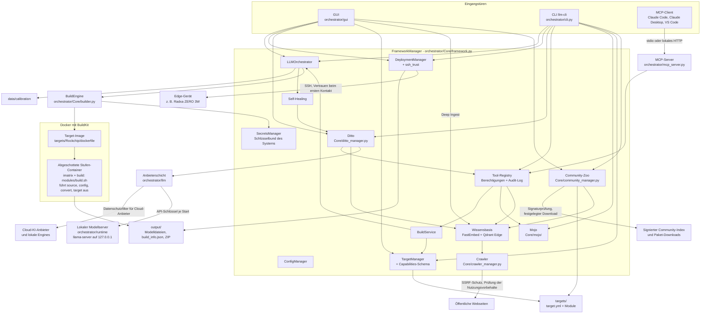
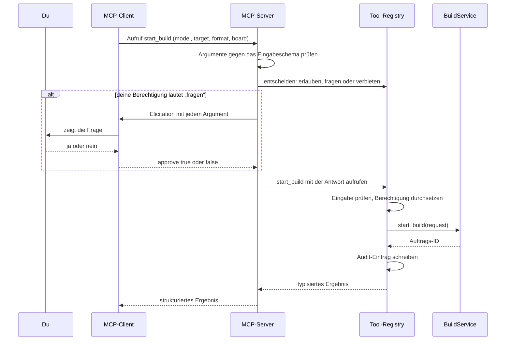
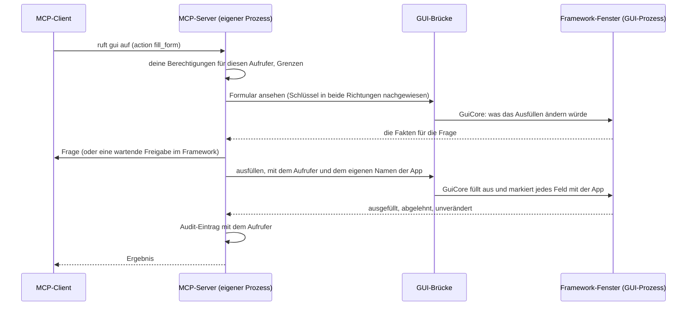

Version 3.2.0 · Stand 2026-10-30

[English](DESIGN.md) · **Deutsch**

# Design

Dies ist das Designdokument des LLM Cross-Compiler Frameworks. Es erklärt, wofür das Framework da ist, wie seine
Teile zusammenspielen, wie Daten hindurchfließen, wie es dich schützt und warum es so gebaut ist. Es ist eine der drei
Dateien des [Bauplans](BLUEPRINT_DE.md): Was als Nächstes kommt, steht in der [Roadmap](ROADMAP_DE.md), und was jede
veröffentlichte Version enthält, steht im [Changelog](../CHANGELOG_DE.md).

Das Dokument beschreibt den Entwicklungszweig: die Version 3.1.0 und was der Changelog seitdem aufführt. Was noch
nicht gebaut ist, steht in der Roadmap, nicht hier.

## Inhalt

- [Kurz gesagt](#kurz-gesagt)
- [Zweck und Grundsätze](#zweck-und-grundsätze)
- [Architektur im Überblick](#architektur-im-überblick)
- [Datenflüsse](#datenflüsse)
- [Bausteine und Entscheidungen](#bausteine-und-entscheidungen)
- [Sicherheitsmodell](#sicherheitsmodell)
- [Wichtige Entscheidungen](#wichtige-entscheidungen)
- [Versionierung und Dokumentationsregeln](#versionierung-und-dokumentationsregeln)
- [Geschichte](#geschichte)
- [Glossar](#glossar)

## Kurz gesagt

Ein Sprachmodell, wie es auf Hugging Face veröffentlicht wird, ist für einen kleinen Rechner wie ein Radxa ZERO 3W
meist zu groß und im falschen Format. Das Framework löst das in drei Schritten:

1. **Holen**: das Modell (eine Hugging-Face-Repo-ID wie `Qwen/Qwen3-0.6B` oder ein Ordner auf deiner Festplatte).
2. **Umwandeln und verkleinern** („quantisieren“) in einem Docker-Container, der die passenden Werkzeuge für deine
   Hardware enthält.
3. **Installieren**: das Ergebnis per SSH auf dein Gerät.

Du kannst es auf drei Wegen bedienen: über die Desktop-Oberfläche (GUI), über die Kommandozeile `llm-cli` oder über
einen KI-Client wie Claude Code oder Claude Desktop per Model Context Protocol (MCP). Alle drei nutzen denselben
Kern.

Der eingebaute Assistent **Ditto** hilft bei der Wahl von Modellen und Einstellungen, erklärt fehlgeschlagene Builds
und kann die Tools des Frameworks für dich bedienen, immer im Rahmen der Berechtigungen, die du festlegst. Ditto
arbeitet mit einem Cloud-KI-Anbieter deiner Wahl oder ganz offline mit einem lokalen Modell, das das Framework für
dich herunterlädt und betreibt.

Es gibt ein offizielles Hardware-Target, **Rockchip** (Boards RK3566, RK3568, RK3576, RK3588), mit drei
Ausgabeformaten:

| Format | Läuft auf | Boards | Typischer Einsatz |
|---|---|---|---|
| GGUF (llama.cpp) | CPU | alle vier | Chat-Modelle auf jedem Board |
| RKLLM | NPU | RK3588, RK3576 | Chat-Modelle auf dem Neuroprozessor |
| RKNN | NPU | alle vier | ONNX-Modelle für Bild und Ton |

`llm-cli` ist der Konsolenbefehl aus `pyproject.toml`. Wenn er nicht im PATH liegt, rufst du im Installationsordner
stattdessen `python -m orchestrator.cli` auf; die Optionen sind dieselben.

## Zweck und Grundsätze

Das Framework soll Menschen ohne Hintergrund in Compilern oder maschinellem Lernen ein Sprachmodell auf eigener,
kleiner Hardware ermöglichen und Fachleuten eine reproduzierbare, nachprüfbare Pipeline geben. Fünf Grundsätze
leiten jede Designentscheidung.

| Grundsatz | Was das praktisch heißt |
|---|---|
| **Lokal zuerst** | Umwandlungen laufen auf deinem Rechner in Docker. Modelle werden auf dem Host heruntergeladen, die Umwandlungs-Container haben kein Netzwerk. Die Wissensbasis berechnet ihre Embeddings und ihr Reranking lokal, und Ditto kann ganz offline mit einem lokalen Modell arbeiten. Außer Downloads verlässt nichts deinen Rechner, es sei denn, du wählst für Ditto einen Cloud-KI-Anbieter (dann greift der Datenschutzfilter, siehe [Sicherheitsmodell](#sicherheitsmodell)), schaltest die anonymen Fehlerberichte ein (`enable_telemetry`, standardmäßig aus) oder öffnest mit einem Community-Paket einen Pull-Request (das Framework bereitet das Paket vor; die GitHub-CLI oder der Browser verschickt es mit ihren eigenen Zugangsdaten). |
| **Laienfreundlich** | Die GUI bietet nur an, was das gewählte Target kann, die CLI lehnt alles andere ab, und beide setzen sinnvolle Vorgaben je Board (zum Beispiel Q4_0 auf dem RK3566). `llm-cli mojo` erklärt Probleme mit Lösungshinweisen. KI-Fehler werden in klaren Worten erklärt (etwa, dass ein Claude-API-Schlüssel, der in jedem Workspace gilt, die Workspace-ID braucht). Vorschläge des Self-Healing warten auf deine Entscheidung. |
| **Sicher von Haus aus** | Die Umwandlungs-Sandbox ist eingeschaltet (`build_sandbox: true`). KI-Clients und Ditto dürfen frei lesen, müssen aber fragen, bevor sie etwas ändern. Neuen SSH-Geräten wird erst vertraut, wenn du ihren Fingerabdruck bestätigt hast. Passwörter werden nie gespeichert. Von einer KI vorgeschlagener Text wird nie ausgeführt. Der Crawler beachtet jeden maschinenlesbaren Nutzungsvorbehalt einer Seite, und kein Schalter hebt das auf. Community-Pakete werden erst nach Prüfungen in einem Quarantäneordner und nach deiner Bestätigung installiert. |
| **Daten statt Code** | Was ein Target bauen kann, steht in seiner `target.yml` (Block `capabilities:`, von einem Schema geprüft). KI-Anbieter sind Vorlagen in `configs/llm_providers.yml`, der lokale Modellserver und seine Modelle sind in `configs/llama_runtime.yml` festgelegt, Dittos Evaluationsfälle stehen in `evals/ditto/cases.yml`, Korpus und Fälle der Abruf-Evaluation in `evals/retrieval/` und die vertrauenswürdigen Community-Schlüssel in `configs/community_keys.yml`. Ein neues Board, ein neues Modell oder ein OpenAI-kompatibler Server ist eine Datenänderung, solange der Code dahinter das unterstützt. |
| **Nachprüfbare Builds** | Jeder Build schreibt ein Manifest (`build_info.json`) mit dem SHA256-Hash jeder Modelldatei, eine `Model_Card.md` und ein ZIP-Archiv. Das Deployment-Paket prüft die Hashes auf dem Gerät vor der Installation. Python-Abhängigkeiten sind per Hash festgelegt, Downloads des lokalen Modellservers und seiner Modelle per Größe und SHA256, und das Audit-Log der Tools lässt sich prüfen. |

## Architektur im Überblick

In einfachen Worten: Es gibt drei Eingangstüren (GUI, CLI, MCP). Dahinter sitzt ein Kern, der `FrameworkManager`,
der alle anderen Teile startet und miteinander verbindet. Ein Build-Auftrag landet bei der `BuildEngine`, die ein
Docker-Image für das Target baut und die Umwandlung in abgeschotteten Containern ausführt. Das fertige Modell liegt
danach in `output/`, und der `DeploymentManager` kopiert es auf das Gerät. Ditto spricht mit KI-Anbietern nur über
die Anbieterschicht und nutzt dieselbe Tool-Registry wie der MCP-Server. Deep Ingest, das eine Person in der GUI
startet oder für einen KI-Client bestätigt (`crawl_docs_site`), schickt den Crawler für die Wissensbasis auf öffentliche Webseiten; der Community-Zoo installiert Community-Pakete
nach `targets/`, in den Rezeptordner und in die Wissensbasis.

### Schichten

GUI, CLI und MCP-Server bleiben in einem Repository (Entscheidung des Maintainers vom 2026-10-17); die Kopplung
halten Schichten im Zaum, von denen jede nur sich selbst und die darunter importiert:

| Schicht | Pakete | Darf importieren |
|---|---|---|
| 1. Unten | `orchestrator/utils/`, `orchestrator/security/`, `orchestrator/schemas/` | Schicht 1 |
| 2. Remote | `orchestrator/remote/`, `orchestrator/utils/ssh_trust.py` | Schichten 1 und 2 |
| 3. Kern | die Module von `orchestrator/tools/`, die keine Tools festlegen (Registry, Richtlinie, Audit, Freigaben, Signaturen, spec, ...) | Schichten 1 bis 3 |
| 4. Fachlogik | `orchestrator/Core/`, `runtime/`, `rag/`, `llm/`, `evals/` (`llm` und `rag` importieren nie `Core`) | Schichten 1 bis 4 |
| 5. Tool-Definitionen | `orchestrator/tools/tools_*`, `framework_*`, `gui_bridge`, `gui_surface` | Schichten 1 bis 5 |
| 6. Adapter | `orchestrator/cli.py`, `orchestrator/mcp_server.py`, `orchestrator/gui/` mit `main.py` | alles außer einem anderen Adapter |

PySide6 gibt es nur in der GUI, click und rich nur in der CLI, mcp und uvicorn nur im MCP-Server, paramiko nur im
SSH-Transport (`remote/transport.py` und das `utils/ssh_trust.py`, aus dem er entstand). `tests/test_layering.py` prüft jeden Import (auch in
Funktionen und verzögerte) gegen diese Regeln; die heutigen Ausnahmen stehen in `tests/data/layering_allowlist.json` mit
ihrem Grund und der Kette, die sie entfernt, und die Liste und der größte Import-Zyklus dürfen nur schrumpfen.
Gemeinsame Helfer liegen deshalb unterhalb der Tools: Pfad-Labels für KIs in `security/paths.py`, private atomare
Dateien und die eine Regel „nur du“ (`owner_only`, unter Windows eine ACL) in `utils/atomic.py`, einmalige Hinweise in `utils/notice_store.py`, Image-Referenzen in `utils/image_ref.py`,
der SSRF-sichere HTTP-Adapter in `security/http.py`, der Audit-Schlüssel in `Core/vault_key.py`.

### Bausteine

| Baustein | Wo | Aufgabe |
|---|---|---|
| GUI | `orchestrator/gui/` (Start: `llm-gui`, `orchestrator/gui/app.py`; PySide6, das optionale Extra `gui`) | Hauptfenster, Build-Reiter, Deployment-Fenster, Ditto-Chat (sein Kopf zeigt den genutzten Zugang), Modul-Assistent mit Deep Ingest, Hugging-Face-Browser, Community-Hub, Dialoge für KI-Einstellungen, der Anmeldebereich (`sign_in.py`: Karten für die Verfahren, Schlüsselformular, Auswahl für den Schutz des Tresors, Passphrase-Dialog; Zugriffe auf Tresor und Netz in Hintergrund-Threads), Tool-Berechtigungen, Tool-Bestätigungen, Self-Healing-Vorschläge, SSH-Vertrauen, den Deep-Ingest-Hinweis und den Export für die Community. |
| CLI | `orchestrator/cli.py` (`llm-cli`, auch `llmcf`) | Befehle der obersten Ebene `build`, `config`, `deploy`, `ditto`, `doctor`, `knowledge`, `mcp`, `mojo`, `module`, `scan`, `secrets`, `targets`, `tools`, `zoo` (`doctor`, `mojo` und `scan` sind einzelne Befehle, die übrigen Gruppen; `doctor` ist der alte Name von `mojo`). Die Befehle zur Anmeldung `ditto login`, `logout` und `auth` nutzen dieselben Anmeldeoperationen wie die GUI (`orchestrator/llm/auth/signin.py`). |
| FrameworkManager | `orchestrator/Core/framework.py` | Startet alle Manager in vier Phasen (Sicherheit und Infrastruktur, Kernlogik, KI und Wissen, Wächter und Betrieb), verbindet sie, hält eine langlebige asyncio-Schleife für Builds und löst relative Datenpfade gegen den Installationsordner auf, nicht gegen das Arbeitsverzeichnis. |
| ConfigManager | `orchestrator/Core/config_manager.py` | Einstellungen mit Schema (Typ, Vorgabe, Prüfregel). Der Einstellungsordner ist `LLM_FRAMEWORK_CONFIG_DIR`, wenn gesetzt, sonst das `configs/` der Installation, wenn es beschreibbar ist, sonst der Benutzerordner; nie das Arbeitsverzeichnis. Benutzereinstellungen landen dort in `config.yml`. Umgebungsvariablen mit dem Präfix `LLM_FRAMEWORK_`, `FRAMEWORK_` oder `LLM_` überschreiben bekannte Einstellungen. Persönlicher Zustand liegt in `~/.llm-framework` (änderbar mit `LLM_FRAMEWORK_HOME`), unter Linux und macOS beim Anlegen privat gemacht (Modus 0700); ein vorhandener Ordner behält seinen Modus, und Mojo Oracle meldet einen, den andere lesen können (`state.permissions`). |
| SecretsManager | `orchestrator/Core/secrets_manager.py`, `orchestrator/Core/vault_key.py`, `orchestrator/utils/file_lock.py` | Verschlüsselter Tresor (`secrets.store` im Benutzerordner, Format v2: Fernet-Einträge mit Schlüssel-IDs, gelesen mit MultiFernet, Schlüsselwechsel). Sein Schlüssel kommt standardmäßig aus dem Schlüsselbund des Betriebssystems (ein Eintrag je Tresor; ein Schlüsselbund, der hängt, nichts behält oder im Klartext speichert, wird abgelehnt) oder aus der ausdrücklichen Wahl in `secret_storage` (Credential-Helper, Passphrase, unverschlüsselte Schlüsseldatei, nur Arbeitsspeicher). Jede Änderung läuft unter einer Sperre über Prozessgrenzen; der Tresor lehnt einen Ort innerhalb einer Git-Arbeitskopie ab. Enthält API-Schlüssel (als Datensätze unter `cred/<anbieter>/api_key`; die alten Namen gelten weiter) und das Hugging-Face-Token (`hf_token`). Die Secrets eines Speichers am alten Ort (Einstellungsordner) werden einmalig übernommen und mit dem Schlüssel des Tresors neu verschlüsselt, auch in einen schon vorhandenen Speicher im Benutzerordner; dort bereits vorhandene Secrets haben Vorrang, und die alte Datei bleibt unverändert. Ein lange laufender Prozess (GUI, MCP-Server) liest den Tresor neu, wenn ein anderer Prozess ihn geändert hat. |
| Secret-Formate und Schwärzung in Logs | `orchestrator/security/` | Eine Tabelle der Secret-Formate, die nur die Standardbibliothek braucht (`secret_patterns.py`); `scripts/secret_scan.py` lädt sie, `redact_secrets` nutzt sie. `redaction.py` schwärzt jeden Logeintrag beim Erzeugen (Logger des Frameworks, der SDKs und der HTTP-Bibliotheken, Tracebacks), hält die SDK-Logger auf INFO oder darüber, außer `--debug-http` ist angegeben, und stellt `SecretStr` bereit, in dem die Anbieterschicht ihre Schlüssel hält. |
| TargetManager und Capabilities | `orchestrator/Core/target_manager.py`, `orchestrator/schemas/targets.py` | Lädt die `target.yml` jedes Target-Ordners (Ordner, die mit `_` oder `.` beginnen, etwa `_template`, werden übersprungen) und prüft ihren Block `capabilities:`: Boards, Formate, Quantisierungstypen (auch je Board), Aliasse, Board-Vorgaben, Standard-Board, Bedarf an Importance-Matrix und Kalibrierdaten, Unterstützungsstufe (`official`, `community`, `experimental`). Welche Formate ein Target anbietet, ist `build_formats.offered_formats`: genau die angegebenen Formate, für ein Target ohne Capabilities jedes Format außer `hf` (ungeprüft); die Formatliste des Builder-Tabs und `llm-cli build start --format` (Hilfe, Vervollständigung und Ablehnung) lesen sie. Welche davon ein Build für ein Board bekommt, entscheidet `build_formats.format_refusal`: NPU-Formate (RKLLM, RKNN) nur, wenn die Hardware-Probe des Boards seine NPU zeigt, RKLLM nur für seine SoCs und auf einem x86_64-Build-Rechner, sonst GGUF; der Build-Dienst und der Builder-Tab lesen es. Die Probe des Boards (`BuildRequestIn.probe`, sonst die neueste gespeicherte Probe eines Boards des SoC des Auftrags) erreicht jeden Build-Container nur lesbar als `HARDWARE_CONFIG_FILE`, und die Stufe config plant den Build für dieses Board. |
| BuildService | `orchestrator/Core/build_service.py`, `orchestrator/schemas/build.py` | Der eine Weg, Builds einzureihen: prüfen, starten, Status, abbrechen, Log-Ende, Ergebnisse, Self-Healing-Entscheidung. `llm-cli build start`, Start Build im Builder-Tab, der MCP-Server und Ditto reihen Builds alle über `start_build` ein (ein installiertes Community-Rezept über `start_recipe`, das seinen Kalibrierungsdatensatz festlegt und beim Bauen prüft, ob das Rezept zurückgezogen wurde; `installed_recipe` ist der einzige Weg, der ein Rezept baut, und `community_manager.read_recipe` der einzige Leser der `recipe.yml`). Deine eigenen Aufrufer (`local_paths=True`) dürfen jeden Pfad nennen, die Priorität und den Ordner wählen, in den der Build gespeichert wird, und ein Target ohne Capabilities ungeprüft bauen; KI-Aufrufer dürfen das nicht. Deine Builds tragen keinen Besitzer, deshalb lehnt sie das Warteschlangen-Limit für Tool-Aufrufer nie ab. |
| Regel des eigenen Netzes | `orchestrator/utils/locality.py`, `orchestrator/Core/local_network.py` | Die eine Prüfung des Offline-Modus (`offline_mode`) und die eine Regel, auf zwei Arten gefragt: `check_reach` (darf der Offline-Modus es erreichen: die Ausnahmen der Person zählen) und `check_location` (wo steht der Server: der Datenschutzfilter und die Kennzeichnung lokal/Cloud; die Ausnahmen zählen nie). Verbindungen gehen an `connect_addresses` (nur die geprüften lokalen Adressen), ein Crawl, den die Person startet, an `crawl_addresses`; `tailscale_vpn` liest das VPN, `forget` verwirft eine Auflösung nach einer gescheiterten Verbindung (siehe [Offline-Modus und das eigene Netz](#offline-modus-und-das-eigene-netz)). `local_network.py` schreibt als Einziges die Ausnahmen der Person (Datei > Einstellungen… > Lokales Netz und `llm-cli config local-network`); kein Modul, das eine KI erreichen kann, importiert es. |
| Änderung der KI-Einstellungen | `orchestrator/llm/settings_change.py` | `AISettingsChange`: die Regeln einer Änderung der KI-Einstellungen an einem Qt-freien Ort (bekannte Fallback-Provider, kein Cloud-Provider offline, Schlüssel nötig und kein Admin-Schlüssel, Workspace-ID, Serveradresse ohne Benutzername oder Passwort, Modell, die Rückfrage bei plain http, der Schlüssel für seine Adresse gespeichert, die Einstellungen geschrieben, die Wissensbasis gestartet, Ditto neu geladen). Der Dialog der KI-Einstellungen behält nur seine Hinweisfenster; die Anmeldung und `ditto login` nutzen seine Adressregeln; MCP `update_settings` und die GUI-Tool-Felder des Dialogs nutzen seine Nur-verschärfen-Regel (`direction_problem`). `current()` und `with_setting()` dienen der Änderung einer einzelnen Einstellung, und `problems_of_settings()` wendet dafür jede Regel an: MCP `update_settings` lehnt ab, was `offline_mode` oder `enable_rag_knowledge` kaputt machen würden (Offline-Modus mit einem Cloud-Provider), während ein Problem, das die gespeicherten Einstellungen schon haben, deins bleibt und im Dialog behoben wird. |
| LLMOrchestrator | `orchestrator/Core/orchestrator.py` | Warteschlange und Pipeline: bereitet Kalibriertext vor, zerlegt einen Auftrag in Jobs (Modell x Target x Format x Quantisierung), führt sie auf der Build-Engine aus, behandelt Abbrüche und die Freigabeschleife des Self-Healing. |
| BuildEngine | `orchestrator/Core/builder.py`, `orchestrator/utils/build_context.py`, `orchestrator/utils/hadolint.py` | Stellt den Docker-Build-Kontext zusammen, prüft sein Dockerfile mit hadolint, wenn es installiert ist (ein Hinweis: Funde gehen ins Build-Log und in die Fortschrittswarnungen, der Build läuft weiter), baut das Image (mit BuildKit, wenn vorhanden), lädt oder bindet das Modell ein, führt den optionalen Trivy-Scan, die Importance-Matrix-Stufe und die Build-Stufe in abgeschotteten Containern aus, schreibt Manifest, Model Card und ZIP in einen versteckten Zwischenordner, verschiebt sie in den Ausgabeordner, sobald der Build nicht mehr abgebrochen werden kann, und räumt auf. |
| DockerManager | `orchestrator/Core/docker_manager.py` | Erzeugt die eine Build-Engine des Frameworks (mit ihrem Docker-Client) und prüft, ob der Docker-Daemon antwortet; ohne Qt. `container_resources()` macht aus einer `docker stats`-Messung eines laufenden Build-Containers CPU- und Speicherwerte (Dockers eigene Formeln, Speicher ohne den inaktiven Seiten-Cache); die Build-Engine misst sie in den Fortschritt des Builds, `BuildService.live_resources` gibt sie an den Builder (unter dem Fortschrittsbalken), und das Build-Protokoll warnt einmal nahe der Speichergrenze. |
| Container-Engine | `orchestrator/utils/docker_engine.py` | Mit welcher Engine das Framework spricht (DECISIONS Runde 26 Q1): Standard ist Docker CE; ohne Docker-Dienst und mit dem Podman-Socket der Person (der Ersatzweg von install.sh unter Rocky Linux, AlmaLinux und Oracle Linux) setzt `ensure_docker_host()` `DOCKER_HOST` für den Prozess und die Programme, die er startet, auf ihn (ein `DOCKER_HOST`, das die Person setzt, gilt immer). Jede Stelle, die einen Docker-Client anlegt, ruft ihn zuerst auf (die Build-Engine, `DockerEngine` des Builder-Images, Dittos `DittoDocker`, die eine Docker-Prüfung `check_docker_environment`, `scripts/build_container_image.sh` über `python3 -I ... --docker-host`). `engine_name()` unterscheidet Docker und Podman an `/version`; `podman_refusal()` lehnt früh ab, was Podman nicht bietet (Dockers GPU-Anfrage, BuildKit): `BuildService`, bevor ein GPU-Build in die Warteschlange kommt, der Builder, Dittos GPU-Weitergabe. `create_container()` legt jeden Container des Frameworks an (die Build-Stufen, den llama.cpp-Builder, Dittos Prüf- und Server-Container); unter rootless Podman bekommt einer, der als die Person läuft, Podmans `keep-id`, damit er in die Ordner der Person schreiben kann. Mojo nennt die Engine. Nur Standardbibliothek (auch das Python 3.9 des Systems). |
| Rockchip-Referenz-Target | `targets/Rockchip/` | `dockerfile` (Debian bookworm-slim; llama.cpp-Werkzeuge v0.6.0; drei Python-venvs), `modules/build.sh` (der Stage-Runner) mit den vier Stufenmodulen `source_module.sh`, `config_module.sh`, `convert_module.sh` und `target_module.sh` (`gguf`, `rkllm`, `rknn` und der Job `imatrix`), `modules/rkllm_module.sh` und `modules/rknn_module.sh` (Format-Helfer der Stufe convert), `scripts/export_rkllm.py`, `scripts/rknn_converter.py`, `scripts/model_check.py` (die Prüfungen der Stufe convert; die Vorlage bringt dieselbe Datei mit), `target.yml`. `targets/_template/` ist der Ausgangspunkt für neue Targets ([Leitfaden für Modulentwickler](Module_Developer_Guide_DE.md)). |
| DeploymentManager und SSH-Vertrauen | `orchestrator/Core/deployment_manager.py`, `orchestrator/utils/ssh_trust.py` | Baut das Deployment-Paket, prüft den Host-Schlüssel des Geräts, hinterlegt den SSH-Schlüssel des Frameworks, lädt hoch und startet die Installation. |
| Deploy-Schritte | `orchestrator/runtime/device/person_steps.py`, `orchestrator/runtime/device/steps.py`, `orchestrator/runtime/device/service.py` | Ein Deployment je Anwendungsfall. `deploy_build` (nur für die Person) bringt einen Build für `llm-cli deploy run` und den Deployment-Tab auf ein Board: das Paket (`make_package`, sein Grund kommt mit dem Ergebnis zurück; mit Docker-Images genau die Container von `deployment_manager.package_containers`, die die Tabelle des Deployment-Tabs angehakt hat, für `--docker` alle), das Deployment, dann der vertraute Eintrag des Boards mit der Audit-Zeile der CLI. `deploy_runtime_flow` bringt die selbst gebaute Runtime eines Boards für `llm-cli device runtime deploy`, das Boards-Fenster und das `deploy_device_runtime` der KI auf das Board: Anmeldung, vertrauter Eintrag, Ablehnung von root, Frage zum Benchmark mit der Zustimmung, Installation, Eintrag „getestet auf“. Jeder Aufrufer übergibt seine Anmeldung und seine Worte als Hooks; nur die Kanäle der Person geben den vertrauten Eintrag und die Frage mit. |
| Remote-Schicht | `orchestrator/remote/` | Alles, was mit einem Board spricht, ohne Qt und nur mit Importen aus `orchestrator/utils` und `orchestrator/security`: die Adresse des Boards (`address.py`: `Endpoint` mit seiner known_hosts-, Speicher- und Anzeigeform, die eine Prüfung von Host, Port und SSH-Benutzer, nur ASCII), warum ein Board nicht erreichbar ist (`reasons.py`: die vier Grundcodes und `local_problem` für ein Problem auf diesem Computer, das nie beim Board vermerkt wird, `check_port`, `classify`, `reach_code`; eine abgebrochene Verbindung, während ein Deployment auf das Board wartet, zählt als „noch nicht zurück“), `RemoteFailure`, die Basis jedes Fehlers eines Board-Schritts (`errors.py`), die Worte eines Boards und der Stand eines laufenden Deployments als eine Zeile für die Person oder eine KI (`text.py`), die Verbindung (`transport.py`: ob SSH hier geht, paramiko erst bei der ersten Nutzung importiert; jeder Befehl als ein `sh -c` mit Zeitlimit und Ausgabegrenze; Anmeldung, SFTP und Keepalive in `ParamikoTransport`; dasselbe über den OpenSSH-Client dieses Computers in `SystemSshTransport`, wo paramiko fehlt, mit dem einen Bauer für OpenSSH-Befehlszeilen: `openssh_argv`, `openssh_options` mit Zeitlimit für die Anmeldung und Keepalive und `-F` mit der eigenen Einstellungsdatei des Frameworks, so dass OpenSSH weder `~/.ssh/config` noch `/etc/ssh/ssh_config` liest, `config_value`, das einen Pfad quotet, `openssh_file`, das ein `%` in den eigenen Pfaden des Frameworks als `%%` schreibt), die eigene OpenSSH-Einstellungsdatei des Frameworks (`ssh_config.py`: bei der ersten Nutzung nur für den Besitzer lesbar angelegt, mit nur den `Host`-Blöcken, die die Person hinzufügt; Zeilen, die die Vertrauenseinstellungen auf der Befehlszeile ändern, einen Befehl ausführen oder eine Datei einbinden würden, abgelehnt, ein `ProxyJump` oder `ProxyCommand` nur wissentlich; geschrieben nur von `runtime/device/person_steps.py` `save_ssh_block` für CLI und GUI, nie von einem Tool), die `known_hosts` des Frameworks, nur lesend (`trust.py`: `TrustStore` mit `status`, `status_of`, `check`, das einen `KeyCheck` gibt, `read_presented_key`; `fingerprint`, `device_id_for`, `parse_public_key` für einen Schlüssel, den die Person einfügt; die Host-Schlüssel-Fehler), die Schreiber der Person für das Vertrauen in ein Board (`pairing.py`: ein vertrauter Schlüssel mit seinem Audit-Eintrag in einem Schritt, die eine Entscheidung für Vertrauen bei der ersten Nutzung hinter `deploy run`, `scan --device` und der Frage der GUI, das Koppeln über eine Sitzung mit Einmal-Passwort, die Änderung von Adresse oder Host-Schlüssel eines Boards aus Q5 mit altem und neuem Fingerabdruck, im Audit-Log, bevor sich etwas ändert; bei einem neuen Schlüssel ziehen die Daten des Boards mit zu seiner neuen Geräte-ID, `runtime/device/board_move.py`: vor der Änderung kopiert und geprüft, die alten Kopien erst danach entfernt; und der Audit-Eintrag einer Zustimmung) und die Sitzung mit einem Board (`session.py`: `RemoteSession` meldet sich mit dem über `TrustStore` geprüften Host-Schlüssel bei jeder Anmeldung an, mit Zugangsdaten mit Typ, `KeyOnly` für jeden KI-Weg und das `OneTimePassword` der Person, das als einziges koppeln kann; ein privater Ordner, der Upload, der nach einem Netzabbruch fortgesetzt wird, das Warten auf das Board (N5), ein Job, der auf dem Board selbständig läuft und wieder verfolgt wird (`run_detached`, `follow`), ein Befehl, der zweimal laufen darf, nach einem Abbruch erneut gesendet (`run_resumable`); ein `CancelToken`, und das Schließen einer Sitzung beendet ihr Warten). Kein für eine KI erreichbares Modul importiert `pairing.py` (ein Test über den Importgraphen). Das Deployment eines Pakets ist ein dünner Adapter über der Sitzung, über paramiko oder, wo es fehlt, über OpenSSH (es wartet in beiden Fällen auf das Board, setzt den Upload fort und lässt `deploy.sh` selbständig auf dem Board laufen), und das Laufzeit-Deployment, die Prüfungen auf dem Board, der Benchmark auf dem Board und die Board-Prüfung laufen ebenfalls darauf (`runtime/device/remote.py` `RemoteShell` ist ihre Fassade): Das Laufzeit-Archiv geht über SFTP und geht nach einem Netzabbruch weiter (ein Board ohne SFTP bekommt es über stdin), die Prüfungen laufen erneut, der Benchmark läuft auf dem Board für sich und wird wieder verfolgt, und der KI-Weg (`runtime/device/service.py`, `KeyOnly`) und die Board-Schritte der Person (`person_steps.connect_stored`, ein Einmal-Passwort erlaubt) öffnen beide eine Sitzung, die auf das Board wartet (N5). Die alten Pfade `orchestrator/runtime/device/reasons.py` und `orchestrator/utils/ssh_trust.py` funktionieren weiter. Was ein Kontakt ergab, hält `record_reach` in `orchestrator/runtime/device/trusted.py` für Mojo fest. |
| Tool-Registry, Berechtigungen, Audit | `orchestrator/tools/` (`registry.py`, `policy.py`, `audit.py`, `confirmation.py`, `framework_tools.py`) | Elf typisierte Tools mit Risikostufen, die gespeicherten Berechtigungen des Benutzers, der Bestätigungstext (gemeinsam für MCP und Ditto) und ein per Hash verkettetes Audit-Log. |
| MCP-Server | `orchestrator/mcp_server.py` | Stellt die Tool-Registry per MCP bereit (offizielles SDK `mcp` 2.3.0), über stdio oder lokales Streamable HTTP. Der Startbefehl, den er für Clients schreibt, nutzt `python -P`, sodass nichts aus dem Ordner importiert wird, in dem ein Client ihn startet. |
| Anbieterschicht | `orchestrator/llm/` | Ein Client (`LLMClient`) für jeden KI-Anbieter, gebaut auf den offiziellen SDKs `anthropic` und `openai`; OpenAI-kompatible Server laufen über `openai`. Wählt Anbieter, Modell und Aufwand je Aufgabe aus den Einstellungen und den Vorlagen in `configs/llm_providers.yml` (eine gleichnamige Datei im Einstellungsordner ergänzt oder ersetzt Vorlagen). Wiederholungen (zwei, die eigenen Wiederholungen der SDKs sind aus), eine Fallback-Kette bei Ablehnungen und Ausfällen (`ai_fallback_chain`), strukturierte Antworten mit Schemaprüfung und einem Reparaturversuch, typisierte Fehler, der Datenschutzfilter für Cloud-Anbieter und eine Tool-Schleife. Der Anmeldekern (`orchestrator/llm/auth/`) bestimmt die Zugangsdaten jedes Aufrufs aus den Anmeldeverfahren im Katalog: Schlüssel aus dem Tresor (Schlüssel eigener Server an ihre Adresse gebunden) oder aus den Umgebungsvariablen, die der Katalog nennt, eine kostenlose Prüfung der Zugangsdaten, Fehler mit bekannter Ursache und dem nächsten Schritt sowie die Erneuerung von Tokens unter einer Sperre, die alle Prozesse teilen. |
| Ditto (neu gebaut) | `orchestrator/Core/ditto_manager.py` | Der Assistent: Chat mit den Tools des Frameworks (höchstens 8 Modellrunden je Frage, Tool-Aufrufe als Akteur `ditto` über die Registry), Analyse fehlgeschlagener Builds, Modulvorschläge aus einer Hardware-Probe und Build-Empfehlungen. Die letzten drei sind geprüfte strukturierte Antworten; eine ungültige Antwort ist ein Fehler und wird nie angewendet. Eine Self-Healing-Analyse oder Build-Empfehlung mit gefährlichem Befehl wird verworfen; einen Modulvorschlag prüft der Modulgenerator noch einmal. Der Chatverlauf wird nur ergänzt (`chat_history.json`); ein langes Gespräch wird zusammengefasst und als neues fortgesetzt. |
| Verwaltetes lokales Modell | `orchestrator/runtime/`, `configs/llama_runtime.yml` | Baut `llama-server` auf dem Rechner aus dem festgelegten llama.cpp-Commit (b11429, derselbe Commit wie v0.6.0): zuerst den CPU-Build, dann einen GPU-Build (in dieser Version Vulkan), jeder vor der Nutzung geprüft; importiert einen Build eines anderen Rechners derselben Art; lädt das offizielle vorgebaute Archiv nur auf ausdrücklichen Wunsch, als nicht selbst gebaut gekennzeichnet. Lädt festgelegte GGUF-Modelle in Stufen (Qwen3.5 9B, 4B und 2B, 2-Bit-Varianten für schwache Hardware und auf Wunsch ein IBM Granite 4.2 3B), jeweils per Größe und SHA256 geprüft. Startet `llama-server` auf 127.0.0.1 mit freiem Port und einem API-Schlüssel je Start. Der Anbieter `local` findet den laufenden Server von selbst. |
| Ditto-Evaluation | `orchestrator/evals/ditto_eval.py`, `evals/ditto/cases.yml`, `evals/retrieval/` | `llm-cli ditto eval`: 19 feste Fälle (Build-Log-Analyse, Build-Empfehlungen, Modulvorschläge, Chat mit Tools, Prompt-Injection), nach Regeln bewertet, gegen den eingestellten Anbieter oder je lokaler Modellstufe. Gebaut wird nichts: Chat-Fälle nutzen die echten Tool-Definitionen über einen Stellvertreter-Build-Service. Mit `--kind retrieval` bewerten 42 Suchen die Suche der Wissensbasis auf einem festen Korpus, ohne KI-Modell (siehe [Eine Suche in der Wissensbasis](#eine-suche-in-der-wissensbasis)). |
| Self-Healing | `orchestrator/Core/self_healing_manager.py` | Erkennt bekannte Fehler zuerst mit festen Mustern und fragt Ditto nur bei unbekannten. Wendet nur vom Framework festgelegte Korrekturen an, und nur nach deiner Freigabe. |
| Wissensbasis und Crawler | `orchestrator/Core/rag_manager.py`, `orchestrator/rag/`, `orchestrator/Core/crawler_manager.py` | Optional (`enable_rag_knowledge`). Webseiten, PDFs, Wissenspakete der Community und, wenn du sie aufnimmst (`llm-cli knowledge index-docs`, die GUI oder das Tool `index_framework_docs`, nie von selbst), die eigene Dokumentation und der Code des Frameworks werden in Abschnitte zerlegt und mit einem lokalen dichten Embedding (FastEmbed auf ONNX Runtime, CPU; Modell je nach Hardware, sofern `rag_embedding_model` nichts anderes sagt) und einem BM25-Vektor gespeichert. Suchen verbinden beide Ranglisten mit Reciprocal Rank Fusion; ein lokaler Cross-Encoder kann die Ergebnisse neu ordnen und die unter einer Relevanzschwelle verwerfen (siehe [Eine Suche in der Wissensbasis](#eine-suche-in-der-wissensbasis)). Qdrant Edge, die Rust-Engine von Qdrant, läuft im Prozess, die Daten liegen im Benutzerordner (eine Wissensbasis einer früheren Version wird bei der ersten Nutzung umgewandelt, siehe [Der Speicher der Wissensbasis](#der-speicher-der-wissensbasis-qdrant-edge)); ein Qdrant-Server wird nur genutzt, wenn `qdrant_url` gesetzt ist. Der Crawler von Deep Ingest beachtet die maschinenlesbaren Nutzungsvorbehalte der Seiten (siehe [Deep Ingest](#deep-ingest-von-der-webseite-in-die-wissensbasis)). |
| Deep-Ingest-Hinweis und Sprachansagen | `orchestrator/utils/crawl_notice.py`, `orchestrator/utils/announce.py` | Der einmalige Hinweis vor dem ersten Deep Ingest, je Benutzer gemerkt, und kurze Ansagen über die Sprachausgabe des Betriebssystems. |
| Community-Zoo | `orchestrator/Core/community_manager.py`, `orchestrator/Core/community_pack.py`, `orchestrator/Core/community_maintainer.py`, `orchestrator/schemas/recipes.py`, `orchestrator/gui/community_hub.py`, `orchestrator/gui/community_maintainer.py`, `configs/community_keys.yml` | Signierte und verschlüsselte Community-Pakete (Targets, Rezepte, Wissen), der signierte Community-Index, die Installation über eine Quarantäne mit Vertrauensstufen, der Export mit Datenschutz-Bereinigung und die Übergabe an einen Pull-Request, und die Aktionen des Maintainers am Community-Repository (Signaturschlüssel, Prüfen und Veröffentlichen, Zurückziehen) (siehe [Community-Pakete](#community-pakete-format-vertrauen-und-austausch)). |
| Eingabe-Historie | `orchestrator/utils/input_history.py` | Zuletzt verwendete Werte der GUI-Eingabefelder, je Benutzer und ohne Geheimnisse (siehe [Zuletzt verwendete Eingaben](#zuletzt-verwendete-eingaben)). |
| Mojo (bis 3.0.0 der Doctor) | `orchestrator/Core/mojo/` (`findings.py`, `checks/`, `runner.py`, `offers.py`, `repairs/`, `views.py`, `docker_objects.py`, `banner.py`); `orchestrator/Core/doctor.py` exportiert es weiter | Deterministische Gesundheitsprüfungen (Python, Docker und BuildKit, Speicherplatz, Targets, Rechte des Zustandsordners, Secrets und Schlüsselbund, Tool-Berechtigungen und Audit-Log, Kalibrierdaten, installierte Community-Pakete, Snapshots der Wissensbasis) mit festen Codes, Lösungshinweisen und zu jeder Warnung und jedem Fehler, wo, warum und was Mojo Miracle dagegen tun kann (Mojo Oracle). Die Prüfungen von Python und Docker laufen über die ursprünglichen Prüfungen des Frameworks in `orchestrator/utils/validation.py` (`validate_python_version`; `check_docker_environment`, das auch der Start der Build-Engine nutzt). Mojo Miracle wendet nur harmlose Reparaturpläne an (die Art aus den Schritten berechnet; ein Probelauf, an seinen sha256 gebunden, zuerst auditiert, Vergleichen-und-Tauschen, immer nur einer, danach erneut geprüft) und meldet jedes Problem als repariert oder nicht repariert mit dem Grund. Löschen ist nie eine Reparatur: `docker_objects.py` baut einen Löschplan jedes Build-Images des Frameworks (`framework_image_plan`: ohne Namen übrig geblieben, benannt `last-build`, Builder der Laufzeit; `DeletionPlan` aus `tools/spec.py`), und `delete_framework_images` entfernt genau die Images, die die Person angehakt hat, nachdem sie sie im Terminal oder in der GUI unter Tools > Framework Build Images... bestätigt hat (nur Akteur `cli` oder `gui`, zuerst auditiert, abgelehnt, wenn sich ein gewähltes Image geändert hat); der Docker-Build-Cache wird nie geleert. `docker_storage` sagt, wo Docker seine Images ablegt. `ai_findings` (`run_doctor`) und `oracle_rows` (`run_mojo_oracle`) sind, was eine KI liest: Ordner unter ihrer Bezeichnung, andere Pfade nur mit dem Dateinamen. `banner.py` ist die Kristallkugel der Konsole, wenn Mojo Miracle nach Mojo Oracle im Terminal endet (die Zeichnung und ihre Farbmaske an einer Stelle, welche Zeile ein Ergebnis bekommt, und die Notiz zum offenen Oracle-Lauf neben der Sperre von Mojo Miracle); nur die CLI gibt sie aus, nichts davon erreicht eine KI. |
| Löschen und Papierkorb | `orchestrator/Core/deletion.py`, `orchestrator/Core/trash.py`, `orchestrator/gui/deletion_dialog.py`, `orchestrator/gui/trash_window.py` | Jedes Löschen von Objekten der Person nimmt eine `AcceptedDeletion`: den Plan, den die Person in der GUI oder im Terminal bestätigt hat (die Mehrfachauswahl baut ihn aus genau den angehakten Teilen neu), seinen Modus (Papierkorb oder endgültig) und den Kanal. Der löschende Code baut den Plan erneut und lehnt einen geänderten ab (`PlanChanged`). Der Papierkorb verschiebt Teile mit einem Umbenennen nach `.trash/<ID>/` ihres Datenordners (nie über Platten hinweg); sein Index `tool_trash.json` ist signiert; nichts verlässt ihn von selbst; nur die Person leert ihn; eine KI stellt nur wieder her, was sie selbst löschen wollte. `tests/test_deletion.py` listet jede Stelle im Code, die löscht, mit ihrer Absicherung. |
| Datei-Hashes | `orchestrator/utils/helpers.py` | Die eine Implementierung jedes sha256 einer Datei (ganze Dateien, offene Handles und ihre ersten Bytes für das Fortsetzen, Deskriptoren, Kopien, die beim Schreiben gehasht werden, damit die geprüften Bytes die benutzten sind, ein Cache mit Lock, `SHA256SUMS`-Zeilen und `.sha256`-Begleitdateien, der Vergleich in konstanter Zeit). Die alten Helfernamen im Build-, Deploy-, Laufzeit-, Papierkorb- und Download-Code sind Delegates; `tests/test_hashing.py` lehnt eine neue Hash-Schleife daneben ab. Die Hardware-Probe hat keine Kopie, und die `sha256sum`-Aufrufe auf einem Board bleiben auf dem Board. |
| Platzregel und Watchdog | `orchestrator/Core/disk_plan.py` | Was ein Build wo ablegt, die Reserve (2 GiB oder 2 %, 20 GiB oder 10 % unter einer dauerhaften Freigabe), das prozessübergreifende Reservierungsbuch und der Watchdog: Unter der halben Reserve wird ein laufender Build-Container gestoppt und das Staging beendet (`DiskWatchdog`, `low_disk_text`), eine volle Platte wird beim Label mit `insufficient_resources` gemeldet (`disk_full_text`, `is_disk_full`), und der Trivy-Scan wird übersprungen (`low_disk_floor`). Die BuildEngine ruft sie nur auf. Die eine Platzregel für jede Prüfung des freien Platzes (Entscheidung A4): `room` (eine Platte) und `check_disk` lassen die Reserve frei, neben dem, was angenommene Aufrufe irgendeines Prozesses im Reservierungsbuch reserviert haben, für Builds, Downloads (`download_rule`, das `space` des Downloaders), das Deployment-Paket, die Benchmark-Kopie, die Umstellung der Wissensbasis, den Snapshot-Export, Mojos Platzprüfung und die Platzangabe für eine KI; `refusal` und `person_text` sagen, was nicht passt, und den nächsten Schritt, auf Englisch oder Deutsch. Das Board-Paket einer Stufe target entsteht im Build-Container, der kein Framework hat: `scripts/board_package.py room` wendet dort dieselbe Reserve mit denselben Worten an (ein Test vergleicht sie), ohne das Reservierungsbuch des Benutzerordners. Während ein Build läuft, trägt die Engine ein, was von seiner Reservierung schon auf der Platte liegt (`LandedMeter`, `ReservationLedger.landed`), damit diese Bytes nicht doppelt zählen. |
| Hugging-Face-Downloads | `orchestrator/Core/hf_hub.py`, `orchestrator/Core/hf_takeover.py`, `orchestrator/gui/huggingface_window.py` | Ein geprüfter Fetcher (`HubFetcher`: der Commit festgelegt, eine fortsetzbare `.part`-Datei, Größe und sha256 des Hubs geprüft, bevor die Datei ihren Namen bekommt, das Token nur an huggingface.co) für `download_hf_file` einer KI, den Hugging-Face-Browser der GUI (`download_for_person`, Entscheidung A6) und den Modell-Download des Builders, eine Hub-API (`hub_api`: nur huggingface.co, nie der Host in `HF_ENDPOINT`, nie ein implizites Token) für jede Suche, Abfrage und Dateiliste des Frameworks, die des Browsers und des Builders eingeschlossen, und eine Token-Regel (Entscheidung Runde 25 Q2): Listen, Abfragen und Dateien eines öffentlichen Repositorys gehen ohne Token, auch wenn eines gespeichert ist; das Token geht nur an ein gated oder privates Repository (`needs_token` aus den Feldern gated und private der Repository-Infos, oder die Antwort 401/403 des Hubs auf eine Anfrage ohne Token, dann eine Anfrage mit ihm: `tokenless_first`, `HubFetcher(token_needed=...)`). Der Prozess läuft mit `HF_HUB_DISABLE_IMPLICIT_TOKEN` und `HF_HUB_DISABLE_TELEMETRY` von huggingface_hub (`orchestrator/utils/hf_env.py`, gesetzt beim Import des Pakets `orchestrator`; in huggingface_hub 1.33 stoppt der Telemetrie-Schalter auch dessen Abfrage der Agent-Harness-Liste), und die fastembed-Modelle der Wissensbasis kommen über `fetch_snapshot` ohne Token in den Cache von fastembed, der sie dann lädt, ohne jemanden zu fragen; und ein Ablageschema für einzelne Dateien, `download_path`: `<models_dir>/hf/<owner>--<name>/<commit[:12]>/<Datei>` (der Builder legt ganze Modelle in `cache/models/hf/` ab). Der Download des Browsers folgt der einen Platzregel und hält während er läuft eine eigene Reservierung im Reservierungsbuch. `hf_takeover` listet, was frühere Versionen im Cache von huggingface_hub im Modellordner gespeichert haben (weiter aufgeführt und nutzbar), kopiert es auf Wunsch der Person, jede Datei gegen die Prüfsumme geprüft, mit der sie geladen wurde, und bietet das Entfernen der alten Kopien nur als angenommenen Löschplan mit der genauen Liste an (**Alte Downloads übernehmen…** im Browser und `llm-cli models take-over` rufen dasselbe auf). Im Offline-Modus lehnen die Hugging-Face-Aufrufe des Browsers, der Übernahme und jeder KI und die Commit-Prüfung der GUI vor jeder Anfrage mit einer Ablehnung ab (`hf_hub.offline`, `offline_refusal`; die Person liest `person_text`); ein Build im Offline-Modus lädt sein Modell nie (siehe die nächste Zeile). |
| Modelle auf diesem Computer | `orchestrator/Core/local_models.py`, `orchestrator/gui/offline_model.py` | Was ein Build im Offline-Modus nutzen kann (Entscheidung Runde 25 Q1): `local_copy` findet eine vollständige Kopie eines Hugging-Face-Modells (die eigene Kopie des Builders in `cache/models/hf/`, als vollständig vermerkt, wenn ihr Bereitstellen endet; einen Modellordner, den der Hugging-Face-Browser geladen hat; den alten Cache von huggingface_hub), die `BuildEngine` im Offline-Modus statt eines Downloads einhängt. `models_here` listet die Modelle, die schon hier sind, jedes mit seinem Label: eine Referenz auf eine lokale Datei für den Modellordner und die mit der KI geteilten Ordner (`LocalFiles.list`), die Repository-ID für die Kopien des Builders, der Pfad für die Eingaben früherer Builds (aus ihren Build-Einträgen; nur für die Person). Ohne Kopie wirft `BuildService.check_model_here` `ModelNotHere` mit dieser Liste: `build start` gibt sie aus und nimmt mit `--model` ein Label aus der Liste oder einen lokalen Pfad (am Terminal wird gefragt), der Builder-Tab öffnet eine Auswahl mit einem Öffnen-Dialog für eine Modelldatei oder einen Modellordner, und der Build-Plan einer KI nennt nur die Labels. `ditto models download` lehnt im Offline-Modus ab und nennt die Ditto-Modelle, die schon hier sind (`runtime/ditto_models.offline_refusal`). |
| Texte (Lokalisierung) | `orchestrator/utils/localization.py`, `orchestrator/utils/l10n_*.py`, `orchestrator/gui/localization.py` | Die eine Texttabelle (`TRANSLATIONS`, aus den `l10n_*`-Modulen zusammengeführt) und `ui_text`, `tr` und `current_language`, ohne Qt, für jeden Prozess. Das Sprachobjekt des Fensters (`LocalizationManager` mit dem Signal `language_changed`, auf das die Fenster neu übersetzen, `get_instance`) und Qts eigene Übersetzung seiner Standard-Schaltflächen (`qtbase_<lang>`) liegen in der GUI; der alte Importpfad führt beim ersten Gebrauch dorthin. Nur `orchestrator/gui/` importiert Qt (`tests/test_qt_free_core.py`). |
| Kalibrierdaten | `data/calibration/`, `orchestrator/utils/calibration.py` | Kuratierter deutscher, englischer und Tool-Nutzungs-Text (MIT-Lizenz) mit SHA256-Prüfung, für Importance-Matrizen. |
| Umgang mit nicht vertrauenswürdigem Text | `orchestrator/utils/untrusted.py` | Bereinigt und verpackt externen Text, bevor er ein Sprachmodell erreicht. |

Ein Build sind die vier Stufenmodule eines Targets (`source_module.sh`, `config_module.sh`, `convert_module.sh`,
`target_module.sh`, die Kette der Version 1.x, die die Entscheidung U9 des Maintainers wieder zum Build gemacht hat).
`build.sh` ist nur der Stage-Runner: Er führt sie der Reihe nach aus, schreibt nach jeder fertigen Stufe eine Marke
zum Fortsetzen (eine Prüfsumme der Eingaben und die Dateien, die die Stufe genannt hat), überspringt eine fertige
Stufe, wenn er auf demselben Arbeitsordner mit denselben Eingaben erneut läuft, und schreibt je Stufe eine
Fortschrittszeile, die die BuildEngine aus dem Container-Log liest. Ein optionales `rotate_module.sh` zwischen
convert und target ist der Platz für eine Rotation wie SpinQuant (mitgeliefert wird keine). Benchmarks bleiben auf
dem Board: Keine Stufe führt einen aus, und das `benchmark_module.sh` der Vorlage ist keine Stufe. Um jede
Umwandlung herum leistet die Stufe convert, was das convert-Modul von 1.x im Entwurf des Maintainers versprochen hat
(Entscheidung U9, Nachtrag): Sie erkennt das Format der Eingabe und lehnt ab, was das Format des Builds nicht
verwenden kann (ein ONNX-Modell für GGUF, mit dem Format rknn als Weg), prüft die Integrität der Eingabe und des
GGUF, das der Konverter geschrieben hat, lässt dieses GGUF kurz mit `llama-completion` laufen, wenn das Image es
hat, schreibt ihre Statistik (Größen, Verhältnis, Dauer, das Ergebnis des Tests) ins Log und in `build_info.json`
(`conversion`) und hinterlässt nichts Halbfertiges, wenn sie scheitert: Eine Datei, die sie ersetzt, bleibt
erhalten, bis die neue ihre Prüfungen bestanden hat. `scripts/model_check.py` erledigt diese Prüfungen mit dem Python
des Images und nur der Standardbibliothek; jedes Target bringt dieselbe Datei mit. Von Hand mit dem
Hardware-Profil eines Boards gestartet, plant die Stufe config das Board und prüft den Plan (Compiler-Test,
Toolchain-Datei, Plan-Skript), und die Stufe target macht das einsatzfertige Paket der Version 1.x (Programme für das
Board, Model Card, `test_model.sh`, `deploy.sh`, `MANIFEST.json`, `SHA256SUMS`); `build.sh --package` macht es auch
ohne Profil, geplant mit den schlichten Vorgaben des Targets. Ein Build des Frameworks hat kein Profil und macht kein
Paket. Das Paket folgt den Build-Regeln des Frameworks: der einen Platzregel, bevor es das Modell kopiert, keiner
Option von llama.cpp, die in seinem Cross-Build etwas herunterlädt (der Modul-Generator und die Ordnerprüfung lehnen
CMake-Flags eines Moduls ab, die eine einschalten würden, `recipe.refused_option`), und für ein x86_64-Profil eines
anderen PCs den CPU-Merkmalen seiner Probe, so wie das Build-Rezept sie plant, `-march=native` nur für ein Profil des
Build-Rechners selbst. Siehe den
[Leitfaden für Modulentwickler](Module_Developer_Guide_DE.md#6-die-stufen-des-builds).

`configs/project_sources.yml` ist ein Katalog vorgelagerter Projekte und Dokumentationslinks. Zur Laufzeit liest
das Framework nur seine Dokumentationslinks für Hardware (sie füllen das Deep-Ingest-Fenster für Hersteller und SDK
einer Probe); wofür jede Datei in `configs/` da ist, steht in
[SSOT_ARCHITECTURE_DE.md](../configs/SSOT_ARCHITECTURE_DE.md).

### Wo was liegt

| Ort | Inhalt |
|---|---|
| `targets/` | Target-Definitionen (ein Ordner je Target). |
| `cache/models/hf/` | Von Hugging Face heruntergeladene Modelle für Builds. |
| `cache/builds/<Build-ID>/` | Arbeitsordner eines laufenden Builds (Build-Kontext, Ausgabe, Importance-Matrix, Zwischenablage); wird nach dem Build entfernt. |
| `cache/calibration/` | Für Importance-Matrizen geschriebener Kalibriertext. |
| `output/` | Fertige Builds, ein Ordner je Build mit Modelldateien, `build_info.json`, `Model_Card.md`, daneben ein ZIP. |
| `models/ditto/` | Dittos lokale GGUF-Modelle mit je einer Markierung `.verified.json`. |
| `models/embeddings/` | Embedding- und Reranking-Modelle der Wissensbasis. |
| `models/hf/<owner>--<name>/<commit>/` | Einzelne Hugging-Face-Dateien, die der Browser der GUI oder eine KI-App geladen hat, gegen den Hub geprüft (Entscheidung A6). |
| `models/models--<owner>--<name>/` | Die Downloads des Browsers früherer Versionen, im eigenen Cache-Schema von huggingface_hub: weiter aufgeführt und nutzbar; **Alte Downloads übernehmen…** kopiert sie nach `models/hf/` und bietet an, sie zu entfernen. |
| `community/` | Installierte Community-Rezepte (`recipes/`) und Wissenspakete (`knowledge/<Thema oder Target>/<Paket>/`: Wissen gehört immer zu einem Thema oder einem Target; eine lose Wissensdatei dort wird nie importiert, bis sie in eins einsortiert ist), jeweils mit einer `.lcf-provenance.json`, und die Pakete, die du exportierst (`contributions/`). Community-Targets werden nach `targets/` installiert. Ein Ordner `.quarantine/` in einem Installationsordner enthält ein Paket nur, solange es geprüft wird. |
| `~/.llm-framework/` (oder `LLM_FRAMEWORK_HOME`) | `secrets.store` (auch deine Community-Schlüssel), `tool_policy.json`, `audit.db` mit `audit.db.anchor`, `known_hosts`, der SSH-Schlüssel des Frameworks `id_ed25519_llm_framework` (+ `.pub`), `mcp_tokens.json` (die benannten MCP-Tokens als SHA-256-Hashes, mit ihren Berechtigungen), `chat_history.json`, `llm_privacy_key` und `llm_install_id`; `crawl_notice.json` und `input_history.json`; der zwischengespeicherte Community-Index `community/index.json` mit `index.json.sig` und die bei der ersten Installation gemerkten öffentlichen Schlüssel der Autoren, `community/authors.json`; die Wissensbasis `qdrant_edge/` mit ihrer Sperrdatei `qdrant_edge.lock` und dem Eintrag ihrer Umwandlung `knowledge_conversion.json` (der Ordner `qdrant/` früherer Versionen bleibt, bis du ihn löschst) und `knowledge_snapshots/`; der lokale Modellserver unter `runtime/llama.cpp/` (Builds, `active.json`, `server.json`, die Schlüsseldatei, solange der Server läuft) und sein Log in `logs/llama-server.log`; solange das Framework-Fenster offen ist, `gui_bridge/` mit `bridge.json` (Adresse und Schlüssel der Brücke, Modus 0600) und dem Socket `gui.sock`. |
| Einstellungsordner (meist `configs/`) | `config.yml` (Benutzereinstellungen); auf Wunsch eine eigene `llm_providers.yml`, die Anbietervorlagen ergänzt oder ersetzt. |
| `chat_feed.sqlite` im Benutzerordner | Der Chat-Verlauf: was der Chat-Bereich rechts zeigt (deine Nachrichten, Dittos Antworten, wartende Fragen, Entscheidungen einer KI mit ihrer Begründung, Ergebnisse von Arbeit, die eine KI gestartet hat). Jede Zeile ist signiert; nichts darin wird von selbst gelöscht. |

`cache/`, `output/` (der Build-Ordner des Frameworks) und `models/` sind relativ zum Installationsordner, sofern die
Einstellungen `cache_dir`, `build_dir` und `models_dir` nichts anderes sagen. Darf der Benutzer im Installationsordner
nicht schreiben (zum Beispiel `C:\Program Files`), liegen ihre Vorgaben stattdessen im Benutzerordner
(`ConfigManager.default_data_root`). Fertige Modelle (Golden-Artefakte) werden im Ausgabeordner gespeichert,
Einstellung `output_dir`, Standard `~/llmcf/output` (siehe
[Funktionen](Features_DE.md#wohin-fertige-modelle-kommen)); ein in der GUI gestarteter Build wartet im Build-Ordner,
bis er gespeichert ist, und frühere Builds bleiben dort aufgelistet. Keiner von ihnen wird beim Start angelegt; ein
Build, ein Download oder die Wissensbasis legt an, was sie nutzen.

## Datenflüsse

### Ein Build, vom Auftrag bis zum Gerät

In einfachen Worten: Du wählst ein Modell, ein Board und eine Quantisierung. Das Framework prüft, ob das Target das
kann, bereitet alles auf deinem Rechner vor, baut ein Werkzeug-Image, wandelt das Modell in einem abgeriegelten
Container um, hält Hashes fest und lässt dich das Ergebnis auf deinem Gerät installieren.

1. **Auftrag.** Der Build-Reiter der GUI, `llm-cli build start -m <Modell> -t Rockchip -f gguf -b rk3566` oder das
   Tool `start_build` (MCP-Client oder Ditto) erzeugt einen Auftrag. Ein unbekanntes Target wird mit der Liste der
   bekannten Targets abgelehnt. Der Auftrag wird gegen die Capabilities des Targets geprüft: Unbekannte Formate,
   Boards oder Quantisierungstypen werden mit einem Satz abgelehnt, der die erlaubten Werte nennt; Schreibweisen werden vereinheitlicht (Groß- und Kleinschreibung, Aliasse wie `INT8` für `Q8_0`); ein
   fehlendes Board wird zum Standard-Board des Targets, eine fehlende Quantisierung zur Vorgabe des Boards;
   Typen mit sehr wenigen Bits wie IQ2_XS verlangen eine Importance-Matrix.
2. **Warteschlange und Kalibrierung.** Der `LLMOrchestrator` reiht den Auftrag ein. Ist eine Importance-Matrix
   gewünscht (nur GGUF) und hast du keinen Datensatz angegeben, schreibt er den mitgelieferten Kalibriertext
   (`calibration_language`: `mixed`, `de` oder `en`) nach `cache/calibration/`.
3. **Jobs.** Der Auftrag wird in einen Job je Modell, Target, Format und Quantisierung zerlegt. Jeder Job geht an
   die `BuildEngine`.
4. **Build-Kontext und Image.** Die Engine kopiert `modules/`, `scripts/` des Targets und das gemeinsame
   `entrypoint.sh` in einen frischen Build-Kontext und baut das Image `llm-framework/<Target>:<Build-ID>` mit
   `docker buildx build` (BuildKit) oder, falls BuildKit fehlt, über die Docker-API. Dieser Schritt braucht Netzwerk:
   Er holt den in `configs/llama_runtime.yml` festgelegten llama.cpp-Commit (`b11429`; der Build bricht ab, wenn er
   nicht genau diesen Commit bekommt) und die Python-Werkzeugketten. Die Konvertierungswerkzeuge von llama.cpp
   entstehen mit den Optionen des Build-Rezepts für diesen Rechner (`LLAMA_CMAKE_ARGS`, aus einer Probe unmittelbar
   vor dem Image-Build), hinter den Optionen, die jeder Build hat (nichts wird beim Konfigurieren heruntergeladen,
   keine Unterprozesse). Die Zahl paralleler Compile-Jobs kommt aus `build_jobs` (0 heißt alle Kerne).
5. **Bereitstellung auf dem Host.** Das Modell wird bereitgestellt, bevor irgendein Umwandlungscode läuft: Ein
   lokaler Ordner oder eine Datei wird schreibgeschützt eingebunden; ein Hugging-Face-Repo wird auf dem Host nach
   `cache/models/hf/` geladen, bei Bedarf mit deinem gespeicherten `hf_token`. Das Token gelangt nie in einen
   Container.
6. **Sicherheitsscan.** Ist `enable_security_scan` an (Vorgabe), durchsucht Trivy (`image_trivy`, Vorgabe
   `aquasec/trivy:0.75.0`) das Image nach Schwachstellen der Stufen HIGH und CRITICAL. Er bekommt nie den
   Docker-Socket: `docker save` schreibt das Image als Archiv in einen privaten Ordner (0700) des Builds, und der
   Scanner läuft ohne Capabilities und liest nur diese Datei, schreibgeschützt; das Archiv wird nach dem Scan
   entfernt, und ohne Platz dafür wird der Scan mit einer Warnung übersprungen. Funde ergeben eine Warnung;
   der Build läuft weiter. Ein Scan, der nicht innerhalb von `build_timeout` fertig wird, wird mit einer Warnung
   gestoppt.
7. **Importance-Matrix-Stufe** (nur GGUF mit IMatrix). Ein abgeschotteter Container führt `modules/build.sh` mit
   `JOB_TYPE=imatrix` aus: Der Stage-Runner führt source, config und convert aus, und die Stufe convert wandelt das
   Modell in F16-GGUF um und lässt `llama-imatrix` über die ersten 100 Abschnitte des Kalibriertexts laufen.
   Scheitert diese Stufe, stoppt der Build.
8. **Build-Stufe.** Ein zweiter abgeschotteter Container führt `modules/build.sh` mit `JOB_TYPE=build` aus, und der
   Stage-Runner führt alle vier Stufen aus: source nennt die Werkzeuge des Images, config vereinheitlicht den
   Auftrag und lehnt ab, was das Target nicht bauen kann, convert prüft die Eingabe, wählt die Werkzeugkette (den
   GGUF-Konverter, `rkllm_module.sh` für RKLLM nur auf RK3588 und RK3576, `rknn_module.sh` für RKNN), prüft, was
   sie geschrieben hat, lässt es kurz laufen und hält ihre Statistik fest, und target quantisiert mit
   `llama-quantize` (mit Importance-Matrix, falls vorhanden) und schreibt `build_info.json`. Die Fortschrittszeilen
   des Runners zeigen die Stufe im Build-Status („Running modules: convert (3/4)“).
9. **Manifest und „Golden Artifact“.** Die Engine kopiert die Ergebnisse in einen versteckten Zwischenordner neben
   dem Ausgabeordner (Links in der Ausgabe des Builds werden nicht verfolgt), ergänzt `build_info.json` um Größe
   und SHA256-Hash jeder Modelldatei und um die Hauptdatei, schreibt `Model_Card.md` und erstellt ein ZIP dieser
   Dateien. Erst wenn der Build nicht mehr abgebrochen werden kann, werden sie nach `output/` verschoben und das ZIP
   neben den Build-Ordner; ein abgebrochener oder gescheiterter Build hinterlässt dort keine Dateien. Das Image des
   Builds heißt `llm-framework/<Target>:last-build`, und nur sein Name für den einzelnen Build wird entfernt: Der
   Builder löscht nie ein Image (ein älteres bleibt ohne Namen, bis die Person es löscht), und der nächste Build nutzt
   die Schichten wieder. Der Arbeitsordner wird entfernt.
10. **Deployment.** Im Deployment-Fenster (oder mit `llm-cli deploy package` und `llm-cli deploy run`) wählst du
    einen Build. Das Framework packt Modelldatei, `build_info.json`, `Model_Card.md`, ein erzeugtes `deploy.sh` und
    `checksums.sha256` in ein ZIP.
11. **Vertrauen beim ersten Kontakt.** Vor der ersten Verbindung wird der Fingerabdruck des Host-Schlüssels des
    Geräts angezeigt (im selben Format wie bei `ssh-keygen -lf`). Erst wenn du ihn bestätigst oder ein passendes
    `--trust-fingerprint` angibst, wird er in der eigenen `known_hosts` des Frameworks gespeichert. Ein geänderter
    Schlüssel stoppt das Deployment immer.
12. **Kopplung und Installation.** Bei der ersten Verbindung wird dein Passwort einmal benutzt, um den
    Ed25519-Schlüssel des Frameworks auf dem Gerät zu hinterlegen; gespeichert wird es nie. Das Paket wird in einen
    privaten temporären Ordner hochgeladen (`mktemp -d /tmp/llm_deploy.XXXXXXXX`) und entpackt, und `deploy.sh`
    prüft alle Hashes mit `sha256sum -c`, bevor es das Modell nach `$MODEL_DIR` (Vorgabe `$HOME/models`) kopiert
    und anzeigt, wie man es startet (bei GGUF mit `llama-server`).

Das Tool `cancel_build`, die Schaltfläche Cancel im Builder-Tab und Strg+C in `llm-cli build start` stoppen den
laufenden Stufen-Container über den Build-Service. Jeder Stufen-Container hat ein eigenes Zeitlimit
(`build_timeout`, Vorgabe 3600 Sekunden). Jede Build-Engine schreibt je Build einen Eintrag nach
`<cache_dir>/build_records/` (`orchestrator/Core/build_records.py`), den `llm-cli build status` liest; so sieht es
auch Builds anderer Programme. CLI, Build-Service, Orchestrator und Engine lösen ein Target über die eine Zuordnung
von ID zu Ordner der Target-Registry auf, deshalb darf eine Target-ID vom Ordnernamen abweichen.

### Ein Tool-Aufruf eines MCP-Clients

In einfachen Worten: Der KI-Client darf sich Dinge selbst ansehen, aber bevor er etwas ändert, fragt das Framework
dich über den Client und schreibt auf, was passiert ist.

1. **Namen, Argumente, Schema.** Tool-Name und rohe Argumente laufen zuerst durch die Absicherungsschicht
   (`orchestrator/tools/normalize.py`), dieselbe, die Dittos Aufrufe nutzen: Schreibvarianten eines Tool-Namens,
   angegebene Argument-Aliasse, Werte umgewandelt und mit geschlossenen Listen abgeglichen, ohne je einen knapp
   danebenliegenden Wert zu erraten, und jede Reparatur festgehalten. Jedes Tool hat ein pydantic-Modell für Ein-
   und Ausgabe; Clients bekommen das geschlossene JSON-Schema des Eingabemodells. Unbekannte Namen und ungültige
   Argumente werden abgelehnt, bevor irgendetwas läuft, mit Grundcode und nächstem Schritt, und die Ablehnung wird
   im Audit-Log festgehalten (`unknown_tool`, `invalid_input`); derselbe fehlschlagende Aufruf wird beim dritten Mal
   abgelehnt, ohne zu laufen (`repeat_refused`).
2. **Berechtigungen.** Die Registry schlägt deine gespeicherte Berechtigung für dieses Tool nach (zuerst eine
   Einstellung für das einzelne Tool, dann seine Stufe). Vorgaben: `read` erlaubt, `local_write` fragen, `external`
   fragen. Tools der Stufe `forbidden` lassen sich gar nicht erst registrieren. Ist die Berechtigungsdatei
   beschädigt, wird jedes Tool verweigert, bis du die Berechtigungen neu einrichtest.
3. **Elicitation.** „Fragen“ wird zu einer MCP-Elicitation: Der Client zeigt dir das Tool und jedes Argument
   vollständig (Argumente, die zu lang zum Anzeigen sind, lassen sich nicht bestätigen). Nur eine echte Antwort
   zählt als Freigabe, und ein „Nein“ gilt für diesen Aufruf endgültig, auch wenn die Berechtigung inzwischen
   gelockert wird. Eine Bestätigung, die scheitert, führt zur Ablehnung und wird im Audit-Log festgehalten. Ein
   Kann der Client nicht fragen (keine Formular-Elicitation), ist die Frage zu lang für eine Elicitation oder hast du
   das Tool auf Bestätigung im Framework gestellt, wird der Aufruf stattdessen zu einer wartenden Freigabe: Die
   Registry speichert die Frage (signiert, gebunden an Aufrufer, Tool, Argument-Hash und Fragen-Hash, 15 Minuten), der
   Client bekommt `waiting_for_approval` mit einer Job-ID, und du entscheidest in der GUI oder mit
   `llm-cli tools approvals`. Bei der Freigabe baut das Framework die Frage neu und führt den Aufruf selbst unter dem
   ursprünglichen Aufrufer aus, wenn sie gleich lautet.
4. **Ausführung.** Ein Aufruf, der etwas ändert, wird zuerst festgehalten (`started`) und abgelehnt, wenn sich
   dieser Eintrag nicht schreiben lässt. Die Tool-Funktion läuft in einem eigenen Thread; der Abbruch eines Clients
   erreicht sie sofort. Ihr Ergebnis wird gegen das Ausgabemodell geprüft und gefiltert: Secrets in jeder
   Zeichenkette geschwärzt, Felder mit externem Text (Logs, Healing-Vorschläge, Manifeste, Auszüge aus der
   Wissensbasis, Fehler von Jobs) von unsichtbaren Zeichen befreit und gekürzt, ein Ergebnis über 256 KiB abgelehnt.
   `notes` fügt nur das Framework hinzu. Der Client bekommt das strukturierte Ergebnis und einen Textblock, der mit
   einem Satz aus Fakten des Frameworks beginnt, gefolgt vom JSON, eingepackt als nicht vertrauenswürdige Daten.
   Fehler kommen als Tool-Fehler mit einer für Menschen gedachten Meldung zurück, Secrets darin geschwärzt; der Teil
   eines Fehlers, der externen Text zitiert (eine Serverantwort, eine Log-Zeile, einen Namen aus einem Pack), wird
   zuerst bereinigt und als nicht vertrauenswürdige Daten eingepackt, die eigenen Worte des Frameworks und der
   nächste Schritt bleiben unverpackt.
5. **Audit.** Jedes Ergebnis (`ok`, `denied`, `not_confirmed` mit der Antwort, `error`, `invalid_input`,
   `confirmation_timeout`, `cancelled`) wird an `audit.db` angehängt, mit geschwärzten, gekürzten Argumenten und
   einem Hash des vollen Texts, der Dauer, einem Hash des Ergebnisses und einem Verweis auf den Eintrag `started`
   des Aufrufs. `llm-cli tools audit --verify` prüft die Kette und ihren Anker; `llm-cli tools audit --archive` legt
   das Log beiseite und beginnt eine neue Kette.
6. **Besitzer, Warten und das Ende einer Sitzung.** Die Lifespan des Servers gibt jeder Verbindung eine Sitzung
   (eine je stdio-Sitzung, eine für den HTTP-Server); dem Aufrufer (Akteur `mcp`, oder `mcp:<Name>` für das
   benannte Token, das ClientTracker für die Anfrage geprüft hat) mit dieser Sitzung gehören die Builds und Jobs, die
   er startet, und dieselbe Identität entscheidet über die Berechtigungen, ist der Akteur im Audit-Log und zählt die
   Wartevorgänge. `cancel_build` und `cancel_job` auf eigene Arbeit sind ohne Frage
   erlaubt (eine Einstellung für das einzelne Tool gilt weiter, eine verweigerte Stufe bleibt verweigert, eine
   beschädigte Berechtigungsdatei verbietet weiter); auf die Arbeit eines anderen Clients gelten die Berechtigungen
   des Aufrufers. Ein Aufruf mit `wait_seconds` wartet zuerst in der Ereignisschleife (ohne Thread, höchstens 50 s
   und 4 Wartevorgänge je Client, Fortschritt alle 5 s, wenn der Client ein Fortschritts-Token mitgegeben hat) und
   läuft dann einmal durch die Registry; ein abgebrochenes Warten lässt den Build oder Job in Ruhe. Endet die
   Sitzung, werden ihre unfertigen Builds und Jobs abgebrochen und als `cancelled` („client disconnected“) im
   Audit-Log festgehalten, der Server wartet bis zu 30 s, bis die Build-Container gestoppt sind, und
   `llm-cli mcp serve` fährt danach das Framework herunter. Über stdio beendet ein SIGTERM des Clients die Sitzung
   genauso (es unterbricht den Server wie Strg+C, statt den Prozess sofort zu beenden).

Die fünfundzwanzig Tools: `list_targets`, `get_target_capabilities`, `list_build_requests`, `get_build_status`,
`read_build_log`, `list_artifacts`, `run_mojo_oracle`, `search_knowledge`, `list_knowledge_sources`,
`read_knowledge_source`, `search_hf_models`, `get_hf_model_info`, `list_local_files`, `get_status`, `get_job_status`,
`list_devices` (Stufe `read`), `start_build`, `cancel_build`, `resolve_healing`, `cancel_job`, `propose_healing_fix`,
`download_hf_file`, `create_deploy_package`, `run_mojo_miracle` (Stufe `local_write`) und `deploy_to_device` (Stufe
`external`). Tools, die deine Berechtigungen verweigern, werden dem Client nicht aufgeführt; `run_doctor`, der Name von
`run_mojo_oracle` in 3.0.0, bleibt aufrufbar, wird aber nie aufgeführt (`TOOL_RENAMES` in `tools/policy.py`: Eine
Einstellung für einen der beiden Namen gilt für beide, die strengere gewinnt). `deploy_to_device` wird immer erfragt (keine
Einstellung erlaubt es ohne Frage) und erreicht nur ein Gerät, dem du in der GUI oder CLI vertraut und das du
gekoppelt hast: Das Framework liest den Host-Schlüssel des Geräts vor der Frage, lehnt einen unbekannten oder
geänderten Schlüssel ab, zeigt in der Frage den Fingerabdruck des Schlüssels und das sha256 des Pakets und bricht
das Deployment ab, wenn eins davon danach abweicht. Sieben optionale Tools (die lokale Laufzeit:
`build_local_runtime`, `start_local_runtime`, `stop_local_runtime`, `run_benchmark`; die Laufzeit eines Boards:
`probe_remote_device`, `deploy_device_runtime`, `run_device_benchmark`) werden mit ihren Laufzeitpaketen registriert
und bleiben verweigert, also nicht aufgeführt, bis du sie freigibst. Das GUI-Tool `gui` liest
und füllt das offene Framework-Fenster, für Ditto und für jeden MCP-Client gleich (siehe den nächsten Datenfluss).

### Eine KI-App im offenen Fenster

Einfach gesagt: Solange du das Fenster des Frameworks offen hast, kann eine KI-App seine Formulare lesen und ausfüllen,
mit demselben Tool wie Ditto, und du siehst, wer was ausgefüllt hat.

1. **Ein Tool.** `gui` hat ein Feld `action`: `read_form`, `fill_form`, `wizard_state`, `wizard_open`, `wizard_fill`,
   `wizard_next`, `wizard_back`, `wizard_docs` und `show_window`. Es ist das vierzigste aufgeführte Tool, so
   bekommt ein Client, der höchstens 40 Tools nimmt, trotzdem alle. Die lesenden Aktionen werden wie Lese-Tools
   entschieden, die anderen wie ein Tool, das etwas auf diesem Computer ändert (standardmäßig mit Frage). Deine
   Einstellung für `gui` gilt für alle Aktionen.
2. **Dasselbe Harness.** Der Code, der am Fenster arbeitet (`GuiCore` in `orchestrator/tools/tools_gui.py`), läuft für
   jeden Aufrufer im GUI-Prozess. Ditto läuft dort und ruft ihn direkt auf. Der Serverprozess eines MCP-Clients schickt
   den Aufruf über die Brücke (`orchestrator/tools/gui_bridge.py`). Die Frage, die Berechtigungen, wartende Freigaben
   und der Audit-Eintrag bleiben im eigenen Prozess des Aufrufers, wie bei jedem anderen Tool.
3. **Die Brücke.** Das Fenster lauscht auf einem Socket im privaten Ordner `gui_bridge` des Benutzerordners (POSIX:
   Ordner 0700, Socket 0600) oder auf einer Named Pipe mit zufälligem Namen (Windows). Beide Seiten weisen einen
   zufälligen Schlüssel aus `gui_bridge/bridge.json` (0600) nach, bevor etwas gesendet wird; unter Linux prüft das
   Fenster zusätzlich das Konto des Prozesses, der sich verbindet. Nachrichten sind JSON. Ein anderes Konto auf
   demselben Computer erreicht sie nicht.
4. **Markierungen.** Jedes ausgefüllte Feld nennt, wer es ausgefüllt hat: Ditto in Lila; eine KI-App in einer anderen
   Farbe, mit dem Namen ihres MCP-Tokens oder mit dem Namen, den sie sich selbst gibt, in Anführungszeichen, als ihre
   eigene Angabe. Eine App sieht nie aus wie Ditto. Ein Rückgängig nimmt alle KI-Änderungen zurück; Felder, die du
   geändert hast, behalten deinen Wert.
5. **Kein Fenster.** Ist kein Framework-Fenster offen, wird `gui` mit dem Blocker `gui_not_open` abgelehnt, und du
   wirst gebeten, das Framework-Fenster zu öffnen. Das Tool bleibt aufgeführt, weil Clients die Tool-Liste einer Sitzung
   behalten. Das Fenster, das zuerst geöffnet wird, bedient die KI-Apps; ein anderes offenes Fenster prüft alle paar
   Sekunden und übernimmt, wenn das erste geschlossen ist.

### Eine Frage an Ditto

In einfachen Worten: Ditto antwortet im Chat-Bereich oder auf der Kommandozeile. Braucht es Fakten über Targets oder
Builds, fragt es die Tools des Frameworks, mit denselben Berechtigungen wie ein KI-Client. Bevor eine Frage an einen
Cloud-Anbieter geht, werden persönliche Angaben durch Platzhalter ersetzt.

1. **Frage.** Im Chat der GUI oder mit `llm-cli ditto ask "<Frage>"` (`--no-tools` antwortet ohne Tools;
   `--provider` und `--model` überschreiben die KI-Einstellungen für diese eine Frage; so eine Wahl wird nie
   gespeichert, auch nicht durch eine Änderung der Einstellungen während der Frage, und ein anderer Anbieter erbt
   weder Modell noch Adresse noch Anmeldeart des gespeicherten).
2. **Anbieter und Modell.** Der `LLMClient` nimmt Anbieter, Modell und Aufwand für die Aufgabe aus den
   KI-Einstellungen und der Vorlage in `configs/llm_providers.yml`. Für den Anbieter `local` liest er Adresse,
   Schlüssel und Modell des laufenden verwalteten `llama-server`. Im Offline-Modus werden nur lokale Anbieter
   genutzt, unter einer Adresse, die die Regel des eigenen Netzes als lokal zählt ([Offline-Modus und das eigene
   Netz](#offline-modus-und-das-eigene-netz)).
3. **Datenschutzfilter** (nur Cloud-Anbieter). Secrets werden immer geschwärzt. Je nach `ai_security_level`
   werden Adressen, E-Mail-Adressen, Logins, Benutzernamen, Hostnamen, Seriennummern und Pfade durch feste
   Platzhalter ersetzt, die in der Antwort lokal zurückübersetzt werden.
4. **Tool-Schleife.** Das Modell darf Tools aufrufen, höchstens 8 Modellrunden je Frage. Jeder Aufruf läuft als
   Akteur `ditto` über die Tool-Registry. Ein Aufruf, der eine Bestätigung braucht, zeigt seinen Titel und jedes
   Argument: als Dialog in der GUI, als Rückfrage in der CLI; ohne Terminal, und mit Strg+C an der Rückfrage,
   lautet die Antwort Nein. Tool-Ergebnisse gehen als nicht vertrauenswürdige Datenblöcke an das Modell zurück.
   Jeder Tool-Aufruf wird beantwortet, bevor das Gespräch weitergeht: Ein Aufruf in einer an der Längengrenze
   abgeschnittenen Antwort läuft nie und bekommt ein Fehlerergebnis.
5. **Fehler.** Anbieterfehler sind typisiert und werden erklärt (kein Guthaben, abgelehnter Schlüssel,
   Ratenlimit, Ablehnung, abgeschnittene Antwort). Bei Ablehnungen und Ausfällen geht es entlang der Fallback-Kette
   weiter. Ein Fehler wird nie als Antwort angezeigt oder gespeichert; liefen in der gescheiterten Runde schon
   Tools, nennt die Meldung sie und sagt, dass Ditto sich die Runde nicht merkt. Im Terminal verlieren die Antwort,
   Fehlertexte und Tool-Zeilen ihre Steuerzeichen.
6. **Verlauf.** Die fertige Runde wird an `chat_history.json` angehängt. Ein langes Gespräch wird zusammengefasst
   und als neues Gespräch fortgesetzt, ebenso ein Gespräch mit Tool-Runden, das ohne Tools gefragt wird
   (Tool-Runden brauchen die Tool-Definitionen); frühere Runden werden nie verändert. Ein gespeichertes Gespräch,
   dessen Tool-Aufrufe und Ergebnisse nicht zusammenpassen, beginnt neu.
7. **Nur die Tools dieses Computers.** Dittos Hände sind die eigenen Tools des Frameworks auf diesem Computer:
   dieselbe Registry, dieselben Berechtigungen, Fragen und dasselbe Audit-Log, die jeder MCP-Client bekommt. Ditto
   verbindet sich nie mit einem Framework auf einem anderen Computer. Eine frühere Entwicklungsversion hatte so einen
   Fernmodus; er wurde vor einem Release entfernt (Entscheidung vom 15.10.2026). Seine alten Einstellungen werden mit
   einer Logzeile ignoriert, und ein gespeichertes Gespräch daraus beginnt einmal neu.

### Freigabe beim Self-Healing

In einfachen Worten: Scheitert ein Build, sucht das Framework nach einer bekannten Ursache, sagt dir, was es tun
würde, und wartet. Ohne dein Ja wird nichts verändert.

1. Ein Job scheitert. Der Orchestrator übergibt das Fehlerlog an den Self-Healing-Manager.
2. **Bekannte Probleme zuerst.** Feste Muster erkennen zum Beispiel einen Compiler, dem beim Image-Bau der
   Speicher ausgeht, eine abgebrochene Umwandlung (Exit-Code 137), eine volle Festplatte, fehlende Docker-Rechte,
   DNS-Fehler und veraltete apt-Quellen.
3. **Ditto als Zweites.** Nur wenn kein Muster passt, analysiert Ditto das Log (als nicht vertrauenswürdiger Text
   verpackt) und liefert eine strukturierte Analyse. Seine Antwort gilt immer als Rat: Die Strategie wird auf
   „manueller Schritt“ gesetzt. Ein Vorschlag mit gefährlichem Befehl wird verworfen.
4. **Warten auf dich.** Der Build-Status wird `awaiting_approval`. Du entscheidest im GUI-Dialog, an der Rückfrage
   eines laufenden `llm-cli build start` oder über das Tool `resolve_healing`. Ohne Entscheidung innerhalb von
   `healing_approval_timeout` (Vorgabe 900 Sekunden) wird der Vorschlag verworfen.
5. **Nur feste Maßnahmen.** Ein freigegebener Vorschlag wird nur angewendet, wenn er eine von zwei im Framework
   festgelegten Strategien ist (`AUTOMATIC_STRATEGIES` in `self_healing_manager.py`): `build_jobs` auf 1 senken oder
   einfach neu versuchen. Der Job wird dann einmal wiederholt. Keine davon löscht etwas: Eine volle Docker-Platte
   (`docker_prune`) ist ein manueller Schritt, der auf die Liste der Build-Images des Frameworks verweist (Tools >
   Framework Build Images..., `llm-cli doctor --fix --tier 2`), die nur die Images löscht, die die Person anhakt und
   bestätigt. Befehlstext aus Mustern oder von der
   KI wird nur angezeigt und nie ausgeführt; die Freigabe eines manuellen Schritts über MCP wird abgelehnt.

### Das lokale Modell für den Offline-Modus

In einfachen Worten: Das Framework baut das Serverprogramm auf deinem Rechner aus einer festgelegten Quelle, lädt ein
kleines Sprachmodell herunter, prüft beide und betreibt sie nur auf deinem Rechner. Ditto braucht dann kein Internet.

1. **Status.** `llm-cli ditto runtime status` zeigt die erkannte Hardware, den genutzten Build (selbst gebaut,
   importiert oder „prebuilt, not self-built“), ob er neu gebaut werden sollte, die Modellstufe und ob der Server
   läuft.
2. **Server bauen.** `llm-cli ditto runtime install` untersucht den Rechner und erkennt die Toolchain; das
   Bau-Rezept (`orchestrator/runtime/build/recipe.py`) macht aus dem Hardwareprofil einen CPU-Bauplan und, wenn
   sich eine GPU lohnt, einen GPU-Bauplan (in dieser Version Vulkan; das Rezept folgt Betriebssystem, Architektur
   und C-Bibliothek). Nach deiner Zustimmung wird der festgelegte llama.cpp-Commit einmal geholt und geprüft;
   Konfiguration und Build laufen nativ oder im Builder-Container, ohne Netzwerk (`orchestrator/runtime/build/host.py`,
   `executor.py`). Jeder Build wird auf diesem Rechner geprüft (`verify.py`: Version und Commit, Geräte, der Server
   lehnt `--tools` ab) und im Build-Speicher abgelegt (`store.py`, `~/.llm-framework/runtime/llama.cpp/builds/<Build-ID>/`).
   Der CPU-Build wird zuerst aktiv und bleibt der Ersatz; ein geprüfter GPU-Build wird danach aktiv. Stattdessen
   lässt sich ein Build eines anderen Rechners derselben Art importieren (`ditto runtime export` dort,
   `ditto runtime import` hier: gegen die Festlegung und sein Manifest geprüft, von dir bestätigt, dann hier
   geprüft). Das offizielle vorgebaute Archiv ist nur die ausdrückliche Wahl `--prebuilt` (Größe und SHA256 vor dem
   Entpacken geprüft).
3. **Modell laden.** `llm-cli ditto models list` zeigt die Stufen; `llm-cli ditto models download [STUFE]` lädt
   eine davon in ihrer festgelegten Hugging-Face-Revision und prüft Größe und SHA256. Die Empfehlung richtet sich
   nach dem Speicher: das 9B-Modell ab 7,5 GiB Grafikspeicher, 2B mit 2 Bit bei höchstens 3 GiB RAM, 2B mit 4 Bit
   bis 4,5 GiB, sonst 4B, jeweils nur, wenn das Modell neben dem System Platz hat. Die übrigen Stufen (4B und 9B
   mit 2 Bit, IBM Granite 4.2 3B) werden nie empfohlen; du lädst sie über ihren Namen.
4. **Starten.** `llm-cli ditto runtime start` (`--model`, `--ctx`, `--sleep-idle`) startet `llama-server` auf
   127.0.0.1 mit einem freien Port, aber nur einen Build, der seine Prüfung auf diesem Rechner bestanden hat und noch
   zu seinem Manifest passt (sonst den CPU-Ersatz, sonst nichts; das vorgebaute Archiv nur nach `--prebuilt`).
   Befehlszeile, geleerte Umgebung, Loopback und Schlüsseldatei kommen aus der einen Startregel, die jeder Starter
   nutzt (`orchestrator/runtime/server_policy.py`). Für jeden Start wird ein neuer zufälliger API-Schlüssel in eine
   private Datei geschrieben; das Framework prüft, dass der Server Anfragen ohne ihn ablehnt. Die Kontextlänge richtet sich nach
   dem freien Speicher (höchstens 32768 Token); ein unbenutztes Modell wird nach 10 Minuten entladen und bei der
   nächsten Anfrage neu geladen.
5. **Nutzen.** Der Anbieter `local` liest Adresse, Schlüssel und Modell bei jedem Aufruf vom laufenden Server; ein
   aus der CLI oder der GUI gestarteter Server wird also ohne Einrichtung gefunden. Anfragen an 127.0.0.1 laufen
   nie über einen HTTP(S)-Proxy. Beim Aufwand `low` ist das Nachdenken ausgeschaltet (Qwen3.5 denkt sonst in voller
   Länge, was auf einer CPU Minuten dauert).
6. **Stoppen.** `llm-cli ditto runtime stop` beendet den Server (und Reste eines Absturzes) und löscht die
   Schlüsseldatei.

### Offline-Modus und das eigene Netz

In einfachen Worten: Mit eingeschaltetem Offline-Modus erreicht das Framework nur diesen Computer und dein eigenes
Netz, und was zu deinem Netz gehört, entscheidest du. Ein Name wie `nas.lan` zählt nach den Adressen, zu denen er
auflöst, nie nach seiner Endung, und du kannst selbst ein VPN, einen Host wie deinen Reverse Proxy oder einen
Adressbereich als lokal zählen.

- **Eine Prüfung.** Jede Stelle, die fragt, ob der Offline-Modus an ist, liest `offline_mode(config)` in
  `orchestrator/utils/locality.py` (die früheren Abfragen, darunter `hf_hub.offline`, geben an sie weiter).
- **Eine Regel** (`orchestrator/utils/locality.py`, Entscheidungen L-NET und „L-NET final“):
  1. Ein Host zählt nach den Adressen, zu denen er auflöst. Loopback, private Adressen (RFC 1918 und `fc00::/7`)
     und Link-Local-Adressen sind lokal. Ein einteiliger Name oder eine Heim-Endung (`.fritz.box`, `.home`, `.lan`,
     `.local`, `.home.arpa`, `.internal`) ist nur lokal, wenn er zu solchen Adressen auflöst, und ein Name macht eine
     öffentliche Adresse nie lokal. Ein Name mit lokalen und öffentlichen Adressen (ein Heim-Router, der auch eine
     globale IPv6-Adresse einträgt) zählt nach seinen lokalen als lokal: Jede Verbindung geht nur an diese, in der
     Reihenfolge des Resolvers, und eine öffentliche Adresse eines solchen Namens wird nie genutzt, auch nicht
     ersatzweise. Ein Name mit nur öffentlichen Adressen ist nicht lokal. `localhost` ist dieser Computer, ohne
     Auflösung.
  2. Die Bereiche von Tailscale (`100.64.0.0/10`, `fd7a:115c:a1e0::/48`) sind standardmäßig nicht lokal: Verkehr
     und Koordination können über Server außerhalb deines Netzes laufen. Sie zählen nur als lokal, wenn das VPN ein
     Headscale in deinem eigenen Netz ist, seine DERP-Karte nur Relays in deinem eigenen Netz enthält und die Adresse
     zu diesem Computer oder zu einem Gerät des Tailnets gehört. Das Framework liest all das mit dem Befehl
     `tailscale`, wenn er installiert ist (`tailscale debug prefs`: `ControlURL`; `tailscale status --json`:
     `BackendState` und die `TailscaleIPs`, `AllowedIPs` und `PrimaryRoutes` von `Self` und jedem `Peer`;
     `tailscale debug derp-map`: `HostName`, `IPv4` und `IPv6` jedes Relays), und beurteilt jeden Steuerserver und
     jedes Relay nach Regel 1 (alle seine Adressen lokal). Eine private Adresse in einer angekündigten Subnet-Route
     eines Geräts (über seine eigenen Adressen hinaus; die Standardroute eines Exit-Nodes ist keine Subnet-Route)
     wird über das VPN erreicht und wie eine VPN-Adresse beurteilt. Tailscales eigener Steuerserver, ein nicht
     verbundenes VPN, ein fehlender Befehl oder alles, was sich nicht lesen lässt: nicht lokal. In einer Antwort mit
     lokalen und öffentlichen Adressen folgt auch eine VPN-Adresse dieser Regel.
  3. Ein öffentlicher Name, etwa ein Reverse Proxy (Caddy mit einem DuckDNS-Namen), löst zu einer öffentlichen
     Adresse auf und ist standardmäßig nicht lokal.
  4. Du kannst ein VPN, einen Host oder einen Adressbereich als lokal zählen: **Datei > Einstellungen… > Lokales
     Netz** oder `llm-cli config local-network`, jeweils mit einer einfachen Erklärung, was dann dein Netz verlassen
     kann (Einstellungen `offline_local_vpns`, `offline_local_hosts`, `offline_local_ranges`). Nur du kannst das: die
     Änderung der KI-Einstellungen und MCP `update_settings` lehnen diese Einstellungen ab, eine KI kann sie weder
     lesen noch setzen, und kein KI-Tool und kein GUI-Tool-Feld erreicht sie (`orchestrator/Core/local_network.py`
     schreibt sie, und kein Modul, das eine KI erreichen kann, importiert es). Die Ausnahmen zählen nur dafür, was
     der Offline-Modus erreichen darf (`check_reach`, Entscheidung Runde 26 Q3): Der Datenschutzfilter und die
     Kennzeichnung lokal/Cloud eines Anbieters fragen ohne sie, wo der Server steht (`check_location`); ein
     öffentlicher Host, den du als lokal zählst, behält also den Datenschutzfilter, online wie offline, und seine
     Kennzeichnung.
  5. Die Auflösung nutzt nur den Resolver des Systems (kein DNS über HTTPS), mit 2 s Zeitlimit, und nie im
     GUI-Thread (die Fenster prüfen vorher in einem Hintergrund-Thread, auch eine Tailscale-Adresse, deren
     VPN-Prüfung den Befehl `tailscale` ausführt). Eine Auflösung und die VPN-Prüfung gelten 5 Minuten
     (`LOOKUP_TTL`), und eine Verbindung, die an jeder geprüften Adresse scheiterte, verwirft die Auflösung sofort
     (`forget`), damit ein Laptop in einem anderen Netz eine frische Antwort bekommt. Folgt auf die Prüfung eine
     Verbindung, geht sie nur an die geprüften lokalen Adressen, der Reihe nach versucht wie bei der Verbindung des
     Systems selbst (eine Link-Local-Adresse mit ihrer Zone; ein `localhost`-Name an die Loopback-Adressen, egal was
     ein DNS-Server für ihn antwortet), und über keinen Proxy, damit eine DNS-Antwort, die sich dazwischen ändert,
     keinen öffentlichen Host erreicht.
- **Wo sie entscheidet.** Die Adresse des KI-Anbieters (Ollama und ein eigener Server nach ihrer Adresse, das
  verwaltete lokale Modell auf 127.0.0.1; `LLMClient.resolve`, der Dialog der KI-Einstellungen und jede Änderung der
  Einstellungen): Im Offline-Modus laufen die Anfragen über einen Client ohne Proxy aus der Umgebung, der sich nur
  mit den geprüften lokalen Adressen verbindet (`security/http.pinned_transport`; das Vertrauen in Zertifikate, das
  die Umgebung nennt, `SSL_CERT_FILE` oder `SSL_CERT_DIR`, bleibt). Die Anmelde-Prüfung (**Prüfen**,
  `ditto login --check`, der Anmeldebereich der KI-Einstellungen): Ein Anbieter, den der Offline-Modus nicht
  erreichen darf, wird abgelehnt, bevor ein Socket aufgeht; ein lokaler Server wird über denselben festgelegten
  Client geprüft. Ein Qdrant-Server (Einstellung `qdrant_url`): nach der Regel beurteilt, ein Qdrant in der Cloud
  wird in einfachen Worten abgelehnt, und qdrant-client verbindet sich nur mit den geprüften Adressen (ein online
  geöffneter Server wird nach der Regel neu geöffnet, sobald der Offline-Modus eingeschaltet wird). Die
  festgelegte llama.cpp-Quelle von einem Spiegel (`device runtime build --mirror`, `ditto runtime export-source
  --mirror`, `ditto runtime install`) und die Prüfung beim Anheben der Festlegung (`scripts/llama_cpp_pin.py`,
  `upstream_tag_commit`): nur aus deinem eigenen Netz, und git verbindet sich mit den geprüften lokalen Adressen
  (`http.curloptResolve`), über keinen Proxy (leeres `http.proxy`, keine Proxy-Variablen) und ohne einer
  Weiterleitung zu folgen (`http.followRedirects=false`); ein internationaler Hostname wird abgelehnt, bis du ihn in
  seiner `xn--`-Form schreibst (Python und das curl von git wandeln einige Zeichen verschieden um). Die
  llama.cpp-Überschreibung eines Image-Builds (`LLAMA_CPP_REPO_OVERRIDE`): dieselbe Regel; das Image selbst wird im
  Offline-Modus nicht gebaut (siehe **Builds** unten), also kommt das früher mit derselben Überschreibung gebaute Image. Die
  Downloads der Laufzeit (ein Modell von einem lokalen Modell-Spiegel, das vorgebaute Archiv) und die KI-Tools
  `build_local_runtime` und `deploy_device_runtime`: ebenso. Deep Ingest (Entscheidung Runde 26 Q5): Ein Crawl, den
  **du** startest, liest nur Seiten auf diesem Computer oder in deinem eigenen Netz, über eine festgelegte Verbindung
  ohne Proxy, und jede Weiterleitung und jeder gefolgte Link wird neu nach derselben Regel beurteilt;
  IPv4-Link-Local-Adressen (`169.254.0.0/16`) und die Metadatendienste der Cloud-Anbieter (`METADATA_ADDRESSES`,
  `METADATA_NAMES`, aus der Dokumentation der Anbieter, auch in ihren Schreibweisen als IPv4-mapped, NAT64 und 6to4,
  und auch wenn nur eine Adresse eines Namens eine solche ist) werden nie gelesen. Ein Crawl, den eine KI startet
  (`crawl_docs_site`), behält den Schutz „nur öffentlich“ und liest im Offline-Modus daher nichts; online behält
  jeder Crawl ihn. Ein online begonnener Crawl liest nichts mehr, sobald der Offline-Modus eingeschaltet wird (jede
  Adresse wird neu beurteilt).
- **Builds.** Ein Build, den du im Offline-Modus startest, lädt sein Modell nie: Ein Modell, das du mit seiner
  Hugging-Face-ID nennst, kommt aus seiner Kopie auf diesem Computer, ohne jede Verbindung. Ohne Kopie startet
  nichts; du wählst ein Modell, das schon hier ist, oder eine eigene Modelldatei oder einen Modellordner
  (`build start --model`, die Auswahl im Builder-Tab; siehe die Zeile „Modelle auf diesem Computer“ oben). Eine KI
  wählt nur unter den Modellen, die schon hier sind, nach Label. Das Image des Targets wird weder gezogen noch
  gebaut: Es kommt das Image des Targets, das früher mit denselben Einstellungen gebaut wurde (Label
  `org.llm-framework.inputs`), und ohne eines hält der Build an und nennt die Basis-Images. Der Security-Scan läuft
  mit Trivy ohne jedes Netz und mit der Schwachstellen-Datenbank, die er schon hat; sein Image kommt von diesem
  Computer oder aus einer Registry, die die Regel als lokal zählt (`utils/image_ref.offline_pull_refusal`), sonst
  entfällt der Scan mit einer Warnung.
- **Docker-Images.** Ein Paket mit Docker-Images (`deploy package --docker`, der Tab Deployment,
  `create_deploy_package` einer KI mit `include_docker_images`) nutzt nur Images, die schon auf diesem Computer
  sind, oder zieht aus einer Registry, die die Regel als lokal zählt (`utils/image_ref.offline_pull_refusal`); sonst
  hält es an und nennt das Image.
- **Nach der Rückfrage.** `download_hf_file`, `build_local_runtime`, `deploy_device_runtime` und
  `add_pack_from_index` sehen nach deiner Antwort noch einmal auf den Offline-Modus: wurde er eingeschaltet, während
  die Rückfrage offen war, folgt dieselbe Ablehnung, und nichts läuft.
- **Ablehnungen** nennen den Host, warum er nicht lokal ist, und dass du ihn als lokal zählen kannst (der nächste
  Schritt `settings.local_network`).
- **Kennzeichnungen.** Die Kennzeichnungen lokal/Cloud der mitgelieferten Anbieter bleiben, wie sie sind (Cloud:
  Claude API, OpenAI, Google, OpenRouter; lokal: Ollama und das verwaltete lokale Modell; ein eigener Server nach
  seiner Adresse, ohne deine Ausnahmen). Ollama behält seine Kennzeichnung „lokal“, egal unter welcher Adresse; der
  Offline-Modus beurteilt die Adresse selbst. Ein eigener Server, der nach seiner Adresse als lokal gilt, wird auch
  online nur unter seinen geprüften lokalen Adressen erreicht, damit seine Prompts, die ohne Datenschutzfilter
  gehen, nie eine öffentliche Adresse erreichen; zählt sein Name nicht mehr als lokal, wird die Verbindung in
  einfachen Worten abgelehnt. Ein Durchgang entscheidet den Datenschutzfilter und seinen Client aus derselben
  Prüfung, daher bekommt ein Durchgang ohne Filter immer diesen festgelegten Client.

### Deep Ingest: von der Webseite in die Wissensbasis

In einfachen Worten: Du gibst dem Framework die Adresse einer Doku-Seite. Es liest die öffentlichen Seiten dieser
Website in deine lokale Wissensbasis ein, damit Ditto sie nutzen kann. Bevor es eine Seite behält, prüft es, ob
der Inhaber der Website maschinenlesbar „kein Text- und Data-Mining“ erklärt hat, und überspringt die Seite dann.
Das musst du nicht selbst beurteilen.

1. **Start.** Eine Person startet Deep Ingest in der GUI: Der Modul-Assistent (Tools > Create Hardware Module...) hat
   den Knopf „Deep Ingest (Add Docs)“, der die Wissensbasis braucht (`enable_rag_knowledge`). Die CLI hat keinen
   Crawl-Befehl. MCP-Clients und Ditto bitten mit dem einen Tool `crawl_docs_site` um einen Crawl,
   das den Crawler nur über `CrawlJobService` (`orchestrator/Core/crawl_jobs.py`) erreicht: immer gefragt, jede
   Startadresse in der Frage, abgelehnt, solange der Hinweis unten nicht gelesen ist, höchstens 5 öffentliche
   Startadressen, `max_pages` und `max_depth` innerhalb der Einstellungen und nie über 100 und 3, eine Pause von
   mindestens einer Sekunde, ein Crawl gleichzeitig je Benutzer, 300 gespeicherte Seiten am Tag je Client und ein
   Job, den `cancel_job` nach der aktuellen Seite anhält. Der Test `TestCrawlsStayWithTheUser` in
   `tests/test_security.py` schlägt fehl, wenn Code des MCP-Servers, von Ditto, der Tools oder der Anbieterschicht
   den Crawler auf anderem Weg erreicht, den Hinweis bestätigt oder ein anderes Tool eine Adresse zum Lesen
   annimmt.
2. **Hinweis.** Vor dem ersten Crawl sagt ein Hinweis, was gelesen wird (nur öffentlich erreichbare Seiten), welche
   Nutzungsvorbehalte beachtet werden, dass das Wissen auf diesem Rechner bleibt (nur die Auszüge, die Ditto nutzt,
   gehen an den gewählten KI-Anbieter) und dass Teilen deine ausdrückliche Freigabe braucht. Er ist eine
   Information, keine rechtliche Bestätigung, und hat deshalb einen einzigen Knopf, „Verstanden“. Ein kurzer
   gesprochener Hinweis beginnt, sobald der Hinweis auf dem Bildschirm ist. Die Datei `crawl_notice.json` im
   Benutzerordner (Modus 0600, atomar geschrieben) hält einen SHA-256-Hash seines englischen und deutschen Texts
   fest: Der Hinweis kommt wieder, wenn sich sein Text ändert, und auch, wenn die Datei fehlt oder beschädigt ist.
3. **Optionen und Snapshot.** Der Deep-Ingest-Dialog nimmt die Start-URLs und für diesen Crawl die Tiefe (0 bis 5),
   PDF-Downloads und die Pause zwischen Anfragen (0 bis 10 Sekunden, auch Bruchteile). Er öffnet sich mit den
   Einstellungen `crawler_max_depth`, `crawler_download_pdfs` und `crawler_rate_limit` (eine größere eingestellte
   Tiefe oder Pause hebt die Obergrenze an, sodass der Dialog eine Einstellung nie kürzt); die Werte im Dialog
   entscheiden. Das Seitenlimit `crawler_max_pages` (Vorgabe 50) und die Sprachen `crawler_languages`
   (Vorgabe `en` und `de`) kommen aus den Einstellungen. Einen Schalter für robots.txt oder einen anderen
   Nutzungsvorbehalt gibt es nicht. Vor jeder Start-URL speichert die Wissensbasis einen Snapshot von sich in
   `knowledge_snapshots/` (eine leere Wissensbasis bekommt keinen). Kein Snapshot wird von selbst gelöscht,
   und es gibt keine Grenze (`orchestrator/Core/knowledge_snapshots.py`): Keine Anzahl bringt eine Erinnerung oder
   eine Warnung, und `llm-cli knowledge snapshots` listet sie mit vollem Pfad, Namen und Größe für die Person, die
   sie löscht oder exportiert. Weder die GUI noch die CLI kann einen Snapshot bisher wiederherstellen.
4. **Prüfungen vor der Anfrage.** Für jede URL, in der Breite zuerst, in dieser Reihenfolge: die SSRF-Prüfung der
   Adresse (siehe [Sicherheitsmodell](#sicherheitsmodell)), dann bei ausgeschalteten PDF-Downloads das Überspringen
   einer URL, die auf `.pdf` endet, die robots.txt und die `/.well-known/tdmrep.json` des Ursprungs (Schema, Host
   und Port; jede Datei einmal geladen). Beide Dateien werden über denselben SSRF-Schutz geladen wie die Seiten,
   und jeder Weiterleitungsschritt auf dem Weg wird erneut geprüft.
5. **Anfrage.** Der Assistent zeigt „Seite N von M: <URL>“, und der Crawler wartet die Pause zwischen Anfragen ab
   (ein Stopp verkürzt sie). Die Anfrage folgt keinen Weiterleitungen: Ein Weiterleitungsziel wird eingereiht und
   durchläuft die Schritte 4 und 5 selbst, wird also gegen robots.txt und `tdmrep.json` seines eigenen Hosts
   geprüft. Ein Link, der auf einen anderen Host weiterleitet, wird wie jeder externe Link übersprungen; nur die
   Start-URL darf den Crawl auf einen anderen Host verlegen (etwa von `example.com` nach `www.example.com`). Mehr
   als fünf Weiterleitungen zählen als Fehler, und ein Crawl stellt höchstens fünfmal `crawler_max_pages`
   Seitenanfragen (das Laden von robots.txt und `tdmrep.json` zählt nicht mit).
6. **Prüfungen nach der Antwort.** Zuerst der Header `X-Robots-Tag` und der TDMRep-Header `tdm-reservation`; dann
   bei HTML `<meta name="robots">`, `<meta name="llm-cross-compiler-framework-bot">` (und das frühere
   `<meta name="llm-conversion-framework-bot">`) und `<meta name="tdm-reservation">`, bei einem PDF
   `tdm:reservation` in seinen Metadaten. `noindex`, `none`, `noai` und `noimageai` halten die Seite heraus;
   `nofollow` und `none` verhindern, dass der Crawler ihren Links folgt.
7. **Speichern.** Eine HTML-Seite verliert ihre Seitenelemente (Navigation, Fußzeile, ...) und jedes Element, das
   vor der Leserin oder dem Leser versteckt ist (Inline-Styles wie `display:none`, Text außerhalb des Bildschirms oder
   ohne Größe, das Attribut `hidden`, `aria-hidden="true"`, `<template>`, `<noscript>`; eine Regel, `hidden_kind` in
   `orchestrator/rag/html_text.py`, also werden auch die Links versteckter Elemente nicht verfolgt), wird in Markdown
   umgewandelt (Überschriften, Codeblöcke und Tabellen bleiben erhalten) und nach Sprache gefiltert
   (`crawler_languages`), ein PDF wird als Text gelesen; jede Seite wird sofort über `RAGManager.ingest_page`
   gespeichert und ersetzt ihre frühere Fassung, gereinigt wie jeder Text von außen (NFKC, unsichtbare Zeichen und
   HTML-Kommentare entfernt, dieselbe Reinigung, die auch die Sicht eines Modells darauf bekommt), mit ihrer
   Quelladresse, dem, was sie über ihre Lizenz und ihr Urheberrecht sagt (siehe unten), und wie viel versteckter Text
   herausgefallen ist, Art für Art (`hidden_removed`, in den Wissensquellen zu sehen). Ein Stopp oder das Schließen des
   Assistenten beendet den Crawl nach der aktuellen Seite; was gespeichert ist, bleibt.
8. **Ergebnis.** Erst wenn der letzte Schreibvorgang zurückgekehrt ist, nennt das Ergebnis Erfolg (Seiten
   gespeichert; keine schlug fehl oder war von der Website vorbehalten, und der Crawl wurde nicht gestoppt),
   Teilerfolg (einige Seiten gespeichert; andere schlugen fehl, waren von der Website vorbehalten, oder der Crawl
   wurde gestoppt) oder Fehler (nichts gespeichert). Es wird angezeigt, protokolliert und gesprochen. Seiten, die
   ein Nutzungsvorbehalt, die Adressprüfung, ausgeschaltete PDF-Downloads, eine Weiterleitung oder der
   Sprachfilter ausgelassen hat, und geladene Seiten, die weder HTML noch PDF sind oder keinen Text haben, stehen
   mit ihrem Grund im Crawl-Protokoll, ebenso Seiten, die sich nicht laden ließen.

Welche Signale zählen und wann sie gelesen werden:

| Signal | Wann | Regel |
|---|---|---|
| robots.txt ([RFC 9309](https://www.rfc-editor.org/rfc/rfc9309)) | vor der Anfrage, einmal je Ursprung (Schema, Host und Port) | Es zählen die Gruppen, deren User-Agent einem der Produkt-Tokens dieses Crawlers gleicht (`LLM-Cross-Compiler-Framework-Bot` oder `LLM-Conversion-Framework-Bot` von vor der Umbenennung des Repositorys, damit ein früherer Vorbehalt bestehen bleibt; gleich in welcher Schreibweise; eine Gruppe für `bot` ist nicht unsere), zusammengeführt, sonst alle `*`-Gruppen zusammen; Muster mit `*` und `$` wirken; die längste passende Regel entscheidet, bei Gleichstand gewinnt `Allow`. Ein 401, ein 403, ein Serverfehler oder eine unerreichbare Datei heißen „alles verboten“ (bei 401 und 403 ist das strenger als RFC 9309, das Crawlen erlaubt, wenn die Datei mit einem 4xx-Code nicht verfügbar ist); eine fehlende Datei (404) heißt, alles ist erlaubt. Eine Datei, die der SSRF-Schutz blockiert oder die hinter mehr als fünf Weiterleitungen liegt, gilt als nicht verfügbar, was RFC 9309 als erlaubt behandelt. |
| TDMRep-Datei `/.well-known/tdmrep.json` | vor der Anfrage, einmal je Ursprung | Die erste Regel, deren Ort zum Pfad passt, entscheidet; `"tdm-reservation": 1` behält die Seite vor. Eine fehlende oder unlesbare Datei heißt, die Website nutzt das Protokoll nicht. |
| Header `X-Robots-Tag` und `tdm-reservation` | nach der Antwort | `noindex`, `none`, `noai`, `noimageai` oder `tdm-reservation: 1` behalten die Seite vor. Anweisungen für andere Crawler (`otherbot: noindex`) werden übergangen. |
| Robots-Meta-Tags (`robots`, `llm-cross-compiler-framework-bot` und das frühere `llm-conversion-framework-bot`), Meta-Tag `tdm-reservation` | nach der Antwort, HTML | wie bei den Headern |
| `tdm:reservation` in den PDF-Metadaten | nach der Antwort, PDF | der Wert 1 behält das PDF vor |

Ein Vorbehalt aus irgendeiner Quelle gewinnt. TDMRep erlaubt einer späteren Quelle, einen Vorbehalt aus einer
früheren aufzuheben; der Crawler weicht davon absichtlich ab und bleibt auf der vorsichtigen Seite: Hat eine
Quelle eine Seite vorbehalten, hebt nichts das wieder auf. Keine dieser Prüfungen lässt sich abschalten; die alte
Option *Respect robots.txt* und die Einstellung `crawler_respect_robots` gibt es nicht mehr.

**Lizenzen und Urheberrecht** (`orchestrator/rag/licences.py`, achte Runde Q-1 und Q-1'). Text- und Data-Mining
erlaubt der Wissensbasis, den Text zu behalten, den der Crawl lesen durfte; die Weitergabe wird je Seite entschieden.
Bevor die Fußzeile entfernt wird, hält der Crawler je Seite fest: einen Lizenz-Link (`rel="license"` an einem Link oder
im HTTP-Header `Link`), Lizenz-Metadaten (`<meta name="license">`, `dc.rights`, `dcterms.license`, schema.org `license`
in JSON-LD; in einem PDF `cc:license` oder `xmpRights:WebStatement` in seinen XMP-Metadaten), einen Link auf eine
Creative-Commons-Lizenz in der Fußzeile oder in einem Satz, der die Seite lizenziert, und einen ausdrücklichen
Urheberrechtshinweis („©“, „(c)“ mit Jahr, „Copyright“ mit Jahr, „All rights reserved“). Nur was die eigene Lizenz
der Seite nennt, zählt: eine Adresse, eine SPDX-ID, der eigene Titel der Lizenz mit Version oder ihr üblicher
Erlaubnistext. Eine nebenbei erwähnte Lizenz, ein Bildnachweis, ein Link im Text eines PDFs und eine andere Version
einer Lizenz nennen nichts, und ein bloßer Link wiegt nie ein ausdrückliches „All rights reserved“ auf. Bei Code von
GitHub entscheidet nur die Lizenzdatei des Repositorys, und nur wenn derselbe Crawl sie gelesen hat; die Fußzeile der
Website selbst wird dort nicht gelesen. Sie gilt für den Code (Startseite, Dateien, Ordner), nicht für Issues, Pull
Requests, Diskussionen, Wiki oder Releases. Ein Wissenspaket und der
Wissens-Snapshot in einem erzeugten Target enthalten den vollen Text einer Seite nur, wenn ihre Lizenz die Weitergabe
erlaubt (CC0, Gemeinfreiheit, CC BY, CC BY-SA, MIT, Apache-2.0, BSD, ISC, 0BSD, Unlicense, MPL-2.0), mit der
Namensnennung, die die Lizenz verlangt (Titel, Adresse, Urheberrechtshinweis, Lizenz, die vorgenommenen Änderungen).
Eine Lizenz, die ihren Text oder Erlaubnishinweis verlangt (MIT, BSD, ISC, Apache-2.0, MPL-2.0, CC BY, CC BY-SA), legt
zusätzlich ihren kanonischen Text ins Paket (`LICENSES/<SPDX-ID>.txt`, unverändert aus der SPDX License List 3.29.0,
über sha256 geprüft; `orchestrator/rag/licence_texts.py`), und eine `NOTICE` führt jede Seite mit ihrer Quelladresse,
ihrer Copyright-Zeile wie gefunden und ihrer SPDX-ID auf: bei MIT-, BSD- und ISC-Code von GitHub jede Copyright-Zeile
aus der Lizenzdatei seines Repositorys, bei Apache-2.0 die Hinweise aus der `NOTICE`-Datei des Werks, wenn der Crawl
sie gelesen hat (`orchestrator/rag/pack_licences.py`). Ohne den kanonischen Text einer solchen Lizenz geht eine Seite
als ihre Adresse mit kurzen Fakten hinaus (Zustand `no_licence_text`).
Jede andere Seite geht als ihre Adresse mit kurzen Fakten hinaus (Titel, Abschnittsnamen, Fachbegriffe): eine Seite
mit Urheberrechtshinweis ohne eine solche Lizenz, Code ohne Lizenz, eine Lizenz, die Änderungen oder kommerzielle
Nutzung verbietet, eine Copyleft-Lizenz (sie verlangt den ganzen Lizenztext und die Quelle bei jeder Kopie), eine
nicht erkannte Lizenz und eine Seite ganz ohne. Wer das Paket bekommt, crawlt diese Seiten unter eigenen Prüfungen.
`llm-cli knowledge sources` und `list_knowledge_sources` zeigen die Lizenz jeder Quelle und was ein Paket enthielte;
der Export führt jede Seite auf, mit dem, was sie enthält, und warum. Eine KI sieht nur die festen Wörter
(Lizenz-ID, Zustand, Art der Weitergabe), nie den Hinweis selbst.

Eine kurze Ansage zum Hinweis und das Ergebnis werden auch **gesprochen**, über die Sprachausgabe des
Betriebssystems und in der Sprache der Oberfläche: Windows PowerShell 5.1 mit System.Speech (aus dem Systemordner
gestartet; der Text reist in Umgebungsvariablen und wird so nie zu Code), macOS `say` (mit einer installierten
Stimme der Sprache, wenn es eine gibt), Linux `spd-say`, sonst `espeak-ng` oder `espeak`. Es gibt keine Audiodateien
und keine neue Abhängigkeit, und die Systemlautstärke wird nie angefasst. Die Ausgabe läuft in einem
Hintergrund-Thread, eine Ansage nach der anderen, höchstens 300 Zeichen, mit Zeitlimit; sie blockiert den Aufrufer
nie und lässt ihn nie scheitern, und jede Ansage steht auch im Log. Sie bleibt stumm, wenn die Einstellung
`audio_announcements` (Tools > Gesprochene Ansagen, in der englischen Oberfläche Spoken Announcements) aus ist, mit
`LLM_FRAMEWORK_NO_AUDIO=1`, in der CI, in einer SSH-Sitzung ohne Bildschirm, unter Linux ohne
Bildschirm und wenn keine Sprachausgabe funktioniert. Die Form des Aufrufs folgt dem USB-Watcher von rag4ll
(MIT-Lizenz, siehe [THIRD_PARTY_NOTICES.md](../THIRD_PARTY_NOTICES.md)), ebenso seine Regel, einen Zustand erst
anzusagen, wenn er stimmt: Das Ergebnis wird gesprochen, nachdem der letzte Schreibvorgang zurückgekehrt ist.

### Eine Suche in der Wissensbasis

In einfachen Worten: Braucht Ditto Hintergrundwissen, durchsucht es deine lokale Wissensbasis gleichzeitig nach
Bedeutung und nach Stichwörtern und führt beide Ergebnislisten zusammen. Ein kleines zweites Modell kann dann die
Frage zusammen mit jedem Treffer lesen und die Treffer aussortieren, die sie nicht beantworten. In den Prompt
kommt nur so viel Text, wie in ein Drittel von Dittos Kontext passt.

**Speichern.** Text wird entlang seiner Struktur in Abschnitte zerlegt (Überschriften, Absätze, Listen,
Codeblöcke, Tabellen), gemessen mit dem Tokenizer des Embedding-Modells; jeder Abschnitt wird zusammen mit einer
Zeile eingebettet, die Quelle, Titel und Kapitel nennt. Codeblöcke und Tabellen bleiben ganz, solange das
Embedding-Modell sie ganz sieht. Ein größerer Block (über dem Kontext des Modells abzüglich 96 Token für jene
Zeile; das Standardmodell liest 512 Token) wird an Zeilengrenzen geteilt, und jedes Stück wiederholt den
Tabellenkopf oder öffnet den Codeblock neu, sodass seine hinteren Teile überhaupt gefunden werden; ein Dokument
wird so geteilt, wenn es erneut eingelesen wird. Jeder Abschnitt bekommt einen dichten Vektor (FastEmbed:
`intfloat/multilingual-e5-small` auf einer CPU, `BAAI/bge-m3` mit CUDA und mindestens 8 GB RAM, oder das Modell in
`rag_embedding_model`) und einen BM25-Vektor. Nur für den BM25-Vektor werden Bezeichner zusätzlich in ihre Teile
zerlegt: `-DGGML_CUDA=ON` ergänzt `GGML_CUDA`, `GGML` und `CUDA`, `rknn_toolkit2` ergänzt `rknn` und `toolkit2`,
`rknnToolkitLite` ergänzt `rknn`, `Toolkit` und `Lite`. Ein führendes `-D` fällt nur bei Definitionen weg
(`-DNAME=WERT`, `-DNAME_MIT_UNTERSTRICH`, nicht bei `-DEBUG`), und Teile aus einer oder zwei Ziffern werden
ausgelassen (`x86_64` ergänzt nur `x86`). Die dichte Eingabe und der gespeicherte Text bleiben, wie sie sind. Die
Teile ergänzen nur Tokens desselben gehashten BM25-Vokabulars; Abschnitte, die vor dem Zerlegen aufgenommen wurden,
bleiben deshalb ohne Migration im selben Index gültig, und erneutes Aufnehmen eines Dokuments ergänzt seine Teile.

**Suchen.**

1. **Anfrage.** Die Anfrage bekommt einen dichten Vektor. Einen BM25-Vektor bekommt sie zusätzlich, wenn sie
   mindestens drei Wörter hat oder einen Bezeichner enthält (eine Ziffer, einen Unterstrich, zwei Großbuchstaben
   hintereinander oder einen Punkt oder Bindestrich innerhalb eines Worts); so nutzen auch Suchen aus einem Wort
   wie `E2041` oder `GGML_CUDA` den Stichwortindex.
2. **Hybride Suche.** Qdrant Edge ordnet die Kandidaten nach beiden Vektoren (die dichte Suche ist exakt) und
   verbindet die zwei Ranglisten mit Reciprocal Rank Fusion (k = 2). Derselbe Text, der unter mehreren Quellen
   gespeichert ist, kommt einmal zurück.
3. **Reranking (optional).** Ein Cross-Encoder liest die Anfrage zusammen mit jedem Kandidaten (seine Überschrift
   und die ersten 1500 Zeichen; bis zu 20 Kandidaten, mindestens 12) und bewertet ihn zwischen 0 und 1. Kandidaten
   unter der Relevanzschwelle werden verworfen, die Liste kann also leer sein: Kein Auszug ist besser als ein
   unpassender. Die Schwelle ist `rag_rerank_min_score` (0 schaltet sie ab) oder, wenn es nicht gesetzt ist
   (Vorgabe), die eigene Schwelle des Modells, 0,2 für beide eingetragenen Modelle. Das Modell kommt aus
   `rag_reranker`: `auto` nimmt `onnx-community/bge-reranker-v2-m3-ONNX` mit CUDA und mindestens 16 GB RAM,
   `cross-encoder/mmarco-mMiniLMv2-L12-H384-v1` (ein Download von etwa 0,12 GB) ab 6 GB RAM und darunter keines;
   `off` schaltet das Reranking aus; eine Modell-ID wählt eines. Das Modell wird bei der ersten Nutzung
   heruntergeladen, nie im Offline-Modus. Bewertungen werden je Text zwischengespeichert. Ein Reranker, der nicht
   laufen kann, wird einmal protokolliert, und Suchen behalten die verbundene Reihenfolge bis zum nächsten Start
   oder einer Änderung von `rag_reranker`.
4. **Budget für die Auszüge.** Ditto nimmt die Auszüge, die besten zuerst, die zusammen in ein Drittel von
   `chat_context_limit` passen (Vorgabe 4096 Token). Einer, der nicht passt, wird übersprungen, sodass ein
   kleinerer danach noch mitkommt; ein erster Auszug, der allein zu lang ist, wird an einer Zeile gekürzt, ein
   offener Codeblock wird geschlossen und die Kürzung markiert. Die Auszüge erreichen das Modell als nicht
   vertrauenswürdige Daten. Das MCP-Tool `search_knowledge` gibt seine Treffer bereinigt zurück, jeden auf 4000
   Zeichen gekürzt.

Wo Reranking genutzt wird:

| Suche | Reranking | Warum |
|---|---|---|
| Build-Empfehlung mit Auszügen aus der Wissensbasis | ja, außer `rag_reranker` ist `off` oder kein Reranker passt zum Rechner | Ihre Anfrage ist Fließtext über Modell, Target und Quantisierung; dort hat der Reranker die Reihenfolge verbessert und seine Schwelle unpassende Auszüge herausgehalten. |
| Ditto-Chat, MCP-Tool `search_knowledge` | nur mit `rag_rerank_default` (standardmäßig aus) | In der Abruf-Evaluation war der Gewinn zu klein für etwa 1 bis 2,5 Sekunden je Suche auf einem freien CPU-Kern. |
| Build-Log-Analyse des Self-Healing | nein | Der Cross-Encoder bewertet Logzeilen gegen Fließtext schlecht: Er hat passende Auszüge verloren, die die hybride Suche gefunden hatte. |
| Modulvorschlag | nein | Bei seiner Suchanfrage aus Stichwörtern hat die Schwelle jeden Auszug verworfen, auch die passenden. |

`rag_rerank_default` gilt nur für den Chat und `search_knowledge`; Build-Log-Analyse und Modulvorschlag behalten
auch mit eingeschalteter Einstellung die hybride Reihenfolge.

**Speicher der Modelle.** Embedding-, Stichwort- und Reranking-Modell werden nach `rag_model_idle_minutes`
(Vorgabe 10; 0 hält sie geladen) ohne Nutzung entladen und bei der nächsten Suche neu geladen. Die Zeit läuft ab
dem Ende der letzten Suche oder des letzten Einlesens, nie währenddessen. Der eingebettete Speicher selbst wird
nach 30 Sekunden ohne Nutzung freigegeben, sodass sich GUI und MCP-Server abwechseln können.

**Die Abruf-Evaluation entscheidet über die Vorgaben.** `llm-cli ditto eval --kind retrieval` liest einen festen
Korpus (`evals/retrieval/corpus/`, 30 deutsche und englische Doku-Auszüge) mit dem eingestellten Embedding-Modell
in eine temporäre Wissensbasis ein und führt 42 Suchen aus `evals/retrieval/cases.yml` aus: deutsche, englische
und sprachübergreifende Fragen, Bezeichner, Antworten tief in einer übergroßen Tabelle oder einem Skript, die
letzten Zeilen gescheiterter Builds, Dittos eigene Suchanfragen und themenfremde Fragen, die keinen Auszug bekommen
dürfen. Kein KI-Modell ist beteiligt, deine eigene Wissensbasis bleibt unberührt, und kein Qdrant-Server wird
genutzt. `--rag-variant fused` bewertet die hybride Suche, `--rag-variant rerank` nimmt Reranker und Schwelle
hinzu (ein Versuch, bei dem der Reranker nicht lief, gilt als gescheitert). Der Bericht nennt hit@1, hit@3, MRR
über 10 Ergebnisse, den Anteil themenfremder Fragen ohne Auszug, Werte je Schlagwort und die Suchdauer. Ein
GitHub-Workflow (`retrieval-eval.yml`) führt beide Varianten nachts und auf Anforderung mit zwischengespeicherten
Modellen aus.
Eine Änderung an der Suche wird erst zur Vorgabe, wenn diese Evaluation zeigt, dass sie hilft: Die Schwelle, das
Zerlegen der Bezeichner und das Teilen großer Blöcke wurden so gemessen, und der Reranker bleibt aus, wo er nicht
geholfen hat. Die Werte stehen im [Changelog](../CHANGELOG_DE.md).

### Der Speicher der Wissensbasis: Qdrant Edge

Frühere Versionen hielten die lokale Wissensbasis im lokalen Modus von qdrant-client: eine reine Python-Nachbildung
von Qdrant, gedacht für die Entwicklung. Sie lädt beim Öffnen jeden Punkt in den Speicher und vergleicht eine Anfrage
in Python mit jedem Punkt. Qdrant Edge ist die eigene Engine von Qdrant (Rust) als Bibliothek im Framework-Prozess
(PyPI `qdrant-edge-py`, Apache-2.0, exakt gepinnt; Wheels für Linux x86_64 und aarch64, Windows x86_64 und macOS, ein
Wheel für jedes Python ab 3.10). qdrant-client bleibt für einen optionalen Qdrant-Server (`qdrant_url`) und um den
alten Speicher einmal zu lesen.

- **Aufbau.** `~/.llm-framework/qdrant_edge/` enthält je Collection einen Edge-Shard (`collections/<name>/`), was jede
  Collection enthält (`collections/<name>.json`: Embedding-Modell, Dimension) und welche aktiv ist (`aliases.json`).
  Die Aufrufer blieben gleich: eine Collection je Embedding-Modell, Punkt-IDs und `chunk_hash`, Payload-Felder und
  Filter, das Ersetzen einer Quelle, der Reranker, das Budget für Auszüge und die Schnappschüsse funktionieren wie
  bisher. Die dichte Suche ist exakt (kein Graph-Index), wie bisher: wenige Millisekunden auch für 50 000 Auszüge, und
  jedes Ergebnis ist wirklich das nächste. Die Ranglisten werden mit Reciprocal Rank Fusion mit k = 2 verbunden, dem
  Wert des alten Speichers, sodass die verbundenen Werte gleich bleiben.
- **Immer nur ein Prozess.** Qdrant Edge sperrt das Write-Ahead-Log eines Shards, sodass nicht einmal ein Leser einen
  Shard öffnen kann, den ein anderer Prozess hält. Das Framework nimmt vorher seine eigene Sperre (`qdrant_edge.lock`
  neben dem Ordner, über `filelock`, unter Linux und Windows), für die ganze Zeit, in der der Speicher offen ist, und
  um die Umwandlung herum. GUI, CLI und MCP-Server wechseln sich ab: jeder gibt den Speicher nach 30 Sekunden ohne
  Nutzung frei. Ein zweiter Prozess wartet bis zu 5 Sekunden und bekommt dann den Fehler "in use by another framework
  process", nie einen halb geschriebenen Stand. Wer eine Wissensbasis zwischen gleichzeitig laufenden Prozessen teilen
  will, nimmt einen Qdrant-Server (`qdrant_url`).
- **Umwandlung.** Bei der ersten Nutzung eines alten Speichers (`~/.llm-framework/qdrant`), unter dieser Sperre:
  1. Die Platte: der neue Speicher braucht etwa die Größe des alten noch einmal, und 512 MB müssen frei bleiben.
  2. Jede Collection der Wissensbasis wird mit ihren Vektoren und Payloads in einen eigenen Ordner kopiert
     (`qdrant_edge.converting`). Nichts wird neu eingebettet.
  3. Die Prüfung: jede Collection enthält so viele Punkte wie vorher, und eine Stichprobe von 16 Punkten je Collection
     wird einzeln verglichen (Payload, Richtung des Vektors, Stichwort-Vektor) und in beiden Speichern gesucht (exakte
     dichte Suche; vier davon auch per Stichwortsuche mit der IDF, die der alte Speicher langsam in Python rechnet).
     Beide Speicher müssen dieselben Ergebnisse geben.
  4. Erst dann wird der Ordner an seinen Platz verschoben und die Umwandlung festgehalten
     (`knowledge_conversion.json`: wann, die Collections, die Punkte, was geprüft wurde, wie lange es dauerte, die
     Version der Engine).

  Der alte Ordner bleibt. Nur die Person löscht ihn, über die Löschliste (Tools > Knowledge Snapshots... > Alten
  Speicher löschen... oder `llm-cli knowledge storage delete-old`; Papierkorb oder endgültig; im Audit-Log als
  `old_store_deleted`). Eine fehlgeschlagene Umwandlung lässt den alten Speicher in Gebrauch, entfernt die halbe Kopie
  und hält den Grund fest; Mojo Oracle und `llm-cli knowledge storage` zeigen ihn. Ein Fehler des Augenblicks
  (Plattenplatz, der alte Speicher von einem älteren Framework belegt) wird beim nächsten Start erneut versucht. Ein
  Fehler, der sich wiederholen würde (eine Prüfung, die nicht passte, ein Fehler beim Kopieren), wartet auf die Person
  (Tools > Knowledge Snapshots... > Umwandlung erneut versuchen, läuft im Hintergrund, oder `llm-cli knowledge storage
  convert`) oder eine neue Version der Engine. Liegt die Wissensbasis einmal in Qdrant Edge, springt der alte Ordner nie
  wieder für sie ein: Lässt sich die Engine später nicht laden (ein fehlendes oder kaputtes Paket), wird die
  Wissensbasis mit dem Grund abgelehnt, und Mojo Oracle meldet einen Fehler. Dem alten Ordner fehlt, was seit der
  Umwandlung dazukam, und was hineingeschrieben würde, käme nie in Qdrant Edge an.
- **Schnappschüsse.** Ein Schnappschuss ist eine portable Datei (gzip, eine JSON-Zeile je Punkt mit Vektoren und
  Payload), für jeden Speicher gleich. Format 2 nennt den Speicher, aus dem er kommt. Schnappschüsse im Format 1, von
  früheren Versionen geschrieben, lassen sich in Qdrant Edge wiederherstellen und werden so umgewandelt. Ein neueres
  Format wird abgelehnt, bevor sich etwas ändert.

**Gemessen** mit künstlichen Auszügen (384-dimensionale Vektoren, ein Stichwort-Vektor und etwa 1 KB Text je
Auszug), über die Speicherschicht, wie das Framework sie nutzt, auf 4 CPU-Kernen, die andere Aufgaben mitbenutzten
(die Zeiten sind also grob):

| | Alter Speicher, 5 000 | Qdrant Edge, 5 000 | Alter Speicher, 50 000 | Qdrant Edge, 50 000 |
|---|---|---|---|---|
| Alle Auszüge speichern (64 je Aufruf) | 21,9 s | 3,6 s | 246 s | 79 s |
| Die gespeicherte Wissensbasis öffnen | 2,9 s | 0,1 s | 19,1 s | 1,1 s |
| Hybride Suche, Median / 95. Perzentil | 414 / 586 ms | 2,6 / 4,3 ms | 4949 / 5935 ms | 12,3 / 17,7 ms |
| Speicher nach dem Öffnen (mehr als vorher) | 291 MB | 118 MB | 2026 MB | 520 MB |
| Belegter Plattenplatz | 42 MB | 38 MB | 415 MB | 370 MB |
| Umwandlung aus dem alten Speicher | | 13,5 s | | 159 s |

Qdrant Edge reserviert seine Dateien im Voraus: der Ordner wirkt größer (187 MB für 5 000 Auszüge), als die Platte
unter Linux wirklich belegt. Sein Speicher enthält die Dateien, die es einblendet. Mit dem Graph-Index von Qdrant statt
der exakten Suche dauerte eine Suche in 50 000 Auszügen 6,5 ms, aber jeder größere Import brauchte danach 37 s für
den Index; gewählt wurde die exakte Suche. Das Embedding-Modell (Hundertstelsekunden je Auszug auf einer
CPU) bleibt der langsamste Teil des Speicherns.

Ein zweiter Lauf mit demselben Aufbau zu einer anderen Zeit auf derselben Maschine (auch mit anderen Aufgaben) ergab
dasselbe Bild mit kürzeren Zeiten für den alten Speicher. 50 000 Auszüge: Speichern 187 s (alt) gegen 39 s (Qdrant
Edge), Öffnen 10,6 s gegen 0,9 s, eine Suche 2492 / 3013 ms gegen 13,7 / 19,5 ms, Speicher nach dem Öffnen 1630 MB gegen
408 MB, Plattenplatz 297 MB gegen 280 MB; die Umwandlung dauerte 68 s mit höchstens 2,0 GB Speicher. 5 000 Auszüge: eine
Suche 254 ms gegen 2,2 ms, Öffnen 2,9 s gegen 0,1 s.

### Community-Pakete: Format, Vertrauen und Austausch

In einfachen Worten: Du kannst ein Target, ein Rezept (wie ein Modell gebaut wurde) oder Wissen als Paket teilen.
Ein öffentliches Paket ist signiert, sodass andere prüfen können, dass niemand es verändert hat; ein privates Paket
ist verschlüsselt, sodass nur die Menschen es öffnen können, die du auswählst. Pakete stehen in einem signierten
Community-Index. Die Installation läuft immer über einen Quarantäneordner, in dem jede Datei geprüft wird, und du
bestätigst, bevor irgendetwas an seinen Platz kommt. Verschickt wird nichts, außer du öffnest einen Pull-Request,
der über die GitHub-CLI oder den Browser läuft; das Framework fragt nie nach einem Token.

**Das Paket.** Eine ZIP-Datei mit `pack.json`, einer optionalen Autorensignatur `pack.sig` und genau den Dateien,
die das Manifest aufführt. Das Manifest nennt Schemaversion, Art (`target`, `recipe` oder `knowledge`), ID, Version,
Autor, Lizenz (eine SPDX-ID), die Mindestversion des Frameworks, die Erstellungszeit in UTC und für jede Datei Pfad,
sha256, Größe und Modus (0644 oder 0755). Pfade sind schlichte relative Pfade, die jedes Betriebssystem speichern
kann; Links und Spezialdateien werden abgelehnt (Binärdateien lehnen der Export und die Target-Prüfer ab); ein Paket
enthält höchstens 10.000 Dateien und 512 MB. Die ZIP-Einträge tragen ein festes Datum, sodass dasselbe Manifest mit
denselben Dateien immer dieselben ZIP-Bytes ergibt. Beim Lesen werden genau die aufgeführten Dateien angenommen und
jede Größe und jeder Hash geprüft; bei jedem Problem bleibt nichts davon übrig.

**Rezepte**, die Modellvorlagen des Zoos, enthalten keine Gewichte. Ein Rezept nennt ein Hugging-Face-Modell mit
festgelegtem Commit, das Target mit einem Fingerabdruck seiner Dateien, Board, Format, Quantisierung, Optionen
(Importance-Matrix, Kontextlänge, Hash des Kalibrierdatensatzes) und geprüfte Ergebnisse (Name, Größe und sha256 des
Artefakts, Framework-Version, per Digest festgelegtes Toolchain-Image, Gerätetests). Es entsteht aus der
`build_info.json` eines fertigen Builds, die festhält, was es braucht (Gerätetests stehen dort nicht); infrage
kommen nur Builds eines Hugging-Face-Modells mit bekanntem Commit. Ein Rezept wird gegen die Capabilities des
Targets geprüft und wird zu einem normalen Build-Auftrag.

**Signaturen.** Ed25519 über ein Zweck-Präfix, gefolgt von den signierten Bytes: dem kanonischen JSON eines
Paket-Manifests (sortierte Schlüssel, keine Leerzeichen, UTF-8), den genauen Bytes von `index.json` oder der
age-Datei eines verschlüsselten Pakets. Es gibt für diese drei je ein Präfix; eine Signatur für einen Zweck lässt sich
also nie für einen anderen verwenden. Eine Schlüssel-ID sind die ersten 16 Hex-Zeichen des SHA-256 des rohen
öffentlichen Schlüssels. Eine Autorensignatur ist Herkunftsangabe, kein Vertrauen: Sie wird geprüft, wenn das Paket
den öffentlichen Schlüssel mitbringt, der ganze öffentliche Schlüssel des Autors (nicht die kurze Schlüssel-ID, die
ein eigens dafür erzeugter Schlüssel treffen könnte) wird bei der ersten Installation gemerkt (`authors.json`), und
ein anderer Schlüssel später wird als Warnung angezeigt.

**Verschlüsselung zum privaten Teilen** im Format [age](https://age-encryption.org/v1), für die eigenen Rechner oder
ein Team:

- Das Paket wird von rage verschlüsselt, der Rust-Implementierung von age, über ihre Python-Anbindung `pyrage`
  (exakt festgelegt): an die X25519-Schlüssel der Empfänger (`age1...`, höchstens 64) oder an eine Passphrase
  (scrypt, mindestens 12 Zeichen, mit dem Arbeitsfaktor, den rage für den Rechner des Absenders wählt), nie an
  beides, wie age es verlangt. Eine eigene Verschlüsselung gibt es nicht.
- Ein verschlüsseltes Paket (`.lcfpack`) ist eine ZIP-Datei mit zwei Einträgen: `pack.zip.age`, eine übliche
  age-Datei, die auch die Werkzeuge `age` und `rage` öffnen, und `pack.zip.age.sig`, die Ed25519-Signatur des
  Absenders darüber (das Format von `pack.sig` mit dem öffentlichen Schlüssel). Die Signatur deckt die ganze
  age-Datei ab; ein hinzugefügter oder entfernter Empfänger oder ein Empfänger, der das Paket neu verschlüsselt,
  bricht sie also.
- Ein Leser prüft in dieser Reihenfolge und bevor irgendetwas entschlüsselt wird: Aufbau und Größen der ZIP-Datei,
  den Kopf der age-Datei (höchstens 68 Abschnitte, 64 Empfänger und Platz für den Grease-Abschnitt von rage, weil
  die Verarbeitung des Kopfs in rage mit dem Quadrat ihrer Zahl wächst; ein scrypt-Abschnitt muss allein stehen und
  sein Arbeitsfaktor höchstens 2^20 sein: die eigene Grenze von pyrage richtet sich nach der Geschwindigkeit des
  Rechners und lässt Arbeitsfaktoren durch, deren Speicherbedarf den Prozess abbricht), die Signatur und den
  Absender, wenn vertrauenswürdige Absender angegeben sind (`--from`). Ohne `--from` wird die Schlüssel-ID des
  Absenders angezeigt.
- Jeder Benutzer bekommt bei der ersten Nutzung einen Ed25519-Schlüssel (Signieren) und eine age-Identität
  (Empfangen). Sie liegen nur im verschlüsselten Secrets-Speicher, werden unter der Sperre des Speichers für diesen
  Eintrag angelegt (zwei Prozesse legen nie zwei Schlüssel an) und nie stillschweigend ersetzt; `llm-cli zoo keys`
  gibt die öffentlichen Schlüssel als Text zum Weitergeben aus. Die gemeinsame Tabelle der Geheimnis-Formate kennt
  geheime age-Schlüssel, damit der Secret-Scan und die Schwärzung zur Laufzeit sie erkennen.

**Der signierte Index.** `index.json` führt die Pakete auf (Art, ID, Version, Autor, Lizenz, Vertrauen `verified`
oder `community`, HTTPS-Adresse, Größe und sha256) und die Widerrufe (per sha256 oder per Art und ID, auf Wunsch
für eine Version, jeweils mit Grund). Seine Versionsnummer wächst mit jedem signierten Index, und
`index.json.sig` signiert seine genauen Bytes. Die Schlüssel, die ihn signieren dürfen, kommen mit dem Framework in
`configs/community_keys.yml`, jeder mit einem Ablaufdatum. Der Index kommt von `community_index_url`, wird
geprüft, je Benutzer zwischengespeichert und neu geladen, wenn der Zwischenspeicher älter als ein Tag ist. Ein
Index, der sich nicht prüfen lässt, wird nicht genutzt, und einer mit niedrigerer Version als der
zwischengespeicherte wird abgelehnt. Nur für Widerrufe bleibt ein zwischengespeicherter Index gültig, nachdem der
Schlüssel, der ihn signiert hat, abgelaufen ist; ein Widerruf hört also nie auf zu gelten, nur weil das Framework
nicht aktualisiert wurde.

**Installation** (`llm-cli zoo install` oder Install im Community-Hub):

1. Eine Installation per ID lädt immer zuerst den aktuellen Index; ohne ihn wird nichts installiert, ein Widerruf
   wird also nie übersehen. Ein widerrufenes Paket wird abgelehnt.
2. Das Paket wird, festgelegt durch Größe und sha256 aus dem Index, in einen Ordner `.quarantine/` innerhalb des
   Installationsordners geladen.
3. Es wird wie oben beschrieben gelesen und muss zu seinem Indexeintrag passen (Art, ID und Version, und bei einem
   Wissenspaket das Thema oder Target, das der Eintrag nennt, wenn er eins nennt).
4. Prüfer: Ein Target muss dieselben Prüfungen bestehen wie ein erzeugtes Modul (Capabilities, jedes Image, das
   ein Dockerfile bezieht, per Digest festgelegt, außer es ist ein offizielles Basis-Image, kein vorgebautes
   llama.cpp, die Shell-Sperrliste, `bash -n`, keine Vorlagen-Platzhalter, keine Binärdateien); ein Rezept muss zu seinem Schema passen und zu den
   Capabilities seines Targets, wenn dieses installiert ist; Wissen muss eine Liste von Einträgen sein, die jeweils
   ihre Quelle behalten. Ein Rezept- oder Wissenspaket darf nur seine `recipe.yml` oder `knowledge.json` und eine
   `README.md` enthalten; ein Wissenspaket außerdem `LICENSES/<SPDX-ID>.txt` und `NOTICE`. Sie müssen zu seinen Seiten
   passen: Jeder Lizenztext ist Byte für Byte der kanonische, jede Lizenz, die ihren Text verlangt und eine Seite mit
   vollem Text abdeckt, hat ihren Text dort, und `NOTICE` führt jede solche Seite auf. Der Wissens-Snapshot eines
   Target-Pakets wird genauso geprüft (`knowledge/LICENSES/`, `knowledge/NOTICE`; seine Lizenztexte auch ohne
   Snapshot); `llm-cli zoo verify` prüft installierte Pakete erneut.
5. Eine Zusammenfassung in reinem Text zeigt Art, ID, Version, Autor, Lizenz, Vertrauensstufe, Quelle, Dateien
   und Ziel, und du bestätigst. `--yes` überspringt die Frage nur, wenn der signierte Index das Paket aufführt
   (Vertrauen `verified` oder `community`), auch bei einer Paketdatei.
6. Ein atomares Umbenennen bringt das Paket an seinen Platz, nie über einen bestehenden Ordner (auch nicht, wenn
   sich nur die Groß- und Kleinschreibung unterscheidet), zusammen mit `.lcf-provenance.json` (Vertrauen, Quelle,
   Hashes, Signierer, Absender; bei Wissen sein Thema oder Target). Ein Wissenspaket, und der Wissens-Snapshot eines
   Target-Pakets, wird danach in die Wissensbasis eingelesen oder, wenn sie ausgeschaltet ist, sobald sie startet:
   Jeder Auszug trägt das Paket, seinen Inhalts-Digest und sein Thema oder Target (eine Seite kann sie nicht setzen),
   und sobald jede Seite drin ist, werden die Auszüge einer älteren Version des Pakets entfernt. Eingelesen werden nur
   installierte Pakete, deren Dateien unverändert sind, nie eine lose Datei (`community_manager.prepare_sort` prüft
   eine genauso, bevor sie in einen Themen- oder Target-Ordner einsortiert wird). Was unterwegs scheitert, wird
   entfernt.

Eine Paketdatei (`llm-cli zoo install --file` oder Import file... im Community-Hub) läuft durch dieselbe
Quarantäne; eine verschlüsselte wird zuerst entschlüsselt (`--from`, `--passphrase`). Ihr Vertrauen kommt aus dem
Index, wenn der Index ihren sha256 aufführt; sonst ist es `local`.

**Vertrauensstufen.** `verified` (im signierten Index: geprüft und unabhängig nachgebaut), `community` (im
signierten Index: geprüft), `local` (eine Datei ohne Indexeintrag: immer bestätigt, und jeder Build davon zeigt eine
Warnung) und `revoked` (in der signierten Widerrufsliste: nicht installiert; installierte Kopien werden von
`llm-cli zoo list`, `llm-cli mojo` und dem Community-Hub markiert und nicht gebaut). Ausgelieferte Targets haben
keine Herkunftsdatei; sie sind keine Pakete und haben keine Vertrauensstufe. `llm-cli zoo verify` findet installierte
Pakete, die verändert oder widerrufen wurden.

**Export und Übergabe.** `llm-cli zoo export target|recipe|knowledge`, das Kontrollkästchen „Export for community“
auf der letzten Seite des Modul-Assistenten und „Export a finished build for the community...“ im Kontextmenü des
Builder-Logs erstellen ein Paket: Seine Dateien werden datenschutzbereinigt (Home-Ordner, IP- und MAC-Adressen,
E-Mail-Adressen, JWTs, Host- und Benutzername, Schlüssel; die Änderungen werden angezeigt), geprüft und mit deinem
Schlüssel signiert. Mit `--to` (Dateien mit age-Empfängern) oder `--passphrase` wird das signierte Paket
zusätzlich zum privaten Teilen verschlüsselt; ein verschlüsseltes Paket wird nie mit `--pr` eingereicht. Die Lizenz
ist standardmäßig MIT, bei Wissen `NOASSERTION`, und jede Seite behält ihre Quelladresse; der volle Text einer Seite
kommt nur hinein, wo ihre Lizenz es erlaubt, jede andere Seite als ihre Adresse mit kurzen Fakten (siehe
[Lizenzen und Urheberrecht](#deep-ingest-von-der-webseite-in-die-wissensbasis)), und der Export führt
jede Seite auf, mit dem, was sie enthält, und warum. Seiten mit vollem Text unter einer Lizenz, die ihren Text
verlangt, bekommen diesen Text in `LICENSES/` und eine `NOTICE`, und der Export nennt jeden Lizenztext und warum. Ein
Target, das du von jemand anderem installiert hast, wird nicht als deines neu signiert, und Seiten aus installierten
Community-Wissenspaketen bleiben aus einem Wissens-Export draußen. „Open pull request“ (`--pr`) übergibt das Paket an
das Community-Repository (`community_repo`, standardmäßig `Smilez1985/Edge-LLM-Knowledge-Base`): über die GitHub-CLI,
wenn sie installiert und angemeldet ist, sonst öffnet sich die Upload-Seite des Repositorys im Browser. Beide behalten
ihre eigenen Zugangsdaten; das Framework fragt nie nach einem Token, liest keines und zeigt keines an.

**Aktionen für den Maintainer.** Die Arbeit des Maintainers am Community-Repository sind drei Aktionen in
`orchestrator/Core/community_maintainer.py`, erreichbar über **Tools > Community Hub öffnen > Maintainer**
(`orchestrator/gui/community_maintainer.py`) und `llm-cli zoo maintainer key|review|revoke`;
`scripts/zoo_sign_index.py` (`keygen`, `entry`, `sign`) ist eine dünne Hülle über denselben Code.
**Signaturschlüssel anlegen** legt den Index-Schlüssel im Schlüsselbund des Systems an (Dienst `lcf-community-index`,
nie ersetzt) und zeigt seinen öffentlichen Eintrag für `configs/community_keys.yml`. **Prüfen und veröffentlichen**
listet die offenen Pull Requests, die Pakete unter `contributions/<kind>/` hinzufügen (und dort gemergte, nicht
veröffentlichte Pakete), prüft ein Paket mit `zoo verify` und zeigt jedes Element der Paket-Datei (ein Pull Request,
der außer neuen Paketen noch etwas ändert, wird von hier nicht gemergt), und nach dem „Ja“ der Person mergt es
den Beitrag (seine Pflichtprüfung `validate` bestanden, sein Stand seit der Prüfung unverändert), verschiebt das Paket
in einem lokalen Klon im benutzereigenen Ordner nach `packs/<kind>/`, trägt es mit der Raw-Adresse in den Index ein,
erhöht Version und Zeit, signiert und mergt das als Pull Request von einem neuen Branch nach der Pflichtprüfung.
**Zurückziehen** trägt einen Rückzug auf demselben Weg ein. `main` ist geschützt, also wird nie dorthin gepusht; jeder
Merge legt den geprüften Commit fest; der Index auf `main` muss sich mit dem Schlüssel des Maintainers oder einem
vertrauenswürdigen Schlüssel prüfen lassen, bevor etwas darauf signiert wird; jeder Schritt wird gemeldet, im
Audit-Log festgehalten (Tool `zoo_maintainer`) und lässt sich bis zum letzten Merge abbrechen (ein Abbruch nach dem
Push schließt den eigenen Pull Request der Veröffentlichung und löscht seinen Branch). gh und git nutzen das
eigene Login der Person; kein Token wird gelesen, gespeichert oder gezeigt, und kein für eine KI erreichbares Modul
importiert den Code (ein Test sichert das ab). `scripts/community_repo/validate-contribution.yml` ist die
Workflow-Vorlage für das Community-Repository: die Pflichtprüfung `validate` von `main`, bei jedem Pull Request in
`main` aus der Kopie in `main` selbst ausgeführt (`pull_request_target`, nur lesend, kein Secret), deshalb kann ein Pull
Request sie nicht umschreiben. Der Head-Commit des Pull Requests ist nur Daten (über seine ID in ein Repository ohne
Arbeitsverzeichnis geholt, nie ausgecheckt, nur mit git gelesen, nie ausgeführt). Die Änderungen kommen von git
zwischen `main` und dem Head, ab ihrer einen Merge-Basis (ein Pull Request ohne oder mit mehreren fällt durch); Links,
ausführbare Dateien und Dateinamen mit Steuerzeichen fallen durch; wer nicht Besitzer, Mitglied oder Collaborator
ist, darf nur Paket-ZIPs unter `contributions/<kind>/` hinzufügen, deren übrige Änderungen sind Hinweise (die
Veröffentlichung des Maintainers besteht). Jedes hinzugefügte Paket muss höchstens 5 MB groß sein und `llm-cli zoo verify` bestehen, das
auch Pakete ablehnt, die noch Schlüssel oder persönliche Daten enthalten (der Secret-Scan des Repositorys überspringt
Binärdateien und läuft deshalb nicht über die ZIP-Dateien). Der Signierschlüssel erreicht die CI nie.

**Stand.** Das Community-Repository ist gewählt (Maintainer, 2026-10-22): `community_repo` nennt standardmäßig
[Smilez1985/Edge-LLM-Knowledge-Base](https://github.com/Smilez1985/Edge-LLM-Knowledge-Base), und `--pr` übergibt Pakete
dorthin. Sein Beitrags-Workflow, sein signierter Index und der Schlüssel des Maintainers sind noch nicht veröffentlicht:
`configs/community_keys.yml` enthält keinen Schlüssel, und `community_index_url` bleibt leer, bis in diesem Repository
der erste signierte Index liegt. Den Index auflisten und per ID installieren endet deshalb mit einer Meldung
(`llm-cli zoo list` zeigt installierte Pakete trotzdem an). Das Framework-Release, mit dem die Workflow-Vorlage Pakete
prüft (`LCF_REF`), ist ein Platzhalter, den der Maintainer einträgt. Pakete lassen sich schon als Dateien austauschen
(Vertrauen `local`) und zwischen Benutzern verschlüsselt weitergeben.

### Zuletzt verwendete Eingaben

In einfachen Worten: Die Eingabefelder der GUI merken sich, was du zuletzt verwendet hast, damit du es nicht neu
tippen musst. Nichts Geheimes wird gemerkt.

- **Felder.** Modell, Kalibrierdatensatz, Deep-Ingest-URL und Gerät (Deployment-Fenster, entfernter
  Hardware-Scan) sind bearbeitbare Listen, das Neueste zuerst. Das zuletzt verwendete Modell und Gerät werden
  eingetragen; Datensätze und URLs werden nur angeboten. Targets und Boards kommen aus den Target-Definitionen:
  Das zuletzt gebaute, das noch angeboten wird, ist vorausgewählt, und ein Target ohne angegebene Boards bietet
  zuletzt verwendete Boards als Vorschläge an.
- **Wann.** Ein Wert wird gemerkt, sobald er verwendet wurde: ein abgeschickter Build (Modell, Target, Board,
  Datensatz), die URLs eines Crawls, ein Gerät, dessen Host-Schlüssel bestätigt wurde (bei einem Deployment auch
  sein Hardware-Profil).
- **Wo.** `input_history.json` im Benutzerordner (Modus 0600, atomar geschrieben), höchstens 20 Werte je Feld; ein
  Wert mit mehr als 1000 Zeichen wird nicht gemerkt. Jedes Lesen lädt die Datei, sodass mehrere Fenster gleichauf
  bleiben. Eine beschädigte Datei beginnt eine neue Historie und bleibt als `input_history.json.bad` erhalten;
  Fehler werden protokolliert und legen die GUI nie lahm.
- **Nie Geheimnisse.** Ein Wert wird abgelehnt, wenn die Secret-Schwärzung ihn verändern würde (API-Schlüssel,
  Tokens), wenn er eine URL mit Benutzername oder Passwort ist, wenn seine Query, sein Fragment oder seine
  Pfadparameter einen Namen tragen, der nach Zugangsdaten klingt (token, key, secret, password, auth, signature,
  credential, session, jwt, sid und Ähnliches), wenn er die Form `user:password@host` hat und wenn er
  Steuerzeichen enthält. Eine von Hand bearbeitete Datei unterliegt denselben Regeln.
- **Vergessen.** Tools > Eingabeverlauf löschen... (englische Oberfläche: Clear Input History...) zählt die Datei
  und die Kopie einer beschädigten auf (vollständiger Pfad, Dateiname, Größe, was es ist; „Nein“ ist die Vorgabe)
  und löscht nur, was es aufgezählt hat. Die frühere Einstellung `input_history` in der gemeinsamen `config.yml` ist
  entfallen: Die Historie ist persönlich.

## Bausteine und Entscheidungen

Jeder Baustein im Detail, mit den Entscheidungen, die ihn prägen: was jede Entscheidung sagt, wie der Code sie umsetzt
(oder die Roadmap-Zeile, die es tun wird) und warum. Die Entscheidungen des Maintainers werden in einem Arbeitsprotokoll
außerhalb des Repositorys gesammelt; jede steht hier beim Baustein, den sie betrifft, ohne private Daten. Die neueste
Entscheidung gilt; eine ersetzte bleibt als eine Zeile unter **Geschichte** (Runde und Datum, was sie sagte, was sie
ersetzte). Entscheidungen ohne einen einzelnen Baustein stehen unter [Wichtige
Entscheidungen](#wichtige-entscheidungen).

### Build-Pipeline und Target-Module

Ein Build macht aus einem Modell ein Paket für ein Board. `BuildEngine` in `orchestrator/Core/builder.py` legt das
Modell auf dem Host bereit, baut das Werkzeug-Image des Targets und führt dessen `build.sh` in einem abgeschotteten
Container ohne Netz aus; `build.sh` ist ein Stage-Runner über die vier Module source, config, convert und target.

#### Entscheidungen

| Was | Wie | Warum |
|---|---|---|
| Die vier Module source, config, convert und target sind der Build: `build.sh` steuert sie nur, jedes Modul läuft auch für sich mit seinen Optionen, das Hardware-Profil wird zu Werkzeugkette und Bauplan. | `targets/Rockchip/build.sh` und das `build.sh` der Vorlage führen `modules/source_module.sh`, `config_module.sh`, `convert_module.sh` und `target_module.sh` mit Fortsetzungsmarken und Fortschritt je Stufe aus; der Modulgenerator schreibt funktionierende Stufenmodule. | Es ist der ursprüngliche Entwurf des Maintainers und hält jeden Schritt prüfbar und fortsetzbar; der eingebaute Verteiler hatte ihn verdeckt. |
| Eine Rotationsstufe (SpinQuant, QuaRot) kommt vor der Quantisierung, nur wo das Zielformat sie unterstützt. | Der Platz ist da: Der Stage-Runner ruft das `modules/rotate_module.sh` eines Targets zwischen convert und target auf; der Algorithmus ist geplant: ROADMAP-Zeile „Rotationsstufe vor der Quantisierung“. | 4-Bit-Llama-Modelle behalten auf kleinen Boards ihre Qualität; ob sie greift, ist eine Eigenschaft des Formats. |
| Die Hardware-Probe geht in jeden Build: Das Config-Modul macht aus der Probe-Datei Compiler- und GGML-Flags, und die Helfer der Vorlage klonen llama.cpp auf seinem festgelegten Commit. | `builder.py` hängt die Probe des Auftrags in den Build-Container ein; `config_module.sh` liest sie (L2-Cache, Vulkan, OpenCL unter den Schlüsseln der Probe 3.1.0). | Ein auf das echte Board abgestimmter Build ist schneller und nutzt nie einen Befehl, den das Board nicht kann. |
| CMake-Flags eines Moduls folgen einer Erlaubnisliste; ein gültiges Flag außerhalb wird erklärt und die Person entscheidet (gemerkt je Modulversion); Download-Optionen laufen nie im Build: Was sie holen würden, wird vorher geholt, festgelegt, per Hash geprüft und nur lesend übergeben. | Die Erlaubnisliste und die Ablehnung von Download-Optionen stecken in den Sicherheitsprüfungen von `module_generator.py` und `builder.py`; das Vorab-Holen in einen Abhängigkeits-Cache ist geplant: ROADMAP-Zeile „Abhängigkeiten von CMake-Optionen eines Moduls vor dem Build geholt“. | Code ladende CMake-Variablen könnten alles ausführen; die Sandbox hat kein Netz, ein Download darin kann also ohnehin nicht klappen. |
| Die Vorlage plant x86 mit demselben Plan wie das Rezept: ausdrückliche Flags für einen anderen Rechner, `-march=native` nur für diesen Rechner. | `orchestrator/runtime/build/recipe.py` plant die Flags; das Config-Modul der Vorlage nutzt dieselbe Regel. | Ein Build für einen anderen Rechner darf nicht die CPU-Merkmale dieses Rechners übernehmen. |
| Keine harte Zeitgrenze für einen Schritt: eine weiche Obergrenze, die die Person aufheben kann, Schutz vor Schleifen und eine Grenze für Stillstand; das Paket-Manifest hält Dauer, Größen, Quantisierung und Werkzeugversionen fest. | Der Teil mit dem Manifest ist gebaut (`MANIFEST.json` der Target-Stufe); die Zeitregel ist geplant: ROADMAP-Zeile „Keine harte Zeitgrenze für einen Build-Schritt“ (heute `build_timeout`). | Ein Schritt dauert so lange, wie er dauert; ein Build, der kurz vor dem Ende abbricht, kostet die Zeit der Person. |
| „Gleicher Build“ heißt genau dieselben gewählten Optionen; andere Gewichte oder eine andere Quantisierung sind nicht gleich. | `check_build_request` und das Builder-Formular vergleichen den ganzen Satz an Optionen und bieten das frühere Ergebnis an („Verwenden“). | Dasselbe neu zu bauen kostet Stunden; eine fast gleiche Wahl darf nicht als gleich gelten. |
| Der Builder zeigt einen Fortschrittsbalken mit Stufe und Prozent und das Live-Protokoll; der Modell-Download zeigt einen Prozentwert. | Der Stage-Runner meldet den Fortschritt je Stufe; der Builder-Reiter und der Download-Worker zeigen ihn. | Eine Person muss sehen, dass ein langer Build vorankommt. |
| Das Build-Formular behält die Werte der Person; Leeren ist ein eigener Knopf mit Rückfrage; Rezepte werden nur für einen erfolgreichen Build behalten oder veröffentlicht, ein fehlgeschlagener wird analysiert und eine Korrektur vorgeschlagen. | Der Builder-Reiter behält seine Felder nach einem Build; Rezepte entstehen nur aus fertigen Builds. | Eine Person soll nach einem Fehler nie vor einem leeren Formular stehen, und ein Rezept muss funktionieren. |
| hadolint läuft beim Build mit gezeigten Funden („Werkzeug fehlt“ und „Prüfung fehlgeschlagen“ unterschieden); ruff-Stil und ShellCheck auf Warnstufe gelten für das Repository, die Vorlage und erzeugte Module. | Der Builder führt hadolint vor einem Image-Build aus; die CI führt ruff und ShellCheck aus. | Fehler in Dockerfiles und Skripten fallen vor einem langen Build auf. |
| Das Rockchip-Image ist ein mehrstufiger Build. | `targets/Rockchip/dockerfile` baut die Werkzeuge in einer Stufe und kopiert die Ergebnisse in die letzte. | Kleinere Images und keine Bauwerkzeuge im fertigen Image. |
| Ungenutzte Daten werden nutzbar gemacht statt entfernt: Optimierungsprofile korrigiert und verdrahtet, Leistungswerte mit Quelle, die Modellliste des Quellenkatalogs speist die Vorschläge im Builder; nicht gemessene Werte sind als solche markiert. | `configs/project_sources.yml` und die Optimierungsprofile liest der Builder; Werte tragen eine Markierung, ob sie gemessen sind. | Vorhandene Daten sollen der Person dienen; ein nie gemessener Wert muss das sagen. |
| Der Offline-Modus darf das Build-Container-Image (das Werkzeug-Image) bauen, wenn nach der einen Lokalitätsregel jede Quelle lokal ist; sonst hält er früh an und nennt die fehlende Quelle; Images lassen sich als geprüfte Dateien importieren und exportieren. Begriffe: „Build-Container-Image“ ist das Werkzeug-Image, „Target-Artefakt, Paket oder Bündel“ ist das, was aufs Board geht. | Heute läuft das Cross-Kompilieren offline, wenn das Image da ist (`_offline_image`, `INPUTS_LABEL` in `Core/builder.py`), und es offline zu bauen wird abgelehnt (`OfflineImageMissing`); der Rest ist geplant: ROADMAP-Zeile „Offline-Builds des Build-Container-Images“. | Rechner ohne Netz müssen cross-kompilieren können, wenn alles da ist; das Ergebnis wird gespeichert und später oder über das lokale Netz deployt. |
| Docker-Images werden nie ohne die Person gelöscht; die Person darf wählen, wo Images liegen. | Kein Aufräumweg entfernt ein Image von selbst; das Entfernen von Images läuft über die Löschliste (`Core/deletion.py`). | Images brauchen lange zum Bauen und gehören vielleicht anderen Projekten. |
| Builds laufen lokal in Docker, das die Zielhardware nachbildet; SSH und SCP dienen dem Deployment des fertigen Artefakts auf das Board, nie Build-Hosts. | `BuildEngine` startet lokale Container; `orchestrator/remote/` dient nur dem Deployment. | Das Framework baut selbst; es gibt keine entfernten Build-Hosts, denen man trauen müsste. |

**Geschichte**

- Runde 14 (2026-10-22) plante einen eigenen Ausführer über SSH und SCP für Builds; Runde 15 (2026-10-22) ersetzte das:
  SSH und SCP dienen nur dem Deployment, Build-Hosts entfielen.
- Runde 10c (2026-10-17) behielt die Vier-Module-Skripte, solange ihre Rolle offen war; Runde 11 (2026-10-17) machte sie
  zum maßgeblichen Build.

### Targets, Hardware und Vorlagen

Ein Target ist eine Hardware-Familie mit eigenem Werkzeug-Image und `target.yml` (Fähigkeiten als Daten). Der
Modul-Assistent und `create_target_module` lassen eine Person oder eine KI ein Target für Hardware erstellen, die der
Maintainer nicht testen kann; jedes erzeugte Modul bleibt als ungetestet markiert, bis ein Lauf auf dem Board es
beweist.

#### Entscheidungen

| Was | Wie | Warum |
|---|---|---|
| Jedes Basis-Image ist für ein KI-erstelltes Modul erlaubt, aber per Digest festgelegt; ein offizielles Image bekommt die normale Frage, eine andere Registry wird deutlich gezeigt (Registry, Image, Digest, „fertiges Image, mit Netz gebaut“) und die Person entscheidet; Ditto bevorzugt ein offizielles Image plus die Paketquellen des Herstellers und nennt den Grund, wenn es ein Hersteller-Image wählt. | `validate_module_data` und `validate_target_folder` in `Core/module_generator.py` prüfen Digests und offizielle Namen; die Bestätigung zeigt nicht offizielle Images. | Manche Hersteller liefern ihre Werkzeugkette nur als Image; ein Verbot machte solche Targets unmöglich, ein nicht festgelegtes Image unsicher. |
| Hersteller-Werkzeugketten in KI-erstellten Modulen (pip-Pakete, festgelegte Downloads) haben weiche Obergrenzen: Wer eine überschreitet, sieht eine klare Warnung und braucht das Ja der Person, nie ein hartes Verbot; https, sha256, Größe und festgelegte Versionen bleiben Pflicht und stehen in der Liste. | Prüfungen `soft_cap` in `Core/module_generator.py` und `tools/tools_targets.py`; der Faktenkatalog markiert sie als Sache der Person. | Die Person muss frei sein, eigene Projekte zu bauen; die Sicherheitsprüfungen schützen sie. |
| Rockchip war nur der Anfang: ein allgemeines ARM64-Target und die weiteren Familien und Formate (Llama, ONNX, NVIDIA, Hailo, Intel, Qualcomm) und die Liste „später nützlich“ stehen in der Roadmap. | geplant: ROADMAP, Abschnitte 3.2.0 und Später. | Eine Familie darf das Framework nicht begrenzen. |
| Targets entstehen aus der Hardware-Probe, die die Person auf dem Board ausführt (auch ohne Netz, zurückgetragen) oder die Ditto über SSH ausführt; ein Benchmark auf dem Board ist der Beweis („getestet auf <Board>“). | `llm-cli scan --import` und die Probe-Tools lesen Proben; ein bestandener Benchmark wird mit dem Build festgehalten; der Beweis in Paketen ist geplant: ROADMAP-Zeile „Targets aus der Hardware-Probe, auf dem Board bewiesen“. | Der Maintainer besitzt die meisten Boards nicht; nur das echte Board zeigt, dass ein Target funktioniert. |
| Auf dem RK3566 läuft das LLM auf der CPU (GGUF); RKNN nur als optionaler Schritt für Sprach- und Bildmodelle, der den LLM-Build nie blockiert; der RK3566 bekommt eine eigene Vorlage, die anderen Rockchip-SoCs behalten die Standardvorlage, auf die neuesten Toolkits gebracht; die Frage zum RK3568 ist offen. | geplant: ROADMAP-Zeile „Eine eigene Target-Vorlage für den RK3566“. | RKLLM unterstützt den RK3566 nicht, und seine NPU ist für Sprachmodelle zu schwach. |
| Die Formate folgen der Probe: NPU-Formate nur, wenn die Probe des Boards eine NPU zeigt; auf einem ARM-Build-Rechner läuft GGUF nativ, RKNN ebenfalls (es hat ARM-Wheels), RKLLM wird mit Grund abgelehnt (nur x86-64-Wheels, GGUF angeboten). | Builder und CLI bieten Formate aus der Probe und den Target-Fähigkeiten an; die RKLLM-SoC-Liste ist RK3588, RK3576, RK3562 und RV1126B. | Ein Format, das das Board nicht kann, oder ein Toolkit, das der Build-Rechner nicht installieren kann, erzeugt nur fehlgeschlagene Builds. |
| Das NVIDIA-GPU-Target ist geplant; Jetson, TensorRT, OpenVINO und ROCm sind für Leute vorbereitet, die Targets dafür bauen (Auswahl in Vorlage und Assistent, Probe-Schlüssel, Rezept-Haken, Doku). | Probe-Schlüssel `JETSON_L4T_VERSION`, `CUDA_TOOLKIT_VERSION`, `TENSORRT_VERSION`, `OPENVINO_VERSION`, `ROCM_GFX_TARGETS` und weitere in der Hardware-Probe; das NVIDIA-Target ist geplant: ROADMAP-Zeile „NVIDIA-GPU-Target“. | Der Maintainer kann nicht jede Plattform testen, die Community aber schon, wenn die Grundlage da ist. |
| Hailo: Die Probe liest die Hailo-Architektur (Schlüssel der Probe 3.1.0, `HardwareProfile.hailo()`); der zugangsbeschränkte Dataflow Compiler wird nie eingebaut oder mitgeliefert, nur gefunden, wo die Person ihn hat (pip-Installation, das Suite-Image des Herstellers oder ein Wheel, nur lesend eingehängt), und was ihn braucht, bleibt bis dahin gesperrt angezeigt; zuerst Hailo-8, Hailo-10 experimentell; Optimieren vorerst auf der CPU; Messungen bleiben auf PC und Board, Pakete tragen nur „getestet auf“; ein lokaler Hailo-Modellserver wird nur erkannt, mit Warnung, wenn er offen lauscht. | Der Teil der Probe ist gebaut (`scripts/hardware_probe.py`, `.sh`, `.ps1`; `llm-cli scan` zeigt eine Zeile „Hailo:“); das Target ist geplant: ROADMAP Später „Hailo“. | Die Lizenz des Compilers verbietet das Mitliefern, und die Benchmark-Bedingungen des Herstellers sind einzuhalten. |
| Wenn sich die Temperatur des Boards lesen lässt und sie zu hoch wird, bekommt die Person eine Warnung mit Empfehlung. | Benchmark, Prüfung und Deployment lesen die Temperatur des Boards und warnen. | Ein heißes Board drosselt und liefert falsche Benchmark-Werte. |
| CUDA je erkannter GPU mit strenger Treibergrenze; die GPU-Vorlage auf Ubuntu 24.04 LTS; das Rockchip-Image und die CPU-Vorlage auf Debian 12, per Digest festgelegt; Alpine 3.24, Ubuntu 26.04 nur mit Rezept-Ausweg, Debian 11 mit Hinweis auf das Supportende behalten. | `recipe.choose_cuda_toolkit` wählt das Toolkit aus der Probe; die Basis-Images stehen in den Dockerfiles der Targets; der Rest folgt geplant: ROADMAP-Zeile „Schritt 7 - Neueste passende Versionen, automatisch gehalten“. | Die neueste Version, die zu Treiber und Board passt, vermeidet alte Sicherheitsmeldungen und kaputte Builds. |
| llama.cpp folgt seinen Semver-Releases. | Der festgelegte Commit steht in `configs/llama_runtime.yml`; Images und Vorlagen prüfen ihn. | Ein Release ist ein getesteter Stand; ein Mensch verschiebt die Festlegung. |

**Geschichte**

- Runde 23 (2026-10-23) nahm zuerst die Vorgabe „x86-Toolkits auf einem ARM-Build-Rechner ablehnen“; der Maintainer
  ersetzte sie am selben Tag: RKNN läuft dort nativ, nur RKLLM wird abgelehnt.
- Runde 23 (2026-10-23) plante den Dataflow Compiler als Herstellerdatei, die die Person bereitstellt; Runde 24
  (2026-10-23) ersetzte das: llmcf findet und nutzt nur einen installierten Compiler.

### Deployment auf Boards

Ein fertiger Build erreicht ein Board über SSH. Es gibt drei Wege, und die Person wählt einen: Weg 1, das goldene
Artefakt als ZIP mit `deploy.sh` (`deploy package`, `deploy run`); Weg 2, das Laufzeitpaket mit `SHA256SUMS` in einen
privaten Ordner (`device runtime deploy`, MCP `deploy_device_runtime`); Weg 3, das Bündel (geplant), das den Code der
Wege 1 und 2 wiederverwendet.

#### Entscheidungen

| Was | Wie | Warum |
|---|---|---|
| Beide vorhandenen Wege bleiben genau, wie sie sind; Weg 1 nimmt root weiter als SSH-Benutzer an (höchstens ein schlichter Hinweis). | `person_steps.deploy_build` (Weg 1) und `steps.deploy_runtime_flow` (Weg 2); keine Änderung ändert ihr Verhalten. | Sie dienen verschiedenen Zwecken; die Person wählt. |
| Das Bündel ist ein dritter, hybrider Weg: llmcf und die Person bereiten auf dem Host ein vollständiges Bündel mit Hash-Liste vor (LLM, Spracherkennung, Stimme, Bilderkennung, das Gateway, ein Harness, jeder Teil in einem eigenen Schritt cross-kompiliert) und senden es mit einem idempotenten Installer, der Benutzer, Units, cgroups und Dateien einrichtet; offline ist das Bündel vollständig, online holt der Installer nur festgelegte, per Hash geprüfte Teile des Manifests über die Lokalitätsregel; root nur mit dem Ja der Person beim Deployment. | geplant: ROADMAP-Zeilen „Das Bündel, Deploy-Weg 3“ und „Ein idempotenter Installer auf dem Board“; es erweitert den vorhandenen Deploy-Weg, das goldene Artefakt und das Laufzeitpaket, nie einen parallelen. | Ein vorbereitetes Image für das ganze Board, gebaut, wo die Werkzeuge sind, jedes Mal gleich eingerichtet. |
| Ein Harness-Installer darf holen, was er braucht (apt, curl, git); llmcf führt ihn nach dem Ja der Person aus, blockiert ihn nicht, beobachtet, was er tut (Netzziele, Pakete, Dateien, Prozesse), markiert Verdächtiges und berichtet klar vorher (was er tun darf; die Verantwortung liegt bei der Person) und nachher (was er getan hat). | geplant: ROADMAP-Zeile „Ein Agenten-Harness als Bestandteil des Bündels“. | Die Person entscheidet über ihr eigenes Board; llmcf muss es durchschaubar machen, nicht bevormunden. |
| Eine KI darf nur nach einer Frage auf ein Gerät deployen, und nur auf ein Gerät, dessen Host-Schlüssel eine Person schon in GUI oder CLI bestätigt hat. | `deploy_to_device` ist auf „fragen“ begrenzt; ein unbekannter oder geänderter Host-Schlüssel wird über MCP abgelehnt. | Das erste Vertrauen in ein Gerät ist eine Entscheidung der Person. |
| Ein Gerät wird über Hostnamen oder Adresse erreicht, was die Person eben weiß; ein Deployment wartet auf ein Board, dessen Netz wegbricht, und macht weiter; SSH-Fehler haben Grund-Codes mit nächsten Schritten; die Quantisierung des KV-Caches wird immer angeboten, bei wenig Speicher standardmäßig an mit Abwahl. | `remote/address.py`, das Warten in `RemoteSession`, `remote/reasons.py` (`device_host_down`, `device_port_closed`, `device_auth_failed`, `device_host_key_changed`, `local_problem`), die Wahl des KV-Caches in den Deploy-Einstellungen. | Kleine Boards im WLAN verlieren oft die Verbindung; die Person muss wissen, warum und was zu tun ist. |
| Benchmarks von Target-Artefakten laufen nach dem Deployment auf dem Target (oder wahlweise in Docker, sobald das Artefakt fertig ist), nie nativ auf dem Host; native Läufe auf dem Host nur für Dittos eigenes lokales Modell. | Benchmarks laufen auf dem Board über `RemoteSession.run_detached`/`follow`; ein bestandener Lauf wird als „getestet auf <Board>“ festgehalten. | Nur die echte Hardware liefert echte Werte; ein Target-Modell aus seinem Container zu holen ergibt keinen Sinn. |
| Auf einem Board gibt die Person das Admin-Passwort einmal ein und darf das Gerätekonto wählen; das Framework legt das Konto und seinen Schlüssel an und behält den Schlüssel, nie das Passwort; was Build und Deployment als root brauchen, läuft über einen Helfer im Besitz von root mit festen Unterbefehlen und einer sudoers-Regel, kein allgemeines sudo. | geplant: ROADMAP-Zeilen „Ein eigenes Konto `llmcf` auf dem Host und auf Boards“ und „Ein idempotenter Installer auf dem Board“ (der Rust-Root-Helfer `llmcf-install`). | Ein festes Konto macht Pfade überall gleich; ein enger Helfer ist sicherer als sudo. |
| Board-Prozesse laufen unter eigenen Linux-Benutzern: `llmcf` für Gateway, Modellserver und Sprache, jeder Harness unter seinem eigenen Benutzer; zwei Wege für die Einrichtung mit Rechten: Die Person hat die Benutzer vorher angelegt, oder der Installer läuft mit dem Ja der Person als root. | geplant: ROADMAP-Zeile „Ein idempotenter Installer auf dem Board“. | Getrennte Benutzer halten einen Harness von den Dateien von llmcf fern und umgekehrt. |
| Das erste Deployment-Ziel ist SCP plus SSH: Die Datei geht aufs Board und wird dort installiert, der selbst gebaute llama.cpp-Server eingeschlossen. | `orchestrator/remote/` (`RemoteSession` über Paramiko oder das OpenSSH des Systems) mit fortsetzbarem Upload. | Es braucht auf dem Board nichts außer SSH. |

**Geschichte**

- Runde 33 (2026-10-29) machte das Bündel zum einen Deploy-Weg; Runde 35 (2026-10-29) ersetzte das durch drei Wege: Die
  beiden vorhandenen bleiben, und das Bündel ist der dritte. Das geplante „deploy run lehnt root ab“ entfiel.
- Runde 7 (2026-10-15) behielt native Benchmarks von Modellen auf dem Host als Vorgabe; ihre zweite Nachricht am selben
  Tag ersetzte das für Target-Modelle: Benchmarks laufen auf dem Target.

### SSH, Host-Schlüssel und das Paket remote

`orchestrator/remote/` ist der eine Weg zu einem Board: Adressen lesen, ein Baustein für die OpenSSH-Argumente, zwei
Transporte (Paramiko und das OpenSSH des Systems) hinter `RemoteSession`, der Vertrauensspeicher und das Koppeln.

#### Entscheidungen

| Was | Wie | Warum |
|---|---|---|
| Der Rückfall auf das System-OpenSSH ist ein vollwertiger zweiter Transport: auf das Board warten, fortsetzen, abgelöste Installation, Zeitgrenzen, Keepalive, gequotete Optionen. | `SystemSshTransport` neben `ParamikoTransport` hinter `RemoteSession`. | Ein Rückfallweg, der weniger kann als der Hauptweg, versagt genau dann, wenn man ihn braucht. |
| llmcf hat eine eigene OpenSSH-Konfigurationsdatei und übergibt sie mit `-F`, sodass weder `~/.ssh/config` noch die Systemdatei gelesen wird; Einträge, die die Person braucht (etwa ein Sprung-Host), ergänzt die Person; ein `%` in den Pfaden von llmcf wird als `%%` übergeben; geteilte Verbindungen kommen später als Option. | Der Argument-Baustein von `orchestrator/remote/` schreibt die Vertrauensoptionen zuerst und lehnt Zeilen ab, die sie ändern würden; geteilte Verbindungen sind geplant: ROADMAP-Zeile „Eine SSH-Verbindung für die Befehle eines Board-Schritts“. | llmcf ist von der SSH-Einrichtung des Hosts abgeschottet, wie mit seinen eigenen known_hosts. |
| Die Zuordnung der Host-Schlüssel eines Boards kann die Person bearbeiten (neuer Hostname, neue Adresse, neuer Schlüssel, eingefügt, alter und neuer Fingerabdruck gezeigt, „Nein“ als Vorgabe, protokolliert, nie über MCP); nach einem bestätigten neuen Schlüssel zieht der Datenbestand des Boards zur neuen Geräte-ID; das alte `trust_host` bleibt als Delegat nur für die Person. | `remote/trust.py` (`replace_key`), `remote/pairing.py` (`trust_presented_key`), `DeploymentManager.trust_host`, das dorthin delegiert. | Ein neu geflashtes Board hat einen neuen Schlüssel; die Person muss das sagen können, ohne seine Geschichte zu verlieren. |
| Eine Stelle für das Audit aller Oberflächen: CLI, GUI und Dienst halten eine Geräteaktion über dieselbe Funktion fest. | `person_steps.device_audit` (das Protokoll der Registry, wenn es eine gibt, sonst die `audit.db` des Benutzers). | Eine Quelle der Wahrheit; die Benchmark-Zustimmung im Fenster Boards funktioniert ohne Registry wie in der CLI. |
| Ein Fehler auf diesem Rechner (Rechte, eine volle oder schreibgeschützte Platte) ist nicht „das Board antwortet nicht“, sondern ein eigener Grund mit nächstem Schritt; der Hardware-Scan eines Geräts prüft seinen SSH-Benutzer wie jeder Board-Weg; Pfad-Bezeichnungen für eine KI decken auch Datei-URLs und Kontonamen mit Leerzeichen ab. | `reach_code` liefert `local_problem`; `scan_device` nutzt `valid_user`; `security.paths.label_paths` und `device_text`. | Falsche Gründe schicken die Person an die falsche Stelle; ein Host-Pfad darf nie eine KI erreichen. |

### MCP-Server, Tools und Berechtigungen

Eine Tool-Registry (`orchestrator/tools/`) dient dem MCP-Server und Ditto gleichermaßen: typisierte Tools mit
Risikostufen, die gespeicherten Berechtigungen der Person bei jedem Aufruf, Bestätigungen, ausstehende und dauerhafte
Freigaben und ein HMAC-verkettetes Audit-Log.

#### Entscheidungen

| Was | Wie | Warum |
|---|---|---|
| Kein Secret und keine Zugangsdaten gehen über MCP; eine KI ändert nie ihre eigenen Rechte, den Schutz des Tresors oder das Audit-Log; jeder Aufruf wird protokolliert; nicht vertrauenswürdiger Text bleibt markiert. | Die Richtlinie der Registry, `AISettingsChange` mit `TIGHTEN_ONLY` und `PERSON_ONLY_SETTINGS`, die Audit-Kette, `orchestrator/utils/untrusted.py`. | Das sind die Grenzen, die die Person die Kontrolle behalten lassen. |
| Es gibt kein Tool „Ditto fragen“: Ein MCP-Client übernimmt Dittos Aufgabe selbst und bekommt alles, was Ditto bekommt (dieselbe Wissensbasis, Build-Logs, Proben, Fähigkeiten, dieselben Aktionen mit denselben Filtern), dazu Prompts, die Dittos Aufgaben spiegeln; zuerst kam der Server, dann die Tools, MCP-Apps später. | Die Kern-Tools in `tools/` und die Prompts in `tools/framework_prompts.py`; MCP-Apps stehen in der Liste Später der Roadmap. | Der Client hat schon ein fähiges Modell; ein zweites Modell hinter einem Tool brächte nur Kosten und eine schwächere Antwort. |
| Eine KI darf gewöhnliche Einstellungen nach einer Frage ändern; nie Tool-Berechtigungen, Secrets, den Schutz des Tresors, das Audit-Log oder etwas, das erweitert, was eine KI darf. | `update_settings` über `AISettingsChange.problems()`; Schlüssel nur für die Person in `PERSON_ONLY_SETTINGS`. | Einstellungen gibt man gern ab; die Grenzen einer KI nicht. |
| Ein Argument, das ein Tool nicht kennt, wird auf keinem Weg stillschweigend verworfen: Tool-Eingaben verbieten zusätzliche Felder, der Server prüft zuerst die rohen Argumente, Schemas sind geschlossen, erklärte Aliase sind die einzige Zuordnung; ein Wächtertest deckt jedes registrierte Tool ab. | Eingabemodelle mit `extra="forbid"`, die Prüfung der rohen Argumente in `mcp_server.py`, der Wächtertest über die ganze Registry. | Ein verworfenes Argument lässt ein Tool etwas anderes tun als verlangt; das war ein Fehler von 3.0.0. |
| Wenn ein Client die Person nicht fragen kann (auch ein Client ohne Oberfläche), wird die Anfrage zu einer ausstehenden Freigabe im Framework statt zu einer Ablehnung. | `tools/approvals.py` (ausstehende Freigaben), gezeigt unter Tools > Pending Approvals... und `llm-cli tools approvals`. | Ein Client ohne Person davor würde von selbst ablehnen; stattdessen entscheidet die Person später. |
| Rechte je Aufrufer: Ditto, lokale stdio-Clients und jedes benannte HTTP-Token; ein neues Token kann nur lesen; Tokens werden nur in GUI und CLI verwaltet; dauerhafte Freigaben für den gemeinsamen stdio-Aufrufer kommen mit Warnung und engstem Umfang; ein Klick gibt den gemeinsamen Aufrufer frei; stdio ist nicht veraltet (stdio und Streamable HTTP sind die zwei Standard-Transporte). | `tools/mcp_tokens.py`, Richtlinien je Aufrufer in `tools/policy.py`, die Warnung im Dialog für dauerhafte Freigaben. | Jeder Client soll nur bekommen, was die Person diesem Client gibt. |
| Pakete über MCP: Wissens-, Target- und Rezeptpakete aus dem signierten Index, jedes bestätigt, mit einem optionalen „ja, und nicht mehr fragen“ (nur Wissens- und Rezeptpakete beider Vertrauensstufen und geprüfte Target-Pakete); `export_pack` fragt immer; einen Pull Request über MCP zu veröffentlichen wird nicht angeboten, nur der lokale Export. | `add_pack_from_index`, `export_pack` und die Regeln für dauerhafte Freigaben in `tools/approvals.py`. | Ein geteiltes Paket verlässt den Rechner der Person; das muss ihr Schritt sein. |
| Kleine Modelle bekommen denselben Tool-Satz; sie müssen ehrlich und konkret sagen, wenn sie eine Aufgabe nicht können (was fehlt: Information, Fähigkeit, Berechtigung, Hardware, ein Tool); die Tools werden narrensicher gemacht. | `report_cannot_do` und die Grund-Codes mit nächsten Schritten bei jeder Ablehnung. | Ein kleinerer Tool-Satz machte kleine Modelle nutzlos; eine vage Ablehnung hilft niemandem. |
| Keine feste Größengrenze für Gewichte-Downloads: Freier Platz und ob die Hardware das Modell tragen kann, werden geprüft, und die Größe steht in der Frage; technische Vorgaben: Audit, das bei Fehlern sperrt, gemeinsamer Build-Zustand, eigene Builds ohne Frage abbrechbar, verbotene Tools verborgen, neue Tools beginnen bei „fragen“. | Die Speicherplatz-Regel (`Core/disk_plan.py`), die Auflistung der Registry und die Vorgabe-Stufen. | Ein großes Modell muss möglich sein, wenn die Hardware der Person es tragen kann. |
| Die Builds einer KI-App werden nicht abgebrochen, wenn die App die Verbindung verliert oder ihr Server abstürzt; die App (oder die Person) kann sich wieder verbinden und ihnen folgen; die Eigentümer-Identität erlaubt das Wiederanhängen, nie eine Übernahme durch eine andere App. | Build-Eigentum je Aufrufer im Build-Dienst; `get_build_status` folgt einem laufenden Build. | Die Zeit der Person ist kostbar; ein Lauf, der kurz vor dem Ende abbricht, ärgert. |
| Zur KI hin: IDs und Bezeichnungen; was die Person sieht, nutzt sprechende Namen (Gerätebezeichnungen, Target- und Modellnamen, Ordnerbezeichnungen), vor der Anzeige zurückübersetzt. | `Core/speaking_names.py`; die Fakten, die eine KI sehen darf, enthalten nie Fakten nur für die Person (D0). | Der Text der KI soll für die Person lesbar bleiben, ohne der KI Host-Pfade oder Konten zu geben. |
| Vollmachten: Die Freigabe der Person lässt eine KI ihre eigenen Routinefragen beantworten (Hinweise zur Lage: knapper, aber ausreichender Platz, langsame Hardware, langer Build, großer Download); Sicherheits- und Rechtshinweise, Lizenzen, das erste Vertrauen in einen Host-Schlüssel, die eigenen Rechte der KI, das Stoppen der Arbeit eines anderen Clients und jedes Löschen bleiben bei der Person; Laufzeiten 8 Stunden, 24 Stunden oder 30 Tage, „bis zum Widerruf“ verfällt nach 90 Tagen ohne Nutzung; der erste Build von KI-erstelltem Code wird einmal gezeigt; eine geparkte Frage wartet, bis die Person etwas tut. | Das gemeinsame Vokabular gibt es (`tools/delegation.py`: IDs, Bereiche, nie abgedeckte Tools); die Maschine ist geplant: ROADMAP-Zeile „Vollmachten“. | Echte Arbeit soll die KI übernehmen, damit ein Laie die Software bedienen kann; die harten Regeln bleiben bei der Person. |
| „Nicht mehr fragen“ ist ein Kästchen; Anwesenheit wird durch einen Klick nachgewiesen, PIN, Passwort oder Fingerabdruck nur als Opt-in. | Dauerhafte Freigaben (`tools/approvals.py`) entstehen nur im eigenen Fenster des Frameworks; die Opt-ins sind geplant: ROADMAP-Zeile „Anwesenheitsnachweis und Zugriffskontrolle als Opt-in“. | Jedes Mal ein Passwort zu verlangen nervt, ohne sicherer zu machen. |
| Harness-unabhängig: Alles, was MCP spricht, kann das Framework bedienen; das Framework startet nie selbst ein Client-Programm; es erreicht laufende Clients über ein Postfach für jeden Client, optionale clientspezifische Push-Wege und einen optionalen Weckruf, den die Person einrichtet und der nur feste Stichwörter trägt (Einzelheiten über MCP); der Broker ist für Feeds anderer Anwendungen offen und wird bei Bedarf automatisch aktiviert; das Framework baut seinen eigenen Mechanismus, mit Ideen aus einem früheren Entwurf, ohne fremden Code. | geplant: ROADMAP-Zeile „Ein Postfach und ein Weckruf für jeden MCP-Client“ und der MQTT-Broker des Rust-Gateways. | Leute nutzen viele verschiedene Harnesses; die Nutzlast eines Weckrufs landet im Prompt eines Modells, also muss sie fester Text sein. |
| Ein entfernter Agent erreicht das Framework direkt über den MCP-Server, angemeldet per OAuth, Token oder vorab geteiltem Schlüssel; ein vorab geteilter Schlüssel ist eine HMAC-Signatur bei jeder Anfrage, ein Token dient Apps, die nur einen festen Header senden können. | Streamable HTTP ist heute nur Loopback; das Netzwerk-Gateway ist geplant: ROADMAP-Zeile „Netzwerk-Gateway für MCP in Rust“. | Eine Handy-App muss sich sicher verbinden können, ohne zweite Installation. |
| Externe KI-Apps bekommen die GUI-Tools genauso wie Ditto, mit denselben Regeln, der Markierung „ausgefüllt von <App>“ und demselben Audit; sie wirken, solange die GUI offen ist. | Das Tool `gui` über die private Brücke (`tools/gui_bridge.py`, `tools/tools_gui.py`). | Ein Harness für jede KI; die Person sieht, wer was ausgefüllt hat. |
| Transparenz überall: was getan, gefunden und entschieden wurde und warum, außer Secrets, die nie gezeigt werden. | Der Chat-Verlauf, das Audit-Log und jedes Ergebnis sagen, was geschah; Secrets werden überall geschwärzt. | Die Person muss jeden Schritt nachvollziehen können. |

**Geschichte**

- Runde 2 (2026-10-11) nahm die Vorgabe „Builds einer Sitzung bei Verbindungsende abbrechen“; Runde 16 (2026-10-22)
  ersetzte sie: Builds laufen weiter und lassen sich wieder verfolgen.
- Runde 5 (2026-10-12) schlug das Verfallen nach der doppelten Laufzeit ohne Nutzung vor; Runde 6 (2026-10-12) ersetzte
  das: feste Laufzeiten, nur „bis zum Widerruf“ verfällt nach 90 Tagen.
- Runde 5 (2026-10-12) plante einen von der Person betriebenen Broker und dann einen asyncio-Broker im Prozess des
  Frameworks; Runde 8 (2026-10-16) ersetzte beides: Der MQTT-Broker sitzt im Rust-Netzwerk-Gateway.
- Runde 5 (2026-10-12) nannte ein vorhandenes Wake-on-Agent-Projekt desselben Autors als Vorbild; Runde 6 (2026-10-12):
  Dieses Projekt kommt nicht ins Framework, nur seine nützlichen Ideen.
- Runde 8 (2026-10-15) baute die GUI-Tools zuerst für Ditto und ließ externe Apps offen; ihre Antworten vom 2026-10-16
  gaben sie auch externen Apps.

### Ditto, die lokale Laufzeit und die LLM-Schicht

Ditto ist der eingebaute Assistent: optional, experimentell, mit einem Cloud-Anbieter oder einem lokalen Modell. Seine
Hände sind die eigenen Tools des Frameworks; sein lokales Modell läuft auf einem selbst gebauten llama.cpp-Server.

#### Entscheidungen

| Was | Wie | Warum |
|---|---|---|
| Dittos Hände sind die eigenen Tools des Frameworks, dieselben, die jeder MCP-Client bekommt; es gibt keinen Fernmodus (Ditto als Client eines Frameworks auf einem anderen Rechner): Er wurde entfernt, lokale Dateien bleiben erreichbar. | Ditto ruft die Registry im Prozess auf; Code, CLI und Texte des Fernmodus wurden in Welle 3b entfernt. | Ditto ist ein Harness für ein lokales Modell oder eine Cloud-API; Kompilieren auf entfernten Rechnern war nie geplant. |
| Ditto bleibt optional und als experimentell markiert, mit dem Hinweis „Nutzung auf eigene Gefahr und Verantwortung; der Ersteller haftet nicht“ bei der ersten Nutzung und in den Dokumenten. | Der einmalige Hinweis in GUI und CLI; README und Features sagen es. | Ein Assistent kann irren; die Person muss es wissen. |
| Die Person kann eine Entscheidung einer KI hinterfragen: Ein verbundener Client wird gefragt; sonst erklärt Ditto aus den festgehaltenen Fakten und dem Grund und sagt, dass es nicht entschieden hat; Ditto schickt die festgehaltenen Fakten je Anfrage neu; das Framework startet nie selbst den Abo-Client einer Person. | Der Chat-Verlauf hält den Grund jeder Entscheidung fest (`Core/chat_feed.py`). | Verbraucher-Abos dürfen nicht über Apps Dritter laufen; die Aufzeichnung lässt jeden später erklären. |
| Dittos lokaler Server läuft direkt auf dem Rechner oder in Docker, automatisch gewählt mit möglichst wenig Arbeit für die Person, als idempotentes Modul des Installers; ein Wechsel vom einen zum anderen entfernt den ersten vollständig, erst nachdem der zweite geprüft ist, mit vorher geprüftem Platz für beide und einer Frage mit der vollen Liste. | `orchestrator/runtime/runtime_mode.py`; `llm-cli ditto runtime` und der Wechsel mit seiner Löschliste. | Direkt auf dem Rechner spart den Aufwand von Docker; Reste eines alten Modus kosten nur Platz und verwirren. |
| Dittos eigenes lokales Modell läuft nativ auf dem Host, sein Server unter einer machtlosen Identität. | `orchestrator/runtime/llama_server.py` mit der Startrichtlinie aus `server_policy.py`. | Nur Dittos Modell läuft wirklich auf dem Host. |
| Eine Welle „Ditto: Sicherheit und Messbarkeit“: Eval-Urteile mit Fingerabdruck, Wiederholungen mit Seed, Intervalle, pass^k und eine Sperre bei Rückschritt, eine Regel für befleckte Runden, Herkunft an Wissensauszügen, neue Gruppen von Eval-Fällen, Wiederholungsfälle, vollständigere Messwerte zur Tool-Nutzung, Packen von Auszügen für kleine Kontexte, Zusammenfassungen, die Fakten behalten. | geplant: ROADMAP-Zeile „Ditto: Sicherheit und Messbarkeit“. | Was Ditto tut, muss messbar sein, und Text von außen darf es nicht lenken. |
| Kontext und Cache: weniger Kosten bei Cloud-Anbietern und ein lokaler KV-Cache, der nicht so schnell überläuft; Kontextgrenze und Verdichtung hängen vom Modell ab (lokal aus der gemessenen Hardware, API-Modelle vom Server des Anbieters, wo möglich); die Lebensdauer des Caches ist eine Einstellung, deren Vorgabe den Ressourcen folgt, mit weicher Obergrenze; Cloud-Caching folgt dem Weg und den Anleitungen jedes Anbieters. | geplant: ROADMAP, Abschnitt „Dittos Kontext“. | Jedes Token kostet in der Cloud Geld und auf dem Gerät Speicher. |
| Ditto führt ein durchsuchbares Archiv, das alle lesen dürfen, die den Harness nutzen (Ditto und KI-Clients über MCP); nur Wissen über llmcf und das Bauen, nie die privaten Gespräche der Person; behalten, bis die Person es löscht oder ein neuerer Fakt es ersetzt (ein echtes Upsert); als eigene Collection im Speicher der Wissensbasis; zuerst Fakten aus Tool-Ergebnissen, Fakten aus Dittos Antworten später. | geplant: ROADMAP-Zeilen „Dittos Archiv, Phase 1“ und „Phase 2“. | Was Ditto gelernt hat, darf zwischen Sitzungen nicht verloren gehen, und nichts Privates darf bleiben. |
| LLMLingua-2, wenn machbar: etwa 150 Zeilen der MIT-Methode übernommen, das Modell bei Bedarf von seiner Originalquelle geholt und nur, wenn es fehlt, nie im Repository mitgeliefert. | geplant: ROADMAP-Zeile „LLMLingua-2 bei Bedarf“. | Kompression spart Tokens; das Modell mitzuliefern machte das Repository zum Träger eines Modells. |
| Ein bezahlter Testaufruf mit dem eigenen OpenAI-Schlüssel der Person ist erlaubt, um den 12-Stunden-Cache und die Token-Zählung zu klären; er läuft im eigenen llmcf der Person, von ihr gestartet, nie aus einer Entwicklungs-Sandbox; der Schlüssel verlässt den Rechner der Person nie. | geplant: ROADMAP-Zeile „Erst echte Token-Zahlen“. | Nur ein echter Aufruf zeigt, wie sich der Anbieter verhält; der Schlüssel gehört der Person. |
| Eine Token sparende Zwischenschicht kann nach dem Deployment auf dem Target laufen, vor dem lokalen Modell, das llmcf gebaut hat, angeboten als fertiges Deployment zusammen mit einem Harness, Sprache und Bilderkennung. | geplant: ROADMAP-Zeile „`llmcf-gateway`, Stufe 1 in Rust“. | Dieselben Einsparungen helfen auf dem Board, wo der Speicher am kleinsten ist. |

**Geschichte**

- Runde 2 (2026-10-11) las „hybrid“ so, dass Ditto auch als MCP-Client eines Frameworks auf einem anderen Rechner
  arbeitet; Runde 5 (2026-10-12) behielt immer die lokale Registry; Runde 8 (2026-10-15) klärte „hybrid“ als die Tools,
  die Dittos Hände sind, und entfernte den Fernmodus.

### Auf dem Board: Gateway, Sprache und MCP (geplant)

Die Board-Seite ist Rust, fertig gebaut und signiert: ein Gateway vor dem lokalen Modell des Boards, Sprache mit
whisper.cpp, Bilderkennung, ein MCP-Server und eine Brücke zu anderen MCP-Servern, alles als Bestandteile des Bündels
deployt.

#### Entscheidungen

| Was | Wie | Warum |
|---|---|---|
| Das Gateway des Boards ist Rust, fertig gebaut und signiert; Rust, wo immer möglich. | geplant: ROADMAP-Zeilen „Fertig gebaute, signierte Rust-Programme für Boards“ und „`llmcf-gateway`, Stufe 1 in Rust“. | Speichersicherheit und ein kleiner Prozess auf einem kleinen Board. |
| Netz: zuerst Loopback, das lokale Netz nur mit TLS (eigenes Zertifikat, festgelegter Fingerabdruck), nie einfaches HTTP. | geplant: ROADMAP-Zeilen „Das Gateway als Bestandteil des Bündels“ und „MCP auf der Netzadresse des Boards“. | Ein Board im Heimnetz darf keinen offenen, unverschlüsselten Port anbieten. |
| Die Speicherreserve des Boards kommt aus einer Messung je Board; ob das LLM auf dem Board läuft, entscheidet zuerst die Person, dann die gemessenen Grenzen; ein LLM außerhalb des Boards bleibt der Ausweg. | geplant: ROADMAP-Zeilen „Das Board messen, bevor eine Board-Vorgabe gesetzt wird“ und „Das Startskript gibt Kontext, Cache-Budget und eine Reserve je Board weiter“. | Geschätzte Grenzen verschwenden entweder das Board oder lassen es auslagern. |
| Spracherkennung und Weckwort mit (tiny) whisper.cpp, später ein eigener Hailo-Build; andere Sprachteile dürfen angeboten werden, mit ihrer Lizenz vor Download und Nutzung gezeigt, nie standardmäßig an bei unfreien Bedingungen. | geplant: ROADMAP-Zeile „Sprache mit whisper.cpp“. | Eine offene Engine für beide Aufgaben; über andere Bedingungen entscheidet die Person. |
| Die Zwischenschicht des Boards bekommt auch einen MCP-Server und einen Brückenmodus, der sich mit MCP-Servern verbindet, die schon laufen (nie einen startet), und ihre Tools an einer Stelle anbietet; gefundene Tools werden automatisch aufgelistet, aber erst angeboten, wenn die Person sie einschaltet; überbrückte Tools gelten als nicht vertrauenswürdig, keine Secrets werden weitergegeben; das Gateway startet und stoppt den Modellserver, der in einer eigenen Unit außerhalb der Speichergrenze des Gateways läuft. | geplant: ROADMAP-Zeilen des MCP-Satzes auf dem Board (Server, Verbindung zum Host, Freigaben, Änderungs-Tools, Brücke, Tool-Schleife, Netzadresse). | Auf dem Board kann sich alles anschließen; die Person behält die Erlaubnisliste. |
| Ein Harness darf seine eigene Person fragen, außer einem Harness, der in den Raum hört; dauerhafte Freigaben bietet llmcf nur als Empfehlung mit weicher Obergrenze an. | geplant: ROADMAP-Zeile „Freigaben für die Tools des Boards“. | Ein Fernseher im Raum kann „ja“ sagen. |

### Wissensbasis und Deep Ingest

Die Wissensbasis ist lokal: FastEmbed-Embeddings auf der CPU und Qdrant Edge im Prozess. Deep Ingest liest öffentliche
Doku-Seiten, nachdem die Person es startet (oder die Anfrage einer KI bestätigt), und prüft jeden Vorbehalt.

#### Entscheidungen

| Was | Wie | Warum |
|---|---|---|
| Deep Ingest über MCP: ja, auf „fragen“ begrenzt, die Frage zeigt jede Adresse, und die Prüfungen der Vorbehalte, die Grenzen und der einmalige Hinweis gelten wie in der GUI. | `crawl_docs_site` in `tools/tools_crawl.py`; ein Wächtertest hält jeden anderen Weg zum Crawler fern. | Text in einem Log oder einer Seite könnte eine KI zum Crawlen bringen. |
| Geteilt wird nur öffentlich zugängliches Wissen, robots.txt und die anderen Vorbehalte beachtet; das Urheberrecht bleibt erhalten, wo es erkennbar ist, und Lizenzen entscheiden (keine Lizenz heißt alle Rechte vorbehalten: nur Link und kurze Fakten); ein Paket, das Text unter einer Lizenz trägt, die ihren Text verlangt, liefert diesen Text mit. | `orchestrator/rag/licences.py`, die Lizenztexte aus der SPDX-Liste, der Paket-Export. | Wir halten uns an das Recht und brauchen trotzdem die Informationen, die Ditto nutzen darf. |
| Die lokale Wissensbasis liegt in Qdrant Edge (die Rust-Engine im Prozess), mit geprüfter Umwandlung; qdrant-client bleibt nur für einen optionalen Qdrant-Server. | `orchestrator/rag/` mit `qdrant-edge-py`; die Umwandlung behält den alten Ordner, bis die Person ihn löscht. | Der alte lokale Modus verglich jede Anfrage in Python mit jedem Punkt. |
| Ein neueres Qdrant Edge kommt erst nach einem Test über Versionen hinweg und einem automatischen Schnappschuss. | Die Festlegung bleibt exakt; das Update folgt geplant: ROADMAP-Zeile „Schritt 7“. | Das Wissen der Person muss ein Update der Engine überstehen. |
| Versteckte HTML-Träger werden beim Deep Ingest entfernt und der Text bereinigt, mit Testseiten in der CI. | `orchestrator/rag/html_text.py`, `RAGManager.ingest_page`; die nächtliche Abruf-Evaluation. | Versteckter Text ist ein häufiger Weg, Anweisungen einzuschleusen. |
| Schnappschüsse der Wissensbasis haben keine Anzahlgrenze und werden nie automatisch gelöscht; vor einem Schnappschuss wird seine Größe geschätzt (passt nicht: gesperrt, mit der Liste zum Löschen oder Exportieren; wenig Platz: eine Warnung); vor jedem Paket-Import wird ein Schnappschuss gemacht. | `create_snapshot` mit `snapshot_estimate`; Mojo Oracle meldet den Schnappschuss-Ordner gegen den freien Platz. | Die Platte ist die echte Grenze, und ein Import muss rückgängig zu machen sein. |
| Die Doku-Links des Quellenkatalogs speisen den Assistenten und Ditto, mit einem Angebot für Deep Ingest, wenn Wissen fehlt; der eigene Code des Frameworks lässt sich aufnehmen. | `orchestrator/Core/doc_sources.py`; `knowledge index-docs --with-code` und `index_framework_docs`. | Ditto antwortet besser mit den eigenen Dokumenten des Herstellers. |
| Wissen gehört immer zu einem Thema oder einem Target; lose Dateien werden in solche Ordner einsortiert, nie unsortiert oder ohne die Paketprüfungen importiert; eine neuere Paketversion oder ein neuer Crawl ersetzt die Stücke der alten Version. | `knowledge loose` / `knowledge sort`, Upsert je Paket im `RAGManager`. | Alte und neue Antworten dürfen sich nicht mischen. |
| Ein Auszug, den mehrere installierte Pakete (oder ein Paket und dein eigener Crawl) tragen, wird von jedem davon gehalten: Die Id des Auszugs bleibt Seite und Stück (übernommene Vorgabe, der Maintainer kann sie ändern), jeder Auszug nennt seine Halter mit Digest, Thema oder Target jedes Halters; eine neuere Paketversion, ein neuer Crawl oder eine Deinstallation gibt nur den eigenen Halt auf, und ein Auszug geht erst, wenn ihn niemand mehr hält. Ein geteilter Auszug wird unter Thema oder Target jedes Halters gefunden. | `holders` und `holder_info` an jedem Punkt, geschrieben von `RAGManager._ingest`; `RAGManager.release_holder` (genutzt von `remove_pack_leftovers`, dem neuen Crawl und der Deinstallation); früher gespeicherte Auszüge nennen einen Halter, den ihre Felder nennen. | Ein echter Upsert ersetzt altes Wissen, aber das Update eines Pakets darf nie wegnehmen, was ein anderes Paket oder dein eigener Crawl noch hält; das gleiche Id-Format lässt jede gespeicherte Wissensbasis lesbar. |
| Deine eigenen gecrawlten Seiten gehören von Anfang an zu einem Thema: Der Crawl-Start fragt danach, die Vorgabe ist der Name der Site (die Person kann sie ändern), ein von einer KI gestarteter Crawl nimmt den abgeleiteten; ein neuer Crawl derselben Startadresse ersetzt ihre Seiten und entfernt, nur wenn er die ganze Site gelesen hat, die Auszüge verschwundener Seiten (Halter beachtet); ein teilweiser oder fehlgeschlagener Crawl entfernt nichts. | `RAGManager.ingest_url(topic=...)`, `site_topic`, das Feld „Topic“ im Deep-Ingest-Fenster; der Crawler meldet `complete`; `release_holder("crawl:<Startadresse>")`. | Wissen gehört immer zu einem Thema; veraltetes Wissen wird ersetzt, nie neben dem neuen behalten; ein früh beendeter Crawl darf nicht löschen, was er nicht gesehen hat. |
| Ein Crawl, den die Person startet, darf im Offline-Modus Adressen des eigenen Netzes erreichen (nach der einen Lokalitätsregel, festgelegt, jeder Sprung neu beurteilt), außer Link-local und den bekannten Cloud-Metadatenadressen; der Crawl einer KI behält die Sperre auf öffentliche Ziele. | `PublicOnlyAdapter` und die Lokalitätsregel in `Core/crawler_manager.py` und `utils/locality.py`. | Ein lokaler Doku-Server ist legitim; ein Metadatendienst nie. |

### Community, Rezepte und Pakete

Leute teilen Target-Vorlagen, Rezepte und Wissen als Pakete über ein öffentliches Git-Repository; das Framework holt den
signierten Index und installiert über eine Quarantäne.

#### Entscheidungen

| Was | Wie | Warum |
|---|---|---|
| Ein Rezept ist eine Target-Vorlage: Es enthält den Build-Code, und Modell, Quantisierung, Format und Deployment sind Variablen, die die Person im Build-Menü wählt, nie an die Wahl des Erstellers gebunden; was ein Rezept enthält, muss der Builder nutzen; reine Datenpakete sind „getestete Einstellungen“; vorhandene Vorlagen werden korrigiert und verbessert, nicht neu erfunden. | `schemas/recipes.py` und der Rezept-Lader; Rezepte als Vorlagen sind geplant: ROADMAP-Zeile „Rezepte als Target-Vorlagen“. | Eine Vorlage betrifft die Hardware; den Rest entscheidet, wer sie holt. |
| Geteilt werden Target-Vorlagen über das öffentliche Community-Repository (Übergabe als Pull Request); nichts Image-Artiges kommt in den Hub, nie Modelle zu Hugging Face; eigene Images der Person sind frei; das Framework holt die Liste fertiger Vorlagen automatisch; Firmen bauen Cluster-Images selbst aus den Dockerfiles in ihre eigene Registry. | `Core/community_manager.py` (`submit_contribution`, der Index), der Community-Hub. | Vorlagen sind klein und prüfbar; Images müssten für jedes Update neu gebaut werden. |
| Das Community-Repository ist das Wissensbasis-Repository des Projekts (Vorgabe von `community_repo`); die Index-Adresse folgt, sobald der erste signierte Index existiert; Workflows von Fork-Pull-Requests brauchen eine Freigabe für alle Beitragenden von außen. | Vorgabe von `community_repo`; den Index zu veröffentlichen ist geplant: ROADMAP-Zeile „Community-Repository und Index veröffentlicht“. | Ein Pull Request von außen darf die Prüfungen des Repositorys nicht ungeprüft ausführen. |
| Board-Wissen in einem Target-Paket wird beim Empfänger importiert. | Der Paket-Installer importiert das `knowledge/` eines Targets in die Wissensbasis. | Die Doku der Vorlage gehört zu ihr. |
| Ein Rezept nennt sein Target über den eigenen Inhalts-Digest des Target-Pakets, und ein installiertes Target-Paket gilt als dieses Target, solange es seit der Installation unverändert ist, auch wo das Dateisystem kein Ausführungsbit hält (Windows); ein bearbeitetes Target ist ein anderes Target. | Ein Helfer in `Core/community_manager.py`: `installed_digest` (was ein Build festhält) und `same_content` (was eine Rezeptprüfung vergleicht), über `Provenance.installed_unchanged`; der Builder, die Prüfung auf gleiche Builds im Build-Service, die Rezept-Tools und die Rezeptprüfung bei der Installation nutzen ihn alle. | Ein unter Linux gemachtes Rezept muss unter Windows bestehen und umgekehrt; die Inhaltsprüfung selbst bleibt das Sicherheitstor. |
| Ein installiertes Paket (Wissen, Target, Rezept) kann deinstalliert werden: von der Person in der CLI oder im Community Hub, von einer KI nur als Bitte, über die die Person im eigenen Fenster des Frameworks entscheidet (nur Papierkorb); zuerst kommt die genaue Liste (Ordner mit Herkunftsangabe, Import-Notizen, die Auszüge, die nur dieses Paket hält) mit „Nein“ als Vorgabe; Auszüge, die ein anderes Paket oder dein eigener Crawl noch hält, bleiben. | `CommunityManager.uninstall_plan` / `uninstall` über `Core/deletion.py` und `Core/trash.py`, `RAGManager.holding` / `release_holder`; `llm-cli zoo uninstall`, **Deinstallieren...** im Hub, das optionale Tool `remove_pack`. | Eine neuere Paketversion braucht die alte weg; Löschen bleibt die Entscheidung der Person, und das Entfernen eines Pakets darf das Wissen eines anderen nicht mitnehmen. |
| Ein Link im Wissensordner (der Ordner selbst oder ein Eintrag seiner ersten zwei Ebenen) bleibt übergangen, und die Paketliste und Mojo Oracle nennen ihn mit dem Grund. | `CommunityManager.ignored_links` / `links_note` / `LINK_REASON`; der Hinweis der Liste; der Mojo-Befund `community.knowledge.links`. | Das Framework folgt nie einem Link aus seinen eigenen Ordnern heraus: Was installiert und geprüft ist, muss dort bleiben, wo es geprüft wurde, und ein Link kann überallhin zeigen; es zu sagen, verhindert, dass die Pakete dahinter verloren scheinen. |
| Ein installiertes Paket, dessen Dateien sich seit der Installation geändert haben, bleibt aus dem Import und ist nicht das signierte Paket; die Ablehnung und Mojo sagen warum und wie es weitergeht (deinstallieren und neu installieren, oder die Änderungen als eigenes Paket behalten). Ein Themenordner, den ein vor den Themenordnern installiertes Paket belegt, nennt dieses Paket und zeigt auf seine Deinstallation. | `community_manager.CHANGED` (das feste Problem von `verify_installed`) und `changed_text`; der Wartegrund des Wissensimports; `_knowledge_group` mit dem Schritt `pack.remove`. | Die Prüfung gegen den signierten Digest ist die Sicherheitsschranke und bleibt; eine Ablehnung nennt den Ausweg, den die Person gehen kann, nie einen, den nur ein Paketautor hat. |
| Die Liste der Wissensquellen hat in CLI und GUI eine Spaltenreihenfolge, mit Thema oder Target an dritter Stelle. | `knowledge_sources.COLUMNS`; `llm-cli knowledge sources` legt seine Spalten daraus an, die `sources.col.*`-Texte des Fensters Wissensquellen sind diese Wörter auf Englisch und in derselben Reihenfolge. | Eine Liste verhindert, dass die beiden Ansichten auseinanderlaufen; wohin eine Quelle gehört, steht gleich nach dem, was sie ist. |
| Ein signierter Indexeintrag eines Wissenspakets nennt das Thema oder Target seines Manifests; ein installiertes Paket muss dorthin gehören, wo sein Eintrag es sagt. | `IndexEntry.topic` / `target` / `belongs()` (weggelassen, wenn nicht gesetzt), geschrieben von `community_maintainer.entry_for`; eine Regel für Manifest und Eintrag (`community_pack.check_belongs`) und ein Text (`belongs_text`); `prepare_install` lehnt eine Abweichung ab. | Die Person sieht vor dem Download, wohin das Wissen geht; der signierte Eintrag und das Paket können sich nicht widersprechen. Ein Client von 3.1.0 lehnt einen Index mit den neuen Feldern ab, daher werden Einträge mit ihnen veröffentlicht, sobald 3.2.0 erschienen ist. |
| Ein Bot darf neue Modelle mit Kompatibilitätstest als geprüften Pull Request vorschlagen; er übernimmt nie etwas selbst. | Roadmap, Später. | Neue Modelle erscheinen schneller als Releases; ein Mensch entscheidet trotzdem. |

**Geschichte**

- Runde 14 (2026-10-22) sagte „wir veröffentlichen keine Images“ ohne Umfang; Runde 15 (2026-10-22) grenzte das ein: Nur
  Vorlagen kommen in den gemeinsamen Hub, eigene Images sind frei.

### Offline-Modus und das eigene Netz

Offline-Modus heißt kein Internet; ein lokales Netz darf da sein. Eine Lokalitätsregel entscheidet jeden Zugriff nach
außen.

#### Entscheidungen

| Was | Wie | Warum |
|---|---|---|
| Hostnamen werden nach ihren Adressen beurteilt (privat, Loopback und Link-local zählen als lokal); eine VPN-Adresse zählt nur mit dem eigenen Steuerserver der Person und ohne öffentliche Relays als lokal (ein Relay im eigenen Netz ist in Ordnung); ein öffentlicher Name, auch eines Reverse Proxys, ist nicht lokal, außer die Person wählt es; jede Vorgabe hat eine Abwahl nur für die Person mit klarer Erklärung. | `orchestrator/utils/locality.py`, `Core/local_network.py`; `config local-network`. | Die Person entscheidet, was ihr eigenes Netz erlaubt; llmcf darf nicht bevormunden. |
| Die Abwahlen der Person zählen nur dafür, was der Offline-Modus erreichen darf, nie für den Datenschutzfilter; ein Name mit lokalen und öffentlichen Adressen zählt als lokal und wird nur über seine geprüften lokalen Adressen erreicht. | `check_reach` gegenüber der Orts-API in `utils/locality.py`; `pinned_transport`. | Ein der Bequemlichkeit halber lokal gezählter Host darf trotzdem keine ungefilterten Daten sehen; das Festlegen macht gemischte Antworten sicher. |
| Ein im Offline-Modus gestarteter Build lädt nie herunter: Er bietet eine lokale Datei oder einen Ordner an (ein vorab geladenes Modell oder eines, das schon auf diesem Rechner liegt); eine KI wählt nur unter lokalen Modellen nach Bezeichnung, eine Dateiwahl ist Sache der Person. | Die Offline-Auswahl im Builder und bei `build start`; die Liste der lokalen Modelle für die KI. | Offline heißt, niemand kann aus dem Internet laden. |

**Geschichte**

- Runde 24 (2026-10-23) fragte zuerst, ob ein VPN-Steuerserver auch öffentliche Relays meiden muss; ihre endgültige
  Antwort am selben Tag klärte das und ergänzte die Abwahlen der Person.

### Hugging Face

Modelle und Datensätze werden von Hugging Face nur heruntergeladen, nie hochgeladen; jeder Aufruf geht über einen
Helfer.

#### Entscheidungen

| Was | Wie | Warum |
|---|---|---|
| Downloads einzelner Dateien (zugangsbeschränkte mit ordentlicher Prüfung) und lokale, vorab geladene Dateien; der Filter „nur frei zugänglich“ ist wichtig; GUI-Downloads nutzen denselben geprüften Downloader wie der Weg der KI nach `models/hf/<owner>--<name>/<commit>/`; der alte Cache bleibt aufgeführt und nutzbar, mit optionaler einmaliger Übernahme. | `Core/hf_hub.py` (`HubFetcher`), `ModelManager.download_file`, `models take-over`. | Ein geprüfter Weg für jeden Aufrufer; nichts, was die Person früher geladen hat, geht verloren. |
| Tokens verlassen das Gerät nie, außer auf dem eigenen verschlüsselten Weg von Hugging Face und nur, wenn es eines braucht (zugangsbeschränkt oder privat); kein stillschweigendes Token für irgendeine Bibliothek, Telemetrie und Nebenanfragen aus, öffentliche Dateien ohne Token. | `HF_HUB_DISABLE_IMPLICIT_TOKEN` und `HF_HUB_DISABLE_TELEMETRY` für den Prozess; fastembed bekommt das Token nur über `hf_hub` und nur für huggingface.co. | Es wird nichts gesendet, was nicht gesendet werden muss. |

### Secrets, Anmeldung und Konten

Secrets liegen in einem verschlüsselten Tresor, dessen Schlüssel im Schlüsselbund des Systems liegt; die Anmeldung folgt
jeder Zugangsart; das Framework ist für alle da, die es starten können.

#### Entscheidungen

| Was | Wie | Warum |
|---|---|---|
| Der Privatmodus nutzt die eigene Schlüsselbund-Lösung des Frameworks; der Enterprise-Modus ergänzt HashiCorp Vault und CyberArk Conjur (im Privatmodus auch als Opt-in): Werte beim Gebrauch geholt, nur im Speicher gehalten, nie im lokalen Speicher, jeder Abruf protokolliert, Leases erneuert und widerrufen; später dynamische Secrets und signierte SSH-Zertifikate für Boards. | Heute `Core/secrets_manager.py` und `Core/vault_key.py`; die Backends sind geplant: ROADMAP-Zeile „Schritt 4 - Secret-Backends“. | Firmen halten Secrets zentral und müssen jede Nutzung sehen. |
| Unter Linux bringt das Framework einen eigenen Schlüsselbund-Dienst mit; unter Windows die Windows-Anmeldeinformationsverwaltung. | geplant: ROADMAP-Zeile „Schritt 6 - Eigener Schlüsselbund-Dienst unter Linux“ (die offene Entscheidung steht dort). | Viele Linux-Installationen haben keinen nutzbaren Schlüsselbund. |
| Ein eigenes Konto `llmcf` auf dem Host, vom Installer mit den nötigen Ordnerrechten angelegt, genutzt für alles, was keine Admin-Rechte braucht; unter Windows Code und Daten unter dem Programmordner (Code nur für Admins und für `llmcf` lesbar, Datenordner per ausdrücklicher Rechte für `llmcf` beschreibbar), unter Linux dieselbe Idee. | geplant: ROADMAP-Zeile „Ein eigenes Konto `llmcf` auf dem Host und auf Boards“. | Ein festes Konto hält Pfade gleich und trennt das Framework von den eigenen Dateien der Person. |
| Wer das Programm starten kann, darf es nutzen; es wird für alle Benutzer installiert; Zugriffskontrolle nur als Opt-in; keine Aufforderungen, der docker-Gruppe beizutreten oder sie zu verlassen. | Keine Kontoprüfung beim Start; Zugriffskontrolle ist geplant: ROADMAP-Zeile „Anwesenheitsnachweis und Zugriffskontrolle als Opt-in“. | Die Software zu öffnen ist nicht sicherheitskritisch; ständige Fragen nerven. |
| Ein gesperrter Tresor wartet auf das Entsperren; GUI und CLI geben ihre Umgebung weiter, ein von einer KI gestarteter Dienst bekommt nur das Nötigste. | Der Entsperrweg des Tresors; der Teil des Dienstes ist geplant: ROADMAP-Zeile „Schritt 1 - Build-Dienst“. | Eine KI darf nicht die ganze Umgebung der Person erben. |

### GUI und der Weg der Person

Die GUI ist für Leute, die nie ein Terminal nutzen. Ditto steuert nie die Maus: Es arbeitet über die Funktionen des
Frameworks, und die Person sieht Felder sich füllen und Fenster das Ergebnis zeigen.

#### Entscheidungen

| Was | Wie | Warum |
|---|---|---|
| Ditto steuert nie die Maus; der Weg mit der Maus ist für die Person: Die GUI sagt nie, dass die Person einen Befehl tippen soll, jeder nächste Schritt nennt den Weg mit der Maus in der Sprache der Person, was eine KI tut, zeigt sich in der GUI, jedes Fenster bekommt eine Prüfung auf Bedienbarkeit; jede Aktion, die eine Person in der CLI starten kann, lässt sich auch mit der Maus starten. | Das Tool `gui` füllt Felder sichtbar; `orchestrator/utils/next_steps/` erzeugt Schritte für CLI, GUI und KI; `tests/test_cli_gui_parity.py` und `tests/test_no_command_texts.py`. | Eine fehlende oder unverständliche GUI heißt, dass die Software nicht genutzt wird, wie gut sie auch ist. |
| Fertige Modelle gehen in einen Ausgabeordner, den die Person einmal festlegt (Vorgabe `~/llmcf/output`), mit einem Speicherdialog für jedes goldene Artefakt; ohne Person wird der Standardordner genutzt und der Bericht sagt, wo; Abbrechen lässt es im Build-Ordner für ein späteres „Speichern...“. | Einstellung `output_dir`, `config output-folder`, `build save`. | Der Speicherort, den die Person meinte, ist der für Ergebnisse, nicht der Speicher von Docker. |
| GUI-Tools für KIs: lesen, was die Person eingegeben hat, Felder sichtbar und markiert füllen (die Person kann ändern und rückgängig machen), den Vorlagen-Assistenten steuern, ein Fenster öffnen; Secrets nur als gesetzt oder nicht gesetzt, Pfade als Bezeichnungen, nichts stillschweigend abgeschickt, ein Feld, das die Person bearbeitet, nie überschrieben; die Board-Vorauswahl aus der Probe ist nur eine Empfehlung, die sagt, woher sie kommt und wie sicher sie ist; bei Unsicherheit fragen statt raten. | `tools/tools_gui.py`, `tools/gui_surface.py`, `gui/form_surface.py`; die Board-Empfehlung des Builders. | Die Person weiß, welches Board sie in der Hand hat. |
| Wenn ein Schritt das Ja der Person braucht, wird der Befehl vorbereitet und die Person gefragt: „`<Befehl>` erlauben?“ mit dem, was er tut und warum; Ja führt genau das aus, Nein nichts; nur Schritte aus dem geschlossenen Katalog mit geprüften Argumenten; Secrets werden in einem Feld erfragt, nie auf einer Befehlszeile. | Vorschläge zum Ausführen aus `orchestrator/utils/next_steps/`. | Die Person muss nie tippen und sieht trotzdem den ganzen Befehl. |
| Menüpfade in Texten kommen aus den lebenden Menübezeichnungen; Starten ohne Terminal ist der Normalfall (Starter, kein Konsolenfenster, eine Absturzbehandlung mit sichtbarer Meldung); die Aktivität von Ditto und KI-Apps zeigt sich in einer Konsole neben dem Chat, in der Größe veränderbar; Fachbegriffe erklären sich beim Überfahren mit der Maus, mit Link zu einer guten Quelle. | `mouse_path` und der Platzhalter `{path:}`, der Chat-Bereich mit der Ditto-Konsole, die Hover-Karten des Glossars (`utils/l10n_glossary.py`). | Von Hand getippte Pfade veralten; Leute müssen verstehen, was sie lesen. |
| Die deutsche Anrede wird beim ersten Start gefragt; Menüs neu gruppiert (Ditto-Menü mit „Ditto einrichten...“ zuerst); der Berechtigungsdialog zieht in „Ditto einrichten...“ und die erste Verbindung einer KI-App; ein Reiter Modelle als echte Liste; Einstellungen ohne Mausweg werden bearbeitbar; Fachbegriffe bleiben englisch, Fehlerberichte sind in der Sprache der Person mit eingeklappten englischen Einzelheiten. | Der Dialog beim ersten Start, die Menümodule, Datei > Einstellungen..., das Fehlerfenster. | Die GUI muss zur Person sprechen, nicht zu einem Entwickler. |

### Mojo, der Gesundheitscheck

Mojo Oracle schaut und meldet, was es gefunden hat; Mojo Miracle repariert, was sich sicher reparieren lässt, und sagt,
was es repariert hat, was nicht und warum.

#### Entscheidungen

| Was | Wie | Warum |
|---|---|---|
| Der Doctor heißt Mojo: `llmcf mojo --oracle` (Vorgabe, nur schauen) und `--miracle` (reparieren); findet Oracle etwas, schlägt es Miracle vor, und ein Ja führt es ohne Tippen aus; eine KI nutzt beide über MCP-Tools; der alte Befehlsname bleibt ein Alias. | `orchestrator/Core/mojo/`, `run_mojo_oracle`, `run_mojo_miracle`, Tools > Mojo-Gesundheitscheck.... | Ein Gesundheitscheck, der benennt und repariert, ist das, was ein Laie braucht. |
| Der normale Lauf von Oracle nimmt keinen Kontakt zu Boards auf; ein Board wird nur auf Anfrage geprüft oder wenn ein festgehaltener Fakt auf ein Problem damit zeigt. | Oracle meldet festgehaltene Fakten und bietet `check_board` an; „Dieses Board prüfen“ im Deployment-Reiter. | Jedes Board grundlos anzusprechen ist Lärm und verrät Anwesenheit. |
| Nach einem erfolgreichen Miracle im Anschluss an einen Oracle-Lauf am Terminal erscheint eine große ASCII-Kristallkugel mit „Miracle managed“ oder mit „404 - miracle not found“, wenn es nichts zu reparieren gab; farbig, wo die Konsole es kann; nie mit `--json`, für KI-Tools oder in der GUI. | `orchestrator/Core/mojo/banner.py`. | Eine kleine Belohnung für den geschlossenen Kreis, ohne etwas zu berühren, das eine KI liest. |
| Die Notiz eines offenen Oracle-Laufs verfällt nach einer Stunde; `--miracle --json` und `doctor --fix` löschen sie ohne Logo, ebenso ein Miracle-Lauf in der GUI; ihre Funktionen werfen bei keinem kaputten Zustandsordner. | geplant: ROADMAP-Zeile „Nacharbeiten am Mojo-Kreis“. | Eine alte Notiz darf Tage später kein Logo auslösen. |
| Die Platten-Urteile von Mojo folgen der einen Speicherplatz-Regel (Reserven), nicht festen Schwellen. | `Core/disk_plan.py` (`reserve_for`, das Reservierungsbuch), von Mojo genutzt. | Eine Regel für jede Prüfung des freien Platzes. |
| Die Aktualitätsprüfung von Mojo ist standardmäßig offline, online nur auf Wunsch. | geplant: ROADMAP-Zeile „Schritt 7“. | Ein Gesundheitscheck darf nicht ungefragt nach außen gehen. |

**Geschichte**

- Runde 7 (2026-10-15) nannte die Befehle; ihre zweite Nachricht am selben Tag ergänzte, dass Oracle Miracle sofort
  vorschlägt.

### Löschen und der Papierkorb

Nichts wird ohne die Person gelöscht: Jedes Löschen zeigt die genaue Liste und steht auf „Nein“.

#### Entscheidungen

| Was | Wie | Warum |
|---|---|---|
| Gelöscht wird nie, ohne die Person vorher zu fragen und genau aufzulisten, was geht (voller Pfad, Dateiname, Größe, was es ist), bei jedem Löschen, der Papierkorb eingeschlossen; nie per Vollmacht, nie als dauerhafte Freigabe; die Person sieht volle Pfade, die KI Bezeichnungen; das Docker-Aufräumen nennt jedes Objekt mit Namen, ID und Größe; das Leeren des Chats listet Pfad, Datei und Größe mit „Nein“ vorausgewählt. | `Core/deletion.py` (`AcceptedDeletion`), `Core/trash.py`; die Registry registriert ein löschendes Tool nur, wenn das eigene Fenster des Frameworks fragen kann. | Ein Löschen lässt sich nicht rückgängig machen; die Person muss genau wissen, was geht. |
| Reste werden nur entfernt, wenn sie wirklich unnötig sind, sonst genutzt; nie ohne Ersatz entfernt; jeder Fall entschieden und berichtet. | Die Entfernungen der Konsolidierung kamen jeweils mit Nachweis (siehe Changelog von 3.1.0). | Unfertiger Funktionscode ist der Plan des Maintainers, kein Abfall. |
| Ein Community-Paket zu deinstallieren ist eine Löschung wie jede andere: die genaue Liste, „Nein“ als Vorgabe, der Papierkorb oder endgültig, zuerst protokolliert; die Bitte einer KI verschiebt nur in den Papierkorb und wird nie dauerhaft freigegeben oder delegiert. | `CommunityManager.uninstall` (Protokoll-Ergebnis `pack_uninstalled`), das optionale Tool `remove_pack` mit `deletes=True`. | Ein Paketordner kann Auszüge der Wissensbasis der Person halten; nichts geht, ohne dass die Person es sieht. |

**Geschichte**

- Runde 5 (2026-10-12) machte das Löschen in den Papierkorb zuerst übertragbar; ihre dritte Nachricht am selben Tag
  ersetzte das: kein Löschen ohne Frage, nie übertragbar.

### Installer, Plattformen und Abhängigkeiten

`install.sh` und der Windows-Installer richten das Framework aus den eigenen Dateien des Repositorys mit per Hash
festgelegten Abhängigkeiten ein; jede Linux-Distribution über ihren eigenen Paketmanager.

#### Entscheidungen

| Was | Wie | Warum |
|---|---|---|
| Es werden keine fertigen Framework-Images veröffentlicht; wer das Framework in einem Container will, baut ihn lokal mit derselben Installation darin; Vorgaben nennen kein Registry-Image; der Installer nutzt immer den neuesten Stand des Frameworks mit dem aktuellen `pyproject.toml`, die veraltete Kopie ist weg. | `scripts/build_container_image.sh` (`make build`), docs/Container_Setup_DE.md; die Image-Einstellungen nennen lokale Images. | Ein veröffentlichtes Image müsste für jedes Update neu gebaut und gepflegt werden. |
| uv ersetzt Poetry: Metadaten nach PEP 621, `uv.lock`, ein per Hash festgelegter Requirements-Export für den Installer, Dependabot auf uv. | `pyproject.toml`, `uv.lock`, `requirements*.txt`, genau so exportiert, wie die CI prüft. | Poetry machte mehr Mühe als Nutzen; der Installer braucht schlichtes pip mit Hashes. |
| PySide6 ist ein optionales Extra `gui`; Desktop-Installer installieren es, Installationen ohne Oberfläche, auf Servern und in Containern lassen Qt weg. | Das Extra in `pyproject.toml`, `requirements-gui.txt`, `install.sh --headless`; Core bleibt ohne Qt (`tests/test_layering.py`). | Ein Server braucht keine Desktop-Bibliotheken. |
| Jede Linux-Distribution über ihren eigenen Paketmanager und ihre Quellen (apt, dnf, zypper, pacman, apk), Signaturen so geprüft, wie es jeder Manager tut; Docker nur mit geprüftem Schlüssel (Repository-Schlüssel gegen den veröffentlichten Fingerabdruck, jedes Skript per sha256 festgelegt, eine Abweichung hält in klaren Worten an); für die ganze RHEL-Familie Docker CE aus dem Repository von Docker, mit der genauen Liste, bevor dnf ein Paket entfernen würde (nie stillschweigend `--allowerasing`); Podman als Ausweg mit `DOCKER_HOST`, von llmcf gesetzt, und klar abgelehnten Funktionen, die ihm fehlen. | Erkennung der Familie, der Probelauf-Plan und die Paketzuordnung in `install.sh`; der Docker-Engine-Helfer. | Keine Umweg-Skripte; das System der Person bleibt das der Person. |
| Das Repository heißt LLM_Cross-Compiler_Framework, und jede Stelle mit dem alten Namen folgt (Paketname, Installationsordner, Bot-Name und Schlüsselbund-Dienst, die alten weiter anerkannt). | `pyproject.toml` (`llm-cross-compiler-framework`), die Installer, der Rückfall im Schlüsselbund. | Ein Name überall, ohne ältere Installationen zu brechen. |
| Jede Abhängigkeit bleibt auf der höchsten Version, die passt, und Updates dürfen nichts kaputt machen; eine Wartezeit von 7 Tagen (14 für Hauptversionen und exakte Festlegungen, Sicherheitskorrekturen ausgenommen); die nächste Hauptversion des Anthropic-SDKs nach ihrer Wartezeit; ein Bot zuerst als geplanter Job, eine App nur bei Bedarf. | Exakte Festlegungen in `pyproject.toml` und `uv.lock`; der Mechanismus ist geplant: ROADMAP-Zeile „Schritt 7“. | Alte Versionen sammeln Sicherheitsmeldungen; ein unbedachtes Update bricht Builds. |
| Die Sicherheitsprüfung von Images liest ein gespeichertes Image-Archiv und bekommt keinen Docker-Socket. | Der Trivy-Schritt des Builders prüft das Archiv. | Der Socket gäbe dem Scanner die Kontrolle über Docker. |

### Updates, Sicherungen und Board-Images (geplant)

Updates der Boards und von llmcf selbst und die Sicherungen der Boards folgen einem übernommenen Update-Orchestrator;
der PC macht die schwere Arbeit, das Board liest und streamt nur.

#### Entscheidungen

| Was | Wie | Warum |
|---|---|---|
| Ein Update-Orchestrator desselben Autors wird nativ in llmcf übernommen, mit festgehaltener Herkunft, und dort überarbeitet; sein eigenes Repository bleibt, wie es ist; das eigene Release von llmcf ist die geprüfte Quelle; Windows folgt denselben Schritten ohne OS-Updates; Releases mit SHA256SUMS und Signatur, „neueste“ innerhalb des erklärten verträglichen Bereichs. | geplant: ROADMAP-Zeile „Der Update-Orchestrator nativ übernommen“. | Das ursprüngliche Repository zu ändern bräche die Routine, die schon damit läuft. |
| Rechte auf Boards: root nur über cron, llmcf nur genaue sudo-Zeilen, Updates auf Boards nur durch die Person mit dem root-Passwort bis zum Rust-Root-Helfer; PCs brauchen kein root; OS-Updates mit einem klaren Satz angeboten und eingeschaltet; ohne Sicherung warten sie (das Höchstalter der Sicherung eine Einstellung, Vorgabe 14 Tage), außer die Person kreuzt die Ausnahme an; der Update-Weg über git bleibt für Entwickler-Checkouts, Optionen zum Herunterfahren und für Verknüpfungen bleiben. | geplant: ROADMAP-Zeile „Der Update-Orchestrator nativ übernommen“. | Ein Update ohne Sicherung kann ein Board unbrauchbar machen. |
| Der PC holt jede Board-Sicherung über die SSH-Sitzung des Deployments; nichts wird auf die eigene Karte des Boards geschrieben; das Image wird auf dem PC gebaut, verkleinert und dorthin exportiert, wo die Person es will; zwei Arten: Eine Gerätesicherung stellt genau dieses Board wieder her, ein Flotten-Image ist verallgemeinert (neue Host-Schlüssel und Machine-ID beim ersten Start, Werte je Board aus einer Liste im Framework oder einer Datei auf der Boot-Partition); das unverkleinerte Image wird gelöscht, sobald das kleine geprüft ist; die eigenen Images des Frameworks kommen von einem Assembler ohne Rechte, PiShrink (festgelegt) nur für rohe Karten-Images von außen; ein Zwilling wird benannt, wenn einer auftaucht. | geplant: ROADMAP-Zeile „Board-Sicherungen holt der PC, zwei Arten von Images“. | Ein Image in Kartengröße frisst Speicher, und Schreiben auf die Karte des Boards nutzt sie ab. |

**Geschichte**

- Runde 18 (2026-10-22) plante, den Orchestrator nach einer Prüfung seiner Geschichte unter MIT zu veröffentlichen und
  sein neuestes Release-Tag zu holen; Runde 19 (2026-10-22) ersetzte das: Er wird nativ übernommen und mit llmcf
  ausgeliefert.
- Runde 19 (2026-10-22) sagte, PiShrink laufe nie auf einem Board und bleibe draußen; Runde 20 (2026-10-22) übernahm es
  ins Framework; Runde 22 (2026-10-23) grenzte es auf Images von außen ein.
- Runde 20 (2026-10-22) schickte Images über das NAS; Runde 21 (2026-10-22) ersetzte das: Der PC holt jede Sicherung,
  jedes Exportziel außer der eigenen Karte des Boards.

### Build-Dienst, Warteschlange und Modi (geplant)

Ein Build-Dienst im Hintergrund je Konto wird jeden Build führen; GUI, CLI und MCP werden seine Clients.

#### Entscheidungen

| Was | Wie | Warum |
|---|---|---|
| Ein eigener Build-Worker: Ein Absturz der GUI beendet keinen Build mehr, er lässt sich ohne Verlust anhalten und neu starten und macht bei der letzten fertigen Stufe weiter; bei Bedarf gestartet, nach 10 Minuten ohne Arbeit beendet, Autostart als Opt-in, eine laufende Konvertierung übersteht Stopp oder Update und wird wieder angehängt. | geplant: ROADMAP-Zeile „Schritt 1 - Build-Dienst“ (der Zustand liegt schon in Dateien). | Heute endet ein Build mit dem Programm, das ihn gestartet hat. |
| Eine Warteschlange über Prozesse, Zulassung nach RAM, CPU und Platte, als Erweiterung des Vorhandenen; kein Celery; Kubernetes und Nomad nur als Opt-in-Ausführer; Modell-Builds zuerst, eigene Builds warten auch, Person vor KI bei gleicher Priorität. | geplant: ROADMAP-Zeilen „Schritt 2“ und „Schritt 5“ (die Warteschlange in `Core/orchestrator.py`, `Core/disk_plan.py`). | Mehrere Programme starten Builds auf einem Rechner. |
| Der Privatmodus ist die Vorgabe, der Enterprise-Modus optional, im Installer und unter Datei > Einstellungen... gewählt; eine KI kann ihn lesen, nie ändern; er nutzt das vorhandene Gerüst für den erweiterten und den Enterprise-Modus; später kann ein Lizenzschlüssel Enterprise freischalten. | Das Gerüst in `Core/config_manager.py`; geplant: ROADMAP-Zeile „Schritt 3 - Privat- und Enterprise-Modus“. | Firmenfunktionen dürfen eine private Installation nicht belasten. |
| Vor jedem Bau kommt ein Lauf, der nur liest und entwirft. | Jede Arbeit beginnt mit einer Bestandsaufnahme dessen, was es gibt (siehe Repository und Konsolidierung). | Doppelt bauen kostet mehr als einmal nachsehen. |

### Repository, Schichten und Konsolidierung

Ein Repository mit Schichten, die ein Test durchsetzt; jede Änderung erweitert, was es gibt.

#### Entscheidungen

| Was | Wie | Warum |
|---|---|---|
| Zuerst die Bestandsaufnahme: ansehen, was es gibt und was eine Änderung berührt, bevor entworfen wird; die vorhandene Umsetzung nutzen, erweitern und verdrahten, nie eine Doublette bauen; „fertig“ heißt verdrahtet und getestet; jede Änderung gegen Design, Roadmap und Changelog prüfen. | Jede Arbeit beginnt mit einer Bestandsaufnahme; ihr Bericht nennt den vorher geprüften vorhandenen Code. | Das Original des Maintainers war zuerst da und hätte genutzt werden können. |
| Ein Repository; Schichten, die ein Test mit schrumpfender Ausnahmeliste und einer Zyklus-Sperre durchsetzt; vorerst keine getrennt installierbaren Pakete. | `tests/test_layering.py`. | Schichten halten Core frei von Qt und der GUI; ein Test hält sie davon ab zu zerfallen. |
| Eine Speicherplatz-Regel für jede Prüfung: Reserven plus ein Reservierungsbuch über Prozesse; Downloads rechnen den Platz, den ein laufender Build reserviert hat (warten oder mit klarem Grund ablehnen). | `Core/disk_plan.py` (`reserve_for`, `ReservationLedger`). | Getrennte Prüfungen waren uneins und ließen zwei Aufgaben dieselbe Platte füllen. |
| Die Antworten zum Entfernen aus der Prüfung auf Unverdrahtetes: eine Umsetzung je Aufgabe, die ursprüngliche, wo sie genügt (die doppelte Link-Frage, alte Textschlüssel, doppelte Übersetzungsschlüssel, Menünamen-Abfragen, der alte Docker-Build-Weg, die Prüfung der Zugangsdaten, das alte Prüfmodul, das Smoke-Test-Skript, ein ungenutzter Probe-Worker), jede mit der behaltenen verdrahtet oder mit Nachweis entfernt. | Die Konsolidierungsketten von 3.1.0 (siehe den Changelog-Eintrag „Eine Umsetzung je Aufgabe“). | Zwei Kopien derselben Aufgabe laufen auseinander. |
| Alles, was existiert, aber nicht verdrahtet ist, wird verdrahtet und dann geprüft, ob es funktioniert, vollständig ist oder besser werden muss. | Die Verdrahtung von Welle 6 und die Konsolidierungsstufen. | Unverdrahteter Code hilft niemandem. |
| Arbeit landet auf dem Zweig `development`; er wird mit einem normalen Merge-Commit (alle Commits bleiben) in main übernommen, wenn er stabil und die CI grün ist; die CI läuft bei Pushes auf development. | Die Push-Auslöser in `.github/workflows/ci.yml`. | Main bleibt der stabile Stand; die Geschichte bleibt lesbar. |
| Fragen kommen gebündelt, wenige auf einmal; was jetzt nicht gefragt wird, kommt als geordneter Punkt mit seinen offenen Entscheidungen in der Zeile in die Roadmap; nichts darf verwaisen. | Die Roadmap-Zeilen tragen ihre offenen Entscheidungen (etwa die Schritte des Build-Dienstes). | Die Roadmap ist eine Aufgabenliste, keine Ablage. |

### Dokumentation und der Bauplan

Jedes Dokument gibt es auf Englisch und Deutsch; der Bauplan besteht aus drei Dateien: diesem Design, der Roadmap und
dem Changelog.

#### Entscheidungen

| Was | Wie | Warum |
|---|---|---|
| Der Bauplan besteht aus drei Dateien mit deutschen Zwillingen: DESIGN (jeder Baustein und jede Entscheidung: was, wie, warum), ROADMAP (was kommt) und CHANGELOG (was war: nur fertige, verdrahtete, getestete und committete Arbeit, die Arten von Keep a Changelog, kein Abschnitt Unreleased, jeder Eintrag mit Zeitstempel und Version, mit seinem Code committet); jede Entscheidung kommt bereinigt ins DESIGN bei ihrem Baustein; das Entscheidungsprotokoll bleibt als Arbeitsprotokoll außerhalb des Repositorys. | docs/BLUEPRINT_DE.md ist das Verzeichnis; `tests/test_docs.py` prüft die Dateien, die Stempel, die Roadmap und die Entscheidungsblöcke dieses Abschnitts. | Ein Ort für jede Frage: wie und warum, was kommt, was war. |
| Die Dokumente bekommen einen Aufräum-Durchgang (Keep a Changelog, Roadmap); Auto-Tuning ist geplant und kommt in die Roadmap; Fachbegriffe bleiben in den deutschen Texten englisch. | Die Dokumentationsregeln in diesem Design und in CONTRIBUTING; `tests/test_docs.py`. | Leser brauchen eine einheitliche Gliederung in beiden Sprachen. |

**Geschichte**

- Runde 34 (2026-10-29) schlug zuerst einen Abschnitt [Unreleased] mit der Version 3.1.0-dev vor; ihre Korrektur am
  selben Tag strich ihn: kein Unreleased, Geplantes nur in der Roadmap; Runde 35 (2026-10-29) legte die Version fest:
  [3.1.0] mit der Versionsanhebung im selben Commit.

## Sicherheitsmodell

In einfachen Worten: Das Framework arbeitet mit Umwandlungswerkzeugen von Dritten, mit KI-erzeugtem Code, mit
KI-Antworten und mit Text aus dem Internet. Es behandelt all das als möglicherweise feindlich und begrenzt, was
jedes davon erreichen kann. Die Tabelle nennt jede Bedrohung, den Schutz und wo er umgesetzt ist.

| Bedrohung | Schutz | Wo |
|---|---|---|
| Umwandlungscode (Hersteller-Toolkits, KI-erzeugte Target-Skripte) schadet dem Host oder schickt Daten nach außen | Umwandlungsstufen laufen als Host-Benutzer statt als root (1000:1000, wenn der Host-Benutzer root ist oder unter Windows), ohne Netzwerk (`network_mode: none`), ohne Capabilities, mit `no-new-privileges`, schreibgeschütztem Image-Dateisystem, einem 1-GB-tmpfs für `/tmp`, einem Prozesslimit (`build_pids_limit`, Vorgabe 4096) und einem optionalen Speicherlimit (`build_memory_limit`). Beschreibbar sind nur die Ordner des Builds (Arbeitsbereich, Ausgabe, Importance-Matrix); Modell-, Cache- und Datensatz-Einbindungen sind schreibgeschützt. Hugging-Face-Bibliotheken werden offline gezwungen. `build_sandbox: false` schaltet auf den alten Modus mit root und Entrypoint zurück. | `BuildEngine._sandbox` in `orchestrator/Core/builder.py` |
| Der Crawler wird missbraucht, um interne Dienste zu erreichen (SSRF), auch über DNS-Rebinding oder Weiterleitungen | Nur http(s); URLs mit Backslashes, Leerzeichen, Steuerzeichen oder mehrdeutigen Hosts werden abgelehnt; jede aufgelöste Adresse muss öffentlich sein (keine privaten, Loopback-, Link-Local-, CGNAT-, Multicast- oder reservierten Bereiche, auch nicht verpackt in IPv4-mapped-, NAT64-, 6to4- und Teredo-Adressen). Beim Verbinden wird die Adresse erneut aufgelöst und geprüft, und die Verbindung geht genau an diese IP. Weiterleitungen werden nie automatisch verfolgt: Jedes Ziel wird wie eine neue URL geprüft (höchstens 5 Schritte); robots.txt und `tdmrep.json` werden über denselben Schutz geladen; ein Anfragebudget vom Fünffachen von `crawler_max_pages`; Pause zwischen Anfragen (`crawler_rate_limit`). Hinter einem eingestellten Proxy gilt nur die URL-Prüfung. | `validate_public_url`, `is_public_ip` in `orchestrator/utils/validation.py`; `PublicOnlyAdapter` in `orchestrator/Core/crawler_manager.py` |
| Eine feindliche Site füllt den Speicher oder hält den Crawl fest, mit einer endlosen, riesigen oder tröpfelnden Antwort | Jeder Antwortinhalt wird bis zu einer Grenze für seine Art gelesen (HTML-Seiten 8 MiB, PDFs 64 MiB, robots.txt 500 KiB, `tdmrep.json` 1 MiB; gezählt nach dem Entpacken), und jede Anfrage, Header und Inhalt zusammen, hat eine Frist (60 s, PDFs 180 s), weil der HTTP-Timeout nur jeden einzelnen Lesevorgang am Socket begrenzt. Die Anfrage läuft in einem Worker-Thread, sodass weder die Frist noch Stoppen auf einen Lesevorgang warten. Eine Seite über ihrer Grenze wird übersprungen, eine über ihrer Frist scheitert, beide mit Grund im Crawl-Protokoll; eine robots.txt, die nicht rechtzeitig ankommt, bedeutet „alles verboten“. | `_guarded_get`, `BODY_LIMITS` in `orchestrator/Core/crawler_manager.py`; `TestCrawlerLimits` in `tests/test_security.py` |
| Seiten, deren Inhaber sich Text- und Data-Mining vorbehalten hat, landen in der Wissensbasis, oder eine KI wird zum Crawlen gebracht | Der Crawler prüft robots.txt (RFC 9309), den Header `X-Robots-Tag`, Robots-Meta-Tags (auch für seinen eigenen Bot-Namen) und das TDM Reservation Protocol (Datei der Website, Header, Meta-Tag, PDF-Metadaten) vor und nach jeder Anfrage. Ein Vorbehalt aus irgendeiner Quelle gewinnt, und keine Prüfung lässt sich abschalten. Übersprungene Seiten stehen im Crawl-Protokoll. Ein KI-Client crawlt nur über `crawl_docs_site`: Die Person sieht jede Startadresse und bestätigt jeden Crawl (nie eine dauerhafte Freigabe), der Hinweis muss vorher von einer Person gelesen sein, und keine Eingabe erreicht die Opt-out-Prüfungen oder die Pause; ein Test schlägt fehl, wenn MCP-Server, Ditto, die Tools oder die Anbieterschicht den Crawler auf anderem Weg erreichen. | `CrawlerManager` in `orchestrator/Core/crawler_manager.py`; `TestCrawlsStayWithTheUser` in `tests/test_security.py` |
| In externem Text versteckte Anweisungen steuern ein Sprachmodell (Prompt-Injection) | Webseiten, Treffer der Wissensbasis, Build-Logs, Hardware-Proben, Tool-Ergebnisse und Gesprächszusammenfassungen kommen nie in einen System-Prompt. Sie werden normalisiert, von unsichtbaren Zeichen und HTML-Kommentaren befreit, gekürzt und in einen Block mit zufälliger ID verpackt; der System-Prompt sagt dem Modell, solche Blöcke als Daten zu behandeln. Text von außen kommt schon gereinigt in die Wissensbasis: Eine gecrawlte Seite und eine Seite eines Wissenspakets, die HTML enthält, verlieren jedes vor der Leserin oder dem Leser versteckte Element (Inline-`display:none`, `visibility:hidden`, Schriftgröße oder Deckkraft null, Boxen außerhalb des Bildschirms oder weggeschnitten, Text in seiner Hintergrundfarbe, `hidden`, `aria-hidden`, `<template>`, `<noscript>`; ein inaktiver Tab-Bereich bleibt), bevor ihr Text und ihre Links gelesen werden, und der gespeicherte Auszug bekommt dieselbe Normalisierung wie die Sicht eines Modells; wie viel herausgefallen ist, Art für Art, zeigen die Wissensquellen, und es geht nie an eine KI. Testseiten mit je einer versteckten Nutzlast lassen die Tests und die nächtliche Retrieval-Evaluation scheitern, wenn eine Nutzlast in die gespeicherten Auszüge gelangt. Tool-Beschreibungen und Serveranweisungen des MCP-Servers kennzeichnen Logs und Suchergebnisse als nicht vertrauenswürdig; Ausgabeschemas markieren jedes Feld mit externem Text, die Tool-Registry bereinigt und kürzt diese Felder und schwärzt Secrets in jedem Ergebnis für jeden Aufrufer, und die erste Zeile eines MCP-Ergebnisses besteht nur aus Fakten des Frameworks. Dittos Self-Healing-Analysen, Modulvorschläge und Build-Empfehlungen sind geprüfte strukturierte Antworten; eine Self-Healing-Korrektur oder Empfehlung mit gefährlichem Befehl (ein Download, der in eine Shell geleitet wird, Löschen des Wurzel- oder Home-Ordners, für alle beschreibbare Rechte, Überschreiben einer Festplatte) wird verworfen. Der Chat-Bereich zeigt jeden Text als reinen Text, nie als HTML; Links öffnen erst nach einer Frage, die die ganze Adresse zeigt. | `orchestrator/utils/untrusted.py`, `orchestrator/rag/html_text.py`, `RAGManager.ingest_page` in `orchestrator/Core/rag_manager.py`, `orchestrator/Core/ditto_manager.py`, `orchestrator/llm/tool_loop.py`, `orchestrator/gui/chat_panel/`, `orchestrator/mcp_server.py` |
| Ein erzeugtes oder geteiltes Target-Modul enthält schädlichen Code | Bevor eine Vorlage ausgefüllt wird, werden Namen, Architektur, Debian-Paketnamen, Compiler-/CMake-Flags und der Erkennungsbefehl gegen strenge Muster geprüft; Basis-Images müssen per Digest festgelegt sein, außer es sind offizielle Basis-Images (`debian:`, `ubuntu:`, `rocm/dev-ubuntu-*`, `rocm/rocm-terminal:`, `python:`); die vorgebauten CUDA-Images von NVIDIA sind nur ein per Digest festgelegter Opt-in der GPU-Vorlage, und ein vorgebautes llama.cpp-Image wird abgelehnt. Shell-Code-Felder müssen eine feste Sperrliste bestehen (Downloads, `sudo`, Löschen von `/`, `chmod 777`, Schreiben auf Rohgeräte, Docker-Socket oder `docker run`, Ausführen erzeugten Codes), und jedes erzeugte Skript muss `bash -n` bestehen. Neue Targets bleiben in `targets/`, überschreiben nie ein bestehendes Target und werden wieder entfernt, wenn die Erzeugung scheitert. Der Assistent und `llm-cli module generate-ai` zeigen den Vorschlag zur Prüfung an. Erzeugte Module, Community-Exporte und Community-Target-Pakete in Quarantäne bestehen zusätzlich `validate_target_folder`: gültige Capabilities, jedes Image, das ein Dockerfile bezieht (`FROM`, `COPY --from`, `RUN --mount=...,from=`), per Digest festgelegt, außer es ist ein offizielles Basis-Image, kein vorgebautes llama.cpp (danach benannte Images, aus einem anderen Image kopierte Programme, Release- oder Programm-Downloads, Paketquellen vorgebauter Wheels, Pakete einer Distribution: das Framework teilt Rezepte, keine Binärdateien), ein Block `runtime:`, der zu seinem Schema passt, die Sperrliste für jede Skriptzeile, die nicht aus der mitgelieferten Vorlage stammt, `bash -n`, keine Vorlagen-Platzhalter und keine Binärdateien. | `validate_module_data`, `validate_target_folder`, `ModuleGenerator` in `orchestrator/Core/module_generator.py` |
| Ein KI-Client oder Ditto tut etwas, das du nicht wolltest | Vier Risikostufen; die Registry setzt deine gespeicherten Berechtigungen bei jedem Aufruf durch, egal was die Tool-Annotationen des Clients sagen. Tools der Stufe `forbidden` lassen sich nicht registrieren; Tools der Stufe `external` fragen höchstens, egal was eingestellt ist; eigene Vorgabe und Obergrenze eines Tools stehen vor und nach deinen Einstellungen, Tools, die du noch nicht gesehen hast, erben nie eine gelockerte Einstellung der Stufe, Ditto, lokale MCP-Clients und jedes benannte MCP-Token können eigene Berechtigungen haben, und verweigerte Tools werden nicht aufgeführt; eine beschädigte Berechtigungsdatei verweigert jedes Tool. Die Berechtigungsdatei und der Token-Speicher sind mit einem aus dem Audit-Schlüssel abgeleiteten Schlüssel signiert: Eine Bearbeitung von Hand, ein anderer Schlüssel oder eine fehlende Signatur verweigert jedes Tool (der Token-Speicher nimmt dann kein Token an). Nur eine Person ändert sie (die GUI, die CLI an einem Terminal); jedes Speichern wird mit den alten und neuen Entscheidungen festgehalten, bevor es wirkt, und ein Speichern auf Grundlage einer älteren Revision wird abgelehnt. Die neueste gespeicherte Revision steht im Schlüsselbund, ein Eintrag je Framework-Home (`Core/vault_key.revision_anchor`), daher verbietet auch eine ältere signierte Kopie, die über eine der beiden Dateien zurückgelegt wird (auch genau die Datei, die ein laufender Prozess gelesen hat, über einen Hardlink zurückgelegt: das verrät die Änderungszeit der Datei, unter Windows die eigene von NTFS), oder eine entfernte Berechtigungsdatei alles. Eine dauerhafte Freigabe („nicht mehr fragen“) entsteht nur im eigenen Fenster des Frameworks, begrenzt durch Fakten, die das Framework nachgeschlagen hat, nie für die Tools, die deployen, Einstellungen ändern, crawlen, Module anlegen, exportieren, heilen, löschen oder die Arbeit eines anderen Clients stoppen; ihre Nutzungen kommen aus dem Audit-Log, damit eine Nutzung die Berechtigungsdatei nie neu schreibt. Bestätigungen zeigen jedes Argument vollständig (MCP-Elicitation, Dittos Dialog oder Rückfrage). Jeder Aufruf wird in einem Audit-Log festgehalten, dessen Einträge per HMAC verkettet sind; ein Aufruf, der etwas ändert, läuft erst, nachdem sein vorab geschriebener Eintrag steht (sonst wird er abgelehnt), und Fragen sowie jedes Ende (abgelehnt, abgelaufen, unbeantwortet, vom Client abgebrochen) werden festgehalten; der Schlüssel ist ein eigener Eintrag im Schlüsselbund des Systems, nicht neben der Datenbank (ohne Schlüsselbund ist die Kette ohne Schlüssel, und Mojo meldet das). Eine Ankerdatei (`audit.db.anchor`) deckt auch entfernte neueste Einträge auf. | `orchestrator/tools/` |
| Eine KI schwächt deine Aufsicht, ihre unbeaufsichtigten Läufe gelten als deine, oder sie löscht etwas | Einstellungen, die dich darüber informieren, was KIs tun (gesprochene Ansagen und das Zeigen des Chat-Bereichs, wenn eine Frage wartet; später auch die Weiterleitung von Fragen, die Erinnerung an den Papierkorb und die Wahl der Benchmark-Sandbox), kann keine KI ändern, in keine Richtung, und `update_settings` wird gar nicht erst registriert, wenn es eine davon erreichen könnte; `crawler_download_pdfs` kann eine KI nur ausschalten. Aufrufe, die liefen, ohne dass du ihre Frage beantwortet hast (heute ein Dauerauftrag, später eine Vollmacht), erkennt eine einzige Hilfsfunktion, `unattended()`: Sie behalten die größere Plattenreserve, ein Paket, das sie installieren, wird als unbeaufsichtigt installiert markiert, und sie zählen nie als deine Bestätigung; ein Quelltext-Test verbietet, diese Kanäle anderswo zu prüfen. Die Builds, die du bestätigt hast (`confirmed_builds.json`), sind wie die Berechtigungsdatei signiert und führen ihre neueste Revision ebenso im Schlüsselbund, sodass eine Handänderung, ein anderer Schlüssel, eine fehlende Signatur oder eine zurückgelegte ältere Kopie als keine Bestätigung zählt, und jede ist an das sha256 eines Pakets, den Inhalt eines von einer KI erstellten Moduls oder das sha256 eines geholten Modells gebunden. Ein Tool, das etwas löscht, gehört allein dir: Die Registry registriert es nur, wenn ausschließlich das eigene Fenster des Frameworks danach fragen kann (nie das Formular des Clients), es nie einen Dauerauftrag oder eine Vollmacht bekommt und jeder Aufruf fragt; dasselbe gilt für jeden Aufruf, dessen nachgeschlagene Fakten einen Löschplan tragen. Dieses Fenster nennt jedes Teil mit vollem Pfad, Dateinamen, Größe und was es ist, während eine KI nur Bezeichnungen und Größen sieht. Eine Antwort aus dem Formular eines Clients zählt nie für einen Aufruf, nach dem nur das Fenster des Frameworks fragen darf. Tools lassen sich auf bestimmte Aufrufer beschränken (geprüft am echten Aufrufer, nie über einen verknüpften Token) oder intern halten; ein verborgenes Tool, das jemand beim Namen aufruft, wird abgelehnt und protokolliert, ebenso eine Ressource oder ein Prompt, die darauf aufbauen. | `orchestrator/tools/tools_status.py`, `orchestrator/Core/confirmed_builds.py`, `orchestrator/tools/registry.py`, `orchestrator/tools/delegation.py` |
| Andere lokale Programme oder Webseiten sprechen mit dem MCP-Server | stdio ist die Vorgabe. Streamable HTTP bindet nur an Loopback-Adressen und verlangt ein benanntes Token je Client (`llm-cli mcp token` oder der Dialog Tool Permissions der GUI, nur durch einen Menschen; als SHA-256 in `mcp_tokens.json` gespeichert, Modus 0600; solange andere sie lesen oder ändern können oder sie einem anderen Benutzer gehört, wird kein Token angenommen und der Server startet nicht; in konstanter Zeit verglichen; ein widerrufenes oder rotiertes Token funktioniert sofort nicht mehr). Bevor das Token geprüft wird, wird jede Anfrage mit `Origin`-Header (eine Webseite, ein CORS-Preflight) abgelehnt, und der `Host`-Header muss eine Loopback-Adresse mit dem Port des Servers nennen (DNS-Rebinding); das SDK prüft beides noch einmal. Höchstens 8 Sitzungen, 4 je Token, nach 10 Minuten ohne Anfrage geschlossen, 1 MiB pro Anfrage; `X-Forwarded-For` und `X-Forwarded-Proto` werden nicht beachtet, und es wird kein Zugriffsprotokoll geschrieben; eine noch offene Anfrage wird geschlossen, wenn ihr Token widerrufen oder rotiert wird, und ebenso die Sitzungen dieses Tokens; und eine Sitzung oder eine offene Fragerunde (2026-07-28) antwortet nur dem Token-Wert, der sie geöffnet hat. Der Name des Tokens ist der Aufrufer (`mcp:<Name>`) mit eigenen Berechtigungen, ein neues Token darf nur lesen, und ein unbekanntes oder widerrufenes bekommt nichts; über stdio leistet `LCF_MCP_TOKEN` dasselbe, von `llm-cli` aus der Umgebung genommen, bevor irgendein Befehl läuft, und nur an `mcp serve` weitergegeben; was außerhalb einer vom Server geprüften Anfrage läuft, bekommt keinerlei Berechtigungen; Aufrufe, die ein widerrufenes stdio-Token noch schickt, werden abgelehnt und protokolliert. Kein Token erreicht ein Tool, ein Ergebnis, eine Logzeile oder das Audit-Log. | `orchestrator/mcp_server.py`, `orchestrator/tools/mcp_tokens.py` |
| Ein anderes Konto auf dem Computer steuert das Fenster, oder eine KI-App gibt sich dort als Ditto aus | Das Fenster ist nur über einen Socket im Ordner `gui_bridge` des Benutzerordners erreichbar (Ordner 0700, Socket 0600; in einem neuen Ordner 0700 im temporären Ordner, wenn der Pfad für einen Socket zu lang ist) oder über eine Named Pipe mit zufälligem Namen, die exklusiv angelegt wird (Windows). Einen zufälligen Schlüssel aus 32 Bytes für jeden Start, in `gui_bridge/bridge.json` (POSIX: Modus 0600, und eine Schlüsseldatei, die andere lesen können, wird nicht benutzt; Windows: die eigenen Berechtigungen des Benutzerordners, und die Standard-Berechtigungen der Pipe lassen nur dieses Konto, SYSTEM und die Administratoren in sie schreiben), weisen beide Seiten mit der dokumentierten Challenge von `multiprocessing.connection` nach, bevor etwas gesendet wird, und unter Linux wird das Konto des Prozesses geprüft, der sich verbindet (`SO_PEERCRED`). Nachrichten sind JSON, nie Pickle, höchstens 1 MiB. Der Schlüssel, die Adresse und der Ordner erreichen nie eine Nachricht, einen Fehler, eine Logzeile oder das Audit-Log. Die Felder einer KI-App werden mit dem vom Framework geprüften Aufrufer (dem Namen des MCP-Tokens) und dem eigenen Namen des Clients als zitierte Angabe markiert, in einer anderen Farbe als Dittos; nur der Aufrufer `ditto` sieht aus wie Ditto. Pfade erreichen eine KI als Bezeichnungen, Geheimnisse nur als gesetzt oder nicht gesetzt, und nichts wird abgeschickt. | `orchestrator/tools/gui_bridge.py`, `orchestrator/tools/tools_gui.py`, `orchestrator/tools/gui_surface.py`, `orchestrator/gui/form_surface.py` |
| Persönliche Daten erreichen einen Cloud-KI-Anbieter | Der Datenschutzfilter läuft über alles, was an einen Cloud-Anbieter geht: System-Prompt, Nachrichten, Tool-Ergebnisse und Tool-Argumente. `OFF`: nur Secrets werden geschwärzt (immer). `BALANCED`: zusätzlich IP- und MAC-Adressen, E-Mail-Adressen, Logins der Form `user@host` und Benutzernamen in Home-Pfaden. `STRICT` (Vorgabe): zusätzlich Hostnamen aus Proben, Seriennummern, UUIDs und die Ordner absoluter Pfade. Platzhalter entstehen aus einem HMAC mit einem Schlüssel je Installation und werden lokal zurückübersetzt. Lokale Anbieter (eine Adresse auf diesem Computer oder in deinem eigenen Netz nach der Regel des eigenen Netzes, ohne deine Ausnahmen: ein Host, den du für den Offline-Modus als lokal zählst, behält den Filter; ein `*.local`-Name nur, wenn er zu einer solchen Adresse auflöst) werden nie gefiltert. Der Offline-Modus nutzt nur lokale Anbieter, und die Wissensbasis berechnet Embeddings lokal. | `orchestrator/llm/privacy.py`, `orchestrator/llm/client.py` |
| Der Offline-Modus erreicht doch das Internet: ein Servername, der aus dem eigenen Netz hinauszeigt, ein Name mit lokalen und öffentlichen Adressen, ein VPN, das über fremde Server weiterleitet oder ein Subnetz durch das Tailnet routet, eine DNS-Antwort, die sich nach der Prüfung ändert, ein Crawl des eigenen Netzes, der zu einem Metadatendienst einer Cloud weitergeleitet wird | Eine Regel des eigenen Netzes für jede Verbindung des Offline-Modus (der KI-Anbieter, die Anmelde-Prüfung, ein Qdrant-Server, die festgelegte Quelle, ihr Spiegel und die Prüfung beim Anheben der Festlegung, die Überschreibung eines Image-Builds, die Downloads der Laufzeit, ein Crawl, den die Person startet): ein Host nach den Adressen, zu denen er auflöst (der Resolver des Systems, 2 s, 5 Minuten gültig, nach einer gescheiterten Verbindung verworfen, nie im GUI-Thread), eine Tailscale-Adresse nur mit dem eigenen Headscale der Person, nur eigenen Relays und nur für ein Gerät des Tailnets, eine private Adresse in der Subnet-Route eines Peers wie eine VPN-Adresse, ein öffentlicher Name nie von sich aus; die Verbindung geht nur an die geprüften lokalen Adressen (eine öffentliche Adresse eines Namens mit beidem wird nie genutzt) und über keinen Proxy (`pinned_transport` für den Anbieter-Client und qdrant-client, ein requests-Adapter nur für das eigene Netz, `http.curloptResolve` von git mit leerem `http.proxy` und ohne Weiterleitungen). Ein Crawl liest nie IPv4-Link-Local-Adressen oder einen Metadatendienst einer Cloud, und der Crawl einer KI liest im Offline-Modus nichts. Die Ausnahmen der Person (ein VPN, ein Host, ein Adressbereich) kommen mit einer einfachen Erklärung, zählen nur dafür, was der Offline-Modus erreichen darf (nie für den Datenschutzfilter), und keine KI kann sie lesen oder setzen. | `orchestrator/utils/locality.py`, `orchestrator/Core/local_network.py`, `orchestrator/security/http.py`, `orchestrator/utils/validation.py` |
| Der Chat zeigt Worte, die eine KI oder ein Programm nie geschrieben hat, verbirgt eine Entscheidung oder behält ein Secret | Der Chat-Verlauf (`chat_feed.sqlite`, Modus 0600) ist der einzige Speicher für die festgehaltene Begründung einer KI; das Audit-Log behält nur ihren Hash. Jede Zeile ist einzeln signiert, mit einem vom Audit-Schlüssel abgeleiteten Schlüssel (eine Zeilensignatur kann nie für die einer Datei oder einer anderen Zeilenart stehen); eine Zeile, die geändert wurde, nicht signiert ist oder mit einem anderen Schlüssel geschrieben wurde, wird nicht angezeigt, und der Leser erfährt, wie viele übersprungen wurden. Jeder Text wird vor dem Speichern und vor jedem Kürzen geschwärzt (ein Schlüssel, den eine Längengrenze teilt, lässt keinen Rest zurück), KI-Text vorher von unsichtbaren Zeichen bereinigt (so verstecken ähnlich aussehende Zeichen keinen Schlüssel), und eine Zeile hat kein Feld für die Ausgabe eines Tools oder die rohen Argumente eines Aufrufs. Fakten, die nur für den Menschen bestimmt sind (vollständige Pfade, Adressen), kommen nie in die Fakten, die eine KI nutzen darf. Parameter sind einzeilig und als Framework- oder Fremdtext markiert (auch Dittos frühere Werkzeug-Hinweise und Hinweise); von wem eine Zeile stammt, kommt aus der Aufrufer-Kennung, nie aus Text, und nur die GUI und das Terminal schreiben im Namen des Menschen. Ein Schreiben, von dem die Entscheidung einer KI abhängt, schlägt geschlossen fehl (nichts läuft), jedes andere schlägt offen fehl, und Lesen wartet nie länger als einen Moment. Den Chat leeren kann nur der Mensch: die Frage nennt vollständigen Pfad, Namen, Größe und Inhalt der Datei, das Leeren wird mit dem Hash des Plans (`deletion_sha256`) vor jedem Löschen protokolliert, der gelöschte Text wird überschrieben, und die Einträge darüber, was KIs getan haben, werden ausgeblendet, nie gelöscht. Genaue Framework-IDs in KI-Text erscheinen erst bei der Anzeige als sprechende Namen; die gespeicherten Worte ändern sich nie. Der Chat-Bereich zeigt jede Zeile als reinen Text: versteckte Zeichen als Escape-Folgen, Werte von außerhalb in Anführungszeichen in ihrer eigenen Zeile, nichts inline anklickbar, das Aussehen des Absenders aus der Aufrufer-Kennung und nie aus Text (eine App, die sich Ditto nennt, wird als „nennt sich so“ gezeigt); wartende Fragen kommen nur aus den ausstehenden Freigaben, und sein „Chat leeren“ nennt auch Dittos Gesprächsdatei, mit „Nein“ als Vorgabe. Meldungsfenster, Tooltips, Benachrichtigungen und Beschriftungen von Schaltflächen der neuen und geänderten Fenster sind ebenfalls reiner Text (`gui/plain.py`). | `orchestrator/Core/chat_feed.py`, `orchestrator/Core/speaking_names.py`, `sign_row` in `orchestrator/tools/signing.py`, `orchestrator/gui/chat_panel/`, `orchestrator/gui/plain.py` |
| Der lokale Modellserver wird missbraucht | `llama-server` bindet nur an 127.0.0.1, auf einem freien Port, mit einem zufälligen API-Schlüssel je Start, der über eine Datei mit Modus 0600 übergeben wird (nie auf der Kommandozeile); das Framework prüft, dass der Schlüssel durchgesetzt wird, und das erst, nachdem es geprüft hat, dass `llama-server` selbst auf dem Port lauscht (ein Programm, das den Port inzwischen belegt hat, bekommt den Schlüssel nie); die Provider-Schicht schickt einen Schlüssel nur an den Port, mit dem sie ihn gelesen hat. Optionen, die dem Server eigene Tools, einen Agentenmodus, MCP-Clients, eine Weboberfläche, entfernte Rechenknoten, Zustandsendpunkte, Downloads oder ein Prompt-Protokoll geben würden, werden nie übergeben, in keiner Schreibweise, die llama.cpp annimmt; er startet mit einer geleerten Umgebung, die nur die Variablen behält, die GPUs auswählen oder ihre Treiber finden. Gestartet wird nur ein auf diesem Rechner geprüfter Build (das vorgebaute Archiv nur nach `--prebuilt`). Dittos Tools laufen im Framework, wo die Berechtigungen gelten. | `orchestrator/runtime/llama_server.py`, `orchestrator/runtime/server_policy.py` |
| Ein manipulierter Download des lokalen Servers oder eines Modells | Jeder Eintrag in `configs/llama_runtime.yml` braucht eine festgelegte Größe und einen SHA256, sonst wird er abgelehnt; Modelle sind auf einen Hugging-Face-Commit festgelegt, nie auf einen Branch. Archive werden vor dem Entpacken geprüft, sicher entpackt und atomar installiert. | `orchestrator/runtime/` |
| Secrets gelangen nach außen | Secrets werden verschlüsselt in einem Tresor gespeichert, dessen Schlüssel im Schlüsselbund des Systems liegt oder so geschützt ist, wie du es ausdrücklich wählst (`secret_storage`); nichts weicht stillschweigend aus. Der Tresor wird unter einer Sperre über Prozessgrenzen geändert, liegt nie in einer Git-Arbeitskopie, und sein Schlüssel lässt sich wechseln. API-Schlüssel werden je Aufruf übergeben, nie in die Umgebung von Kindprozessen exportiert; jeder SDK-Client bekommt Schlüssel und Basis-URL ausdrücklich, und `OPENAI_CUSTOM_HEADERS`/`ANTHROPIC_CUSTOM_HEADERS` werden beim Start entfernt. Cloud-Vorlagen haben feste Endpunkte; ein Cloud-Schlüssel erreicht also nie eine übrig gebliebene eigene URL, und der Schlüssel eines eigenen Servers ist an die Adresse gebunden, für die er gespeichert wurde; Admin-API-Schlüssel von Claude werden abgelehnt. Schlüssel aus Umgebungsvariablen werden nur gelesen, wie der Anbieterkatalog sie nennt, und als Quelle des Schlüssels angezeigt. Das Hugging-Face-Token bleibt auf dem Host. Das SSH-Passwort wird einmal benutzt und nie gespeichert. Eine Tabelle der Secret-Formate teilen sich der Secret-Scan des Repositorys und die Schwärzung zur Laufzeit; diese erfasst jeden Logeintrag (auch die der SDKs und HTTP-Bibliotheken, und Tracebacks), Build-Logs und an Tools gegebene Fehler, das Audit-Log, Anfragen an Cloud-KI-Anbieter, Telemetrieberichte und Community-Exporte. Die Debug-Logs der SDKs bleiben aus, außer `--debug-http` ist angegeben. Im Repository lehnt ein Secret-Scan Zugangsdaten in Commits und Pushes ab, und die CI durchsucht die ganze Historie. | `orchestrator/Core/secrets_manager.py`, `orchestrator/Core/vault_key.py`, `orchestrator/security/`, `orchestrator/llm/sdk_env.py`, `orchestrator/llm/client.py`, `orchestrator/llm/auth/`, `scripts/secret_scan.py` |
| Jemand gibt sich beim Deployment als dein Gerät aus | Vertrauen beim ersten Kontakt, aber nie stillschweigend: Unbekannte Host-Schlüssel werden mit ihrem SHA256-Fingerabdruck angezeigt und erst nach Bestätigung gespeichert; ein geänderter Schlüssel oder Schlüsseltyp scheitert immer. Die Anmeldung nutzt den eigenen Ed25519-Schlüssel des Frameworks. Der OpenSSH-Rückfallweg läuft mit `BatchMode=yes` und `StrictHostKeyChecking=yes`, nur mit dem Schlüssel des Frameworks (nur für dein Konto lesbar, unter Windows über seine ACL) und seiner known_hosts (`GlobalKnownHostsFile` ist das Null-Gerät, die systemweite known_hosts dieses Rechners entscheidet also nie mit), und mit der eigenen Einstellungsdatei des Frameworks (`-F`) statt `~/.ssh/config` und `/etc/ssh/ssh_config`; diese Optionen stehen zuerst auf der Befehlszeile, wo der erste Wert gilt, und die Einstellungsdatei lehnt jede Zeile ab, die sie ändern würde. Benutzernamen und IP-Adressen werden geprüft; das Hochladen geht in einen privaten temporären Ordner; `deploy.sh` prüft alle Prüfsummen. Ohne Docker deployt ein Modellpaket nur Modelldateien, nie beliebige Programme; die Geräte-Laufzeit deployt nur die Programme eines auf deinem Rechner gebauten und im Format geprüften Tarballs, auf dem Board Datei für Datei gegen seine `SHA256SUMS` geprüft, als unprivilegierter Benutzer (root wird abgelehnt), nur auf das Board, mit dessen Host-Schlüssel das Profil erstellt wurde, und sie wird erst aktiv, wenn ihre Prüfungen dort bestehen. | `orchestrator/utils/ssh_trust.py`, `orchestrator/Core/deployment_manager.py`, `orchestrator/runtime/device/` |
| Ein präpariertes Archiv schreibt außerhalb seines Ordners | Das Entpacken lehnt Pfadüberschreitungen, nach außen zeigende Links und Gerätedateien ab und nutzt für tar-Dateien den `data`-Filter von Python. | `safe_extract_archive` in `orchestrator/utils/helpers.py` |
| Ein Community-Paket wird unterwegs verändert, durch einen älteren Index ersetzt oder nach seiner Veröffentlichung widerrufen | Pakete aus dem Index werden, festgelegt durch Größe und sha256, aus einem Index geladen, der mit einem Schlüssel signiert ist, der mit dem Framework ausgeliefert wird (mit Ablaufdatum). Ein Index, der sich nicht prüfen lässt, wird nicht genutzt, ein älterer wird abgelehnt, eine Installation per ID lädt immer den aktuellen Index, und widerrufene Pakete werden weder installiert noch gebaut. Jedes Paket wird in einem Quarantäneordner geprüft (genaue Dateiliste und Hashes, keine Links oder Spezialdateien, die Prüfer, die in einem Target Binärdateien ablehnen) und erst nach deiner Bestätigung einer Zusammenfassung in reinem Text mit seiner Vertrauensstufe atomar an seinen Platz gebracht; Text aus einem Paket kann diese also nicht verdecken. Eine Datei ohne Indexeintrag ist `local` und warnt bei jedem Build. | `orchestrator/Core/community_manager.py` (mit `build_trust_check`, das `orchestrator/Core/builder.py` aufruft), `orchestrator/Core/community_pack.py` |
| Jemand liest oder verändert ein privat geteiltes Paket | Im Format age von rage (`pyrage`) an X25519-Empfänger oder eine scrypt-Passphrase verschlüsselt, mit der Ed25519-Signatur des Absenders über die ganze age-Datei. Jede Änderung, auch an der Empfängerliste, fällt auf, bevor irgendetwas entschlüsselt wird; ein Kopf mit mehr als 68 Abschnitten oder ein scrypt-Arbeitsfaktor über 2^20 wird abgelehnt, bevor rage ihn liest; `--from` nimmt nur bekannte Absender an. Die privaten Schlüssel liegen nur im verschlüsselten Secrets-Speicher. | `encrypt_pack`, `decrypt_pack`, `UserKeys` in `orchestrator/Core/community_pack.py` |
| Ein geteiltes Paket oder die Eingabe-Historie verrät persönliche Daten oder Zugangsdaten | Exporte werden datenschutzbereinigt (Home-Ordner, IP- und MAC-Adressen, E-Mail-Adressen, JWTs, Host- und Benutzername, Schlüssel), und die Änderungen werden angezeigt; `llm-cli zoo verify`, auch in der CI des Community-Repositorys, lehnt ein Paket ab, das die Bereinigung noch verändern würde. Die Eingabe-Historie lehnt Werte ab, die nach Secrets aussehen, und URLs mit Zugangsdaten. Das Framework fragt nie nach einem Repository-Token und speichert keines: Ein Pull-Request läuft über die GitHub-CLI oder den Browser, die ihre eigenen Zugangsdaten behalten. | `scrub` in `orchestrator/Core/community_pack.py`, `submit_contribution` in `orchestrator/Core/community_manager.py`, `orchestrator/utils/input_history.py` |
| Eine kompromittierte Abhängigkeit (Lieferkette) | Host-Abhängigkeiten sind mit Hashes festgelegt (`requirements*.txt`, exportiert aus `uv.lock`); `anthropic` (1.13.0), `openai` (3.28.0), `fastembed` (0.8.1) und `mcp` (2.3.0) sind exakt festgelegt. GitHub Actions sind per Commit-SHA festgelegt; die CI führt pip-audit und bandit aus; Dependabot prüft uv, Actions und Docker wöchentlich. Im Rockchip-Image wird das RKLLM-Wheel per SHA256 geprüft, und die Versionen von Toolkit, torch und onnx sind festgelegt. Der Kalibriertext wird per SHA256 geprüft. | `pyproject.toml`, `uv.lock`, `.github/`, `targets/Rockchip/dockerfile`, `orchestrator/utils/calibration.py` |

### Bekannte Lücken

Das sind echte Einschränkungen des aktuellen Stands. Die meisten sind in der [Roadmap](ROADMAP_DE.md) eingeplant.

- **Das Framework im Container baut keine Modelle.** Das Image, das du mit `make build` baust
  ([Container-Einrichtung](Container_Setup_DE.md)), enthält kein Docker; Konvertierungen laufen deshalb auf einem
  Computer, auf dem das Framework direkt installiert ist. Den Docker-Socket des Hosts in den Container zu geben wird
  nicht angeboten.
- **Die Anmeldung umfasst bisher API-Schlüssel, lokale Engines und das `ant`-Profil** (der Anmeldebereich der GUI
  und `llm-cli ditto login`). Eine Anmeldung im Browser und Anmeldeketten von Cloud-Plattformen gibt es noch
  nicht. Bei Anthropic wird ein Profil von `ant auth login` nur genutzt, wenn du es wählst. Die übrigen
  Anmeldeverfahren entstehen gerade für 3.1.0.
- **Der Datenschutzfilter arbeitet mit Mustern.** Er erkennt die oben genannten Formate, nicht jede persönliche
  Angabe in freiem Text, etwa einen Namen in einem Satz. Für heikles Material nutzt du besser einen lokalen Anbieter.
- **Erzeugte Targets sind Gerüste.** Der Modulgenerator schreibt einen Block `capabilities:` (Unterstützungsstufe
  community: die Boards und GGUF mit den Typen, die das Build-Skript behandelt) und einen Block `runtime:`, das
  Vorlagen-`build.sh` ist derselbe Stage-Runner wie der von Rockchip (seine vier Stufenmodule enthalten die
  Einrichtungs-, Quantisierungs- und Packbefehle des Wizards), und das Vorlagen-Dockerfile baut die Konvertierungswerkzeuge von
  llama.cpp nach demselben Rezept wie `targets/Rockchip/dockerfile`. Boards, Formate und Quantisierungen bleiben ein
  Ausgangspunkt, und ein erzeugtes GPU-Target ist auf echter Hardware nicht getestet. Siehe
  [Leitfaden für Modulentwickler](Module_Developer_Guide_DE.md).
- **Der Community-Zoo hat noch keinen veröffentlichten Index.** Das Community-Repository ist festgelegt
  (`community_repo`: `Smilez1985/Edge-LLM-Knowledge-Base`), sein Beitrags-Workflow, sein signierter Index und der
  Schlüssel des Maintainers sind aber nicht veröffentlicht: `configs/community_keys.yml` enthält keinen Schlüssel,
  und `community_index_url` ist leer. Den Index auflisten und per ID installieren endet mit einer Meldung; Pakete
  lassen sich als Dateien austauschen (Vertrauen `local`) und zwischen Benutzern verschlüsselt weitergeben. Die
  Veröffentlichung ist für 3.1.0 geplant.
- **Deep Ingest hat keinen CLI-Befehl.** Eine Person startet es in der GUI; MCP-Clients und Ditto bitten mit
  `crawl_docs_site` darum, und die Person bestätigt jeden Crawl.
- **Versteckter Text wird an dem erkannt, was ein Element selbst sagt.** Inline-Styles und Attribute zählen; Regeln in
  Stylesheets und Klassen (wie `.sr-only`) sind ohne CSS-Engine nicht zu sehen, und die versteckte Textebene eines PDFs
  wird nicht geprüft (sein Text bekommt trotzdem die Reinigung). Eine Seite wird ohne ihre Skripte gelesen, und ein
  Element, das eine Schriftgröße, Sichtbarkeit oder Farbe versteckt, nimmt ein Kind mit, das eine eigene setzt. Das
  Markdown eines Wissenspakets behält seine HTML-Tags, wie sie geschrieben sind; Attributwerte wie `title` oder `alt`
  gelangen also in den gespeicherten Text. Auszüge, die vor dieser Prüfung gespeichert wurden, behalten ihren Text,
  bis die Seite erneut eingelesen oder das Paket erneut importiert wird.
- **Reranking ist nur für Build-Empfehlungen eingeschaltet.** Chat und MCP-Suche nutzen es nur mit
  `rag_rerank_default`. Die Schwelle des Rerankers ist für Fragen kalibriert; bei kurzen Suchen aus Stichwörtern,
  etwa der des Modulvorschlags, verwirft sie auch passende Auszüge.
- **Trivy-Image per Tag.** Das Scanner-Image ist per Tag festgelegt (`aquasec/trivy:0.75.0`), noch nicht per
  Digest. Den Docker-Socket bekommt es nicht mehr: Es liest ein gespeichertes Archiv des Images.
- **Festlegungen in den Images.** Das Rockchip-Image und die CPU-Vorlage nutzen per Tag festgelegte Basis-Images
  (`debian:bookworm-slim`; die GPU-Vorlage legt Ubuntu 22.04 per Digest fest), und die venvs in den Images haben keine
  Lock-Dateien mit Hashes. Geplant für 3.4.0. llama.cpp wird über den Commit aus `configs/llama_runtime.yml` geholt,
  den das Image prüft.
- **Image-Builds haben Netzwerk.** Das ist Absicht (sie laden Werkzeugketten); nur die Umwandlungsstufen sind
  offline.
- **Der Katalog der Projektquellen** (`configs/project_sources.yml`) ist eine Referenz für Entwickler; zur
  Laufzeit werden nur seine Dokumentationslinks für Hardware gelesen, für Deep Ingest (siehe
  [SSOT_ARCHITECTURE_DE.md](../configs/SSOT_ARCHITECTURE_DE.md)).

## Wichtige Entscheidungen

| Entscheidung | Warum |
|---|---|
| **Ein venv je Werkzeugkette** im Target-Image | Die Werkzeugketten legen sich gegenseitig widersprechende Versionen fest: Der llama.cpp-Konverter nutzt ein aktuelles torch (2.11, CPU), RKLLM-Toolkit 1.3.1 braucht torch 2.6 und ein eigenes transformers, RKNN-Toolkit2 2.3.2 braucht torch 2.4, setuptools unter 81 und onnx 1.16.2. Getrennte venvs (`/opt/venv`, `/opt/venv-rkllm`, `/opt/venv-rknn`) halten jede bei ihren getesteten Versionen; die Modulskripte rufen den passenden Interpreter auf. |
| **Debian bookworm und Python 3.11 in den Images** | Rockchip veröffentlicht seine Toolkit-Wheels nur für CPython 3.10 bis 3.12 (das Image nutzt das RKLLM-Wheel für cp311); bookworm bringt Python 3.11 mit. Die Host-Seite ist davon unabhängig und unterstützt Python 3.11 bis 3.14. |
| **BuildKit für Image-Builds** | Besseres Zwischenspeichern der Schichten als der alte Builder hinter `api.build` von docker-py, den Docker abgekündigt hat, und derselbe Builder wie in der CI. Fehlt `docker buildx`, weicht die Engine auf die Docker-API aus. |
| **Capabilities als Daten** | Eine Angabe in `target.yml` speist GUI, CLI, Build-Service, Ditto und die MCP-Tools; sie können sich also nicht widersprechen. Das pydantic-Schema lehnt widersprüchliche Angaben ab (etwa eine Vorgabe, die nicht in der Liste steht); Tests in `tests/test_foundation.py` und `tests/test_review_capabilities_paths.py` halten sie im Einklang mit `config_module.sh`, `convert_module.sh`, `rkllm_module.sh`, `rknn_module.sh` und `export_rkllm.py`. |
| **Modelle auf dem Host bereitstellen, die Sandbox ohne Netzwerk betreiben** | Downloads brauchen Netzwerk und manchmal ein Token. Erledigt der Host sie, kann jeder Umwandlungscode offline laufen: Hersteller-Toolkits und KI-erzeugte Target-Skripte erreichen weder das Internet noch dein lokales Netz, und das Token gelangt nie in einen Container. |
| **MCP zuerst, eine Tool-Registry** | Viele Benutzer haben schon einen fähigen KI-Client (Claude Code, Claude Desktop, VS Code). Typisierte Tools mit Berechtigungen und Audit-Log machten das Framework aus diesen Clients nutzbar, und die Zugangsdaten des Clients bleiben im Client. Dittos Tool-Schleife nutzt dieselbe Registry, dieselben Berechtigungen und denselben Bestätigungstext; beide Wege folgen also denselben Regeln. |
| **Offizielle SDKs statt LiteLLM** | LiteLLM brachte einen großen Abhängigkeitsbaum mit; mit ihm und tiktoken fielen 19 indirekte Pakete weg (unter anderem aiohttp, boto3 und jinja2). Jeder API-Schlüssel läuft durch diese Schicht, und KI-Werkzeuge sind ein häufiges Ziel von Angriffen auf die Lieferkette; weniger Schichten heißen weniger Risiko. Die offiziellen SDKs `anthropic` und `openai` decken alle Vorlagen direkt oder über OpenAI-kompatible APIs ab und sind exakt festgelegt. |
| **Keine Claude-Abo-Anmeldung im Framework** | Anthropic erlaubt Drittentwicklern nicht, in ihren Produkten die claude.ai-Anmeldung oder die Nutzungsgrenzen eines Abos anzubieten ([Agent-SDK-Überblick](https://code.claude.com/docs/en/agent-sdk/overview)), und seine [Nutzungsrichtlinie](https://www.anthropic.com/legal/aup), gültig ab 2026-11-12, verbietet, Anfragen über Verbraucher-Abos zu leiten. Wer ein Claude-Abo hat, nutzt das Framework deshalb aus Claude Code oder Claude Desktop über den MCP-Server oder gibt Ditto einen Anthropic-API-Schlüssel; die Tarife Max und Team enthalten monatliches API-Guthaben. |
| **Anbieter als Daten** | Neue Modelle und OpenAI-kompatible Server erscheinen schneller als Releases. Vorlagen in `configs/llm_providers.yml` (Modell und Aufwand je Aufgabe, Endpunkt, wie das Nachdenken übergeben wird) und eine live geladene Modellliste machen solche Änderungen ohne Codeänderung möglich. |
| **Lokales Modell über einen verwalteten llama-server** | Der Offline-Modus von 3.0.0 lud ein Transformers-Modell im Framework selbst, wofür torch und transformers nötig waren (nicht Teil der Standardinstallation). Ein llama.cpp-Serverprogramm, auf dem Rechner des Nutzers aus einem festgelegten Commit für diesen Rechner gebaut (das offizielle vorgebaute Archiv nur auf ausdrücklichen Wunsch), ist klein, läuft auf CPU, Vulkan, CUDA, ROCm und Metal, spricht die OpenAI-kompatible API, die die Anbieterschicht ohnehin nutzt, und läuft als eigener Prozess mit eigenem Schlüssel; das Framework selbst bleibt frei von GPU-Bibliotheken. |
| **Lokale Embeddings und ein eingebetteter Vektorspeicher** | In 3.0.0 schickte die Wissensbasis eingelesenen Text und Suchanfragen für Embeddings an OpenAI und brauchte einen Qdrant-Container. FastEmbed auf ONNX Runtime und ein im Prozess eingebettetes Qdrant halten allen Text auf dem Rechner und öffnen keinen Port; ein Qdrant-Server bleibt möglich. |
| **Qdrant Edge statt des lokalen Modus von qdrant-client** | Der lokale Modus ist eine Python-Nachbildung von Qdrant für die Entwicklung: er lädt jeden Punkt in den Speicher und vergleicht jede Anfrage in Python mit jedem Punkt (gemessen mit 50 000 Auszügen: 5 s je Suche und 2 GB Speicher). Qdrant Edge ist die Rust-Engine von Qdrant als Bibliothek im Prozess: kein Server, kein Port, kein Docker, Millisekunden je Suche. Eine ältere Wissensbasis wird umgewandelt und geprüft, nie neu eingebettet, und ihr alter Ordner bleibt, bis die Person ihn löscht. qdrant-client bleibt für einen optionalen Qdrant-Server. |
| **Strukturierte Antworten statt freiem Text für Aktionen** | Eine Self-Healing-Korrektur, ein Modulvorschlag oder eine Build-Empfehlung als freier Text lässt sich nicht prüfen. Pydantic-Modelle mit Grenzen machen eine ungültige Antwort zu einem Fehler, der nie angewendet wird, und der Modulgenerator prüft jeden Wert noch einmal. |
| **Evaluation nach Regeln** | Ob ein kleines oder ein 2-Bit-Modell für Ditto reicht, muss sich auf dem Rechner des Benutzers messen lassen. Feste Fälle mit deterministischen Regeln sind wiederholbar und brauchen kein zweites Modell als Schiedsrichter; die Falldatei ist Daten. |
| **Niedriger Aufwand heißt kein Nachdenken bei lokalen Modellen** | Qwen3.5 auf llama-server denkt sonst in voller Länge, was auf einer CPU Minuten dauert. Ab „medium“ bleibt das Nachdenken an. |
| **Kuratierte Kalibrierdaten mitliefern statt erzeugen** | Eine Importance-Matrix ist nur so gut wie der Text, auf dem sie berechnet wird. Der alte Generator lud eine URL, die 404 lieferte, und wich auf wiederholte Sätze aus. 3.0.0 liefert Teilmengen von `eaddario/imatrix-calibration` (MIT, festgelegte Revision) mit, prüft ihren SHA256 und verzahnt sie so, dass schon die ersten Abschnitte, die `llama-imatrix` liest, Deutsch, Englisch und Tool-Nutzung abdecken. |
| **Nur feste Maßnahmen beim Self-Healing** | Ein Build-Log kann von irgendwem geschriebenen Text enthalten, und Modellausgaben können falsch sein. Dürfte eins von beiden Befehle auf dem Host ausführen, wäre das ein Weg zur Codeausführung aus der Ferne. KI-Ausgaben sind deshalb Rat; das Framework wendet nur drei feste Strategien an, und nur mit deiner Freigabe. |
| **Vertrauen beim ersten Kontakt mit Bestätigung, Framework-Schlüssel statt Passwörtern** | Stillschweigend angenommene Host-Schlüssel machen Man-in-the-Middle-Angriffe leicht; gespeicherte Passwörter gelangen nach außen. Einen Fingerabdruck einmal zu bestätigen und einen eigenen Schlüssel zu hinterlegen, ergibt passwortfreie, nachprüfbare Deployments. |
| **Eine Quelle für die Version** | `orchestrator.__version__` ist die einzige Stelle im Code, an der die Version steht; ein Test hält `pyproject.toml` und den Changelog im Einklang, sodass GUI, CLI und MCP-Server immer dieselbe Version melden. |
| **Die maschinenlesbaren Nutzungsvorbehalte der Website entscheiden, und jeder Vorbehalt gewinnt** | Text- und Data-Mining öffentlicher Seiten ist erlaubt, es sei denn, der Rechteinhaber hat es sich maschinenlesbar vorbehalten (EU-DSM-Richtlinie Art. 4, deutsches UrhG § 44b). Ein Benutzer kann das nicht für jede Seite beurteilen, deshalb liest der Crawler die Signale selbst. TDMRep erlaubt einer späteren Quelle, einen Vorbehalt aus einer früheren aufzuheben; der Crawler weicht absichtlich ab und hält eine Seite heraus, sobald irgendeine Quelle sie vorbehält, denn eine übersprungene Seite kostet wenig, und eine falsche Annahme lässt sich nicht zurücknehmen, sobald der Text geteilt ist. |
| **Kein Schalter für robots.txt oder die anderen Nutzungsvorbehalte** | Ein Schalter machte aus einem Vorbehalt eine Wahl des Benutzers. robots.txt ist ein maschinenlesbarer Nutzungsvorbehalt wie die anderen; deshalb sind die Option *Respect robots.txt* und `crawler_respect_robots` entfallen; der Crawler behält einen Parameter nur für Tests mit einem nachgebildeten Web. |
| **Ein Hinweis statt einer rechtlichen Bestätigung** | Ein Kontrollkästchen wie „Ich darf diese Website auswerten“ verlangte vom Benutzer, etwas zu bestätigen, das er nicht wissen kann. Der Hinweis informiert und hat einen Knopf; sein gespeicherter Hash bringt ihn zurück, wenn sich sein Text ändert. |
| **KI-Crawls nur mit dem Ja einer Person zu jeder Startadresse** | Text in einem Build-Log oder auf einer Webseite könnte einen KI-Client oder Ditto zum Crawlen bringen. Deshalb ist das eine Tool, das crawlt (`crawl_docs_site`), auf "nachfragen" gedeckelt, nie von einer dauerhaften Freigabe gedeckt, zeigt jede Startadresse und braucht den von einer Person gelesenen Hinweis; ein Wächtertest hält jeden anderen Weg zum Crawler außer Reichweite von MCP-Server, Ditto, den Tools und der Anbieterschicht. |
| **Sprachansagen über die Sprachausgabe des Betriebssystems** | Keine Audiodateien, keine neue Abhängigkeit und nichts, was einen Crawl scheitern lassen kann: Die Sprachausgaben gehören zu Windows, macOS und den meisten Linux-Desktops, und eine Ansage wird immer auch angezeigt und protokolliert. |
| **Standardmäßig nur Build-Empfehlungen neu ordnen** | In der Abruf-Evaluation hat der Reranker bei Fragen die Reihenfolge verbessert und unpassende Auszüge herausgehalten, aber im Chat rechtfertigte der Gewinn nicht etwa 1 bis 2,5 Sekunden je Suche auf einer CPU, und bei Build-Log-Zeilen und der Stichwortsuche des Modulvorschlags hat er passende Auszüge verloren oder verworfen. |
| **Lieber kein Auszug als ein unpassender** | Unpassende Auszüge belegen Platz in einem kleinen Kontext und führen kleine lokale Modelle in die Irre. Eine Relevanzschwelle, mit der Abruf-Evaluation kalibriert, erlaubt einer neu geordneten Suche, nichts zurückzugeben. |
| **Der mMARCO-Cross-Encoder ist der Standard-Reranker für die CPU** | `cross-encoder/mmarco-mMiniLMv2-L12-H384-v1` ist mehrsprachig (deutsche und englische Fragen), klein (etwa 0,12 GB) und auf einer CPU schnell genug; seine Model Card nennt die Lizenz Apache-2.0. Trainiert wurde er auf mMARCO, einer Übersetzung von MS MARCO, das eigene Nutzungsbedingungen hat; der Maintainer hat ihn als Vorgabe akzeptiert, die `rag_reranker: auto` bei der ersten Nutzung herunterlädt. `rag_reranker: off` oder eine andere Modell-ID ersetzt ihn. |
| **Die Abruf-Evaluation entscheidet über die Vorgaben der Suche** | Eine Änderung an der Suche kann einer Art Frage helfen und einer anderen schaden. Ein fester Korpus mit festen Fällen, nach Regeln bewertet und ohne KI als Schiedsrichter, zeigt das, bevor eine Änderung zur Vorgabe wird. |
| **Bezeichner werden nur für den Stichwortindex zerlegt** | Flags und Namen wie `-DGGML_CUDA=ON` waren für BM25 ein einziges Token und über ihre Teile nicht zu finden. Die Teile nur der BM25-Eingabe hinzuzufügen, lässt die dichten Vektoren und den gespeicherten Text unverändert. Sie teilen das gehashte BM25-Vokabular, ältere Abschnitte brauchen also keine Migration: Erneutes Aufnehmen ergänzt ihre Teile. |
| **Öffentliche Pakete signiert, private im Format age verschlüsselt** | Bei öffentlichen Daten zählen Echtheit und Unversehrtheit, beim privaten Teilen auch Vertraulichkeit. Die XOR-„SwarmCipher“ konnte jeder rückgängig machen. age ist ein veröffentlichtes, gut geprüftes Format und rage eine gepflegte Implementierung davon; es gibt also keine eigene Verschlüsselung zu prüfen, und Empfänger können auch die üblichen age-Werkzeuge nutzen. Ein Signatur-Präfix je Zweck verhindert, dass eine Signatur für das eine auch für etwas anderes gilt. |
| **Eine Installation liest immer zuerst den aktuellen Index** | Ein Widerruf schützt nur Benutzer, die ihn sehen. Eine Installation braucht ohnehin das Netz, also lädt sie zuerst den Index und installiert ohne ihn nichts. Ein zwischengespeicherter Index dient dem Auflisten und Installationen aus Dateien und wird nie durch einen älteren ersetzt. |
| **Kein Token im Framework und kein eigener Upload** | Ein Repository-Token im Framework wäre ein wertvolles Geheimnis an einer Stelle mehr, und ein Upload-Knopf schickt Daten ohne Prüfschritt hinaus. Das Framework bereitet ein bereinigtes, signiertes Paket vor und zeigt, was die Bereinigung geändert hat; erst wenn du den Pull-Request öffnest, verschicken die GitHub-CLI oder der Browser es mit ihren eigenen Zugangsdaten. |
| **`NOASSERTION` für Wissenspakete** | Ein Wissenspaket enthält Seiten anderer Leute. Wer es exportiert, kann sie nicht lizenzieren; das Paket beansprucht deshalb keine Lizenz für sie, und jede Seite behält ihre Quelladresse. |
| **Kanonische Lizenztexte aus der SPDX License List** | MIT, BSD, ISC, Apache-2.0, MPL-2.0, CC BY und CC BY-SA verlangen ihren Text oder Erlaubnishinweis bei jeder Kopie. Die Texte kommen als Daten mit, unverändert aus den Daten der SPDX License List (CC0) in einer festgelegten Version, jeder mit seinem sha256; so schreibt das Framework nie selbst einen Lizenztext. Ohne den Text geht eine Seite unter einer solchen Lizenz als Adresse mit kurzen Fakten hinaus statt ohne ihre Lizenz. |
| **Voller Text nur, wo die Lizenz es erlaubt** | Text- und Data-Mining erlaubt eine Kopie für den, der auswertet, nicht die Weitergabe des Textes. Ein Paket enthält den Text einer Seite deshalb nur unter einer Lizenz, die es erlaubt, mit der verlangten Namensnennung; jede andere Seite geht als Adresse mit kurzen Fakten, und wer sie bekommt, crawlt sie unter eigenen Prüfungen. Code ohne Lizenz ist urheberrechtlich voll geschützt. |
| **Rezepte statt geteilter Modelldateien** | Modelldateien sind groß und haben eigene Lizenzen. Ein Rezept legt Modell-Commit, Target-Fingerabdruck und Toolchain-Image fest und nennt die Hashes der Artefakte; so kann jeder das Modell nachbauen und vergleichen, und „verified“ heißt unabhängig nachgebaut. |
| **Eingabe-Historie je Benutzer und ohne Geheimnisse** | Die gemeinsame `config.yml` kann im Installationsordner liegen und geteilt werden. Zuletzt verwendete Eingaben sind persönlich; sie liegen deshalb im Benutzerordner (Modus 0600), und Werte, die nach Zugangsdaten aussehen, werden nie geschrieben. |

**Weitere wichtige Entscheidungen** (was, wie, warum):

| Was | Wie | Warum |
|---|---|---|
| Der Kern bleibt Python; für sich stehende Teile an einer Vertrauensgrenze, die noch nicht gebaut sind, sind Rust (das Netzwerk-Gateway für MCP mit dem MQTT-Broker darin, der Root-Helfer des Boards), fertig gebaut und signiert, selbst bauen als Opt-in; der Rest wechselt nur nach einer Messung; zuerst Lazy Loading; kein Go; die GUI bleibt Qt; Rust, wo immer möglich, auf dem Board. | Lazy Loading ist gebaut (CLI, MCP-Server und GUI laden schwere Teile beim ersten Gebrauch); die Rust-Teile sind ROADMAP „Rust-Teile“. | Tempo und Sicherheit dort, wo Netz und Board sind; eine kompilierte Sprache neben Python reicht. |
| Keine Builds in der Cloud oder auf gemieteten Maschinen; kommen je Builds auf einem anderen Rechner, baut das Framework sie selbst. | Die Roadmap nennt sie nur als „nicht geplant“; ein Test hält das so. | Kompilieren auf entfernten Rechnern war nie der Plan. |
| Reihenfolge: die Rotationsstufe und das allgemeine ARM64-Target direkt nach den Rezepten. | ROADMAP 3.2.0 führt sie in dieser Reihenfolge. | Sie helfen den meisten Boards am schnellsten. |
| Nachrichten von KIs kommen in einem Chat-Bereich rechts im Hauptfenster an, mit Blasen je Antwort, wo die Person fragen, Aufgaben geben und Entscheidungen hinterfragen kann. | `orchestrator/gui/chat_panel/` und der Chat-Verlauf. | Die Person muss sehen und hinterfragen können, was KIs tun, an einem Ort. |

## Versionierung und Dokumentationsregeln

- **Semantic Versioning 2.0.0.** MAJOR für inkompatible Änderungen, MINOR für neue Funktionen, PATCH für
  Fehlerbehebungen.
- **Der Bauplan besteht aus drei Dateien** (entschieden am 2026-10-29), jede auf Englisch mit einem deutschen Zwilling
  und im [Verzeichnis](BLUEPRINT_DE.md) aufgeführt: dieses Design (was das Framework ist, jeder Baustein, jede
  Entscheidung mit Was, Wie und Warum), die [Roadmap](ROADMAP_DE.md) (was kommt) und der
  [Changelog](../CHANGELOG_DE.md) (was war). Jede Änderung wird vor ihrem Entwurf gegen alle drei geprüft und
  aktualisiert alle drei im selben Commit: ihren Changelog-Eintrag, ihre Entscheidung in diesem Design beim Baustein,
  den sie betrifft, und die Roadmap-Zeile, die sie abschließt (entfernt oder auf den Rest verkleinert).
- **Der Changelog sagt, was war, und nur das.** [CHANGELOG.md](../CHANGELOG.md) (Englisch) und
  [CHANGELOG_DE.md](../CHANGELOG_DE.md) (Deutsch) folgen [Keep a Changelog 1.1.0](https://keepachangelog.com/de/1.1.0/)
  mit seinen sechs Arten (Hinzugefügt, Geändert, Veraltet, Entfernt, Behoben, Sicherheit), der neuesten Version
  zuerst, ISO-Daten und einem Link je Version. Ein Punkt weicht bewusst ab: Es gibt keinen Abschnitt `[Unreleased]`.
  Ein Eintrag wird nur für fertige Arbeit geschrieben (verdrahtet, getestet und committet), im selben Commit wie sein
  Code, unter der Version, in der er landet (`## [x.y.z] - JJJJ-MM-TT`). Jeder Eintrag beginnt mit Zeitstempel und
  Version, `` `JJJJ-MM-TT HH:MM UTC` · `vX.Y.Z` ``; der deutsche Eintrag trägt den Stempel seines englischen
  Zwillings. Ältere Einträge bekamen die Autorenzeit des Commits, der sie zuerst geschrieben hat.
- **Die Roadmap sagt, was kommt.** Geplante und unfertige Arbeit steht nur in der [Roadmap](ROADMAP_DE.md), mit dem
  Status „in Arbeit“ oder „geplant“, nie im Changelog. Halb fertige Arbeit kommt nicht in den Changelog; was fehlt,
  bleibt in der Roadmap.
- **Eine Quelle für die Version.** `orchestrator/__init__.py` enthält `__version__`; `pyproject.toml` trägt
  denselben Wert. `tests/test_versioning.py` prüft, dass `pyproject.toml`, der neueste Changelog-Abschnitt, die
  Framework-Info und die CLI übereinstimmen; die Version steigt also im selben Commit, der einen neuen
  Changelog-Abschnitt öffnet. `llm-cli --version` zeigt sie an.
- **Englisch zuerst, Deutsch als Zweites.** Jedes Dokument gibt es zweimal: `<Name>.md` auf Englisch und
  `<Name>_DE.md` auf Deutsch, mit gleicher Gliederung und gleichem Inhalt und oben einem Link auf das Gegenstück.
  Der deutsche Text ist natürliches Deutsch mit korrekten Umlauten und typografischen Anführungszeichen, keine
  Wort-für-Wort-Übersetzung.
- **Versionszeile.** Jedes Dokument beginnt mit Version und Datum, zum Beispiel „Version 3.1.0 · Stand
  2026-10-29“ (Englisch: „Version 3.1.0 · Last updated 2026-10-29“).
- **Nur was es gibt.** Dokumente beschreiben den Code ihres Zweigs, geprüft am Code und an der Ausgabe von
  `--help`. Was nicht gebaut ist, gehört in die Roadmap.
- **Entscheidungen stehen hier.** Die Entscheidungen des Maintainers werden in einem Arbeitsprotokoll gesammelt, das
  außerhalb des Repositorys liegt; jede wird, ohne private Daten, in dieses Design übernommen, beim Baustein, den sie
  betrifft (siehe [Bausteine und Entscheidungen](#bausteine-und-entscheidungen)). Die neueste Entscheidung gilt; eine
  ersetzte bleibt als eine Zeile Geschichte stehen.

## Geschichte

Was jede veröffentlichte Version enthält, steht im [Changelog](../CHANGELOG_DE.md)
([englische Fassung](../CHANGELOG.md)). Kurz:

| Version | Datum | Thema |
|---|---|---|
| 1.0.0 | 2025-11-20 | Erste Veröffentlichung: Orchestrator, Builder, Docker-Manager, grundlegende Rockchip-Unterstützung, CLI und GUI. |
| 1.1.0 bis 1.7.0 | 2025-11-28 bis 2025-12-10 | Target-unabhängiger Builder, Ditto und Hardware-Probe, Lokalisierung, „Smart Calibration“, Wissensbasis und Crawler, Deployment-Manager. |
| 2.0.0 bis 2.4.0 | 2025-12-13 bis 2026-01-14 | Self-Healing, Offline-Modus, Telemetrie, IMatrix-Kalibrierung, Katalog der Projektquellen (ein nachträglich rekonstruierter Changelog-Eintrag). |
| 3.0.0 | 2026-10-10 | Reparatur, Sicherheit und MCP: funktionierende Pipeline, Sandbox, Capabilities, Tool-Registry, MCP-Server, Doctor, SSH-Vertrauen beim ersten Kontakt, CI. |

## Glossar

| Begriff | Bedeutung |
|---|---|
| Quantisierung | Die Zahlen eines Modells mit weniger Bits speichern (etwa 4 statt 16), damit es weniger Speicher braucht und schneller läuft, auf Kosten von etwas Qualität. „2-Bit“-Modelle sind sehr klein und spürbar ungenauer. |
| GGUF | Das Modelldateiformat von llama.cpp; läuft auf gewöhnlichen CPUs (und GPUs). |
| Importance-Matrix (IMatrix) | Auf Beispieltext berechnete Statistik, die dem Quantisierer sagt, welche Gewichte am wichtigsten sind; nötig für Typen mit sehr wenigen Bits. |
| Kalibriertext / Datensatz | Der Beispieltext (oder die Beispieleingaben) für eine Importance-Matrix oder für die NPU-Quantisierung. |
| NPU | Neural Processing Unit, ein Chipteil für KI-Aufgaben, etwa im RK3588. |
| RKLLM / RKNN | Die Modellformate von Rockchip für seine NPU: RKLLM für Sprachmodelle, RKNN für andere (ONNX-)Modelle. |
| Target / Board | Ein Target ist eine Hardware-Familie mit eigenem Werkzeug-Image (hier: Rockchip); ein Board ist ein Chip darin (etwa RK3566). |
| Capabilities | Der Block `capabilities:` in der `target.yml` eines Targets: was das Target bauen kann, für welches Board, mit welcher Quantisierung. |
| MCP | Model Context Protocol, ein Standard, über den KI-Clients Tools anderer Programme nutzen. |
| Elicitation | Eine MCP-Funktion: Der Server stellt dem Benutzer über den Client eine Frage. |
| Anbieter / Vorlage | Ein Anbieter ist ein Dienst oder Programm, das ein Sprachmodell betreibt (Cloud oder lokal); eine Vorlage ist sein Eintrag in `configs/llm_providers.yml`. |
| Aufwand (Effort) | Wie viel ein Modell nachdenken darf, bevor es antwortet (`low` bis `max`); mehr Aufwand ist langsamer und kostet mehr. |
| Fallback-Kette | Anbieter, die der Reihe nach versucht werden, wenn der erste ablehnt oder nicht erreichbar ist. |
| Datenschutzfilter | Ersetzt persönliche Angaben durch Platzhalter, bevor eine Anfrage an einen Cloud-Anbieter geht, und setzt sie in der Antwort wieder ein. |
| Stufe (Tier) | Eine Größenklasse von Dittos lokalem Modell (etwa `small`, `small-q2`, `default`, `large`). |
| llama-server | Das Serverprogramm von llama.cpp; es bietet auf deinem Rechner eine OpenAI-kompatible API. |
| Embedding | Eine Zahlenliste, die die Bedeutung eines Texts darstellt; damit findet man ähnliche Texte. |
| Hybride Suche / RRF | Gleichzeitig nach Stichwörtern (BM25) und Bedeutung (Embeddings) suchen und beide Ranglisten verbinden (Reciprocal Rank Fusion). |
| RAG | Retrieval-Augmented Generation: Der Assistent schlägt vor der Antwort passende Texte in einer lokalen Wissensbasis nach. |
| Reranker / Cross-Encoder | Ein kleines Modell, das eine Frage zusammen mit einem Suchtreffer liest und bewertet, wie gut der Treffer sie beantwortet; damit werden Treffer neu geordnet und unpassende verworfen. |
| Relevanzschwelle | Die niedrigste Reranker-Bewertung (0 bis 1), die ein Treffer braucht, um zu bleiben. |
| Deep Ingest | Das Einlesen der öffentlichen Seiten einer Doku-Website in die lokale Wissensbasis. |
| Nutzungsvorbehalt (Opt-out, TDM-Vorbehalt) | Ein maschinenlesbares Signal, mit dem der Inhaber einer Website erklärt, dass ihre Seiten nicht für Text- und Data-Mining genutzt werden dürfen (robots.txt, Robots-Tags, das TDM Reservation Protocol). |
| Community-Paket | Eine ZIP-Datei mit einem Target, einem Rezept oder Wissen, einem Manifest ihrer Dateien und meist einer Signatur; private Pakete sind verschlüsselt. |
| Rezept | Wie ein Modell gebaut wurde (Modell-Commit, Target, Format, Quantisierung, Optionen, Hashes der Ergebnisse), damit andere es nachbauen können; enthält keine Modelldateien. |
| Community-Index | Die signierte Liste geprüfter Community-Pakete mit ihren Download-Adressen, Hashes und Widerrufen. |
| Vertrauensstufe | Wie weit ein Paket geprüft wurde: verified, community, local oder revoked. |
| Quarantäne | Ein Ordner, in dem ein Paket entpackt und geprüft wird, bevor es installiert wird. |
| Sandbox | Ein abgeriegelter Container ohne Netzwerk und mit minimalen Rechten. |
| Vertrauen beim ersten Kontakt (TOFU) | Beim ersten Verbinden mit einem Gerät bestätigst du seinen Schlüssel; danach fällt jede Änderung auf. |
